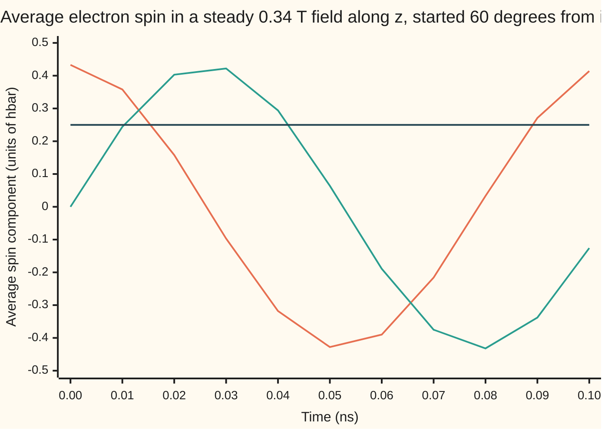

# Symmetry and conservation: each continuous symmetry hands you a conserved quantity

[Syllabus](../../../SYLLABUS.md) → [Engineering mathematics](../README.md) → [Quantum Mechanics in Outline](../README.md#s09) → Symmetry and conservation

---

## General Overview

An electron spin resonance (ESR) spectrometer finds unpaired electrons in a sample, such as the free radicals in a failing battery electrolyte. Its magnet holds a steady, uniform field of 0.34 T (tesla). An electron's spin is a tiny built-in magnet. Tip it 60 degrees from the field and it does not swing into line: it sweeps round the field like a tilted top, 9.5285 billion times a second. The microwave source must be tuned to that frequency, 9.5285 GHz, or the instrument sees nothing.

Through all that swinging, two numbers never move. Both are averages over many readings: a single reading of a spin component gives only +ħ/2 or −ħ/2 (ħ, "h-bar", is the natural unit of spin), as [Spin one-half](06-spin-and-two-state-systems.md) shows. The spin's average energy stays at 9.852 μeV (micro-electronvolts), and its average component along the field stays at 0.2500 ħ. The average components across the field swing between plus and minus 0.433 ħ.

The reason is the field, not the spin. The field is the same at every moment, so energy is kept. It looks the same after any turn about its own axis, so the spin along that axis is kept. A turn about any other axis tilts it, so nothing across the field is kept. Likewise an electron in a 1 nm box keeps its energy, 0.3760 eV, because the walls stand still, but, in the classical picture of a bouncing particle, not its momentum, because a slide moves the walls.

**Every smooth way of moving a system that leaves its rules unchanged (a continuous symmetry) comes with a quantity that the motion cannot change: steady rules keep energy, rules the same everywhere keep momentum, rules the same at every angle keep angular momentum, spin included.**

**What kind of fact this is:** a theorem for any system described by a Lagrangian, proved on this card in Why it works. The quantum version, through the commutator, is stated and checked on the spin, not proved. The spin in its magnet is a model: one isolated spin in a perfectly uniform field, with no losses.

### The picture: one sweep of the spin, with one component that never moves



Orange: $\langle S_x\rangle$, the average spin across the field in one direction. Teal: $\langle S_y\rangle$, across the field in the other. Dark: $\langle S_z\rangle$, along the field, flat at 0.250 ħ. One full sweep takes 0.10495 ns.

---

## The formula

Notation, in words first. A system's position is fixed by coordinates $q_i$ (a length, an angle); a prime is a rate in time, so $q_i'$ is a speed. The Lagrangian $L(q, q', t)$ is kinetic minus potential energy, and the momentum belonging to $q_i$ is $p_i = \partial L/\partial q_i'$, both from [Lagrangian and Hamiltonian mechanics](../07-Mechanics%20and%20Structures/04-lagrangian-and-hamiltonian-mechanics-for-engineers.md). A symmetry is a move $q_i \to q_i + \varepsilon\,\eta_i(q)$: $\varepsilon$ is how far, and $\eta_i$ says which way each coordinate goes. **Noether's theorem:**

$$\text{if } L(q + \varepsilon\eta,\ q' + \varepsilon\eta',\ t) = L(q, q', t) \text{ for every small } \varepsilon, \quad\text{then}\quad Q = \sum_i p_i\,\eta_i \ \text{ is constant;} \qquad \text{if } \frac{\partial L}{\partial t} = 0, \quad E = \sum_i p_i\,q_i' - L \ \text{ is constant.}$$

**Read it aloud:** if sliding the system a little along a fixed pattern leaves the Lagrangian unchanged, then momentum measured along that pattern never changes; if the Lagrangian does not mention the clock, energy never changes.

The same fact in the Hamiltonian's language uses the **Poisson bracket** of two quantities $A$ and $B$ (functions of the $q$'s and $p$'s):

$$\{A, B\} = \sum_i \left(\frac{\partial A}{\partial q_i}\frac{\partial B}{\partial p_i} - \frac{\partial A}{\partial p_i}\frac{\partial B}{\partial q_i}\right), \qquad \frac{dA}{dt} = \{A, H\}, \qquad \{A, B\} \;\longrightarrow\; \frac{[\hat A, \hat B]}{i\hbar}$$

**Read it aloud:** any quantity changes at the rate given by its bracket with the energy; and quantum mechanics keeps the rule with the bracket replaced by the commutator divided by $i\hbar$.

Here a hat marks an operator (a matrix acting on the state, as in [States as vectors](02-state-vectors-operators-and-measurement.md)), not an estimate. The **commutator** is $[\hat A, \hat B] = \hat A\hat B - \hat B\hat A$: how much the order of the two matters.

The three examples:

| Symmetry: the move that changes nothing | $\eta$ | The quantity kept |
| --- | --- | --- |
| shift in time: run the experiment later | (clock moves) | energy $E$ |
| shift in space: slide everything along $x$ | 1 for $x$ | momentum $p_x$ |
| turn about $z$ by an angle | $(-y, x)$ for $(x, y)$ | angular momentum $L_z = x p_y - y p_x$, and for a spin, $S_z$ |

| Symbol | Plain meaning | In our example | Push it up and the answer… |
| --- | --- | --- | --- |
| $q_i$, $q_i'$, $t$ | coordinates, their rates, time (s) | spin angles; box position | — |
| $L$ | Lagrangian: kinetic minus potential energy, J | — | — |
| $p_i$ | momentum belonging to $q_i$: $\partial L/\partial q_i'$ | 3.3130 × 10⁻²⁵ kg m/s in the box | faster electron, shorter 2.750 fs between walls |
| $\varepsilon$, $\eta_i$, $\alpha$ | size of the symmetry move; its direction for each coordinate; a turn angle | 10⁻⁶ rad in the code's test | change in $H$ grows in step, unless the move is a symmetry: then it stays 0 |
| $Q$, $G$, $L_z$ | Noether's kept quantity, $\sum p_i \eta_i$; any quantity, read as the move it generates; angular momentum about $z$ | $\langle S_z\rangle$ = 0.2500 ħ | — |
| $E$, $H$ | energy; the Hamiltonian, energy written in $q$ and $p$ | average 9.852 μeV for the spin | — |
| $\{A, B\}$ | Poisson bracket: rate of $A$ along the motion $B$ generates | $\{S_x, S_y\} = S_z$ | $A$ changes faster |
| $[\hat A, \hat B]$, $\hbar$, $\langle A\rangle$ | commutator; reduced Planck constant, $h/2\pi$ = 1.054571818 × 10⁻³⁴ J s; the average a measurement of $A$ returns | $[\hat S_x, \hat S_y] = i\hbar \hat S_z$ | — |
| $S_x$, $S_y$, $S_z$ | spin components, in units of ħ; one reading gives ±½, so the values shown are averages | averages 0.433, 0, 0.250 at the start | larger $S_z$: higher kept energy |
| $\gamma$, $B$ | electron gyromagnetic ratio (spin turn rate per tesla); field | 1.76085962784 × 10¹¹ rad/(s T); 0.34 T | faster sweep |
| $\omega$, $f$ | sweep rate in rad/s; in hertz, $\omega/2\pi$ | 5.98692 × 10¹⁰ rad/s; 9.5285 GHz | source tuned higher; wider level splitting |
| $m$, $a$, $h$ | electron mass; box width; Planck constant $2\pi\hbar$ | 9.1093837139 × 10⁻³¹ kg; 1 nm | larger $a$: lower energy |

The spin's energy is $H = \gamma\,\hbar\,(B_x S_x + B_y S_y + B_z S_z)$, so the bracket rule gives the sweep: $S' = \gamma\,B \times S$, a turn about $B$ at $\omega = \gamma B$.

### When it holds

- **The symmetry is continuous.** A mirror flip has no "small amount", and the argument gives nothing for it.
- **It is a symmetry of the rules, not of the state.** The tilted spin does not look the same after a turn about $z$; the field does, and that is what counts.
- **It is exact.** Tilt the field 10 degrees off $z$ and $S_z$ is no longer kept: its average swings from 0.2500 to 0.3830 ħ. The component along the new field direction is kept instead.
- **The rules are steady.** Ramp the field from 0.34 to 0.36 T over 1 ns and the average energy climbs from 9.852 to 10.431 μeV. $\langle S_z\rangle$ stays at 0.2500 ħ: the turn symmetry survives the ramp, and each symmetry carries its own quantity.
- **No losses.** Real spins relax toward the field through their surroundings, a loss no Lagrangian holds; this model leaves it out.

---

## Why it works

### Step 0: the motion already obeys a rule that turns "unchanged" into "constant"

A true motion obeys Lagrange's equation, $p_i' = \partial L/\partial q_i$: momentum changes at the rate $L$ changes with position. A symmetry says $L$ does not change in one particular direction of position. Put those together and the momentum along that direction has nothing pushing it. The rest is bookkeeping for the case where the direction mixes several coordinates.

### Step 1: the simplest case, a coordinate the Lagrangian does not contain

A free electron sliding along a wire has $L = \tfrac12 m x'^2$. No $x$ appears, so $p_x' = \partial L/\partial x = 0$: momentum $m x'$ is constant. Put the electron in a 1 nm box and the walls add a potential energy that depends on $x$. The symmetry is gone, and so is the conservation: in the classical picture the electron's momentum, 3.3130 × 10⁻²⁵ kg m/s, flips sign at each wall, every 2.750 fs. The walls take the difference. Count the electron and the box together, with nothing outside pushing them, and sliding both is a symmetry again: the box takes 6.6261 × 10⁻²⁵ kg m/s at one wall and gives it back at the other, so the total is kept. [Hamilton's equations](../../08-Differential%20equations%20and%20dynamics/12-Calculus%20of%20Variations%20and%20Optimal%20Control/05-hamiltons-equations.md) meets the same case as a coordinate missing from $H$.

### Step 2: any symmetry, the general proof

Differentiate the symmetry condition in $\varepsilon$ at $\varepsilon = 0$. The left side does not depend on $\varepsilon$ at all, so

$$0 = \sum_i \left(\frac{\partial L}{\partial q_i}\,\eta_i + \frac{\partial L}{\partial q_i'}\,\eta_i'\right) = \sum_i \left(p_i'\,\eta_i + p_i\,\eta_i'\right) = \frac{d}{dt}\sum_i p_i\,\eta_i .$$

The middle step uses Lagrange's equation for the first term and the definition of $p_i$ for the second. The last step is the product rule read backwards. So $Q = \sum p_i \eta_i$ is constant along every motion.

For a turn in the plane, a small angle $\varepsilon$ moves $(x, y)$ to $(x - \varepsilon y,\ y + \varepsilon x)$, so $\eta = (-y, x)$ and $Q = x p_y - y p_x = L_z$, angular momentum.

### Step 3: the clock, and energy

Along a motion the chain rule gives $dL/dt = \sum (\partial L/\partial q_i\, q_i' + p_i\, q_i'') + \partial L/\partial t$. Lagrange's equation turns the first term into $p_i' q_i'$, so the sum is $d(\sum p_i q_i')/dt$. Rearranged,

$$\frac{dE}{dt} = \frac{d}{dt}\Big(\sum_i p_i q_i' - L\Big) = -\frac{\partial L}{\partial t}.$$

Energy changes exactly as fast as the rules change with the clock. The box's walls hold still, so its electron keeps 0.3760 eV. The ramped field changes the rules, so the spin's energy moves.

### Step 4: the Poisson bracket says both halves at once

In Hamilton's form, $q_i' = \partial H/\partial p_i$ and $p_i' = -\partial H/\partial q_i$. Any quantity $A(q, p)$ then changes at $\sum(\partial A/\partial q_i\, q_i' + \partial A/\partial p_i\, p_i') = \{A, H\}$. So $A$ is kept exactly when $\{A, H\} = 0$.

Now read the bracket the other way. Any quantity $G$ generates a move: nudge $q_i$ by $\varepsilon\,\partial G/\partial p_i$ and $p_i$ by $-\varepsilon\,\partial G/\partial q_i$. Momentum $p_x$ generates a slide along $x$; $L_z$ generates a turn about $z$; $H$ generates the passage of time. Under that move $H$ changes by $\varepsilon\{H, G\} = -\varepsilon\{G, H\}$.

So one number, $\{G, H\}$, measures two things. It is how fast $G$ changes along the motion, and how much $H$ changes under the move $G$ generates. If one is zero, so is the other. That is Noether's theorem in two lines. The code tests it on the spin: turning it about $z$ changes $H$ at 0.0000 μeV per radian, and $S_z$ is kept; turning it about $x$ changes $H$ at 15.8877 μeV per radian, matching $-\hbar\{S_x, H\}$, and $S_x$ moves.

### Step 5: spin, and the commutator as the bracket's heir

A spin has no position and momentum of its own, so its bracket is set directly, copying orbital angular momentum: $\{S_x, S_y\} = S_z$, and the same with $x \to y \to z \to x$. Inside a bracket, $S$ is an angular momentum in J s, which makes that rule balance. Everywhere else this card counts $S$ in units of ħ, so $H = \gamma\hbar\,B\cdot S$ comes out in joules, and a rate such as $\{S_x, H\}$ comes out per second; Step 4's test multiplies it by ħ to make it an energy. With $H = \gamma\hbar\, B\cdot S$ and the field along $z$, $S_x' = \{S_x, H\} = -\omega S_y$ and $S_y' = \omega S_x$: a circle at $\omega = \gamma B$. And $S_z' = \{S_z, H\} = 0$.

In 1925 the new quantum rules turned out to be the old brackets in disguise: wherever classical mechanics has $\{A, B\}$, quantum mechanics has $[\hat A, \hat B]/(i\hbar)$. The spin matrices of [Spin one-half](06-spin-and-two-state-systems.md) obey $[\hat S_x, \hat S_y] = i\hbar\hat S_z$. So the rates become $d\langle A\rangle/dt = \langle[\hat A, \hat H]\rangle/(i\hbar)$, where $\langle A\rangle$ is the average a measurement returns. A quantity is kept exactly when its operator commutes with $\hat H$. Here $\hat H$ is a multiple of $\hat S_z$, so $[\hat S_z, \hat H] = 0$. Because $\hat H$ is a straight sum of spin components, the quantum averages follow the classical circle exactly, and the code finds them equal to six decimals.

The operator that turns a state about $z$ by an angle $\alpha$ is $e^{-i\alpha\hat S_z/\hbar}$: again the kept quantity generates the symmetry. Those turns form a continuous group ([Groups](../../03-Algebra/08-Groups/01-groups.md)). The same turning symmetry is why l and m label the levels on [Hydrogen in outline](07-the-hydrogen-atom-in-outline.md). The same bracket, $[\hat x, \hat p] = i\hbar$, sits behind [Uncertainty](05-uncertainty-principle.md).

<details>
<summary>What this outline leaves out</summary>

Noether's theorem for fields, where a symmetry gives a conserved current flowing through space rather than one number; symmetries that leave $L$ unchanged only up to a total time derivative, such as a moving reference frame; the quantum proof that every symmetry is carried by an operator; and gauge symmetry, which ties charge conservation to electromagnetism. The geometry behind continuous symmetry groups belongs to the differential geometry and Lie groups wing.

</details>

---

## Worked numbers, by hand

The spin in a 0.34 T magnet, started 60 degrees from the field. Constants from CODATA 2022 (Sources).

| Step | Arithmetic | Value |
| --- | --- | --- |
| sweep rate $\omega$ | $\gamma B$ = 1.76085962784 × 10¹¹ × 0.34 | 5.98692 × 10¹⁰ rad/s |
| period | $2\pi/\omega$ | 0.10495 ns |
| level splitting | $\hbar\omega$, in μeV | 39.41 μeV |
| average spin along the field, kept | ½ × cos 60° | 0.2500 ħ |
| average spin across the field, at the start | ½ × sin 60° | 0.433 ħ |
| average energy, kept | $\gamma B \hbar \times 0.2500$, in μeV | 9.852 μeV |
| $\langle S_x\rangle$ after 1 ns | 0.433 × cos(ω × 1 ns) | −0.426097 ħ |
| **microwave frequency to tune to** | $\omega / 2\pi$ | **9.5285 GHz** |

The spectrometer's source must sit at 9.5285 GHz for this field: that is the sweep rate of the spin, and also the photon energy, 39.41 μeV, that flips it.

The house example, an electron in a 1 nm box, by the same rule:

| Step | Arithmetic | Value |
| --- | --- | --- |
| lowest energy, kept (walls still) | $h^2/(8 m a^2)$ | 0.3760 eV |
| momentum size | $h/(2a)$ | 3.3130 × 10⁻²⁵ kg m/s |
| handed to a wall at each bounce | 2 × momentum | 6.6261 × 10⁻²⁵ kg m/s |
| speed | momentum ÷ $m$ | 363695 m/s |
| time from wall to wall, when momentum flips | $a$ ÷ speed | **2.750 fs** |

### What breaks if you drop a piece

| Mistake | Comes out at | What went wrong |
| --- | --- | --- |
| Expect $S_z$ kept with the field tilted 10° | $\langle S_z\rangle$ swings 0.2500 to 0.3830 ħ | Turns about $z$ are no longer a symmetry; the kept component is the one along the field |
| Expect energy kept while the field ramps 0.34 → 0.36 T | average 9.852 → 10.431 μeV | The rules change with the clock |
| Tune the source to $\omega$ read as hertz | 59.8692 GHz | $\omega$ is in rad/s; divide by $2\pi$ |
| Take the electron's g-factor as exactly 2 | 9.5174 GHz, 11.0 MHz low | The measured $\gamma$ already holds the electron's extra 0.1% |

---

## Code, from first principles, and it actually runs

The code follows the spin four independent ways. Road 1 moves a classical spin by its Poisson bracket with $H$, stepped by [Runge-Kutta four](../../08-Differential%20equations%20and%20dynamics/05-Numerical%20Evolution/04-runge-kutta-four.md) at 0.1 ps, and counts zero crossings for the frequency. Road 2 steps Schrödinger's equation on the spin's two complex amplitudes. Road 3 is the closed form. Road 4 is Noether's test: turn the spin a millionth of a radian about each axis and compare the change in $H$ with the bracket. It also checks the commutators, the tilted and ramped fields, and the box.

### Python

```python
# Symmetry and conservation -- the check behind the card.  Standard library only.
# An electron spin in a 0.34 T ESR magnet, followed four independent ways:
# Road 1: the classical spin, moved by its Poisson bracket with H, stepped by RK4.
# Road 2: the quantum spin, Schrodinger's equation on two complex amplitudes, RK4.
# Road 3: the closed form, a cone swept at w = gamma B.
# Road 4: Noether's test: turn the spin a little and see whether H notices.
from math import sin, cos, pi, radians, sqrt
H_PL = 6.62607015e-34         # J s, exact
HBAR = H_PL / (2*pi)          # J s, h / 2 pi
GAMMA = 1.76085962784e11      # electron gyromagnetic ratio, rad/(s T), CODATA 2022
MU_B = 9.2740100657e-24       # Bohr magneton, J/T, CODATA 2022
M_E, EV = 9.1093837139e-31, 1.602176634e-19   # kg; J per eV
B0, TILT, DT = 0.34, radians(60), 1e-13       # T; spin starts 60 deg from the field; 0.1 ps step

def cross(a, b): return (a[1]*b[2]-a[2]*b[1], a[2]*b[0]-a[0]*b[2], a[0]*b[1]-a[1]*b[0])
def sci(x): m, e = ("%.1e" % x).split("e"); return "%se%d" % (m, int(e))   # 1.2e-12
def dot(a, b): return a[0]*b[0] + a[1]*b[1] + a[2]*b[2]
def bracket_rate(s, B):       # dS/dt = {S, H} with H = gamma B.S and {Sx, Sy} = Sz: gamma B x S
    return tuple(GAMMA * c for c in cross(B, s))
def rk4(f, y, h):
    k1 = f(y); k2 = f([a + h/2*b for a, b in zip(y, k1)])
    k3 = f([a + h/2*b for a, b in zip(y, k2)]); k4 = f([a + h*b for a, b in zip(y, k3)])
    return [a + h/6*(b + 2*c + 2*d + e) for a, b, c, d, e in zip(y, k1, k2, k3, k4)]
def classical(Bt, n):         # spin in units of hbar; Bt(t) gives the field; returns the path
    s, path = [0.5*sin(TILT), 0.0, 0.5*cos(TILT)], []
    for k in range(n + 1):
        path.append(s)
        s = rk4(lambda y: bracket_rate(y, Bt(k*DT)), s, DT)   # field held over one step
    return path
def quantum(B, n):            # i hbar dpsi/dt = H psi, H = gamma B.(hbar/2 sigma); <S> in hbar
    def f(p):                 # d(psi)/dt = -i gamma/2 (B.sigma) psi
        a, b = p
        return [-0.5j*GAMMA*(B[2]*a + (B[0]-1j*B[1])*b), -0.5j*GAMMA*((B[0]+1j*B[1])*a - B[2]*b)]
    p = [complex(cos(TILT/2)), complex(sin(TILT/2))]
    for _ in range(n): p = rk4(f, p, DT)
    a, b = p
    return ((a.conjugate()*b).real, (a.conjugate()*b).imag, 0.5*(abs(a)**2 - abs(b)**2))

Bz = (0.0, 0.0, B0)
w = GAMMA * B0; f_formula = w / (2*pi)
path = classical(lambda t: Bz, 10000)                     # 1 ns
up = [k*DT - path[k][1]*DT/(path[k+1][1]-path[k][1]) for k in range(10000)
      if path[k][1] < 0 <= path[k+1][1]]                  # Sy crossing zero upward
f_sim = (len(up) - 1) / (up[-1] - up[0])
sq = quantum(Bz, 10000)
sx_exact = 0.5*sin(TILT)*cos(w*1e-9)
sz_drift = max(abs(s[2] - path[0][2]) for s in path)
H0 = GAMMA*dot(Bz, path[0])*HBAR
size_drift = max(abs(sqrt(dot(s, s)) - 0.5) for s in path)

print("ESR magnet %.2f T, spin starts 60 deg from the field" % B0)
print("w = gamma B = %.5f x 10^10 rad/s" % (w/1e10))
print("f closed form       %.4f GHz" % (f_formula/1e9))
print("f from the bracket  %.4f GHz  (zero crossings, 1 ns of RK4)" % (f_sim/1e9))
print("period %.5f ns; level splitting hbar w = %.2f ueV" % (1e9/f_formula, HBAR*w/EV*1e6))
print("energy H = gamma B Sz = %.3f ueV, Sz = %.4f hbar" % (H0/EV*1e6, path[0][2]))
print("1 ns:  Sx classical %.6f  quantum %.6f  closed form %.6f hbar" % (path[-1][0], sq[0], sx_exact))
print("1 ns:  Sz classical %.6f  quantum %.6f hbar" % (path[-1][2], sq[2]))
print("largest drift over 1 ns: Sz %s, |S| %s hbar" % (sci(sz_drift), sci(size_drift)))
print("chart t (ns):  " + " ".join("%.2f" % (k/100) for k in range(11)))
for i, name in enumerate(("Sx", "Sy", "Sz")):
    print("chart %s (hbar): " % name + " ".join("%.3f" % (path[100*k][i] + 0.0) for k in range(11)))

# Road 4: Noether's test, and the bracket that measures it
eps, s0 = 1e-6, path[200]     # the spin at t = 0.02 ns
def turn(s, axis, a):         # rotate s by angle a about a unit axis (Rodrigues)
    c = cross(axis, s); d = dot(axis, s)
    return tuple(s[i]*cos(a) + c[i]*sin(a) + axis[i]*d*(1 - cos(a)) for i in range(3))
for name, ax in (("z", (0, 0, 1)), ("x", (1, 0, 0))):
    dH = (dot(Bz, turn(s0, ax, eps)) - dot(Bz, turn(s0, ax, -eps))) / (2*eps) * GAMMA
    rate = bracket_rate(s0, Bz)["xyz".index(name)]        # dS/dt = {S, H}, from the bracket
    print("turn about %s: dH/dangle = %.4f ueV/rad;  -hbar {S%s, H} = %.4f ueV" % (
        name, dH*HBAR/EV*1e6 + 0.0, name, -rate*HBAR/EV*1e6 + 0.0))
    assert abs(dH + rate) < 1e-6 * w
# quantum: commutators of 2 x 2 matrices, hbar = 1
def mm(A, C): return [[sum(A[i][k]*C[k][j] for k in range(2)) for j in range(2)] for i in range(2)]
def comm(A, C): return [[x - y for x, y in zip(r, q)] for r, q in zip(mm(A, C), mm(C, A))]
Sx, Sy, Sz = [[0, .5], [.5, 0]], [[0, -.5j], [.5j, 0]], [[.5, 0], [0, -.5]]
Hm = [[GAMMA*B0*x for x in r] for r in Sz]
big = lambda M: max(abs(x) for r in M for x in r)
minus = lambda A, C, z: [[a - z*b for a, b in zip(r, q)] for r, q in zip(A, C)]
c_xy, c_zh, c_xh = big(minus(comm(Sx, Sy), Sz, 1j)), big(comm(Sz, Hm)), comm(Sx, Hm)
c_rule = big(minus(c_xh, Sy, -1j*w))     # Dirac: [Sx, H] = i hbar {Sx, H} = i hbar (-w Sy)
print("[Sx,Sy] - i Sz: %s;  [Sz,H]: %s;  [Sx,H] - i(-w Sy): %s;  |[Sx,H]|: %.4f x 10^10 /s" % (
    sci(c_xy), sci(c_zh), sci(c_rule), big(c_xh)/1e10))

# what breaks: tilt the field, ramp the field, f mixed with w, g taken as exactly 2
FTILT = 10                    # field tilt from z, degrees (the check below holds up to 30)
Bt = (B0*sin(radians(FTILT)), 0.0, B0*cos(radians(FTILT)))
tp = classical(lambda t: Bt, 10000)
along_drift = max(abs(dot(s, Bt) - dot(tp[0], Bt)) for s in tp) / B0
ramp = lambda t: (0.0, 0.0, B0 + 0.02*t/1e-9)   # 0.34 -> 0.36 T over 1 ns
rp = classical(ramp, 10000)
E_end = GAMMA*dot(ramp(1e-9), rp[-1])*HBAR
f_g2 = 2*MU_B*B0/H_PL
print("field tilted %d deg: Sz swings %.4f to %.4f hbar; S along B drifts %s" % (
    FTILT, min(s[2] for s in tp), max(s[2] for s in tp), sci(along_drift)))
print("field ramped 0.34 -> 0.36 T in 1 ns: H %.3f -> %.3f ueV, Sz %.4f -> %.4f hbar" % (
    H0/EV*1e6, E_end/EV*1e6, rp[0][2], rp[-1][2]))
print("w read as hertz: %.4f GHz;  g = 2 exactly: %.4f GHz (off by %.1f MHz)" % (
    w/1e9, f_g2/1e9, (f_formula - f_g2)/1e6))

# the house example: an electron in a 1 nm box (time shift kept, space shift broken)
L = 1e-9; E1 = H_PL**2/(8*M_E*L**2); p1 = H_PL/(2*L); v1 = p1/M_E
print("1 nm box: E1 = %.4f eV, |p| = %.4e kg m/s, v = %.0f m/s, wall to wall %.3f fs" % (
    E1/EV, p1, v1, L/v1*1e15))
print("1 nm box: each bounce hands the walls 2|p| = %.4e kg m/s, given back at the other wall" % (2*p1))

assert abs(f_sim/f_formula - 1) < 1e-6                     # road 1 against road 3
assert abs(sq[0] - path[-1][0]) < 1e-6 and abs(sq[0] - sx_exact) < 1e-6   # road 2 against 1 and 3
assert abs(sq[1] - path[-1][1]) < 1e-6 and abs(sq[2] - path[-1][2]) < 1e-6
assert sz_drift < 1e-9 and size_drift < 1e-9               # rotation about the field: Sz kept
assert abs(max(s[2] for s in tp) - 0.5*cos(TILT - 2*radians(FTILT))) < 1e-4 and along_drift < 1e-9
assert abs(E_end/H0 - (B0 + 0.02)/B0) < 1e-9 and abs(rp[-1][2] - rp[0][2]) < 1e-9
assert c_zh == 0 and big(c_xh) > 0.1*w and c_rule < 1e-6*w   # Sz kept, Sx not
assert c_xy < 1e-15                                        # the spin algebra itself
assert abs(E1/EV - 0.376) < 5e-4 and abs(f_formula/1e9 - 9.5285) < 1e-4
print("ALL CHECKS PASS")
```

**Ran 2026-11-11 on macOS, Python 3.14.10, standard library only. All checks passed. Output, pasted from the run:**

```
ESR magnet 0.34 T, spin starts 60 deg from the field
w = gamma B = 5.98692 x 10^10 rad/s
f closed form       9.5285 GHz
f from the bracket  9.5285 GHz  (zero crossings, 1 ns of RK4)
period 0.10495 ns; level splitting hbar w = 39.41 ueV
energy H = gamma B Sz = 9.852 ueV, Sz = 0.2500 hbar
1 ns:  Sx classical -0.426097  quantum -0.426097  closed form -0.426097 hbar
1 ns:  Sz classical 0.250000  quantum 0.250000 hbar
largest drift over 1 ns: Sz 0.0e0, |S| 1.2e-12 hbar
chart t (ns):  0.00 0.01 0.02 0.03 0.04 0.05 0.06 0.07 0.08 0.09 0.10
chart Sx (hbar): 0.433 0.358 0.158 -0.097 -0.318 -0.428 -0.390 -0.216 0.033 0.271 0.414
chart Sy (hbar): 0.000 0.244 0.403 0.422 0.294 0.064 -0.189 -0.375 -0.432 -0.338 -0.126
chart Sz (hbar): 0.250 0.250 0.250 0.250 0.250 0.250 0.250 0.250 0.250 0.250 0.250
turn about z: dH/dangle = 0.0000 ueV/rad;  -hbar {Sz, H} = 0.0000 ueV
turn about x: dH/dangle = 15.8877 ueV/rad;  -hbar {Sx, H} = 15.8877 ueV
[Sx,Sy] - i Sz: 0.0e0;  [Sz,H]: 0.0e0;  [Sx,H] - i(-w Sy): 0.0e0;  |[Sx,H]|: 2.9935 x 10^10 /s
field tilted 10 deg: Sz swings 0.2500 to 0.3830 hbar; S along B drifts 1.5e-15
field ramped 0.34 -> 0.36 T in 1 ns: H 9.852 -> 10.431 ueV, Sz 0.2500 -> 0.2500 hbar
w read as hertz: 59.8692 GHz;  g = 2 exactly: 9.5174 GHz (off by 11.0 MHz)
1 nm box: E1 = 0.3760 eV, |p| = 3.3130e-25 kg m/s, v = 363695 m/s, wall to wall 2.750 fs
1 nm box: each bounce hands the walls 2|p| = 6.6261e-25 kg m/s, given back at the other wall
ALL CHECKS PASS
```

### Rust

```rust
// Symmetry and conservation -- the check behind the card.  Rust std only.
// The same four roads as the Python: classical spin moved by its Poisson bracket (RK4),
// quantum spin by Schrodinger's equation (RK4), the closed form, and Noether's test.
use std::f64::consts::PI;
const HBAR: f64 = H_PL / (2.0 * PI); // J s, h / 2 pi
const H_PL: f64 = 6.62607015e-34; // J s, exact
const GAMMA: f64 = 1.76085962784e11; // electron gyromagnetic ratio, rad/(s T), CODATA 2022
const MU_B: f64 = 9.2740100657e-24; // Bohr magneton, J/T, CODATA 2022
const M_E: f64 = 9.1093837139e-31; // kg
const EV: f64 = 1.602176634e-19; // J per eV
const B0: f64 = 0.34; // T
const DT: f64 = 1e-13; // 0.1 ps step
type V3 = [f64; 3];
#[derive(Clone, Copy)]
struct C { re: f64, im: f64 } // a complex number, written out
fn c(re: f64, im: f64) -> C { C { re, im } }
fn add(a: C, b: C) -> C { c(a.re + b.re, a.im + b.im) }
fn sub(a: C, b: C) -> C { c(a.re - b.re, a.im - b.im) }
fn mul(a: C, b: C) -> C { c(a.re * b.re - a.im * b.im, a.re * b.im + a.im * b.re) }
fn sc(k: f64, a: C) -> C { c(k * a.re, k * a.im) }
fn abs(a: C) -> f64 { (a.re * a.re + a.im * a.im).sqrt() }
fn cross(a: V3, b: V3) -> V3 { [a[1]*b[2]-a[2]*b[1], a[2]*b[0]-a[0]*b[2], a[0]*b[1]-a[1]*b[0]] }
fn dot(a: V3, b: V3) -> f64 { a[0]*b[0] + a[1]*b[1] + a[2]*b[2] }
fn sci(x: f64) -> String { format!("{:.1e}", x) } // 1.2e-12
fn bracket_rate(s: V3, b: V3) -> V3 { let k = cross(b, s); [GAMMA*k[0], GAMMA*k[1], GAMMA*k[2]] }
fn tilt() -> f64 { 60f64.to_radians() }
fn classical(bt: &dyn Fn(f64) -> V3, n: usize) -> Vec<V3> {
    let mut s = [0.5 * tilt().sin(), 0.0, 0.5 * tilt().cos()];
    let mut path = Vec::new();
    for k in 0..=n {
        path.push(s);
        let b = bt(k as f64 * DT); // field held over one step
        let f = |y: V3| bracket_rate(y, b);
        let st = |y: V3, k: V3, h: f64| [y[0] + h*k[0], y[1] + h*k[1], y[2] + h*k[2]];
        let k1 = f(s); let k2 = f(st(s, k1, DT/2.0)); let k3 = f(st(s, k2, DT/2.0)); let k4 = f(st(s, k3, DT));
        for i in 0..3 { s[i] = s[i] + DT/6.0*(k1[i] + 2.0*k2[i] + 2.0*k3[i] + k4[i]); }
    }
    path
}
fn quantum(b: V3, n: usize) -> V3 { // i hbar dpsi/dt = H psi, H = gamma B.(hbar/2 sigma)
    let mi = c(0.0, -0.5 * GAMMA);
    let f = |p: [C; 2]| [mul(mi, add(sc(b[2], p[0]), mul(c(b[0], -b[1]), p[1]))),
                         mul(mi, sub(mul(c(b[0], b[1]), p[0]), sc(b[2], p[1])))];
    let st = |p: [C; 2], k: [C; 2], h: f64| [add(p[0], sc(h, k[0])), add(p[1], sc(h, k[1]))];
    let mut p = [c((tilt() / 2.0).cos(), 0.0), c((tilt() / 2.0).sin(), 0.0)];
    for _ in 0..n {
        let k1 = f(p); let k2 = f(st(p, k1, DT/2.0)); let k3 = f(st(p, k2, DT/2.0)); let k4 = f(st(p, k3, DT));
        for i in 0..2 {
            let s = add(add(k1[i], sc(2.0, k2[i])), add(sc(2.0, k3[i]), k4[i]));
            p[i] = add(p[i], sc(DT / 6.0, s));
        }
    }
    let ab = mul(c(p[0].re, -p[0].im), p[1]);
    [ab.re, ab.im, 0.5 * (abs(p[0]).powi(2) - abs(p[1]).powi(2))]
}
fn turn(s: V3, ax: V3, a: f64) -> V3 { // rotate s by angle a about a unit axis (Rodrigues)
    let cr = cross(ax, s); let d = dot(ax, s);
    [0, 1, 2].map(|i| s[i]*a.cos() + cr[i]*a.sin() + ax[i]*d*(1.0 - a.cos()))
}
type M2 = [[C; 2]; 2];
fn mm(a: M2, b: M2) -> M2 {
    let mut r = [[c(0.0, 0.0); 2]; 2];
    for i in 0..2 { for j in 0..2 { r[i][j] = add(mul(a[i][0], b[0][j]), mul(a[i][1], b[1][j])); } }
    r
}
fn comm(a: M2, b: M2) -> M2 { let (x, y) = (mm(a, b), mm(b, a)); [0, 1].map(|i| [0, 1].map(|j| sub(x[i][j], y[i][j]))) }
fn minus(a: M2, b: M2, z: C) -> M2 { [0, 1].map(|i| [0, 1].map(|j| sub(a[i][j], mul(z, b[i][j])))) }
fn big(m: M2) -> f64 { m.iter().flatten().map(|&x| abs(x)).fold(0.0, f64::max) }
fn main() {
    let bz = [0.0, 0.0, B0];
    let w = GAMMA * B0; let f_formula = w / (2.0 * PI);
    let path = classical(&|_t| bz, 10000); // 1 ns
    let up: Vec<f64> = (0..10000).filter(|&k| path[k][1] < 0.0 && 0.0 <= path[k+1][1])
        .map(|k| k as f64 * DT - path[k][1] * DT / (path[k+1][1] - path[k][1])).collect(); // Sy upward
    let f_sim = (up.len() - 1) as f64 / (up[up.len() - 1] - up[0]);
    let sq = quantum(bz, 10000);
    let sx_exact = 0.5 * tilt().sin() * (w * 1e-9).cos();
    let sz_drift = path.iter().map(|s| (s[2] - path[0][2]).abs()).fold(0.0, f64::max);
    let h0 = GAMMA * dot(bz, path[0]) * HBAR;
    let size_drift = path.iter().map(|s| (dot(*s, *s).sqrt() - 0.5).abs()).fold(0.0, f64::max);
    let last = path[10000];
    println!("ESR magnet {:.2} T, spin starts 60 deg from the field", B0);
    println!("w = gamma B = {:.5} x 10^10 rad/s", w / 1e10);
    println!("f closed form       {:.4} GHz", f_formula / 1e9);
    println!("f from the bracket  {:.4} GHz  (zero crossings, 1 ns of RK4)", f_sim / 1e9);
    println!("period {:.5} ns; level splitting hbar w = {:.2} ueV", 1e9 / f_formula, HBAR * w / EV * 1e6);
    println!("energy H = gamma B Sz = {:.3} ueV, Sz = {:.4} hbar", h0 / EV * 1e6, path[0][2]);
    println!("1 ns:  Sx classical {:.6}  quantum {:.6}  closed form {:.6} hbar", last[0], sq[0], sx_exact);
    println!("1 ns:  Sz classical {:.6}  quantum {:.6} hbar", last[2], sq[2]);
    println!("largest drift over 1 ns: Sz {}, |S| {} hbar", sci(sz_drift), sci(size_drift));
    println!("chart t (ns):  {}", (0..11).map(|k| format!("{:.2}", k as f64 / 100.0)).collect::<Vec<_>>().join(" "));
    for (i, name) in ["Sx", "Sy", "Sz"].iter().enumerate() {
        println!("chart {} (hbar): {}", name, (0..11).map(|k| format!("{:.3}", path[100*k][i] + 0.0)).collect::<Vec<_>>().join(" "));
    }
    // Road 4: Noether's test, and the bracket that measures it
    let (eps, s0) = (1e-6, path[200]); // the spin at t = 0.02 ns
    for (i, name, ax) in [(2, "z", [0.0, 0.0, 1.0]), (0, "x", [1.0, 0.0, 0.0])] {
        let dh = (dot(bz, turn(s0, ax, eps)) - dot(bz, turn(s0, ax, -eps))) / (2.0 * eps) * GAMMA;
        let rate = bracket_rate(s0, bz)[i]; // dS/dt = {S, H}, from the bracket
        println!("turn about {}: dH/dangle = {:.4} ueV/rad;  -hbar {{S{}, H}} = {:.4} ueV",
                 name, dh * HBAR / EV * 1e6 + 0.0, name, -rate * HBAR / EV * 1e6 + 0.0);
        assert!((dh + rate).abs() < 1e-6 * w);
    }
    // quantum: commutators of 2 x 2 matrices, hbar = 1
    let z = c(0.0, 0.0);
    let sx: M2 = [[z, c(0.5, 0.0)], [c(0.5, 0.0), z]];
    let sy: M2 = [[z, c(0.0, -0.5)], [c(0.0, 0.5), z]];
    let szm: M2 = [[c(0.5, 0.0), z], [z, c(-0.5, 0.0)]];
    let hm: M2 = [0, 1].map(|i| [0, 1].map(|j| sc(GAMMA * B0, szm[i][j])));
    let (c_xy, c_zh, c_xh) = (big(minus(comm(sx, sy), szm, c(0.0, 1.0))), big(comm(szm, hm)), comm(sx, hm));
    let c_rule = big(minus(c_xh, sy, c(0.0, -w))); // Dirac: [Sx, H] = i hbar {Sx, H} = i hbar (-w Sy)
    println!("[Sx,Sy] - i Sz: {};  [Sz,H]: {};  [Sx,H] - i(-w Sy): {};  |[Sx,H]|: {:.4} x 10^10 /s",
             sci(c_xy), sci(c_zh), sci(c_rule), big(c_xh) / 1e10);
    // what breaks: tilt the field, ramp the field, f mixed with w, g taken as exactly 2
    let ftilt = 10.0f64; // field tilt from z, degrees (the check below holds up to 30)
    let rt = ftilt.to_radians();
    let bt = [B0 * rt.sin(), 0.0, B0 * rt.cos()];
    let tp = classical(&|_t| bt, 10000);
    let along_drift = tp.iter().map(|s| (dot(*s, bt) - dot(tp[0], bt)).abs()).fold(0.0, f64::max) / B0;
    let ramp = |t: f64| [0.0, 0.0, B0 + 0.02 * t / 1e-9]; // 0.34 -> 0.36 T over 1 ns
    let rp = classical(&ramp, 10000);
    let e_end = GAMMA * dot(ramp(1e-9), rp[10000]) * HBAR;
    let f_g2 = 2.0 * MU_B * B0 / H_PL;
    let tmin = tp.iter().map(|s| s[2]).fold(f64::INFINITY, f64::min);
    let tmax = tp.iter().map(|s| s[2]).fold(f64::NEG_INFINITY, f64::max);
    println!("field tilted {:.0} deg: Sz swings {:.4} to {:.4} hbar; S along B drifts {}", ftilt, tmin, tmax, sci(along_drift));
    println!("field ramped 0.34 -> 0.36 T in 1 ns: H {:.3} -> {:.3} ueV, Sz {:.4} -> {:.4} hbar",
             h0 / EV * 1e6, e_end / EV * 1e6, rp[0][2], rp[10000][2]);
    println!("w read as hertz: {:.4} GHz;  g = 2 exactly: {:.4} GHz (off by {:.1} MHz)",
             w / 1e9, f_g2 / 1e9, (f_formula - f_g2) / 1e6);
    // the house example: an electron in a 1 nm box (time shift kept, space shift broken)
    let l = 1e-9; let e1 = H_PL * H_PL / (8.0 * M_E * l * l); let p1 = H_PL / (2.0 * l); let v1 = p1 / M_E;
    let p1s = format!("{:.4e}", p1);
    println!("1 nm box: E1 = {:.4} eV, |p| = {} kg m/s, v = {:.0} m/s, wall to wall {:.3} fs",
             e1 / EV, p1s, v1, l / v1 * 1e15);
    println!("1 nm box: each bounce hands the walls 2|p| = {:.4e} kg m/s, given back at the other wall", 2.0 * p1);
    assert!((f_sim / f_formula - 1.0).abs() < 1e-6); // road 1 against road 3
    assert!((sq[0] - last[0]).abs() < 1e-6 && (sq[0] - sx_exact).abs() < 1e-6); // road 2 against 1 and 3
    assert!((sq[1] - last[1]).abs() < 1e-6 && (sq[2] - last[2]).abs() < 1e-6);
    assert!(sz_drift < 1e-9 && size_drift < 1e-9); // rotation about the field: Sz kept
    assert!((tmax - 0.5 * (tilt() - 2.0 * rt).cos()).abs() < 1e-4 && along_drift < 1e-9);
    assert!((e_end / h0 - (B0 + 0.02) / B0).abs() < 1e-9 && (rp[10000][2] - rp[0][2]).abs() < 1e-9);
    assert!(c_zh == 0.0 && big(c_xh) > 0.1 * w && c_rule < 1e-6 * w); // Sz kept, Sx not
    assert!(c_xy < 1e-15); // the spin algebra itself
    assert!((e1 / EV - 0.376).abs() < 5e-4 && (f_formula / 1e9 - 9.5285).abs() < 1e-4);
    println!("ALL CHECKS PASS");
}
```

**Ran 2026-11-11 on macOS, rustc 1.98.1, no crates. All checks passed. Output, pasted from the run:**

```
ESR magnet 0.34 T, spin starts 60 deg from the field
w = gamma B = 5.98692 x 10^10 rad/s
f closed form       9.5285 GHz
f from the bracket  9.5285 GHz  (zero crossings, 1 ns of RK4)
period 0.10495 ns; level splitting hbar w = 39.41 ueV
energy H = gamma B Sz = 9.852 ueV, Sz = 0.2500 hbar
1 ns:  Sx classical -0.426097  quantum -0.426097  closed form -0.426097 hbar
1 ns:  Sz classical 0.250000  quantum 0.250000 hbar
largest drift over 1 ns: Sz 0.0e0, |S| 1.2e-12 hbar
chart t (ns):  0.00 0.01 0.02 0.03 0.04 0.05 0.06 0.07 0.08 0.09 0.10
chart Sx (hbar): 0.433 0.358 0.158 -0.097 -0.318 -0.428 -0.390 -0.216 0.033 0.271 0.414
chart Sy (hbar): 0.000 0.244 0.403 0.422 0.294 0.064 -0.189 -0.375 -0.432 -0.338 -0.126
chart Sz (hbar): 0.250 0.250 0.250 0.250 0.250 0.250 0.250 0.250 0.250 0.250 0.250
turn about z: dH/dangle = 0.0000 ueV/rad;  -hbar {Sz, H} = 0.0000 ueV
turn about x: dH/dangle = 15.8877 ueV/rad;  -hbar {Sx, H} = 15.8877 ueV
[Sx,Sy] - i Sz: 0.0e0;  [Sz,H]: 0.0e0;  [Sx,H] - i(-w Sy): 0.0e0;  |[Sx,H]|: 2.9935 x 10^10 /s
field tilted 10 deg: Sz swings 0.2500 to 0.3830 hbar; S along B drifts 1.5e-15
field ramped 0.34 -> 0.36 T in 1 ns: H 9.852 -> 10.431 ueV, Sz 0.2500 -> 0.2500 hbar
w read as hertz: 59.8692 GHz;  g = 2 exactly: 9.5174 GHz (off by 11.0 MHz)
1 nm box: E1 = 0.3760 eV, |p| = 3.3130e-25 kg m/s, v = 363695 m/s, wall to wall 2.750 fs
1 nm box: each bounce hands the walls 2|p| = 6.6261e-25 kg m/s, given back at the other wall
ALL CHECKS PASS
```

The two outputs match line for line.

> [!TIP]
> **Try changing**
> - **Guess first: what does a field with no tilt do to the swing?** Set `FTILT` to 0. The average $S_z$ swings from 0.2500 to 0.2500 ħ, nothing at all: the field is back along $z$, the label reads 0 deg, and every check still passes.
> - **Guess first: does reversing the bracket's sign change the frequency?** Swap `cross(B, s)` to `cross(s, B)`. The spin sweeps the other way at the same 9.5285 GHz, but Noether's test no longer matches the bracket and the quantum road disagrees on $S_y$, so an assert stops it.
> - **Guess first: what happens to a spin started along the field?** Set `TILT` to `radians(0)`. It never moves, so there are no zero crossings to count and the script stops: a spin along the field has nothing to sweep.
> - **Guess first: what frequency does a 0.35 T magnet need?** Set `B0` to `0.35`. The closed form and the bracket still agree with each other, about 3% higher, but the assert pinned to 9.5285 GHz stops it.

---

## The usual mistake

> [!warning]
> **Reading the symmetry off the state instead of off the rules.** The spin tipped at 60 degrees does not look the same after a turn about $z$, yet $S_z$ is kept, because the field does look the same. A round object in a lopsided field keeps no angular momentum; a lopsided object in a round field keeps angular momentum. Check $L$ or $H$, never a snapshot.
>
> - Keeping the wrong component: with the field tilted 10°, the average $S_z$ swings from 0.2500 to 0.3830 ħ. Only the component along the field is kept.
> - Tuning to $\omega$ instead of $f$: 59.8692 GHz, more than six times too high.
> - Using g = 2 exactly: 9.5174 GHz, 11.0 MHz off the 9.5285 GHz line, which a spectrometer resolves easily.

---

## Where you meet it in real life

- **ESR and MRI.** Both tune a radio or microwave source to the sweep rate of spins in a steady field, $\omega = \gamma B$; the pulses tip the kept component along the field into the plane across it, where it sweeps round at $\omega$ and induces the signal in the coil.
- **Spacecraft attitude.** Reaction wheels turn a satellite without fuel because total angular momentum is kept: speed a wheel up one way and the body turns the other.
- **Simulation codes.** Energy or momentum that drifts in a simulation with the matching symmetry points to a bug or too large a step; the spin code holds $S_z$, the quantity its turn symmetry promises, with no drift at all over 1 ns, and the spin's length to 1.2 × 10⁻¹² ħ.

> **Say it back**
> If a smooth move, such as waiting, sliding or turning, leaves a system's rules unchanged, some quantity cannot change: energy, momentum or angular momentum. The proof is Lagrange's equation applied in the symmetry's direction. In Hamilton's form, one bracket $\{G, H\}$ is both the rate of $G$ and the change of $H$ under the move $G$ generates. Quantum mechanics keeps the rule with the commutator divided by $i\hbar$. An electron spin in a 0.34 T field keeps its energy and its component along the field and sweeps round at 9.5285 GHz.

---

## What this builds on

- [Lagrangian and Hamiltonian mechanics](../07-Mechanics%20and%20Structures/04-lagrangian-and-hamiltonian-mechanics-for-engineers.md): the Lagrangian, its momenta and the energy function used in the proof.
- [Spin one-half](06-spin-and-two-state-systems.md): the three spin matrices whose commutators Step 5 uses.
- [Hamilton's equations](../../08-Differential%20equations%20and%20dynamics/12-Calculus%20of%20Variations%20and%20Optimal%20Control/05-hamiltons-equations.md): the first-order form that turns into the Poisson bracket.
- [Groups](../../03-Algebra/08-Groups/01-groups.md): the rules a collection of symmetry moves obeys.

## Where this goes next

- Noether (planned): the same theorem with symmetries as smooth groups, and for fields.
- Lie algebra (planned): the brackets of the generators, $\{S_x, S_y\} = S_z$, as the structure of the rotation group itself.

Left open: how a symmetry of a field, rather than of a few coordinates, becomes a conserved current flowing through space.

---

## Sources

Verified 2026-11-11: every link below resolves to the publisher's page.

- Noether, E. "Invariant Variation Problems," translated by M. A. Tavel. *Transport Theory and Statistical Physics* 1, no. 3 (1971). [doi:10.1080/00411457108231446](https://doi.org/10.1080/00411457108231446). The 1918 theorem in English: symmetries of a variational problem give conserved quantities.
- Dirac, P. A. M. "The Fundamental Equations of Quantum Mechanics." *Proceedings of the Royal Society A* 109 (1925). [doi:10.1098/rspa.1925.0150](https://doi.org/10.1098/rspa.1925.0150). The paper that matched the quantum commutator to the classical Poisson bracket times $i\hbar$.
- NIST. "CODATA Value: electron gyromagnetic ratio." 2022 CODATA recommended values. [NIST page](https://physics.nist.gov/cgi-bin/cuu/Value?gammae). The value of $\gamma$; the same tables give ħ, the electron mass and the Bohr magneton.
- Griffiths, D. J., and D. F. Schroeter. *Introduction to Quantum Mechanics*, 3rd ed. Cambridge University Press (2018). [doi:10.1017/9781316995433](https://doi.org/10.1017/9781316995433). Spin in a magnetic field, the precession, and conserved quantities as operators that commute with the Hamiltonian.
