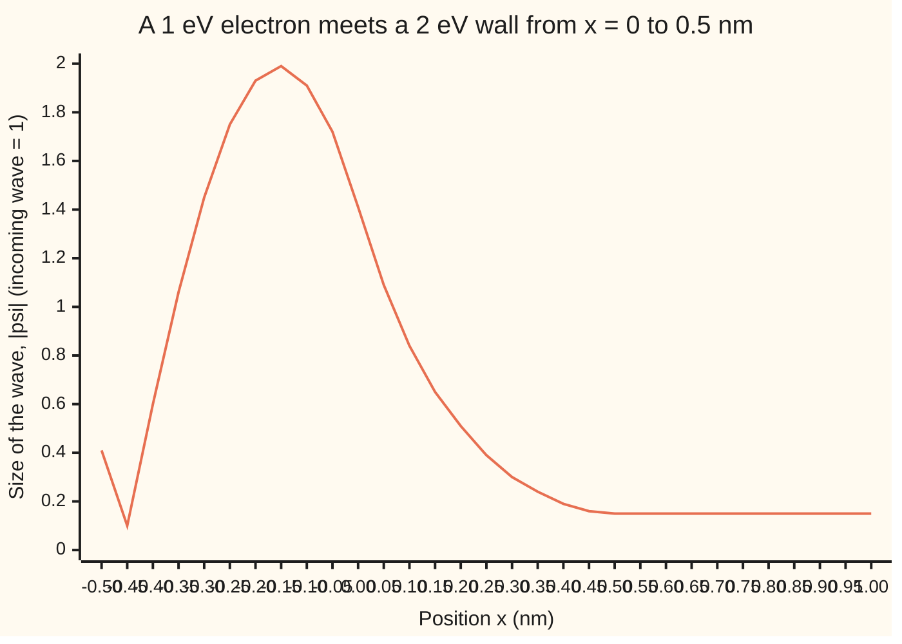
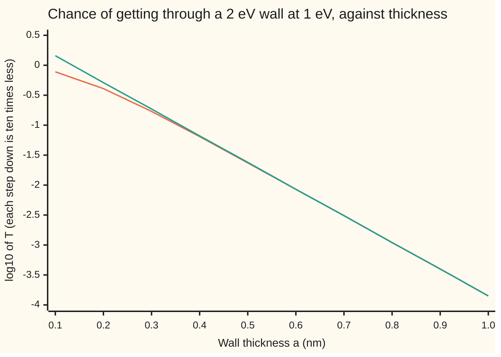

# Tunnelling: a particle gets through a wall it cannot climb

[Syllabus](../../../SYLLABUS.md) → [Engineering mathematics](../README.md) → [Quantum Mechanics in Outline](../README.md#s09) → Tunnelling

---

## General Overview

An electron moving with 1 eV of energy meets a wall 2 eV high and 0.5 nm thick (an electronvolt, eV, is the energy an electron gains crossing one volt; 0.5 nm is about two atoms). The wall could be a thin oxide layer in a chip, or the vacuum gap under the tip of a scanning tunnelling microscope.

A ball rolling at a hill twice as high as its energy can climb always rolls back. The electron does not always come back. Out of 1,000,000 electrons, 23,547 come out on the far side: a chance of T = 0.0235. This is **tunnelling**.

The reason is that the electron is a wave. Inside the wall the wave cannot travel, but it does not stop dead. It dies away steadily, and a small part of it is still there at the far face. That part carries on as an ordinary travelling wave.

The engineer wants two numbers: how much gets through, and how fast that changes with the wall's thickness. The second is the striking one. Double the wall to 1.0 nm and T falls to 0.006028 of its value, to 1.4194 × 10⁻⁴. Each extra 0.1 nm multiplies T by about 0.3589. That steep exponential lets a microscope feel single atoms.

**A wave meeting a wall higher than its energy decays exponentially inside it instead of stopping, so a part of size about e^(−κa) reaches the far side and travels on; matching the waves at the two faces gives the exact chance T, and for a thick wall T is close to a fixed factor times e^(−2κa), the WKB exponent.**

Here a is the wall's thickness and κ (kappa) is the rate at which the wave dies away inside it, defined in The formula.

**What kind of fact this is:** a theorem inside a model. Schrodinger's equation is the model, a law accepted because it matches experiment. Given the equation and a flat wall with sharp edges, the formula for T is proved on this card in Why it works. The thick-wall formula is an approximation, and the code measures its error.

### The picture: the wave's size through the wall



The one line is the size |ψ| of the electron's wave, from the RK4 march in the code, scaled so the incoming wave has size 1. Its square is the relative chance per metre of finding the electron there, compared with the incoming beam.

- **Left of the wall** (x below 0) the incoming and reflected waves add and cancel in turn, so the size swings between nearly 0 and 1.9882.
- **Inside the wall** (0 to 0.5 nm) it falls steadily, with no swings.
- **Right of the wall** it is flat at 0.1535, the square root of T = 0.0235.

---

## The formula

Notation reminder from [States as vectors](02-state-vectors-operators-and-measurement.md): ψ (psi) is the wavefunction, the wave that describes the electron. ħ (h-bar) is Planck's constant divided by 2π. From [Schrodinger's equation](03-schrodinger-equation-and-the-particle-in-a-box.md), a state with one energy E has a shape that obeys

```math
-\frac{\hbar^2}{2m}\,\psi'' + V(x)\,\psi = E\,\psi .
```

Here ψ'' is the bending of the shape, its second derivative along x, and V(x) is the potential energy at x. The wall is V = V₀ for x between 0 and a, and V = 0 everywhere else. Two rates come out of it:

```math
k = \frac{\sqrt{2mE}}{\hbar} \ \text{(outside)}, \qquad \kappa = \frac{\sqrt{2m(V_0 - E)}}{\hbar} \ \text{(inside)}, \qquad T = \frac{1}{1 + \dfrac{V_0^2\,\sinh^2(\kappa a)}{4E\,(V_0 - E)}} \;\approx\; \frac{16E\,(V_0 - E)}{V_0^2}\,e^{-2\kappa a}.
```

**Read it aloud:** outside, the wave turns at k radians per metre; inside, it dies away at the rate κ; the chance of getting through is one over one plus a hyperbolic sine squared, and for a thick wall that is a fixed factor times e to the minus two kappa a.

The hyperbolic sine is $`\sinh z = (e^z - e^{-z})/2`$, and the hyperbolic cosine is $`\cosh z = (e^z + e^{-z})/2`$. For large z both are close to $`e^z/2`$.

For the example, $`E = 1`$ eV and $`V_0 - E = 1`$ eV, so $`k = \kappa = 5.1232`$ per nm and the factor $`V_0^2/(4E(V_0 - E))`$ is exactly 1. Then $`T = 1/(1 + \sinh^2 2.5616) = 0.023547`$, and the thick-wall estimate is $`4e^{-5.1232} = 0.023829`$.

| Symbol | Plain meaning | In our example | Push it up and the answer… |
| --- | --- | --- | --- |
| $`x`$ | position, with the wall from 0 to $`a`$, in nm | −0.5 to 1.0 nm | — |
| $`E`$ | the electron's energy, in eV | 1 eV | T rises: 0.9090 at 3 eV, above the top |
| $`V(x)`$, $`V_0`$ | potential energy at $`x`$; the wall's height | 0 outside, 2 eV inside | T falls: 0.002534 for a 3 eV wall |
| $`a`$ | the wall's thickness | 0.5 nm | T is multiplied by about 0.3589 per extra 0.1 nm |
| $`m`$, $`\hbar`$, $`h`$ | the electron's mass; Planck's constant over 2π; Planck's constant itself, $`h = 2\pi\hbar`$ | 9.1093837139 × 10⁻³¹ kg; 1.054571818 × 10⁻³⁴ J s | a heavier particle tunnels far less |
| $`K`$ | $`2m/\hbar^2`$ in the card's units, so $`k^2 = KE`$ and $`\kappa^2 = K(V_0 - E)`$ | 26.2468 per eV per nm² | — |
| $`k`$, $`\delta`$ | wavenumber outside: radians of phase per nm; in the fold, $`\delta = k/\kappa - \kappa/k`$ | 5.1232 per nm; δ = 0, since k = κ | — |
| $`\kappa`$ | decay rate inside: the wave shrinks by a factor e every $`1/\kappa`$ | 5.1232 per nm, so $`\kappa a`$ = 2.5616 | T falls |
| $`\psi`$, $`\bar\psi`$, $`i`$; $`j`$, $`\mathrm{Im}`$ | the wavefunction, where $`\lvert\psi\rvert^2`$ is the relative chance per metre of finding the electron, compared with the incoming beam; its complex conjugate; the square root of −1; the probability current; the imaginary part | incoming wave of size 1; $`j`$ the same on both sides | — |
| $`r`$, $`t`$; $`C`$, $`D`$ | sizes of the reflected and transmitted waves; of the growing and dying parts inside the wall | $`\lvert C\rvert`$ = 0.008375, $`\lvert D\rvert`$ = 1.405839 | — |
| $`R`$, $`T`$ | chances of bouncing back and getting through: $`\lvert r\rvert^2`$ and $`\lvert t\rvert^2`$ | 0.976453 and 0.023547 | — |
| $`\theta`$, $`w`$; $`x_1`$, $`x_2`$ | the WKB phase integral $`\int\kappa\,dx`$ under the wall; the rounded wall's width scale; the turning points, where V = E | rectangle: $`\theta = \kappa a`$ = 2.5616; rounded wall: $`w`$ = 0.5 nm, $`\theta`$ = 3.3334, turning points ±0.4407 nm | T falls as about $`e^{-2\theta}`$ |

### When it holds

- **The electron is below the top, E < V₀.** Above the top κ becomes imaginary and sinh becomes an ordinary sine. At E = 3 eV the code gives T = 0.9090, not 1: a ball would always cross, but the wave still partly reflects at the edges.
- **A flat wall with sharp edges.** Real walls are rounded. For a rounded wall of the same height, $`V = V_0/\cosh^2(x/w)`$ with w = 0.5 nm, the exact answer is T = 0.001580, and this card's formula does not apply.
- **The thick-wall estimate needs κa well above 1.** At a = 0.1 nm, κa = 0.51, and the estimate gives 1.4357: a chance above one, which is impossible. The exact value is 0.7775.
- **The free electron's mass.** Inside a crystal the electron moves as if it had an **effective mass**, often much lighter. With 0.067 times the free mass, close to the value in gallium arsenide, the same wall lets through T = 0.6631.
- **One dimension, a steady stream, and no voltage across the wall.** A voltage tilts the top of the wall and thins it for the electrons. That case, Fowler–Nordheim tunnelling, is left out of this outline.

---

## Why it works

### Step 0: under the wall the wave turns into an exponential, and an exponential never reaches zero

Write Schrodinger's equation as $`\psi'' = K\,(V - E)\,\psi`$. Outside the wall $`V - E`$ is negative. The bending then pulls ψ back toward zero, which makes it swing: a wave.

Inside the wall $`V - E`$ is positive. Now the bending pushes ψ away from zero, so the solutions are growing and dying exponentials, $`e^{\kappa x}`$ and $`e^{-\kappa x}`$. A ball has no such option: where its kinetic energy would be negative, it cannot be. The wave can, because its rule only fixes its curvature.

The dying exponential is small at the far face, but it is not zero. The equation needs ψ and its slope to carry on smoothly into the region beyond, and there the only way to carry on is as a travelling wave. That wave is what gets through.

### Step 1: write the wave in each of the three regions

With an incoming wave of size 1 from the left:

```math
\psi(x) = \begin{cases} e^{ikx} + r\,e^{-ikx}, & x < 0 \\ C\,e^{\kappa x} + D\,e^{-\kappa x}, & 0 < x < a \\ t\,e^{ikx}, & x > a \end{cases}
```

On the left the incoming wave and a reflected wave of size r add. Inside the wall there is a dying part D and a smaller growing part C. On the right there is only a wave moving away, of size t, because nothing sends electrons in from the right.

That leaves four unknowns: r, C, D and t.

### Step 2: match at the two faces, and solve

At each face the wave and its slope must agree on both sides. The reason is that ψ'' is finite. A jump in the slope would need an infinite bending at that point. A jump in ψ itself would be worse still.

Two faces give four equations for the four unknowns. Solving them (fold below) gives

```math
t\,e^{ika} = \frac{1}{\cosh\kappa a - i\,\dfrac{k^2 - \kappa^2}{2k\kappa}\,\sinh\kappa a} .
```

Here i is the square root of −1. The size squared is $`T = \lvert t\rvert^2`$. Use $`\cosh^2 = 1 + \sinh^2`$, then $`k^2 = KE`$ and $`\kappa^2 = K(V_0 - E)`$. The result is the formula on this card.

In the example $`k = \kappa`$, so the imaginary part vanishes and $`T = 1/\cosh^2(2.5616) = 1/6.5168^2`$.

<details>
<summary>Detailed algebra: from the four matching equations to t</summary>

At x = a the wave and its slope give

$`\displaystyle C e^{\kappa a} + D e^{-\kappa a} = t e^{ika}, \qquad \kappa\left(C e^{\kappa a} - D e^{-\kappa a}\right) = ik\,t e^{ika}.`$

Add and subtract them to find C and D in terms of t:

$`\displaystyle C = \frac{t e^{ika} e^{-\kappa a}}{2}\left(1 + \frac{ik}{\kappa}\right), \qquad D = \frac{t e^{ika} e^{\kappa a}}{2}\left(1 - \frac{ik}{\kappa}\right).`$

At x = 0 the wave and its slope give $`1 + r = C + D`$ and $`ik(1 - r) = \kappa(C - D)`$. Divide the second by ik and add it to the first. That removes r:

$`\displaystyle 2 = C\left(1 - \frac{i\kappa}{k}\right) + D\left(1 + \frac{i\kappa}{k}\right).`$

Put in C and D. Write $`\delta = k/\kappa - \kappa/k`$. The two products are $`(1 + ik/\kappa)(1 - i\kappa/k) = 2 + i\delta`$ and $`(1 - ik/\kappa)(1 + i\kappa/k) = 2 - i\delta`$. So

$`\displaystyle 2 = \frac{t e^{ika}}{2}\left[(2 + i\delta)e^{-\kappa a} + (2 - i\delta)e^{\kappa a}\right] = \frac{t e^{ika}}{2}\left[4\cosh\kappa a - 2i\delta\sinh\kappa a\right].`$

Divide through: $`t e^{ika} = 1/(\cosh\kappa a - i(\delta/2)\sinh\kappa a)`$, and $`\delta/2 = (k^2 - \kappa^2)/(2k\kappa)`$. Its size squared is

$`\displaystyle T = \frac{1}{\cosh^2\kappa a + \left(\frac{k^2 - \kappa^2}{2k\kappa}\right)^2 \sinh^2\kappa a} = \frac{1}{1 + \frac{(k^2 + \kappa^2)^2}{4k^2\kappa^2}\sinh^2\kappa a}.`$

The last step uses $`\cosh^2 = 1 + \sinh^2`$ and $`4k^2\kappa^2 + (k^2 - \kappa^2)^2 = (k^2 + \kappa^2)^2`$. Finally $`k^2 + \kappa^2 = KV_0`$ and $`k^2\kappa^2 = K^2E(V_0 - E)`$, which gives the factor $`V_0^2/(4E(V_0 - E))`$.

</details>

The code does not trust this algebra. Its second road solves the four equations as numbers, by Gaussian elimination (removing one unknown at a time). Its third road never writes the three regions at all. It marches Schrodinger's equation across the wall with RK4, a standard step-by-step solver. All three give T = 0.023547.

### Step 3: nothing is lost, so R + T = 1

The electron either bounces back or gets through. The algebra must agree, and here is why it does. The flow of probability past a point, the **probability current**, is $`j = (\hbar/m)\,\mathrm{Im}(\bar\psi\,\psi')`$. Here $`\bar\psi`$ is the complex conjugate (i replaced by −i), and Im takes the imaginary part.

Its slope is $`(\hbar/m)\,\mathrm{Im}(\bar\psi'\psi' + \bar\psi\,\psi'')`$. The first term, $`\lvert\psi'\rvert^2`$, is real and drops out of Im. The second, $`\bar\psi\psi'' = K(V - E)\lvert\psi\rvert^2`$, is real too. So the current is the same everywhere.

On the left it is $`(\hbar k/m)(1 - \lvert r\rvert^2)`$, and on the right $`(\hbar k/m)\lvert t\rvert^2`$. Set them equal and R + T = 1. The second road prints R + T = 1.000000000000, which is 0.976453 + 0.023547.

### Step 4: a thick wall gives a plain exponential

When κa is large, sinh κa is close to $`e^{\kappa a}/2`$, and the 1 in the denominator hardly matters. Then

```math
T \approx \frac{16E\,(V_0 - E)}{V_0^2}\,e^{-2\kappa a}, \qquad \frac{\text{estimate}}{\text{exact}} = \left(1 + e^{-2\kappa a}\right)^2 \ \text{in the example}.
```

At 0.5 nm the estimate 0.023829 is 1.0119 times the exact value. At 1.0 nm the ratio is 1.0001. Each extra 0.1 nm multiplies T by $`e^{-0.2\kappa}`$ = 0.3589. Doubling the width multiplies T by 0.006028, close to $`e^{-2\kappa a}`$ = 0.005957. This is why doubling cuts T by about $`e^{-5.1}`$.



Orange: the exact T. Green: the thick-wall estimate $`4e^{-2\kappa a}`$. On this scale an exponential is a straight line. The two lines meet from about 0.4 nm on. At 0.1 nm the estimate is above 0 on the log scale, which means T above 1.

### Step 5: the same exponent from WKB, and where the factor in front comes from

[WKB](../01-Units%20and%20Modelling/08-wkb-approximation.md) says that where a coefficient changes slowly, a wave's phase is the running total of its local wavenumber. Under the wall that wavenumber is imaginary, iκ(x). The wave then shrinks by $`e^{-\int\kappa\,dx}`$, and the chance by its square:

```math
T_{\mathrm{WKB}} \approx e^{-2\theta}, \qquad \theta = \int_{x_1}^{x_2} \kappa(x)\,dx = \int_{x_1}^{x_2} \frac{\sqrt{2m\,(V(x) - E)}}{\hbar}\,dx .
```

Here $`x_1`$ and $`x_2`$ are the **turning points**, where V(x) = E and a ball would stop. For the rectangle θ = κa = 2.5616, and $`e^{-2\theta}`$ = 0.005957. That has the right exponent but is 4 times too small.

The missing factor $`16E(V_0 - E)/V_0^2`$ = 4 comes from the sharp edges. A sudden jump in V reflects part of the wave, and WKB assumes there are no jumps. The WKB card shows the same failure on a string with a sudden change in mass. Step 2's matching handles the jumps exactly.

For a smooth wall WKB does much better. Take the rounded wall $`V = V_0/\cosh^2(x/w)`$ with w = 0.5 nm, the same 2 eV high. Its turning points are at ±0.4407 nm, and θ = 3.3334, both by a numerical integral and by the closed form $`\pi w\sqrt{K}(\sqrt{V_0} - \sqrt{E})`$.

This shape also has a known exact answer, T = 0.001580, which the code's RK4 march confirms. WKB gives $`e^{-2\theta}`$ = 0.001273, so the exact answer is 1.241 times the WKB value. That is far closer than the factor 4 on the sharp wall, and the gap shrinks as the wall gets wider and smoother.

---

## Worked numbers, by hand

An electron, m = 9.1093837139 × 10⁻³¹ kg (CODATA 2022), with E = 1 eV, meets a wall V₀ = 2 eV high and a = 0.5 nm thick. ħ = 1.054571818 × 10⁻³⁴ J s, and 1 eV = 1.602176634 × 10⁻¹⁹ J exactly.

| Step | Arithmetic | Value |
| --- | --- | --- |
| K | 2m × (1 eV) × (1 nm)² ÷ ħ² | 26.2468 per eV per nm² |
| k outside | √(26.2468 × 1) | 5.1232 per nm |
| κ inside | √(26.2468 × (2 − 1)) | 5.1232 per nm |
| κa | 5.1232 × 0.5 | 2.5616 |
| sinh κa | (e^2.5616 − e^−2.5616) ÷ 2 | 6.4396 |
| sinh² κa | 6.4396² | 41.4680 |
| factor V₀² ÷ (4E(V₀ − E)) | 4 ÷ (4 × 1 × 1) | 1 |
| T | 1 ÷ (1 + 1 × 41.4680) | **0.023547** |
| thick-wall estimate | 4 × e^−5.1232 | 0.023829 |
| twice as thick | 1 ÷ (1 + sinh² 5.1232) | 1.4194 × 10⁻⁴ |

Of 1,000,000 electrons, 23,547 get through this wall and 976,453 bounce back. Make the wall twice as thick and the share that gets through falls to 0.006028 of that.

### What breaks if you drop a piece

| Mistake | Comes out at | What went wrong |
| --- | --- | --- |
| The bare WKB exponent $`e^{-2\kappa a}`$ for a sharp wall | 0.005957, not 0.023547 | The sharp edges add the factor 16E(V₀ − E)/V₀² = 4, which WKB cannot see |
| The wave's size, $`2e^{-\kappa a}`$, used as the chance | 0.154365, 6.6 times too big | That is the thick-wall size of the wave that gets through, close to the true 0.1535. The chance is its square, $`4e^{-2\kappa a}`$ |
| The thick-wall estimate at a = 0.1 nm | 1.4357, not 0.7775 | κa = 0.51 is not large, so sinh is not close to half an exponential |
| h where ħ belongs | κ = 0.8154 per nm, T = 0.8506 | h is 2π times ħ, so κ comes out 2π times too small and the wall almost vanishes |

The code prints all four.

---

## Code, from first principles, and it actually runs

The code finds T by three independent roads.

1. **The closed form**, the formula of this card.
2. **The matching equations solved as numbers.** The four conditions of Step 2 become a 4 × 4 system of complex equations, solved by Gaussian elimination with row swaps. It also prints R + T.
3. **An RK4 march of Schrodinger's equation itself.** It starts on the far side with a wave moving away, steps $`\psi'' = K(V - E)\psi`$ back through the wall, and splits what arrives on the near side into incoming and reflected waves. It knows nothing of sinh, and it works for any shape of wall.

The third road also handles the rounded wall, where it meets that wall's exact formula. A midpoint sum checks the WKB integral θ against its closed form.

### Python

```python
# Quantum tunnelling -- the check behind the card.  Standard library only.
# An electron of 1 eV meets a wall 2 eV high and 0.5 nm wide.  Three roads to the
# chance T that it gets through: the closed form, the four matching equations
# solved by Gaussian elimination, and an RK4 march of Schrodinger's equation
# itself.  Then the thick-barrier (WKB) estimate, and a rounded barrier.
import cmath, math

H = 6.62607015e-34          # Planck constant, J s (exact in SI)
HBAR = H / (2 * math.pi)    # reduced Planck constant, J s
ME = 9.1093837139e-31       # electron mass, kg (CODATA 2022)
EV = 1.602176634e-19        # one electronvolt, J (exact in SI)
K = 2 * ME * EV * 1e-18 / HBAR ** 2   # k^2 = K (E - V): k in 1/nm, E and V in eV
E, V0, A = 1.0, 2.0, 0.5    # electron energy (eV), wall height (eV), wall width (nm)

def closed(E, V0, a, K=K):  # road 1: T = 1 / (1 + V0^2 sinh^2(kappa a) / (4 E (V0 - E)))
    kap = math.sqrt(K * (V0 - E))
    return 1 / (1 + V0 ** 2 * math.sinh(kap * a) ** 2 / (4 * E * (V0 - E)))

def solve(M, b):            # Gaussian elimination with row swaps, complex entries
    n = len(b)
    M = [list(M[i]) + [b[i]] for i in range(n)]
    for c in range(n):
        p = max(range(c, n), key=lambda r: abs(M[r][c]))
        M[c], M[p] = M[p], M[c]
        for r in range(c + 1, n):
            f = M[r][c] / M[c][c]
            M[r] = [x - f * y for x, y in zip(M[r], M[c])]
    x = [0j] * n
    for r in range(n - 1, -1, -1):
        x[r] = (M[r][n] - sum(M[r][j] * x[j] for j in range(r + 1, n))) / M[r][r]
    return x

def matched(E, V0, a):      # road 2: unknowns r, C, D, t; psi and psi' agree at x = 0 and x = a
    k, q = math.sqrt(K * E), math.sqrt(K * (V0 - E))
    ep, em, ek = math.exp(q * a), math.exp(-q * a), cmath.exp(1j * k * a)
    M = [[-1, 1, 1, 0], [1j * k, q, -q, 0], [0, ep, em, -ek], [0, q * ep, -q * em, -1j * k * ek]]
    return solve(M, [1, 1j * k, 0, 0])

def march(V, E, x0, x1, n, keep=0):  # road 3: put t = 1 at x1, step psi'' = K (V - E) psi back to x0
    k, h = math.sqrt(K * E), (x0 - x1) / n
    y, v, pts = cmath.exp(1j * k * x1), 1j * k * cmath.exp(1j * k * x1), []
    for i in range(n):
        x = x1 + i * h
        if keep and i % keep == 0: pts.append((x, y))
        g = K * (V(x + h / 2) - E)   # the wall's height at the middle of the step
        k1y, k1v = v, g * y
        k2y, k2v = v + h / 2 * k1v, g * (y + h / 2 * k1y)
        k3y, k3v = v + h / 2 * k2v, g * (y + h / 2 * k2y)
        k4y, k4v = v + h * k3v, g * (y + h * k3y)
        y += h / 6 * (k1y + 2 * k2y + 2 * k3y + k4y)
        v += h / 6 * (k1v + 2 * k2v + 2 * k3v + k4v)
    pts.append((x0, y))
    inc = (y + v / (1j * k)) * cmath.exp(-1j * k * x0) / 2   # incoming wave's size
    ref = (y - v / (1j * k)) * cmath.exp(1j * k * x0) / 2    # reflected wave's size
    return 1 / abs(inc) ** 2, abs(ref / inc) ** 2, inc, pts

wall = lambda x: V0 if 0 <= x <= A else 0.0
k, kap = math.sqrt(K * E), math.sqrt(K * (V0 - E))
T1 = closed(E, V0, A)
r, C, D, t = matched(E, V0, A)
T3, R3, inc, pts = march(wall, E, -0.5, 1.0, 6000, keep=200)
est = 16 * E * (V0 - E) / V0 ** 2 * math.exp(-2 * kap * A)
print("constants: hbar %.9f x 10^-34 J s, m_e %.10f x 10^-31 kg" % (HBAR * 1e34, ME * 1e31))
print("K = 2 m_e (1 eV)(1 nm)^2 / hbar^2 = %.4f per eV per nm^2" % K)
print("electron E = %.1f eV, wall V0 = %.1f eV, width a = %.2f nm" % (E, V0, A))
print("k = %.4f per nm, kappa = %.4f per nm, kappa a = %.4f" % (k, kap, kap * A))
print("hand route: sinh(kappa a) = %.4f, sinh^2 = %.4f, cosh(kappa a) = %.4f" % (
    math.sinh(kap * A), math.sinh(kap * A) ** 2, math.cosh(kap * A)))
print("road 1, closed form:      T = %.6f" % T1)
print("road 2, matching solved:  T = %.6f, R = %.6f, R + T = %.12f" % (abs(t) ** 2, abs(r) ** 2, abs(r) ** 2 + abs(t) ** 2))
print("road 3, RK4 march:        T = %.6f, R = %.6f" % (T3, R3))
print("inside the wall: C = %.6f, D = %.6f (size of the rising and falling parts)" % (abs(C), abs(D)))
print("thick-wall estimate 16 E (V0 - E)/V0^2 e^(-2 kappa a) = 4 e^(-%.4f) = %.6f" % (2 * kap * A, est))
print("bare WKB exponent e^(-2 kappa a) = %.6f" % math.exp(-2 * kap * A))
print("of 1,000,000 electrons: %.0f through, %.0f bounce back" % (1e6 * T1, 1e6 * (1 - T1)))
psi = sorted((round(x, 2), abs(y / inc)) for x, y in pts)
print("chart x nm: " + " ".join("%.2f" % x for x, _ in psi))
print("chart |psi|: " + " ".join("%.2f" % m for _, m in psi))
print("|psi| left peak %.4f = 1 + |r|, right side %.4f = sqrt(T)" % (1 + abs(r), math.sqrt(T1)))
widths = [0.1 * i for i in range(1, 11)]
ex = [closed(E, V0, a) for a in widths]
es = [4 * math.exp(-2 * kap * a) for a in widths]
print("width nm:   " + " ".join("%6.1f" % a for a in widths))
print("log10 T:    " + " ".join("%6.2f" % math.log10(x) for x in ex))
print("log10 est:  " + " ".join("%6.2f" % math.log10(x) for x in es))
print("estimate / exact: 0.5 nm %.4f, 1.0 nm %.4f" % (es[4] / ex[4], es[9] / ex[9]))
dbl = closed(E, V0, 2 * A) / T1
print("double the width: T(1.0 nm) = %.4f x 10^-4, ratio %.6f, e^(-2 kappa a) = %.6f" % (
    closed(E, V0, 2 * A) * 1e4, dbl, math.exp(-2 * kap * A)))
print("per 0.1 nm of extra width: T x %.4f; straight-line guess for double width T/2 = %.6f" % (math.exp(-0.2 * kap), T1 / 2))
w = 0.5                     # rounded wall V0 / cosh^2(x / w), with an exact answer
s, u = math.sinh(math.pi * k * w) ** 2, math.cosh(math.pi / 2 * math.sqrt(4 * K * V0 * w * w - 1)) ** 2
Te = s / (s + u)
Tr, Rr, _, _ = march(lambda x: V0 / math.cosh(x / w) ** 2, E, -4.0, 4.0, 16000)
xt, N = w * math.acosh(math.sqrt(V0 / E)), 20000
th = sum(math.sqrt(K * (V0 / math.cosh((-xt + (i + 0.5) * 2 * xt / N) / w) ** 2 - E)) for i in range(N)) * 2 * xt / N
th_c = math.pi * w * math.sqrt(K) * (math.sqrt(V0) - math.sqrt(E))
print("rounded wall, w = 0.5 nm: exact T = %.6f, RK4 T = %.6f, turning points +-%.4f nm" % (Te, Tr, xt))
print("rounded wall WKB: theta = %.4f (formula %.4f), e^(-2 theta) = %.6f, ratio exact/WKB %.3f" % (th, th_c, math.exp(-2 * th), Te / math.exp(-2 * th)))
kt = math.sqrt(K * 4.5)
print("STM gap, 4.5 eV barrier: kappa = %.4f per nm, 0.1 nm more gap: current x %.4f (1/%.2f)" % (
    kt, math.exp(-0.2 * kt), math.exp(0.2 * kt)))
print("mistake, bare WKB exponent: T = %.6f (right %.6f)" % (math.exp(-2 * kap * A), T1))
print("mistake, wave size 2 e^(-kappa a) = %.6f taken as the chance: %.1f times too big (true size |t| = %.4f)" % (
    2 * math.exp(-kap * A), 2 * math.exp(-kap * A) / T1, abs(t)))
print("mistake, thick estimate at 0.1 nm (kappa a = %.2f): T = %.4f (right %.4f)" % (kap * 0.1, es[0], ex[0]))
kh = kap / (2 * math.pi)      # h = 2 pi hbar used where hbar belongs makes kappa 2 pi times too small
print("mistake, h for hbar: kappa = %.4f per nm, T = %.4f (right %.6f)" % (kh, closed(E, V0, A, K / (2 * math.pi) ** 2), T1))
print("try: E = 3 eV, over the top: T = %.4f; effective mass 0.067 m_e: T = %.4f; wall 3 eV high: T = %.6f" % (
    march(wall, 3.0, -0.5, 1.0, 6000)[0], closed(E, V0, A, K * 0.067), closed(E, 3.0, A)))

assert abs(abs(t) ** 2 - T1) / T1 < 1e-12                          # matching meets closed form
assert abs(T3 - T1) / T1 < 1e-8 and abs(R3 + T3 - 1) < 1e-8         # RK4 march meets closed form
assert abs(abs(r) ** 2 + abs(t) ** 2 - 1) < 1e-12                   # nothing lost: R + T = 1
assert abs(Tr - Te) / Te < 1e-5                                     # RK4 meets the rounded wall's exact T
assert abs(th - th_c) / th_c < 1e-4                                 # WKB integral, two ways
assert 0.01 < es[4] / ex[4] - 1 < 0.02 and es[9] / ex[9] - 1 < 1e-3 # estimate improves as the wall thickens
assert abs(dbl / math.exp(-2 * kap * A) - 1) < 0.02                 # doubling the width costs e^(-2 kappa a)
print("ALL CHECKS PASS")
```

**Ran 2026-11-23 on macOS, Python 3.14.10, standard library only. All checks passed. Output, pasted from the run:**

```
constants: hbar 1.054571818 x 10^-34 J s, m_e 9.1093837139 x 10^-31 kg
K = 2 m_e (1 eV)(1 nm)^2 / hbar^2 = 26.2468 per eV per nm^2
electron E = 1.0 eV, wall V0 = 2.0 eV, width a = 0.50 nm
k = 5.1232 per nm, kappa = 5.1232 per nm, kappa a = 2.5616
hand route: sinh(kappa a) = 6.4396, sinh^2 = 41.4680, cosh(kappa a) = 6.5168
road 1, closed form:      T = 0.023547
road 2, matching solved:  T = 0.023547, R = 0.976453, R + T = 1.000000000000
road 3, RK4 march:        T = 0.023547, R = 0.976453
inside the wall: C = 0.008375, D = 1.405839 (size of the rising and falling parts)
thick-wall estimate 16 E (V0 - E)/V0^2 e^(-2 kappa a) = 4 e^(-5.1232) = 0.023829
bare WKB exponent e^(-2 kappa a) = 0.005957
of 1,000,000 electrons: 23547 through, 976453 bounce back
chart x nm: -0.50 -0.45 -0.40 -0.35 -0.30 -0.25 -0.20 -0.15 -0.10 -0.05 0.00 0.05 0.10 0.15 0.20 0.25 0.30 0.35 0.40 0.45 0.50 0.55 0.60 0.65 0.70 0.75 0.80 0.85 0.90 0.95 1.00
chart |psi|: 0.41 0.10 0.60 1.06 1.45 1.75 1.93 1.99 1.91 1.72 1.41 1.09 0.84 0.65 0.51 0.39 0.30 0.24 0.19 0.16 0.15 0.15 0.15 0.15 0.15 0.15 0.15 0.15 0.15 0.15 0.15
|psi| left peak 1.9882 = 1 + |r|, right side 0.1535 = sqrt(T)
width nm:      0.1    0.2    0.3    0.4    0.5    0.6    0.7    0.8    0.9    1.0
log10 T:     -0.11  -0.39  -0.77  -1.19  -1.63  -2.07  -2.51  -2.96  -3.40  -3.85
log10 est:    0.16  -0.29  -0.73  -1.18  -1.62  -2.07  -2.51  -2.96  -3.40  -3.85
estimate / exact: 0.5 nm 1.0119, 1.0 nm 1.0001
double the width: T(1.0 nm) = 1.4194 x 10^-4, ratio 0.006028, e^(-2 kappa a) = 0.005957
per 0.1 nm of extra width: T x 0.3589; straight-line guess for double width T/2 = 0.011774
rounded wall, w = 0.5 nm: exact T = 0.001580, RK4 T = 0.001580, turning points +-0.4407 nm
rounded wall WKB: theta = 3.3334 (formula 3.3334), e^(-2 theta) = 0.001273, ratio exact/WKB 1.241
STM gap, 4.5 eV barrier: kappa = 10.8679 per nm, 0.1 nm more gap: current x 0.1138 (1/8.79)
mistake, bare WKB exponent: T = 0.005957 (right 0.023547)
mistake, wave size 2 e^(-kappa a) = 0.154365 taken as the chance: 6.6 times too big (true size |t| = 0.1535)
mistake, thick estimate at 0.1 nm (kappa a = 0.51): T = 1.4357 (right 0.7775)
mistake, h for hbar: kappa = 0.8154 per nm, T = 0.8506 (right 0.023547)
try: E = 3 eV, over the top: T = 0.9090; effective mass 0.067 m_e: T = 0.6631; wall 3 eV high: T = 0.002534
ALL CHECKS PASS
```

### Rust

Same numbers, same labels, built with `rustc --edition 2021 -O`.

```rust
// Quantum tunnelling -- the same check in Rust.  No crates.
// An electron of 1 eV meets a wall 2 eV high and 0.5 nm wide.  Three roads to the
// chance T that it gets through: the closed form, the four matching equations
// solved by Gaussian elimination, and an RK4 march of Schrodinger's equation
// itself.  Then the thick-barrier (WKB) estimate, and a rounded barrier.
use std::f64::consts::PI;
use std::ops::{Add, Div, Mul, Sub};

#[derive(Clone, Copy)]
struct C { re: f64, im: f64 }       // a complex number, written out
fn c(re: f64, im: f64) -> C { C { re, im } }
fn cis(t: f64) -> C { c(t.cos(), t.sin()) } // e^(i t)
impl Add for C { type Output = C; fn add(self, o: C) -> C { c(self.re + o.re, self.im + o.im) } }
impl Sub for C { type Output = C; fn sub(self, o: C) -> C { c(self.re - o.re, self.im - o.im) } }
impl Mul for C { type Output = C; fn mul(self, o: C) -> C { c(self.re * o.re - self.im * o.im, self.re * o.im + self.im * o.re) } }
impl Div for C { type Output = C; fn div(self, o: C) -> C { let d = o.re * o.re + o.im * o.im; c((self.re * o.re + self.im * o.im) / d, (self.im * o.re - self.re * o.im) / d) } }
impl C { fn abs(self) -> f64 { self.re.hypot(self.im) } fn s(self, k: f64) -> C { c(self.re * k, self.im * k) } }

const H: f64 = 6.62607015e-34;      // Planck constant, J s (exact in SI)
const ME: f64 = 9.1093837139e-31;   // electron mass, kg (CODATA 2022)
const EV: f64 = 1.602176634e-19;    // one electronvolt, J (exact in SI)
const E: f64 = 1.0;                 // electron energy, eV
const V0: f64 = 2.0;                // wall height, eV
const A: f64 = 0.5;                 // wall width, nm

fn hbar() -> f64 { H / (2.0 * PI) }
fn kk() -> f64 { 2.0 * ME * EV * 1e-18 / (hbar() * hbar()) } // k^2 = K (E - V), 1/nm and eV

fn closed(e: f64, v0: f64, a: f64, k: f64) -> f64 { // road 1
    let kap = (k * (v0 - e)).sqrt();
    1.0 / (1.0 + v0 * v0 * (kap * a).sinh().powi(2) / (4.0 * e * (v0 - e)))
}

fn solve(mut m: Vec<Vec<C>>, b: Vec<C>) -> Vec<C> { // Gaussian elimination with row swaps
    let n = b.len();
    for i in 0..n { m[i].push(b[i]); }
    for col in 0..n {
        let mut p = col;
        for r in col..n { if m[r][col].abs() > m[p][col].abs() { p = r; } }
        m.swap(col, p);
        for r in col + 1..n {
            let f = m[r][col] / m[col][col];
            for j in 0..=n { let v = m[col][j]; m[r][j] = m[r][j] - f * v; }
        }
    }
    let mut x = vec![c(0.0, 0.0); n];
    for r in (0..n).rev() {
        let mut s = m[r][n];
        for j in r + 1..n { s = s - m[r][j] * x[j]; }
        x[r] = s / m[r][r];
    }
    x
}

fn matched(e: f64, v0: f64, a: f64) -> Vec<C> { // road 2: unknowns r, C, D, t
    let (k, q) = ((kk() * e).sqrt(), (kk() * (v0 - e)).sqrt());
    let (ep, em, ek) = ((q * a).exp(), (-q * a).exp(), cis(k * a));
    let (z, o, ik) = (c(0.0, 0.0), c(1.0, 0.0), c(0.0, k));
    let m = vec![vec![o.s(-1.0), o, o, z], vec![ik, c(q, 0.0), c(-q, 0.0), z],
                 vec![z, c(ep, 0.0), c(em, 0.0), ek.s(-1.0)], vec![z, c(q * ep, 0.0), c(-q * em, 0.0), (ik * ek).s(-1.0)]];
    solve(m, vec![o, ik, z, z])
}

// road 3: put t = 1 at x1, step psi'' = K (V - E) psi back to x0 with RK4
fn march<F: Fn(f64) -> f64>(v: F, e: f64, x0: f64, x1: f64, n: usize, keep: usize) -> (f64, f64, C, Vec<(f64, C)>) {
    let (kq, k) = (kk(), (kk() * e).sqrt());
    let h = (x0 - x1) / n as f64;
    let (mut y, mut d, mut pts) = (cis(k * x1), c(0.0, k) * cis(k * x1), Vec::new());
    for i in 0..n {
        let x = x1 + i as f64 * h;
        if keep > 0 && i % keep == 0 { pts.push((x, y)); }
        let g = kq * (v(x + h / 2.0) - e);  // the wall's height at the middle of the step
        let (k1y, k1v) = (d, y.s(g));
        let (k2y, k2v) = (d + k1v.s(h / 2.0), (y + k1y.s(h / 2.0)).s(g));
        let (k3y, k3v) = (d + k2v.s(h / 2.0), (y + k2y.s(h / 2.0)).s(g));
        let (k4y, k4v) = (d + k3v.s(h), (y + k3y.s(h)).s(g));
        y = y + (k1y + k2y.s(2.0) + k3y.s(2.0) + k4y).s(h / 6.0);
        d = d + (k1v + k2v.s(2.0) + k3v.s(2.0) + k4v).s(h / 6.0);
    }
    pts.push((x0, y));
    let inc = ((y + d / c(0.0, k)) * cis(-k * x0)).s(0.5);   // incoming wave's size
    let rf = ((y - d / c(0.0, k)) * cis(k * x0)).s(0.5);     // reflected wave's size
    (1.0 / inc.abs().powi(2), (rf / inc).abs().powi(2), inc, pts)
}

fn row(v: &[f64], w: usize, p: usize) -> String { v.iter().map(|x| format!("{:w$.p$}", x, w = w, p = p)).collect::<Vec<_>>().join(" ") }

fn main() {
    let kq = kk();
    let wall = |x: f64| if 0.0 <= x && x <= A { V0 } else { 0.0 };
    let (k, kap) = ((kq * E).sqrt(), (kq * (V0 - E)).sqrt());
    let t1 = closed(E, V0, A, kq);
    let s2 = matched(E, V0, A);
    let (r, cc, dd, t) = (s2[0], s2[1], s2[2], s2[3]);
    let (t3, r3, inc, pts) = march(wall, E, -0.5, 1.0, 6000, 200);
    let est = 16.0 * E * (V0 - E) / (V0 * V0) * (-2.0 * kap * A).exp();
    println!("constants: hbar {:.9} x 10^-34 J s, m_e {:.10} x 10^-31 kg", hbar() * 1e34, ME * 1e31);
    println!("K = 2 m_e (1 eV)(1 nm)^2 / hbar^2 = {:.4} per eV per nm^2", kq);
    println!("electron E = {:.1} eV, wall V0 = {:.1} eV, width a = {:.2} nm", E, V0, A);
    println!("k = {:.4} per nm, kappa = {:.4} per nm, kappa a = {:.4}", k, kap, kap * A);
    println!("hand route: sinh(kappa a) = {:.4}, sinh^2 = {:.4}, cosh(kappa a) = {:.4}",
             (kap * A).sinh(), (kap * A).sinh().powi(2), (kap * A).cosh());
    println!("road 1, closed form:      T = {:.6}", t1);
    let (rr, tt) = (r.abs().powi(2), t.abs().powi(2));
    println!("road 2, matching solved:  T = {:.6}, R = {:.6}, R + T = {:.12}", tt, rr, rr + tt);
    println!("road 3, RK4 march:        T = {:.6}, R = {:.6}", t3, r3);
    println!("inside the wall: C = {:.6}, D = {:.6} (size of the rising and falling parts)", cc.abs(), dd.abs());
    println!("thick-wall estimate 16 E (V0 - E)/V0^2 e^(-2 kappa a) = 4 e^(-{:.4}) = {:.6}", 2.0 * kap * A, est);
    println!("bare WKB exponent e^(-2 kappa a) = {:.6}", (-2.0 * kap * A).exp());
    println!("of 1,000,000 electrons: {:.0} through, {:.0} bounce back", 1e6 * t1, 1e6 * (1.0 - t1));
    let mut psi: Vec<(f64, f64)> = pts.iter().map(|&(x, y)| ((x * 100.0).round() / 100.0, (y / inc).abs())).collect();
    psi.sort_by(|a, b| a.0.partial_cmp(&b.0).unwrap());
    println!("chart x nm: {}", row(&psi.iter().map(|p| p.0).collect::<Vec<_>>(), 0, 2));
    println!("chart |psi|: {}", row(&psi.iter().map(|p| p.1).collect::<Vec<_>>(), 0, 2));
    println!("|psi| left peak {:.4} = 1 + |r|, right side {:.4} = sqrt(T)", 1.0 + r.abs(), t1.sqrt());
    let widths: Vec<f64> = (1..11).map(|i| 0.1 * i as f64).collect();
    let ex: Vec<f64> = widths.iter().map(|&a| closed(E, V0, a, kq)).collect();
    let es: Vec<f64> = widths.iter().map(|&a| 4.0 * (-2.0 * kap * a).exp()).collect();
    println!("width nm:   {}", row(&widths, 6, 1));
    println!("log10 T:    {}", row(&ex.iter().map(|x| x.log10()).collect::<Vec<_>>(), 6, 2));
    println!("log10 est:  {}", row(&es.iter().map(|x| x.log10()).collect::<Vec<_>>(), 6, 2));
    println!("estimate / exact: 0.5 nm {:.4}, 1.0 nm {:.4}", es[4] / ex[4], es[9] / ex[9]);
    let dbl = closed(E, V0, 2.0 * A, kq) / t1;
    println!("double the width: T(1.0 nm) = {:.4} x 10^-4, ratio {:.6}, e^(-2 kappa a) = {:.6}",
             closed(E, V0, 2.0 * A, kq) * 1e4, dbl, (-2.0 * kap * A).exp());
    println!("per 0.1 nm of extra width: T x {:.4}; straight-line guess for double width T/2 = {:.6}", (-0.2 * kap).exp(), t1 / 2.0);
    let w = 0.5;                    // rounded wall V0 / cosh^2(x / w), with an exact answer
    let s = (PI * k * w).sinh().powi(2);
    let u = (PI / 2.0 * (4.0 * kq * V0 * w * w - 1.0).sqrt()).cosh().powi(2);
    let te = s / (s + u);
    let (tr, _, _, _) = march(|x: f64| V0 / (x / w).cosh().powi(2), E, -4.0, 4.0, 16000, 0);
    let (xt, nn) = (w * (V0 / E).sqrt().acosh(), 20000);
    let mut th = 0.0;
    for i in 0..nn { th += (kq * (V0 / ((-xt + (i as f64 + 0.5) * 2.0 * xt / nn as f64) / w).cosh().powi(2) - E)).sqrt(); }
    th *= 2.0 * xt / nn as f64;
    let th_c = PI * w * kq.sqrt() * (V0.sqrt() - E.sqrt());
    println!("rounded wall, w = 0.5 nm: exact T = {:.6}, RK4 T = {:.6}, turning points +-{:.4} nm", te, tr, xt);
    println!("rounded wall WKB: theta = {:.4} (formula {:.4}), e^(-2 theta) = {:.6}, ratio exact/WKB {:.3}",
             th, th_c, (-2.0 * th).exp(), te / (-2.0 * th).exp());
    let kt = (kq * 4.5).sqrt();
    println!("STM gap, 4.5 eV barrier: kappa = {:.4} per nm, 0.1 nm more gap: current x {:.4} (1/{:.2})",
             kt, (-0.2 * kt).exp(), (0.2 * kt).exp());
    println!("mistake, bare WKB exponent: T = {:.6} (right {:.6})", (-2.0 * kap * A).exp(), t1);
    println!("mistake, wave size 2 e^(-kappa a) = {:.6} taken as the chance: {:.1} times too big (true size |t| = {:.4})",
             2.0 * (-kap * A).exp(), 2.0 * (-kap * A).exp() / t1, t.abs());
    println!("mistake, thick estimate at 0.1 nm (kappa a = {:.2}): T = {:.4} (right {:.4})", kap * 0.1, es[0], ex[0]);
    let kh = kap / (2.0 * PI);      // h = 2 pi hbar used where hbar belongs makes kappa 2 pi times too small
    println!("mistake, h for hbar: kappa = {:.4} per nm, T = {:.4} (right {:.6})", kh, closed(E, V0, A, kq / (2.0 * PI).powi(2)), t1);
    println!("try: E = 3 eV, over the top: T = {:.4}; effective mass 0.067 m_e: T = {:.4}; wall 3 eV high: T = {:.6}",
             march(wall, 3.0, -0.5, 1.0, 6000, 0).0, closed(E, V0, A, kq * 0.067), closed(E, 3.0, A, kq));

    assert!((tt - t1).abs() / t1 < 1e-12);                          // matching meets closed form
    assert!((t3 - t1).abs() / t1 < 1e-8 && (r3 + t3 - 1.0).abs() < 1e-8); // RK4 march meets closed form
    assert!((rr + tt - 1.0).abs() < 1e-12);                         // nothing lost: R + T = 1
    assert!((tr - te).abs() / te < 1e-5);                           // RK4 meets the rounded wall's exact T
    assert!((th - th_c).abs() / th_c < 1e-4);                       // WKB integral, two ways
    assert!(0.01 < es[4] / ex[4] - 1.0 && es[4] / ex[4] - 1.0 < 0.02 && es[9] / ex[9] - 1.0 < 1e-3);
    assert!((dbl / (-2.0 * kap * A).exp() - 1.0).abs() < 0.02);     // doubling the width costs e^(-2 kappa a)
    println!("ALL CHECKS PASS");
}
```

**Ran 2026-11-23 on macOS, rustc 1.98.1, no crates. All checks passed. Output, pasted from the run:**

```
constants: hbar 1.054571818 x 10^-34 J s, m_e 9.1093837139 x 10^-31 kg
K = 2 m_e (1 eV)(1 nm)^2 / hbar^2 = 26.2468 per eV per nm^2
electron E = 1.0 eV, wall V0 = 2.0 eV, width a = 0.50 nm
k = 5.1232 per nm, kappa = 5.1232 per nm, kappa a = 2.5616
hand route: sinh(kappa a) = 6.4396, sinh^2 = 41.4680, cosh(kappa a) = 6.5168
road 1, closed form:      T = 0.023547
road 2, matching solved:  T = 0.023547, R = 0.976453, R + T = 1.000000000000
road 3, RK4 march:        T = 0.023547, R = 0.976453
inside the wall: C = 0.008375, D = 1.405839 (size of the rising and falling parts)
thick-wall estimate 16 E (V0 - E)/V0^2 e^(-2 kappa a) = 4 e^(-5.1232) = 0.023829
bare WKB exponent e^(-2 kappa a) = 0.005957
of 1,000,000 electrons: 23547 through, 976453 bounce back
chart x nm: -0.50 -0.45 -0.40 -0.35 -0.30 -0.25 -0.20 -0.15 -0.10 -0.05 0.00 0.05 0.10 0.15 0.20 0.25 0.30 0.35 0.40 0.45 0.50 0.55 0.60 0.65 0.70 0.75 0.80 0.85 0.90 0.95 1.00
chart |psi|: 0.41 0.10 0.60 1.06 1.45 1.75 1.93 1.99 1.91 1.72 1.41 1.09 0.84 0.65 0.51 0.39 0.30 0.24 0.19 0.16 0.15 0.15 0.15 0.15 0.15 0.15 0.15 0.15 0.15 0.15 0.15
|psi| left peak 1.9882 = 1 + |r|, right side 0.1535 = sqrt(T)
width nm:      0.1    0.2    0.3    0.4    0.5    0.6    0.7    0.8    0.9    1.0
log10 T:     -0.11  -0.39  -0.77  -1.19  -1.63  -2.07  -2.51  -2.96  -3.40  -3.85
log10 est:    0.16  -0.29  -0.73  -1.18  -1.62  -2.07  -2.51  -2.96  -3.40  -3.85
estimate / exact: 0.5 nm 1.0119, 1.0 nm 1.0001
double the width: T(1.0 nm) = 1.4194 x 10^-4, ratio 0.006028, e^(-2 kappa a) = 0.005957
per 0.1 nm of extra width: T x 0.3589; straight-line guess for double width T/2 = 0.011774
rounded wall, w = 0.5 nm: exact T = 0.001580, RK4 T = 0.001580, turning points +-0.4407 nm
rounded wall WKB: theta = 3.3334 (formula 3.3334), e^(-2 theta) = 0.001273, ratio exact/WKB 1.241
STM gap, 4.5 eV barrier: kappa = 10.8679 per nm, 0.1 nm more gap: current x 0.1138 (1/8.79)
mistake, bare WKB exponent: T = 0.005957 (right 0.023547)
mistake, wave size 2 e^(-kappa a) = 0.154365 taken as the chance: 6.6 times too big (true size |t| = 0.1535)
mistake, thick estimate at 0.1 nm (kappa a = 0.51): T = 1.4357 (right 0.7775)
mistake, h for hbar: kappa = 0.8154 per nm, T = 0.8506 (right 0.023547)
try: E = 3 eV, over the top: T = 0.9090; effective mass 0.067 m_e: T = 0.6631; wall 3 eV high: T = 0.002534
ALL CHECKS PASS
```

The two outputs match line for line.

### Lean

Lean proves the exact chance T, R + T = 1, and the thick-wall limit, whenever $`0 < E < V_0`$.

- Suppose $`0 < E < V_0`$, and r, C, D and t satisfy the four matching equations at the two faces. Then $`\lvert t\rvert^2 = 1/(1 + V_0^2\sinh^2(\kappa a)/(4E(V_0 - E)))`$, the card's formula for T.
- Take the same wall, energy and matching equations. Then $`\lvert r\rvert^2 + \lvert t\rvert^2 = 1`$, so R + T = 1.
- Take $`0 < E < V_0`$ and let the thickness a grow. Then the exact T times $`e^{2\kappa a}`$ tends to $`16E(V_0 - E)/V_0^2`$.
- Take the card's example, E = 1 eV and V₀ = 2 eV. Then the factor in T is exactly 1, and the thick-wall factor is exactly 4.
- Of 1,000,000 electrons, the 23,547 that get through and the 976,453 that bounce back add up to 1,000,000.

The decimal values of T, the RK4 march, the rounded wall and the WKB integral are left to the Python and Rust checks.

```lean
-- Tunnelling: for a flat wall of height V₀ and width a met at energy 0 < E < V₀, the four matching equations force the chance of getting through to be T = 1 / (1 + V₀² sinh²(κa) / (4E(V₀ − E))), the chances of bouncing back and getting through add to 1, and for a thick wall T is 16E(V₀ − E)/V₀² times e^(−2κa).
import Mathlib.Analysis.SpecialFunctions.Exp
import Mathlib.Analysis.Complex.Trigonometric

open Filter Topology

lemma tunnelling_key (k κ X Y : ℝ) (hXY : X * Y = 1) (P r C D t : ℂ)
    (hP : Complex.normSq P = 1)
    (h₁ : 1 + r = C + D)
    (h₂ : Complex.I * (k : ℂ) * (1 - r) = (κ : ℂ) * (C - D))
    (h₃ : C * (X : ℂ) + D * (Y : ℂ) = t * P)
    (h₄ : (κ : ℂ) * (C * (X : ℂ) - D * (Y : ℂ)) = Complex.I * (k : ℂ) * t * P) :
    Complex.normSq t * ((κ ^ 2 + k ^ 2) ^ 2 * (X - Y) ^ 2 + 16 * k ^ 2 * κ ^ 2) =
        16 * k ^ 2 * κ ^ 2 ∧
      Complex.normSq r * (16 * k ^ 2 * κ ^ 2) =
        Complex.normSq t * ((κ ^ 2 + k ^ 2) ^ 2 * (X - Y) ^ 2) := by
  have hXYc : (X : ℂ) * (Y : ℂ) = 1 := by exact_mod_cast hXY
  have e1 : 2 * κ * C * X = t * P * (κ + Complex.I * k) := by linear_combination κ * h₃ + h₄
  have e2 : 2 * κ * D * Y = t * P * (κ - Complex.I * k) := by linear_combination κ * h₃ - h₄
  have e3 : 2 * Complex.I * k = (Complex.I * k + κ) * C + (Complex.I * k - κ) * D := by
    linear_combination Complex.I * k * h₁ + h₂
  have e4 : 2 * Complex.I * k * r = (Complex.I * k - κ) * C + (Complex.I * k + κ) * D := by
    linear_combination Complex.I * k * h₁ - h₂
  have f1 : ((4 * k * κ : ℝ) : ℂ) * Complex.I =
      t * P * ((((κ ^ 2 - k ^ 2) * (Y - X) : ℝ) : ℂ) + ((2 * κ * k * (X + Y) : ℝ) : ℂ) * Complex.I) := by
    push_cast
    linear_combination 2 * κ * e3 + (Complex.I * k + κ) * Y * e1 + (Complex.I * k - κ) * X * e2
      - ((Complex.I * k + κ) * 2 * κ * C + (Complex.I * k - κ) * 2 * κ * D) * hXYc
      + t * P * k ^ 2 * (Y - X) * Complex.I_sq
  have g1 : ((4 * k * κ : ℝ) : ℂ) * Complex.I * r =
      t * P * (((κ ^ 2 + k ^ 2) * (X - Y) : ℝ) : ℂ) := by
    push_cast
    linear_combination 2 * κ * e4 + (Complex.I * k - κ) * Y * e1 + (Complex.I * k + κ) * X * e2
      - ((Complex.I * k - κ) * 2 * κ * C + (Complex.I * k + κ) * 2 * κ * D) * hXYc
      + t * P * k ^ 2 * (Y - X) * Complex.I_sq
  have n1 := congrArg Complex.normSq f1
  have n2 := congrArg Complex.normSq g1
  simp only [Complex.normSq_mul, Complex.normSq_add_mul_I, Complex.normSq_ofReal,
    Complex.normSq_I, hP] at n1 n2
  constructor
  · linear_combination -n1 - 16 * Complex.normSq t * k ^ 2 * κ ^ 2 * hXY
  · linear_combination n2

lemma tunnelling_setup (K E V₀ a : ℝ) (hK : 0 < K) (hE : 0 < E) (hEV : E < V₀)
    (r C D t : ℂ)
    (h₁ : 1 + r = C + D)
    (h₂ : Complex.I * (Real.sqrt (K * E) : ℂ) * (1 - r) =
      (Real.sqrt (K * (V₀ - E)) : ℂ) * (C - D))
    (h₃ : C * Complex.exp ((Real.sqrt (K * (V₀ - E)) * a : ℝ)) +
        D * Complex.exp (-((Real.sqrt (K * (V₀ - E)) * a : ℝ) : ℂ)) =
      t * Complex.exp (Complex.I * ((Real.sqrt (K * E) * a : ℝ) : ℂ)))
    (h₄ : (Real.sqrt (K * (V₀ - E)) : ℂ) *
        (C * Complex.exp ((Real.sqrt (K * (V₀ - E)) * a : ℝ)) -
          D * Complex.exp (-((Real.sqrt (K * (V₀ - E)) * a : ℝ) : ℂ))) =
      Complex.I * (Real.sqrt (K * E) : ℂ) * t *
        Complex.exp (Complex.I * ((Real.sqrt (K * E) * a : ℝ) : ℂ))) :
    Complex.normSq t * ((K * V₀) ^ 2 * (2 * Real.sinh (Real.sqrt (K * (V₀ - E)) * a)) ^ 2
        + 16 * (K * E) * (K * (V₀ - E))) = 16 * (K * E) * (K * (V₀ - E)) ∧
      Complex.normSq r * (16 * (K * E) * (K * (V₀ - E))) =
        Complex.normSq t * ((K * V₀) ^ 2 * (2 * Real.sinh (Real.sqrt (K * (V₀ - E)) * a)) ^ 2) := by
  set k := Real.sqrt (K * E)
  set κ := Real.sqrt (K * (V₀ - E))
  have hk2 : k ^ 2 = K * E := Real.sq_sqrt (by nlinarith)
  have hκ2 : κ ^ 2 = K * (V₀ - E) := Real.sq_sqrt (by nlinarith)
  have hP : Complex.normSq (Complex.exp (Complex.I * ((k * a : ℝ) : ℂ))) = 1 := by
    rw [mul_comm, Complex.normSq_eq_norm_sq, Complex.norm_exp_ofReal_mul_I]; norm_num
  rw [← Complex.ofReal_neg, ← Complex.ofReal_exp, ← Complex.ofReal_exp] at h₃ h₄
  have hXY : Real.exp (κ * a) * Real.exp (-(κ * a)) = 1 := by
    rw [← Real.exp_add]; simp
  obtain ⟨c1, c2⟩ := tunnelling_key k κ _ _ hXY _ r C D t hP h₁ h₂ h₃ h₄
  have hs : 2 * Real.sinh (κ * a) = Real.exp (κ * a) - Real.exp (-(κ * a)) := by
    rw [Real.sinh_eq]; ring
  rw [hs, show K * V₀ = κ ^ 2 + k ^ 2 by rw [hk2, hκ2]; ring, ← hk2, ← hκ2]
  constructor
  · linear_combination c1
  · linear_combination c2

#print axioms tunnelling_key
#print axioms tunnelling_setup

/-- **The exact chance of getting through a flat wall.** Write Schrodinger's equation as
`ψ'' = K (V − E) ψ` with `K = 2m/ħ² > 0`, and let the wall be `V = V₀` for `0 < x < a`,
`V = 0` elsewhere. The electron is below the top, `0 < E < V₀`. Outside the wall the wave
turns at `k = √(K E)`, inside it dies away at the rate `κ = √(K (V₀ − E))`, and the wave is
`e^{ikx} + r e^{−ikx}` on the left, `C e^{κx} + D e^{−κx}` inside, `t e^{ikx}` on the right.
If the wave and its slope agree at both faces `x = 0` and `x = a` (the four matching
equations), then the chance of getting through, `T = |t|²`, is
`T = 1 / (1 + V₀² sinh²(κa) / (4E(V₀ − E)))`. -/
theorem tunnelling_transmission_eq (K E V₀ a : ℝ) (hK : 0 < K) (hE : 0 < E) (hEV : E < V₀)
    (r C D t : ℂ)
    (h₁ : 1 + r = C + D)
    (h₂ : Complex.I * (Real.sqrt (K * E) : ℂ) * (1 - r) =
      (Real.sqrt (K * (V₀ - E)) : ℂ) * (C - D))
    (h₃ : C * Complex.exp ((Real.sqrt (K * (V₀ - E)) * a : ℝ)) +
        D * Complex.exp (-((Real.sqrt (K * (V₀ - E)) * a : ℝ) : ℂ)) =
      t * Complex.exp (Complex.I * ((Real.sqrt (K * E) * a : ℝ) : ℂ)))
    (h₄ : (Real.sqrt (K * (V₀ - E)) : ℂ) *
        (C * Complex.exp ((Real.sqrt (K * (V₀ - E)) * a : ℝ)) -
          D * Complex.exp (-((Real.sqrt (K * (V₀ - E)) * a : ℝ) : ℂ))) =
      Complex.I * (Real.sqrt (K * E) : ℂ) * t *
        Complex.exp (Complex.I * ((Real.sqrt (K * E) * a : ℝ) : ℂ))) :
    Complex.normSq t =
      1 / (1 + V₀ ^ 2 * Real.sinh (Real.sqrt (K * (V₀ - E)) * a) ^ 2 / (4 * E * (V₀ - E))) := by
  obtain ⟨c1, -⟩ := tunnelling_setup K E V₀ a hK hE hEV r C D t h₁ h₂ h₃ h₄
  set s := Real.sinh (Real.sqrt (K * (V₀ - E)) * a)
  have hd : 0 < 4 * E * (V₀ - E) := by have := sub_pos.2 hEV; positivity
  have h' : Complex.normSq t * (V₀ ^ 2 * s ^ 2 + 4 * E * (V₀ - E)) = 4 * E * (V₀ - E) := by
    have hK2 : (0 : ℝ) < 4 * K ^ 2 := by positivity
    apply mul_left_cancel₀ hK2.ne'
    linear_combination c1
  have hq : 0 ≤ V₀ ^ 2 * s ^ 2 / (4 * E * (V₀ - E)) := div_nonneg (by positivity) hd.le
  rw [eq_div_iff (by linarith)]
  field_simp
  linear_combination h'

/-- **Nothing is lost: R + T = 1.** Under the same wall, energy and matching equations, the
chance of bouncing back, `R = |r|²`, and the chance of getting through, `T = |t|²`, add to 1. -/
theorem tunnelling_reflection_add_transmission (K E V₀ a : ℝ) (hK : 0 < K) (hE : 0 < E)
    (hEV : E < V₀) (r C D t : ℂ)
    (h₁ : 1 + r = C + D)
    (h₂ : Complex.I * (Real.sqrt (K * E) : ℂ) * (1 - r) =
      (Real.sqrt (K * (V₀ - E)) : ℂ) * (C - D))
    (h₃ : C * Complex.exp ((Real.sqrt (K * (V₀ - E)) * a : ℝ)) +
        D * Complex.exp (-((Real.sqrt (K * (V₀ - E)) * a : ℝ) : ℂ)) =
      t * Complex.exp (Complex.I * ((Real.sqrt (K * E) * a : ℝ) : ℂ)))
    (h₄ : (Real.sqrt (K * (V₀ - E)) : ℂ) *
        (C * Complex.exp ((Real.sqrt (K * (V₀ - E)) * a : ℝ)) -
          D * Complex.exp (-((Real.sqrt (K * (V₀ - E)) * a : ℝ) : ℂ))) =
      Complex.I * (Real.sqrt (K * E) : ℂ) * t *
        Complex.exp (Complex.I * ((Real.sqrt (K * E) * a : ℝ) : ℂ))) :
    Complex.normSq r + Complex.normSq t = 1 := by
  obtain ⟨c1, c2⟩ := tunnelling_setup K E V₀ a hK hE hEV r C D t h₁ h₂ h₃ h₄
  have hpos : 0 < 16 * (K * E) * (K * (V₀ - E)) := by have := sub_pos.2 hEV; positivity
  apply mul_right_cancel₀ hpos.ne'
  linear_combination c2 + c1

/-- **A thick wall gives a plain exponential.** For `0 < E < V₀` and `κ = √(K (V₀ − E))`, the
exact chance `T(a) = 1 / (1 + V₀² sinh²(κa) / (4E(V₀ − E)))` divided by the WKB exponential
`e^{−2κa}` tends to the fixed factor `16E(V₀ − E)/V₀²` as the width `a` grows: for a thick
wall, `T ≈ 16E(V₀ − E)/V₀² · e^{−2κa}`. -/
theorem tunnelling_thick_wall_limit (K E V₀ : ℝ) (hK : 0 < K) (hE : 0 < E) (hEV : E < V₀) :
    Tendsto (fun a : ℝ =>
        1 / (1 + V₀ ^ 2 * Real.sinh (Real.sqrt (K * (V₀ - E)) * a) ^ 2 / (4 * E * (V₀ - E))) *
          Real.exp (2 * Real.sqrt (K * (V₀ - E)) * a))
      atTop (𝓝 (16 * E * (V₀ - E) / V₀ ^ 2)) := by
  set κ := Real.sqrt (K * (V₀ - E))
  have hκ : 0 < κ := Real.sqrt_pos.2 (mul_pos hK (sub_pos.2 hEV))
  have hM : 0 < 4 * E * (V₀ - E) := by have := sub_pos.2 hEV; positivity
  have hV : 0 < V₀ := by linarith
  set M := 4 * E * (V₀ - E) with hMdef
  set g : ℝ → ℝ := fun u => 1 / (u + V₀ ^ 2 * (1 - u) ^ 2 / (4 * M)) with hgdef
  have hu : Tendsto (fun a : ℝ => (Real.exp (2 * κ * a))⁻¹) atTop (𝓝 0) :=
    tendsto_inv_atTop_zero.comp
      (Real.tendsto_exp_atTop.comp (tendsto_id.const_mul_atTop (by positivity : 0 < 2 * κ)))
  have hg : Tendsto g (𝓝 0) (𝓝 (g 0)) := by
    have hc : ContinuousAt (fun u : ℝ => u + V₀ ^ 2 * (1 - u) ^ 2 / (4 * M)) 0 := by fun_prop
    have hne : (0 : ℝ) + V₀ ^ 2 * (1 - 0) ^ 2 / (4 * M) ≠ 0 := by positivity
    exact (continuousAt_const.div hc hne).tendsto
  have hlim := hg.comp hu
  have hg0 : g 0 = 16 * E * (V₀ - E) / V₀ ^ 2 := by
    simp only [hgdef, hMdef]; field_simp; ring
  rw [hg0] at hlim
  refine hlim.congr' (Eventually.of_forall fun a => ?_)
  simp only [Function.comp, hgdef]
  have hX : 0 < Real.exp (κ * a) := Real.exp_pos _
  rw [show 2 * κ * a = κ * a + κ * a by ring, Real.exp_add, Real.sinh_eq, Real.exp_neg]
  field_simp
  ring

-- The card's example, E = 1 eV and V₀ = 2 eV: the factor V₀² / (4E(V₀ − E)) is exactly 1.
example : ((2 : ℚ) ^ 2 / (4 * 1 * (2 - 1)) = 1) := by norm_num

-- The thick-wall factor 16E(V₀ − E)/V₀² is exactly 4 for that example.
example : ((16 : ℚ) * 1 * (2 - 1) / 2 ^ 2 = 4) := by norm_num

-- Of 1,000,000 electrons, 23,547 get through and 976,453 bounce back: none are lost.
example : (23547 : ℕ) + 976453 = 1000000 := by norm_num

#print axioms tunnelling_transmission_eq
#print axioms tunnelling_reflection_add_transmission
#print axioms tunnelling_thick_wall_limit
```

**Checked 2026-11-23 on macOS, Lean 4.36.0-rc2, Mathlib v4.36.0-rc2. Every proof is complete and uses only Lean's standard axioms. Output, pasted from the run:**

```
'tunnelling_key' depends on axioms: [propext, Classical.choice, Quot.sound]
'tunnelling_setup' depends on axioms: [propext, Classical.choice, Quot.sound]
'tunnelling_transmission_eq' depends on axioms: [propext, Classical.choice, Quot.sound]
'tunnelling_reflection_add_transmission' depends on axioms: [propext, Classical.choice, Quot.sound]
'tunnelling_thick_wall_limit' depends on axioms: [propext, Classical.choice, Quot.sound]
```

> [!TIP]
> **Try changing**
> Guess first, then read the answer on the `try:` line or run the change. An assert is a line that stops the program when a number comes out wrong.
> - **Go over the top.** Guess first: at E = 3 eV, above the 2 eV wall, is T exactly 1? The `try:` line runs the RK4 march at 3 eV: T = 0.9090. The wave still reflects at the sharp edges.
> - **Lighten the electron.** Guess first: how much does a crystal's effective mass of 0.067 m_e help? The `try:` line multiplies `K` by 0.067: T rises from 0.0235 to 0.6631.
> - **Raise the wall.** Guess first: does a 3 eV wall halve T? Set `V0 = 3.0`. Road 1 prints T = 0.002534, far less than half. Then an assert stops the run: the code's estimate uses the factor 4, which is right only when V₀ = 2E.
> - **Thicken the wall.** Guess first: what does 1.0 nm give? Set `A = 1.0`. All three roads print T = 0.000142, the 1.4194 × 10⁻⁴ of the worked numbers, and every check still passes.

---

## The usual mistake

> [!warning]
> **Thinking a wall twice as thick lets through half as much.** It is an exponential, not a straight line. Doubling 0.5 nm to 1.0 nm turns T = 0.023547 into 1.4194 × 10⁻⁴. The straight-line guess, 0.011774, is far too big.
>
> - **Using the bare WKB exponent on a sharp wall.** $`e^{-2\kappa a}`$ gives 0.005957, 4 times too small. WKB gets the exponent right, but sharp edges need the factor in front.
> - **Squaring once too few.** For a thick wall the wave that gets through has size about $`2e^{-\kappa a}`$ = 0.154365, close to the true 0.1535. The chance is its square. Using the size as the chance gives 0.154365, 6.6 times too big.
> - **Using the thick-wall estimate on a thin wall.** At 0.1 nm it gives 1.4357, an impossible chance. Use the exact formula unless κa is well above 1.
> - **h for ħ.** h is 2π times ħ, so κ comes out 2π times too small, at 0.8154 per nm, and T at 0.8506 instead of 0.023547. An error in κ does not shift T a little: κ sits inside sinh, so the answer moves wholesale.

---

## Where you meet it in real life

- **The scanning tunnelling microscope.** A sharp metal tip sits a few tenths of a nanometre above a surface, and electrons tunnel across the gap. For a 4.5 eV barrier, typical of a metal's work function (the energy needed to pull an electron out), κ = 10.8679 per nm. Each extra 0.1 nm of gap multiplies the current by 0.1138, about 1/8.79. A feedback loop holds the current steady, so the tip traces the atoms.
- **Flash memory.** A memory cell stores charge on an island wrapped in a thin oxide. A strong voltage tilts the barrier so electrons tunnel on or off: Fowler–Nordheim tunnelling. With no voltage the oxide is thick enough that the charge stays for years.
- **Alpha decay.** An alpha particle (two protons and two neutrons) sits inside a nucleus behind a wall made by the electric push of the nucleus. It has too little energy to climb out and escapes by tunnelling. Because T is an exponential, small changes in energy change half-lives by many powers of ten.
- **Leakage in transistors.** The insulating layer under a transistor's gate is a wall a few atoms thick. Make it thinner and electrons tunnel through it, wasting power. That set a floor on how thin the layer could be made.

> **Say it back**
> A wave meeting a wall higher than its energy does not stop; inside, it dies away as an exponential and is still there at the far face. Matching the wave and its slope at both faces gives the exact chance of getting through: 0.0235 for a 1 eV electron and a 2 eV wall 0.5 nm thick. The chance of bouncing back is the rest, because the probability current is the same everywhere. For a thick wall the chance is close to 16E(V₀ − E)/V₀² times e^(−2κa), so each extra 0.1 nm multiplies it by 0.3589 here. WKB supplies the exponent for any smooth wall, but not the factor that sharp edges add.

---

## What this builds on

- [Schrodinger's equation](03-schrodinger-equation-and-the-particle-in-a-box.md): the time-independent equation, the electron's constants and the finite well whose wave leaks into its walls. This card lets that leak reach the far side.
- [States as vectors](02-state-vectors-operators-and-measurement.md): the wavefunction ψ, ħ, and the rule that a chance is the square of a wave's size, used here for R and T.
- [WKB](../01-Units%20and%20Modelling/08-wkb-approximation.md): the phase integral and its failure at a sudden jump. Step 5 uses it under the wall, where the phase becomes the decay θ.

## Where this goes next

- [Perturbation theory](10-time-independent-perturbation-theory.md): the next card on this shelf. It finds how a small change in V shifts levels that are already known, without solving the equation again.
- [Two particles](11-two-particle-states-and-entanglement.md): the step from one electron to two, whose joint wave cannot always be split into one wave each.

This card sends one electron at one wall. What happens when two wells sit side by side with a thin wall between them, so an electron can tunnel back and forth and the levels split in two, is the question it leaves open.

---

## Sources

Verified 2026-11-23: every link below resolves to the publisher's page.

- Gamow, G. "Zur Quantentheorie des Atomkernes." *Zeitschrift für Physik* 51 (1928): 204–212. [doi:10.1007/BF01343196](https://doi.org/10.1007/BF01343196). Alpha decay explained as tunnelling through the nucleus's electric wall.
- Fowler, R. H., and L. Nordheim. "Electron Emission in Intense Electric Fields." *Proceedings of the Royal Society A* 119 (1928): 173–181. [doi:10.1098/rspa.1928.0091](https://doi.org/10.1098/rspa.1928.0091). Tunnelling through a wall tilted by a strong field, the effect flash memory uses.
- Binnig, G., H. Rohrer, Ch. Gerber, and E. Weibel. "Surface Studies by Scanning Tunneling Microscopy." *Physical Review Letters* 49 (1982): 57–61. [doi:10.1103/PhysRevLett.49.57](https://doi.org/10.1103/PhysRevLett.49.57). The first scanning tunnelling microscope, built on the exponential dependence on the gap.
- Mohr, P. J., et al. "CODATA Recommended Values of the Fundamental Physical Constants: 2022." *Reviews of Modern Physics* 97, 025002 (2025). [doi:10.1103/RevModPhys.97.025002](https://doi.org/10.1103/RevModPhys.97.025002). The electron mass used throughout.
- Griffiths, D. J., and D. F. Schroeter. *Introduction to Quantum Mechanics*, 3rd ed. Cambridge University Press, 2018. [Publisher page](https://www.cambridge.org/highereducation/books/introduction-to-quantum-mechanics/990799CA07A83FC5312402AF6860311E). The rectangular barrier by matching (chapter 2) and the WKB tunnelling estimate (chapter 9).
