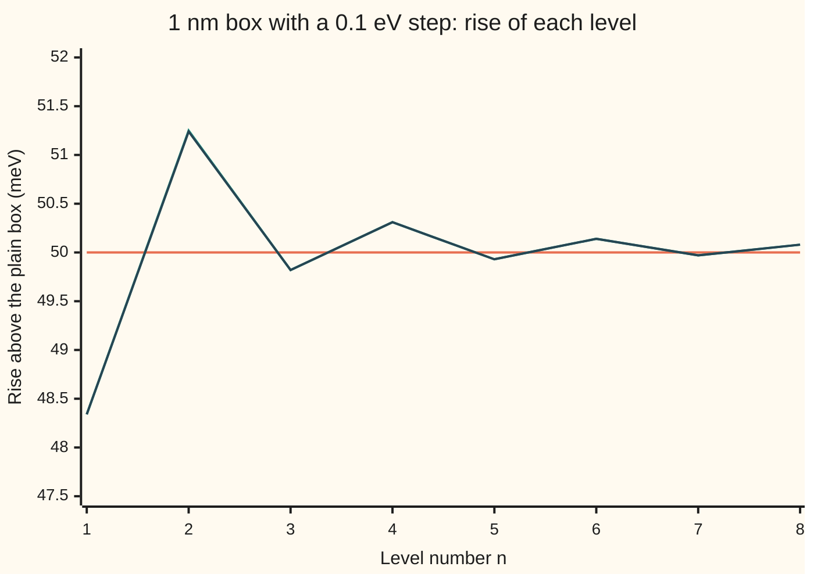

# Perturbation theory: nudge the energy levels without solving again

[Syllabus](../../../SYLLABUS.md) → [Engineering mathematics](../README.md) → [Quantum Mechanics in Outline](../README.md#s09) → Perturbation theory

---

## General Overview

An electron sits in a semiconductor layer 1 nm wide, with walls it cannot cross. Its energy levels are known exactly: 0.37603 eV, 1.50412 eV, 3.38427 eV, and so on ([Schrodinger's equation](03-schrodinger-equation-and-the-particle-in-a-box.md)). An electronvolt, eV, is the energy an electron gains crossing one volt.

Now the crystal grower changes the alloy in the right half of the layer, so the floor there sits 0.1 eV higher. This is a **stepped well**. The engineer wants three numbers: how far each level moves, how the electron's spread changes, and how the wavelength of the infrared light from level 2 to level 1 moves.

The step breaks the clean sine waves, so the old answer no longer solves the equation. Perturbation theory treats the step as a small nudge and computes the change from the old answer alone, with no new solve for each design change.

The first answer is clean. Every level rises by exactly 0.0500 eV, half the step, because in every level of a box the electron is in the right half with chance exactly one half. The second answer is finer. The ground level actually rises by 48.34 meV (thousandths of an eV), level 2 by 51.25 meV, and the light's wavelength shortens by 2.82 nm (a blue shift), from 1099.06 nm to 1096.24 nm. These second-order numbers match a 50-state computer solve to within 0.00001 eV.

**To first order a small change shifts each level by the change averaged over that level's old wave; to second order each level is pushed away from its neighbours, by the square of their coupling divided by their energy gap; and when two levels share an energy, the change must first be diagonalised inside that pair.**

**What kind of fact this is:** a method of approximation, built on [Regular perturbation](../01-Units%20and%20Modelling/05-regular-perturbation.md). The first- and second-order formulas are derived in Why it works; how close they come here is measured in the code, against two exact roads.

### The picture: how far each level moves



Orange: first order, a flat 50.00 meV. Green: first plus second order. Dark blue: the exact 50-state answer, which lies on top of green. The zigzag is second order at work: odd levels end up a little low, even levels a little high, and the swing dies away as the levels spread apart.

---

## The formula

Notation reminder: a hat marks an operator, here a matrix of energies ([States as vectors](02-state-vectors-operators-and-measurement.md)). $`\hat H_0`$ is the plain box, whose levels $`E_n^{(0)}`$ and waves $`\varphi_n`$ are known. The nudge $`V(x)`$ is the step: 0.1 eV over the right half, 0 elsewhere. The superscripts (0), (1), (2) count how many powers of the step a term carries.

The one number that does the work is the **matrix element**, the step weighted by two of the old waves:

```math
V_{mn} = \int_0^L \varphi_m(x)\,V(x)\,\varphi_n(x)\,dx
```

**Read it aloud:** V m n is the step, averaged against level m's wave times level n's wave. When m = n it is the step averaged over one level; when m ≠ n it says how strongly the step couples two levels.

With it, the nudged levels and waves are

```math
E_n \approx E_n^{(0)} + V_{nn} + \sum_{m \ne n} \frac{\lvert V_{mn}\rvert^2}{E_n^{(0)} - E_m^{(0)}}, \qquad \varphi_n^{\mathrm{new}} \approx \varphi_n + \sum_{m \ne n} c_m\,\varphi_m, \qquad c_m = \frac{V_{mn}}{E_n^{(0)} - E_m^{(0)}}
```

**Read it aloud:** the new level is the old level, plus the step averaged over the old wave, plus a sum over every other level of the coupling squared over the energy gap; the new wave is the old wave with a little of each other wave mixed in, in proportion to the coupling over the gap. The bars mean size. For complex waves the first wave in $`V_{mn}`$ is replaced by its complex conjugate, and the top is $`\lvert V_{mn}\rvert^2`$; for the box's real waves that is just $`V_{mn}^2`$.

When two levels a and b share one energy $`E^{(0)}`$, the gap is zero and the sums blow up. Then diagonalise the step inside the pair:

```math
E_\pm = E^{(0)} + \frac{V_{aa} + V_{bb}}{2} \pm \sqrt{\left(\frac{V_{aa} - V_{bb}}{2}\right)^2 + \lvert V_{ab}\rvert^2}
```

**Read it aloud:** the shared level splits in two, around the average of the two diagonal entries, by the square root of their half-difference squared plus the coupling squared.

| Symbol | Plain meaning | In our example | Push it up and the answer… |
| --- | --- | --- | --- |
| $`L`$, $`x`$, $`y`$, $`u`$ | the box's width; position across it (and, in the square box, up it), in nm; u = x/L | 1 nm; step on 0.5 to 1 nm | every level falls as 1/L² |
| $`\hat H_0`$, $`\hat H`$ | energy operator of the plain box; of the box with the step | — | — |
| $`V(x)`$, $`V_0`$ | the nudge: extra potential energy at x; its height, eV | $`V_0`$ = 0.1 eV on the right half | every shift grows: first order as $`V_0`$, second as $`V_0^2`$ |
| $`n`$, $`m`$ | level numbers: n the level studied, m the others summed over (m is not a mass here) | n = 1, m = 2, 4, 6, … | — |
| $`E_n^{(0)}`$ | the plain box's level n, eV | 0.37603, 1.50412, 3.38427 eV | — |
| $`E_n^{(1)} = V_{nn}`$ | first-order shift: the step averaged over level n | 0.0500 eV for every n | grows with $`V_0`$ |
| $`E_n^{(2)}`$ | second-order shift: the sum of coupling squared over gap | −0.0016621 eV for n = 1 | grows with $`V_0^2`$ |
| $`E_n`$, $`E_\pm`$ | the true nudged level, eV; the two levels a shared level splits into | 0.42437 eV for n = 1; 1.92316 and 1.88714 eV | — |
| $`\varphi_n`$, $`\varphi_n^{(1)}`$, $`\varphi_n^{\mathrm{new}}`$ | the plain box's wave for level n, $`\sqrt{2/L}\,\sin(n\pi x/L)`$; its first-order correction; the nudged wave | — | — |
| $`V_{mn}`$, $`V_{ab}`$ | matrix element: the step weighted by waves m and n, eV; the same between two waves a and b | $`V_{12}`$ = −0.042441 eV; $`V_{ab}`$ = 0.018013 eV | — |
| $`c_m`$ | how much of wave m mixes into the new wave | $`c_2`$ = 0.03762 for the ground level | grows with the coupling, shrinks with the gap |
| $`\varepsilon`$, $`a`$, $`b`$, $`E^{(0)}`$, $`\alpha`$, $`\beta`$ | the small number $`\lvert V_{12}\rvert/(E_2^{(0)} - E_1^{(0)})`$; a and b label two levels that share the energy $`E^{(0)}`$; α and β are the amounts of wave a and wave b in a good starting wave | ε = 0.0376; a = (1,2), b = (2,1) at 1.88015 eV in the square box; α = ±β = 0.7071 | at ε near 1 the series fails |

### When it holds

- **The nudge is small against the gaps.** Here the coupling is 3.76% of the gap, and second order lands within 0.00001 eV. With a 1 eV step (ε = 0.38) it reads 0.7098 eV against the true 0.7268 eV. With a 4 eV step (ε = 1.50) it reads −0.2833 eV, below the box's floor, against the true 1.0363 eV.
- **No two coupled levels share an energy.** If they do, the gap in a denominator is zero. The fix is the degenerate formula, Step 4 below.
- **The plain problem is solved exactly.** The method corrects a known answer. The box's sines and levels come from [Schrodinger's equation](03-schrodinger-equation-and-the-particle-in-a-box.md).
- **The model behind the box.** Hard walls, one electron, the free electron's mass. A real layer's finite walls and effective mass (the mass the electron seems to have inside a crystal) move the plain levels; the method then nudges whichever plain levels it is given.

---

## Why it works

### Step 0: a small change barely changes the shape, so measure it with the old shape

A gentle step does not reshape the wave much. So to a first guess, the new energy is the old energy plus the step's energy, counted with the old wave: the step's height times the chance the electron is under it. Everything else is a correction to this guess, and each correction is smaller by another factor of ε, the coupling measured against the gap.

This is [Regular perturbation](../01-Units%20and%20Modelling/05-regular-perturbation.md) again: write the answer as a series in a small number, put it into the equation, and match powers. The new feature is that the unknown is a whole list of levels and waves, so the equations are about matrices.

### Step 1: put the series into the equation

Write the step as $`V`$, of size $`V_0`$. The level and wave become series in powers of $`V_0`$:

```math
E_n = E_n^{(0)} + E_n^{(1)} + E_n^{(2)} + \dots, \qquad \varphi_n^{\mathrm{new}} = \varphi_n + \varphi_n^{(1)} + \dots
```

Put them into $`(\hat H_0 + V)\,\varphi^{\mathrm{new}} = E\,\varphi^{\mathrm{new}}`$ and keep the terms with one power of $`V_0`$:

```math
(\hat H_0 - E_n^{(0)})\,\varphi_n^{(1)} = (E_n^{(1)} - V)\,\varphi_n
```

### Step 2: first order is the average of the step

Multiply both sides by $`\varphi_n`$ and integrate across the box. On the left, $`\hat H_0`$ is symmetric (it can act on either wave in the integral) and $`\varphi_n`$ is its eigenvector, so the left side is $`(E_n^{(0)} - E_n^{(0)})`$ times something: zero. The right side then says

```math
E_n^{(1)} = V_{nn} = V_0 \int_{L/2}^{L} \varphi_n(x)^2\,dx
```

That integral is the chance of finding the electron in the right half. Every box wave squared is a mirror image of itself about the centre: $`\sin^2(n\pi(L - x)/L) = \sin^2(n\pi x/L)`$. So exactly half the chance sits on each side, for every level. Hence $`E_n^{(1)}`$ = 0.1 × 0.5 = 0.0500 eV, the flat orange line.

The code checks the half by numerical integration (Simpson's rule) for levels 1 to 5: 0.500000 each time.

### Step 3: the wave correction, and second order

Now multiply the Step 1 equation by a different wave $`\varphi_m`$ and integrate. The left side gives $`(E_m^{(0)} - E_n^{(0)})\,c_m`$, where $`c_m`$ is the amount of wave m inside $`\varphi_n^{(1)}`$. The right side gives $`-V_{mn}`$, since different box waves are perpendicular. So

```math
c_m = \frac{V_{mn}}{E_n^{(0)} - E_m^{(0)}}
```

Repeat the trick with the terms of two powers of $`V_0`$, multiplying by $`\varphi_n`$. What survives is the step acting on the first-order wave correction:

```math
E_n^{(2)} = \sum_{m \ne n} V_{nm}\,c_m = \sum_{m \ne n} \frac{\lvert V_{mn}\rvert^2}{E_n^{(0)} - E_m^{(0)}}
```

The top is $`V_{nm}V_{mn} = \lvert V_{mn}\rvert^2`$: swapping the two waves conjugates the integral, and for the box's real waves changes nothing.

Read the signs. A level above n has a negative gap, so it pushes level n **down**. A level below pushes it **up**. Levels repel. The ground level has nothing below it, so its second-order shift is never positive: negative, or zero if no level couples to it.

<details>
<summary>The matrix elements of the half-box step, worked out</summary>

Write $`u = x/L`$. Then $`V_{mn} = 2V_0 \int_{1/2}^{1} \sin(m\pi u)\sin(n\pi u)\,du`$.

Mirror symmetry kills half of them at once. If m and n are both odd or both even, the product $`\varphi_m\varphi_n`$ is its own mirror image. Then the right half holds half the whole-box integral, and the whole-box integral is zero for m ≠ n. So $`V_{mn}`$ = 0, and only levels of opposite parity couple.

For the others, use $`2\sin A\sin B = \cos(A - B) - \cos(A + B)`$ and integrate:

$`\displaystyle V_{mn} = \frac{V_0}{\pi}\left[\frac{\sin((m+n)\pi/2)}{m+n} - \frac{\sin((m-n)\pi/2)}{m-n}\right]`$

For the ground level and an even m this is $`V_{1m} = \pm 2mV_0/(\pi(m^2 - 1))`$: $`V_{12} = -4V_0/(3\pi)`$ = −0.042441 eV and $`V_{14}`$ = 0.016977 eV. The couplings fall off slowly, about as 1/m, but the gaps grow as m², so the second-order sum settles fast.

The code computes six of these by Simpson's rule and by this formula. They agree to six decimals.

</details>

### Step 4: two levels with one energy

A square box, 1 nm by 1 nm, has waves $`\varphi_a(x)\varphi_b(y)`$ with energy $`E_1^{(0)}(a^2 + b^2)`$. The waves (1,2) and (2,1) both sit at 5 × 0.37603 = 1.88015 eV. Two waves that share one energy are called **degenerate**, like the square drumhead's twin modes in [Waves on strings and drums](01-wave-equation-for-strings-and-membranes.md).

Put a 0.1 eV bump on one corner, $`x, y > 0.5`$ nm. The coupling between the twins is $`V_{ab}`$ = 0.018013 eV, and their gap is zero. Step 3's formula divides by zero.

The cure comes from what degeneracy means. Any mixture of the twins is also a wave of the plain box at 1.88015 eV. The plain box cannot choose among them; the bump can. Start the series from a mixture $`\alpha\varphi_a + \beta\varphi_b`$ and repeat Step 2, multiplying by $`\varphi_a`$ and then by $`\varphi_b`$. The left side vanishes both times, because both waves share the energy. What is left says that $`(\alpha, \beta)`$ must be an eigenvector of the bump's 2 × 2 block, with the first-order shift as its eigenvalue:

```math
\begin{pmatrix} V_{aa} & V_{ab} \\ V_{ab} & V_{bb} \end{pmatrix} = \begin{pmatrix} 0.025000 & 0.018013 \\ 0.018013 & 0.025000 \end{pmatrix}\ \mathrm{eV}
```

The block is symmetric, so [The spectral theorem](../../03-Algebra/07-Eigenvalues%20and%20Symmetric%20Matrices/04-spectral-theorem.md) guarantees real eigenvalues and perpendicular eigenvectors. Here they are 0.025 ± 0.018013 eV, with eigenvectors $`(\varphi_a \pm \varphi_b)/\sqrt 2`$: equal parts of (1,2) and (2,1), added or subtracted. In that basis the twins no longer couple, and Step 3's formulas apply to everything else.

The plus mixture is symmetric under swapping x and y, and piles its chance into the corner, so it rises more. The minus mixture is zero all along the diagonal x = y, which cuts through the corner, so it rises less. The bump's mirror symmetry picks the good waves, as in [Symmetry and conservation](08-symmetry-and-conserved-quantities.md).

[Spin one-half](06-spin-and-two-state-systems.md) is the smallest case: spin up and spin down share one energy until a magnetic field adds a 2 × 2 block, and diagonalising it gives the two levels exactly.

---

## Worked numbers, by hand

The ground level of the stepped box, with $`E_1^{(0)}`$ = 0.37603 eV from [Schrodinger's equation](03-schrodinger-equation-and-the-particle-in-a-box.md) and $`V_0`$ = 0.1 eV.

| Step | Arithmetic | Value |
| --- | --- | --- |
| first-order shift | 0.1 eV × 0.5 | 0.0500 eV |
| first-order level | 0.37603 + 0.05000 | 0.42603 eV |
| coupling to level 2 | $`V_{12} = -4 \times 0.1/(3\pi)`$ | −0.042441 eV |
| its square | (−0.042441)² | 0.0018013 eV² |
| gap to level 2 | 0.37603 − 1.50412 | −1.12809 eV |
| level-2 term | 0.0018013 ÷ (−1.12809) | −0.0015967 eV |
| level-4 term | 0.0002882 ÷ (0.37603 − 6.01648 = −5.64045) | −0.0000511 eV |
| level-6 term | from $`V_{16}`$ = −0.010913 eV | −0.0000090 eV |
| all terms to m = 50 | sum | −0.0016621 eV |
| second-order level | 0.42603 − 0.00166 | **0.42437 eV** |
| exact, 50 states and shooting | both roads | 0.42437 eV |

So the step lifts the ground level by 48.34 meV, not the 50.00 meV first order says, and the two exact roads agree to five decimals.

The wave tells the same story. The mixing number is $`c_2`$ = −0.042441 ÷ (−1.12809) = 0.03762; the exact solve, counted the same way as the amount of wave 2 per unit of wave 1, gives 0.03757. With that much of level 2 mixed in, the electron leans away from the step: its chance of being in the right half falls from 0.5000 to 0.4668.

Level by level, for the first five:

| n | plain box | first order | second order | 50-state exact | shooting |
| --- | --- | --- | --- | --- | --- |
| 1 | 0.37603 | 0.42603 | 0.42437 | 0.42437 | 0.42437 |
| 2 | 1.50412 | 1.55412 | 1.55537 | 1.55536 | 1.55536 |
| 3 | 3.38427 | 3.43427 | 3.43409 | 3.43409 | 3.43409 |
| 4 | 6.01648 | 6.06648 | 6.06679 | 6.06679 | 6.06679 |
| 5 | 9.40075 | 9.45075 | 9.45069 | 9.45069 | 9.45069 |

All in eV. The light from level 2 to level 1 has energy 1.12809 eV in the plain box, and the same at first order, since both levels rise 0.05 eV. Second order gives 1.13100 eV and the exact roads 1.13099 eV: the wavelength moves from 1099.06 nm to 1096.24 nm, 2.82 nm shorter.

For the square box, the degenerate pair at 1.88015 eV splits to 1.92316 and 1.88714 eV, 0.03603 eV apart. A 64-state exact solve gives 1.92296 and 1.88698 eV, 0.03598 eV apart. Its good waves weigh (1,2) and (2,1) as 0.7066 and 0.7066 for the upper level, and 0.7071 and −0.7071 for the lower.

### What breaks if you drop a piece

| Mistake | Comes out at | What went wrong |
| --- | --- | --- |
| Non-degenerate formula on the square box's twins | 0.018013 ÷ 0.000000: division by zero | The gap is zero, so the twins must be mixed first by diagonalising their 2 × 2 block |
| First order only, for the wavelength of the light from level 2 to level 1 | 1099.06 nm, not 1096.24 nm (2.82 nm off) | Both levels rise by 0.05 eV, so first order sees no change in wavelength; the change is second order |
| Gap written $`E_m^{(0)} - E_n^{(0)}`$ | ground 0.42769 eV, not 0.42437 eV | The sign is flipped, so the higher levels push the ground level up instead of down |
| A 4 eV step, ε = 1.50 | −0.2833 eV, not 1.0363 eV | The coupling is bigger than the gap, so each term is bigger than the last; the series is meaningless |

The code prints all four.

---

## Code, from first principles, and it actually runs

The code finds the stepped box's levels by three independent roads, and the degenerate pair by two.

- **The series.** The matrix elements come from the closed form in the fold above, checked against Simpson's rule; first and second order follow.
- **Exact diagonalisation.** The full energy matrix in the first 50 box waves, $`E_n^{(0)}`$ on the diagonal plus every $`V_{mn}`$, is diagonalised by **Jacobi rotations**: turn two coordinates at a time to zero one off-diagonal entry, and sweep until none is left. The square box uses 64 waves (8 × 8).
- **Shooting.** No sines here. The wave starts at zero at the left wall and is stepped across the box by RK4 (a standard step-by-step solver), with the floor 0.1 eV higher past 0.5 nm. The code halves the energy bracket until the wave lands at zero on the right wall.

The asserts compare the series with the 50-state solve, the solve with shooting, the first-order wave with the exact wave, and the degenerate formula with the 64-state solve. The last one confirms that the series really fails at a 4 eV step.

### Python

```python
# Time-independent perturbation theory -- the check behind the card.
# Standard library only.  An electron in a 1 nm box with a 0.1 eV step over its
# right half.  Three roads to the shifted levels: the perturbation series, an
# exact 50-state diagonalisation (Jacobi rotations), and shooting the equation
# itself (RK4 plus bisection).  Then a degenerate pair in a square 1 nm box.
import math

H = 6.62607015e-34          # Planck constant, J s (exact in SI)
HBAR = H / (2 * math.pi)    # reduced Planck constant, J s
ME = 9.1093837139e-31       # electron mass, kg (CODATA 2022)
EV = 1.602176634e-19        # one electronvolt, J (exact in SI)
HC = H * 299792458.0 / EV * 1e9   # h c in eV nm
E1 = H * H / (8 * ME * 1e-18) / EV              # ground level of the 1 nm box, eV
K = 2 * ME * EV * 1e-18 / HBAR ** 2             # phi'' = -K (E - V) phi, x in nm, E in eV
V0, N = 0.1, 50                                 # step height, eV; basis size

def I(m, n):                # integral over the right half of phi_m phi_n (1 nm box)
    if m == n: return 0.5
    if (m - n) % 2 == 0: return 0.0
    return (math.sin((m + n) * math.pi / 2) / (m + n) - math.sin((m - n) * math.pi / 2) / (m - n)) / math.pi

def simpson(f, a, b, n=2000):
    h = (b - a) / n
    return (f(a) + f(b) + sum((4 if i % 2 else 2) * f(a + i * h) for i in range(1, n))) * h / 3

def phi(n): return lambda x: math.sqrt(2.0) * math.sin(n * math.pi * x)

def jacobi(A):              # eigenvalues and eigenvectors of a symmetric matrix by rotations
    n = len(A); A = [r[:] for r in A]; Q = [[float(i == j) for j in range(n)] for i in range(n)]
    for _ in range(30):
        if sum(A[i][j] ** 2 for i in range(n) for j in range(n) if i != j) < 1e-26: break
        for p in range(n - 1):
            for q in range(p + 1, n):
                if A[p][q] == 0.0: continue
                th = (A[q][q] - A[p][p]) / (2 * A[p][q])
                t = (1.0 if th >= 0 else -1.0) / (abs(th) + math.sqrt(th * th + 1))
                c = 1 / math.sqrt(t * t + 1); s = t * c
                for M in (A, Q):
                    for k in range(n):
                        a, b = M[k][p], M[k][q]; M[k][p], M[k][q] = c * a - s * b, s * a + c * b
                for k in range(n):
                    a, b = A[p][k], A[q][k]; A[p][k], A[q][k] = c * a - s * b, s * a + c * b
    order = sorted(range(n), key=lambda i: A[i][i])
    return [A[i][i] for i in order], [[Q[k][i] for k in range(n)] for i in order]

def shoot(E, V, steps=2000):  # phi(0)=0, phi'(0)=1, RK4 across 1 nm with the step; returns phi(1 nm)
    dx, y, v = 1.0 / steps, 0.0, 1.0
    for i in range(steps):
        k = -K * (E - (V if (i + 0.5) * dx > 0.5 else 0.0))
        k1y, k1v = v, k * y
        k2y, k2v = v + dx / 2 * k1v, k * (y + dx / 2 * k1y)
        k3y, k3v = v + dx / 2 * k2v, k * (y + dx / 2 * k2y)
        k4y, k4v = v + dx * k3v, k * (y + dx * k3y)
        y += dx / 6 * (k1y + 2 * k2y + 2 * k3y + k4y); v += dx / 6 * (k1v + 2 * k2v + 2 * k3v + k4v)
    return y

def root_from(V, E):        # first sign change of shoot above E, scanned in 0.02 eV, then bisected
    f = lambda e: shoot(e, V)
    while (f(E) < 0) == (f(E + 0.02) < 0): E += 0.02
    a, b, fa = E, E + 0.02, f(E)
    for _ in range(60):
        m = (a + b) / 2; fm = f(m)
        if (fm < 0) == (fa < 0): a, fa = m, fm
        else: b = m
    return (a + b) / 2

def series(n, V, size=N):   # unperturbed, first order, second order for level n
    e0 = E1 * n * n
    e2 = sum((V * I(n, m)) ** 2 / (e0 - E1 * m * m) for m in range(1, size + 1) if m != n)
    return e0, e0 + V * I(n, n), e0 + V * I(n, n) + e2

def exact(V, size=N):
    return jacobi([[(E1 * (i + 1) ** 2 if i == j else 0.0) + V * I(i + 1, j + 1) for j in range(size)] for i in range(size)])

print("box 1 nm: E_1 = h^2/(8 m_e L^2) = %.5f eV; K = %.4f per eV per nm^2; step V0 = %.3f eV on 0.5-1 nm" % (E1, K, V0))
half = [simpson(lambda x: phi(n)(x) ** 2, 0.5, 1.0) for n in range(1, 6)]
print("chance in right half, levels 1-5 (Simpson): " + " ".join("%.6f" % h for h in half))
pairs = [(1, 1), (1, 2), (1, 4), (2, 3), (3, 4), (1, 6)]
num = [V0 * simpson(lambda x: phi(a)(x) * phi(b)(x), 0.5, 1.0) for a, b in pairs]
print("V_mn closed form / Simpson, eV: " + ", ".join("V_%d%d %.6f/%.6f" % (a, b, V0 * I(a, b), u) for (a, b), u in zip(pairs, num)))
terms = [(V0 * I(1, m)) ** 2 / (E1 - E1 * m * m) for m in (2, 4, 6)]
print("ground, second order: V_12^2 %.7f eV^2 / (E_1 - E_2) %.5f eV; V_14^2 %.7f eV^2 / (E_1 - E_4) %.5f eV"
      % ((V0 * I(1, 2)) ** 2, E1 - 4 * E1, (V0 * I(1, 4)) ** 2, E1 - 16 * E1))
print("ground, second order: m=2 %.7f, m=4 %.7f, m=6 %.7f, all m to 50 %.7f eV" % (*terms, series(1, V0)[2] - series(1, V0)[1]))
ev, vec = exact(V0)
shot = [root_from(V0, E1 * n * n) for n in range(1, 6)]
print("n  unperturbed  first order  second order  50-state exact  shooting  (eV)")
for n in range(1, 6):
    print("%d  %10.5f  %11.5f  %12.5f  %14.5f  %8.5f" % (n, *series(n, V0), ev[n - 1], shot[n - 1]))
for lab, col in (("first order", 1), ("second order", 2)):
    print("chart, shift %s, levels 1-8, meV: %s" % (lab, " ".join("%.2f" % (1000 * (series(n, V0)[col] - E1 * n * n)) for n in range(1, 9))))
print("chart, shift exact, levels 1-8, meV: %s" % " ".join("%.2f" % (1000 * (ev[n - 1] - E1 * n * n)) for n in range(1, 9)))
c = {m: V0 * I(1, m) / (E1 - E1 * m * m) for m in range(2, N + 1)}
print("ground state mix, amount per unit of phi_1: c_2 first order %.5f, exact %.5f; c_4 first order %.5f, exact %.5f"
      % (c[2], vec[0][1] / vec[0][0], c[4], vec[0][3] / vec[0][0]))
p1 = 0.5 + 2 * sum(c[m] * I(1, m) for m in c)
pex = sum(vec[0][i] * vec[0][j] * I(i + 1, j + 1) for i in range(N) for j in range(N))
print("ground, chance in right half: unperturbed 0.5000, first order %.4f, exact %.4f" % (p1, pex))
gaps = [E1 * 3, series(2, V0)[1] - series(1, V0)[1], series(2, V0)[2] - series(1, V0)[2], ev[1] - ev[0], shot[1] - shot[0]]
print("light 2->1, eV / nm: unperturbed, first, second, exact, shooting: " + ", ".join("%.5f/%.2f" % (g, HC / g) for g in gaps))
eps = abs(V0 * I(1, 2)) / (3 * E1)
print("small number eps = |V_12|/(E_2 - E_1) = %.4f" % eps)
st = [(a, b) for a in range(1, 9) for b in range(1, 9)]
H2 = [[(E1 * (a * a + b * b) if (a, b) == (p, q) else 0.0) + V0 * I(a, p) * I(b, q) for (p, q) in st] for (a, b) in st]
ev2, vec2 = jacobi(H2)
Vaa, Vab = V0 * I(1, 1) * I(2, 2), V0 * I(1, 2) * I(2, 1)
deg = [5 * E1 + Vaa + Vab, 5 * E1 + Vaa - Vab]
i12, i21 = st.index((1, 2)), st.index((2, 1))
print("square 1 nm x 1 nm, bump %.1f eV on corner x,y > 0.5 nm: pair (1,2),(2,1) at %.5f eV" % (V0, 5 * E1))
print("pair block [[%.6f, %.6f], [%.6f, %.6f]] eV; eigenvalues %.6f, %.6f eV" % (Vaa, Vab, Vab, Vaa, Vaa + Vab, Vaa - Vab))
su, sl = (1 if vec2[2][i12] > 0 else -1), (1 if vec2[1][i12] > 0 else -1)
print("exact good states on (1,2),(2,1): upper %.4f %.4f, lower %.4f %.4f"
      % (su * vec2[2][i12], su * vec2[2][i21], sl * vec2[1][i12], sl * vec2[1][i21]))
print("pair levels: degenerate theory %.5f, %.5f eV; 64-state exact %.5f, %.5f eV; split %.5f vs %.5f eV"
      % (deg[0], deg[1], ev2[2], ev2[1], 2 * Vab, ev2[2] - ev2[1]))
print("mistake, nondegenerate formula on the pair: c = %.6f / %.6f, division by zero" % (Vab, 5 * E1 - 5 * E1))
print("mistake, first order only: light 2->1 at %.2f nm, exact %.2f nm, %.2f nm shorter" % (HC / gaps[1], HC / gaps[3], HC / gaps[1] - HC / gaps[3]))
flip = series(1, V0)[1] - (series(1, V0)[2] - series(1, V0)[1])
print("mistake, denominator flipped: ground %.5f eV, exact %.5f eV" % (flip, ev[0]))
big = [(V, series(1, V)[2], root_from(V, 0.01)) for V in (0.5, 1.0, 2.0, 4.0)]
print("step not small, ground second order / exact, eV: " + ", ".join("V0 %.1f eps %.2f: %.4f/%.4f" % (V, V * eps / V0, s, x) for V, s, x in big))
print("try: V0 0.2 eV ground first order %.5f, second-order term %.7f eV; 10-state ground %.5f eV"
      % (series(1, 0.2)[1], series(1, 0.2)[2] - series(1, 0.2)[1], exact(V0, 10)[0][0]))

assert all(abs(h - 0.5) < 1e-9 for h in half)                                  # half the chance under the step
assert all(abs(V0 * I(a, b) - u) < 1e-9 for (a, b), u in zip(pairs, num))      # matrix elements by Simpson
assert all(abs(series(n, V0)[2] - ev[n - 1]) < 1e-5 for n in range(1, 6))       # second order meets 50 states
assert all(abs(shot[n] - ev[n]) / ev[n] < 1e-6 for n in range(5))              # shooting meets 50 states
assert abs(c[2] / (vec[0][1] / vec[0][0]) - 1) < 0.01 and abs(p1 - pex) < 1e-3         # state correction
assert all(abs(d - e) < 5e-4 for d, e in zip(deg, (ev2[2], ev2[1])))            # degenerate pair
assert abs(2 * Vab / (ev2[2] - ev2[1]) - 1) < 0.01
assert big[-1][2] - big[-1][1] > 1.0 and abs(big[0][1] - big[0][2]) < 0.002    # series fails when eps ~ 1
print("ALL CHECKS PASS")
```

**Ran 2026-11-23 on macOS, Python 3.14.10, standard library only. All checks passed. Output, pasted from the run:**

```
box 1 nm: E_1 = h^2/(8 m_e L^2) = 0.37603 eV; K = 26.2468 per eV per nm^2; step V0 = 0.100 eV on 0.5-1 nm
chance in right half, levels 1-5 (Simpson): 0.500000 0.500000 0.500000 0.500000 0.500000
V_mn closed form / Simpson, eV: V_11 0.050000/0.050000, V_12 -0.042441/-0.042441, V_14 0.016977/0.016977, V_23 -0.025465/-0.025465, V_34 -0.036378/-0.036378, V_16 -0.010913/-0.010913
ground, second order: V_12^2 0.0018013 eV^2 / (E_1 - E_2) -1.12809 eV; V_14^2 0.0002882 eV^2 / (E_1 - E_4) -5.64045 eV
ground, second order: m=2 -0.0015967, m=4 -0.0000511, m=6 -0.0000090, all m to 50 -0.0016621 eV
n  unperturbed  first order  second order  50-state exact  shooting  (eV)
1     0.37603      0.42603       0.42437         0.42437   0.42437
2     1.50412      1.55412       1.55537         1.55536   1.55536
3     3.38427      3.43427       3.43409         3.43409   3.43409
4     6.01648      6.06648       6.06679         6.06679   6.06679
5     9.40075      9.45075       9.45069         9.45069   9.45069
chart, shift first order, levels 1-8, meV: 50.00 50.00 50.00 50.00 50.00 50.00 50.00 50.00
chart, shift second order, levels 1-8, meV: 48.34 51.25 49.82 50.31 49.93 50.14 49.97 50.08
chart, shift exact, levels 1-8, meV: 48.34 51.24 49.82 50.31 49.93 50.14 49.97 50.08
ground state mix, amount per unit of phi_1: c_2 first order 0.03762, exact 0.03757; c_4 first order -0.00301, exact -0.00301
ground, chance in right half: unperturbed 0.5000, first order 0.4668, exact 0.4668
light 2->1, eV / nm: unperturbed, first, second, exact, shooting: 1.12809/1099.06, 1.12809/1099.06, 1.13100/1096.24, 1.13099/1096.24, 1.13099/1096.24
small number eps = |V_12|/(E_2 - E_1) = 0.0376
square 1 nm x 1 nm, bump 0.1 eV on corner x,y > 0.5 nm: pair (1,2),(2,1) at 1.88015 eV
pair block [[0.025000, 0.018013], [0.018013, 0.025000]] eV; eigenvalues 0.043013, 0.006987 eV
exact good states on (1,2),(2,1): upper 0.7066 0.7066, lower 0.7071 -0.7071
pair levels: degenerate theory 1.92316, 1.88714 eV; 64-state exact 1.92296, 1.88698 eV; split 0.03603 vs 0.03598 eV
mistake, nondegenerate formula on the pair: c = 0.018013 / 0.000000, division by zero
mistake, first order only: light 2->1 at 1099.06 nm, exact 1096.24 nm, 2.82 nm shorter
mistake, denominator flipped: ground 0.42769 eV, exact 0.42437 eV
step not small, ground second order / exact, eV: V0 0.5 eps 0.19: 0.5845/0.5857, V0 1.0 eps 0.38: 0.7098/0.7268, V0 2.0 eps 0.75: 0.7112/0.8896, V0 4.0 eps 1.50: -0.2833/1.0363
try: V0 0.2 eV ground first order 0.47603, second-order term -0.0066483 eV; 10-state ground 0.42437 eV
ALL CHECKS PASS
```

### Rust

Same numbers, same labels, built with `rustc --edition 2021 -O`.

```rust
// Time-independent perturbation theory -- the same check in Rust, no crates.  A 1 nm box with a 0.1 eV
// step over its right half, by three roads: the perturbation series, a 50-state Jacobi diagonalisation,
// and shooting the equation (RK4 plus bisection).  Then a degenerate pair in a square 1 nm box.
use std::f64::consts::PI;

const H: f64 = 6.62607015e-34;      // Planck constant, J s (exact in SI)
const ME: f64 = 9.1093837139e-31;   // electron mass, kg (CODATA 2022)
const EV: f64 = 1.602176634e-19;    // one electronvolt, J (exact in SI)
const V0: f64 = 0.1;                // step height, eV
const N: usize = 50;                // basis size

fn e1() -> f64 { H * H / (8.0 * ME * 1e-18) / EV }                    // ground level, eV
fn kk() -> f64 { let hb = H / (2.0 * PI); 2.0 * ME * EV * 1e-18 / (hb * hb) } // per eV per nm^2
fn hc() -> f64 { H * 299792458.0 / EV * 1e9 }                         // h c in eV nm

fn ii(m: i64, n: i64) -> f64 {      // integral over the right half of phi_m phi_n
    if m == n { return 0.5; }
    if (m - n) % 2 == 0 { return 0.0; }
    ((((m + n) as f64) * PI / 2.0).sin() / (m + n) as f64 - (((m - n) as f64) * PI / 2.0).sin() / (m - n) as f64) / PI
}

fn simpson<F: Fn(f64) -> f64>(f: F, a: f64, b: f64) -> f64 {
    let (n, mut s) = (2000, 0.0);
    let h = (b - a) / n as f64;
    for i in 1..n { s += if i % 2 == 1 { 4.0 } else { 2.0 } * f(a + i as f64 * h); }
    (f(a) + f(b) + s) * h / 3.0
}

fn phi(n: i64, x: f64) -> f64 { 2.0f64.sqrt() * (n as f64 * PI * x).sin() }

fn rotate(m: &mut Vec<Vec<f64>>, p: usize, q: usize, c: f64, s: f64, cols: bool) {
    for k in 0..m.len() {
        if cols { let (a, b) = (m[k][p], m[k][q]); m[k][p] = c * a - s * b; m[k][q] = s * a + c * b; }
        else { let (a, b) = (m[p][k], m[q][k]); m[p][k] = c * a - s * b; m[q][k] = s * a + c * b; }
    }
}

fn jacobi(a0: &Vec<Vec<f64>>) -> (Vec<f64>, Vec<Vec<f64>>) {   // eigenvalues, eigenvectors
    let (n, mut a) = (a0.len(), a0.clone());
    let mut q: Vec<Vec<f64>> = (0..n).map(|i| (0..n).map(|j| if i == j { 1.0 } else { 0.0 }).collect()).collect();
    for _ in 0..30 {
        let off: f64 = (0..n).map(|i| (0..n).filter(|&j| j != i).map(|j| a[i][j] * a[i][j]).sum::<f64>()).sum();
        if off < 1e-26 { break; }
        for p in 0..n - 1 {
            for r in p + 1..n {
                if a[p][r] == 0.0 { continue; }
                let th = (a[r][r] - a[p][p]) / (2.0 * a[p][r]);
                let t = (if th >= 0.0 { 1.0 } else { -1.0 }) / (th.abs() + (th * th + 1.0).sqrt());
                let c = 1.0 / (t * t + 1.0).sqrt(); let s = t * c;
                rotate(&mut a, p, r, c, s, true);
                rotate(&mut q, p, r, c, s, true);
                rotate(&mut a, p, r, c, s, false);
            }
        }
    }
    let mut order: Vec<usize> = (0..n).collect();
    order.sort_by(|&i, &j| a[i][i].partial_cmp(&a[j][j]).unwrap());
    (order.iter().map(|&i| a[i][i]).collect(), order.iter().map(|&i| (0..n).map(|k| q[k][i]).collect()).collect())
}

fn shoot(e: f64, v: f64) -> f64 {   // phi(0)=0, phi'(0)=1, RK4 across 1 nm with the step
    let (dx, mut y, mut w) = (1.0 / 2000.0, 0.0f64, 1.0f64);
    for i in 0..2000 {
        let k = -kk() * (e - if (i as f64 + 0.5) * dx > 0.5 { v } else { 0.0 });
        let (k1y, k1v) = (w, k * y);
        let (k2y, k2v) = (w + dx / 2.0 * k1v, k * (y + dx / 2.0 * k1y));
        let (k3y, k3v) = (w + dx / 2.0 * k2v, k * (y + dx / 2.0 * k2y));
        let (k4y, k4v) = (w + dx * k3v, k * (y + dx * k3y));
        y += dx / 6.0 * (k1y + 2.0 * k2y + 2.0 * k3y + k4y); w += dx / 6.0 * (k1v + 2.0 * k2v + 2.0 * k3v + k4v);
    }
    y
}

fn root_from(v: f64, mut e: f64) -> f64 {   // first sign change above e, then bisect
    while (shoot(e, v) < 0.0) == (shoot(e + 0.02, v) < 0.0) { e += 0.02; }
    let (mut a, mut b, mut fa) = (e, e + 0.02, shoot(e, v)); // bisection
    for _ in 0..60 {
        let (m, fm) = ((a + b) / 2.0, shoot((a + b) / 2.0, v));
        if (fm < 0.0) == (fa < 0.0) { a = m; fa = fm; } else { b = m; }
    }
    (a + b) / 2.0
}

fn series(n: i64, v: f64) -> [f64; 3] {     // unperturbed, first order, second order
    let e0 = e1() * (n * n) as f64;
    let mut e2 = 0.0;
    for m in 1..=N as i64 { if m != n { e2 += (v * ii(n, m)).powi(2) / (e0 - e1() * (m * m) as f64); } }
    [e0, e0 + v * ii(n, n), e0 + v * ii(n, n) + e2]
}

fn exact(v: f64, size: usize) -> (Vec<f64>, Vec<Vec<f64>>) {
    jacobi(&(0..size).map(|i| (0..size).map(|j| (if i == j { e1() * ((i + 1) * (i + 1)) as f64 } else { 0.0 })
        + v * ii(i as i64 + 1, j as i64 + 1)).collect()).collect())
}

fn join(v: &[f64], f: impl Fn(f64) -> String) -> String { v.iter().map(|&x| f(x)).collect::<Vec<_>>().join(" ") }

fn main() {
    let e1 = e1();
    println!("box 1 nm: E_1 = h^2/(8 m_e L^2) = {:.5} eV; K = {:.4} per eV per nm^2; step V0 = {:.3} eV on 0.5-1 nm", e1, kk(), V0);
    let half: Vec<f64> = (1..6).map(|n| simpson(|x| phi(n, x).powi(2), 0.5, 1.0)).collect();
    println!("chance in right half, levels 1-5 (Simpson): {}", join(&half, |h| format!("{:.6}", h)));
    let pairs = [(1, 1), (1, 2), (1, 4), (2, 3), (3, 4), (1, 6)];
    let num: Vec<f64> = pairs.iter().map(|&(a, b)| V0 * simpson(|x| phi(a, x) * phi(b, x), 0.5, 1.0)).collect();
    let pv: Vec<String> = pairs.iter().zip(&num).map(|(&(a, b), u)| format!("V_{}{} {:.6}/{:.6}", a, b, V0 * ii(a, b), u)).collect();
    println!("V_mn closed form / Simpson, eV: {}", pv.join(", "));
    let t: Vec<f64> = [2i64, 4, 6].iter().map(|&m| (V0 * ii(1, m)).powi(2) / (e1 - e1 * (m * m) as f64)).collect();
    println!("ground, second order: V_12^2 {:.7} eV^2 / (E_1 - E_2) {:.5} eV; V_14^2 {:.7} eV^2 / (E_1 - E_4) {:.5} eV",
             (V0 * ii(1, 2)).powi(2), e1 - 4.0 * e1, (V0 * ii(1, 4)).powi(2), e1 - 16.0 * e1);
    let s1 = series(1, V0); println!("ground, second order: m=2 {:.7}, m=4 {:.7}, m=6 {:.7}, all m to 50 {:.7} eV", t[0], t[1], t[2], s1[2] - s1[1]);
    let (ev, vec) = exact(V0, N);
    let shot: Vec<f64> = (1..6).map(|n| root_from(V0, e1 * (n * n) as f64)).collect();
    println!("n  unperturbed  first order  second order  50-state exact  shooting  (eV)");
    for n in 1..6usize {
        let s = series(n as i64, V0);
        println!("{}  {:10.5}  {:11.5}  {:12.5}  {:14.5}  {:8.5}", n, s[0], s[1], s[2], ev[n - 1], shot[n - 1]);
    }
    for (lab, col) in [("first order", 1usize), ("second order", 2)] {
        let sh: Vec<f64> = (1..9).map(|n| 1000.0 * (series(n, V0)[col] - e1 * (n * n) as f64)).collect();
        println!("chart, shift {}, levels 1-8, meV: {}", lab, join(&sh, |x| format!("{:.2}", x)));
    }
    let sh: Vec<f64> = (1..9).map(|n: usize| 1000.0 * (ev[n - 1] - e1 * (n * n) as f64)).collect();
    println!("chart, shift exact, levels 1-8, meV: {}", join(&sh, |x| format!("{:.2}", x)));
    let c: Vec<f64> = (0..=N as i64).map(|m| if m < 2 { 0.0 } else { V0 * ii(1, m) / (e1 - e1 * (m * m) as f64) }).collect();
    println!("ground state mix, amount per unit of phi_1: c_2 first order {:.5}, exact {:.5}; c_4 first order {:.5}, exact {:.5}",
             c[2], vec[0][1] / vec[0][0], c[4], vec[0][3] / vec[0][0]);
    let p1 = 0.5 + 2.0 * (2..=N as i64).map(|m| c[m as usize] * ii(1, m)).sum::<f64>();
    let mut pex = 0.0;
    for i in 0..N { for j in 0..N { pex += vec[0][i] * vec[0][j] * ii(i as i64 + 1, j as i64 + 1); } }
    println!("ground, chance in right half: unperturbed 0.5000, first order {:.4}, exact {:.4}", p1, pex);
    let (s2, eps) = (series(2, V0), (V0 * ii(1, 2)).abs() / (3.0 * e1)); let gaps = [e1 * 3.0, s2[1] - s1[1], s2[2] - s1[2], ev[1] - ev[0], shot[1] - shot[0]];
    let gs: Vec<String> = gaps.iter().map(|g| format!("{:.5}/{:.2}", g, hc() / g)).collect();
    println!("light 2->1, eV / nm: unperturbed, first, second, exact, shooting: {}", gs.join(", "));
    println!("small number eps = |V_12|/(E_2 - E_1) = {:.4}", eps);
    let st: Vec<(i64, i64)> = (1..9).flat_map(|a| (1..9).map(move |b| (a, b))).collect();
    let h2: Vec<Vec<f64>> = st.iter().map(|&(a, b)| st.iter().map(|&(p, q)|
        (if (a, b) == (p, q) { e1 * (a * a + b * b) as f64 } else { 0.0 }) + V0 * ii(a, p) * ii(b, q)).collect()).collect();
    let (ev2, vec2) = jacobi(&h2);
    let (vaa, vab) = (V0 * ii(1, 1) * ii(2, 2), V0 * ii(1, 2) * ii(2, 1));
    let deg = [5.0 * e1 + vaa + vab, 5.0 * e1 + vaa - vab]; // degenerate theory: diagonalise the 2x2 block
    let (i12, i21) = (st.iter().position(|&x| x == (1, 2)).unwrap(), st.iter().position(|&x| x == (2, 1)).unwrap());
    println!("square 1 nm x 1 nm, bump {:.1} eV on corner x,y > 0.5 nm: pair (1,2),(2,1) at {:.5} eV", V0, 5.0 * e1);
    println!("pair block [[{:.6}, {:.6}], [{:.6}, {:.6}]] eV; eigenvalues {:.6}, {:.6} eV", vaa, vab, vab, vaa, vaa + vab, vaa - vab);
    let (su, sl) = (vec2[2][i12].signum(), vec2[1][i12].signum());
    println!("exact good states on (1,2),(2,1): upper {:.4} {:.4}, lower {:.4} {:.4}",
             su * vec2[2][i12], su * vec2[2][i21], sl * vec2[1][i12], sl * vec2[1][i21]);
    println!("pair levels: degenerate theory {:.5}, {:.5} eV; 64-state exact {:.5}, {:.5} eV; split {:.5} vs {:.5} eV",
             deg[0], deg[1], ev2[2], ev2[1], 2.0 * vab, ev2[2] - ev2[1]);
    println!("mistake, nondegenerate formula on the pair: c = {:.6} / {:.6}, division by zero", vab, 5.0 * e1 - 5.0 * e1);
    println!("mistake, first order only: light 2->1 at {:.2} nm, exact {:.2} nm, {:.2} nm shorter", hc() / gaps[1], hc() / gaps[3], hc() / gaps[1] - hc() / gaps[3]);
    let flip = s1[1] - (s1[2] - s1[1]);
    println!("mistake, denominator flipped: ground {:.5} eV, exact {:.5} eV", flip, ev[0]);
    let big: Vec<(f64, f64, f64)> = [0.5, 1.0, 2.0, 4.0].iter().map(|&v| (v, series(1, v)[2], root_from(v, 0.01))).collect();
    let bs: Vec<String> = big.iter().map(|&(v, s, x)| format!("V0 {:.1} eps {:.2}: {:.4}/{:.4}", v, v * eps / V0, s, x)).collect();
    println!("step not small, ground second order / exact, eV: {}", bs.join(", "));
    let s02 = series(1, 0.2);
    println!("try: V0 0.2 eV ground first order {:.5}, second-order term {:.7} eV; 10-state ground {:.5} eV",
             s02[1], s02[2] - s02[1], exact(V0, 10).0[0]);

    assert!(half.iter().all(|h| (h - 0.5).abs() < 1e-9));                               // half the chance under the step
    assert!(pairs.iter().zip(&num).all(|(&(a, b), u)| (V0 * ii(a, b) - u).abs() < 1e-9)); // matrix elements by Simpson
    assert!((1..6).all(|n| (series(n, V0)[2] - ev[n as usize - 1]).abs() < 1e-5));       // second order meets 50 states
    assert!((0..5).all(|n| (shot[n] - ev[n]).abs() / ev[n] < 1e-6));                     // shooting meets 50 states
    assert!((c[2] / (vec[0][1] / vec[0][0]) - 1.0).abs() < 0.01 && (p1 - pex).abs() < 1e-3);    // state correction
    assert!((deg[0] - ev2[2]).abs() < 5e-4 && (deg[1] - ev2[1]).abs() < 5e-4);           // degenerate pair
    assert!((2.0 * vab / (ev2[2] - ev2[1]) - 1.0).abs() < 0.01);
    assert!(big[3].2 - big[3].1 > 1.0 && (big[0].1 - big[0].2).abs() < 0.002);           // series fails when eps ~ 1
    println!("ALL CHECKS PASS");
}
```

**Ran 2026-11-23 on macOS, rustc 1.98.1, no crates. All checks passed. Output, pasted from the run:**

```
box 1 nm: E_1 = h^2/(8 m_e L^2) = 0.37603 eV; K = 26.2468 per eV per nm^2; step V0 = 0.100 eV on 0.5-1 nm
chance in right half, levels 1-5 (Simpson): 0.500000 0.500000 0.500000 0.500000 0.500000
V_mn closed form / Simpson, eV: V_11 0.050000/0.050000, V_12 -0.042441/-0.042441, V_14 0.016977/0.016977, V_23 -0.025465/-0.025465, V_34 -0.036378/-0.036378, V_16 -0.010913/-0.010913
ground, second order: V_12^2 0.0018013 eV^2 / (E_1 - E_2) -1.12809 eV; V_14^2 0.0002882 eV^2 / (E_1 - E_4) -5.64045 eV
ground, second order: m=2 -0.0015967, m=4 -0.0000511, m=6 -0.0000090, all m to 50 -0.0016621 eV
n  unperturbed  first order  second order  50-state exact  shooting  (eV)
1     0.37603      0.42603       0.42437         0.42437   0.42437
2     1.50412      1.55412       1.55537         1.55536   1.55536
3     3.38427      3.43427       3.43409         3.43409   3.43409
4     6.01648      6.06648       6.06679         6.06679   6.06679
5     9.40075      9.45075       9.45069         9.45069   9.45069
chart, shift first order, levels 1-8, meV: 50.00 50.00 50.00 50.00 50.00 50.00 50.00 50.00
chart, shift second order, levels 1-8, meV: 48.34 51.25 49.82 50.31 49.93 50.14 49.97 50.08
chart, shift exact, levels 1-8, meV: 48.34 51.24 49.82 50.31 49.93 50.14 49.97 50.08
ground state mix, amount per unit of phi_1: c_2 first order 0.03762, exact 0.03757; c_4 first order -0.00301, exact -0.00301
ground, chance in right half: unperturbed 0.5000, first order 0.4668, exact 0.4668
light 2->1, eV / nm: unperturbed, first, second, exact, shooting: 1.12809/1099.06, 1.12809/1099.06, 1.13100/1096.24, 1.13099/1096.24, 1.13099/1096.24
small number eps = |V_12|/(E_2 - E_1) = 0.0376
square 1 nm x 1 nm, bump 0.1 eV on corner x,y > 0.5 nm: pair (1,2),(2,1) at 1.88015 eV
pair block [[0.025000, 0.018013], [0.018013, 0.025000]] eV; eigenvalues 0.043013, 0.006987 eV
exact good states on (1,2),(2,1): upper 0.7066 0.7066, lower 0.7071 -0.7071
pair levels: degenerate theory 1.92316, 1.88714 eV; 64-state exact 1.92296, 1.88698 eV; split 0.03603 vs 0.03598 eV
mistake, nondegenerate formula on the pair: c = 0.018013 / 0.000000, division by zero
mistake, first order only: light 2->1 at 1099.06 nm, exact 1096.24 nm, 2.82 nm shorter
mistake, denominator flipped: ground 0.42769 eV, exact 0.42437 eV
step not small, ground second order / exact, eV: V0 0.5 eps 0.19: 0.5845/0.5857, V0 1.0 eps 0.38: 0.7098/0.7268, V0 2.0 eps 0.75: 0.7112/0.8896, V0 4.0 eps 1.50: -0.2833/1.0363
try: V0 0.2 eV ground first order 0.47603, second-order term -0.0066483 eV; 10-state ground 0.42437 eV
ALL CHECKS PASS
```

The two outputs match line for line.

### Lean

Lean proves the first-order rule for any symmetric $`\hat H_0`$, the half-box result for every level, and the degenerate pair formula.

- Suppose $`\hat H_0`$ is symmetric, $`\hat H_0\varphi_n = E_n^{(0)}\varphi_n`$, and $`\varphi_n`$ has size 1. Then Step 1's first-order equation forces $`E_n^{(1)} = V_{nn}`$.
- Take a box of width $`L > 0`$ and any level $`n \ge 1`$. Then $`V_0 \int_{L/2}^{L} \varphi_n(x)^2\,dx = V_0/2`$, half the step's height.
- Take two levels that share the energy $`E^{(0)}`$, and the step's symmetric 2 × 2 block inside them. Then the block's eigenvalues, each added to $`E^{(0)}`$, are exactly $`E_+`$ and $`E_-`$.
- Take the square box's twins (1,2) and (2,1). Then both have $`a^2 + b^2 = 5`$, so they share one energy.
- Take the plain box's levels 1, 2 and 4. Then the gaps from level 1 are $`3E_1^{(0)}`$ and $`15E_1^{(0)}`$.

The eV values, second order, the wave correction and the exact solves are left to the Python and Rust checks.

```lean
-- Perturbation theory: to first order a level moves by the nudge averaged over its old wave, a half-box step lifts every box level by exactly half its height, and a degenerate pair splits by the 2 x 2 formula.
import Mathlib.Analysis.InnerProductSpace.Symmetric
import Mathlib.Analysis.SpecialFunctions.Integrals.Basic
import Mathlib.Analysis.SpecialFunctions.Pow.Real
import Mathlib.LinearAlgebra.Matrix.Notation
import Mathlib.LinearAlgebra.Matrix.Determinant.Basic

open Real InnerProductSpace

/-- First order is the average of the nudge (Step 2). Let the plain energy operator `H₀`
be symmetric and let the plain problem be solved exactly: `H₀ φ = E₀ φ` with `φ` of size 1.
If the first-order terms satisfy `(H₀ - E₀) φ₁ = (E₁ - V) φ`, then the first-order shift
`E₁` is the nudge averaged over the old wave, `E₁ = ⟪φ, V φ⟫ = V_nn`. -/
theorem first_order_shift_eq_average
    {F : Type*} [NormedAddCommGroup F] [InnerProductSpace ℝ F]
    (H₀ V : F →ₗ[ℝ] F) (hH : H₀.IsSymmetric)
    (E₀ E₁ : ℝ) (φ φ₁ : F)
    (hφ : H₀ φ = E₀ • φ) (hnorm : ‖φ‖ = 1)
    (h1 : H₀ φ₁ - E₀ • φ₁ = E₁ • φ - V φ) :
    E₁ = ⟪φ, V φ⟫_ℝ := by
  have h2 : ⟪φ, H₀ φ₁ - E₀ • φ₁⟫_ℝ = ⟪φ, E₁ • φ - V φ⟫_ℝ := by rw [h1]
  rw [inner_sub_right, inner_sub_right, inner_smul_right, inner_smul_right, ← hH φ φ₁, hφ,
    inner_smul_left, real_inner_self_eq_norm_sq, hnorm] at h2
  simp at h2
  linarith

/-- The half-box step lifts every level by exactly half its height. In a box of width
`L > 0`, with level `n ≥ 1` wave `φ_n(x) = √(2/L) sin(nπx/L)` and a step of height `V₀`
over the right half `L/2 ≤ x ≤ L`, the first-order shift is
`V_nn = V₀ ∫_{L/2}^{L} φ_n(x)² dx = V₀ / 2`. -/
theorem half_box_step_first_order_shift (L V₀ : ℝ) (hL : 0 < L) (n : ℕ) (hn : 1 ≤ n) :
    V₀ * ∫ x in L / 2..L, (√(2 / L) * sin (n * π * x / L)) ^ 2 = V₀ / 2 := by
  have hn' : (0 : ℝ) < n := by exact_mod_cast hn
  have hpi := Real.pi_pos
  have hk : (n : ℝ) * π ≠ 0 := by positivity
  have hLne : L ≠ 0 := hL.ne'
  have hfun : (fun x : ℝ => (√(2 / L) * sin (n * π * x / L)) ^ 2)
      = fun x => 2 / L * sin (n * π * x / L) ^ 2 := by
    funext x
    rw [mul_pow, Real.sq_sqrt (by positivity)]
  rw [hfun]
  have hderiv : ∀ x ∈ Set.uIcc (L / 2) L,
      HasDerivAt (fun x : ℝ => x / L - sin (2 * (n * π) * x / L) / (2 * (n * π)))
        (2 / L * sin (n * π * x / L) ^ 2) x := by
    intro x _
    have h1 : HasDerivAt (fun x : ℝ => 2 * (n * π) * x / L) (2 * (n * π) / L) x := by
      have := ((hasDerivAt_id x).const_mul (2 * (n * π))).div_const L
      simpa using this
    have h2 := (h1.sin).div_const (2 * (n * π))
    have h3 := ((hasDerivAt_id x).div_const L).sub h2
    convert h3 using 1
    · rfl
    have : 2 * (n * π) * x / L = 2 * (n * π * x / L) := by ring
    rw [this, Real.cos_two_mul, Real.cos_sq']
    field_simp
    ring
  rw [intervalIntegral.integral_eq_sub_of_hasDerivAt hderiv]
  · have e1 : 2 * ((n : ℝ) * π) * L / L = (2 * n : ℕ) * π := by push_cast; field_simp
    have e2 : 2 * ((n : ℝ) * π) * (L / 2) / L = (n : ℕ) * π := by field_simp
    rw [e1, e2, Real.sin_nat_mul_pi, Real.sin_nat_mul_pi]
    field_simp
    ring
  · apply Continuous.intervalIntegrable
    fun_prop

/-- Degenerate pair (Step 4). Two levels share the plain energy `E⁰`, and the nudge's block
inside the pair is the symmetric matrix `[[V_aa, V_ab], [V_ab, V_bb]]`. The pair's energies,
the roots of `det(E⁰ I + block - E I) = 0`, are exactly
`E± = E⁰ + (V_aa + V_bb)/2 ± √(((V_aa - V_bb)/2)² + V_ab²)`. -/
theorem degenerate_pair_levels (E₀ Vaa Vbb Vab E : ℝ) :
    (!![E₀ + Vaa, Vab; Vab, E₀ + Vbb] - E • (1 : Matrix (Fin 2) (Fin 2) ℝ)).det = 0 ↔
      E = E₀ + (Vaa + Vbb) / 2 + √(((Vaa - Vbb) / 2) ^ 2 + Vab ^ 2) ∨
      E = E₀ + (Vaa + Vbb) / 2 - √(((Vaa - Vbb) / 2) ^ 2 + Vab ^ 2) := by
  have hs := Real.sq_sqrt (show (0 : ℝ) ≤ ((Vaa - Vbb) / 2) ^ 2 + Vab ^ 2 by positivity)
  set s := √(((Vaa - Vbb) / 2) ^ 2 + Vab ^ 2)
  rw [Matrix.det_fin_two]
  simp [Matrix.sub_apply, Matrix.smul_apply]
  constructor
  · intro h
    have : (E - (E₀ + (Vaa + Vbb) / 2) - s) * (E - (E₀ + (Vaa + Vbb) / 2) + s) = 0 := by
      nlinarith
    rcases mul_eq_zero.mp this with h | h
    · left; linarith
    · right; linarith
  · rintro (h | h) <;> subst h <;> nlinarith

-- The square box's twins (1,2) and (2,1) share the energy 5 E₁, since a² + b² = 5 for both.
example : (1 : ℕ) ^ 2 + 2 ^ 2 = 5 ∧ (2 : ℕ) ^ 2 + 1 ^ 2 = 5 := by decide
-- The plain gap from level 1 to level 2 is (2² - 1²) E₁ = 3 E₁.
example : (2 : ℕ) ^ 2 - 1 ^ 2 = 3 := by decide
-- Gaps grow as m²: level 4 sits 4² - 1 = 15 E₁ above level 1.
example : (4 : ℕ) ^ 2 - 1 ^ 2 = 15 := by decide

#print axioms first_order_shift_eq_average
#print axioms half_box_step_first_order_shift
#print axioms degenerate_pair_levels
```

**Checked 2026-11-23 on macOS, Lean 4.36.0-rc2, Mathlib v4.36.0-rc2. Every proof is complete and uses only Lean's standard axioms. Output, pasted from the run:**

```
'first_order_shift_eq_average' depends on axioms: [propext, Classical.choice, Quot.sound]
'half_box_step_first_order_shift' depends on axioms: [propext, Classical.choice, Quot.sound]
'degenerate_pair_levels' depends on axioms: [propext, Classical.choice, Quot.sound]
```

> [!TIP]
> **Try changing**
> Guess first, then run it. An assert is a line that stops the program when a number comes out wrong.
> - **Double the step.** Guess first: by how much do the first- and second-order shifts grow? Set `V0 = 0.2`, or read the `try:` line. The ground level's first-order value is 0.47603 eV, a shift twice as big. The second-order term is −0.0066483 eV, four times as big, because it carries $`V_0^2`$.
> - **Shrink the basis.** Guess first: do 10 waves still give the exact answer? Call `exact(V0, 10)`, or read the `try:` line. The ground level still reads 0.42437 eV. The far levels sit so high that they barely mix in.
> - **Raise the step to 4 eV.** Guess first: does second order still land within a percent? Read the `step not small` line. It reads −0.2833 eV against the true 1.0363 eV. The last assert is there to show this failure is real.
> - **Flip the sign of the gap.** In `series`, write `(E1 * m * m - e0)`. The ground level comes out at 0.42769 eV and the assert against the 50-state solve stops the program.

---

## The usual mistake

> [!warning]
> **Using first order where the answer is a difference.** A nudge can shift every level by the same first-order amount. Here it lifts every level by exactly 0.05 eV, so it predicts no change at all in the light from level 2 to level 1. The real change, 1099.06 nm to 1096.24 nm, lives entirely in second order. Whenever the number that matters is a gap, check whether first order cancels before trusting it.
>
> - **Dividing by a zero gap.** The square box's twins at 1.88015 eV give 0.018013 ÷ 0: diagonalise the pair's block first, then use the ordinary formulas for the rest.
> - **Flipping the sign of the gap.** Writing $`E_m^{(0)} - E_n^{(0)}`$ lifts the ground level to 0.42769 eV instead of lowering it to 0.42437 eV. A quick test: second order never raises the ground level.
> - **Trusting the series when the nudge is not small.** At ε = 1.50 second order gives −0.2833 eV, below the floor of the box, against the true 1.0363 eV. Compare the coupling with the gap before using the series.
> - **Stopping the sum at the nearest level.** The m = 2 term alone gives −0.0015967 eV; all terms to m = 50 give −0.0016621 eV. The nearest level does most of the work, but not all of it.

---

## Where you meet it in real life

- **Optical modulators.** An electric field across a quantum well tilts its floor. In a well that is its own mirror image, the field's first-order shift of each level is zero, by the same mirror argument as Step 2, so the wavelength moves at second order, growing as the field squared at low field. This **quantum-confined Stark effect** switches light on and off in fibre-optic transmitters.
- **Atoms in a magnetic field.** Spin up and spin down share one energy until a field splits them, the **Zeeman effect**. The 2 × 2 diagonalisation of Step 4 gives the split, and MRI scanners read it from the spins of hydrogen nuclei in the body.
- **Hydrogen in an electric field.** Hydrogen's level 2 holds four waves with one energy ([Hydrogen in outline](07-the-hydrogen-atom-in-outline.md)). An electric field couples two of them, and degenerate perturbation theory splits the level in proportion to the field. Schrödinger computed this splitting in 1926, by this method.

> **Say it back**
> Perturbation theory corrects a solved problem for a small change, without solving again. To first order a level moves by the change averaged over its old wave: a 0.1 eV step over half a 1 nm box lifts every level by 0.05 eV. To second order each level is pushed away from the others by coupling squared over gap, which lowers the ground level to 0.42437 eV and moves the light from 1099.06 nm to 1096.24 nm. When two levels share an energy, the change is first diagonalised inside the pair, which splits the square box's twins by 0.036 eV. The series works while the coupling is small against the gap, and fails when it is not.

---

## What this builds on

- [Schrodinger's equation](03-schrodinger-equation-and-the-particle-in-a-box.md): the plain box's levels and sine waves, the known answer this card corrects, and the shooting road used again in the code.
- [States as vectors](02-state-vectors-operators-and-measurement.md): states as vectors, energies as a symmetric operator, and chance as a squared size, which make $`V_{mn}`$ an entry of a matrix.
- [Spin one-half](06-spin-and-two-state-systems.md): the two-state system whose 2 × 2 energy matrix is the smallest degenerate case of Step 4.
- [Regular perturbation](../01-Units%20and%20Modelling/05-regular-perturbation.md): the method itself for numbers and equations; this card is its matrix version.
- [The spectral theorem](../../03-Algebra/07-Eigenvalues%20and%20Symmetric%20Matrices/04-spectral-theorem.md): why a symmetric block has real eigenvalues and perpendicular eigenvectors, which makes the degenerate cure work.

## Where this goes next

- [Two particles](11-two-particle-states-and-entanglement.md): two electrons in one box. That card sets aside the electrons' electric push on each other. Treating that push as a nudge is the natural next use of this method, and that card shows the push is not small at 1 nm, so the ε check in When it holds decides whether the series can be trusted.
- [Kato-Rellich](../../18-Functional%20analysis/05-Unbounded%20Operators%20and%20Semigroups/11-kato-rellich-and-perturbed-eigenvalues.md): a small enough addition keeps an operator self-adjoint, and eigenvalues move smoothly.

This card held the nudge steady. What happens when the nudge switches on and off in time, as a passing light wave does, and the electron jumps between levels, is the question it leaves open.

---

## Sources

Verified 2026-11-23: every link below resolves to the publisher's page.

- Schrödinger, E. "Quantisierung als Eigenwertproblem (Dritte Mitteilung)." *Annalen der Physik* 385, no. 13 (1926): 437–490. [doi:10.1002/andp.19263851302](https://doi.org/10.1002/andp.19263851302). The paper that set out this perturbation method and applied it to the Stark effect in hydrogen.
- Miller, D. A. B., et al. "Band-Edge Electroabsorption in Quantum Well Structures: The Quantum-Confined Stark Effect." *Physical Review Letters* 53 (1984): 2173–2176. [doi:10.1103/PhysRevLett.53.2173](https://doi.org/10.1103/PhysRevLett.53.2173). The field-tuned quantum-well absorption behind optical modulators.
- Griffiths, D. J., and D. F. Schroeter. *Introduction to Quantum Mechanics*, 3rd ed. Cambridge University Press, 2018. [Publisher page](https://www.cambridge.org/highereducation/books/introduction-to-quantum-mechanics/990799CA07A83FC5312402AF6860311E). Chapter 7: the standard derivation of first and second order and of the degenerate case.
- Sakurai, J. J., and J. Napolitano. *Modern Quantum Mechanics*, 2nd ed. Cambridge University Press, 2017. [doi:10.1017/9781108499996](https://doi.org/10.1017/9781108499996). Chapter 5: the same method in matrix form, with the choice of basis for degenerate levels.
- Mohr, P. J., et al. "CODATA Recommended Values of the Fundamental Physical Constants: 2022." *Reviews of Modern Physics* 97, 025002 (2025). [doi:10.1103/RevModPhys.97.025002](https://doi.org/10.1103/RevModPhys.97.025002). The electron mass behind the box's levels.
