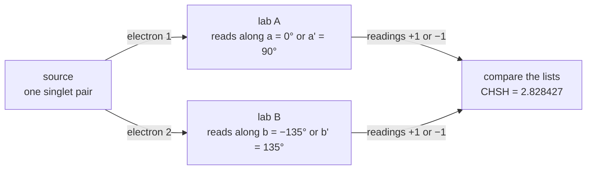
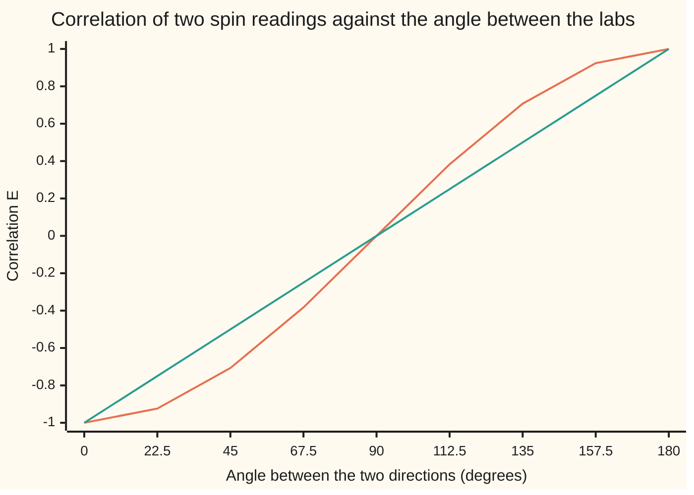

# Two particles: product states, the singlet, and the CHSH bound

[Syllabus](../../../SYLLABUS.md) → [Engineering mathematics](../README.md) → [Quantum Mechanics in Outline](../README.md#s09) → Two particles

---

## General Overview

In 2015 a team in Delft linked two electrons held 1.3 km apart, one in each of two labs. Each lab then read its electron's spin along one of two directions, picked at random just before the reading. Each lab alone saw a fair coin: up half the time, down half the time. Yet when the two lists of readings were compared, they matched a pattern too strong for any pair of coins that carried their answers from the start.

The score that measures this pattern is the **CHSH value** (after Clauser, Horne, Shimony and Holt, 1969). Any pair whose answers were fixed in advance scores at most 2. Two electrons in the **singlet**, the state (up-down − down-up)/√2, score 2√2 = 2.828427. The Delft team measured 2.42 ± 0.20.

The same mathematics sets how electrons fill an atom or a chip. Put two electrons in the shelf's 1 nm box. In the singlet both fit in the lowest level, for 0.752060 eV. With the same spin, both up, one must move up a level, and the pair costs 1.880151 eV.

This card builds the state of two particles, tests whether it splits into one state per particle, adds two spins into the singlet and the triplet, states the swap rule for identical particles, and proves the bound of 2 that the singlet beats.

**Two particles share one state, a column of four amplitudes built by the tensor product; when its 2 × 2 table fails the product test c₀₀c₁₁ − c₀₁c₁₀ = 0, as the singlet does with 0.5, neither particle has a state of its own, and its readings along four chosen directions reach a CHSH value of 2√2 = 2.828, above the bound of 2 that every model with answers fixed in advance obeys.**

**What kind of fact this is:** the rules for states and chances are a model, never contradicted by experiment. Inside it, the product test, the singlet and triplet, and the singlet's CHSH value 2√2 are theorems proved on this card. The bound of 2 is a theorem about every local model, proved in Why it works. The swap rule for identical particles is a law of the model, stated here: its proof (the spin-statistics theorem) needs relativistic quantum field theory, which this outline leaves out.

### The picture: one source, two labs, four settings



Each lab picks one of its two directions for each pair, after the electrons have left the source. Only the comparison shows the pattern; each list alone looks like coin tosses.

---

## The formula

Notation first, in words.

- From [Spin one-half](06-spin-and-two-state-systems.md): one electron's spin is a column of two complex numbers. Up along z is $`\lvert\uparrow\rangle = (1, 0)`$ and down is $`\lvert\downarrow\rangle = (0, 1)`$. A reading along a direction gives $`+1`$ (up) or $`-1`$ (down), in units of $`\hbar/2`$.
- The **tensor product** $`\otimes`$ from [Tensor products](../../03-Algebra/11-Duals%2C%20Quotients%20and%20Tensors/03-tensor-products.md) multiplies every entry of one column by every entry of the other: $`(u_0, u_1)\otimes(v_0, v_1) = (u_0v_0,\ u_0v_1,\ u_1v_0,\ u_1v_1)`$.
- A **two-particle state** is a column of four amplitudes, one per joint outcome. The subscripts say each electron's reading, 0 for up and 1 for down. So $`c_{01}`$ is the amplitude for "electron 1 up, electron 2 down", and $`\lvert\uparrow\downarrow\rangle = \lvert\uparrow\rangle\otimes\lvert\downarrow\rangle`$.
- A **product state** is one that equals some single column for electron 1 tensor some single column for electron 2. A state that is not a product is **entangled**.

```math
\lvert\psi\rangle = c_{00}\lvert\uparrow\uparrow\rangle + c_{01}\lvert\uparrow\downarrow\rangle + c_{10}\lvert\downarrow\uparrow\rangle + c_{11}\lvert\downarrow\downarrow\rangle, \qquad \text{product} \iff D = c_{00}c_{11} - c_{01}c_{10} = 0
```

```math
\text{triplet } (s = 1):\ \lvert\uparrow\uparrow\rangle,\ \tfrac{1}{\sqrt2}\bigl(\lvert\uparrow\downarrow\rangle + \lvert\downarrow\uparrow\rangle\bigr),\ \lvert\downarrow\downarrow\rangle; \qquad \text{singlet } (s = 0):\ \tfrac{1}{\sqrt2}\bigl(\lvert\uparrow\downarrow\rangle - \lvert\downarrow\uparrow\rangle\bigr); \qquad \hat S^2 = s(s+1)\hbar^2
```

```math
\psi(x_2, x_1) = -\,\psi(x_1, x_2) \quad \text{for two electrons, counting space and spin together}
```

```math
\mathrm{CHSH} = E(a,b) + E(a,b') + E(a',b) - E(a',b'), \qquad \lvert\mathrm{CHSH}\rvert \le 2 \ \text{(local)}, \qquad E(a,b) = -\cos(a-b) \ \text{(singlet)}, \qquad \mathrm{CHSH} = 2\sqrt2
```

**Read it aloud:** a pair splits into one state per electron exactly when c-zero-zero times c-one-one equals c-zero-one times c-one-zero. Two spins one-half combine into three states of total spin 1 and one state of total spin 0. Swapping two electrons flips the sign of their state. Four correlations, three added and one taken away, never pass 2 for answers fixed in advance, but reach 2√2 for the singlet.

| Symbol | Plain meaning | In our example | Push it up and the answer… |
| --- | --- | --- | --- |
| $`\lvert\uparrow\rangle`$, $`\lvert\downarrow\rangle`$ | one electron up or down along z: the columns (1, 0) and (0, 1) | — | — |
| $`\otimes`$, $`\lvert\psi\rangle`$, $`u`$, $`v`$ | the tensor product; the pair's state, a column of four amplitudes of total squared size 1; the two one-electron columns of a product $`u\otimes v`$ | the singlet (0, 0.7071, −0.7071, 0); the product state has u = (1, 0), v = (0.8660, 0.5000) | — |
| $`c_{00}, c_{01}, c_{10}, c_{11}`$ | the amplitudes for up-up, up-down, down-up, down-down | 0, 0.7071, −0.7071, 0 | — |
| $`D`$ | the product test, $`c_{00}c_{11} - c_{01}c_{10}`$: zero exactly for a product state | 0.5000 for the singlet, 0.0000 for a product | further from 0, further from any product; 0.5 is the most a state can reach |
| $`\sigma_x, \sigma_y, \sigma_z`$, $`I`$, $`\sigma_a`$ | the Pauli matrices (spin readings along x, y, z) and the 2 × 2 identity, from [Spin one-half](06-spin-and-two-state-systems.md); the spin-reading matrix along the direction at angle $`a`$ from z, in the x–z plane: $`\cos a\,\sigma_z + \sin a\,\sigma_x`$, readings $`\pm1`$ | $`a = 0°`$ is z | — |
| $`\hat S^2`$, $`s`$, $`\hat S_z`$, $`\hbar`$ | the pair's total spin squared; its spin number; the total spin along z; the reduced Planck constant | $`s = 1`$ (triplet) or 0 (singlet); $`S_z = +1, 0, -1`$ or 0, in units of $`\hbar`$ | — |
| $`\hat P`$ | the swap: exchange electron 1 and electron 2 | +1 on the triplet, −1 on the singlet | — |
| $`\psi_n(x)`$, $`n`$, $`L`$, $`\psi_A`$ | one electron's wave in the box, $`\sqrt{2/L}\sin(n\pi x/L)`$; its level; the box width; the pair's antisymmetric space part; $`x_1`$, $`x_2`$: electron 1's and electron 2's coordinates (position, and in the swap rule spin too) | $`n = 1`$ or 2; $`L = 1`$ nm | a wider box lowers every level |
| $`E_1`$, $`h`$, $`m_e`$ | the lowest level, $`h^2/(8m_eL^2)`$; the Planck constant; the electron mass | 0.376030 eV | — |
| $`a, a'`$; $`b, b'`$; $`A, A', B, B'`$ | lab A's two directions; lab B's two directions; the readings (±1) along them, or in the Tsirelson fold their reading matrices | 0°, 90°; −135°, 135° | — |
| $`E(a,b)`$, $`\theta`$ | the correlation: the average of (A's reading × B's reading) over many pairs, between −1 and +1; $`\theta = a - b`$, the angle between the two directions | −cos 135° = +0.7071 | — |
| $`\mathrm{CHSH}`$, $`\lambda`$, $`W`$ | the CHSH value; the hidden instructions a local model lets each pair carry; the CHSH matrix in the Tsirelson fold | 2.828427 for the singlet; at most 2 for any $`\lambda`$ model; largest eigenvalue of $`W`$ 2.828427 | — |

### When it holds

- **Nothing touches the spins on the way.** A stray field at one lab turns that electron's phase, as on [Spin one-half](06-spin-and-two-state-systems.md), and the pair drifts towards the plus-sign state. With the four directions fixed, the CHSH value then falls, to 0.0000 for the plus sign. The pair is still entangled; the fixed directions no longer suit it.
- **The settings are chosen after the pair leaves, too late for any signal.** If a lab's choice could reach the other lab or the source in time, a model with fixed answers could fake any score. Delft finished each reading before light from the other lab's choice could arrive.
- **Every pair counts.** If the labs throw away pairs where a detector missed, the kept pairs can score above 2 with no entanglement at all.
- **The two electrons in the box ignore each other's charge.** Their repulsion at 1 nm apart is 1.439965 eV, larger than the 1.128090 eV gap the swap rule opens. The count of who fits in which level survives; the energies are bookkeeping, not a prediction.
- **The swap rule needs identical particles.** An electron and a proton can be told apart, so their joint state has no sign rule.

---

## Why it works

### Step 0: amplitudes for joint outcomes

Two electrons have four joint outcomes, so their state needs four amplitudes. A product is built from two columns of two, but doubling one column and halving the other gives the same product. So products have only three free numbers, and the four amplitudes of a product must obey one equation. Step 1 finds it: $`D = 0`$. Most states break it. Those are the entangled ones.

### Step 1: the product test

If the state is a product $`u\otimes v`$, then $`c_{jk} = u_jv_k`$. Then $`c_{00}c_{11} = u_0v_0u_1v_1 = c_{01}c_{10}`$, so $`D = 0`$.

The converse uses the rank test from [Tensor products](../../03-Algebra/11-Duals%2C%20Quotients%20and%20Tensors/03-tensor-products.md). Write the amplitudes as a 2 × 2 table, rows for electron 1 and columns for electron 2. $`D`$ is the table's determinant. $`D = 0`$ means the rows are multiples of one row, and that row is electron 2's column.

For the singlet, $`D = 0 \times 0 - (0.7071)(-0.7071) = 0.5000`$. A product such as "electron 1 up along z, electron 2 at 60° from z" gives (0.8660, 0.5000, 0, 0) and $`D = 0.0000`$.

Two more facts show what failing the test means:

- **Electron 1 alone is a fair coin along every axis.** Its own state, the **reduced state** (the 2 × 2 table that gives every chance for readings on electron 1 alone, the amplitude table times its conjugate transpose; here every entry is real), is `[[0.5, 0], [0, 0.5]]`. Its purity (the sum of its entries squared; 1 for a definite state) is 0.5000, which equals $`1 - 2D^2`$.
- **No product comes close.** The best overlap squared between the singlet and any real product state is 0.5000, found by scanning both columns degree by degree, and it equals $`\bigl(1+\sqrt{1-4D^2}\bigr)/2`$.

### Step 2: adding two spins gives the triplet and the singlet

The pair's total spin is the sum of the two spins. In matrix form, electron 1's spin is $`\tfrac\hbar2\sigma_k\otimes I`$ and electron 2's is $`\tfrac\hbar2 I\otimes\sigma_k`$, for each axis $`k = x, y, z`$. Square the sum. Each $`\sigma_k^2 = I`$, so

```math
\hat S^2 = \hbar^2\Bigl(\tfrac32 I + \tfrac12\sum_k \sigma_k\otimes\sigma_k\Bigr) = \hbar^2\,(I + \hat P), \qquad \text{because}\ \sum_k\sigma_k\otimes\sigma_k = 2\hat P - I .
```

The last identity says the three Pauli products add up to the swap, shifted and scaled; the checks multiply out all sixteen entries. So $`\hat S^2`$ depends only on the swap:

| Swap gives | $`\hat S^2`$ | Spin number $`s`$, from $`s(s+1)`$ | States | Name |
| --- | --- | --- | --- | --- |
| +1 (symmetric) | $`2\hbar^2`$ | 1 | up-up, (up-down + down-up)/√2, down-down: $`S_z = +1, 0, -1`$ | triplet |
| −1 (antisymmetric) | $`0`$ | 0 | (up-down − down-up)/√2: $`S_z = 0`$ | singlet |

The trace of $`\hat S^2`$ is 6, which equals 3 × 2 + 0. The singlet has spin 0, so it has no direction. Turning both spins by 60° about y leaves it unchanged: overlap 1.0000. **The singlet is anticorrelated along every axis, not only along z.** That is why its correlation depends only on the angle between the two labs.

### Step 3: identical particles and the swap rule

Two electrons carry no labels. Swapping them must leave every chance unchanged, so the state can change only by a sign. Nature fixes the sign by the spin. Particles of half-integer spin, called **fermions** (electrons, protons, neutrons), take −1. Particles of whole-number spin, called **bosons** (photons, helium-4 atoms), take +1.

For electrons the whole state, space part times spin part, must flip sign. So there are two ways to build it:

- spin singlet (antisymmetric) times a symmetric space part;
- spin triplet (symmetric) times an antisymmetric space part.

The antisymmetric space part for levels $`n_1`$ and $`n_2`$ is

```math
\psi_A(x_1, x_2) = \tfrac{1}{\sqrt2}\bigl(\psi_{n_1}(x_1)\psi_{n_2}(x_2) - \psi_{n_2}(x_1)\psi_{n_1}(x_2)\bigr).
```

Set $`n_1 = n_2`$ and the two terms cancel: the state is zero everywhere. **Two electrons with the same spin cannot share a level.** That is the Pauli exclusion principle, read off from a minus sign.

In the 1 nm box, $`E_1 = h^2/(8m_eL^2) = 0.376030`$ eV and level $`n`$ costs $`n^2E_1`$ ([Schrodinger's equation](03-schrodinger-equation-and-the-particle-in-a-box.md)). The singlet lets both take $`n = 1`$: 0.752060 eV. The triplet, which holds every same-spin pair and also (up-down + down-up)/√2, needs $`n = 1`$ and $`n = 2`$: (1 + 4) × 0.376030 = 1.880151 eV. The gap is 1.128090 eV.

The minus sign also moves the electrons apart. Chance that both electrons sit in the same half of the box, levels 1 and 2:

| Pair | Chance both in the same half |
| --- | --- |
| spin triplet (for example both up): antisymmetric space part | 0.1397 |
| two electrons that could be told apart | 0.5000 |
| spin singlet: symmetric space part | 0.8603 |

The formula is $`\tfrac12 \mp 2\bigl(\tfrac{4}{3\pi}\bigr)^2`$, where $`\tfrac{4}{3\pi}`$ is the overlap of levels 1 and 2 over the left half. Same-spin electrons keep apart with no force acting. Chemists call the gap around each one the **exchange hole**.

### Step 4: no model with fixed answers passes 2

A **local model** says each pair leaves the source carrying instructions $`\lambda`$. These fix A's reading for each of A's directions, $`A, A' = \pm1`$, and B's for each of B's, $`B, B' = \pm1`$. Neither lab's reading may depend on the other lab's choice. For one pair:

```math
AB + AB' + A'B - A'B' = A\,(B + B') + A'\,(B - B').
```

$`B`$ and $`B'`$ are each $`\pm1`$. So either they agree, and $`B - B' = 0`$ while $`B + B' = \pm2`$, or they differ, and the reverse. Either way the sum is $`+2`$ or $`-2`$. The CHSH value is the average of this sum over many pairs, so it lies between −2 and 2, whatever the instructions. The checks list all 16 sets of instructions: each gives exactly +2 or −2.

### Step 5: the singlet reaches 2√2

Take directions at angle $`\theta`$ apart. Lab A reads up with chance ½. The singlet is anticorrelated along every axis, so electron 2 is then down along A's direction. By the half-angle rule on [Spin one-half](06-spin-and-two-state-systems.md), electron 2 reads up along B's direction with chance $`\sin^2(\theta/2)`$. So

```math
E = P(\text{same}) - P(\text{opposite}) = \sin^2\tfrac\theta2 - \cos^2\tfrac\theta2 = -\cos\theta .
```

At the chosen directions all four terms are 0.7071 in the right direction, so CHSH = 4 × 0.7071 = 2.828427.

The chart compares this with a simple local model that reaches the bound of 2. Each pair carries a random direction; each lab reads +1 if its direction lies within 90° of it, with lab B's sign reversed. That model scores exactly 2 at these four settings.



Orange: the singlet, −cos θ. Green: the random-direction local model, a straight line. They agree at 0°, 90° and 180°. In between, the singlet's curve bulges past the straight line: −0.707 against −0.500 at 45°, and 0.707 against 0.500 at 135°. CHSH collects four such gains.

<details>
<summary>Why 2√2 is the most quantum mechanics allows (Tsirelson's bound, 1980)</summary>

Write the four reading matrices as $`A, A'`$ for lab A and $`B, B'`$ for lab B. Each squares to $`I`$. The CHSH matrix is

$`\displaystyle W = A\otimes(B + B') + A'\otimes(B - B').`$

Multiply it out, using $`A^2 = A'^2 = B^2 = B'^2 = I`$:

$`\displaystyle W^2 = 4\,I - [A, A']\otimes[B, B'],`$

where $`[A, A'] = AA' - A'A`$. Each of $`AA'`$ and $`A'A`$ stretches no column by more than 1, so a commutator stretches by at most 2. Then $`W^2`$ stretches by at most 4 + 2 × 2 = 8, and the CHSH value of any state is at most $`\sqrt8 = 2\sqrt2`$.

The checks find the largest eigenvalue of the 4 × 4 matrix $`W`$ by repeated multiplication: 2.828427. The singlet reaches it, so no state does better at these settings.

</details>

---

## Worked numbers, by hand

| Step | Arithmetic | Value |
| --- | --- | --- |
| product test, singlet | 0 × 0 − 0.7071 × (−0.7071) | 0.5000 |
| lowest level in the 1 nm box | $`(6.62607015\times10^{-34})^2 / (8 \times 9.1093837139\times10^{-31} \times (10^{-9})^2)`$, in eV | 0.376030 eV |
| singlet, both in level 1 | 2 × 0.376030 | 0.752060 eV |
| triplet (same spins), levels 1 and 2 | (1 + 4) × 0.376030 | 1.880151 eV |
| $`E(0°, -135°)`$ | −cos 135° | +0.7071 |
| $`E(0°, 135°)`$ | −cos(−135°) | +0.7071 |
| $`E(90°, -135°)`$ | −cos 225° | +0.7071 |
| $`E(90°, 135°)`$ | −cos(−45°) | −0.7071 |
| CHSH | 0.7071 + 0.7071 + 0.7071 − (−0.7071) | **2.828427** |

So the singlet's readings, compared across the two labs, score 2.828427, above the 2 that any pair carrying fixed answers can score.

### What breaks if you drop a piece

| Mistake | Comes out at | What went wrong |
| --- | --- | --- |
| Treat the singlet as two separate 50/50 spins | chance of both up along z 0.2500, truth 0.0000 | Each electron alone is 50/50, but the pair is entangled: its chances do not multiply |
| Write the singlet with a plus sign, (up-down + down-up)/√2 | CHSH 0.0000 at the same four directions | That is the triplet's middle state. It is just as entangled (test −0.5000) but correlated differently; swap B's two directions and it scores 2.8284 |
| Put two same-spin electrons both in level 1 | 0.752060 eV, but the lowest allowed is 1.880151 eV | Their space part must be antisymmetric, and that is zero when both levels are the same |
| Read the box energies as a prediction | repulsion 1.439965 eV against a gap of 1.128090 eV | Outside the model's range: the electrons' charge matters as much as the levels at 1 nm |

---

## Code, from first principles, and it actually runs

The scripts build every two-particle matrix by the Kronecker product (the tensor product written as a matrix) from 2 × 2 blocks. $`\sigma_y\otimes\sigma_y`$ is written as $`-J\otimes J`$ with $`J`$ = `[[0, 1], [-1, 0]]`, so everything stays real.

The product test takes three roads: the number $`D`$, the purity of electron 1's reduced state, and a scan for the closest product state. Spin addition is checked by applying the 4 × 4 matrix $`\hat S^2`$ to each state, and the swap identity entry by entry. The swap rule takes two roads: the box formula against a 200 × 200 grid that searches for the lowest pair of levels whose antisymmetric state is not zero, and the same-half chances by formula and by grid.

CHSH takes three roads: 4 × 4 matrices on the singlet, the closed form −cos(a − b), and the largest eigenvalue of the CHSH matrix. All 16 local strategies are listed. A SplitMix64 generator with seed 2026 then simulates 100000 pairs per setting, for the random-direction model and for the singlet. The simulations show the scatter of real counts; they are a demonstration, not an extra road.

### Python

```python
# Two particles -- the check behind the card.  Standard library only.
# Two spin-one-half electrons.  Four-entry states come from the Kronecker
# product.  The singlet fails the product test three ways (the test number,
# the reduced state, the best product fit); spin addition comes from the 4x4
# matrix S^2; the exchange rule is run on two electrons in a 1 nm box (formula
# against a grid); CHSH comes from 4x4 matrices, from -cos(a - b), and from the
# largest eigenvalue of the CHSH matrix, against every local strategy.
from math import cos, sin, pi, sqrt

def kron(A, B):
    p, q = len(B), len(B[0])
    return [[A[i // p][j // q] * B[i % p][j % q] for j in range(len(A[0]) * q)] for i in range(len(A) * p)]
def lin(a, A, b, B): return [[a * x + b * y for x, y in zip(r, s)] for r, s in zip(A, B)]
def mv(M, v): return [sum(m * x for m, x in zip(row, v)) for row in M]
def dot(u, v): return sum(x * y for x, y in zip(u, v))
def gap(A, B): return max(abs(x - y) for r, s in zip(A, B) for x, y in zip(r, s))
def eye(n): return [[1.0 if i == j else 0.0 for j in range(n)] for i in range(n)]
I2, SX, SZ = eye(2), [[0, 1], [1, 0]], [[1, 0], [0, -1]]
J = [[0, 1], [-1, 0]]                  # sigma_y = -i J, so sigma_y (x) sigma_y = -J (x) J: all real
def sig(deg): t = deg * pi / 180; return lin(cos(t), SZ, sin(t), SX)   # axis tilted deg from z towards x
def test(c): return c[0] * c[3] - c[1] * c[2]                           # c00 c11 - c01 c10
def z(x): return 0.0 if abs(x) < 5e-13 else x                           # print rounding noise as 0

class SplitMix64:                      # a small seeded generator, written out
    def __init__(self, seed): self.s = seed
    def next(self):
        self.s = (self.s + 0x9E3779B97F4A7C15) & 0xFFFFFFFFFFFFFFFF
        z = self.s
        z = ((z ^ (z >> 30)) * 0xBF58476D1CE4E5B9) & 0xFFFFFFFFFFFFFFFF
        z = ((z ^ (z >> 27)) * 0x94D049BB133111EB) & 0xFFFFFFFFFFFFFFFF
        return ((z ^ (z >> 31)) >> 11) / 9007199254740992.0

# ---- 1. the product test: entries ordered (up-up, up-down, down-up, down-down) ----
r = 1 / sqrt(2)
singlet, t_plus, t_zero, t_minus = [0, r, -r, 0], [1, 0, 0, 0], [0, r, r, 0], [0, 0, 0, 1]
prod = [x[0] for x in kron([[1], [0]], [[cos(pi / 6)], [sin(pi / 6)]])]  # A up along z, B 60 deg from z
print(f"product state  ({prod[0]:.4f}, {prod[1]:.4f}, {prod[2]:.4f}, {prod[3]:.4f})  test {test(prod):.4f}")
print(f"singlet        ({singlet[0]:.4f}, {singlet[1]:.4f}, {singlet[2]:.4f}, {singlet[3]:.4f})  test {test(singlet):.4f}")
assert abs(test(prod)) < 1e-15 and abs(test(singlet) - 0.5) < 1e-15
C = [[singlet[0], singlet[1]], [singlet[2], singlet[3]]]           # road 2: electron 1's own state, C C^T
rho = [[dot(C[i], C[j]) for j in range(2)] for i in range(2)]
purity = sum(rho[i][j] ** 2 for i in range(2) for j in range(2))
print(f"electron 1 alone: [[{rho[0][0]:.4f}, {rho[0][1]:.4f}], [{rho[1][0]:.4f}, {rho[1][1]:.4f}]], purity {purity:.4f} = 1 - 2 test^2 = {1 - 2 * test(singlet) ** 2:.4f}")
assert abs(purity - (1 - 2 * test(singlet) ** 2)) < 1e-12 and gap(rho, lin(0.5, I2, 0, I2)) < 1e-15
best = 0.0                              # road 3: closest product state, scanned every degree
for a in range(180):
    for b in range(180):
        u = (cos(a * pi / 180), sin(a * pi / 180)); v = (cos(b * pi / 180), sin(b * pi / 180))
        best = max(best, dot([u[0] * v[0], u[0] * v[1], u[1] * v[0], u[1] * v[1]], singlet) ** 2)
print(f"best product overlap^2 {best:.4f}  formula (1 + sqrt(1 - 4 test^2))/2 = {(1 + sqrt(1 - 4 * test(singlet) ** 2)) / 2:.4f}")
assert abs(best - 0.5) < 1e-12

# ---- 2. adding two spins: S^2 = (3/2) I + (1/2) sum_k sigma_k (x) sigma_k, in units of hbar^2 ----
SS = lin(1, lin(1, kron(SX, SX), -1, kron(J, J)), 1, kron(SZ, SZ))
S2 = lin(1.5, eye(4), 0.5, SS)
Sz = lin(0.5, kron(SZ, I2), 0.5, kron(I2, SZ))
for name, v, s in (("triplet up-up    ", t_plus, 1), ("triplet (ud+du)  ", t_zero, 1), ("triplet down-down", t_minus, 1), ("singlet (ud-du)  ", singlet, 0)):
    s2, sz = dot(v, mv(S2, v)), dot(v, mv(Sz, v))
    assert max(abs(x - s * (s + 1) * y) for x, y in zip(mv(S2, v), v)) < 1e-12   # eigenvector, eigenvalue s(s+1)
    print(f"{name}  S^2 = {s2:.4f} hbar^2  s = {(sqrt(1 + 4 * s2) - 1) / 2:.0f}  S_z = {z(sz):+.0f} hbar")
swap = [[1, 0, 0, 0], [0, 0, 1, 0], [0, 1, 0, 0], [0, 0, 0, 1]]
assert gap(lin(0.5, eye(4), 0.5, SS), swap) < 1e-15                         # swap = (I + sum sigma.sigma)/2
print(f"swap: triplet {dot(t_zero, mv(swap, t_zero)):+.0f}, singlet {dot(singlet, mv(swap, singlet)):+.0f};  trace S^2 = {sum(S2[i][i] for i in range(4)):.0f} = 3 x 2 + 0")
R = [[cos(pi / 6), -sin(pi / 6)], [sin(pi / 6), cos(pi / 6)]]               # turn both spins 60 deg about y
print(f"singlet after turning both spins 60 deg: overlap {dot(singlet, mv(kron(R, R), singlet)):.4f}")
assert abs(dot(singlet, mv(kron(R, R), singlet)) - 1) < 1e-12

# ---- 3. identical electrons in a 1 nm box ----
h, me, eV, eps0 = 6.62607015e-34, 9.1093837139e-31, 1.602176634e-19, 8.8541878188e-12   # CODATA 2022
L = 1e-9
E1 = h * h / (8 * me * L * L) / eV
print(f"E1 = h^2/(8 m L^2) = {E1:.6f} eV;  singlet, both n=1: {2 * E1:.6f} eV;  triplet, n=1 and 2: {5 * E1:.6f} eV;  gap {3 * E1:.6f} eV")
N = 200; xs = [(k + 0.5) / N for k in range(N)]                                # box in units of L
psi = lambda n, x: sqrt(2) * sin(n * pi * x)
def anti_norm(n1, n2):                  # grid norm^2 of psi_n1(x1) psi_n2(x2) - psi_n2(x1) psi_n1(x2), over 2
    return sum((psi(n1, x) * psi(n2, y) - psi(n2, x) * psi(n1, y)) ** 2 for x in xs for y in xs) / (2 * N * N)
pairs = sorted(((n1 * n1 + n2 * n2, n1, n2) for n1 in range(1, 4) for n2 in range(n1, 4)))
low = next(p for p in pairs if anti_norm(p[1], p[2]) > 0.5)
print(f"antisymmetric norm^2: (1,1) {anti_norm(1, 1):.4f}, (1,2) {anti_norm(1, 2):.4f};  lowest allowed pair ({low[1]},{low[2]}) at {low[0] * E1:.6f} eV")
assert (low[1], low[2]) == (1, 2)
a12 = 4 / (3 * pi)                       # overlap of psi_1 and psi_2 over the left half
same_cf = {+1: 0.5 + 2 * a12 ** 2, -1: 0.5 - 2 * a12 ** 2}
for sgn, name in ((+1, "symmetric (singlet)"), (-1, "antisymmetric (triplet)")):
    grid = sum((psi(1, x) * psi(2, y) + sgn * psi(2, x) * psi(1, y)) ** 2 / 2 for x in xs for y in xs if (x < 0.5) == (y < 0.5)) / (N * N)
    print(f"P(same half) {name}  formula {same_cf[sgn]:.4f}  grid {grid:.4f}")
    assert abs(grid - same_cf[sgn]) < 1e-4
print(f"P(same half) told-apart electrons  {0.5:.4f}")

# ---- 4. CHSH: S = E(a,b) + E(a,b') + E(a',b) - E(a',b') ----
a, a2, b, b2 = 0.0, 90.0, -135.0, 135.0
def E(state, x, y): return dot(state, mv(kron(sig(x), sig(y)), state))
pairs4 = ((a, b, 1), (a, b2, 1), (a2, b, 1), (a2, b2, -1))
for x, y, _ in pairs4:
    print(f"E({x:4.0f},{y:5.0f})  matrices {E(singlet, x, y):+.4f}  -cos(a-b) {-cos((x - y) * pi / 180):+.4f}")
    assert abs(E(singlet, x, y) + cos((x - y) * pi / 180)) < 1e-12
S_q = sum(s * E(singlet, x, y) for x, y, s in pairs4)
W = [[0.0] * 4 for _ in range(4)]       # road 3: the CHSH matrix; its largest eigenvalue by power iteration on W^2
for x, y, s in pairs4: W = lin(1, W, s, kron(sig(x), sig(y)))
v = [1.0, 0.3, -0.7, 0.2]
for _ in range(200): v = mv(W, mv(W, v)); n = sqrt(dot(v, v)); v = [t / n for t in v]
lam = sqrt(dot(v, mv(W, mv(W, v))))
print(f"CHSH singlet {S_q:.6f};  2 sqrt 2 = {2 * sqrt(2):.6f};  largest eigenvalue of the CHSH matrix {lam:.6f}")
assert abs(S_q - 2 * sqrt(2)) < 1e-12 and abs(lam - 2 * sqrt(2)) < 1e-9
local = [A0 * B0 + A0 * B1 + A1 * B0 - A1 * B1 for A0 in (1, -1) for A1 in (1, -1) for B0 in (1, -1) for B1 in (1, -1)]
print(f"all 16 local strategies: S in {sorted(set(local))}, largest {max(local)}")
assert max(abs(t) for t in local) == 2
def E_lhv(x, y): d = abs((x - y + 180) % 360 - 180); return -1 + 2 * d / 180   # hidden direction, sign readings
rng, M = SplitMix64(2026), 100000
S_lhv = S_sim_l = S_sim_q = 0.0
for x, y, s in pairs4:
    S_lhv += s * E_lhv(x, y); tot_l = tot_q = 0
    for _ in range(M):
        lmb = 360 * rng.next()
        A = 1 if cos((x - lmb) * pi / 180) >= 0 else -1; B = -1 if cos((y - lmb) * pi / 180) >= 0 else 1
        tot_l += A * B
        tot_q += 1 if rng.next() < (1 + E(singlet, x, y)) / 2 else -1         # +1: same readings
    S_sim_l += s * tot_l / M; S_sim_q += s * tot_q / M
print(f"hidden-direction model S {S_lhv:.4f}, simulated {S_sim_l:.4f};  quantum simulated {S_sim_q:.4f}  ({M} pairs per setting)")
assert abs(S_sim_l - S_lhv) < 4 * sqrt(4 * 0.75 / M) and abs(S_sim_q - S_q) < 4 * sqrt(4 * 0.5 / M)
th = [22.5 * k for k in range(9)]
print("chart, angle (deg)   " + " ".join(f"{t:6.1f}" for t in th))
print("chart, quantum E     " + " ".join(f"{z(E(singlet, 0, t)):+.3f}" for t in th))
print("chart, hidden-dir E  " + " ".join(f"{E_lhv(0, t):+.3f}" for t in th))

# ---- what breaks ----
print(f"wrong: two separate 50/50 spins  P(both up along z) {rho[0][0] * rho[0][0]:.4f}   (singlet {singlet[0] ** 2:.4f})")
swapped = ((a, b2, 1), (a, b, 1), (a2, b2, 1), (a2, b, -1))
print(f"wrong: plus sign (ud+du)  test {test(t_zero):.4f}, CHSH same directions {z(sum(s * E(t_zero, x, y) for x, y, s in pairs4)):.4f}, B's two swapped {sum(s * E(t_zero, x, y) for x, y, s in swapped):.4f}")
print(f"wrong: same-spin pair both in n=1  {2 * E1:.6f} eV   (allowed lowest {5 * E1:.6f} eV)")
print(f"outside the model: repulsion at 1 nm {eV / (4 * pi * eps0 * L):.6f} eV  vs  Pauli gap {3 * E1:.6f} eV")
print("ALL CHECKS PASS")
```

**Ran 2026-11-23 on macOS, Python 3.14.10, standard library only. All checks passed. Output, pasted from the run:**

```
product state  (0.8660, 0.5000, 0.0000, 0.0000)  test 0.0000
singlet        (0.0000, 0.7071, -0.7071, 0.0000)  test 0.5000
electron 1 alone: [[0.5000, 0.0000], [0.0000, 0.5000]], purity 0.5000 = 1 - 2 test^2 = 0.5000
best product overlap^2 0.5000  formula (1 + sqrt(1 - 4 test^2))/2 = 0.5000
triplet up-up      S^2 = 2.0000 hbar^2  s = 1  S_z = +1 hbar
triplet (ud+du)    S^2 = 2.0000 hbar^2  s = 1  S_z = +0 hbar
triplet down-down  S^2 = 2.0000 hbar^2  s = 1  S_z = -1 hbar
singlet (ud-du)    S^2 = 0.0000 hbar^2  s = 0  S_z = +0 hbar
swap: triplet +1, singlet -1;  trace S^2 = 6 = 3 x 2 + 0
singlet after turning both spins 60 deg: overlap 1.0000
E1 = h^2/(8 m L^2) = 0.376030 eV;  singlet, both n=1: 0.752060 eV;  triplet, n=1 and 2: 1.880151 eV;  gap 1.128090 eV
antisymmetric norm^2: (1,1) 0.0000, (1,2) 1.0000;  lowest allowed pair (1,2) at 1.880151 eV
P(same half) symmetric (singlet)  formula 0.8603  grid 0.8603
P(same half) antisymmetric (triplet)  formula 0.1397  grid 0.1397
P(same half) told-apart electrons  0.5000
E(   0, -135)  matrices +0.7071  -cos(a-b) +0.7071
E(   0,  135)  matrices +0.7071  -cos(a-b) +0.7071
E(  90, -135)  matrices +0.7071  -cos(a-b) +0.7071
E(  90,  135)  matrices -0.7071  -cos(a-b) -0.7071
CHSH singlet 2.828427;  2 sqrt 2 = 2.828427;  largest eigenvalue of the CHSH matrix 2.828427
all 16 local strategies: S in [-2, 2], largest 2
hidden-direction model S 2.0000, simulated 2.0020;  quantum simulated 2.8240  (100000 pairs per setting)
chart, angle (deg)      0.0   22.5   45.0   67.5   90.0  112.5  135.0  157.5  180.0
chart, quantum E     -1.000 -0.924 -0.707 -0.383 +0.000 +0.383 +0.707 +0.924 +1.000
chart, hidden-dir E  -1.000 -0.750 -0.500 -0.250 +0.000 +0.250 +0.500 +0.750 +1.000
wrong: two separate 50/50 spins  P(both up along z) 0.2500   (singlet 0.0000)
wrong: plus sign (ud+du)  test -0.5000, CHSH same directions 0.0000, B's two swapped 2.8284
wrong: same-spin pair both in n=1  0.752060 eV   (allowed lowest 1.880151 eV)
outside the model: repulsion at 1 nm 1.439965 eV  vs  Pauli gap 1.128090 eV
ALL CHECKS PASS
```

### Rust

```rust
// Two particles -- the check behind the card.  Rust std only, no crates.
// Two spin-one-half electrons.  Four-entry states come from the Kronecker
// product.  The singlet fails the product test three ways (the test number,
// the reduced state, the best product fit); spin addition comes from the 4x4
// matrix S^2; the exchange rule is run on two electrons in a 1 nm box (formula
// against a grid); CHSH comes from 4x4 matrices, from -cos(a - b), and from the
// largest eigenvalue of the CHSH matrix, against every local strategy.
use std::f64::consts::PI;
type M = Vec<Vec<f64>>;

fn kron(a: &M, b: &M) -> M {
    let (p, q) = (b.len(), b[0].len());
    (0..a.len() * p).map(|i| (0..a[0].len() * q).map(|j| a[i / p][j / q] * b[i % p][j % q]).collect()).collect()
}
fn lin(x: f64, a: &M, y: f64, b: &M) -> M { a.iter().zip(b).map(|(r, s)| r.iter().zip(s).map(|(u, v)| x * u + y * v).collect()).collect() }
fn mv(m: &M, v: &[f64]) -> Vec<f64> { m.iter().map(|row| row.iter().zip(v).map(|(a, b)| a * b).sum()).collect() }
fn dot(u: &[f64], v: &[f64]) -> f64 { u.iter().zip(v).map(|(a, b)| a * b).sum() }
fn gap(a: &M, b: &M) -> f64 { a.iter().zip(b).flat_map(|(r, s)| r.iter().zip(s).map(|(x, y)| (x - y).abs())).fold(0.0, f64::max) }
fn eye(n: usize) -> M { (0..n).map(|i| (0..n).map(|j| if i == j { 1.0 } else { 0.0 }).collect()).collect() }
fn m2(a: f64, b: f64, c: f64, d: f64) -> M { vec![vec![a, b], vec![c, d]] }
fn sig(deg: f64) -> M { let t = deg * PI / 180.0; m2(t.cos(), t.sin(), t.sin(), -t.cos()) } // tilted deg from z towards x
fn test(c: &[f64]) -> f64 { c[0] * c[3] - c[1] * c[2] }                                 // c00 c11 - c01 c10
fn z(x: f64) -> f64 { if x.abs() < 5e-13 { 0.0 } else { x } }                         // print rounding noise as 0
fn psi(n: f64, x: f64) -> f64 { 2f64.sqrt() * (n * PI * x).sin() }
fn e_q(st: &[f64], x: f64, y: f64) -> f64 { dot(st, &mv(&kron(&sig(x), &sig(y)), st)) }
fn e_lhv(x: f64, y: f64) -> f64 { let d = ((x - y + 180.0).rem_euclid(360.0) - 180.0).abs(); -1.0 + 2.0 * d / 180.0 }

struct SplitMix64 { s: u64 }    // a small seeded generator, written out
impl SplitMix64 {
    fn next(&mut self) -> f64 {
        self.s = self.s.wrapping_add(0x9E3779B97F4A7C15);
        let mut z = self.s;
        z = (z ^ (z >> 30)).wrapping_mul(0xBF58476D1CE4E5B9);
        z = (z ^ (z >> 27)).wrapping_mul(0x94D049BB133111EB);
        ((z ^ (z >> 31)) >> 11) as f64 / 9007199254740992.0
    }
}

fn main() {
    let (i2, sx, sz) = (eye(2), m2(0.0, 1.0, 1.0, 0.0), m2(1.0, 0.0, 0.0, -1.0));
    let jj = m2(0.0, 1.0, -1.0, 0.0);   // sigma_y = -i J, so sigma_y (x) sigma_y = -J (x) J: all real
    // ---- 1. the product test: entries ordered (up-up, up-down, down-up, down-down) ----
    let r = 1.0 / 2f64.sqrt();
    let (singlet, t_plus, t_zero, t_minus) = (vec![0.0, r, -r, 0.0], vec![1.0, 0.0, 0.0, 0.0], vec![0.0, r, r, 0.0], vec![0.0, 0.0, 0.0, 1.0]);
    let prod: Vec<f64> = kron(&vec![vec![1.0], vec![0.0]], &vec![vec![(PI / 6.0).cos()], vec![(PI / 6.0).sin()]]).iter().map(|x| x[0]).collect();
    println!("product state  ({:.4}, {:.4}, {:.4}, {:.4})  test {:.4}", prod[0], prod[1], prod[2], prod[3], test(&prod));
    println!("singlet        ({:.4}, {:.4}, {:.4}, {:.4})  test {:.4}", singlet[0], singlet[1], singlet[2], singlet[3], test(&singlet));
    assert!(test(&prod).abs() < 1e-15 && (test(&singlet) - 0.5).abs() < 1e-15);
    let c = [[singlet[0], singlet[1]], [singlet[2], singlet[3]]];            // road 2: electron 1's own state, C C^T
    let rho: M = (0..2).map(|i| (0..2).map(|j| dot(&c[i], &c[j])).collect()).collect();
    let purity: f64 = rho.iter().flatten().map(|x| x * x).sum();
    println!("electron 1 alone: [[{:.4}, {:.4}], [{:.4}, {:.4}]], purity {:.4} = 1 - 2 test^2 = {:.4}", rho[0][0], rho[0][1], rho[1][0], rho[1][1], purity, 1.0 - 2.0 * test(&singlet).powi(2));
    assert!((purity - (1.0 - 2.0 * test(&singlet).powi(2))).abs() < 1e-12 && gap(&rho, &lin(0.5, &i2, 0.0, &i2)) < 1e-15);
    let mut best = 0.0f64;              // road 3: closest product state, scanned every degree
    for a in 0..180 {
        for b in 0..180 {
            let (u0, u1) = ((a as f64 * PI / 180.0).cos(), (a as f64 * PI / 180.0).sin());
            let (v0, v1) = ((b as f64 * PI / 180.0).cos(), (b as f64 * PI / 180.0).sin());
            best = best.max(dot(&[u0 * v0, u0 * v1, u1 * v0, u1 * v1], &singlet).powi(2));
        }
    }
    println!("best product overlap^2 {:.4}  formula (1 + sqrt(1 - 4 test^2))/2 = {:.4}", best, (1.0 + (1.0 - 4.0 * test(&singlet).powi(2)).sqrt()) / 2.0);
    assert!((best - 0.5).abs() < 1e-12);

    // ---- 2. adding two spins: S^2 = (3/2) I + (1/2) sum_k sigma_k (x) sigma_k, in units of hbar^2 ----
    let ss = lin(1.0, &lin(1.0, &kron(&sx, &sx), -1.0, &kron(&jj, &jj)), 1.0, &kron(&sz, &sz));
    let s2m = lin(1.5, &eye(4), 0.5, &ss);
    let szm = lin(0.5, &kron(&sz, &i2), 0.5, &kron(&i2, &sz));
    for (name, v, s) in [("triplet up-up    ", &t_plus, 1.0), ("triplet (ud+du)  ", &t_zero, 1.0), ("triplet down-down", &t_minus, 1.0), ("singlet (ud-du)  ", &singlet, 0.0)] {
        let (s2, szv) = (dot(v, &mv(&s2m, v)), dot(v, &mv(&szm, v)));
        assert!(mv(&s2m, v).iter().zip(v.iter()).all(|(x, y)| (x - s * (s + 1.0) * y).abs() < 1e-12)); // eigenvector, eigenvalue s(s+1)
        println!("{}  S^2 = {:.4} hbar^2  s = {:.0}  S_z = {:+.0} hbar", name, s2, ((1.0 + 4.0 * s2).sqrt() - 1.0) / 2.0, z(szv));
    }
    let swap: M = vec![vec![1.0, 0.0, 0.0, 0.0], vec![0.0, 0.0, 1.0, 0.0], vec![0.0, 1.0, 0.0, 0.0], vec![0.0, 0.0, 0.0, 1.0]];
    assert!(gap(&lin(0.5, &eye(4), 0.5, &ss), &swap) < 1e-15);                  // swap = (I + sum sigma.sigma)/2
    println!("swap: triplet {:+.0}, singlet {:+.0};  trace S^2 = {:.0} = 3 x 2 + 0", dot(&t_zero, &mv(&swap, &t_zero)), dot(&singlet, &mv(&swap, &singlet)), (0..4).map(|i| s2m[i][i]).sum::<f64>());
    let rr = m2((PI / 6.0).cos(), -(PI / 6.0).sin(), (PI / 6.0).sin(), (PI / 6.0).cos()); // turn both spins 60 deg about y
    let ov = dot(&singlet, &mv(&kron(&rr, &rr), &singlet));
    println!("singlet after turning both spins 60 deg: overlap {:.4}", ov);
    assert!((ov - 1.0).abs() < 1e-12);

    // ---- 3. identical electrons in a 1 nm box ----
    let (h, me, ev, eps0) = (6.62607015e-34, 9.1093837139e-31, 1.602176634e-19, 8.8541878188e-12); // CODATA 2022
    let l = 1e-9;
    let e1 = h * h / (8.0 * me * l * l) / ev;
    println!("E1 = h^2/(8 m L^2) = {:.6} eV;  singlet, both n=1: {:.6} eV;  triplet, n=1 and 2: {:.6} eV;  gap {:.6} eV", e1, 2.0 * e1, 5.0 * e1, 3.0 * e1);
    let n = 200usize;
    let xs: Vec<f64> = (0..n).map(|k| (k as f64 + 0.5) / n as f64).collect();   // box in units of L
    let anti_norm = |n1: f64, n2: f64| -> f64 {  // grid norm^2 of psi_n1(x1) psi_n2(x2) - psi_n2(x1) psi_n1(x2), over 2
        let mut s = 0.0; for &x in &xs { for &y in &xs { s += (psi(n1, x) * psi(n2, y) - psi(n2, x) * psi(n1, y)).powi(2); } }
        s / (2.0 * (n * n) as f64)
    };
    let mut pairs: Vec<(i32, i32, i32)> = Vec::new();
    for n1 in 1..4 { for n2 in n1..4 { pairs.push((n1 * n1 + n2 * n2, n1, n2)); } }
    pairs.sort();
    let low = *pairs.iter().find(|p| anti_norm(p.1 as f64, p.2 as f64) > 0.5).unwrap();
    println!("antisymmetric norm^2: (1,1) {:.4}, (1,2) {:.4};  lowest allowed pair ({},{}) at {:.6} eV", anti_norm(1.0, 1.0), anti_norm(1.0, 2.0), low.1, low.2, low.0 as f64 * e1);
    assert!((low.1, low.2) == (1, 2));
    let a12 = 4.0 / (3.0 * PI);         // overlap of psi_1 and psi_2 over the left half
    for (sgn, name) in [(1.0, "symmetric (singlet)"), (-1.0, "antisymmetric (triplet)")] {
        let cf = 0.5 + sgn * 2.0 * a12 * a12;
        let mut grid = 0.0;
        for &x in &xs { for &y in &xs { if (x < 0.5) == (y < 0.5) { grid += (psi(1.0, x) * psi(2.0, y) + sgn * psi(2.0, x) * psi(1.0, y)).powi(2) / 2.0; } } }
        grid /= (n * n) as f64;
        println!("P(same half) {}  formula {:.4}  grid {:.4}", name, cf, grid);
        assert!((grid - cf).abs() < 1e-4);
    }
    println!("P(same half) told-apart electrons  {:.4}", 0.5);

    // ---- 4. CHSH: S = E(a,b) + E(a,b') + E(a',b) - E(a',b') ----
    let (a, a2, b, b2) = (0.0, 90.0, -135.0, 135.0);
    let pairs4 = [(a, b, 1.0), (a, b2, 1.0), (a2, b, 1.0), (a2, b2, -1.0)];
    for &(x, y, _) in &pairs4 {
        println!("E({:4.0},{:5.0})  matrices {:+.4}  -cos(a-b) {:+.4}", x, y, e_q(&singlet, x, y), -((x - y) * PI / 180.0).cos());
        assert!((e_q(&singlet, x, y) + ((x - y) * PI / 180.0).cos()).abs() < 1e-12);
    }
    let s_q: f64 = pairs4.iter().map(|&(x, y, s)| s * e_q(&singlet, x, y)).sum();
    let mut w: M = vec![vec![0.0; 4]; 4];   // road 3: the CHSH matrix; its largest eigenvalue by power iteration on W^2
    for &(x, y, s) in &pairs4 { w = lin(1.0, &w, s, &kron(&sig(x), &sig(y))); }
    let mut v = vec![1.0, 0.3, -0.7, 0.2];
    for _ in 0..200 { v = mv(&w, &mv(&w, &v)); let nv = dot(&v, &v).sqrt(); v = v.iter().map(|t| t / nv).collect(); }
    let lam = dot(&v, &mv(&w, &mv(&w, &v))).sqrt();
    println!("CHSH singlet {:.6};  2 sqrt 2 = {:.6};  largest eigenvalue of the CHSH matrix {:.6}", s_q, 2.0 * 2f64.sqrt(), lam);
    assert!((s_q - 2.0 * 2f64.sqrt()).abs() < 1e-12 && (lam - 2.0 * 2f64.sqrt()).abs() < 1e-9);
    let mut local: Vec<i32> = Vec::new();
    for a0 in [1, -1] { for a1 in [1, -1] { for b0 in [1, -1] { for b1 in [1, -1] { local.push(a0 * b0 + a0 * b1 + a1 * b0 - a1 * b1); } } } }
    let mut set = local.clone(); set.sort(); set.dedup();
    println!("all 16 local strategies: S in [{}], largest {}", set.iter().map(|t| t.to_string()).collect::<Vec<_>>().join(", "), local.iter().max().unwrap());
    assert!(local.iter().map(|t| t.abs()).max().unwrap() == 2);
    let (mut rng, m) = (SplitMix64 { s: 2026 }, 100000usize);
    let (mut s_lhv, mut s_sim_l, mut s_sim_q) = (0.0, 0.0, 0.0);
    for &(x, y, s) in &pairs4 {
        s_lhv += s * e_lhv(x, y);
        let (mut tot_l, mut tot_q) = (0i64, 0i64);
        let p_same = (1.0 + e_q(&singlet, x, y)) / 2.0;
        for _ in 0..m {
            let lmb = 360.0 * rng.next();
            let aa = if ((x - lmb) * PI / 180.0).cos() >= 0.0 { 1 } else { -1 };
            let bb = if ((y - lmb) * PI / 180.0).cos() >= 0.0 { -1 } else { 1 };
            tot_l += aa * bb;
            tot_q += if rng.next() < p_same { 1 } else { -1 };                  // +1: same readings
        }
        s_sim_l += s * tot_l as f64 / m as f64; s_sim_q += s * tot_q as f64 / m as f64;
    }
    println!("hidden-direction model S {:.4}, simulated {:.4};  quantum simulated {:.4}  ({} pairs per setting)", s_lhv, s_sim_l, s_sim_q, m);
    let mf = m as f64;
    assert!((s_sim_l - s_lhv).abs() < 4.0 * (4.0 * 0.75 / mf).sqrt() && (s_sim_q - s_q).abs() < 4.0 * (4.0 * 0.5 / mf).sqrt());
    let th: Vec<f64> = (0..9).map(|k| 22.5 * k as f64).collect();
    let row = |f: &dyn Fn(f64) -> String| th.iter().map(|&t| f(t)).collect::<Vec<_>>().join(" ");
    println!("chart, angle (deg)   {}", row(&|t| format!("{:6.1}", t)));
    println!("chart, quantum E     {}", row(&|t| format!("{:+.3}", z(e_q(&singlet, 0.0, t)))));
    println!("chart, hidden-dir E  {}", row(&|t| format!("{:+.3}", e_lhv(0.0, t))));

    // ---- what breaks ----
    println!("wrong: two separate 50/50 spins  P(both up along z) {:.4}   (singlet {:.4})", rho[0][0] * rho[0][0], singlet[0].powi(2));
    let swapped = [(a, b2, 1.0), (a, b, 1.0), (a2, b2, 1.0), (a2, b, -1.0)];
    let plus_same: f64 = pairs4.iter().map(|&(x, y, s)| s * e_q(&t_zero, x, y)).sum();
    let plus_swap: f64 = swapped.iter().map(|&(x, y, s)| s * e_q(&t_zero, x, y)).sum();
    println!("wrong: plus sign (ud+du)  test {:.4}, CHSH same directions {:.4}, B's two swapped {:.4}", test(&t_zero), z(plus_same), plus_swap);
    println!("wrong: same-spin pair both in n=1  {:.6} eV   (allowed lowest {:.6} eV)", 2.0 * e1, 5.0 * e1);
    println!("outside the model: repulsion at 1 nm {:.6} eV  vs  Pauli gap {:.6} eV", ev / (4.0 * PI * eps0 * l), 3.0 * e1);
    println!("ALL CHECKS PASS");
}
```

**Ran 2026-11-23 on macOS, rustc 1.98.1, no crates. All checks passed. Output, pasted from the run:**

```
product state  (0.8660, 0.5000, 0.0000, 0.0000)  test 0.0000
singlet        (0.0000, 0.7071, -0.7071, 0.0000)  test 0.5000
electron 1 alone: [[0.5000, 0.0000], [0.0000, 0.5000]], purity 0.5000 = 1 - 2 test^2 = 0.5000
best product overlap^2 0.5000  formula (1 + sqrt(1 - 4 test^2))/2 = 0.5000
triplet up-up      S^2 = 2.0000 hbar^2  s = 1  S_z = +1 hbar
triplet (ud+du)    S^2 = 2.0000 hbar^2  s = 1  S_z = +0 hbar
triplet down-down  S^2 = 2.0000 hbar^2  s = 1  S_z = -1 hbar
singlet (ud-du)    S^2 = 0.0000 hbar^2  s = 0  S_z = +0 hbar
swap: triplet +1, singlet -1;  trace S^2 = 6 = 3 x 2 + 0
singlet after turning both spins 60 deg: overlap 1.0000
E1 = h^2/(8 m L^2) = 0.376030 eV;  singlet, both n=1: 0.752060 eV;  triplet, n=1 and 2: 1.880151 eV;  gap 1.128090 eV
antisymmetric norm^2: (1,1) 0.0000, (1,2) 1.0000;  lowest allowed pair (1,2) at 1.880151 eV
P(same half) symmetric (singlet)  formula 0.8603  grid 0.8603
P(same half) antisymmetric (triplet)  formula 0.1397  grid 0.1397
P(same half) told-apart electrons  0.5000
E(   0, -135)  matrices +0.7071  -cos(a-b) +0.7071
E(   0,  135)  matrices +0.7071  -cos(a-b) +0.7071
E(  90, -135)  matrices +0.7071  -cos(a-b) +0.7071
E(  90,  135)  matrices -0.7071  -cos(a-b) -0.7071
CHSH singlet 2.828427;  2 sqrt 2 = 2.828427;  largest eigenvalue of the CHSH matrix 2.828427
all 16 local strategies: S in [-2, 2], largest 2
hidden-direction model S 2.0000, simulated 2.0020;  quantum simulated 2.8240  (100000 pairs per setting)
chart, angle (deg)      0.0   22.5   45.0   67.5   90.0  112.5  135.0  157.5  180.0
chart, quantum E     -1.000 -0.924 -0.707 -0.383 +0.000 +0.383 +0.707 +0.924 +1.000
chart, hidden-dir E  -1.000 -0.750 -0.500 -0.250 +0.000 +0.250 +0.500 +0.750 +1.000
wrong: two separate 50/50 spins  P(both up along z) 0.2500   (singlet 0.0000)
wrong: plus sign (ud+du)  test -0.5000, CHSH same directions 0.0000, B's two swapped 2.8284
wrong: same-spin pair both in n=1  0.752060 eV   (allowed lowest 1.880151 eV)
outside the model: repulsion at 1 nm 1.439965 eV  vs  Pauli gap 1.128090 eV
ALL CHECKS PASS
```

The two outputs agree line for line, including the simulated values, because both generators give the same stream from seed 2026.

### Lean

Lean proves the product test, the bound of 2 for local models, and the singlet's CHSH value at the card's four directions.

- Take any four complex amplitudes $`c_{00}, c_{01}, c_{10}, c_{11}`$. Then they form a product $`u\otimes v`$ exactly when $`D = 0`$.
- Suppose a local model draws its instructions from a finite list, with chances adding up to 1, and every reading is ±1. Then its CHSH value lies between −2 and 2.
- Each of the 16 sets of instructions gives a sum of exactly +2 or −2.
- Take the singlet and any two directions $`a`$ and $`b`$ in the x–z plane. Then $`E(a,b) = -\cos(a-b)`$.
- Take $`a = 0°`$, $`a' = 90°`$, $`b = -135°`$ and $`b' = 135°`$. Then the singlet's CHSH value is exactly $`2\sqrt2`$.

Adding two spins, the swap rule, the energies in eV, Tsirelson's bound and the simulations are left to the Python and Rust checks.

```lean
-- Two particles: a two-spin state is a product exactly when c₀₀c₁₁ − c₀₁c₁₀ = 0, every local model has CHSH value at most 2, and the singlet reaches 2√2.
import Mathlib.LinearAlgebra.Matrix.Kronecker
import Mathlib.LinearAlgebra.Matrix.Determinant.Basic
import Mathlib.Analysis.SpecialFunctions.Trigonometric.Basic
import Mathlib.Analysis.SpecialFunctions.Pow.Real
import Mathlib.Data.Complex.Basic

open Matrix Real
open scoped Kronecker

/-- The product test: a two-particle spin state with amplitudes c₀₀, c₀₁, c₁₀, c₁₁ (first index
electron 1, second index electron 2) is a product u ⊗ v, meaning c_jk = u_j v_k for some
one-electron columns u and v, exactly when D = c₀₀c₁₁ − c₀₁c₁₀ = 0. -/
theorem product_state_iff_product_test (c : Matrix (Fin 2) (Fin 2) ℂ) :
    (∃ u v : Fin 2 → ℂ, ∀ j k, c j k = u j * v k) ↔ c 0 0 * c 1 1 - c 0 1 * c 1 0 = 0 := by
  constructor
  · rintro ⟨u, v, h⟩
    rw [h 0 0, h 1 1, h 0 1, h 1 0]; ring
  · intro hD
    by_cases h00 : c 0 0 = 0
    · have h2 : c 0 1 * c 1 0 = 0 := by rw [h00] at hD; linear_combination -hD
      rcases mul_eq_zero.mp h2 with h01 | h10
      · refine ⟨![0, 1], ![c 1 0, c 1 1], ?_⟩
        intro j k; fin_cases j <;> fin_cases k <;> simp [h00, h01]
      · refine ⟨![c 0 1, c 1 1], ![0, 1], ?_⟩
        intro j k; fin_cases j <;> fin_cases k <;> simp [h00, h10]
    · refine ⟨![1, c 1 0 / c 0 0], ![c 0 0, c 0 1], ?_⟩
      intro j k; fin_cases j <;> fin_cases k
      · simp
      · simp
      · simp [h00]
      · simp
        field_simp
        linear_combination hD

/-- The CHSH bound for local models: if each pair carries instructions i, drawn with chances p i,
that fix lab A's readings A, A' and lab B's readings B, B', each +1 or −1, then the CHSH value
E(a,b) + E(a,b') + E(a',b) − E(a',b'), the average of AB + AB' + A'B − A'B', lies between −2 and 2. -/
theorem chsh_local_bound {ι : Type*} (s : Finset ι) (p : ι → ℝ)
    (hp : ∀ i ∈ s, 0 ≤ p i) (hsum : ∑ i ∈ s, p i = 1)
    (A A' B B' : ι → ℝ)
    (hA : ∀ i, A i = 1 ∨ A i = -1) (hA' : ∀ i, A' i = 1 ∨ A' i = -1)
    (hB : ∀ i, B i = 1 ∨ B i = -1) (hB' : ∀ i, B' i = 1 ∨ B' i = -1) :
    |∑ i ∈ s, p i * (A i * B i + A i * B' i + A' i * B i - A' i * B' i)| ≤ 2 := by
  have hX : ∀ i, |A i * B i + A i * B' i + A' i * B i - A' i * B' i| ≤ 2 := by
    intro i
    rcases hA i with h1 | h1 <;> rcases hA' i with h2 | h2 <;>
      rcases hB i with h3 | h3 <;> rcases hB' i with h4 | h4 <;>
      · rw [h1, h2, h3, h4]; norm_num
  calc |∑ i ∈ s, p i * (A i * B i + A i * B' i + A' i * B i - A' i * B' i)|
      ≤ ∑ i ∈ s, |p i * (A i * B i + A i * B' i + A' i * B i - A' i * B' i)| :=
        Finset.abs_sum_le_sum_abs _ _
    _ ≤ ∑ i ∈ s, p i * 2 := by
        apply Finset.sum_le_sum
        intro i hi
        rw [abs_mul, abs_of_nonneg (hp i hi)]
        exact mul_le_mul_of_nonneg_left (hX i) (hp i hi)
    _ = 2 := by rw [← Finset.sum_mul, hsum, one_mul]

/-- The spin-reading matrix along the direction at angle a from z in the x–z plane:
cos a σ_z + sin a σ_x, with readings ±1. -/
noncomputable def spinAlong (a : ℝ) : Matrix (Fin 2) (Fin 2) ℝ :=
  Real.cos a • !![1, 0; 0, -1] + Real.sin a • !![0, 1; 1, 0]

/-- The singlet (up-down − down-up)/√2 as a column of four amplitudes indexed by
(electron 1's reading, electron 2's reading), 0 for up and 1 for down. -/
noncomputable def singlet : Fin 2 × Fin 2 → ℝ := fun q =>
  (1 / Real.sqrt 2) * ((if q = (0, 1) then 1 else 0) - (if q = (1, 0) then 1 else 0))

/-- The correlation E(a,b) of the two labs' readings in the state ψ:
the expected value of σ_a ⊗ σ_b. -/
noncomputable def corr (ψ : Fin 2 × Fin 2 → ℝ) (a b : ℝ) : ℝ :=
  ψ ⬝ᵥ ((spinAlong a ⊗ₖ spinAlong b) *ᵥ ψ)

/-- The singlet's correlation is E(a,b) = −cos(a − b) for every pair of directions, and at the
card's four directions a = 0, a' = π/2, b = −3π/4, b' = 3π/4 its CHSH value
E(a,b) + E(a,b') + E(a',b) − E(a',b') is 2√2, above the local bound of 2. -/
theorem singlet_chsh_eq_two_sqrt_two :
    (∀ a b : ℝ, corr singlet a b = -Real.cos (a - b)) ∧
    corr singlet 0 (-(3 * π / 4)) + corr singlet 0 (3 * π / 4)
      + corr singlet (π / 2) (-(3 * π / 4)) - corr singlet (π / 2) (3 * π / 4)
      = 2 * Real.sqrt 2 := by
  have hc : ∀ a b : ℝ, corr singlet a b = -Real.cos (a - b) := by
    intro a b
    have hs : Real.sqrt 2 ^ 2 = 2 := Real.sq_sqrt (by norm_num)
    have hs0 : Real.sqrt 2 ≠ 0 := by positivity
    simp only [corr, singlet, spinAlong, dotProduct, mulVec, Fintype.sum_prod_type,
      Fin.sum_univ_two, kroneckerMap_apply, Matrix.add_apply, Matrix.smul_apply,
      Matrix.of_apply, Matrix.cons_val', Matrix.cons_val_zero, Matrix.cons_val_one,
      Matrix.empty_val', Matrix.cons_val_fin_one, smul_eq_mul,
      Prod.mk.injEq]
    simp
    rw [Real.cos_sub]
    field_simp
    linear_combination (cos a * cos b + sin a * sin b) * hs
  refine ⟨hc, ?_⟩
  rw [hc, hc, hc, hc]
  have h1 : (0:ℝ) - -(3 * π / 4) = π - π / 4 := by ring
  have h2 : (0:ℝ) - 3 * π / 4 = -(π - π / 4) := by ring
  have h3 : π / 2 - -(3 * π / 4) = π / 4 + π := by ring
  have h4 : π / 2 - 3 * π / 4 = -(π / 4) := by ring
  rw [h1, h2, h3, h4, Real.cos_neg, Real.cos_neg, Real.cos_pi_sub, Real.cos_add_pi,
    Real.cos_pi_div_four]
  ring

-- All 16 local strategies: each gives exactly +2 or −2.
example : ∀ A ∈ ({1, -1} : Finset ℤ), ∀ A' ∈ ({1, -1} : Finset ℤ),
    ∀ B ∈ ({1, -1} : Finset ℤ), ∀ B' ∈ ({1, -1} : Finset ℤ),
    A * B + A * B' + A' * B - A' * B' = 2 ∨ A * B + A * B' + A' * B - A' * B' = -2 := by
  decide

-- The singlet's table times √2, (0, 1; −1, 0), fails the product test: D = 1 (so 1/2 for the singlet).
example : (0 : ℤ) * 0 - 1 * (-1) = 1 := by norm_num

-- A product table, (1, 0) ⊗ (2, 1) = (2, 1; 0, 0), passes it: D = 0.
example : (2 : ℤ) * 0 - 1 * 0 = 0 := by norm_num

-- Box levels in units of E₁ = n²: singlet both in level 1 costs 2, triplet levels 1 and 2 cost 5, gap 3.
example : (1 ^ 2 + 1 ^ 2 : ℕ) = 2 ∧ (1 ^ 2 + 2 ^ 2 : ℕ) = 5 ∧ 5 - 2 = 3 := by norm_num

-- Trace of S² (in units of ħ²): three triplet states at 2 and the singlet at 0.
example : 3 * 2 + 0 = 6 := by norm_num

#print axioms product_state_iff_product_test
#print axioms chsh_local_bound
#print axioms singlet_chsh_eq_two_sqrt_two
```

**Checked 2026-11-23 on macOS, Lean 4.36.0-rc2, Mathlib v4.36.0-rc2. Every proof is complete and uses only Lean's standard axioms. Output, pasted from the run:**

```
'product_state_iff_product_test' depends on axioms: [propext, Classical.choice, Quot.sound]
'chsh_local_bound' depends on axioms: [propext, Classical.choice, Quot.sound]
'singlet_chsh_eq_two_sqrt_two' depends on axioms: [propext, Classical.choice, Quot.sound]
```

> [!TIP]
> **Try changing**
> Guess first, then make the change in the Python or the Rust and run it. An assert is a line that stops the program when a number comes out wrong.
> - **Flip the singlet's sign.** Guess first: is (up-down + down-up)/√2 still entangled? In section 1, change the singlet's `-r` to `r`: `[0, r, r, 0]`, in Rust `vec![0.0, r, r, 0.0]`. The product test prints **−0.5000**, so yes. Then the first assert stops the run: the state is entangled, but it is not the singlet.
> - **Move one of lab B's directions.** Guess first: does the singlet still beat 2 with b′ = 45° instead of 135°? Set `b2 = 45.0`. CHSH prints **1.414214**, and the largest eigenvalue of the CHSH matrix prints **2.000000**, so no state at all beats 2 at these directions. The CHSH assert stops the run.
> - **Fewer pairs.** Guess first: how far do the simulations stray with 1000 pairs per setting instead of 100000? Set `M = 1000` (in Rust `1000usize`). The local model prints **1.9860** and the singlet **2.8600**, both inside the four-standard-error band, so every check still passes.
> - **A coarser grid.** Guess first: is a 50 × 50 grid fine enough for the same-half chances? Set `N = 50` (in Rust `let n = 50usize;`). The singlet's grid value prints **0.8606** against the formula's **0.8603**, and the assert, which allows 0.0001, stops the run.

---

## The usual mistake

> [!warning]
> **Reading entanglement as a signal from one electron to the other.** Electron 1's reduced state is `[[0.5, 0], [0, 0.5]]` whatever lab B does, so lab A sees a fair coin, 0.5000 up, under every setting B chooses. No message passes. The pattern appears only when the two lists are brought together and compared, by ordinary means.
>
> - **Multiplying the single-electron chances.** 0.5 × 0.5 gives 0.2500 for both up along z; the singlet gives 0.0000.
> - **Taking the plus sign for "less entangled".** (up-down + down-up)/√2 fails the product test just as hard, −0.5000; at the wrong directions it scores 0.0000.
> - **Forgetting the swap rule.** Two same-spin electrons in level 1 would cost 0.752060 eV; that state is zero, and the real lowest is 1.880151 eV.
> - **Treating one score above 2 as proof.** A score counts only with settings chosen too late for a signal and with every pair kept. Delft's 2.42 ± 0.20 met both conditions.

---

## Where you meet it in real life

- **Loophole-free Bell tests.** Delft, 2015: electron spins in diamond, 1.3 km apart, settings chosen too late for any signal, every trial counted. They measured CHSH = 2.42 ± 0.20, above 2.
- **Spin qubits in quantum dots.** A quantum dot is a box a few tens of nanometres wide on a chip. Devices read two-electron spin qubits by whether both electrons can enter the dot's lowest level: only the singlet can, by the swap rule. This readout is called Pauli spin blockade.
- **Atoms, metals and semiconductors.** Each level holds two electrons of opposite spin, so electrons stack up level by level. This builds the shells of the periodic table on top of [Hydrogen in outline](07-the-hydrogen-atom-in-outline.md), and the filled bands that make a solid a metal or an insulator.
- **Chemical bonds and magnets.** The two electrons of a covalent bond sit in a singlet, sharing one level between the nuclei. Same-spin electrons repel less because of the exchange hole; in iron that saving lines spins up into a magnet.
- **Certified random numbers and keys.** A CHSH value above 2 proves the readings were not fixed in advance, so no one can hold a copy of them. Device-independent key and random-number schemes rest on this.

> **Say it back**
> Two particles share one state: four amplitudes, one per joint outcome, built by the tensor product. The state splits into one column per particle exactly when c₀₀c₁₁ − c₀₁c₁₀ = 0; the singlet gives 0.5, so neither of its electrons has a state of its own. Two spins one-half add to a triplet of spin 1 (symmetric under swap) and a singlet of spin 0 (antisymmetric). Swapping two electrons flips the sign of their whole state, so same-spin electrons cannot share a level: in the 1 nm box they cost 1.880151 eV, not 0.752060 eV. Answers fixed in advance give a CHSH value of at most 2; the singlet gives 2√2 = 2.828427.

---

## What this builds on

- [Spin one-half](06-spin-and-two-state-systems.md): one electron's spin as a column of two, the Pauli matrices, and the half-angle rule that gives the singlet's correlation −cos θ.
- [States as vectors](02-state-vectors-operators-and-measurement.md): states as unit columns, readings as eigenvalues of matrices, and chances as squared overlaps, now for columns of four.
- [Tensor products](../../03-Algebra/11-Duals%2C%20Quotients%20and%20Tensors/03-tensor-products.md): the construction that pairs every entry with every entry, and the rank test that becomes the product test.
- [Schrodinger's equation](03-schrodinger-equation-and-the-particle-in-a-box.md): the box levels $`n^2E_1`$ that the swap rule fills.

## Where this goes next

- [Qubits](../../24-Computability%20and%20complexity/05-Algebraic%2C%20Interactive%20and%20Quantum/05-qubits-superposition-and-measurement.md): the same four-amplitude states as two qubits, made entangled by a gate and read in a circuit.
- [BQP](../../24-Computability%20and%20complexity/05-Algebraic%2C%20Interactive%20and%20Quantum/06-quantum-computation-and-bqp.md): what circuits of many entangled qubits can and cannot compute faster than an ordinary computer.

This card leaves open how entanglement wears away when a stray field is random and unknown, so that the pair must be described by a table of chances rather than a single column.

---

## Sources

Verified 2026-11-23: every link below resolves to the publisher's page.

- Clauser, John F., Michael A. Horne, Abner Shimony, and Richard A. Holt. "Proposed experiment to test local hidden-variable theories." *Physical Review Letters* 23 (1969): 880–884. [doi:10.1103/PhysRevLett.23.880](https://doi.org/10.1103/PhysRevLett.23.880). The CHSH combination and its bound of 2.
- Hensen, B., et al. "Loophole-free Bell inequality violation using electron spins separated by 1.3 kilometres." *Nature* 526 (2015): 682–686. [doi:10.1038/nature15759](https://doi.org/10.1038/nature15759). The Delft experiment and its value 2.42 ± 0.20.
- Griffiths, David J., and Darrell F. Schroeter. *Introduction to Quantum Mechanics*, 3rd ed. Cambridge University Press, 2018. [Publisher page](https://www.cambridge.org/highereducation/books/introduction-to-quantum-mechanics/990799CA07A83FC5312402AF6860311E). Addition of two spins (section 4.4), identical particles and exclusion (chapter 5), and Bell's theorem (chapter 12), at this card's level.
- Nielsen, Michael A., and Isaac L. Chuang. *Quantum Computation and Quantum Information*, 10th anniversary ed. Cambridge University Press, 2010. [doi:10.1017/CBO9780511976667](https://doi.org/10.1017/CBO9780511976667). The product test, reduced states, and the CHSH derivation for local models (sections 2.4 to 2.6).
- NIST. *CODATA Internationally Recommended 2022 Values of the Fundamental Physical Constants*. [Electron mass](https://physics.nist.gov/cgi-bin/cuu/Value?me). Source of $`m_e`$, with $`h`$, the electron charge and the vacuum permittivity ([NIST page](https://physics.nist.gov/cgi-bin/cuu/Value?ep0)) for the box levels and the repulsion.
