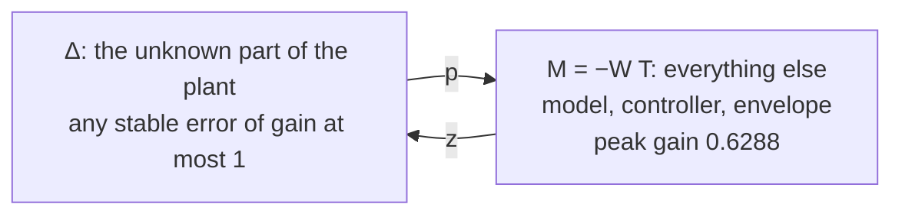
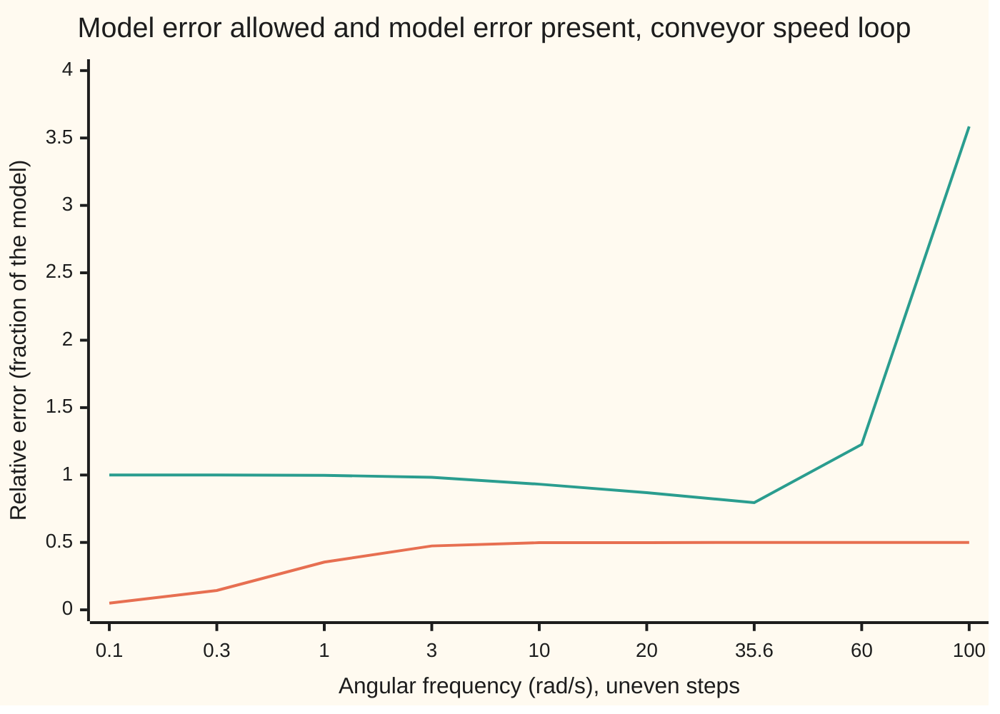

# Writing down model error: an added lump or a percentage, and the small gain rule

[Syllabus](../../../SYLLABUS.md) → [Engineering mathematics](../README.md) → [Robustness and Adaptation](../README.md#s10) → Writing down model error

---

## General Overview

A conveyor in a parcel depot is driven by one motor. A speed controller holds the belt at its set speed. It was tuned in the morning, when the belt was nearly empty: the roller, the belt and the parcels on it added up to an inertia of 0.20 kg·m² (inertia: how hard the load is to spin up). By the afternoon rush the belt is full and the inertia has doubled, to 0.40 kg·m².

The controller is the same all day. The engineer wants one answer: will the speed loop stay stable at every load between empty and full, without testing each load on the real belt? A single number, the certificate, gives it here: 0.6288. It is below 1, so every load in that range is safe, and the error could be 1.59 times larger before the guarantee runs out.

The method has two parts. First, write the model error down as a size at each frequency: here the full belt answers fast wobbles up to 50% differently from the model, and slow ones hardly differently at all. That curve is the **envelope**.

Second, look at the loop from the error's point of view. The error sends a signal round the loop, and the loop hands part of it back. If what comes back is always smaller than what went out, at every frequency, the signal cannot build up. The loop is stable, whatever the error is inside its envelope.

**Write the model error as an envelope, a percentage of the plant or an added lump, at every frequency; if the round trip from the error through the rest of the loop and back has a gain below 1 at every frequency, the loop stays stable for every error inside the envelope.**

**What kind of fact this is:** a theorem, the small gain theorem, proved on this card in Why it works; the envelope is a modelling assumption, and the guarantee is only as good as it is.

### The picture: the loop, seen by the error



Schematic. The error $\Delta$ receives the signal $z$ and sends back $p$. Everything else in the loop, the modelled motor, the controller and the envelope, is lumped into one block $M$. A signal going round loses at least 1 − 0.6288 of its size on every lap.

---

## The formula

Some notation, reminded or introduced. The **loop gain** $L(s)$ is one trip round controller and motor; the **sensitivity** is $S = 1/(1+L)$ and the **complementary sensitivity** is $T = L/(1+L)$ ([Sensitivity functions](../03-Feedback%20Control/02-sensitivity-and-the-gang-of-four.md)). Engineers write $j$ for the square root of −1; the rest of the library writes i. A transfer function evaluated at $s = j\omega$ says what the system does to a sine wave of angular frequency $\omega$, in rad/s.

The **H-infinity norm**, introduced here, is the largest gain a stable system shows at any frequency:

$$\lVert G \rVert_\infty = \max_{\omega} \lvert G(j\omega) \rvert$$

**Read it aloud:** the H-infinity norm of G is the peak, over all frequencies, of the size of G's answer to a sine wave. The name comes from a family of function spaces; here it means "worst-case gain".

The conveyor, with the torque command in N·m and the belt speed in rad/s:

$$P_0(s) = \frac{1}{(J_0 s + b)(\tau_a s + 1)}, \qquad C(s) = K_p + \frac{K_i}{s}$$

The model error, written two ways:

$$\text{a percentage:}\ \ P = P_0\,(1 + W\Delta), \qquad \text{an added lump:}\ \ P = P_0 + W_A \Delta_A, \qquad \lVert\Delta\rVert_\infty \le 1$$

and the small gain rule for each:

$$\lVert W T \rVert_\infty < 1 \qquad\text{or}\qquad \lVert W_A\, C S \rVert_\infty < 1$$

**Read it aloud:** if the true plant is the model times one plus an error no bigger than the envelope W, the loop is safe when the envelope times the complementary sensitivity stays below 1 at every frequency; if the true plant is the model plus a lump no bigger than $W_A$, it is safe when that envelope times the controller times the sensitivity stays below 1.

For the doubled inertia the percentage error is $(J_0 - J)s/(Js + b)$. Its size is exactly the envelope

$$W(s) = \frac{0.5\,s}{s + 1},$$

which is 0 for a steady speed, 35.4% at 1 rad/s and 50% for fast wobbles. Every load between 0.20 and 0.40 kg·m² stays inside it, which the code checks at 2,001 frequencies.

| Symbol | Plain meaning | In our example | Push it up and the answer… |
| --- | --- | --- | --- |
| $P_0(s)$, $P(s)$ | the modelled and the true motor: torque command to belt speed, (rad/s) per N·m | $P_0 = 1/((0.2s + 0.4)(0.02s + 1))$ | — |
| $J_0$, $J$, $k$ | modelled and true load inertia in kg·m²; the factor $k = J/J_0$ | 0.20, 0.40, $k$ = 2 | the error approaches $1 - 1/k$; certified up to $k$ = 4.87 |
| $b$, $\tau_a$ | belt friction, N·m·s/rad; the drive's torque lag, s | 0.40 N·m·s/rad, 0.020 s | — |
| $C(s)$, $K_p$, $K_i$ | the PI (proportional-integral) speed controller: N·m per rad/s of error, N·m per rad of built-up error | 10.0 and 50.0 | $\lVert WT\rVert_\infty$ rises: 0.8125 at double both |
| $L$, $L_0$, $S$, $T$ | loop gain $P_0 C$, written $L_0$ beside the true loop gain; sensitivity $1/(1+L)$; complementary sensitivity $L/(1+L)$ | $\lVert T\rVert_\infty$ = 1.2582 at 35.58 rad/s, $\lVert S\rVert_\infty$ = 1.5344 at 55.75 rad/s | — |
| $s$, $j$, $\omega$, $\omega^*$ | the Laplace variable; the square root of −1; angular frequency in rad/s; the frequency of the peak | $\omega^*$ = 35.60 rad/s | — |
| $W(s)$, $\Delta$ | the percentage envelope; the unknown, any stable system whose gain never exceeds 1 | $0.5s/(s+1)$, up to 50% | the certificate number rises in proportion |
| $W_A(s)$, $\Delta_A$ | the added-lump envelope, (rad/s)/N·m; its unknown | true lump peaks at 0.8330 at 1.41 rad/s | — |
| $\lVert\cdot\rVert_\infty$, $G$, $\bar\sigma$ | the H-infinity norm, peak gain over frequency, of any stable system $G$; the largest singular value, its replacement for several inputs | $\lVert WT\rVert_\infty$ = 0.6288 | at 1 the guarantee is lost |
| $M$, $F_\lambda$, $\lambda$ | the rest of the loop as the error sees it: $-WT$ or $-W_A CS$; in the proof, $F_\lambda = 1 - \lambda M\Delta$, with $\lambda$ sliding from 0 to 1 | peak 0.6288 | — |
| $\theta$ | an extra time delay in the loop, s | certified 19.38 ms; true limit 20.94 ms | the loop oscillates past 20.94 ms |
| $u$, $y$, $z$, $p$ | torque command (N·m), belt speed (rad/s); the signal into the error and the signal out of it | — | — |

### The picture: the envelope against the room the loop leaves

The rule $\lvert W T\rvert < 1$ is the same as $\lvert W\rvert < 1/\lvert T\rvert$: the envelope must pass under the curve $1/\lvert T\rvert$ at every frequency.



Orange: the envelope $\lvert W\rvert$, the error the full belt brings, rising to 50%. Green: $1/\lvert T\rvert$, the largest error the loop tolerates at each frequency, at its lowest, 0.795, near 35.6 rad/s, where $T$ peaks. The gap is narrowest there: 0.500 against 0.795, a ratio of 0.6288. At 300 and 1000 rad/s the green curve reaches 35.505 and 399.497, off the chart.

### When it holds

- **Both parts stable.** The theorem needs the nominal loop stable and the error $\Delta$ stable. An error that adds an unstable pole, such as a belt that runs away on its own, is not a bounded gain and is not covered.
- **The envelope really covers the error.** It is an assumption about the machine. Leave out a 25 ms delay in the speed sensor's fieldbus (the factory network that carries its readings) and the light belt's loop has a closed-loop pole at +2.2098 ± 37.2618j /s: it oscillates and grows, while the certificate still reads 0.6288.
- **Inside the stated range.** The envelope was drawn for 0.20 to 0.40 kg·m². A belt loaded to three times the morning inertia is outside it; its own envelope gives 0.8386, still certified, but the 50% envelope says nothing about it.
- **Linear.** The drive delivers torque up to a limit. Each 1 rad/s of speed error asks for 10.0 N·m at once; a large speed change saturates the drive and the transfer functions stop describing it.
- **Slow change.** The envelope was drawn for loads that stay fixed while the loop acts. The load changes over hours and the loop settles in under half a second, so each load can be treated as fixed.

---

## Why it works

### Step 0: a signal that shrinks on every lap dies out

Suppose a signal goes round a loop and comes back at most 0.6288 times as big, whatever its frequency. Then after two laps it is at most 0.6288² of its size, after three 0.6288³, and so on. The sum of all the laps is at most $1/(1 - 0.6288)$ times the starting size: finite. Nothing can build up. A loop goes unstable only when some signal can come back at least as big as it left, with the right timing to reinforce itself.

### Step 1: measure size by the worst frequency

Every signal is a mix of sine waves ([Bode plots](../02-Linear%20Systems%20and%20Transforms/04-frequency-response-and-bode-plots.md)). A stable linear system multiplies each one by $\lvert G(j\omega)\rvert$. So the most it can amplify any signal's energy, in the root-mean-square sense, is the largest of those multipliers: $\lVert G\rVert_\infty$. For a system with several inputs and outputs, $G(j\omega)$ is a matrix and its largest stretch is its largest singular value $\bar\sigma$ ([The singular value decomposition](../../03-Algebra/07-Eigenvalues%20and%20Symmetric%20Matrices/06-singular-value-decomposition.md)); everything below carries over with $\bar\sigma$ in place of $\lvert\cdot\rvert$.

### Step 2: pull the error out of the loop

Hold the setpoint at zero. The controller sends $u = -C y$. The true motor answers $y = P_0(1 + W\Delta)u = P_0 u + P_0 W p$, where $p = \Delta z$ is the error's output and $z = u$ is what it sees. Solve for $y$: $y = P_0 W p/(1 + L)$. Then the error's input is

$$z = u = -C y = -\frac{W L}{1 + L}\,p = -W T\,p.$$

So the error sees the rest of the loop as one block, $M = -WT$. For the added lump, $y = P_0 u + W_A p$ with $z = u$, and the same steps give $M = -W_A C S$.

### Step 3: the small gain theorem

Round the loop $z \to \Delta \to p \to M \to z$ the gain at each frequency is at most $\lvert M(j\omega)\rvert\,\lvert\Delta(j\omega)\rvert \le \lvert M(j\omega)\rvert$. If $\lVert M\rVert_\infty < 1$, Step 0 applies at every frequency. Both blocks are stable, so the closed loop is stable.

The same fact in the picture of [Nyquist and margins](../03-Feedback%20Control/06-nyquist-criterion-and-stability-margins.md): the true loop gain $L_0(1 + W\Delta)$ lies, at each frequency, in a disc centred on the model's $L_0$ with radius $\lvert W L_0\rvert$. The closed loop fails where the loop gain reaches −1. The distance from $L_0$ to −1 is $\lvert 1 + L_0\rvert$. So −1 stays outside every disc exactly when $\lvert W L_0\rvert < \lvert 1 + L_0 \rvert$, which is $\lvert W T\rvert < 1$.

<details>
<summary>Detailed proof: the turn count cannot change</summary>

Let $M$ and $\Delta$ be stable, with $\lvert M(j\omega)\Delta(j\omega)\rvert < 1$ for every $\omega$, including in the limit $\omega \to \infty$. The loop of $M$ and $\Delta$ fails exactly where $1 - M\Delta$ has a zero in the closed right half-plane. Consider $F_\lambda = 1 - \lambda M \Delta$ for $\lambda$ from 0 to 1. Each $F_\lambda$ is stable, so it has no poles in the right half-plane, and on the imaginary axis $\lvert F_\lambda - 1\rvert \le \lvert M\Delta\rvert < 1$, so $F_\lambda(j\omega)$ stays inside the disc of radius 1 about 1 and never reaches 0.

For $\lambda = 0$, $F_0 = 1$ has no zeros. The number of right-half-plane zeros of $F_\lambda$ equals the number of turns of $F_\lambda(j\omega)$ round 0 (the argument principle, as on the Nyquist card, with no poles to subtract). A curve confined to a disc that excludes 0 makes no turns, for every $\lambda$. So $F_1 = 1 - M\Delta$ has no right-half-plane zeros and the loop is stable.

For the conveyor, $M\Delta = -WT\Delta$, and the internal stability of the nominal loop ([Sensitivity functions](../03-Feedback%20Control/02-sensitivity-and-the-gang-of-four.md)) makes every transfer function in the perturbed loop a stable combination of $S$, $T$ and $(1 - M\Delta)^{-1}$.

</details>

### Step 4: the rule is exact for the worst error, cautious for a particular one

Suppose instead the peak reaches 1 at some $\omega^*$. Then an error of size 1 with exactly the right phase at $\omega^*$, $\Delta(j\omega^*) = 1/M(j\omega^*) = -1/(WT)(j\omega^*)$, makes $1 - M\Delta$ zero and puts the true loop gain $L_0(1 + W\Delta)$ on −1, and some stable $\Delta$ achieves it. So for "every error inside the envelope", the rule cannot be improved.

A delay can take any phase, so it comes close to that worst case. The relative error of a delay $\theta$ is $e^{-j\omega\theta} - 1$. The small gain rule with that as envelope certifies up to 19.38 ms; the loop's true delay margin, the largest delay it survives, is 20.94 ms, at 39.50 rad/s.

A heavier load cannot choose its phase. At each frequency its error has one definite phase, set by the physics, and for this loop that phase never lines up the loop gain with −1. The rule, using only the error's size, certifies loads up to 4.87 times the morning inertia.

Routh's test on the closed-loop polynomial $J\tau_a s^3 + (J + b\tau_a)s^2 + (b + K_p)s + K_i$ ([Routh-Hurwitz](../03-Feedback%20Control/04-routh-hurwitz-criterion.md)) shows the loop is stable for every load: its decisive term is $J(b + K_p - \tau_a K_i) = 9.4J$ plus a positive constant. The rule is sufficient, never necessary; the extra caution is what it charges for not knowing the error's phase.

### Step 5: lump or percentage

The two forms describe the same error when $W_A = P_0 W$: then $W_A C S = W P_0 C S = W T$, and the certificate is 0.6288 either way.

They differ when the envelope is drawn crudely. A percentage suits errors that scale with the plant: inertia, a motor constant, a gain. A lump suits errors with a fixed size in physical units, such as an unmodelled resonance or a parallel leakage path. Bounding the inertia error by a flat lump of its peak size, 0.8330 (rad/s)/N·m at all frequencies, gives a certificate of 12.83: a failure, for a loop that is fine.

---

## Worked numbers, by hand

At the peak frequency, $\omega^*$ = 35.60 rad/s, found by sweeping 2,001 frequencies from 0.01 to 1,000 rad/s:

| Step | Arithmetic | Value |
| --- | --- | --- |
| belt factor $\lvert J_0 j\omega + b\rvert$ | $\sqrt{0.4^2 + (0.2 \times 35.60)^2}$ | 7.1307 |
| drive factor $\lvert \tau_a j\omega + 1\rvert$ | $\sqrt{1 + (0.02 \times 35.60)^2}$ | 1.2275 |
| controller $\lvert C(j\omega)\rvert$ | $\sqrt{10^2 + (50 / 35.60)^2}$ | 10.0982 |
| loop gain size $\lvert L\rvert$ | 10.0982 / (7.1307 × 1.2275) | 1.1536 |
| loop gain phase | $-\arctan\frac{50}{10 \times 35.60} - \arctan\frac{0.2 \times 35.60}{0.4} - \arctan(0.02 \times 35.60)$ | −130.2286° |
| distance to −1, $\lvert 1 + L\rvert$ | $\lvert 1 + 1.1536\,e^{-j\,130.2286^\circ}\rvert$ | 0.9169 |
| $\lvert T\rvert$ | 1.1536 / 0.9169 | 1.2582 |
| envelope $\lvert W\rvert$ | $0.5 \times 35.60 / \sqrt{35.60^2 + 1}$ | 0.4998 |
| **certificate** $\lVert WT\rVert_\infty$ | 0.4998 × 1.2582 | **0.6288** |
| room to spare | 1 / 0.6288 | 1.590 |

The speed loop stays stable at every load from 0.20 to 0.40 kg·m², and would stay stable for any error up to 1.59 times the envelope.

Checked against the belt itself. With the full load, the rightmost closed-loop pole is at −6.0883 /s; with five times the morning load, at −5.8957 ± 5.4766j /s; with a hundred times, at −0.2369 ± 1.5706j /s: all stable. A 1 rad/s speed step overshoots by 23.75% and settles within 2% after 0.254 s on the empty belt, and overshoots by 18.63% and settles after 0.436 s on the full one. The controller tuned in the morning works in the afternoon.

### What breaks if you drop a piece

| Mistake | Comes out at | What went wrong |
| --- | --- | --- |
| Test the envelope against the loop gain $L$ instead of $T$ | peak $\lvert WL\rvert$ = 62.50: "fails" | The error sees $L/(1+L)$, not $L$. At low frequency $L$ is huge but $T$ is near 1: feedback absorbs slow errors |
| Bound the inertia error by a flat lump of its peak size | 0.8330 (rad/s)/N·m everywhere, certificate 12.83: "fails" | The true lump is small at high frequency, where $CS$ is large; a flat envelope charges the worst size at every frequency |
| Leave a 25 ms fieldbus delay out of the envelope | certificate 0.6288 "safe"; truth: pole at +2.2098 ± 37.2618j /s | The hypothesis failed: the delay's error is not inside $W$, and 25 ms is past the 20.94 ms delay margin |
| Read a failed certificate as instability: load ×5 | exact envelope gives above 1 (the limit is ×4.87); truth: pole at −5.8957 ± 5.4766j /s, stable | The rule is sufficient, not necessary |

---

## Code, from first principles, and it actually runs

The code reaches the verdict by three independent roads.

- Road 1 sweeps frequency, finds the peak of $\lvert WT\rvert$ by a coarse grid and then golden-section search (narrowing an interval by a fixed ratio each time), and also checks that the envelope covers 21 loads between 0.20 and 0.40 kg·m².
- Road 2 finds the closed-loop poles of the true belt at several loads, by Durand-Kerner iteration (an update that moves all of a polynomial's roots at once), with no frequency response at all.
- Road 3 simulates the loop with fourth-order Runge-Kutta (RK4) steps: a sine wave at the peak frequency measures $\lvert T\rvert$ in the time domain, and speed steps show both loads settle.

For the delay, Newton's method finds the closed-loop pole of the delay equation (it contains $e^{-s\theta}$, so it is not a polynomial), confirming the delay margin and the 25 ms instability. Asserts compare the roads with each other.

### Python

```python
# Model uncertainty and the small gain rule -- the check behind the card.  Standard library only.
# Conveyor motor speed loop.  Torque command u (N m) -> drive lag 0.02 s -> roller and belt,
# inertia J (kg m^2), friction b (N m s/rad) -> speed v (rad/s).  PI controller on speed.
# Model error: the load inertia doubles, J0 = 0.2 -> 0.4 kg m^2, written as a percentage
# P = P0 (1 + W D), |D| <= 1, with envelope W(s) = 0.5 s / (s + 1).  Roads:
#   1. small gain: peak over frequency of |W T| < 1 (sweep plus golden-section refinement);
#   2. closed-loop poles of the true plant, by Durand-Kerner on the cubic, for many loads;
#   3. RK4 simulation: a sine at the peak frequency measures |T|; steps with both loads.
import cmath, math
J0, b, ta, Kp, Ki = 0.2, 0.4, 0.02, 10.0, 50.0
def P(s, J=J0): return 1 / ((J * s + b) * (ta * s + 1))
def C(s, kp=Kp, ki=Ki): return kp + ki / s
def T(s, kp=Kp, ki=Ki): L = P(s) * C(s, kp, ki); return L / (1 + L)
def Wk(s, k): return (1 - 1 / k) * s / (s + b / (k * J0))    # exact envelope for load x k
def W(s): return Wk(s, 2.0)                                   # = 0.5 s / (s + 1)
WS = [10 ** (-2 + 5 * i / 2000) for i in range(2001)]           # 0.01 to 1000 rad/s
def peak(f):                       # largest |f(jw)|: sweep, then golden section on log w
    i = max(range(len(WS)), key=lambda i: abs(f(1j * WS[i])))
    a, c = math.log(WS[max(i - 1, 0)]), math.log(WS[min(i + 1, 2000)])
    g = (math.sqrt(5) - 1) / 2
    for _ in range(80):
        x1, x2 = c - g * (c - a), a + g * (c - a)
        if abs(f(1j * math.exp(x1))) > abs(f(1j * math.exp(x2))): c = x2
        else: a = x1
    w = math.exp((a + c) / 2); return abs(f(1j * w)), w
print(f"plant: J0 {J0:.2f} kg m^2, b {b:.2f} N m s/rad, drive lag {ta:.3f} s; PI Kp {Kp:.1f} N m s/rad, Ki {Ki:.1f} N m/rad")
gap = max(abs((J0 - J) * s / (J * s + b)) - abs(W(s)) for J in [J0 * (1 + i / 20) for i in range(21)] for s in [1j * w for w in WS])
print(f"envelope covers every load 0.20 to 0.40 kg m^2: largest |error| - |W| = {gap:.4f}")
assert gap <= 1e-12
nWT, wWT = peak(lambda s: W(s) * T(s)); nT, wT = peak(T); nS, wS = peak(lambda s: 1 / (1 + P(s) * C(s)))
print(f"road 1: peak |W T| = {nWT:.4f} at {wWT:.2f} rad/s, so the envelope may grow x{1 / nWT:.3f}")
print(f"peak |T| = {nT:.4f} at {wT:.2f} rad/s; peak |S| = {nS:.4f} at {wS:.2f} rad/s")
s = 1j * wWT; L = P(s) * C(s)
for lab, v in [("|J0 jw + b|", abs(J0 * s + b)), ("|ta jw + 1|", abs(ta * s + 1)), ("|C(jw)|", abs(C(s))),
               ("|L|", abs(L)), ("phase of L (deg)", math.degrees(cmath.phase(L))), ("|1 + L|", abs(1 + L)),
               ("|T| = |L| / |1 + L|", abs(L / (1 + L))), ("|W|", abs(W(s))), ("|W T|", abs(W(s) * L / (1 + L)))]:
    print(f"  at {wWT:.2f} rad/s  {lab:22s} {v:9.4f}")
assert abs(nWT - abs(W(1j * wT)) * nT) < 1e-3     # W is nearly flat at the peak
def roots(c):                       # Durand-Kerner: all roots of a polynomial, highest power first
    c = [x / c[0] for x in c]; n = len(c) - 1; z = [(0.4 + 0.9j) ** k for k in range(n)]
    for _ in range(500):
        for i in range(n):
            num = sum(c[k] * z[i] ** (n - k) for k in range(n + 1)); den = 1
            for j in range(n):
                if j != i: den *= z[i] - z[j]
            z[i] -= num / den
    return sorted(z, key=lambda r: -r.real)
def cubic(J): return [J * ta, J + b * ta, b + Kp, Ki]   # (J s + b)(ta s + 1) s + Kp s + Ki
for k in [1, 2, 5, 100]:
    r = roots(cubic(k * J0)); print(f"road 2: load x{k:<3d} rightmost closed-loop pole {r[0].real:.4f} +/- {abs(r[0].imag):.4f}j /s")
    assert r[0].real < 0 and abs(sum(c * r[0] ** (3 - i) for i, c in enumerate(cubic(k * J0)))) < 1e-6
def sim(J, ref, tend, dt=1e-4):     # RK4: speed v, delivered torque m, integral of error z
    def f(t, x): u = Kp * (ref(t) - x[0]) + Ki * x[2]; return [(x[1] - b * x[0]) / J, (u - x[1]) / ta, ref(t) - x[0]]
    x, t, out = [0.0, 0.0, 0.0], 0.0, []
    for _ in range(round(tend / dt)):
        k1 = f(t, x); k2 = f(t + dt / 2, [a + dt / 2 * d for a, d in zip(x, k1)])
        k3 = f(t + dt / 2, [a + dt / 2 * d for a, d in zip(x, k2)]); k4 = f(t + dt, [a + dt * d for a, d in zip(x, k3)])
        x = [a + dt / 6 * (p + 2 * q + 2 * r + w) for a, p, q, r, w in zip(x, k1, k2, k3, k4)]; t += dt; out.append((t, x[0]))
    return out
amp = max(abs(v) for t, v in sim(J0, lambda t: math.sin(wT * t), 3.0) if t > 2.5)
print(f"road 3: sine of 1 rad/s at {wT:.2f} rad/s comes back {amp:.4f} rad/s (|T| = {nT:.4f})")
assert abs(amp - nT) < 1e-3
for k in [1, 2]:
    y = sim(k * J0, lambda t: 1.0, 2.0); top = max(v for t, v in y)
    ts = max(t for t, v in y if abs(v - 1) > 0.02)
    print(f"1 rad/s speed step, load x{k}: overshoot {100 * (top - 1):.2f}%, within 2% after {ts:.3f} s")
    assert abs(y[-1][1] - 1) < 1e-3
lo, hi = 2.0, 50.0                  # largest load the exact-envelope test still certifies
for _ in range(50):
    m = (lo + hi) / 2; lo, hi = (m, hi) if peak(lambda s: Wk(s, m) * T(s))[0] < 1 else (lo, m)
print(f"certified up to load x{lo:.2f}; Routh term J (b + Kp - ta Ki) = J x {b + Kp - ta * Ki:.1f} > 0: stable for every load")
def wgc():                          # gain crossover |L| = 1 by halving on log w
    lo, hi = 1.0, 1000.0
    for _ in range(100): m = math.sqrt(lo * hi); lo, hi = (m, hi) if abs(P(1j * m) * C(1j * m)) > 1 else (lo, m)
    return lo
wc = wgc(); dm = (math.pi + cmath.phase(P(1j * wc) * C(1j * wc))) / wc
lo, hi = 0.0, 0.1                   # small gain for a delay: envelope |e^(-jw th) - 1|
for _ in range(40):
    m = (lo + hi) / 2; lo, hi = (m, hi) if peak(lambda s: (cmath.exp(-s * m) - 1) * T(s))[0] < 1 else (lo, m)
print(f"delay: small gain certifies {1000 * lo:.2f} ms; true delay margin {1000 * dm:.2f} ms at {wc:.2f} rad/s")
def newton(th, s):                  # a root of (J0 s + b)(ta s + 1) s + (Kp s + Ki) e^(-s th)
    for _ in range(60):
        e = cmath.exp(-s * th); f = (J0 * s + b) * (ta * s + 1) * s + (Kp * s + Ki) * e
        d = J0 * (ta * s + 1) * s + ta * (J0 * s + b) * s + (J0 * s + b) * (ta * s + 1) + (Kp - th * (Kp * s + Ki)) * e
        s -= f / d
    return s
z = newton(dm, 1j * wc); assert abs(z.real) < 1e-9 and abs(z.imag - wc) < 1e-6 and lo < dm
z = newton(0.025, 1j * wc); print(f"25 ms delay, light load: closed-loop pole {z.real:+.4f} {z.imag:+.4f}j /s")
assert z.real > 0
print(f"break: L in place of T, peak |W L| = {peak(lambda s: W(s) * P(s) * C(s))[0]:.2f}")
lump, wl = peak(lambda s: P(s, 2 * J0) - P(s))
print(f"break: flat lump {lump:.4f} (rad/s)/(N m) (peak at {wl:.2f} rad/s), peak |lump C S| = {peak(lambda s: lump * C(s) / (1 + P(s) * C(s)))[0]:.2f}")
print(f"break: true lump with |P0 W| as envelope, peak |P0 W C S| = {peak(lambda s: P(s) * W(s) * C(s) / (1 + P(s) * C(s)))[0]:.4f}")
for lab, kp, ki in [("try: Kp 20, Ki 100", 20, 100), ("try: Kp 5, Ki 25", 5, 25)]:
    print(f"{lab}: peak |W T| = {peak(lambda s: W(s) * T(s, kp, ki))[0]:.4f}")
print(f"try: load x3, exact envelope: peak |W T| = {peak(lambda s: Wk(s, 3) * T(s))[0]:.4f}")
FW = [0.1, 0.3, 1, 3, 10, 20, 35.6, 60, 100, 300, 1000]
print("chart |W|   ", ", ".join(f"{abs(W(1j * w)):.3f}" for w in FW))
print("chart 1/|T| ", ", ".join(f"{1 / abs(T(1j * w)):.3f}" for w in FW))
print("ALL CHECKS PASS")
```

**Ran 2026-11-11 on macOS, Python 3.14.10, standard library only. All checks passed. Output, pasted from the run:**

```
plant: J0 0.20 kg m^2, b 0.40 N m s/rad, drive lag 0.020 s; PI Kp 10.0 N m s/rad, Ki 50.0 N m/rad
envelope covers every load 0.20 to 0.40 kg m^2: largest |error| - |W| = 0.0000
road 1: peak |W T| = 0.6288 at 35.60 rad/s, so the envelope may grow x1.590
peak |T| = 1.2582 at 35.58 rad/s; peak |S| = 1.5344 at 55.75 rad/s
  at 35.60 rad/s  |J0 jw + b|               7.1307
  at 35.60 rad/s  |ta jw + 1|               1.2275
  at 35.60 rad/s  |C(jw)|                  10.0982
  at 35.60 rad/s  |L|                       1.1536
  at 35.60 rad/s  phase of L (deg)       -130.2286
  at 35.60 rad/s  |1 + L|                   0.9169
  at 35.60 rad/s  |T| = |L| / |1 + L|       1.2582
  at 35.60 rad/s  |W|                       0.4998
  at 35.60 rad/s  |W T|                     0.6288
road 2: load x1   rightmost closed-loop pole -5.3149 +/- 0.0000j /s
road 2: load x2   rightmost closed-loop pole -6.0883 +/- 0.0000j /s
road 2: load x5   rightmost closed-loop pole -5.8957 +/- 5.4766j /s
road 2: load x100 rightmost closed-loop pole -0.2369 +/- 1.5706j /s
road 3: sine of 1 rad/s at 35.58 rad/s comes back 1.2582 rad/s (|T| = 1.2582)
1 rad/s speed step, load x1: overshoot 23.75%, within 2% after 0.254 s
1 rad/s speed step, load x2: overshoot 18.63%, within 2% after 0.436 s
certified up to load x4.87; Routh term J (b + Kp - ta Ki) = J x 9.4 > 0: stable for every load
delay: small gain certifies 19.38 ms; true delay margin 20.94 ms at 39.50 rad/s
25 ms delay, light load: closed-loop pole +2.2098 +37.2618j /s
break: L in place of T, peak |W L| = 62.50
break: flat lump 0.8330 (rad/s)/(N m) (peak at 1.41 rad/s), peak |lump C S| = 12.83
break: true lump with |P0 W| as envelope, peak |P0 W C S| = 0.6288
try: Kp 20, Ki 100: peak |W T| = 0.8125
try: Kp 5, Ki 25: peak |W T| = 0.5578
try: load x3, exact envelope: peak |W T| = 0.8386
chart |W|    0.050, 0.144, 0.354, 0.474, 0.498, 0.499, 0.500, 0.500, 0.500, 0.500, 0.500
chart 1/|T|  1.000, 1.000, 0.998, 0.983, 0.932, 0.869, 0.795, 1.227, 3.585, 35.505, 399.497
ALL CHECKS PASS
```

### Rust

```rust
// Model uncertainty and the small gain rule -- the check behind the card.  std only, no crates.
// Conveyor motor speed loop: torque command (N m) -> drive lag 0.02 s -> roller and belt,
// inertia J (kg m^2), friction b (N m s/rad) -> speed (rad/s); PI controller on speed.
// Model error: the load inertia doubles, written as P = P0 (1 + W D), |D| <= 1, W = 0.5 s / (s + 1).
// Roads: 1. peak of |W T| over frequency; 2. Durand-Kerner closed-loop poles; 3. RK4 simulation.
use std::f64::consts::PI;
#[derive(Clone, Copy)]
struct C { re: f64, im: f64 }
fn c(re: f64, im: f64) -> C { C { re, im } }
fn r(x: f64) -> C { c(x, 0.0) }
impl std::ops::Add for C { type Output = C; fn add(self, o: C) -> C { c(self.re + o.re, self.im + o.im) } }
impl std::ops::Sub for C { type Output = C; fn sub(self, o: C) -> C { c(self.re - o.re, self.im - o.im) } }
impl std::ops::Mul for C { type Output = C; fn mul(self, o: C) -> C { c(self.re * o.re - self.im * o.im, self.re * o.im + self.im * o.re) } }
impl std::ops::Div for C { type Output = C; fn div(self, o: C) -> C { let d = o.re * o.re + o.im * o.im; c((self.re * o.re + self.im * o.im) / d, (self.im * o.re - self.re * o.im) / d) } }
impl C {
    fn abs(self) -> f64 { self.re.hypot(self.im) }
    fn arg(self) -> f64 { self.im.atan2(self.re) }
    fn exp(self) -> C { let m = self.re.exp(); c(m * self.im.cos(), m * self.im.sin()) }
    fn pw(self, n: usize) -> C { let mut z = r(1.0); for _ in 0..n { z = z * self; } z }
}
const J0: f64 = 0.2; const B: f64 = 0.4; const TA: f64 = 0.02; const KP: f64 = 10.0; const KI: f64 = 50.0;
fn p(s: C, j: f64) -> C { r(1.0) / ((r(j) * s + r(B)) * (r(TA) * s + r(1.0))) }
fn ctl(s: C, kp: f64, ki: f64) -> C { r(kp) + r(ki) / s }
fn t(s: C, kp: f64, ki: f64) -> C { let l = p(s, J0) * ctl(s, kp, ki); l / (r(1.0) + l) }
fn tn(s: C) -> C { t(s, KP, KI) }
fn sn(s: C) -> C { r(1.0) / (r(1.0) + p(s, J0) * ctl(s, KP, KI)) }
fn wk(s: C, k: f64) -> C { r(1.0 - 1.0 / k) * s / (s + r(B / (k * J0))) }
fn w(s: C) -> C { wk(s, 2.0) }
fn jw(w: f64) -> C { c(0.0, w) }
fn ws(i: usize) -> f64 { 10f64.powf(-2.0 + 5.0 * i as f64 / 2000.0) }
fn peak(f: &dyn Fn(C) -> C) -> (f64, f64) {
    let mut i = 0;
    for k in 1..=2000 { if f(jw(ws(k))).abs() > f(jw(ws(i))).abs() { i = k; } }
    let (mut a, mut cc) = (ws(if i > 0 { i - 1 } else { 0 }).ln(), ws((i + 1).min(2000)).ln());
    let g = (5f64.sqrt() - 1.0) / 2.0;
    for _ in 0..80 {
        let (x1, x2) = (cc - g * (cc - a), a + g * (cc - a));
        if f(jw(x1.exp())).abs() > f(jw(x2.exp())).abs() { cc = x2; } else { a = x1; }
    }
    let wm = ((a + cc) / 2.0).exp(); (f(jw(wm)).abs(), wm)
}
fn roots(co: &[f64]) -> Vec<C> {
    let n = co.len() - 1; let cn: Vec<C> = co.iter().map(|x| r(x / co[0])).collect();
    let mut z: Vec<C> = (0..n).map(|k| c(0.4, 0.9).pw(k)).collect();
    for _ in 0..500 { for i in 0..n {
        let mut num = r(0.0); for k in 0..=n { num = num + cn[k] * z[i].pw(n - k); }
        let mut den = r(1.0); for j in 0..n { if j != i { den = den * (z[i] - z[j]); } }
        z[i] = z[i] - num / den;
    } }
    z.sort_by(|a, b| b.re.partial_cmp(&a.re).unwrap()); z
}
fn cubic(j: f64) -> [f64; 4] { [j * TA, j + B * TA, B + KP, KI] }
fn sim(j: f64, rf: &dyn Fn(f64) -> f64, tend: f64) -> Vec<(f64, f64)> {
    let dt = 1e-4;
    let f = |t: f64, x: [f64; 3]| { let u = KP * (rf(t) - x[0]) + KI * x[2]; [(x[1] - B * x[0]) / j, (u - x[1]) / TA, rf(t) - x[0]] };
    let add = |x: [f64; 3], h: f64, d: [f64; 3]| [x[0] + h * d[0], x[1] + h * d[1], x[2] + h * d[2]];
    let (mut x, mut tt, mut out) = ([0.0; 3], 0.0, vec![]);
    for _ in 0..(tend / dt).round() as usize {
        let k1 = f(tt, x); let k2 = f(tt + dt / 2.0, add(x, dt / 2.0, k1));
        let k3 = f(tt + dt / 2.0, add(x, dt / 2.0, k2)); let k4 = f(tt + dt, add(x, dt, k3));
        for i in 0..3 { x[i] = x[i] + dt / 6.0 * (k1[i] + 2.0 * k2[i] + 2.0 * k3[i] + k4[i]); }
        tt += dt; out.push((tt, x[0]));
    }
    out
}
fn newton(th: f64, mut s: C) -> C {
    for _ in 0..60 {
        let e = (r(-th) * s).exp();
        let f = (r(J0) * s + r(B)) * (r(TA) * s + r(1.0)) * s + (r(KP) * s + r(KI)) * e;
        let d = r(J0) * (r(TA) * s + r(1.0)) * s + r(TA) * (r(J0) * s + r(B)) * s + (r(J0) * s + r(B)) * (r(TA) * s + r(1.0))
            + (r(KP) - r(th) * (r(KP) * s + r(KI))) * e;
        s = s - f / d;
    }
    s
}
fn main() {
    println!("plant: J0 {:.2} kg m^2, b {:.2} N m s/rad, drive lag {:.3} s; PI Kp {:.1} N m s/rad, Ki {:.1} N m/rad", J0, B, TA, KP, KI);
    let mut gap = f64::NEG_INFINITY;
    for i in 0..=20 { let j = J0 * (1.0 + i as f64 / 20.0); for k in 0..=2000 { let s = jw(ws(k));
        gap = gap.max((r(J0 - j) * s / (r(j) * s + r(B))).abs() - w(s).abs()); } }
    println!("envelope covers every load 0.20 to 0.40 kg m^2: largest |error| - |W| = {:.4}", gap);
    assert!(gap <= 1e-12);
    let (nwt, wwt) = peak(&|s| w(s) * tn(s)); let (nt, wt) = peak(&tn); let (ns, wsn) = peak(&sn);
    println!("road 1: peak |W T| = {:.4} at {:.2} rad/s, so the envelope may grow x{:.3}", nwt, wwt, 1.0 / nwt);
    println!("peak |T| = {:.4} at {:.2} rad/s; peak |S| = {:.4} at {:.2} rad/s", nt, wt, ns, wsn);
    let s = jw(wwt); let l = p(s, J0) * ctl(s, KP, KI);
    for (lab, v) in [("|J0 jw + b|", (r(J0) * s + r(B)).abs()), ("|ta jw + 1|", (r(TA) * s + r(1.0)).abs()), ("|C(jw)|", ctl(s, KP, KI).abs()),
        ("|L|", l.abs()), ("phase of L (deg)", l.arg() * 180.0 / PI), ("|1 + L|", (r(1.0) + l).abs()),
        ("|T| = |L| / |1 + L|", (l / (r(1.0) + l)).abs()), ("|W|", w(s).abs()), ("|W T|", (w(s) * l / (r(1.0) + l)).abs())] {
        println!("  at {:.2} rad/s  {:22} {:9.4}", wwt, lab, v);
    }
    assert!((nwt - w(jw(wt)).abs() * nt).abs() < 1e-3);
    for k in [1usize, 2, 5, 100] {
        let co = cubic(k as f64 * J0); let z = roots(&co);
        println!("road 2: load x{:<3} rightmost closed-loop pole {:.4} +/- {:.4}j /s", k, z[0].re, z[0].im.abs());
        let mut res = r(0.0); for (i, x) in co.iter().enumerate() { res = res + r(*x) * z[0].pw(3 - i); }
        assert!(z[0].re < 0.0 && res.abs() < 1e-6);
    }
    let amp = sim(J0, &|tt| (wt * tt).sin(), 3.0).iter().filter(|q| q.0 > 2.5).fold(0.0f64, |m, q| m.max(q.1.abs()));
    println!("road 3: sine of 1 rad/s at {:.2} rad/s comes back {:.4} rad/s (|T| = {:.4})", wt, amp, nt);
    assert!((amp - nt).abs() < 1e-3);
    for k in [1usize, 2] {
        let y = sim(k as f64 * J0, &|_| 1.0, 2.0);
        let top = y.iter().fold(f64::NEG_INFINITY, |m, q| m.max(q.1));
        let ts = y.iter().filter(|q| (q.1 - 1.0).abs() > 0.02).fold(f64::NEG_INFINITY, |m, q| m.max(q.0));
        println!("1 rad/s speed step, load x{}: overshoot {:.2}%, within 2% after {:.3} s", k, 100.0 * (top - 1.0), ts);
        assert!((y[y.len() - 1].1 - 1.0).abs() < 1e-3);
    }
    let (mut lo, mut hi) = (2.0, 50.0);
    for _ in 0..50 { let m = (lo + hi) / 2.0; if peak(&|s| wk(s, m) * tn(s)).0 < 1.0 { lo = m; } else { hi = m; } }
    println!("certified up to load x{:.2}; Routh term J (b + Kp - ta Ki) = J x {:.1} > 0: stable for every load", lo, B + KP - TA * KI);
    let (mut a, mut bb) = (1.0f64, 1000.0f64);
    for _ in 0..100 { let m = (a * bb).sqrt(); if (p(jw(m), J0) * ctl(jw(m), KP, KI)).abs() > 1.0 { a = m; } else { bb = m; } }
    let wc = a; let dm = (PI + (p(jw(wc), J0) * ctl(jw(wc), KP, KI)).arg()) / wc;
    let (mut lo, mut hi) = (0.0, 0.1);
    for _ in 0..40 { let m = (lo + hi) / 2.0; if peak(&|s| ((r(-m) * s).exp() - r(1.0)) * tn(s)).0 < 1.0 { lo = m; } else { hi = m; } }
    println!("delay: small gain certifies {:.2} ms; true delay margin {:.2} ms at {:.2} rad/s", 1000.0 * lo, 1000.0 * dm, wc);
    let z = newton(dm, jw(wc)); assert!(z.re.abs() < 1e-9 && (z.im - wc).abs() < 1e-6 && lo < dm);
    let z = newton(0.025, jw(wc)); println!("25 ms delay, light load: closed-loop pole {:+.4} {:+.4}j /s", z.re, z.im);
    assert!(z.re > 0.0);
    println!("break: L in place of T, peak |W L| = {:.2}", peak(&|s| w(s) * p(s, J0) * ctl(s, KP, KI)).0);
    let (lump, wl) = peak(&|s| p(s, 2.0 * J0) - p(s, J0));
    println!("break: flat lump {:.4} (rad/s)/(N m) (peak at {:.2} rad/s), peak |lump C S| = {:.2}", lump, wl, peak(&|s| r(lump) * ctl(s, KP, KI) * sn(s)).0);
    println!("break: true lump with |P0 W| as envelope, peak |P0 W C S| = {:.4}", peak(&|s| p(s, J0) * w(s) * ctl(s, KP, KI) * sn(s)).0);
    for (lab, kp, ki) in [("try: Kp 20, Ki 100", 20.0, 100.0), ("try: Kp 5, Ki 25", 5.0, 25.0)] {
        println!("{}: peak |W T| = {:.4}", lab, peak(&|s| w(s) * t(s, kp, ki)).0);
    }
    println!("try: load x3, exact envelope: peak |W T| = {:.4}", peak(&|s| wk(s, 3.0) * tn(s)).0);
    let fw = [0.1, 0.3, 1.0, 3.0, 10.0, 20.0, 35.6, 60.0, 100.0, 300.0, 1000.0];
    println!("chart |W|    {}", fw.iter().map(|x| format!("{:.3}", w(jw(*x)).abs())).collect::<Vec<_>>().join(", "));
    println!("chart 1/|T|  {}", fw.iter().map(|x| format!("{:.3}", 1.0 / tn(jw(*x)).abs())).collect::<Vec<_>>().join(", "));
    println!("ALL CHECKS PASS");
}
```

**Ran 2026-11-11 on macOS, rustc 1.98.1, no crates. All checks passed. Output, pasted from the run:**

```
plant: J0 0.20 kg m^2, b 0.40 N m s/rad, drive lag 0.020 s; PI Kp 10.0 N m s/rad, Ki 50.0 N m/rad
envelope covers every load 0.20 to 0.40 kg m^2: largest |error| - |W| = 0.0000
road 1: peak |W T| = 0.6288 at 35.60 rad/s, so the envelope may grow x1.590
peak |T| = 1.2582 at 35.58 rad/s; peak |S| = 1.5344 at 55.75 rad/s
  at 35.60 rad/s  |J0 jw + b|               7.1307
  at 35.60 rad/s  |ta jw + 1|               1.2275
  at 35.60 rad/s  |C(jw)|                  10.0982
  at 35.60 rad/s  |L|                       1.1536
  at 35.60 rad/s  phase of L (deg)       -130.2286
  at 35.60 rad/s  |1 + L|                   0.9169
  at 35.60 rad/s  |T| = |L| / |1 + L|       1.2582
  at 35.60 rad/s  |W|                       0.4998
  at 35.60 rad/s  |W T|                     0.6288
road 2: load x1   rightmost closed-loop pole -5.3149 +/- 0.0000j /s
road 2: load x2   rightmost closed-loop pole -6.0883 +/- 0.0000j /s
road 2: load x5   rightmost closed-loop pole -5.8957 +/- 5.4766j /s
road 2: load x100 rightmost closed-loop pole -0.2369 +/- 1.5706j /s
road 3: sine of 1 rad/s at 35.58 rad/s comes back 1.2582 rad/s (|T| = 1.2582)
1 rad/s speed step, load x1: overshoot 23.75%, within 2% after 0.254 s
1 rad/s speed step, load x2: overshoot 18.63%, within 2% after 0.436 s
certified up to load x4.87; Routh term J (b + Kp - ta Ki) = J x 9.4 > 0: stable for every load
delay: small gain certifies 19.38 ms; true delay margin 20.94 ms at 39.50 rad/s
25 ms delay, light load: closed-loop pole +2.2098 +37.2618j /s
break: L in place of T, peak |W L| = 62.50
break: flat lump 0.8330 (rad/s)/(N m) (peak at 1.41 rad/s), peak |lump C S| = 12.83
break: true lump with |P0 W| as envelope, peak |P0 W C S| = 0.6288
try: Kp 20, Ki 100: peak |W T| = 0.8125
try: Kp 5, Ki 25: peak |W T| = 0.5578
try: load x3, exact envelope: peak |W T| = 0.8386
chart |W|    0.050, 0.144, 0.354, 0.474, 0.498, 0.499, 0.500, 0.500, 0.500, 0.500, 0.500
chart 1/|T|  1.000, 1.000, 0.998, 0.983, 0.932, 0.869, 0.795, 1.227, 3.585, 35.505, 399.497
ALL CHECKS PASS
```

### Lean

Lean proves the small gain rule's algebra at a single frequency, and checks the conveyor's envelope and Routh's decisive term exactly.

- Suppose the model's loop gain $L_0$ never touches −1, $\lvert W T\rvert < 1$ and $\lvert\Delta\rvert \le 1$ at every frequency. Then the true loop gain $L_0(1 + W\Delta)$ never reaches −1.
- Take the setpoint at zero, $u = -C y$, $y = P_0 u + P_0 W p$, and $L_0$ not −1. Then $u = -W T\,p$: the error sees the rest of the loop as one block.
- Suppose $L_0$ is not −1 and $\lvert W T\rvert = 1$ at some frequency. Then an error of size exactly 1, with the right phase, puts $L_0(1 + W\Delta)$ on −1.
- Take $J_0$ = 0.20 and $J$ = 0.40 kg·m², with $b$ = 0.40. Then the percentage error $(J_0 - J)s/(Js + b)$ is $-W(s)$, so its size is exactly the envelope.
- Take the card's $b$, $K_p$, $\tau_a$ and $K_i$, and any load $J$. Then Routh's decisive term is $9.4J$ plus a positive constant.

Lean works one frequency at a time; the turn count, the sweeps, the poles and the simulations are left to the Python and Rust checks.

```lean
-- Writing down model error: at each frequency, if the envelope times the complementary sensitivity has size below 1, no error inside the envelope can put the true loop gain on −1, and the bound is exact for the worst error.
import Mathlib.Analysis.Complex.Basic
import Mathlib.Tactic.FieldSimp
import Mathlib.Tactic.Ring
import Mathlib.Tactic.NormNum

/-- The small gain rule for a percentage error, frequency by frequency (the disc picture on
the Nyquist plot). Let `L ω` be the nominal loop gain, `W ω` the envelope and `Δ ω` the
unknown error at frequency `ω`. If the nominal loop never touches −1 (`1 + L ω ≠ 0`), the
envelope times the complementary sensitivity `T = L / (1 + L)` has size below 1 at every
frequency, and the error has size at most 1 at every frequency, then the true loop gain
`L (1 + W Δ)` never reaches −1 at any frequency. -/
theorem small_gain_true_loop_gain_avoids_minus_one
    (L W Δ : ℝ → ℂ)
    (hnom : ∀ ω, 1 + L ω ≠ 0)
    (hgain : ∀ ω, ‖W ω * (L ω / (1 + L ω))‖ < 1)
    (hΔ : ∀ ω, ‖Δ ω‖ ≤ 1) :
    ∀ ω, 1 + L ω * (1 + W ω * Δ ω) ≠ 0 := by
  intro ω
  have h1 := hnom ω
  have hlt : ‖W ω * (L ω / (1 + L ω)) * Δ ω‖ < 1 := by
    rw [norm_mul]
    calc ‖W ω * (L ω / (1 + L ω))‖ * ‖Δ ω‖ ≤ ‖W ω * (L ω / (1 + L ω))‖ * 1 :=
          mul_le_mul_of_nonneg_left (hΔ ω) (norm_nonneg _)
      _ < 1 := by rw [mul_one]; exact hgain ω
  have hne : 1 + W ω * (L ω / (1 + L ω)) * Δ ω ≠ 0 := by
    intro h
    have : W ω * (L ω / (1 + L ω)) * Δ ω = -1 := by linear_combination h
    rw [this, norm_neg, norm_one] at hlt
    exact lt_irrefl _ hlt
  have key : 1 + L ω * (1 + W ω * Δ ω)
      = (1 + L ω) * (1 + W ω * (L ω / (1 + L ω)) * Δ ω) := by
    field_simp
    ring
  rw [key]
  exact mul_ne_zero h1 hne

/-- Pulling the error out of the loop (Step 2). With the setpoint at zero, the controller
sends `u = −C y`, and the true motor answers `y = P₀ u + P₀ W p`, where `p` is the error's
output and `u` is what it sees. If the nominal loop `1 + P₀ C` is not zero, the error sees the
rest of the loop as one block: `u = −W T p`, with `T = P₀ C / (1 + P₀ C)`. -/
theorem error_sees_minus_W_T
    (P₀ C W u y p : ℂ)
    (hnom : 1 + P₀ * C ≠ 0)
    (hu : u = -C * y)
    (hy : y = P₀ * u + P₀ * W * p) :
    u = -(W * (P₀ * C / (1 + P₀ * C))) * p := by
  have h : u * (1 + P₀ * C) = -(C * P₀ * W * p) := by
    rw [hy] at hu
    linear_combination hu
  field_simp
  linear_combination h

/-- The rule cannot be improved (Step 4). If the nominal loop does not touch −1 and the
envelope times the complementary sensitivity has size exactly 1 at some frequency, then an
error of size exactly 1 with the right phase puts the true loop gain `L (1 + W Δ)` on −1. -/
theorem small_gain_exact_for_worst_error
    (L W : ℂ)
    (hnom : 1 + L ≠ 0)
    (hpeak : ‖W * (L / (1 + L))‖ = 1) :
    ∃ Δ : ℂ, ‖Δ‖ = 1 ∧ 1 + L * (1 + W * Δ) = 0 := by
  have hx : W * (L / (1 + L)) ≠ 0 := by
    intro h
    rw [h, norm_zero] at hpeak
    exact zero_ne_one hpeak
  refine ⟨-(W * (L / (1 + L)))⁻¹, ?_, ?_⟩
  · rw [norm_neg, norm_inv, hpeak, inv_one]
  · have hLW : L * W = (1 + L) * (W * (L / (1 + L))) := by
      field_simp
    have hinv := mul_inv_cancel₀ hx
    linear_combination (-(W * (L / (1 + L)))⁻¹) * hLW - (1 + L) * hinv

-- The card's exact numbers. J₀ = 0.20 = 1/5, J = 0.40 = 2/5, b = 0.40 = 2/5, τₐ = 0.020 = 1/50,
-- Kp = 10, Ki = 50.

-- For the doubled inertia, the percentage error (J₀ − J) s / (J s + b) is −(0.5 s / (s + 1)),
-- so its size is exactly the envelope W(s) = 0.5 s / (s + 1).
example (s : ℂ) (hs : s + 1 ≠ 0) :
    ((1 / 5 : ℂ) - 2 / 5) * s / (2 / 5 * s + 2 / 5) = -((1 / 2) * s / (s + 1)) := by
  have h : (2 / 5 * s + 2 / 5 : ℂ) = 2 / 5 * (s + 1) := by ring
  rw [h]
  field_simp
  ring

-- Routh's decisive term: b + Kp − τₐ Ki = 0.4 + 10 − 0.02 × 50 = 9.4.
example : (2 / 5 : ℚ) + 10 - 1 / 50 * 50 = 47 / 5 := by norm_num

-- For the cubic J τₐ s³ + (J + b τₐ) s² + (b + Kp) s + Ki, Routh's product test
-- (J + b τₐ)(b + Kp) − J τₐ Ki equals 9.4 J plus a positive constant.
example (J : ℚ) :
    (J + 2 / 5 * (1 / 50)) * (2 / 5 + 10) - J * (1 / 50) * 50
      = 47 / 5 * J + 2 / 5 * (1 / 50) * (2 / 5 + 10) := by
  ring

#print axioms small_gain_true_loop_gain_avoids_minus_one
#print axioms error_sees_minus_W_T
#print axioms small_gain_exact_for_worst_error
```

**Checked 2026-11-14 on macOS, Lean 4.36.0-rc2, Mathlib v4.36.0-rc2. Every proof is complete and uses only Lean's standard axioms. Output, pasted from the run:**

```
'small_gain_true_loop_gain_avoids_minus_one' depends on axioms: [propext, Classical.choice, Quot.sound]
'error_sees_minus_W_T' depends on axioms: [propext, Classical.choice, Quot.sound]
'small_gain_exact_for_worst_error' depends on axioms: [propext, Classical.choice, Quot.sound]
```

> [!TIP]
> **Try changing**
> - Guess first: double both controller gains, `Kp` to 20 and `Ki` to 100. Does the certificate get better or worse? Worse: 0.8125. A harder-working loop has a taller $T$ peak and less room for error.
> - Guess first: halve them, to 5 and 25. The certificate improves to 0.5578: a gentler loop leaves more room for error.
> - Guess first: draw the exact envelope for a load that triples, `Wk(s, 3)`, in place of the 50% one. The certificate is 0.8386, still below 1.
> - Guess first: in the delay search, how close does the small gain rule come to the true limit? Close: 19.38 ms certified against 20.94 ms, because a delay can take any phase.

---

## The usual mistake

> [!warning]
> **Treating the certificate as a fact about the machine.** It is a fact about the envelope. It guarantees stability for every error inside it and says nothing about errors outside it. The conveyor's certificate, 0.6288, is unchanged by a 25 ms delay in the speed sensor, and with that delay the empty belt oscillates, its pole at +2.2098 ± 37.2618j /s. The work is in drawing the envelope honestly: every load, every delay, every unmodelled lag.
>
> - **Using $L$ where $T$ belongs.** The error sees the closed loop. Testing $\lvert WL\rvert$ gives 62.50 and condemns a good loop.
> - **Reading "fails" as "unstable".** Above 1 means "not guaranteed". The belt is stable at five times the load, where the rule has already given up at 4.87.
> - **A flat bound on a shaped error.** Charging the peak lump, 0.8330 (rad/s)/N·m, at every frequency turns 0.6288 into 12.83.
> - **Margins one at a time.** A gain margin and a phase margin each assume the other quantity is exact; the envelope covers size and phase errors together at every frequency.

---

## Where you meet it in real life

- **Conveyors, winders and packaging lines.** Loads change through the shift. One controller certified across the whole range avoids retuning, and the certificate says how much more change, here a factor of 1.59, is safe.
- **Drives on a network.** Speed and position often arrive over a fieldbus with a few milliseconds of delay. The small gain rule with a delay envelope certified 19.38 ms here, close to the true limit of 20.94 ms.
- **Robot arms.** A gripped payload changes the arm's inertia by a percentage, which is the multiplicative form; when the percentage is too large for one controller, gains are scheduled by payload ([Adapting as you go](04-gain-scheduling-and-adaptive-control.md)).
- **Multivariable plants.** Distillation columns and aircraft have several inputs and outputs; $\lvert\cdot\rvert$ becomes the largest singular value $\bar\sigma$, and the same rule certifies the loop.
- **Nonlinear parts.** A part whose output never exceeds its input in size, such as a saturation, has gain at most 1, so the rule applies to it too; [Passivity](05-passivity-and-absolute-stability.md) gives a sharper test for parts that only absorb energy.

> **Say it back**
> A model is wrong, so write the error down as an envelope: a percentage of the plant or an added lump, sized at every frequency. Pull the error out of the loop: it sees the rest as one block, $-WT$ for a percentage. If that block's gain stays below 1 at every frequency, no signal can build up, so every error inside the envelope leaves the loop stable. The conveyor's certificate is 0.6288, so a load that doubles is safe with room to spare. The rule is exact for the worst error of that size, cautious for a particular one, and blind to errors left out of the envelope.

---

## What this builds on

- [Nyquist and margins](../03-Feedback%20Control/06-nyquist-criterion-and-stability-margins.md): the loop fails where its gain reaches −1, and the turn count that proves the small gain theorem.
- [Sensitivity functions](../03-Feedback%20Control/02-sensitivity-and-the-gang-of-four.md): $S$ and $T$, internal stability, and the peak of $\lvert S\rvert$ as distance to −1.
- [The singular value decomposition](../../03-Algebra/07-Eigenvalues%20and%20Symmetric%20Matrices/06-singular-value-decomposition.md): the largest stretch of a matrix, which replaces $\lvert\cdot\rvert$ when the plant has several inputs and outputs.

## Where this goes next

- [Robust tests](02-robust-stability-and-robust-performance.md): from "stays stable" to "still performs", with weights on $S$ and $T$ tested together for every plant in the family.

The certificate checks a controller someone already designed; how to choose the controller that makes the worst-case gain as small as possible is the question [H-infinity design](03-h-infinity-control-in-outline.md) takes up.

---

## Sources

Verified 2026-11-11: every link below resolves to the publisher's page.

- Zames, George. "On the Input-Output Stability of Time-Varying Nonlinear Feedback Systems, Part One: Conditions Derived Using Concepts of Loop Gain, Conicity, and Positivity." *IEEE Transactions on Automatic Control* 11, no. 2 (1966): 228–238. [doi:10.1109/TAC.1966.1098316](https://doi.org/10.1109/TAC.1966.1098316). The small gain theorem in its original, operator form.
- Doyle, John C., and Gunter Stein. "Multivariable Feedback Design: Concepts for a Classical/Modern Synthesis." *IEEE Transactions on Automatic Control* 26, no. 1 (1981): 4–16. [doi:10.1109/TAC.1981.1102555](https://doi.org/10.1109/TAC.1981.1102555). Frequency-shaped envelopes for model error and the test $\bar\sigma(WT) < 1$.
- Skogestad, Sigurd, and Ian Postlethwaite. *Multivariable Feedback Control: Analysis and Design*, 2nd ed. Wiley, 2005. [Publisher's page](https://www.wiley.com/en-us/Multivariable+Feedback+Control%3A+Analysis+and+Design%2C+2nd+Edition-p-9780470011683). Additive and multiplicative uncertainty, the M–Δ structure, and how to fit an envelope to a family of plants.
- Åström, Karl J., and Richard M. Murray. *Feedback Systems: An Introduction for Scientists and Engineers*, 2nd ed. Princeton University Press, 2021. [Publisher's page](https://press.princeton.edu/books/hardcover/9780691193984/feedback-systems). The robustness chapter: uncertainty descriptions, the disc picture on the Nyquist plot, and robust stability for unmodelled delays.
