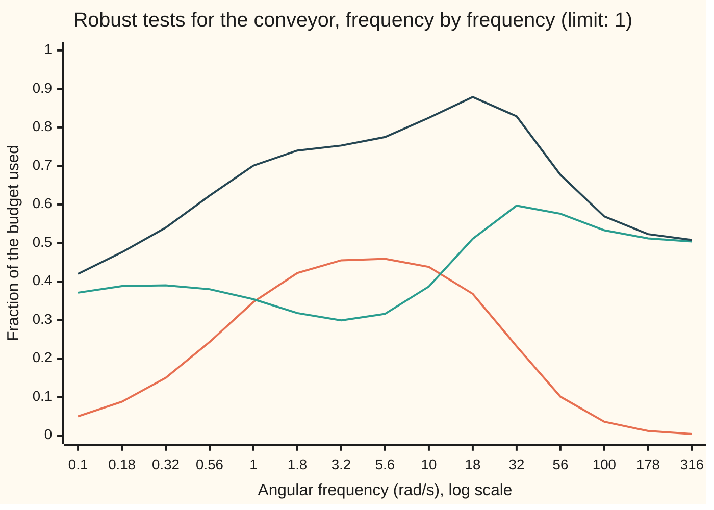

# Robust tests: does every plant in the family stay stable, and still perform

[Syllabus](../../../SYLLABUS.md) → [Engineering mathematics](../README.md) → [Robustness and Adaptation](../README.md#s10) → Robust tests

---

## General Overview

A parcel-depot conveyor is driven by one motor under speed control. Through the day the belt runs empty, half loaded and full. The inertia the motor has to spin up (its resistance to speeding up) is 0.20 kg·m² empty, 0.30 kg·m² half loaded and 0.40 kg·m² full. One controller, tuned on the empty belt, has to serve all three.

The engineer wants two answers. First: does the speed loop stay stable for every load, not just the one it was tuned on? Second: does it still do its job for every load, keeping speed errors as small as the specification demands? The first is **robust stability**. The second is **robust performance**. Passing the first, and passing the specification on the empty belt, does not mean passing the second.

The tests work one frequency at a time. At each frequency two numbers are read off the empty-belt model. One says how much the load's model error could hurt. The other says how much of the error budget the loop already uses. Their sum must stay under 1 at every frequency. For this conveyor and a gentle controller the largest sum is 0.881, at 19.72 rad/s, so every load passes. Checked load by load, the worst belt uses 0.600 of its budget.



Orange: the stability term $\lvert WT\rvert$, how much the load's model error could hurt. Green: the performance term $\lvert W_P S\rvert$, how much of the error budget the empty-belt loop uses. Dark: their sum, the robust performance test. The top of the chart is the limit, 1. The two terms peak almost a decade apart, at 4.73 rad/s and 35.81 rad/s, so their sum stays clear of the top. Labels are rounded; the points are a quarter-decade apart.

**Robust stability holds when the model error, weighted by how strongly the loop passes it round, stays under 1 at every frequency; robust performance holds when that term plus the model's performance term stays under 1 at every frequency, because the worst plant can be a different plant at each frequency.**

**What kind of fact this is:** two theorems about a family of plants, proved on this card in Why it works. Both are exact for the family the envelope describes, and only sufficient (safe but possibly pessimistic) for the real conveyor, whose family is smaller.

---

## The formula

Notation first, in words. The loop gain $L$, the sensitivity $S = 1/(1+L)$ and the complementary sensitivity $T = L/(1+L)$ are from [Sensitivity functions](../03-Feedback%20Control/02-sensitivity-and-the-gang-of-four.md): $S$ is how much of an error survives the loop, $T$ how much of a signal goes round it. Engineers write $j$ for the square root of −1; the rest of the library writes i. [Writing down model error](01-model-uncertainty-and-the-small-gain-theorem.md) writes every real plant as the model times one plus an error inside an envelope $W$, and introduces the H-infinity norm, the peak gain over all frequencies. This card adds a performance weight $W_P$: the specification turned into a curve over frequency.

The conveyor, torque in N·m to belt speed in rad/s, and its PI controller (proportional plus integral), as on the small-gain card:

$$P_J(s) = \frac{1}{(Js + b)(\tau s + 1)}, \qquad C(s) = K_p + \frac{K_i}{s}.$$

The family, the envelope and the specification:

$$P_J = P_0\,(1 + W\Delta),\ \ \lvert\Delta\rvert \le 1, \qquad W(s) = \frac{0.5\,s}{s + 1}, \qquad W_P(s) = \frac{s/M + \omega_B}{s + \omega_B A}.$$

The three tests, each required at every angular frequency $\omega$, with $S$ and $T$ computed from the model $P_0$:

$$\text{robust stability: } \lvert WT\rvert < 1, \qquad \text{nominal performance: } \lvert W_P S\rvert < 1, \qquad \text{robust performance: } \lvert W_P S\rvert + \lvert WT\rvert < 1.$$

**Read it aloud:** at every frequency, the model error passed round the loop must stay below one for stability, and the error budget the model uses plus the model error passed round the loop must stay below one for performance on every plant.

| Symbol | Plain meaning | In our example | Push it up and the answer… |
| --- | --- | --- | --- |
| $s$, $j$, $\omega$ | the Laplace variable; the square root of −1; angular frequency in rad/s, with $s = j\omega$ for a steady wobble | 0.01 to 10,000 rad/s scanned | — |
| $J$, $J_0$ | inertia of motor, belt and load, kg·m²; $J_0$ the empty belt, the model | 0.20, 0.30, 0.40; $J_0$ = 0.20 | more inertia: bigger model error |
| $b$, $\tau$ | belt friction, N·m·s/rad; the drive's torque lag, s | 0.40 N·m·s/rad, 0.02 s | — |
| $P_0$, $P_J$ | the model (empty belt) and the real plant with inertia $J$, (rad/s) per N·m | — | — |
| $C$, $K_p$, $K_i$ | the PI controller: N·m per rad/s of speed error, N·m per rad of built-up error | 3.0 and 4.0 | $K_i$ to 8: the sum rises to 0.925; but $K_p$ down to 1.5 with $K_i$ = 5 fails at 1.060 |
| $L$, $S$, $T$, $S_J$ | loop gain $P_0C$; sensitivity; complementary sensitivity; $S_J$ the sensitivity with the real plant $J$ | at 10 rad/s: $\lvert S\rvert$ = 0.6049, $\lvert T\rvert$ = 0.8802 | — |
| $W$, $\Delta$ | the envelope, the largest relative model error at each frequency (here the full belt's); any stable unknown of size at most 1 | $\lvert W\rvert$ = 0.4975 at 10 rad/s, up to 0.5 | harder to pass both robust tests |
| $W_P$, $M$, $\omega_B$, $A$ | the specification: $\lvert S\rvert$ must stay below $1/\lvert W_P\rvert$; the largest $\lvert S\rvert$ allowed (not the $M$ of Writing down model error, the loop seen by the error); the frequency below which errors must be cut; the steady error allowed | $M$ = 2, $\omega_B$ = 4 rad/s, $A$ = 0.01 | a harder specification |
| $u$, $y$, $r$ | torque command, N·m; belt speed, rad/s; a step in the speed command, rad/s | $r$ = 5 rad/s | — |
| $a_0 \ldots a_3$, $h$ | coefficients of the closed-loop polynomial; the Hurwitz ratio $a_2a_1/(a_3a_0)$, stable when above 1 | $h$ = 43.350 for the full belt | — |

### When it holds

- **The family sits inside the envelope.** The tests speak only for plants whose relative error stays under $\lvert W\rvert$ at every frequency. An envelope drawn from the half-loaded belt allows 0.330 at 10 rad/s, while the full belt's real error there is 0.498. The full belt is outside, and a pass says nothing about it.
- **Linear and unsaturated.** The drive is taken never to hit its torque limit. Each rad/s of speed error asks for 3.0 N·m at once, so a 10 rad/s step asks for 30 N·m; a 20 N·m drive clips, and none of these tests describes the clipped loop. This card's 5 rad/s step asks for 15 N·m.
- **The load changes slowly.** Each plant in the family is fixed in time. A belt loaded within a fraction of a second is a time-varying plant, which frequency tests on frozen plants do not cover; [Adapting as you go](04-gain-scheduling-and-adaptive-control.md) treats loads that move.
- **The model loop is stable.** Every test starts from a stable empty-belt loop. Its Hurwitz ratio is 44.200, well above 1.
- **One input, one output.** With several motors coupled through one belt, $\Delta$ becomes a matrix and the sum of two sizes is no longer exact; the tool then is the structured singular value (the size of the smallest error of the allowed shape that breaks the loop), which is beyond this shelf.

---

## Why it works

### Step 0: every plant is the model plus an extra loop

Write each real plant as the model times $(1 + W\Delta)$. The error $W\Delta$ then acts like an extra path wrapped round the model's closed loop. A signal entering that path comes back through the loop scaled by $T$, goes through the error scaled by at most $\lvert W\rvert$, and returns. If that round trip shrinks every signal at every frequency, the extra loop cannot sustain anything: that is the small gain rule. Performance is the same argument with one more signal in the round trip, the error the specification cares about.

### Step 1: the envelope for the conveyor

For a plant with inertia $J$ the ratio to the model is $P_J/P_0 = (J_0 s + b)/(Js + b)$, so the relative error is

$$\frac{P_J}{P_0} - 1 = \frac{(J_0 - J)\,s}{Js + b}.$$

Its size is zero for slow changes, grows with frequency, and grows with the load. The full belt has the largest, $-0.2s/(0.4s + 0.4)$, whose size is exactly $\lvert 0.5s/(s+1)\rvert$: that is $W$. At 10 rad/s it is 0.4975. Every load in between lies inside it.

### Step 2: robust stability, $\lvert WT\rvert < 1$

Factor the return difference (the $1 + PC$ whose zeros are the closed-loop poles):

$$1 + P_J C = 1 + L(1 + W\Delta) = (1 + L)\,(1 + W\Delta\,T).$$

The first factor is the model loop, stable. Now grow the error from $\Delta = 0$ to its full size. The closed-loop poles move continuously, so to reach the right half-plane a pole must cross the imaginary axis at some $s = j\omega$. There the second factor would be zero, which needs $\lvert W\Delta T\rvert = 1$. If $\lvert WT\rvert < 1$ at every $\omega$ that cannot happen, so every plant in the family is stable. If instead $\lvert WT\rvert \ge 1$ somewhere, some $\Delta$ of size at most 1, with the right phase, puts a pole on the axis. For the envelope's family the test is exact.

For the gentle controller the peak is 0.460, at 4.73 rad/s. For the controller on the small-gain card, $K_p$ = 10 and $K_i$ = 50, it is 0.6288, the same number that card found.

### Step 3: nominal performance, $\lvert W_P S\rvert < 1$

The specification says the error left at frequency $\omega$ may be at most $1/\lvert W_P\rvert$ of what came in. At zero frequency that is $A$, 1%, and integral action makes it 0. The allowance rises through about $\omega_B$, 4 rad/s, and levels off at $M = 2$: at high frequency the loop may amplify a disturbance, but not by more than 2. Dividing through, the specification is $\lvert W_P S\rvert < 1$. For the empty-belt model the peak is 0.600, at 35.81 rad/s.

### Step 4: robust performance, the sum

Divide one by the factored return difference. The real plant's sensitivity is the model's divided by the extra factor:

$$S_J = \frac{1}{(1 + L)(1 + W\Delta\,T)} = \frac{S}{1 + W\Delta\,T}.$$

The worst $\Delta$ at frequency $\omega$ has size 1 and the phase that makes the bottom as small as possible, $1 - \lvert WT\rvert$. So the worst plant's performance term is

$$\max_{\lvert\Delta\rvert\le 1}\lvert W_P S_J\rvert = \frac{\lvert W_P S\rvert}{1 - \lvert WT\rvert},$$

which is under 1 exactly when $\lvert W_P S\rvert + \lvert WT\rvert < 1$. The worst $\Delta$ is chosen afresh at each frequency, so the two terms add at the same $\omega$, never peak to peak. For the conveyor the largest sum is 0.881, at 19.72 rad/s.

Note what the sum sees that the two separate tests miss. Robust stability alone allows $\lvert WT\rvert$ close to 1. Then the bottom, $1 - \lvert WT\rvert$, is close to 0, and the worst plant's error is huge even though the plant is stable.

<details>
<summary>The two lines of algebra behind Steps 2 and 4</summary>

With $P_J = P_0(1 + W\Delta)$ and $L = P_0C$:

$1 + P_JC = 1 + L + LW\Delta = (1 + L)\left(1 + \dfrac{L}{1 + L}W\Delta\right) = (1 + L)(1 + TW\Delta).$

For the worst phase: $\lvert 1 + W\Delta T\rvert \ge 1 - \lvert WT\rvert$ by the triangle inequality, with equality when $W\Delta T$ is a negative real number of size $\lvert WT\rvert$, which a $\Delta$ of size 1 can always reach. Then $\lvert W_P S\rvert/(1 - \lvert WT\rvert) < 1$ rearranges to $\lvert W_P S\rvert + \lvert WT\rvert < 1$ whenever $\lvert WT\rvert < 1$.

</details>

### Step 5: the real family is smaller than the envelope's

The real conveyor's error is not any complex number inside the envelope. It is one curve, fixed by the inertia, with its own phase at each frequency. So the tests are safe but pessimistic for it. Checked directly, plant by plant across 21 inertias from 0.20 to 0.40 kg·m², the worst $\lvert W_P S_J\rvert$ is 0.600, under the bound 0.881, and at every frequency each real value stays under $\lvert W_P S\rvert/(1 - \lvert WT\rvert)$.

The small-gain card's controller shows the gap the other way. Its sum is 1.308, so the test cannot prove robust performance. Yet the three real belts score 0.775, 0.717 and 0.686: all inside the specification. A failed test means "not proved", and calls for the direct check.

### Step 6: why the specification must allow a hump

Why allow $\lvert S\rvert$ up to 2 at all? Because no controller can make it small everywhere. For a loop gain with no poles in the right half-plane that falls off at least as fast as $1/s^2$, as this one does, Bode's sensitivity integral, proved on [Loop shaping](../03-Feedback%20Control/09-lead-lag-compensation-and-loop-shaping.md), says

$$\int_0^\infty \ln\lvert S(j\omega)\rvert\,d\omega = 0.$$

Every bit of attenuation at low frequency ($\ln\lvert S\rvert < 0$) is paid back as amplification somewhere else: the "waterbed". For the conveyor the area below zero is −15.760 rad/s and the area above is 15.760 rad/s. A specification asking for $\lvert S\rvert < 1$ at every frequency would be impossible, whatever the controller.

---

## Worked numbers, by hand

One frequency, 10 rad/s, on the empty-belt model: $J_0$ = 0.20 kg·m², $b$ = 0.40 N·m·s/rad, $\tau$ = 0.02 s, $K_p$ = 3.0, $K_i$ = 4.0.

| Step | Arithmetic | Value |
| --- | --- | --- |
| plant's bottom, $(J_0 s + b)(\tau s + 1)$ | $(0.40 + 2j)(1 + 0.2j) = 0.40 - 0.40 + (0.08 + 2)j$ | $0.00 + 2.08j$ |
| controller, $K_p + K_i/s$ | $3.0 + 4.0/(10j)$ | $3.0 - 0.4j$ |
| loop gain $L$ | $(3.0 - 0.4j)/(2.08j)$ | $-0.1923 - 1.4423j$ |
| $\lvert L\rvert$ and $\lvert 1 + L\rvert$ | $\lvert -0.1923 - 1.4423j\rvert$, $\lvert 0.8077 - 1.4423j\rvert$ | $1.4551$, $1.6531$ |
| $\lvert S\rvert = 1/\lvert 1 + L\rvert$ | $1/1.6531$ | $0.6049$ |
| $\lvert T\rvert = \lvert L\rvert/\lvert 1 + L\rvert$ | $1.4551/1.6531$ | $0.8802$ |
| envelope $\lvert W\rvert$ | $\lvert 5j\rvert/\lvert 1 + 10j\rvert$ | $0.4975$ |
| weight $\lvert W_P\rvert$ | $\lvert 4 + 5j\rvert/\lvert 0.04 + 10j\rvert$ | $0.6403$ |
| stability term $\lvert WT\rvert$ | $0.4975 \times 0.8802$ | $0.438$ |
| performance term $\lvert W_P S\rvert$ | $0.6403 \times 0.6049$ | $0.387$ |
| **robust performance sum** | $0.438 + 0.387$ | **$0.825$** |

At 10 rad/s even the worst plant the envelope allows uses 0.825 of its error budget. Repeat at every frequency and the largest sum, 0.881 at 19.72 rad/s, is the verdict: robust performance holds for every load from empty to full.

The three real belts, checked one by one:

| Belt | Hurwitz ratio | Peak $\lvert W_P S_J\rvert$ | Peak $\lvert S_J\rvert$ | 5 rad/s step: overshoot, 2% settling |
| --- | --- | --- | --- | --- |
| empty, 0.20 kg·m² | 44.200 | 0.600 at 35.81 rad/s | 1.173 at 38.73 rad/s | 0.0%, 0.70 s |
| half, 0.30 kg·m² | 43.633 | 0.584 at 26.55 rad/s | 1.128 at 32.89 rad/s | 0.0%, 0.32 s |
| full, 0.40 kg·m² | 43.350 | 0.586 at 14.69 rad/s | 1.104 at 29.11 rad/s | 2.3%, 0.85 s |

Each belt is stretched at a different frequency: the empty one at 35.81 rad/s, the full one at 14.69 rad/s. That is why the sum is taken frequency by frequency.

### What breaks if you drop a piece

| Mistake | Comes out at | What went wrong |
| --- | --- | --- |
| Add the two peaks instead of summing at each frequency | 1.060: a false "fail" | The peaks sit at 4.73 and 35.81 rad/s; no plant suffers both at once |
| Less damping, $K_p$ = 1.5 and $K_i$ = 5, checking only stability and the empty belt | 0.504 and 0.611, both "pass"; the sum is 1.060, by coincidence the same figure as the row above | The full belt's $\lvert W_P S_J\rvert$ reaches 1.021 at 3.89 rad/s: there it cuts speed errors slightly less than the specification demands, and a 5 rad/s step overshoots 16.6% |
| Envelope drawn from the half-loaded belt | stability peak 0.303, looks safer | It allows 0.330 at 10 rad/s; the full belt's real error is 0.498, outside the envelope |
| Treat a failed sum as a failed design: the small-gain card's $K_p$ = 10, $K_i$ = 50 | sum 1.308, "fails" | The real belts score 0.775, 0.717, 0.686, all inside the specification; the test is only sufficient |

---

## Code, from first principles, and it actually runs

The scripts write complex arithmetic, the loop and both weights by hand, and scan 6,001 frequencies from 0.01 to 10,000 rad/s. They reach the verdict by **four independent roads**: the frequency-by-frequency tests on the model; a direct scan of 21 real belts, each checked against the bound from Step 4; the Hurwitz test on each belt's closed-loop polynomial, which uses no frequencies at all; and a time simulation of each belt by RK4 (the fourth-order Runge–Kutta method), which must settle. Bode's integral is checked as well, by summing $\ln\lvert S\rvert$ on a log-spaced grid.

### Python

```python
# Robust stability and robust performance -- the check behind the card.  Standard library only.
# Conveyor: torque u (N m) -> belt speed y (rad/s).  P_J(s) = 1 / ((J s + b)(tau s + 1)).  PI: C(s) = Kp + Ki/s.
# Model P0: the empty belt, J0 = 0.20 kg m^2.  Family: J from 0.20 (empty) to 0.40 kg m^2 (full).
from math import log, exp

J0, JH, JF, B, TAU = 0.20, 0.30, 0.40, 0.40, 0.02   # kg m^2 (empty, half, full), N m s/rad, s
KP, KI, M, WB, A = 3.0, 4.0, 2.0, 4.0, 0.01          # N m/(rad/s), N m/rad; spec: peak, rad/s, steady error
GRID = [10 ** (-2 + 6 * i / 6000) for i in range(6001)]   # 0.01 to 10^4 rad/s

def plant(J, s): return 1 / ((J * s + B) * (TAU * s + 1))
def ctrl(s, kp, ki): return kp + ki / s
def w_env(s, j=JF): return (j - J0) * s / (j * s + B)    # envelope: belt j's relative error; JF gives 0.5 s/(s + 1)
def w_p(s, wb=WB): return (s / M + wb) / (s + wb * A)   # specification: |S| must stay under 1/|W_P|

def tests(kp=KP, ki=KI, wb=WB, j=JF):
    """Model loop on P0; returns peaks (value, rad/s) of |W T|, |W_P S| and of their sum."""
    best = [(0.0, 0.0)] * 3
    for w in GRID:
        s = 1j * w
        L = plant(J0, s) * ctrl(s, kp, ki)
        a, c = abs(w_env(s, j) * L / (1 + L)), abs(w_p(s, wb) / (1 + L))
        best = [max(bv, (v, w)) for bv, v in zip(best, (a, c, a + c))]
    return best

def belt(J, kp=KP, ki=KI):
    """Direct road: the real plant J.  Peak |W_P S_J| and peak |S_J|, each with its frequency."""
    pk, ms = (0.0, 0.0), (0.0, 0.0)
    for w in GRID:
        s = 1j * w
        S = 1 / (1 + plant(J, s) * ctrl(s, kp, ki))
        pk, ms = max(pk, (abs(w_p(s) * S), w)), max(ms, (abs(S), w))
    return pk, ms

def hurwitz(J, kp=KP, ki=KI):
    """Closed loop: J tau s^3 + (J + b tau) s^2 + (b + Kp) s + Ki.  Stable when all > 0 and a2 a1 > a3 a0."""
    return (J + B * TAU) * (B + kp) / (J * TAU * ki)

def simulate(J, kp=KP, ki=KI, r=5.0, t_end=6.0, dt=1e-4):
    """Time road: RK4 on drive torque q, belt speed v and integral z, after a speed step of r rad/s."""
    def f(x):
        q, v, z = x
        return ((kp * (r - v) + ki * z - q) / TAU, (q - B * v) / J, r - v)
    x, peak, settle = [0.0] * 3, 0.0, 0.0
    for k in range(int(round(t_end / dt))):
        k1 = f(x); k2 = f([a + dt / 2 * d for a, d in zip(x, k1)])
        k3 = f([a + dt / 2 * d for a, d in zip(x, k2)]); k4 = f([a + dt * d for a, d in zip(x, k3)])
        x = [a + dt / 6 * (p + 2 * q + 2 * s + t) for a, p, q, s, t in zip(x, k1, k2, k3, k4)]
        peak = max(peak, x[1])
        if abs(x[1] - r) > 0.02 * r: settle = (k + 1) * dt
    return max(0.0, 100 * (peak - r) / r), settle, abs(x[1] - r)

print(f"design: Kp = {KP:.1f} N m/(rad/s), Ki = {KI:.1f} N m/rad; model J0 = {J0:.2f} kg m^2 (empty)")
print(f"plant: J = {J0:.2f}, {JH:.2f}, {JF:.2f} kg m^2, b = {B:.2f} N m s/rad, tau = {TAU:.2f} s;"
      f" spec: M = {M:.0f}, wB = {WB:.0f} rad/s, A = {A:.2f}")
s = 10j                                                   # the by-hand table, at 10 rad/s
den, c10 = (J0 * s + B) * (TAU * s + 1), ctrl(s, KP, KI)
L = c10 / den
print(f"hand at 10 rad/s: den = {den.real:.2f} {den.imag:+.2f}j, C = {c10.real:.1f} {c10.imag:+.1f}j,"
      f" L = {L.real:.4f} {L.imag:+.4f}j, |L| = {abs(L):.4f}, |1+L| = {abs(1 + L):.4f}")
print(f"hand at 10 rad/s: |S| = {abs(1 / (1 + L)):.4f}, |T| = {abs(L / (1 + L)):.4f},"
      f" |W| = {abs(w_env(s)):.4f}, |W_P| = {abs(w_p(s)):.4f}")
print("chart: w (rad/s) |W T| |W_P S| sum")
for w in (0.1, 0.178, 0.316, 0.562, 1, 1.78, 3.16, 5.62, 10, 17.8, 31.6, 56.2, 100, 178, 316):
    s = 1j * w
    L = plant(J0, s) * ctrl(s, KP, KI)
    a, c = abs(w_env(s) * L / (1 + L)), abs(w_p(s) / (1 + L))
    print(f"chart, {w:7.3f}, {a:.3f}, {c:.3f}, {a + c:.3f}")
rs, np_, rp = tests()
print(f"robust stability   peak |W T|     = {rs[0]:.3f} at {rs[1]:.2f} rad/s")
print(f"nominal perf       peak |W_P S|   = {np_[0]:.3f} at {np_[1]:.2f} rad/s")
print(f"robust perf        peak of sum    = {rp[0]:.3f} at {rp[1]:.2f} rad/s")
print(f"wrong: add the two peaks         = {rs[0] + np_[0]:.3f}")
assert rp[0] < 1 < rs[0] + np_[0] and rs[1] < rp[1] < np_[1]   # the peaks sit at different frequencies
peaks = {}
for name, J in (("empty", J0), ("half", JH), ("full", JF)):
    (pk, wpk), (ms, wms) = belt(J)
    os_, ts, err = simulate(J)
    peaks[name] = pk
    print(f"belt {name:5s} J={J:.2f}: Hurwitz ratio {hurwitz(J):.3f}, peak |W_P S| {pk:.3f} at {wpk:.2f} rad/s,"
          f" peak |S| {ms:.3f} at {wms:.2f} rad/s, overshoot {os_:.1f} %, 2% settle {ts:.2f} s")
    assert hurwitz(J) > 1 and err < 1e-3                  # algebra and simulation both say: stable
    assert pk < 1                                          # the real belt meets the specification
worst, slack, top = 0.0, 1.0, [0.0] * 21
for k in range(21):                                        # sweep the whole family, not just three belts
    J = J0 + (JF - J0) * k / 20
    for w in GRID[::10]:
        s = 1j * w
        L = plant(J0, s) * ctrl(s, KP, KI)
        bound = abs(w_p(s) / (1 + L)) / (1 - abs(w_env(s) * L / (1 + L)))
        real = abs(w_p(s) / (1 + plant(J, s) * ctrl(s, KP, KI)))
        worst, slack, top[k] = max(worst, real), min(slack, bound - real), max(top[k], real)
print(f"family sweep, 21 inertias: worst |W_P S_J| = {worst:.3f}; real never above the bound: {slack >= -1e-12}")
assert slack >= -1e-12 and worst < rp[0] < 1               # Step 4's bound holds; the test is pessimistic
assert abs(worst - max(peaks.values())) < 2e-3
assert abs(top[10] - peaks["half"]) < 2e-3 and abs(top[20] - peaks["full"]) < 2e-3   # the sweep's belts are the real ones
# Bode's sensitivity integral: integral of ln|S| over w is 0 here (no right-half-plane poles, L ~ 1/s^2)
lo, hi, n = log(1e-8), log(1e9), 200000
h, below, above = (hi - lo) / n, 0.0, 0.0
for i in range(n + 1):
    w = exp(lo + i * h)
    v = log(abs(1 / (1 + plant(J0, 1j * w) * ctrl(1j * w, KP, KI)))) * w * h * (0.5 if i in (0, n) else 1)
    below, above = below + min(v, 0.0), above + max(v, 0.0)
print(f"Bode integral: area below 0 = {below:.3f}, above 0 = {above:.3f}, |total| = {abs(below + above):.4f} (rad/s)")
assert abs(below + above) < 1e-3 * above
# What breaks
mrn = tests(kp=10.0, ki=50.0)                              # the controller from the small-gain card
mb = [belt(J, 10.0, 50.0)[0][0] for J in (J0, JH, JF)]
print(f"morning controller Kp = 10, Ki = 50: RS {mrn[0][0]:.4f}, NP {mrn[1][0]:.3f}, sum {mrn[2][0]:.3f};"
      f" real belts {mb[0]:.3f}, {mb[1]:.3f}, {mb[2]:.3f}")
assert mrn[0][0] < 1 < mrn[2][0] and max(mb) < 1           # not proved by the test, true for the real belts
soft = tests(kp=1.5, ki=5.0)
(spk, swp), (sms, _) = belt(JF, 1.5, 5.0)
os_, ts, err = simulate(JF, 1.5, 5.0)
print(f"wrong: Kp = 1.5, Ki = 5, two tests only: RS {soft[0][0]:.3f}, NP {soft[1][0]:.3f}, sum {soft[2][0]:.3f};"
      f" full belt peak |W_P S| {spk:.3f} at {swp:.2f} rad/s, overshoot {os_:.1f} %, settle {ts:.2f} s")
assert soft[0][0] < 1 and soft[1][0] < 1 and soft[2][0] > 1 and spk > 1
half_env = tests(j=JH)                                     # envelope drawn from the half-loaded belt
print(f"wrong: envelope from half belt: RS {half_env[0][0]:.3f}; at 10 rad/s it allows {abs(w_env(10j, JH)):.3f},"
      f" full belt's real error is {abs(w_env(10j)):.3f}")
assert abs(w_env(10j, JH)) < abs(w_env(10j))
print(f"saturation: a 10 rad/s step asks {KP * 10:.0f} N m at once, over a {20.0:.0f} N m drive;"
      f" the 5 rad/s step asks {KP * 5:.0f} N m")
print("try: Ki = 8 -> sum {:.3f}; Kp = 5, Ki = 10 -> sum {:.3f}; wB = 6 rad/s -> sum {:.3f}".format(
    tests(ki=8.0)[2][0], tests(kp=5.0, ki=10.0)[2][0], tests(wb=6.0)[2][0]))
print("ALL CHECKS PASS")
```

**Ran 2026-11-11 on macOS, Python 3.14.10, standard library only. All checks passed. Output, pasted from the run:**

```
design: Kp = 3.0 N m/(rad/s), Ki = 4.0 N m/rad; model J0 = 0.20 kg m^2 (empty)
plant: J = 0.20, 0.30, 0.40 kg m^2, b = 0.40 N m s/rad, tau = 0.02 s; spec: M = 2, wB = 4 rad/s, A = 0.01
hand at 10 rad/s: den = 0.00 +2.08j, C = 3.0 -0.4j, L = -0.1923 -1.4423j, |L| = 1.4551, |1+L| = 1.6531
hand at 10 rad/s: |S| = 0.6049, |T| = 0.8802, |W| = 0.4975, |W_P| = 0.6403
chart: w (rad/s) |W T| |W_P S| sum
chart,   0.100, 0.050, 0.371, 0.420
chart,   0.178, 0.088, 0.388, 0.476
chart,   0.316, 0.150, 0.390, 0.540
chart,   0.562, 0.243, 0.380, 0.623
chart,   1.000, 0.347, 0.354, 0.701
chart,   1.780, 0.422, 0.318, 0.740
chart,   3.160, 0.455, 0.299, 0.753
chart,   5.620, 0.459, 0.316, 0.775
chart,  10.000, 0.438, 0.387, 0.825
chart,  17.800, 0.368, 0.511, 0.879
chart,  31.600, 0.232, 0.597, 0.829
chart,  56.200, 0.101, 0.576, 0.677
chart, 100.000, 0.036, 0.533, 0.569
chart, 178.000, 0.012, 0.512, 0.523
chart, 316.000, 0.004, 0.504, 0.508
robust stability   peak |W T|     = 0.460 at 4.73 rad/s
nominal perf       peak |W_P S|   = 0.600 at 35.81 rad/s
robust perf        peak of sum    = 0.881 at 19.72 rad/s
wrong: add the two peaks         = 1.060
belt empty J=0.20: Hurwitz ratio 44.200, peak |W_P S| 0.600 at 35.81 rad/s, peak |S| 1.173 at 38.73 rad/s, overshoot 0.0 %, 2% settle 0.70 s
belt half  J=0.30: Hurwitz ratio 43.633, peak |W_P S| 0.584 at 26.55 rad/s, peak |S| 1.128 at 32.89 rad/s, overshoot 0.0 %, 2% settle 0.32 s
belt full  J=0.40: Hurwitz ratio 43.350, peak |W_P S| 0.586 at 14.69 rad/s, peak |S| 1.104 at 29.11 rad/s, overshoot 2.3 %, 2% settle 0.85 s
family sweep, 21 inertias: worst |W_P S_J| = 0.600; real never above the bound: True
Bode integral: area below 0 = -15.760, above 0 = 15.760, |total| = 0.0000 (rad/s)
morning controller Kp = 10, Ki = 50: RS 0.6288, NP 0.775, sum 1.308; real belts 0.775, 0.717, 0.686
wrong: Kp = 1.5, Ki = 5, two tests only: RS 0.504, NP 0.611, sum 1.060; full belt peak |W_P S| 1.021 at 3.89 rad/s, overshoot 16.6 %, settle 1.36 s
wrong: envelope from half belt: RS 0.303; at 10 rad/s it allows 0.330, full belt's real error is 0.498
saturation: a 10 rad/s step asks 30 N m at once, over a 20 N m drive; the 5 rad/s step asks 15 N m
try: Ki = 8 -> sum 0.925; Kp = 5, Ki = 10 -> sum 0.994; wB = 6 rad/s -> sum 0.931
ALL CHECKS PASS
```

### Rust

```rust
// Robust stability and robust performance -- the same check as robust_stability_and_robust_performance_check.py.
// Standard library only, no crates.  Complex numbers are a small struct written out.
// Conveyor: torque u (N m) -> belt speed y (rad/s).  P_J(s) = 1 / ((J s + b)(tau s + 1)).  PI: C(s) = Kp + Ki/s.
// Model P0: the empty belt, J0 = 0.20 kg m^2.  Family: J from 0.20 (empty) to 0.40 kg m^2 (full).
const J0: f64 = 0.20; const JH: f64 = 0.30; const JF: f64 = 0.40; const B: f64 = 0.40; const TAU: f64 = 0.02;
const KP: f64 = 3.0; const KI: f64 = 4.0; const M: f64 = 2.0; const WB: f64 = 4.0; const A: f64 = 0.01;

#[derive(Clone, Copy)]
struct C { re: f64, im: f64 }
impl C {
    fn new(re: f64, im: f64) -> C { C { re, im } }
    fn r(x: f64) -> C { C::new(x, 0.0) }
    fn add(self, o: C) -> C { C::new(self.re + o.re, self.im + o.im) }
    fn mul(self, o: C) -> C { C::new(self.re * o.re - self.im * o.im, self.re * o.im + self.im * o.re) }
    fn div(self, o: C) -> C { let d = o.re * o.re + o.im * o.im; C::new((self.re * o.re + self.im * o.im) / d, (self.im * o.re - self.re * o.im) / d) }
    fn abs(self) -> f64 { self.re.hypot(self.im) }
}

fn jw(w: f64) -> C { C::new(0.0, w) }
fn den(j: f64, s: C) -> C { C::r(j).mul(s).add(C::r(B)).mul(C::r(TAU).mul(s).add(C::r(1.0))) }
fn plant(j: f64, s: C) -> C { C::r(1.0).div(den(j, s)) }
fn ctrl(s: C, kp: f64, ki: f64) -> C { C::r(kp).add(C::r(ki).div(s)) }
fn w_env(s: C, j: f64) -> C { C::r(j - J0).mul(s).div(C::r(j).mul(s).add(C::r(B))) }
fn w_p(s: C, wb: f64) -> C { s.div(C::r(M)).add(C::r(wb)).div(s.add(C::r(wb * A))) }
fn sens(l: C) -> C { C::r(1.0).div(C::r(1.0).add(l)) }
fn comp(l: C) -> C { l.div(C::r(1.0).add(l)) }

fn grid() -> Vec<f64> { (0..=6000).map(|i| 10f64.powf(-2.0 + 6.0 * i as f64 / 6000.0)).collect() }

fn tests(g: &[f64], kp: f64, ki: f64, wb: f64, j: f64) -> [(f64, f64); 3] {
    let mut best = [(0.0, 0.0); 3];
    for &w in g {
        let s = jw(w);
        let l = plant(J0, s).mul(ctrl(s, kp, ki));
        let (a, c) = (w_env(s, j).mul(comp(l)).abs(), w_p(s, wb).mul(sens(l)).abs());
        for (b, v) in best.iter_mut().zip([a, c, a + c]) { if v > b.0 { *b = (v, w); } }
    }
    best
}

fn belt(g: &[f64], j: f64, kp: f64, ki: f64) -> ((f64, f64), (f64, f64)) {
    let (mut pk, mut ms) = ((0.0, 0.0), (0.0, 0.0));
    for &w in g {
        let s = jw(w);
        let sj = sens(plant(j, s).mul(ctrl(s, kp, ki)));
        let (a, b) = (w_p(s, WB).mul(sj).abs(), sj.abs());
        if a > pk.0 { pk = (a, w); }
        if b > ms.0 { ms = (b, w); }
    }
    (pk, ms)
}

fn hurwitz(j: f64, kp: f64, ki: f64) -> f64 { (j + B * TAU) * (B + kp) / (j * TAU * ki) }

fn simulate(j: f64, kp: f64, ki: f64) -> (f64, f64, f64) {
    let (r, t_end, dt) = (5.0, 6.0, 1e-4);
    let f = |x: [f64; 3]| -> [f64; 3] { [(kp * (r - x[1]) + ki * x[2] - x[0]) / TAU, (x[0] - B * x[1]) / j, r - x[1]] };
    let mv = |x: [f64; 3], k: [f64; 3], h: f64| -> [f64; 3] { [x[0] + h * k[0], x[1] + h * k[1], x[2] + h * k[2]] };
    let (mut x, mut peak, mut settle) = ([0.0f64; 3], 0.0f64, 0.0);
    for k in 0..(t_end / dt as f64).round() as usize {
        let k1 = f(x); let k2 = f(mv(x, k1, dt / 2.0)); let k3 = f(mv(x, k2, dt / 2.0)); let k4 = f(mv(x, k3, dt));
        for i in 0..3 { x[i] += dt / 6.0 * (k1[i] + 2.0 * k2[i] + 2.0 * k3[i] + k4[i]); }
        peak = peak.max(x[1]);
        if (x[1] - r).abs() > 0.02 * r { settle = (k + 1) as f64 * dt; }
    }
    ((100.0 * (peak - r) / r).max(0.0), settle, (x[1] - r).abs())
}

fn main() {
    let g = grid();
    println!("design: Kp = {:.1} N m/(rad/s), Ki = {:.1} N m/rad; model J0 = {:.2} kg m^2 (empty)", KP, KI, J0);
    println!("plant: J = {:.2}, {:.2}, {:.2} kg m^2, b = {:.2} N m s/rad, tau = {:.2} s; spec: M = {:.0}, wB = {:.0} rad/s, A = {:.2}",
             J0, JH, JF, B, TAU, M, WB, A);
    let s = jw(10.0);
    let (d10, c10) = (den(J0, s), ctrl(s, KP, KI));
    let l = c10.div(d10);
    println!("hand at 10 rad/s: den = {:.2} {:+.2}j, C = {:.1} {:+.1}j, L = {:.4} {:+.4}j, |L| = {:.4}, |1+L| = {:.4}",
             d10.re, d10.im, c10.re, c10.im, l.re, l.im, l.abs(), C::r(1.0).add(l).abs());
    println!("hand at 10 rad/s: |S| = {:.4}, |T| = {:.4}, |W| = {:.4}, |W_P| = {:.4}",
             sens(l).abs(), comp(l).abs(), w_env(s, JF).abs(), w_p(s, WB).abs());
    println!("chart: w (rad/s) |W T| |W_P S| sum");
    for w in [0.1, 0.178, 0.316, 0.562, 1.0, 1.78, 3.16, 5.62, 10.0, 17.8, 31.6, 56.2, 100.0, 178.0, 316.0] {
        let s = jw(w);
        let l = plant(J0, s).mul(ctrl(s, KP, KI));
        let (a, c) = (w_env(s, JF).mul(comp(l)).abs(), w_p(s, WB).mul(sens(l)).abs());
        println!("chart, {:7.3}, {:.3}, {:.3}, {:.3}", w, a, c, a + c);
    }
    let [rs, np, rp] = tests(&g, KP, KI, WB, JF);
    println!("robust stability   peak |W T|     = {:.3} at {:.2} rad/s", rs.0, rs.1);
    println!("nominal perf       peak |W_P S|   = {:.3} at {:.2} rad/s", np.0, np.1);
    println!("robust perf        peak of sum    = {:.3} at {:.2} rad/s", rp.0, rp.1);
    println!("wrong: add the two peaks         = {:.3}", rs.0 + np.0);
    assert!(rp.0 < 1.0 && 1.0 < rs.0 + np.0 && rs.1 < rp.1 && rp.1 < np.1);
    let (mut top, mut pks) = (0.0f64, vec![]);
    for (name, j) in [("empty", J0), ("half", JH), ("full", JF)] {
        let ((pk, wpk), (ms, wms)) = belt(&g, j, KP, KI);
        let (os, ts, err) = simulate(j, KP, KI);
        top = top.max(pk); pks.push(pk);
        println!("belt {:5} J={:.2}: Hurwitz ratio {:.3}, peak |W_P S| {:.3} at {:.2} rad/s, peak |S| {:.3} at {:.2} rad/s, overshoot {:.1} %, 2% settle {:.2} s",
                 name, j, hurwitz(j, KP, KI), pk, wpk, ms, wms, os, ts);
        assert!(hurwitz(j, KP, KI) > 1.0 && err < 1e-3);
        assert!(pk < 1.0);
    }
    let (mut worst, mut slack, mut sw) = (0.0f64, 1.0f64, [0.0f64; 21]);
    for k in 0..21 {
        let j = J0 + (JF - J0) * k as f64 / 20.0;
        for &w in g.iter().step_by(10) {
            let s = jw(w);
            let l = plant(J0, s).mul(ctrl(s, KP, KI));
            let bound = w_p(s, WB).mul(sens(l)).abs() / (1.0 - w_env(s, JF).mul(comp(l)).abs());
            let real = w_p(s, WB).mul(sens(plant(j, s).mul(ctrl(s, KP, KI)))).abs();
            worst = worst.max(real); slack = slack.min(bound - real); sw[k] = sw[k].max(real);
        }
    }
    println!("family sweep, 21 inertias: worst |W_P S_J| = {:.3}; real never above the bound: {}", worst, if slack >= -1e-12 { "True" } else { "False" });
    assert!(slack >= -1e-12 && worst < rp.0 && rp.0 < 1.0);
    assert!((worst - top).abs() < 2e-3);
    assert!((sw[10] - pks[1]).abs() < 2e-3 && (sw[20] - pks[2]).abs() < 2e-3);
    let (lo, hi, n) = (1e-8f64.ln(), 1e9f64.ln(), 200000usize);
    let (h, mut below, mut above) = ((hi - lo) / n as f64, 0.0f64, 0.0f64);
    for i in 0..=n {
        let w = (lo + i as f64 * h).exp();
        let s = jw(w);
        let v = sens(plant(J0, s).mul(ctrl(s, KP, KI))).abs().ln() * w * h * if i == 0 || i == n { 0.5 } else { 1.0 };
        below += v.min(0.0); above += v.max(0.0);
    }
    println!("Bode integral: area below 0 = {:.3}, above 0 = {:.3}, |total| = {:.4} (rad/s)", below, above, (below + above).abs());
    assert!((below + above).abs() < 1e-3 * above);
    let mrn = tests(&g, 10.0, 50.0, WB, JF);
    let mb: Vec<f64> = [J0, JH, JF].iter().map(|&j| belt(&g, j, 10.0, 50.0).0 .0).collect();
    println!("morning controller Kp = 10, Ki = 50: RS {:.4}, NP {:.3}, sum {:.3}; real belts {:.3}, {:.3}, {:.3}",
             mrn[0].0, mrn[1].0, mrn[2].0, mb[0], mb[1], mb[2]);
    assert!(mrn[0].0 < 1.0 && 1.0 < mrn[2].0 && mb.iter().all(|&v| v < 1.0));
    let soft = tests(&g, 1.5, 5.0, WB, JF);
    let ((spk, swp), _) = belt(&g, JF, 1.5, 5.0);
    let (os, ts, _) = simulate(JF, 1.5, 5.0);
    println!("wrong: Kp = 1.5, Ki = 5, two tests only: RS {:.3}, NP {:.3}, sum {:.3}; full belt peak |W_P S| {:.3} at {:.2} rad/s, overshoot {:.1} %, settle {:.2} s",
             soft[0].0, soft[1].0, soft[2].0, spk, swp, os, ts);
    assert!(soft[0].0 < 1.0 && soft[1].0 < 1.0 && soft[2].0 > 1.0 && spk > 1.0);
    let half_env = tests(&g, KP, KI, WB, JH);
    println!("wrong: envelope from half belt: RS {:.3}; at 10 rad/s it allows {:.3}, full belt's real error is {:.3}",
             half_env[0].0, w_env(jw(10.0), JH).abs(), w_env(jw(10.0), JF).abs());
    assert!(w_env(jw(10.0), JH).abs() < w_env(jw(10.0), JF).abs());
    println!("saturation: a 10 rad/s step asks {:.0} N m at once, over a {:.0} N m drive; the 5 rad/s step asks {:.0} N m", KP * 10.0, 20.0, KP * 5.0);
    println!("try: Ki = 8 -> sum {:.3}; Kp = 5, Ki = 10 -> sum {:.3}; wB = 6 rad/s -> sum {:.3}",
             tests(&g, KP, 8.0, WB, JF)[2].0, tests(&g, 5.0, 10.0, WB, JF)[2].0, tests(&g, KP, KI, 6.0, JF)[2].0);
    println!("ALL CHECKS PASS");
}
```

**Ran 2026-11-11 on macOS, rustc 1.98.1, no crates. All checks passed. Output, pasted from the run:**

```
design: Kp = 3.0 N m/(rad/s), Ki = 4.0 N m/rad; model J0 = 0.20 kg m^2 (empty)
plant: J = 0.20, 0.30, 0.40 kg m^2, b = 0.40 N m s/rad, tau = 0.02 s; spec: M = 2, wB = 4 rad/s, A = 0.01
hand at 10 rad/s: den = 0.00 +2.08j, C = 3.0 -0.4j, L = -0.1923 -1.4423j, |L| = 1.4551, |1+L| = 1.6531
hand at 10 rad/s: |S| = 0.6049, |T| = 0.8802, |W| = 0.4975, |W_P| = 0.6403
chart: w (rad/s) |W T| |W_P S| sum
chart,   0.100, 0.050, 0.371, 0.420
chart,   0.178, 0.088, 0.388, 0.476
chart,   0.316, 0.150, 0.390, 0.540
chart,   0.562, 0.243, 0.380, 0.623
chart,   1.000, 0.347, 0.354, 0.701
chart,   1.780, 0.422, 0.318, 0.740
chart,   3.160, 0.455, 0.299, 0.753
chart,   5.620, 0.459, 0.316, 0.775
chart,  10.000, 0.438, 0.387, 0.825
chart,  17.800, 0.368, 0.511, 0.879
chart,  31.600, 0.232, 0.597, 0.829
chart,  56.200, 0.101, 0.576, 0.677
chart, 100.000, 0.036, 0.533, 0.569
chart, 178.000, 0.012, 0.512, 0.523
chart, 316.000, 0.004, 0.504, 0.508
robust stability   peak |W T|     = 0.460 at 4.73 rad/s
nominal perf       peak |W_P S|   = 0.600 at 35.81 rad/s
robust perf        peak of sum    = 0.881 at 19.72 rad/s
wrong: add the two peaks         = 1.060
belt empty J=0.20: Hurwitz ratio 44.200, peak |W_P S| 0.600 at 35.81 rad/s, peak |S| 1.173 at 38.73 rad/s, overshoot 0.0 %, 2% settle 0.70 s
belt half  J=0.30: Hurwitz ratio 43.633, peak |W_P S| 0.584 at 26.55 rad/s, peak |S| 1.128 at 32.89 rad/s, overshoot 0.0 %, 2% settle 0.32 s
belt full  J=0.40: Hurwitz ratio 43.350, peak |W_P S| 0.586 at 14.69 rad/s, peak |S| 1.104 at 29.11 rad/s, overshoot 2.3 %, 2% settle 0.85 s
family sweep, 21 inertias: worst |W_P S_J| = 0.600; real never above the bound: True
Bode integral: area below 0 = -15.760, above 0 = 15.760, |total| = 0.0000 (rad/s)
morning controller Kp = 10, Ki = 50: RS 0.6288, NP 0.775, sum 1.308; real belts 0.775, 0.717, 0.686
wrong: Kp = 1.5, Ki = 5, two tests only: RS 0.504, NP 0.611, sum 1.060; full belt peak |W_P S| 1.021 at 3.89 rad/s, overshoot 16.6 %, settle 1.36 s
wrong: envelope from half belt: RS 0.303; at 10 rad/s it allows 0.330, full belt's real error is 0.498
saturation: a 10 rad/s step asks 30 N m at once, over a 20 N m drive; the 5 rad/s step asks 15 N m
try: Ki = 8 -> sum 0.925; Kp = 5, Ki = 10 -> sum 0.994; wB = 6 rad/s -> sum 0.931
ALL CHECKS PASS
```

> [!TIP]
> **Try changing**
> - Guess first: a stronger integral, $K_i$ = 8, to cut slow errors faster. Does it still pass? The sum rises to 0.925: a pass, with less room.
> - Guess first: $K_p$ = 5 and $K_i$ = 10, a faster loop. The sum is 0.994: a pass by a hair.
> - Guess first: demand that errors be cut up to $\omega_B$ = 6 rad/s instead of 4. The sum is 0.931: still a pass.

---

## The usual mistake

> [!warning]
> **Checking robust stability and the model's performance, and calling the job done.** Each test can pass while their sum fails. With $K_p$ = 1.5 and $K_i$ = 5 the stability peak is 0.504 and the empty belt's performance peak 0.611, both under 1. The sum is 1.060, and the full belt really misses the specification: its $\lvert W_P S_J\rvert$ reaches 1.021 at 3.89 rad/s. A plant can be stable and still miss the specification, and only the sum sees it.
>
> Smaller traps:
> - **Adding peaks.** The sum is taken at each frequency. Adding the two peaks gives 1.060, by coincidence the same figure as above, and rejects a design that passes at 0.881.
> - **Drawing the envelope from a middle load.** The heaviest belt has the biggest error. An envelope from the half-loaded belt gives a stability peak of 0.303, but at 10 rad/s it allows 0.330 against the full belt's real 0.498.
> - **Reading a failed test as a failed plant.** The tests are sufficient, not necessary, for a real family. The small-gain card's controller fails the sum at 1.308 while every real belt passes, the worst at 0.775.
> - **Asking for small $\lvert S\rvert$ everywhere.** Bode's integral forbids it: −15.760 rad/s of attenuation is paid back as +15.760 rad/s of amplification.

---

## Where you meet it in real life

- **Conveyors, hoists and lifts.** Load changes the inertia through the day; drive makers tune one speed loop and check it at empty and at full load.
- **Aircraft flight control.** Fuel burn and payload change mass and balance. Each flight condition is a plant in the family, and the control law is checked across the whole flight envelope.
- **Hard-disk drives.** Every unit off the line differs a little. The servo loop must meet its tracking specification on all of them, not on an average drive.
- **Robot arms.** A gripped payload changes the arm's inertia: the conveyor's empty-to-full range in another shape.
- **Process plants.** Gains drift with throughput and temperature, and robust performance is how one tuning is checked across the operating range.

> **Say it back**
> A real plant differs from its model by an error bounded by an envelope $W$ at each frequency. The loop is robustly stable when $\lvert WT\rvert$ stays under 1 at every frequency. It performs robustly when $\lvert W_P S\rvert + \lvert WT\rvert$ stays under 1 at every frequency, because the worst plant at one frequency need not be the worst at another. For the conveyor the largest sum is 0.881, so empty, half and full belts all meet the specification; checked one by one, the worst uses 0.600 of its budget. The tests are pessimistic for a real family, so a failed test calls for a direct check, not a verdict.

---

## What this builds on

- [Writing down model error](01-model-uncertainty-and-the-small-gain-theorem.md): the envelope $W$, the H-infinity norm and the small gain rule, which Step 2 applies frequency by frequency.
- [Sensitivity functions](../03-Feedback%20Control/02-sensitivity-and-the-gang-of-four.md): $S$ and $T$, the two terms in every test on this card.
- [Routh-Hurwitz](../03-Feedback%20Control/04-routh-hurwitz-criterion.md): the algebraic stability test used as an independent road for each belt.
- [Nyquist and margins](../03-Feedback%20Control/06-nyquist-criterion-and-stability-margins.md): stability read from the frequency response, and why a pole can only become unstable by crossing the imaginary axis.

## Where this goes next

- [H-infinity design](03-h-infinity-control-in-outline.md): turns the test into a design method, choosing the controller that makes the weighted peak as small as possible.
- [Adapting as you go](04-gain-scheduling-and-adaptive-control.md): when one controller cannot serve the whole family, measure the load and change the gains with it.

The question this card leaves open: when the family is one real number, like this inertia, how much of the gap between 0.881 and 0.600 can a sharper test close?

---

## Sources

Verified 2026-11-11: every link below resolves to the publisher's page.

- Doyle, John C., and Gunter Stein. "Multivariable Feedback Design: Concepts for a Classical/Modern Synthesis." *IEEE Transactions on Automatic Control* 26, no. 1 (1981): 4–16. [doi:10.1109/TAC.1981.1102555](https://doi.org/10.1109/TAC.1981.1102555). The multiplicative envelope and the robust stability test $\lvert WT\rvert < 1$.
- Freudenberg, James S., and Douglas P. Looze. "Right Half Plane Poles and Zeros and Design Tradeoffs in Feedback Systems." *IEEE Transactions on Automatic Control* 30, no. 6 (1985): 555–565. [doi:10.1109/TAC.1985.1104004](https://doi.org/10.1109/TAC.1985.1104004). Bode's sensitivity integral and the trade-offs it forces, used in Step 6.
- Skogestad, Sigurd, and Ian Postlethwaite. *Multivariable Feedback Control: Analysis and Design*, 2nd ed. Wiley, 2005. [Publisher page](https://www.wiley.com/en-us/Multivariable+Feedback+Control%3A+Analysis+and+Design%2C+2nd+Edition-p-9780470011683). The weights in this form and the robust performance condition $\lvert W_P S\rvert + \lvert WT\rvert < 1$ for one input and one output.
- Åström, Karl Johan, and Richard M. Murray. *Feedback Systems: An Introduction for Scientists and Engineers*, 2nd ed. Princeton University Press, 2021. [Publisher page](https://press.princeton.edu/books/hardcover/9780691193984/feedback-systems). Robust stability and robust performance for one loop, at an engineering level.
