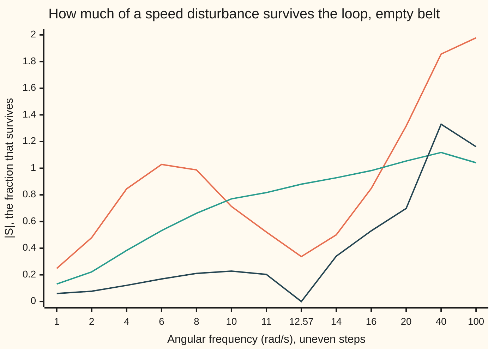
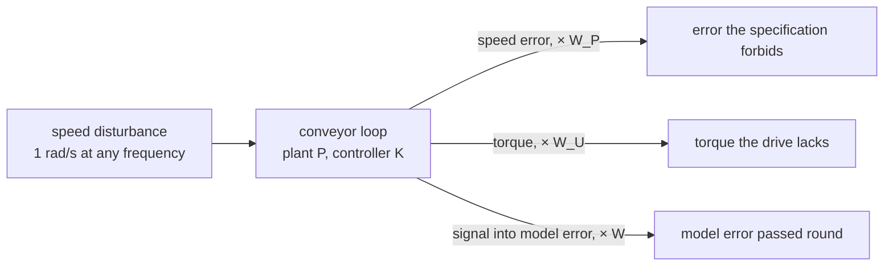
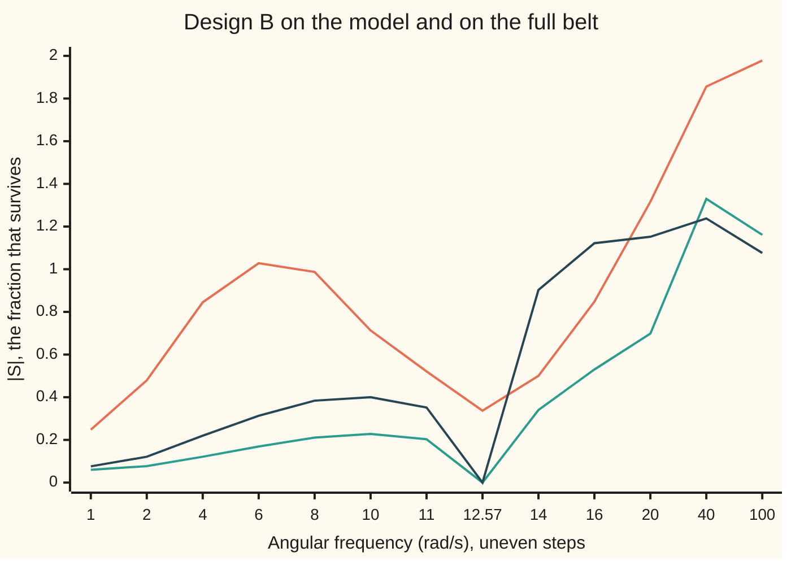

# H-infinity design: shrink the worst-case gain from disturbance to error

[Syllabus](../../../SYLLABUS.md) → [Engineering mathematics](../README.md) → [Robustness and Adaptation](../README.md#s10) → H-infinity design

---

## General Overview

The parcel-depot conveyor from the rest of this shelf has a new problem. A chute drops parcels onto the belt twice a second. Each drop drags on the belt, and the drag adds up to a load torque that swings by 0.5 N·m at 2 Hz, which is 12.5664 rad/s. With no speed control, that bump makes the roller speed wobble by 0.1965 rad/s either side of its set speed. The barcode scanner downstream misreads labels when the belt jerks, so the wobble has to go.

The speed controller must also keep everything the earlier cards asked for. It must stay stable when the belt's inertia doubles from 0.20 kg·m² empty to 0.40 kg·m² full. It must cut slow speed errors. It must not ask the drive for more torque than it has. Four wishes, one controller, and they pull against each other.

H-infinity design turns every wish into a curve over frequency, called a **weight**. Each closed-loop gain is divided by its weight. The design then picks the controller that makes the worst of these ratios, at the worst frequency, as small as possible. The worst case for one controller is one number, written $\gamma$ (gamma). If $\gamma$ is below 1, every wish is met at every frequency at once, with one catch this card returns to: the error wish is checked on the empty-belt model only.

For the conveyor the weight that matters gets a peak at 2 Hz: a demand for five times more rejection there. The search answers by switching on a part of the controller it had left off: a resonator, a term whose gain is unlimited at exactly 2 Hz. The worst case comes out at $\gamma$ = 0.9696. In a simulation the 2 Hz wobble dies away to 0.0000 rad/s on the empty belt and on the full one. A plain design from the same search, with no peak in the weight, leaves 0.1728 rad/s.



Orange: the allowance $1/\lvert W_P\rvert$ from the peaked weight, the most $\lvert S\rvert$ may be when $\gamma$ = 1; its dip at 12.57 rad/s is the 2 Hz demand. Green: design A, tuned with a flat weight; at 2 Hz it lets 0.880 of the disturbance through. Dark: design B, tuned with the peaked weight; it digs a notch to 0.000 at 2 Hz and stays under the allowance everywhere.

**H-infinity design writes each requirement as a weight over frequency, stacks the weighted closed-loop gains, and chooses the controller that makes the peak of the stack, the worst-case gain from disturbance to weighted error, as small as possible; a peak below 1 meets every requirement at every frequency at once.**

**What kind of fact this is:** a design method. Its guarantee, that $\gamma < 1$ meets every weighted requirement and keeps every belt in the envelope stable, is a theorem proved on this card in Why it works. That the truly best controller can be computed from two Riccati equations is a theorem stated here, not proved; this card finds a good controller by a search instead, and says how far from the best it can be.

---

## The formula

Notation from earlier cards, one line each. The controller is written $K$ here, as is usual in H-infinity work; the earlier cards call it $C$. The loop gain $L = PK$ is one trip round plant and controller; the sensitivity $S = 1/(1+L)$ is the fraction of a disturbance that survives the loop, and $T = L/(1+L)$ is the fraction of a signal that goes round it ([Sensitivity functions](../03-Feedback%20Control/02-sensitivity-and-the-gang-of-four.md)). Engineers write $j$ for the square root of −1; the rest of the library writes i. The **H-infinity norm** $\lVert G\rVert_\infty$ is the peak gain of a stable system $G$ over all frequencies ([Writing down model error](01-model-uncertainty-and-the-small-gain-theorem.md)). The weights $W$ and $W_P$ and the test $\lvert W_P S\rvert + \lvert WT\rvert < 1$ come from [Robust tests](02-robust-stability-and-robust-performance.md).

The plant, from drive torque in N·m to roller speed in rad/s, and the controller family searched on this card:

$$P(s) = \frac{1}{(Js + b)(\tau s + 1)}, \qquad K(s) = K_p + \frac{K_i}{s} + K_r\,\frac{s}{s^2 + \omega_0^2}.$$

The load bump enters at the belt, after the drive, so it reaches the speed through $S/(Js+b)$. The **mixed-sensitivity problem**, mixed because it weights $S$, $KS$ and $T$ together:

$$\gamma_{\text{opt}} = \min_{K\ \text{stabilising}}\ \gamma(K), \qquad \gamma(K) = \left\lVert \begin{matrix} W_P\,S \\ W_U\,K S \\ W\,T \end{matrix} \right\rVert_\infty, \qquad \text{where at each } \omega\text{ the size of the stack is } \sqrt{\lvert W_P S\rvert^2 + \lvert W_U K S\rvert^2 + \lvert W T\rvert^2}.$$

The three weights:

$$W_P(s) = \frac{s/M + \omega_B}{s + \omega_B A}\cdot\frac{s^2 + 2\zeta_n\omega_0 s + \omega_0^2}{s^2 + 2\zeta_d\omega_0 s + \omega_0^2}, \qquad W_U = 0.05, \qquad W(s) = \frac{0.5\,s}{s+1}.$$

**Read it aloud:** gamma of a controller is the peak across frequency of the combined size of three things: the speed error the specification forbids, the torque the drive cannot give, and the model error passed round the loop; gamma-opt is the smallest gamma any stabilising controller can reach.



Schematic. One disturbance in, added to the roller speed, three weighted errors out. $\gamma$ is the worst-case gain of this map. The 0.5 N·m load bump reaches this input only after the belt, $1/(Js+b)$, has filtered it; the 2 Hz demand on it is written into $W_P$.

| Symbol | Plain meaning | In our example | Push it up and the answer… |
| --- | --- | --- | --- |
| $P$, $J$, $J_0$, $b$, $\tau$ | the plant; inertia of motor, belt and load, kg·m², with $J_0$ the empty belt used as the model; belt friction, N·m·s/rad; the drive's torque lag, s | $J$ from 0.20 to 0.40, $J_0$ = 0.20; $b$ = 0.40; $\tau$ = 0.02 | more inertia: less loop gain at 2 Hz |
| $d$, $\omega_0$ | the load bump's size in N·m; its frequency in rad/s | 0.5 N·m; 2 Hz = 12.5664 rad/s | the speed wobble grows in proportion to $d$ |
| $s$, $j$, $\omega$ | the Laplace variable; the square root of −1; angular frequency, with $s = j\omega$ for a steady sine | scanned from 0.01 to 1000 rad/s | — |
| $K$, $K_p$, $K_i$ | the controller; N·m per rad/s of speed error; N·m per rad of built-up error | design B: 7.000 and 1.643 | faster loop, more torque, less robust |
| $K_r$ | gain of the resonator, N·m per rad, like $K_i$; the resonator is a part of $K$ with infinite gain at $\omega_0$ | design B: 22.750; design A: 0.000 | the notch in $\lvert S\rvert$ widens, and its sides rise |
| $L$, $S$, $T$, $S_J$ | loop gain $PK$; sensitivity $1/(1+L)$; complementary sensitivity $L/(1+L)$; $S_J$ the sensitivity with the real belt $J$ in place of the model | design A at 2 Hz: $\lvert S\rvert$ = 0.8796, $\lvert T\rvert$ = 0.6742; design B, full belt: $\lvert S_J\rvert$ = 0.903 at 14 rad/s | — |
| $W_P$, $M$, $\omega_B$, $A$ | the performance weight: $\lvert S\rvert$ must stay under $\gamma/\lvert W_P\rvert$; the largest $\lvert S\rvert$ allowed; the frequency below which errors must be cut; the steady error allowed | $M$ = 2, $\omega_B$ = 4 rad/s, $A$ = 0.01, as on Robust tests | a harder specification, a larger $\gamma$ |
| $\zeta_n$, $\zeta_d$ | damping ratios of the weight's 2 Hz zeros and poles; the peak is $\zeta_n/\zeta_d$ times the flat weight | 0.5 and 0.1: a peak of 5 | smaller $\zeta_d$: a taller, narrower demand |
| $W_U$ | the torque weight: one over the torque, in N·m, allowed per rad/s of speed wobble | 0.05, so 20 N·m per rad/s | less torque allowed: $\gamma$ = 1.1467 at 0.1 |
| $W$ | the envelope of relative model error, from the full belt | 0.4984 at 2 Hz, up to 0.5 | harder to keep every belt stable |
| $\lVert\cdot\rVert_\infty$, $G$, $\gamma$, $\gamma_{\text{opt}}$ | the H-infinity norm, peak gain over frequency, of any stable system $G$; the value it reaches for the chosen controller; the best value any controller reaches | design A 0.6288, design B 0.9696; $\gamma_{\text{opt}}$ between 0.5081 and 0.9696 | at 1 a requirement is just met |
| $a$, $c$ | in Step 3: the size of $W_P$; the combined size of $W_U/P$ and $W$ | at high frequency $a$ tends to 0.5 | — |

### When it holds

- **Linear and unsaturated.** Everything here assumes the drive gives whatever torque is asked. The weight $W_U$ limits the torque per rad/s of wobble, not the torque for a big command change. Design B has $K_p$ = 7.000, so a 3 rad/s step in the speed command asks for 21.0 N·m at once, over a 20 N·m drive: outside the range this card describes.
- **The bump is at the frequency the weight names.** The resonator kills 2 Hz exactly. If the chute speeds up so parcels land at 2.4 Hz, design B leaves 0.0918 rad/s on the full belt, worse than the plain design's 0.0870.
- **The model errors sit inside the envelope.** Robust stability covers inertias from 0.20 to 0.40 kg·m², the family $W$ was drawn from. A delay or a slipping belt is a different error and needs its own weight.
- **One input, one output.** With one drive and one speed the stack's size is a square root of a sum of squares. With several drives on one belt it becomes the largest singular value of a matrix, the same idea with more algebra.
- **A search, not the optimum.** The controller here comes from a search over three gains. Its $\gamma$ is an upper bound on $\gamma_{\text{opt}}$, what the best controller of any form could reach.

---

## Why it works

### Step 0: one number can hold many requirements

Each requirement on a loop says that some closed-loop gain must stay under a curve: $\lvert S\rvert$ under the error allowance, $\lvert KS\rvert$ under the torque budget, $\lvert T\rvert$ under the room the model error leaves. Divide each gain by its curve and every requirement becomes "this ratio stays under 1". Stack the ratios and take the largest value of the stack over all frequencies. If that one peak is below 1, every ratio is below 1 everywhere. The design question shrinks to one number, and the controller is chosen to shrink it.

### Step 1: what the peak measures

Add a sine disturbance of frequency $\omega$ and size 1 rad/s to the roller speed. The three weighted errors come out as sines of sizes $\lvert W_P S\rvert$, $\lvert W_U KS\rvert$ and $\lvert WT\rvert$. Their combined size, the square root of the sum of squares, is the stack at $\omega$. The peak over $\omega$ is therefore the worst gain any sine can see.

It is also the worst gain for any disturbance at all, not only sines. A disturbance of finite energy is a mixture of frequencies, and by Parseval's theorem its energy is the sum of the energies at each frequency. Each frequency is amplified by at most the peak, so the output energy is at most $\gamma^2$ times the input energy. A long burst of sine at the peak frequency gets arbitrarily close to that. So $\gamma$ is exactly the worst-case gain from disturbance to weighted error.

For design B the peak is 0.9696 at 14.45 rad/s, just above the bump's 12.5664 rad/s. The code checks the peak on a grid four times finer and gets the same value to 0.001.

### Step 2: a peak under 1 gives three guarantees

Each squared term is at most the squared stack. So $\gamma < 1$ gives, at every frequency:

- $\lvert W_P S\rvert < 1$: the model loop meets the error specification;
- $\lvert W_U KS\rvert < 1$: a speed wobble of 1 rad/s never asks for more than 20 N·m of torque wobble;
- $\lvert WT\rvert < 1$: by the small gain rule of [Robust tests](02-robust-stability-and-robust-performance.md), every belt from empty to full stays stable.

For design B, $\lvert WT\rvert$ peaks at 0.6411. The Routh test on the closed-loop polynomial, which uses no frequencies at all, agrees: every first-column entry is positive for the empty, half and full belts.

What $\gamma < 1$ does **not** give is robust performance. That needs $\lvert W_P S\rvert + \lvert WT\rvert < 1$, and a sum can be up to $\sqrt 2$ times the square root of the sum of squares. For design B the sum peaks at 1.3418, under the most it could be, 1.3712, but over 1. Checked directly, the full belt's $\lvert W_P S_J\rvert$ reaches 1.8324 at 14.21 rad/s. The full belt still kills the 2 Hz bump exactly, but near it, at 14 rad/s, it lets 0.903 of a disturbance through where the specification allowed 0.500.



Orange: the allowance $1/\lvert W_P\rvert$. Green: design B on the empty-belt model, under the allowance everywhere. Dark: design B on the full belt. Both notches reach 0.000 at 12.57 rad/s, but the full belt's right shoulder pokes far over the allowance at 14 and 16 rad/s.

### Step 3: a floor no controller can go below

At every frequency two facts tie the three terms together, whatever the controller: $S + T = 1$, and $KS = T/P$. So at one frequency the stack is $\sqrt{a^2\lvert S\rvert^2 + c^2\lvert 1 - S\rvert^2}$, with $a = \lvert W_P\rvert$ and $c^2 = \lvert W_U/P\rvert^2 + \lvert W\rvert^2$. The smallest that can be, over every complex number $S$, is $ac/\sqrt{a^2 + c^2}$. The peak of that over frequency is a floor under $\gamma$ for every controller there is.

For the conveyor the floor is 0.5000 with the flat weight, reached at high frequency (436.52 rad/s on the scan). There the plant barely responds, so any $T$ costs a lot of torque ($KS = T/P$); the cheapest choice is $S$ near 1, and the weight allows $\lvert S\rvert$ up to $M$ = 2, so $\gamma$ can never drop below $1/M$. The 2 Hz demand lifts the floor to 0.5081, at 12.88 rad/s, right beside the demand. The best possible, $\gamma_{\text{opt}}$ for design B's weights, therefore lies between 0.5081 and 0.9696. The floor picks $S$ separately at each frequency. A real controller that stabilises the loop ties those values together, Bode's integral being one such tie, so the floor is not the answer itself.

### Step 4: the weight's shape becomes the loop's shape

With the flat weight the search returns $K_r$ = 0.000: design A is a plain PI controller (proportional plus integral), $\gamma$ = 0.6288. That it matches the certificate on [Writing down model error](01-model-uncertainty-and-the-small-gain-theorem.md) to four digits is a coincidence: a different controller and a different quantity. The peaked weight multiplies $\lvert W_P\rvert$ at 2 Hz by 5, from 0.5927 to 2.9636, so at 12.57 rad/s $\lvert S\rvert$ may be at most 0.337 when $\gamma$ = 1. A PI controller can get there only by raising its gain at every frequency. The best PI found, $K_p$ = 8.725, cuts $\lvert S\rvert$ at 2 Hz to 0.2962, yet its stack still reaches 1.0169 twice. The first peak is beside 2 Hz, at 12.66 rad/s (1.0141 at 2 Hz itself), where the model-error term, unavoidable once $\lvert S\rvert$ is small, adds to the performance term. The second is at 50.99 rad/s, where the high gain lifts $\lvert S\rvert$, $\lvert KS\rvert$ and $\lvert T\rvert$ together. More gain would lower the first peak and raise the second, so the search finds no PI under 1. The resonator escapes this trade. Its gain $K_r s/(s^2 + \omega_0^2)$ is infinite at $\omega_0$ and falls away on either side, so $L$ is infinite and $S(j\omega_0)$ = 0 exactly, for every belt that stays stable. This is the internal model idea: a controller that contains a model of the disturbance, here an undamped 2 Hz oscillator, can cancel it completely.

The cancellation has a price, and Bode's sensitivity integral from [Loop shaping](../03-Feedback%20Control/09-lead-lag-compensation-and-loop-shaping.md) names it: pushing $\lvert S\rvert$ down at one frequency pushes it up nearby. The notch's shoulders at 14 and 16 rad/s are that price, and the search picks the $K_r$ that keeps them furthest under the allowance on the model.

### Step 5: how the best controller is really found

Exact H-infinity synthesis does not search. For a given $\gamma$ it solves two Riccati equations (quadratic matrix equations, like the one behind the LQR gain); a solution of a certain kind exists exactly when some controller reaches $\gamma$. Bisecting on $\gamma$ finds the optimum, and the answer is a controller whose order equals the plant's plus the weights'. That theorem is stated here, not proved. Reliable Riccati solvers belong to [Numerical analysis](../../16-Numerical%20analysis/README.md); the same synthesis written as linear matrix inequalities (matrix conditions solved by convex optimisation) belongs to [Optimization](../../15-Optimization/README.md).

This card instead fixes the controller's form and searches its three gains: a grid of 13 × 13 × 11 controllers, then a pattern search (try a step up and down in each gain, halve the step when nothing improves). The peak of a stack is not smooth in the gains, so this finds a good controller, not a certified best. Searching a fixed form is a real method used in industry, because a three-gain controller is easy to install and explain.

<details>
<summary>Why the floor in Step 3 is the smallest value of the stack at one frequency</summary>

Treat the squared stack at one frequency as a function of the complex number $S$: $f(S) = a^2\lvert S\rvert^2 + c^2\lvert 1 - S\rvert^2$. Both terms are squared distances, from $S$ to 0 and from $S$ to 1, weighted by $a^2$ and $c^2$. Moving $S$ off the real line only adds to both, so the minimum has $S$ real, between 0 and 1. On that segment $f(S) = a^2S^2 + c^2(1 - S)^2$, whose derivative $2a^2S - 2c^2(1 - S)$ is zero at $S = c^2/(a^2 + c^2)$. Substituting, $f = a^2c^4/(a^2+c^2)^2 + c^2a^4/(a^2+c^2)^2 = a^2c^2/(a^2 + c^2)$. The square root is $ac/\sqrt{a^2 + c^2}$.

The identities used: $S + T = (1 + L)/(1 + L) = 1$, and $KS = K/(1 + PK) = (PK/(1+PK))/P = T/P$.

</details>

---

## Worked numbers, by hand

Design A at the bump's frequency, $\omega_0$ = 12.5664 rad/s, on the empty belt, with $K_p$ = 2.000 and $K_i$ = 2.656.

| Step | Arithmetic | Value |
| --- | --- | --- |
| belt's response to load torque, $\lvert J_0 j\omega_0 + b\rvert$ | $\lvert 0.40 + 2.5133j\rvert$ | 2.5449 |
| wobble with no control | $0.5/2.5449$ | 0.1965 rad/s |
| controller, $K = K_p + K_i/(j\omega_0)$ | $2.000 - (2.656/12.5664)j$ | $2.0000 - 0.2114j$ |
| plant's bottom, $(J_0 j\omega_0 + b)(\tau j\omega_0 + 1)$ | $(0.40 + 2.5133j)(1 + 0.02 \times 12.5664j)$ | $-0.2317 + 2.6138j$ |
| loop gain $L = PK$, the controller over the bottom | $(2.0000 - 0.2114j)/(-0.2317 + 2.6138j)$ | $-0.14753 - 0.75209j$ |
| $\lvert 1 + L\rvert$ | $\sqrt{(1 - 0.14753)^2 + 0.75209^2}$ | 1.13682 |
| fraction surviving the loop, $\lvert S\rvert$ | $1/1.13682$ | 0.8796 |
| fraction going round, $\lvert T\rvert = \lvert L\rvert/\lvert 1 + L\rvert$ | $0.7664/1.13682$ | 0.6742 |
| torque per unit wobble, $\lvert KS\rvert = \lvert K\rvert/\lvert 1 + L\rvert$ | $2.0111/1.13682$ | 1.7691 |
| wobble with design A | $0.5 \times 0.8796/2.5449$ | 0.1728 rad/s |
| performance term squared | $(0.5927 \times 0.8796)^2$ | 0.2718 |
| torque term squared | $(0.05 \times 1.7691)^2$ | 0.0078 |
| model-error term squared | $(0.4984 \times 0.6742)^2$ | 0.1129 |
| stack at 2 Hz | $\sqrt{0.2718 + 0.0078 + 0.1129}$ | 0.6266 |
| **design A's peak, over all frequencies** | the scan's maximum | **$\gamma$ = 0.6288 at 16.31 rad/s** |

Design A passes its own flat specification with room to spare, and still leaves 0.1728 rad/s of the 0.1965 rad/s wobble: the flat weight never asked about 2 Hz.

Design B at the same frequency: $\lvert S\rvert$ = 0.0000 and $\lvert T\rvert$ = 1.0000, because the resonator's gain is infinite there. The stack is $\sqrt{0 + (0.05 \times 2.6241)^2 + (0.4984 \times 1)^2}$ = 0.5154. The wobble is 0.0000 rad/s, and an RK4 simulation (the fourth-order Runge–Kutta method) of 30 s agrees on the empty and the full belt.

| Belt | Design A wobble, formula and RK4 | Design B wobble, formula and RK4 | Design B peak $\lvert W_P S_J\rvert$ |
| --- | --- | --- | --- |
| empty, 0.20 kg·m² | 0.1728 and 0.1728 rad/s | 0.0000 and 0.0000 rad/s | 0.8277 at 0.09 rad/s |
| half, 0.30 kg·m² | — | — | 1.2032 at 14.37 rad/s |
| full, 0.40 kg·m² | 0.1022 and 0.1022 rad/s | 0.0000 and 0.0000 rad/s | 1.8324 at 14.21 rad/s |

### What breaks if you drop a piece

| Mistake | Comes out at | What went wrong |
| --- | --- | --- |
| Find the peak on 11 frequencies, one per half decade | $\gamma$ = 0.9270 instead of 0.9696 | The peak is a narrow shoulder beside the notch; a coarse grid steps over it and flatters the design |
| Peak the weight but keep a plain PI | best $\gamma$ = 1.0169, with $K_p$ = 8.725, $K_i$ = 1.213 | The PI cuts $\lvert S\rvert$ at 2 Hz to 0.2962, under the 0.337 allowed, but only by high gain everywhere, and its stack reaches 1.0169 beside 2 Hz and again at 50.99 rad/s; the controller's form must be able to follow the weight |
| Leave out the model-error weight $W$ | $\gamma$ = 0.8286, but 1.0680 once $W$ is put back | The design looks better because it was never asked to keep the full belt stable; the guarantee is gone |
| Assume the bump stays at 2 Hz | at 2.4 Hz the full belt wobbles 0.0918 rad/s with B, 0.0870 with A | The notch is narrow; on the full belt, off its centre the shoulder makes things worse than a plain loop |

---

## Code, from first principles, and it actually runs

The scripts write the loop's frequency response with products of complex numbers only, define the three weights, and search for the controller: a 13 × 13 × 11 grid of gains, then a pattern search, scoring each controller by the peak of the stack over 2,001 frequencies. They reach the answers by **four independent roads**: the frequency-domain formula for the speed wobble; an RK4 time simulation of the conveyor hit by the bump, which must settle to the same wobble; the Routh test on the closed-loop polynomial for three belts, which uses no frequencies; and the controller-free floor of Step 3, which every $\gamma$ must sit above. A brute-force search over complex values of $S$ confirms the floor's formula at its peak frequency, and the flat weight's floor must equal $1/M$. A four-times-finer grid confirms each peak.

### Python

```python
# H-infinity design in outline -- the check behind the card.  Standard library only.
# Conveyor: drive torque u (N m) -> roller speed v (rad/s).  P(s) = 1/((J s + b)(tau s + 1)).
# A load bump d = 0.5 sin(2 pi 2 t) N m acts on the belt, so it reaches the speed through 1/(J s + b) times S.
# Controller family: K(s) = Kp + Ki/s + Kr s/(s^2 + w0^2), with w0 the bump's 2 Hz in rad/s.
from math import pi, sqrt, hypot, sin
J0, JH, JF, B, TAU, D0 = 0.20, 0.30, 0.40, 0.40, 0.02, 0.5   # kg m^2 (empty, half, full), N m s/rad, s, N m
W0, WB, M, A = 4 * pi, 4.0, 2.0, 0.01                         # rad/s (2 Hz); the spec from Robust tests
FINE = [10 ** (-2 + 5 * i / 2000) for i in range(2001)]       # 0.01 to 1000 rad/s
COARSE = FINE[::8]

def wp(w, zd):   # performance weight |W_P|: 1/|W_P| is the |S| allowed; zd = 0 means no 2 Hz peak
    v = abs(complex(WB, w / M)) / abs(complex(WB * A, w))
    return v * abs(complex(W0 * W0 - w * w, 2 * 0.5 * W0 * w)) / abs(complex(W0 * W0 - w * w, 2 * zd * W0 * w)) if zd else v

def wm(w): return 0.5 * w / hypot(w, 1.0)   # model-error envelope |W|, from Writing down model error

def loop(w, k, J=J0):   # |S|, |T|, |K S|, |speed per N m of load|; products only, no complex division
    kp, ki, kr = k
    q = W0 * W0 - w * w if kr else 1.0
    dp = complex(B, J * w) * complex(1.0, TAU * w)
    nk, dk = complex(ki * q - kr * w * w, kp * w * q), complex(0.0, w * q)
    dd = abs(dk * dp + nk)
    return abs(dk * dp) / dd, abs(nk) / dd, abs(nk * dp) / dd, abs(dk * complex(1.0, TAU * w)) / dd

def stack(w, k, sp):   # the mixed-sensitivity stack [W_P S; W_U K S; W T] at one frequency; sp = (zd, wt, wu)
    s, t, ks, _ = loop(w, k)
    a, b, c = wp(w, sp[0]) * s, sp[2] * ks, sp[1] * wm(w) * t
    return sqrt(a * a + b * b + c * c)

def norm(k, sp, grid=FINE):   # the H-infinity norm: the peak over frequency, with where it sits
    return max((stack(w, k, sp), w) for w in grid)

def design(sp, res=True):   # coarse grid of controllers, then a pattern search; res=False keeps Kr = 0
    best = min((norm([a * 1.0, b * 1.0, c * 4.0], sp, COARSE)[0], [a * 1.0, b * 1.0, c * 4.0])
               for a in range(13) for b in range(13) for c in range(11 if res else 1))
    g, k, step = norm(best[1], sp)[0], best[1], 0.5
    while step > 1e-3:
        moved = False
        for i in range(3 if res else 2):
            for d in (step, -step):
                y = k[:]; y[i] = max(0.0, y[i] + d)
                gy = norm(y, sp)[0]
                if gy < g: g, k, moved = gy, y, True
        if not moved: step /= 2
    return k

def floor(w, sp):   # Step 3: the least the stack can be at w over every complex S, since S + T = 1 and K S = T/P
    a, ct = wp(w, sp[0]), sp[1] * wm(w)
    cu = sp[2] * abs(complex(B, J0 * w) * complex(1.0, TAU * w))
    c = sqrt(cu * cu + ct * ct)
    return a * c / sqrt(a * a + c * c)

def brute(w, sp):   # the same least value by brute force: the stack at each S on a grid, then a 100x finer grid round the best
    pinv = complex(B, J0 * w) * complex(1.0, TAU * w)          # 1/P at jw, so K S = T/P = (1 - S)/P
    def f(x, y):
        a, b, c = wp(w, sp[0]) * hypot(x, y), sp[2] * abs(complex(1 - x, -y) * pinv), sp[1] * wm(w) * hypot(1 - x, y)
        return sqrt(a * a + b * b + c * c)
    x, y = 0.5, 0.0
    for h in (0.01, 1e-4):
        v, x, y = min((f(x + i * h, y + k * h), x + i * h, y + k * h) for i in range(-100, 101) for k in range(-100, 101))
    return v

def simulate(k, J, wd=W0, t_end=30.0, dt=1e-3):   # RK4 on torque q, speed v, integral z, resonator r1, r2
    kp, ki, kr = k
    def f(t, x):
        q, v, z, r1, r2 = x
        return [(kp * -v + ki * z + kr * r2 - q) / TAU, (q - B * v - D0 * sin(wd * t)) / J, -v, r2, -W0 * W0 * r1 - v]
    x, lo, hi, n = [0.0] * 5, 0.0, 0.0, int(round(t_end / dt))
    for i in range(n):
        t = i * dt
        k1 = f(t, x); k2 = f(t + dt / 2, [a + dt / 2 * b for a, b in zip(x, k1)])
        k3 = f(t + dt / 2, [a + dt / 2 * b for a, b in zip(x, k2)]); k4 = f(t + dt, [a + dt * b for a, b in zip(x, k3)])
        x = [a + dt / 6 * (p + 2 * q + 2 * r + s) for a, p, q, r, s in zip(x, k1, k2, k3, k4)]
        if i >= n - 5000: lo, hi = min(lo, x[1]), max(hi, x[1])
    return (hi - lo) / 2   # half the peak-to-peak speed swing over the last 5 s

def routh(k, J):   # s (s^2 + w0^2)(J s + b)(tau s + 1) + Kp s (s^2 + w0^2) + Ki (s^2 + w0^2) + Kr s^2
    kp, ki, kr = k
    a = [J * TAU, J + B * TAU, B + J * TAU * W0 * W0 + kp, (J + B * TAU) * W0 * W0 + ki + kr, (B + kp) * W0 * W0, ki * W0 * W0]
    rows = [a[0::2], a[1::2]]
    while len(rows) < len(a):
        r0, r1 = rows[-2], rows[-1] + [0.0]
        rows.append([(r1[0] * r0[i + 1] - r0[0] * r1[i + 1]) / r1[0] for i in range(len(r0) - 1)])
    return min(r[0] for r in rows)   # stable when every first-column entry is positive

FLAT, PEAK = (0.0, 1.0, 0.05), (0.1, 1.0, 0.05)
print(f"conveyor: J = {J0:.2f} to {JF:.2f} kg m^2, b = {B:.2f} N m s/rad, tau = {TAU:.2f} s; bump {D0:.1f} N m at 2 Hz = {W0:.4f} rad/s")
ga = hypot(B, J0 * W0)
print(f"no control: |{B:.2f} + {J0 * W0:.4f}j| = {ga:.4f}; ripple = {D0:.1f}/{ga:.4f} = {D0 / ga:.4f} rad/s")
print(f"weights: M = {M:.0f}, wB = {WB:.0f} rad/s, A = {A:.2f}; 2 Hz peak {0.5 / 0.1:.0f}x (zn = 0.5, zd = 0.1); W_U = 0.05, 1/W_U = {1 / 0.05:.0f} N m per rad/s")
ka, kb = design(FLAT), design(PEAK)
for name, k, sp in (("A, flat weight ", ka, FLAT), ("B, 2 Hz peak   ", kb, PEAK)):
    g, wg = norm(k, sp)
    fl, wf = max((floor(w, sp), w) for w in FINE)                # no controller of any form gets below this
    print(f"design {name}: Kp = {k[0]:.3f}, Ki = {k[1]:.3f}, Kr = {k[2]:.3f}; gamma = {g:.4f} at {wg:.2f} rad/s; floor {fl:.4f} at {wf:.2f} rad/s")
    gd, bf = norm(k, sp, [10 ** (-2 + 5 * i / 8000) for i in range(8001)])[0], brute(wf, sp)
    print(f"  floor at {wf:.2f} rad/s: formula {fl:.4f}, brute force over complex S {bf:.4f}")
    assert fl <= g < 1 and abs(gd - g) < 1e-3 and abs(bf - fl) < 1e-5   # under 1; above the floor; finer grids agree
assert abs(max(floor(w, FLAT) for w in FINE) - 1 / M) < 1e-3              # flat weight: the floor is the high-frequency limit 1/M
s, t, ks, gd = loop(W0, ka)
kA, dA = complex(ka[0], -ka[1] / W0), complex(B, J0 * W0) * complex(1.0, TAU * W0)   # K(j w0); the plant's bottom, 1/P(j w0)
p, n2 = kA * dA.conjugate(), dA.real * dA.real + dA.imag * dA.imag; LA = complex(p.real / n2, p.imag / n2)   # L = K/bottom
print(f"hand A at 2 Hz: K = {kA.real:.4f} {kA.imag:+.4f}j, bottom = {dA.real:.4f} {dA.imag:+.4f}j, L = K/bottom = {LA.real:.5f} {LA.imag:+.5f}j, |L| = {abs(LA):.4f}, |K| = {abs(kA):.4f}, |1 + L| = {abs(1 + LA):.5f}")
print(f"hand A at 2 Hz: |S| = {s:.4f}, |T| = {t:.4f}, |K S| = {ks:.4f}, |W_P| = {wp(W0, 0.0):.4f}, |W| = {wm(W0):.4f}")
a2, b2, c2 = wp(W0, 0.0) * s * (wp(W0, 0.0) * s), 0.05 * ks * (0.05 * ks), wm(W0) * t * (wm(W0) * t)
print(f"hand A at 2 Hz: stack = sqrt({a2:.4f} + {b2:.4f} + {c2:.4f}) = {sqrt(a2 + b2 + c2):.4f}; ripple = {D0:.1f} x {s:.4f}/{ga:.4f} = {D0 * gd:.4f} rad/s")
assert abs(s / ga - gd) < 1e-12 and abs(sqrt(a2 + b2 + c2) - stack(W0, ka, FLAT)) < 1e-12 and abs(abs(1 + LA) * s - 1) < 1e-12 and abs(LA * dA - kA) < 1e-12
s, t, ks, gd = loop(W0, kb)
print(f"hand B at 2 Hz: |S| = {s:.4f}, |T| = {t:.4f}, |K S| = {ks:.4f}, |W_P| = {wp(W0, 0.1):.4f}; stack = {stack(W0, kb, PEAK):.4f}")
print("chart: w (rad/s), allowed 1/|W_P|, |S| A, |S| B empty, |S| B full")
for w in (1.0, 2.0, 4.0, 6.0, 8.0, 10.0, 11.0, W0, 14.0, 16.0, 20.0, 40.0, 100.0):
    print(f"chart, {w:7.3f}, {1 / wp(w, 0.1):.3f}, {loop(w, ka)[0]:.3f}, {loop(w, kb)[0]:.3f}, {loop(w, kb, JF)[0]:.3f}")
for name, k in (("A", ka), ("B", kb)):
    for J in (J0, JF):
        r_f, r_t = D0 * loop(W0, k, J)[3], simulate(k, J)
        print(f"ripple {name}, J = {J:.2f}: formula {r_f:.4f} rad/s, RK4 after 30 s {r_t:.4f} rad/s")
        assert abs(r_f - r_t) < 1e-4                               # frequency road and time road agree
print("Routh, design B, lowest first-column entry: " + ", ".join(f"J = {J:.2f}: {routh(kb, J):.4f}" for J in (J0, JH, JF)))
assert min(routh(kb, J) for J in (J0, JH, JF)) > 0
rs = max((wm(w) * loop(w, kb)[1], w) for w in FINE)
rp = max((wp(w, 0.1) * loop(w, kb)[0] + wm(w) * loop(w, kb)[1], w) for w in FINE)
real = [max((wp(w, 0.1) * loop(w, kb, J)[0], w) for w in FINE) for J in (J0, JH, JF)]
print(f"design B: peak |W T| = {rs[0]:.4f} at {rs[1]:.2f} rad/s; peak |W_P S| + |W T| = {rp[0]:.4f} at {rp[1]:.2f} rad/s; sqrt(2) x gamma = {sqrt(2) * norm(kb, PEAK)[0]:.4f}")
print("design B, real belts, peak |W_P S_J|: " + ", ".join(f"{v:.4f} at {w:.2f} rad/s" for v, w in real))
assert rs[0] < norm(kb, PEAK)[0] < 1 < rp[0] < sqrt(2) and real[2][0] > 1   # stability certified, performance not
print(f"wrong: 11-point grid gives gamma = {norm(kb, PEAK, FINE[::200])[0]:.4f}")
kpi = design(PEAK, res=False); gpi, wpi = norm(kpi, PEAK); hump = max((stack(w, kpi, PEAK), w) for w in FINE if w > 30)
print(f"wrong: peaked weight, plain PI: Kp = {kpi[0]:.3f}, Ki = {kpi[1]:.3f}; gamma = {gpi:.4f} at {wpi:.2f} rad/s, {hump[0]:.4f} at {hump[1]:.2f} rad/s; at 2 Hz |S| = {loop(W0, kpi)[0]:.4f}, stack {stack(W0, kpi, PEAK):.4f}")
kw = design((0.1, 0.0, 0.05))
print(f"wrong: no model-error weight: Kp = {kw[0]:.3f}, Ki = {kw[1]:.3f}, Kr = {kw[2]:.3f}; gamma {norm(kw, (0.1, 0.0, 0.05))[0]:.4f}, with W restored {norm(kw, PEAK)[0]:.4f}")
assert hump[0] > 1 > loop(W0, kpi)[0] * wp(W0, 0.1) and norm(kw, PEAK)[0] > 1 > norm(kw, (0.1, 0.0, 0.05))[0]   # PI meets 2 Hz, not the stack
w24 = 2 * pi * 2.4
r24 = [D0 * loop(w24, k, J)[3] for k in (ka, kb) for J in (J0, JF)]
print(f"wrong: bump at 2.4 Hz: A {r24[0]:.4f}, {r24[1]:.4f}; B {r24[2]:.4f}, {r24[3]:.4f} rad/s (empty, full); no control {D0 / hypot(B, J0 * w24):.4f}")
assert abs(simulate(kb, JF, w24) - r24[3]) < 1e-4 and r24[3] > r24[1]
print(f"outside the range: a 3 rad/s speed step asks Kp x 3 = {kb[0] * 3:.1f} N m at once, over a 20 N m drive")
for label, sp in (("peak 2.5x (zd = 0.2)", (0.2, 1.0, 0.05)), ("peak 10x (zd = 0.05)", (0.05, 1.0, 0.05)), ("torque weight 0.1", (0.1, 1.0, 0.1))):
    k = design(sp)
    print(f"try: {label}: Kp = {k[0]:.3f}, Ki = {k[1]:.3f}, Kr = {k[2]:.3f}; gamma = {norm(k, sp)[0]:.4f}")
print("ALL CHECKS PASS")
```

**Ran 2026-11-11 on macOS, Python 3.14.10, standard library only. All checks passed. Output, pasted from the run:**

```
conveyor: J = 0.20 to 0.40 kg m^2, b = 0.40 N m s/rad, tau = 0.02 s; bump 0.5 N m at 2 Hz = 12.5664 rad/s
no control: |0.40 + 2.5133j| = 2.5449; ripple = 0.5/2.5449 = 0.1965 rad/s
weights: M = 2, wB = 4 rad/s, A = 0.01; 2 Hz peak 5x (zn = 0.5, zd = 0.1); W_U = 0.05, 1/W_U = 20 N m per rad/s
design A, flat weight : Kp = 2.000, Ki = 2.656, Kr = 0.000; gamma = 0.6288 at 16.31 rad/s; floor 0.5000 at 436.52 rad/s
  floor at 436.52 rad/s: formula 0.5000, brute force over complex S 0.5000
design B, 2 Hz peak   : Kp = 7.000, Ki = 1.643, Kr = 22.750; gamma = 0.9696 at 14.45 rad/s; floor 0.5081 at 12.88 rad/s
  floor at 12.88 rad/s: formula 0.5081, brute force over complex S 0.5081
hand A at 2 Hz: K = 2.0000 -0.2114j, bottom = -0.2317 +2.6138j, L = K/bottom = -0.14753 -0.75209j, |L| = 0.7664, |K| = 2.0111, |1 + L| = 1.13682
hand A at 2 Hz: |S| = 0.8796, |T| = 0.6742, |K S| = 1.7691, |W_P| = 0.5927, |W| = 0.4984
hand A at 2 Hz: stack = sqrt(0.2718 + 0.0078 + 0.1129) = 0.6266; ripple = 0.5 x 0.8796/2.5449 = 0.1728 rad/s
hand B at 2 Hz: |S| = 0.0000, |T| = 1.0000, |K S| = 2.6241, |W_P| = 2.9636; stack = 0.5154
chart: w (rad/s), allowed 1/|W_P|, |S| A, |S| B empty, |S| B full
chart,   1.000, 0.248, 0.131, 0.060, 0.076
chart,   2.000, 0.479, 0.222, 0.077, 0.121
chart,   4.000, 0.845, 0.383, 0.121, 0.220
chart,   6.000, 1.028, 0.532, 0.169, 0.313
chart,   8.000, 0.987, 0.662, 0.211, 0.384
chart,  10.000, 0.713, 0.770, 0.228, 0.400
chart,  11.000, 0.521, 0.817, 0.203, 0.352
chart,  12.566, 0.337, 0.880, 0.000, 0.000
chart,  14.000, 0.500, 0.928, 0.340, 0.903
chart,  16.000, 0.848, 0.982, 0.530, 1.122
chart,  20.000, 1.316, 1.054, 0.698, 1.152
chart,  40.000, 1.856, 1.118, 1.330, 1.238
chart, 100.000, 1.978, 1.041, 1.161, 1.076
ripple A, J = 0.20: formula 0.1728 rad/s, RK4 after 30 s 0.1728 rad/s
ripple A, J = 0.40: formula 0.1022 rad/s, RK4 after 30 s 0.1022 rad/s
ripple B, J = 0.20: formula 0.0000 rad/s, RK4 after 30 s 0.0000 rad/s
ripple B, J = 0.40: formula 0.0000 rad/s, RK4 after 30 s 0.0000 rad/s
Routh, design B, lowest first-column entry: J = 0.20: 0.0040, J = 0.30: 0.0060, J = 0.40: 0.0080
design B: peak |W T| = 0.6411 at 14.54 rad/s; peak |W_P S| + |W T| = 1.3418 at 14.45 rad/s; sqrt(2) x gamma = 1.3712
design B, real belts, peak |W_P S_J|: 0.8277 at 0.09 rad/s, 1.2032 at 14.37 rad/s, 1.8324 at 14.21 rad/s
wrong: 11-point grid gives gamma = 0.9270
wrong: peaked weight, plain PI: Kp = 8.725, Ki = 1.213; gamma = 1.0169 at 12.66 rad/s, 1.0169 at 50.99 rad/s; at 2 Hz |S| = 0.2962, stack 1.0141
wrong: no model-error weight: Kp = 6.000, Ki = 1.684, Kr = 22.430; gamma 0.8286, with W restored 1.0680
wrong: bump at 2.4 Hz: A 0.1576, 0.0870; B 0.0772, 0.0918 rad/s (empty, full); no control 0.1643
outside the range: a 3 rad/s speed step asks Kp x 3 = 21.0 N m at once, over a 20 N m drive
try: peak 2.5x (zd = 0.2): Kp = 5.654, Ki = 1.713, Kr = 0.000; gamma = 0.8233
try: peak 10x (zd = 0.05): Kp = 7.000, Ki = 2.109, Kr = 28.000; gamma = 0.9915
try: torque weight 0.1: Kp = 6.000, Ki = 2.641, Kr = 20.000; gamma = 1.1467
ALL CHECKS PASS
```

### Rust

```rust
// H-infinity design in outline -- the same check as h_infinity_control_in_outline_check.py.
// Standard library only, no crates.  Complex numbers are a small struct written out.
// Conveyor: drive torque u (N m) -> roller speed v (rad/s).  P(s) = 1/((J s + b)(tau s + 1)).
// A load bump d = 0.5 sin(2 pi 2 t) N m acts on the belt, so it reaches the speed through 1/(J s + b) times S.
// Controller family: K(s) = Kp + Ki/s + Kr s/(s^2 + w0^2), with w0 the bump's 2 Hz in rad/s.
use std::f64::consts::PI;
const J0: f64 = 0.20; const JH: f64 = 0.30; const JF: f64 = 0.40; const B: f64 = 0.40; const TAU: f64 = 0.02; const D0: f64 = 0.5;
const W0: f64 = 4.0 * PI; const WB: f64 = 4.0; const M: f64 = 2.0; const A: f64 = 0.01;
type Sp = (f64, f64, f64); // (zd, wt, wu): peak damping (0 = no peak), model-error weight on or off, torque weight
#[derive(Clone, Copy)] struct C { re: f64, im: f64 }
fn c(re: f64, im: f64) -> C { C { re, im } }
fn mul(a: C, b: C) -> C { c(a.re * b.re - a.im * b.im, a.re * b.im + a.im * b.re) }
fn add(a: C, b: C) -> C { c(a.re + b.re, a.im + b.im) }
fn ab(a: C) -> f64 { a.re.hypot(a.im) }
fn wp(w: f64, zd: f64) -> f64 {
    let v = WB.hypot(w / M) / (WB * A).hypot(w);
    if zd != 0.0 { v * (W0 * W0 - w * w).hypot(2.0 * 0.5 * W0 * w) / (W0 * W0 - w * w).hypot(2.0 * zd * W0 * w) } else { v }
}
fn wm(w: f64) -> f64 { 0.5 * w / w.hypot(1.0) }
fn lp(w: f64, k: &[f64; 3], j: f64) -> [f64; 4] {
    let (kp, ki, kr) = (k[0], k[1], k[2]);
    let q = if kr != 0.0 { W0 * W0 - w * w } else { 1.0 };
    let dp = mul(c(B, j * w), c(1.0, TAU * w));
    let (nk, dk) = (c(ki * q - kr * w * w, kp * w * q), c(0.0, w * q));
    let dd = ab(add(mul(dk, dp), nk));
    [ab(mul(dk, dp)) / dd, ab(nk) / dd, ab(mul(nk, dp)) / dd, ab(mul(dk, c(1.0, TAU * w))) / dd]
}
fn stack(w: f64, k: &[f64; 3], sp: Sp) -> f64 {
    let l = lp(w, k, J0);
    let (a, b, cc) = (wp(w, sp.0) * l[0], sp.2 * l[2], sp.1 * wm(w) * l[1]);
    (a * a + b * b + cc * cc).sqrt()
}
fn norm(k: &[f64; 3], sp: Sp, grid: &[f64]) -> (f64, f64) { peak(grid, |w| stack(w, k, sp)) }
fn design(sp: Sp, res: bool, fine: &[f64], coarse: &[f64]) -> [f64; 3] {
    let (mut g, mut k) = (f64::MAX, [0.0; 3]);
    for a in 0..13 { for b in 0..13 { for cc in 0..(if res { 11 } else { 1 }) {
        let t = [a as f64, b as f64, cc as f64 * 4.0];
        let v = norm(&t, sp, coarse).0;
        if v < g { g = v; k = t; }
    } } }
    g = norm(&k, sp, fine).0;
    let mut step = 0.5;
    while step > 1e-3 {
        let mut moved = false;
        for i in 0..(if res { 3 } else { 2 }) {
            for d in [step, -step] {
                let mut y = k; y[i] = (y[i] + d).max(0.0);
                let gy = norm(&y, sp, fine).0;
                if gy < g { g = gy; k = y; moved = true; }
            }
        }
        if !moved { step /= 2.0; }
    }
    k
}
fn floor(w: f64, sp: Sp) -> f64 { // Step 3: the least the stack can be at w over every complex S, since S + T = 1 and K S = T/P
    let (a, ct, cu) = (wp(w, sp.0), sp.1 * wm(w), sp.2 * ab(mul(c(B, J0 * w), c(1.0, TAU * w))));
    let cc = (cu * cu + ct * ct).sqrt();
    a * cc / (a * a + cc * cc).sqrt()
}
fn brute(w: f64, sp: Sp) -> f64 { // the same least value by brute force: the stack at each S on a grid, then a 100x finer grid
    let pinv = mul(c(B, J0 * w), c(1.0, TAU * w)); // 1/P at jw, so K S = T/P = (1 - S)/P
    let f = |x: f64, y: f64| { let (a, b, cc) = (wp(w, sp.0) * x.hypot(y), sp.2 * ab(mul(c(1.0 - x, -y), pinv)), sp.1 * wm(w) * (1.0 - x).hypot(y)); (a * a + b * b + cc * cc).sqrt() };
    let (mut v, mut x, mut y) = (f64::MAX, 0.5, 0.0);
    for h in [0.01, 1e-4] { let (x0, y0) = (x, y); v = f64::MAX; for i in -100..=100 { for k in -100..=100 {
        let (xi, yk) = (x0 + i as f64 * h, y0 + k as f64 * h); let u = f(xi, yk); if u < v { v = u; x = xi; y = yk; } } } }
    v
}
fn simulate(k: &[f64; 3], j: f64, wd: f64) -> f64 {
    let (kp, ki, kr) = (k[0], k[1], k[2]);
    let (t_end, dt) = (30.0f64, 1e-3);
    let f = |t: f64, x: [f64; 5]| -> [f64; 5] {
        [(kp * -x[1] + ki * x[2] + kr * x[4] - x[0]) / TAU, (x[0] - B * x[1] - D0 * (wd * t).sin()) / j, -x[1], x[4], -W0 * W0 * x[3] - x[1]]
    };
    let mv = |x: [f64; 5], k: [f64; 5], h: f64| -> [f64; 5] { let mut y = x; for i in 0..5 { y[i] = x[i] + h * k[i]; } y };
    let (mut x, mut lo, mut hi, n) = ([0.0f64; 5], 0.0f64, 0.0f64, (t_end / dt).round() as usize);
    for i in 0..n {
        let t = i as f64 * dt;
        let k1 = f(t, x); let k2 = f(t + dt / 2.0, mv(x, k1, dt / 2.0));
        let k3 = f(t + dt / 2.0, mv(x, k2, dt / 2.0)); let k4 = f(t + dt, mv(x, k3, dt));
        for m in 0..5 { x[m] = x[m] + dt / 6.0 * (k1[m] + 2.0 * k2[m] + 2.0 * k3[m] + k4[m]); }
        if i >= n - 5000 { lo = lo.min(x[1]); hi = hi.max(x[1]); }
    }
    (hi - lo) / 2.0
}
fn routh(k: &[f64; 3], j: f64) -> f64 {
    let (kp, ki, kr) = (k[0], k[1], k[2]);
    let a = [j * TAU, j + B * TAU, B + j * TAU * W0 * W0 + kp, (j + B * TAU) * W0 * W0 + ki + kr, (B + kp) * W0 * W0, ki * W0 * W0];
    let mut rows: Vec<Vec<f64>> = vec![vec![a[0], a[2], a[4]], vec![a[1], a[3], a[5]]];
    while rows.len() < a.len() {
        let r0 = rows[rows.len() - 2].clone();
        let mut r1 = rows[rows.len() - 1].clone(); r1.push(0.0);
        rows.push((0..r0.len() - 1).map(|i| (r1[0] * r0[i + 1] - r0[0] * r1[i + 1]) / r1[0]).collect());
    }
    rows.iter().map(|r| r[0]).fold(f64::MAX, f64::min)
}
fn peak<F: Fn(f64) -> f64>(fine: &[f64], f: F) -> (f64, f64) {
    let mut best = (f64::MIN, 0.0);
    for &w in fine { let v = f(w); if v >= best.0 { best = (v, w); } }
    best
}
fn main() {
    let fine: Vec<f64> = (0..=2000).map(|i| 10f64.powf(-2.0 + (5 * i) as f64 / 2000.0)).collect();
    let coarse: Vec<f64> = fine.iter().step_by(8).cloned().collect();
    let (flat, pk): (Sp, Sp) = ((0.0, 1.0, 0.05), (0.1, 1.0, 0.05));
    println!("conveyor: J = {:.2} to {:.2} kg m^2, b = {:.2} N m s/rad, tau = {:.2} s; bump {:.1} N m at 2 Hz = {:.4} rad/s", J0, JF, B, TAU, D0, W0);
    let ga = B.hypot(J0 * W0);
    println!("no control: |{:.2} + {:.4}j| = {:.4}; ripple = {:.1}/{:.4} = {:.4} rad/s", B, J0 * W0, ga, D0, ga, D0 / ga);
    println!("weights: M = {:.0}, wB = {:.0} rad/s, A = {:.2}; 2 Hz peak {:.0}x (zn = 0.5, zd = 0.1); W_U = 0.05, 1/W_U = {:.0} N m per rad/s", M, WB, A, 0.5 / 0.1, 1.0 / 0.05);
    let (ka, kb) = (design(flat, true, &fine, &coarse), design(pk, true, &fine, &coarse));
    let dense: Vec<f64> = (0..=8000).map(|i| 10f64.powf(-2.0 + (5 * i) as f64 / 8000.0)).collect();
    for (name, k, sp) in [("A, flat weight ", ka, flat), ("B, 2 Hz peak   ", kb, pk)] {
        let ((g, wg), (fl, wf)) = (norm(&k, sp, &fine), peak(&fine, |w| floor(w, sp)));
        println!("design {}: Kp = {:.3}, Ki = {:.3}, Kr = {:.3}; gamma = {:.4} at {:.2} rad/s; floor {:.4} at {:.2} rad/s", name, k[0], k[1], k[2], g, wg, fl, wf);
        let (gd, bf) = (norm(&k, sp, &dense).0, brute(wf, sp));
        println!("  floor at {:.2} rad/s: formula {:.4}, brute force over complex S {:.4}", wf, fl, bf);
        assert!(fl <= g && g < 1.0 && (gd - g).abs() < 1e-3 && (bf - fl).abs() < 1e-5);
    }
    assert!((peak(&fine, |w| floor(w, flat)).0 - 1.0 / M).abs() < 1e-3);
    let l = lp(W0, &ka, J0);
    let (kac, da) = (c(ka[0], -ka[1] / W0), mul(c(B, J0 * W0), c(1.0, TAU * W0))); let (p, n2) = (mul(kac, c(da.re, -da.im)), da.re * da.re + da.im * da.im); let la = c(p.re / n2, p.im / n2);
    println!("hand A at 2 Hz: K = {:.4} {:+.4}j, bottom = {:.4} {:+.4}j, L = K/bottom = {:.5} {:+.5}j, |L| = {:.4}, |K| = {:.4}, |1 + L| = {:.5}", kac.re, kac.im, da.re, da.im, la.re, la.im, ab(la), ab(kac), ab(add(c(1.0, 0.0), la)));
    println!("hand A at 2 Hz: |S| = {:.4}, |T| = {:.4}, |K S| = {:.4}, |W_P| = {:.4}, |W| = {:.4}", l[0], l[1], l[2], wp(W0, 0.0), wm(W0));
    let (a2, b2, c2) = (wp(W0, 0.0) * l[0] * (wp(W0, 0.0) * l[0]), 0.05 * l[2] * (0.05 * l[2]), wm(W0) * l[1] * (wm(W0) * l[1]));
    println!("hand A at 2 Hz: stack = sqrt({:.4} + {:.4} + {:.4}) = {:.4}; ripple = {:.1} x {:.4}/{:.4} = {:.4} rad/s", a2, b2, c2, (a2 + b2 + c2).sqrt(), D0, l[0], ga, D0 * l[3]);
    assert!((l[0] / ga - l[3]).abs() < 1e-12 && ((a2 + b2 + c2).sqrt() - stack(W0, &ka, flat)).abs() < 1e-12 && (ab(add(c(1.0, 0.0), la)) * l[0] - 1.0).abs() < 1e-12 && ab(add(mul(la, da), c(-kac.re, -kac.im))) < 1e-12);
    let l = lp(W0, &kb, J0);
    println!("hand B at 2 Hz: |S| = {:.4}, |T| = {:.4}, |K S| = {:.4}, |W_P| = {:.4}; stack = {:.4}", l[0], l[1], l[2], wp(W0, 0.1), stack(W0, &kb, pk));
    println!("chart: w (rad/s), allowed 1/|W_P|, |S| A, |S| B empty, |S| B full");
    for w in [1.0, 2.0, 4.0, 6.0, 8.0, 10.0, 11.0, W0, 14.0, 16.0, 20.0, 40.0, 100.0] {
        println!("chart, {:7.3}, {:.3}, {:.3}, {:.3}, {:.3}", w, 1.0 / wp(w, 0.1), lp(w, &ka, J0)[0], lp(w, &kb, J0)[0], lp(w, &kb, JF)[0]);
    }
    for (name, k) in [("A", ka), ("B", kb)] {
        for j in [J0, JF] {
            let (rf, rt) = (D0 * lp(W0, &k, j)[3], simulate(&k, j, W0));
            println!("ripple {}, J = {:.2}: formula {:.4} rad/s, RK4 after 30 s {:.4} rad/s", name, j, rf, rt);
            assert!((rf - rt).abs() < 1e-4);
        }
    }
    let rt: Vec<String> = [J0, JH, JF].iter().map(|&j| format!("J = {:.2}: {:.4}", j, routh(&kb, j))).collect();
    println!("Routh, design B, lowest first-column entry: {}", rt.join(", "));
    assert!([J0, JH, JF].iter().all(|&j| routh(&kb, j) > 0.0));
    let rs = peak(&fine, |w| wm(w) * lp(w, &kb, J0)[1]);
    let rp = peak(&fine, |w| wp(w, 0.1) * lp(w, &kb, J0)[0] + wm(w) * lp(w, &kb, J0)[1]);
    let real: Vec<(f64, f64)> = [J0, JH, JF].iter().map(|&j| peak(&fine, |w| wp(w, 0.1) * lp(w, &kb, j)[0])).collect();
    println!("design B: peak |W T| = {:.4} at {:.2} rad/s; peak |W_P S| + |W T| = {:.4} at {:.2} rad/s; sqrt(2) x gamma = {:.4}", rs.0, rs.1, rp.0, rp.1, 2f64.sqrt() * norm(&kb, pk, &fine).0);
    let rl: Vec<String> = real.iter().map(|p| format!("{:.4} at {:.2} rad/s", p.0, p.1)).collect();
    println!("design B, real belts, peak |W_P S_J|: {}", rl.join(", "));
    assert!(rs.0 < norm(&kb, pk, &fine).0 && norm(&kb, pk, &fine).0 < 1.0 && 1.0 < rp.0 && rp.0 < 2f64.sqrt() && real[2].0 > 1.0);
    let g11: Vec<f64> = fine.iter().step_by(200).cloned().collect();
    println!("wrong: 11-point grid gives gamma = {:.4}", norm(&kb, pk, &g11).0);
    let kpi = design(pk, false, &fine, &coarse); let (gpi, wpi) = norm(&kpi, pk, &fine);
    let hi: Vec<f64> = fine.iter().cloned().filter(|&w| w > 30.0).collect(); let hump = peak(&hi, |w| stack(w, &kpi, pk));
    println!("wrong: peaked weight, plain PI: Kp = {:.3}, Ki = {:.3}; gamma = {:.4} at {:.2} rad/s, {:.4} at {:.2} rad/s; at 2 Hz |S| = {:.4}, stack {:.4}", kpi[0], kpi[1], gpi, wpi, hump.0, hump.1, lp(W0, &kpi, J0)[0], stack(W0, &kpi, pk));
    let now: Sp = (0.1, 0.0, 0.05);
    let kw = design(now, true, &fine, &coarse);
    println!("wrong: no model-error weight: Kp = {:.3}, Ki = {:.3}, Kr = {:.3}; gamma {:.4}, with W restored {:.4}", kw[0], kw[1], kw[2], norm(&kw, now, &fine).0, norm(&kw, pk, &fine).0);
    assert!(hump.0 > 1.0 && 1.0 > lp(W0, &kpi, J0)[0] * wp(W0, 0.1) && norm(&kw, pk, &fine).0 > 1.0 && 1.0 > norm(&kw, now, &fine).0);
    let w24 = 2.0 * PI * 2.4;
    let r24: Vec<f64> = [(ka, J0), (ka, JF), (kb, J0), (kb, JF)].iter().map(|(k, j)| D0 * lp(w24, k, *j)[3]).collect();
    println!("wrong: bump at 2.4 Hz: A {:.4}, {:.4}; B {:.4}, {:.4} rad/s (empty, full); no control {:.4}", r24[0], r24[1], r24[2], r24[3], D0 / B.hypot(J0 * w24));
    assert!((simulate(&kb, JF, w24) - r24[3]).abs() < 1e-4 && r24[3] > r24[1]);
    println!("outside the range: a 3 rad/s speed step asks Kp x 3 = {:.1} N m at once, over a 20 N m drive", kb[0] * 3.0);
    for (label, sp) in [("peak 2.5x (zd = 0.2)", (0.2, 1.0, 0.05)), ("peak 10x (zd = 0.05)", (0.05, 1.0, 0.05)), ("torque weight 0.1", (0.1, 1.0, 0.1))] {
        let k = design(sp, true, &fine, &coarse);
        println!("try: {}: Kp = {:.3}, Ki = {:.3}, Kr = {:.3}; gamma = {:.4}", label, k[0], k[1], k[2], norm(&k, sp, &fine).0);
    }
    println!("ALL CHECKS PASS");
}
```

**Ran 2026-11-11 on macOS, rustc 1.98.1, no crates. All checks passed. Output, pasted from the run:**

```
conveyor: J = 0.20 to 0.40 kg m^2, b = 0.40 N m s/rad, tau = 0.02 s; bump 0.5 N m at 2 Hz = 12.5664 rad/s
no control: |0.40 + 2.5133j| = 2.5449; ripple = 0.5/2.5449 = 0.1965 rad/s
weights: M = 2, wB = 4 rad/s, A = 0.01; 2 Hz peak 5x (zn = 0.5, zd = 0.1); W_U = 0.05, 1/W_U = 20 N m per rad/s
design A, flat weight : Kp = 2.000, Ki = 2.656, Kr = 0.000; gamma = 0.6288 at 16.31 rad/s; floor 0.5000 at 436.52 rad/s
  floor at 436.52 rad/s: formula 0.5000, brute force over complex S 0.5000
design B, 2 Hz peak   : Kp = 7.000, Ki = 1.643, Kr = 22.750; gamma = 0.9696 at 14.45 rad/s; floor 0.5081 at 12.88 rad/s
  floor at 12.88 rad/s: formula 0.5081, brute force over complex S 0.5081
hand A at 2 Hz: K = 2.0000 -0.2114j, bottom = -0.2317 +2.6138j, L = K/bottom = -0.14753 -0.75209j, |L| = 0.7664, |K| = 2.0111, |1 + L| = 1.13682
hand A at 2 Hz: |S| = 0.8796, |T| = 0.6742, |K S| = 1.7691, |W_P| = 0.5927, |W| = 0.4984
hand A at 2 Hz: stack = sqrt(0.2718 + 0.0078 + 0.1129) = 0.6266; ripple = 0.5 x 0.8796/2.5449 = 0.1728 rad/s
hand B at 2 Hz: |S| = 0.0000, |T| = 1.0000, |K S| = 2.6241, |W_P| = 2.9636; stack = 0.5154
chart: w (rad/s), allowed 1/|W_P|, |S| A, |S| B empty, |S| B full
chart,   1.000, 0.248, 0.131, 0.060, 0.076
chart,   2.000, 0.479, 0.222, 0.077, 0.121
chart,   4.000, 0.845, 0.383, 0.121, 0.220
chart,   6.000, 1.028, 0.532, 0.169, 0.313
chart,   8.000, 0.987, 0.662, 0.211, 0.384
chart,  10.000, 0.713, 0.770, 0.228, 0.400
chart,  11.000, 0.521, 0.817, 0.203, 0.352
chart,  12.566, 0.337, 0.880, 0.000, 0.000
chart,  14.000, 0.500, 0.928, 0.340, 0.903
chart,  16.000, 0.848, 0.982, 0.530, 1.122
chart,  20.000, 1.316, 1.054, 0.698, 1.152
chart,  40.000, 1.856, 1.118, 1.330, 1.238
chart, 100.000, 1.978, 1.041, 1.161, 1.076
ripple A, J = 0.20: formula 0.1728 rad/s, RK4 after 30 s 0.1728 rad/s
ripple A, J = 0.40: formula 0.1022 rad/s, RK4 after 30 s 0.1022 rad/s
ripple B, J = 0.20: formula 0.0000 rad/s, RK4 after 30 s 0.0000 rad/s
ripple B, J = 0.40: formula 0.0000 rad/s, RK4 after 30 s 0.0000 rad/s
Routh, design B, lowest first-column entry: J = 0.20: 0.0040, J = 0.30: 0.0060, J = 0.40: 0.0080
design B: peak |W T| = 0.6411 at 14.54 rad/s; peak |W_P S| + |W T| = 1.3418 at 14.45 rad/s; sqrt(2) x gamma = 1.3712
design B, real belts, peak |W_P S_J|: 0.8277 at 0.09 rad/s, 1.2032 at 14.37 rad/s, 1.8324 at 14.21 rad/s
wrong: 11-point grid gives gamma = 0.9270
wrong: peaked weight, plain PI: Kp = 8.725, Ki = 1.213; gamma = 1.0169 at 12.66 rad/s, 1.0169 at 50.99 rad/s; at 2 Hz |S| = 0.2962, stack 1.0141
wrong: no model-error weight: Kp = 6.000, Ki = 1.684, Kr = 22.430; gamma 0.8286, with W restored 1.0680
wrong: bump at 2.4 Hz: A 0.1576, 0.0870; B 0.0772, 0.0918 rad/s (empty, full); no control 0.1643
outside the range: a 3 rad/s speed step asks Kp x 3 = 21.0 N m at once, over a 20 N m drive
try: peak 2.5x (zd = 0.2): Kp = 5.654, Ki = 1.713, Kr = 0.000; gamma = 0.8233
try: peak 10x (zd = 0.05): Kp = 7.000, Ki = 2.109, Kr = 28.000; gamma = 0.9915
try: torque weight 0.1: Kp = 6.000, Ki = 2.641, Kr = 20.000; gamma = 1.1467
ALL CHECKS PASS
```

> [!TIP]
> **Try changing**
> - Guess first: halve the 2 Hz demand, a peak of 2.5 ($\zeta_d$ = 0.2) instead of 5. Does the resonator survive? No: the search sets $K_r$ = 0.000 and settles on $K_p$ = 5.654, $K_i$ = 1.713, $\gamma$ = 0.8233. A PI controller now meets the milder demand.
> - Guess first: double the peak to 10 ($\zeta_d$ = 0.05). $K_r$ rises to 28.000 and $\gamma$ to 0.9915: met, with almost nothing to spare.
> - Guess first: halve the torque budget, $W_U$ = 0.1. $\gamma$ = 1.1467: no controller in the family meets every wish, so one of them has to give.

---

## The usual mistake

> [!warning]
> **Reading $\gamma < 1$ as "every belt meets the specification".** The stacked norm checks performance on the model and stability on every belt, and nothing more. Design B has $\gamma$ = 0.9696, yet its robust performance sum is 1.3418, and the full belt's $\lvert W_P S_J\rvert$ reaches 1.8324 at 14.21 rad/s. Robust performance needs the sum test of [Robust tests](02-robust-stability-and-robust-performance.md), or a direct check of each belt.
>
> Smaller traps:
> - **Reading $\gamma$ as the wobble.** $\gamma$ is a weighted, dimensionless peak. Design B's 0.9696 sits beside a 2 Hz wobble of 0.0000 rad/s; the engineering number comes from $\lvert S\rvert/\lvert Js + b\rvert$ times the bump.
> - **A coarse frequency grid.** Eleven frequencies give 0.9270 and miss the shoulder that sets the real 0.9696.
> - **Dropping a weight to make $\gamma$ look good.** Without $W$ the design scores 0.8286; with it restored, 1.0680.
> - **Expecting a weight to work in a controller that cannot follow it.** With the peaked weight the best plain PI meets the 2 Hz demand on $\lvert S\rvert$ only by raising its gain everywhere, and scores 1.0169.

---

## Where you meet it in real life

- **Disk drives.** A spinning platter wobbles once per revolution. Read-head servos are designed with weights that demand rejection at that frequency, and the resulting controllers contain the same kind of resonator.
- **Aircraft and helicopter flight control.** Mixed-sensitivity weights trade tracking, actuator rate and unmodelled flexible modes, and fixed-form controllers are tuned by peak-minimising searches like this one.
- **Wind turbines.** Three blades each pass the tower once a revolution, a periodic load at three times the rotor speed; pitch controllers are shaped to reject it without exciting the tower's own sway.
- **Power converters.** Grid-tied inverters must cancel mains-frequency disturbances; resonant controllers tuned to 50 or 60 Hz are standard.
- **Conveyors, rolling mills and paper machines.** Periodic loads from rollers and drops are rejected by shaping the speed loop at their frequency, then checked across the load range.

> **Say it back**
> H-infinity design writes each requirement on a loop as a weight over frequency, stacks the weighted gains $W_P S$, $W_U KS$ and $WT$, and chooses the controller that makes the stack's peak, $\gamma$, as small as it can. The peak is the worst-case gain from disturbance to weighted error, for sines and for any finite-energy disturbance. Below 1, the model meets its specification, the torque stays in budget and every belt in the envelope stays stable, but robust performance still needs its own check. Peaking the weight at 2 Hz made the search add a resonator, and the conveyor's 2 Hz wobble went from 0.1965 rad/s to 0.0000 rad/s on every belt. No controller can push $\gamma$ below the floor set by $S + T = 1$, here 0.5081.

---

## What this builds on

- [Robust tests](02-robust-stability-and-robust-performance.md): the weights $W$ and $W_P$, the robust stability test $\lvert WT\rvert < 1$ and the robust performance sum, which this card turns from a test into a design goal.
- [Loop shaping](../03-Feedback%20Control/09-lead-lag-compensation-and-loop-shaping.md): choosing a loop's frequency response by hand, and Bode's sensitivity integral, which explains the shoulders beside the notch.

## Where this goes next

- [Adapting as you go](04-gain-scheduling-and-adaptive-control.md): when one controller cannot serve the whole family, as design B cannot for robust performance, measure the load and change the gains with it.
- [Passivity](05-passivity-and-absolute-stability.md): a different worst-case guarantee, built from energy instead of gain, that also covers nonlinear parts such as a saturating drive.
- [Numerical analysis](../../16-Numerical%20analysis/README.md) and [Optimization](../../15-Optimization/README.md): the Riccati solvers and the linear-matrix-inequality form of the synthesis, which give the true optimum this card only brackets.

The question this card leaves open: $\gamma_{\text{opt}}$ for design B's weights lies between 0.5081 and 0.9696; how much of that gap does a controller of unrestricted form close?

---

## Sources

Verified 2026-11-11: every link below resolves to the publisher's page.

- Zames, George. "Feedback and Optimal Sensitivity: Model Reference Transformations, Multiplicative Seminorms, and Approximate Inverses." *IEEE Transactions on Automatic Control* 26, no. 2 (1981): 301–320. [doi:10.1109/TAC.1981.1102603](https://doi.org/10.1109/TAC.1981.1102603). The founding paper: minimise the worst-case weighted sensitivity over frequency.
- Doyle, John C., Keith Glover, Pramod P. Khargonekar, and Bruce A. Francis. "State-Space Solutions to Standard H2 and H∞ Control Problems." *IEEE Transactions on Automatic Control* 34, no. 8 (1989): 831–847. [doi:10.1109/9.29425](https://doi.org/10.1109/9.29425). The two-Riccati-equation synthesis and the bisection on $\gamma$ outlined in Step 5.
- Kwakernaak, Huibert. "Robust Control and H∞-Optimization: Tutorial Paper." *Automatica* 29, no. 2 (1993): 255–273. [doi:10.1016/0005-1098(93)90122-A](https://doi.org/10.1016/0005-1098%2893%2990122-A). The mixed-sensitivity problem and how weights shape the loop.
- Apkarian, Pierre, and Dominikus Noll. "Nonsmooth H∞ Synthesis." *IEEE Transactions on Automatic Control* 51, no. 1 (2006): 71–86. [doi:10.1109/TAC.2005.860290](https://doi.org/10.1109/TAC.2005.860290). Minimising the peak over a controller of fixed form, the approach of this card's search.
- Skogestad, Sigurd, and Ian Postlethwaite. *Multivariable Feedback Control: Analysis and Design*, 2nd ed. Wiley, 2005. [Publisher page](https://www.wiley.com/en-us/Multivariable+Feedback+Control%3A+Analysis+and+Design%2C+2nd+Edition-p-9780470011683). The $S/KS/T$ stack, the weight forms used here, and the $\sqrt 2$ link between the stacked norm and robust performance.
