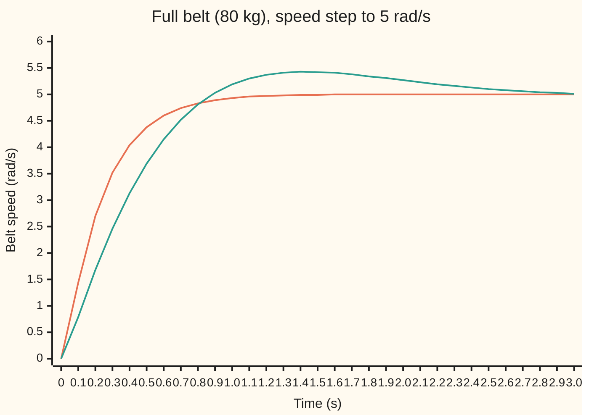
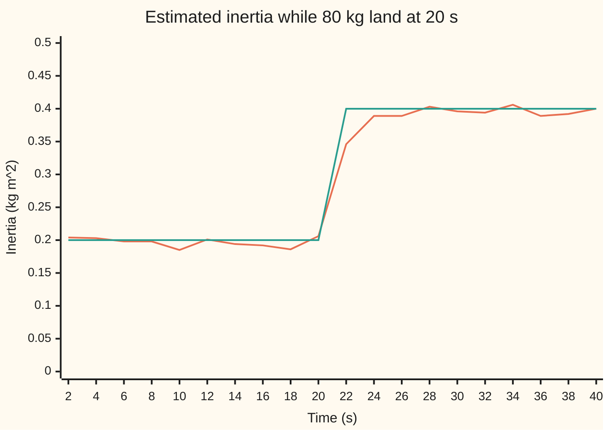

# Adapting as you go: schedule the gains, or let the controller learn the plant

[Syllabus](../../../SYLLABUS.md) → [Engineering mathematics](../README.md) → [Robustness and Adaptation](../README.md#s10) → Adapting as you go

---

## General Overview

A parcel-depot conveyor is driven by one motor under speed control. Through the day the belt carries anywhere from nothing to 80 kg of parcels. The parcels add to the inertia the motor must spin up (its resistance to speeding up): 0.20 kg·m² empty, 0.30 kg·m² with 40 kg on board, 0.40 kg·m² with 80 kg. The engineer wants one thing: a step in the speed command should settle the same way, in the same time, whatever the load.

A single fixed controller cannot do that. [Robust tests](02-robust-stability-and-robust-performance.md) showed that one well-chosen controller keeps every load stable and inside a specification. Yet a heavy belt still answers slowly and a light one quickly. Tune for the empty belt, and the full belt takes 2.504 s to settle and overshoots by 8.59%. This card changes the controller as the load changes. There are two ways.

**Gain scheduling.** A load cell under the belt weighs the parcels. A table says which controller gains suit which load, and the controller reads the table as the load changes. With the right table, the empty, half and full belts all settle in 0.915 s, with no overshoot. A load cell that reads the full belt as 60 kg costs little: 1.04% overshoot, settled in 0.864 s.

**Adaptive control.** No load cell. The controller watches the torque it sends and the speed that comes back. From those it estimates the inertia by **recursive least squares**: a least-squares fit updated with every new sample. It then sets its gains so the belt copies a chosen **reference model**, an ideal speed response. When 80 kg of parcels land, the estimate climbs from 0.20 to within 10% of 0.40 kg·m² inside 2.05 s.



Orange: the full belt with gains read from the schedule. It is the same curve the empty and half belts trace. Green: the full belt with the gains tuned for the empty belt, slower and overshooting to 5.43 rad/s.

**When the plant changes, change the controller with it: either measure what changed and look the gains up in a table designed in advance, or estimate the plant from its own inputs and outputs and recompute the gains every sample, as long as the commands keep the plant moving enough to learn from.**

**What kind of fact this is:** two methods. That the schedule gives every load the same loop, that the matched controller makes the belt copy the reference model, and that the recursive update equals a batch least-squares fit are theorems, proved on this card in Why it works. That the whole adaptive loop settles down is shown here by simulation, not proved.

---

## The formula

Notation first, in words. The PI gains $K_p$ and $K_i$ (proportional and integral) are from [PID control](../03-Feedback%20Control/07-pid-control-and-tuning.md). The Laplace variable $s$ is from wing 08. The adaptive half works on samples: $v_k$ is the belt speed at sample $k$, taken every $T_s$ seconds. A hat marks an estimate, as in the statistics wing: $\hat J$ is the controller's guess at $J$.

The conveyor, torque $u$ in N·m to belt speed $v$ in rad/s, with a drive lag $\tau$ and a load $m$ in kg:

$$G(s) = \frac{1}{(Js + b)(\tau s + 1)}, \qquad J = 0.20 + 0.0025\,m.$$

The 0.0025 is the drive roller's radius squared, $(0.05\text{ m})^2$: a mass on the belt adds its mass times the radius squared to the inertia.

**The schedule.** Pick the closed-loop lag $T_c$ wanted, the same for every load, and set

$$K_p(m) = \frac{J(m)}{T_c}, \qquad K_i = \frac{b}{T_c}.$$

**Read it aloud:** the proportional gain grows in step with the inertia the load cell reports; the integral gain stays fixed.

**The adaptive loop.** Sampled every $T_s$, the belt obeys $v_{k+1} = a\,v_k + g\,u_k$, where $a$ is how much speed survives one sample and $g$ is the speed gained per N·m of torque. The reference model is the response wanted, $v^m_{k+1} = a_m v^m_k + (1 - a_m)\,r_k$: its speed $v^m$ follows the command $r$, and its pole $a_m$ is how much of its speed survives one sample. With estimates $\hat a$, $\hat g$ the controller sends

$$u_k = \frac{(a_m - \hat a)\,v_k + (1 - a_m)\,r_k}{\hat g},$$

and recursive least squares updates the estimates $\hat\theta = (\hat a, \hat g)$ from the regressor $\varphi_k = (v_k, u_k)$, the two numbers the next speed depends on. $K_k$ is the update gain, $P$ is a 2×2 matrix saying how uncertain the estimates still are, and $\lambda$ is the forgetting factor:

$$K_k = \frac{P\varphi_k}{\lambda + \varphi_k^{\mathsf T} P \varphi_k}, \qquad \hat\theta \leftarrow \hat\theta + K_k\,(v_{k+1} - \varphi_k^{\mathsf T}\hat\theta), \qquad P \leftarrow \frac{P - K_k\varphi_k^{\mathsf T}P}{\lambda}.$$

**Read it aloud:** move each estimate by the surprise in the newest speed, scaled by how uncertain that estimate still is ($P$), and let old data fade by a factor $\lambda$ each sample.

| Symbol | Plain meaning | In our example | Push it up and the answer… |
| --- | --- | --- | --- |
| $m$, $J$, $\hat J$ | parcel load, kg; inertia of motor, belt and load, kg·m²; the controller's estimate of $J$ | 0, 40, 60, 80 kg; 0.20 to 0.40 kg·m² | heavier belt: slower unless the gains follow |
| $b$, $\hat b$, $\tau$ | belt friction, N·m·s/rad, and its estimate; the drive's torque lag, s | 0.40 N·m·s/rad; 0.02 s | — |
| $u$, $v$, $r$ | torque command, N·m; belt speed, rad/s; speed command, rad/s | a 5 rad/s step; a square wave of 4 and 6 rad/s | — |
| $K_p$, $K_i$ | PI gains: N·m per rad/s of speed error; N·m per rad of built-up error | 0.800 to 1.600; 1.600 | — |
| $T_c$ | the closed-loop lag the schedule aims for, s | 0.25 s; settles in 0.915 s | slower, calmer loop |
| $s$, $G$, $L$ | the Laplace variable; the belt's transfer function; the loop gain, controller times belt | $L = 1/(T_c s(\tau s + 1))$ on every load | — |
| $T_s$, $k$ | sampling interval, s; sample number | 0.05 s | — |
| $a$, $g$ | the sampled belt: how much speed survives one sample; speed gained per N·m over one sample | empty 0.904837 and 0.237906; full 0.951229 and 0.121926 | — |
| $a_m$, $v^m$ | the reference model's pole, $e^{-T_s/T_c}$; its speed, rad/s | 0.818731 | slower reference |
| $\hat\theta$, $\varphi$, $K_k$, $y$ | estimates $(\hat a, \hat g)$; regressor $(v_k, u_k)$; update gain; the newest speed $v_{k+1}$ | start at (0.5, 0.5) | — |
| $P$, $\lambda$, $R$, $q$, $N$ | how uncertain the estimates still are (a 2×2 matrix, $P = R^{-1}$); forgetting factor; the weighted sums in the normal equations $R\hat\theta = q$; samples so far | $P$ starts at 100 times the identity; $\lambda$ = 0.98 | longer memory, slower to follow a load change |
| $d$ | torque ripple, N·m, random and centred on zero | up to ±0.3 N·m | noisier estimates |

### When it holds

- **The load changes slowly next to the loop.** The schedule designs each gain for a frozen load. Its loop settles in 0.915 s, so a load that changes over seconds is fine. A belt loaded within a fraction of that is a time-varying plant, which no frozen-load design covers.
- **The target is slower than the drive.** The cancellation is exact even with the drive lag, but the lag still sets how fast the loop can be. At $T_c$ = 0.25 s the loop is overdamped. Ask for $T_c$ = 0.02 s and the damping ratio falls to 0.500: a 16.30% overshoot on every load, and a 5 rad/s step on the empty belt would ask for 50 N·m at once.
- **The commands keep the belt moving.** Recursive least squares learns two numbers, so the data must vary in two directions. A square-wave command does that. Hold the command at a constant 5 rad/s and $\hat J$ wanders from 0.259 to 0.995 kg·m² while the true value sits at 0.40. This is called **persistence of excitation**.
- **The model has the right shape.** The adaptive half fits a first-order belt and leaves out the 0.02 s drive lag, shorter than half a sample. Its simulation leaves the lag out of the belt too, so it shows the method, not the cost of that omission. The ripple is taken as random, centred on zero and unrelated from sample to sample. A steady extra drag, or a much longer lag, would bias the estimates.
- **The gain stays away from zero.** The controller divides by $\hat g$. The code holds it at 0.02 or more, because the sign of the motor's effect is known in advance and a near-zero guess would ask for unbounded torque. In these runs the floor never acts: even with the constant command, $\hat g$ stays at 0.0498 or above.

---

## Why it works

### Step 0: two ways to keep up with the plant

A controller tuned for one plant is right only for that plant. If the plant changes, the controller must change too. If the change can be measured, design the controller for each value in advance and look it up: that is a schedule. If it cannot be measured, estimate the plant from the signals already in the loop and redesign from the estimate every sample. Treating the estimate as if it were the truth is called **certainty equivalence**. It is the idea behind every indirect adaptive controller, the kind that estimates the plant first and designs second.

### Step 1: the schedule makes every load look the same

Ignore the drive lag for a moment. The PI controller is $K_p + K_i/s = (K_p s + K_i)/s$, which has a zero at $s = -K_i/K_p$. The belt has a pole at $s = -b/J$. Choose the gains so the zero sits on the pole: $K_i/K_p = b/J$. With $K_p = J/T_c$ that means $K_i = b/T_c$. Then the loop gain is

$$L(s) = \frac{K_p(s + b/J)}{s}\cdot\frac{1}{J(s + b/J)(\tau s + 1)} = \frac{1}{T_c\, s\,(\tau s + 1)}.$$

$J$ has cancelled. Every load gives the same loop, so the closed loop from command to speed is

$$\frac{v}{r} = \frac{L}{1 + L} = \frac{1}{T_c\tau s^2 + T_c s + 1}.$$

For $T_c$ = 0.25 s and $\tau$ = 0.02 s its poles are −4.384 and −45.616 per second. The slow one dominates, and the speed settles to within 2% in 0.915 s. A first-order guess, $T_c\ln 50$, gives 0.978 s; the fast pole shaves a little off.

The schedule needs only $K_p$ to follow the load: 0.800, 1.200 and 1.600 N·m/(rad/s) at 0, 40 and 80 kg. Between table rows the controller interpolates. Here $K_p$ is a straight line in $m$, so interpolation is exact. On a real plant the gains are rarely straight lines, and the table needs enough rows that the line between two rows is close.

### Step 2: the sampled belt

Hold the torque constant over one sample. The belt equation $J\dot v = u - bv$ then has an exact solution over $T_s$ seconds:

$$v_{k+1} = a\,v_k + g\,u_k, \qquad a = e^{-bT_s/J}, \qquad g = \frac{1 - a}{b}.$$

So two numbers describe the belt. Both carry the inertia, and it can be read back from an estimate: $\hat b = (1 - \hat a)/\hat g$ and $\hat J = -\hat b\,T_s/\ln \hat a$. Dividing by $\ln\hat a$ needs $\hat a$ between 0 and 1, which a working estimate always meets.

### Step 3: the matching controller makes the belt copy the model

Put the controller into the sampled belt, with the estimates equal to the truth:

$$v_{k+1} = a v_k + g\cdot\frac{(a_m - a)v_k + (1 - a_m)r_k}{g} = a_m v_k + (1 - a_m)r_k.$$

That is the reference model, exactly. The belt's own pole $a$ has been replaced by the chosen $a_m$. For the full belt the controller is $u = -1.08671\,v + 1.48671\,r$ and the closed-loop pole is 0.818731, which is $a_m$. An RK4 simulation of $J\dot v = u - bv$ over one sample, torque held, lands on the same 0.818731.

If the estimates are wrong, the match fails gracefully here. Keep the empty-belt values on the full belt and the closed-loop pole becomes 0.907100: a lag of 0.5128 s instead of 0.25 s. The belt still reaches the right speed, because the steady state needs only $(1 - a)/g$, which is $b$ for every load. Slow, but not wrong at rest.

### Step 4: recursive least squares is ordinary least squares, kept up to date

[Least squares](../../09-Probability%20and%20statistics/09-Regression/01-least-squares-regression.md) picks the line whose squared misses add up to the least. Here every sample gives one equation, $v_{k+1} \approx \hat a\,v_k + \hat g\,u_k$. Least squares chooses $\hat\theta$ to make the weighted sum $\sum_k \lambda^{N-1-k}(v_{k+1} - \varphi_k^{\mathsf T}\hat\theta)^2$ as small as possible. The weight $\lambda^{N-1-k}$ makes a sample $n$ steps old count $\lambda^n$ as much as the newest. With $\lambda$ = 0.98, data a few seconds old has mostly faded. That is what lets the estimate follow a load change.

Setting the derivative to zero gives the normal equations $R\,\hat\theta = q$, with $R = \sum \lambda^{N-1-k}\varphi_k\varphi_k^{\mathsf T}$ and $q = \sum \lambda^{N-1-k}\varphi_k v_{k+1}$. Solving them afresh every sample is wasteful. The recursion keeps $P = R^{-1}$ instead and updates it when one new row arrives. The fold shows that the update is exact. The checks confirm it: after 20 s and after 40 s, the recursion and the batch solution agree to better than $10^{-8}$.

<details>
<summary>Why the recursive update equals the batch solution</summary>

One new sample changes $R$ to $R' = \lambda R + \varphi\varphi^{\mathsf T}$ and $q$ to $q' = \lambda q + \varphi y$, where $y = v_{k+1}$. For a rank-one change the inverse has a closed form (the Sherman–Morrison formula):

$(\lambda R + \varphi\varphi^{\mathsf T})^{-1} = \dfrac{1}{\lambda}\left(P - \dfrac{P\varphi\varphi^{\mathsf T}P}{\lambda + \varphi^{\mathsf T}P\varphi}\right) = \dfrac{P - K\varphi^{\mathsf T}P}{\lambda}$, with $K = \dfrac{P\varphi}{\lambda + \varphi^{\mathsf T}P\varphi}$.

Multiply by $q'$ and simplify, using $P'\varphi = K$:

$\hat\theta' = P'q' = P'(\lambda R\hat\theta + \varphi y) = P'(R' - \varphi\varphi^{\mathsf T})\hat\theta + K y = \hat\theta + K(y - \varphi^{\mathsf T}\hat\theta)$.

The starting values act as one extra row of evidence: $P_0$ = 100 times the identity says "the guess (0.5, 0.5) is worth very little". The batch road in the code adds the same prior, $\lambda^N P_0^{-1}$ to $R$ and $\lambda^N P_0^{-1}\hat\theta_0$ to $q$, so the two roads agree exactly.

</details>

### Step 5: why the data must keep moving

Two unknowns need two kinds of evidence. At a steady speed every sample says the same thing: $v = a v + g u$, so $(1 - a)\,v = g\,u$. That one equation fixes the ratio $g/(1 - a)$, which is $1/b$, and says nothing about the inertia. The matrix $R$ then becomes nearly singular, which means it cannot be inverted reliably. With forgetting, $P = R^{-1}$ would grow without limit if nothing new arrived, an effect called covariance windup. Here the ripple's small kicks keep it bounded but large, and the ripple alone pushes the estimates around. That is why a constant command lets $\hat J$ wander from 0.259 to 0.995 kg·m².

A command that keeps changing level supplies transients, and during a transient speed and torque are not in fixed ratio. The square wave of 4 and 6 rad/s, 2 s each, keeps $\hat J$ between 0.382 and 0.406 kg·m² over the last 10 s.

### Step 6: what the adaptive loop does not prove

Certainty equivalence is a leap: the controller is designed as if the estimate were right, and the estimate is learned from data the controller shaped. In general this loop has no stability guarantee. Model-reference designs built on a Lyapunov function, an energy-like quantity that must keep falling, do have one (see Sources). This card shows the indirect loop working on one belt, against ripple and a sudden load, by simulation.

---

## Worked numbers, by hand

The schedule at 60 kg, then the adaptive controller on the full belt.

| Step | Arithmetic | Value |
| --- | --- | --- |
| inertia at 60 kg | $0.20 + 0.0025 \times 60$ | 0.3500 kg·m² |
| proportional gain | $0.35 / 0.25$ | 1.400 N·m/(rad/s) |
| integral gain, any load | $0.40 / 0.25$ | 1.600 N·m/rad |
| closed-loop poles | roots of $0.005s^2 + 0.25s + 1$: $(-0.25 \pm \sqrt{0.0625 - 0.02})/0.01$ | −4.384 and −45.616 1/s |
| reference pole | $e^{-0.05/0.25} = e^{-0.2}$ | 0.818731 |
| full belt, sampled | $a = e^{-0.40 \times 0.05/0.40} = e^{-0.05}$; $g = (1 - 0.951229)/0.40$ | 0.951229; 0.121926 |
| speed feedback | $(0.818731 - 0.951229)/0.121926$ | −1.08671 |
| command feedforward | $(1 - 0.818731)/0.121926$ | 1.48671 |
| **closed-loop pole** | $0.951229 + 0.121926 \times (-1.08671)$ | **0.818731** |

The full belt with the matched controller has exactly the reference model's pole: it answers like a 0.25 s lag, the same lag the schedule aims for.

One step of the estimator, the very first sample. The belt starts at rest, $v_0$ = 0, with guesses $\hat a = \hat g$ = 0.5 and $P$ = 100 times the identity.

| Step | Arithmetic | Value |
| --- | --- | --- |
| torque sent for $r$ = 4 | $(1 - 0.818731) \times 4 / 0.5$ | 1.4502 N·m |
| regressor $\varphi_0$ | $(v_0, u_0)$ | (0.0000, 1.4502) |
| speed measured | from the belt, with ripple | 0.3293 rad/s |
| surprise | $0.3293 - 0.5 \times 1.4502$ | −0.3958 rad/s |
| update gain for $\hat g$ | $100 \times 1.4502/(0.98 + 100 \times 1.4502^2)$, with $u_0$ unrounded | 0.68638 |
| **new $\hat g$** | $0.5 + 0.68638 \times (-0.3958)$ | **0.2283** |

The first sample teaches the gain and nothing else: $\hat a$ stays at 0.5000, because with $v_0$ = 0 the speed term carried no information. That is Step 5 in miniature. The true empty-belt $g$ is 0.237906, so one sample came close.

### What breaks if you drop a piece

| Mistake | Comes out at | What went wrong |
| --- | --- | --- |
| No schedule: keep the empty-belt gains on the full belt | settles in 2.504 s, overshoot 8.59%, against 0.915 s and none | The PI zero no longer cancels the belt pole; the loop is slower and swings |
| Schedule aimed faster than the drive, $T_c$ = 0.02 s | overshoot 16.30% on every load; 50 N·m asked for a 5 rad/s step | The closed loop is $1/(T_c\tau s^2 + T_c s + 1)$; with $T_c$ equal to $\tau$ its damping ratio is 0.500 |
| Adaptive loop with learning switched off, empty-belt model kept | full-belt tracking error 0.3059 rad/s rms, against 0.0688 | The closed-loop pole moves to 0.907100: a 0.5128 s lag, not 0.25 s |
| No forgetting, $\lambda$ = 1 | $\hat J$ = 0.2945 kg·m² at 40 s; tracking error 0.2106 rad/s rms | 20 s of empty-belt data outvote the new evidence |
| Constant command, 5 rad/s | $\hat J$ wanders 0.259 to 0.995 kg·m² | No persistence of excitation: steady data fix only $b$ |

---

## How the estimate moves when the parcels land

The story: the belt runs empty for 20 s while the command steps between 4 and 6 rad/s every 2 s. At 20 s, 80 kg of parcels land at once, just as the command drops to 4 rad/s. Torque ripple of up to ±0.3 N·m shakes the belt the whole time.

| Time | What happens | $\hat J$, kg·m² |
| --- | --- | --- |
| 10 to 20 s | empty belt, learned | 0.1960 ± 0.0066 on average |
| 20 s | 80 kg land | true value jumps to 0.40 |
| 22 s | one command step later | 0.346 |
| 24 s | after the next step | 0.389 |
| 30 to 40 s | full belt, learned | 0.3957 ± 0.0056 on average |

Read back as a load, the last 10 s give 78.3 kg against the true 80 kg, and the friction estimate is 0.4035 N·m·s/rad against 0.40.

The final estimate, case by case:

```
true value, full belt            ████████████████████  0.400
learned, square wave, lambda .98 ████████████████████  0.3957
no forgetting, lambda 1 (40 s)   ███████████████       0.2945
constant command (highest seen)  ██████████████████████████████████████████████████  0.995
```



Orange: $\hat J$ every 2 s. Green: the true inertia. The estimate jitters by about 0.0056 kg·m² from the ripple. It reaches within 10% of the new value 2.05 s after the parcels land, one sample after the command step at 22 s, and stays there.

The speed loop keeps up. Over the empty half the tracking error, belt speed minus reference model speed, is 0.0750 rad/s rms against 0.0736 for a controller told the true inertia. Over the full half it is 0.0688 against 0.0370; the difference is the two seconds of learning just after the landing.

---

## Code, from first principles, and it actually runs

The scripts write out a fourth-order Runge–Kutta (RK4) simulation of the conveyor with its drive lag, the recursive least-squares update, a batch least-squares solver, and a small SplitMix64 random generator with seed 7 for the ripple, so both languages print the same numbers. They reach the answers by **three independent roads**: the closed-form step response of the scheduled loop against an RK4 simulation of each load; the recursive estimate against a batch weighted least-squares fit of the same data; and the sampled belt formulas against an RK4 integration of the belt over one sample, which puts the matched loop's pole on $a_m$, with the learned inertia checked against the true one.

### Python

```python
# Gain scheduling and adaptive control -- the check behind the card.  Standard library only.
# Conveyor: torque u (N m) -> drive lag tau -> belt inertia J, friction b -> speed v (rad/s).
# Load m (kg) on the belt adds m r^2 to the inertia: J = 0.20 + 0.0025 m kg m^2 (drive roller r = 0.05 m).
# Part A, gain schedule: PI gains Kp = J/Tc, Ki = b/Tc from the load cell.  Roads: closed form vs RK4.
# Part B, adaptive: sampled every Ts, recursive least squares (RLS) learns v[k+1] = a v[k] + g u[k], and the
# controller makes the loop copy a reference model.  Roads: RLS vs weighted batch least squares, vs physics.
from math import exp, log, sqrt, pi

J0, B, TAU, R2, TC, TS, LAM = 0.20, 0.40, 0.02, 0.0025, 0.25, 0.05, 0.98
AM = exp(-TS / TC)                                   # reference model pole: a 0.25 s lag, sampled
def J_of(m): return J0 + R2 * m
def ab(J): a = exp(-B * TS / J); return a, (1 - a) / B   # exact sampled plant (drive lag left out)
def hold(J, v, u, h=TS / 50):   # road 3: RK4 of J dv/dt = u - b v over one sample, torque held
    f = lambda x: (u - B * x) / J
    for _ in range(50): k1 = f(v); k2 = f(v + h / 2 * k1); k3 = f(v + h / 2 * k2); v += h / 6 * (k1 + 2 * k2 + 2 * k3 + f(v + h * k3))
    return v

def step(J, kp, ki, r=5.0, t_end=3.0, dt=1e-4, every=1000):
    """RK4 on drive torque q, speed v, integral z after a speed step r; overshoot %, 2% settle, samples."""
    def f(x):
        q, v, z = x
        return ((kp * (r - v) + ki * z - q) / TAU, (q - B * v) / J, r - v)
    x, peak, settle, pts = [0.0] * 3, 0.0, 0.0, [0.0]
    for k in range(int(round(t_end / dt))):
        k1 = f(x); k2 = f([a + dt / 2 * d for a, d in zip(x, k1)])
        k3 = f([a + dt / 2 * d for a, d in zip(x, k2)]); k4 = f([a + dt * d for a, d in zip(x, k3)])
        x = [a + dt / 6 * (p + 2 * q + 2 * s + t) for a, p, q, s, t in zip(x, k1, k2, k3, k4)]
        peak = max(peak, x[1])
        if abs(x[1] - r) > 0.02 * r: settle = (k + 1) * dt
        if (k + 1) % every == 0: pts.append(x[1])
    return max(0.0, 100 * (peak - r) / r), settle, pts

def closed_form(tc):   # Kp = J/Tc cancels the belt pole: v/r = 1/(Tc tau s^2 + Tc s + 1) for every load
    d = sqrt(tc * tc - 4 * tc * TAU)
    p1, p2 = (-tc + d) / (2 * tc * TAU), (-tc - d) / (2 * tc * TAU)
    y = lambda t: 1 - (p2 * exp(p1 * t) - p1 * exp(p2 * t)) / (p2 - p1)
    lo, hi = 0.0, 10.0
    for _ in range(60):
        mid = (lo + hi) / 2; lo, hi = (mid, hi) if y(mid) < 0.98 else (lo, mid)
    return p1, p2, lo

def sm64(s):
    s = (s + 0x9E3779B97F4A7C15) & (2**64 - 1); z = s
    z = ((z ^ (z >> 30)) * 0xBF58476D1CE4E5B9) & (2**64 - 1); z = ((z ^ (z >> 27)) * 0x94D049BB133111EB) & (2**64 - 1)
    return s, z ^ (z >> 31)

def adaptive(cmd, lam=LAM, known=None, dmax=0.3, seed=7, n=800):
    """Belt empty for 20 s, then 80 kg land.  Ripple d uniform in +-dmax N m.  known: 'true' or 'empty' model, no RLS."""
    s, th, P, v, vm, log_, e2, data = seed, [0.5, 0.5], [[100.0, 0.0], [0.0, 100.0]], 0.0, 0.0, [], [0.0, 0.0], []
    for k in range(n):
        a, g = ab(J_of(0 if k < n // 2 else 80)); r = cmd(k * TS)
        ah, gh = {'true': (a, g), 'empty': ab(J0)}.get(known, (th[0], max(th[1], 0.02)))
        u = ((AM - ah) * v + (1 - AM) * r) / gh                    # model matching on the estimates
        s, x = sm64(s); d = dmax * (2 * (x >> 11) / 2**53 - 1)
        vn, vm = a * v + g * (u + d), AM * vm + (1 - AM) * r
        phi = (v, u); data.append((phi, vn))
        if known is None:
            Pp = [P[0][0] * phi[0] + P[0][1] * phi[1], P[1][0] * phi[0] + P[1][1] * phi[1]]
            K = [p / (lam + phi[0] * Pp[0] + phi[1] * Pp[1]) for p in Pp]
            err = vn - th[0] * phi[0] - th[1] * phi[1]
            th = [th[0] + K[0] * err, th[1] + K[1] * err]
            P = [[(P[i][j] - K[i] * Pp[j]) / lam for j in range(2)] for i in range(2)]
        v = vn; e2[k >= n // 2] += (v - vm) ** 2
        bh = (1 - th[0]) / th[1]; log_.append((th[0], th[1], -bh * TS / log(th[0])))
    return log_, [sqrt(e / (n // 2)) for e in e2], data

def batch(data, lam=LAM):   # road 2: weighted least squares as normal equations, same starting guess as prior
    N = len(data); w0 = lam ** N / 100.0
    R, q = [[w0, 0.0], [0.0, w0]], [w0 * 0.5, w0 * 0.5]
    for k, (phi, y) in enumerate(data):
        w = lam ** (N - 1 - k)
        for i in range(2):
            q[i] += w * phi[i] * y
            for j in range(2): R[i][j] += w * phi[i] * phi[j]
    det = R[0][0] * R[1][1] - R[0][1] * R[1][0]
    return (R[1][1] * q[0] - R[0][1] * q[1]) / det, (R[0][0] * q[1] - R[1][0] * q[0]) / det
def stats(xs): mu = sum(xs) / len(xs); return mu, sqrt(sum((x - mu) ** 2 for x in xs) / len(xs))

print(f"conveyor: b = {B:.2f} N m s/rad, tau = {TAU:.2f} s, J = {J0:.2f} + {R2:.4f} m kg m^2; target lag Tc = {TC:.2f} s")
for m in (0, 40, 60, 80):
    print(f"schedule m = {m:2d} kg: J = {J_of(m):.4f} kg m^2, Kp = {J_of(m) / TC:.3f} N m/(rad/s), Ki = {B / TC:.3f} N m/rad")
p1, p2, ts_cf = closed_form(TC)
print(f"closed form: poles {p1:.3f} and {p2:.3f} 1/s, 2% settle {ts_cf:.3f} s (first-order guess Tc ln 50 = {TC * log(50):.3f} s)")
runs = {}   # (name, true load, load the gains are read for), kg
for name, m, m_read in (("empty", 0, 0), ("half", 40, 40), ("full", 80, 80), ("full, fixed empty gains", 80, 0),
                        ("full, load cell reads 60 kg", 80, 60)):
    runs[name] = step(J_of(m), J_of(m_read) / TC, B / TC, every=1000)
    print(f"step 5 rad/s, {name}: overshoot {runs[name][0]:.2f} %, 2% settle {runs[name][1]:.3f} s")
assert all(abs(runs[n][1] - ts_cf) < 2e-4 and runs[n][0] < 1e-6 for n in ("empty", "half", "full"))   # sim = formula
assert runs["full, fixed empty gains"][1] > 1.5 * ts_cf
print("chartA t = 0.0..3.0 s by 0.1, scheduled:", ", ".join(f"{v:.2f}" for v in runs["full"][2]))
print("chartA t = 0.0..3.0 s by 0.1, fixed    :", ", ".join(f"{v:.2f}" for v in runs["full, fixed empty gains"][2]))
zeta = 0.5 * sqrt(0.02 / TAU); os_cf = 100 * exp(-pi * zeta / sqrt(1 - zeta * zeta))
os_sim = step(J_of(0), J_of(0) / 0.02, B / 0.02)[0]
print(f"too fast, Tc = 0.02 s: zeta {zeta:.3f}, overshoot formula {os_cf:.2f} %, simulated {os_sim:.2f} %;"
      f" Kp = {J_of(0) / 0.02:.1f} asks {5 * J_of(0) / 0.02:.0f} N m")
assert abs(os_cf - os_sim) < 0.05
# ---- Part B: adaptive ----
a0, g0 = ab(J_of(0)); a1, g1 = ab(J_of(80))
print(f"sampled: Ts = {TS:.2f} s, a_m = {AM:.6f}; empty a = {a0:.6f}, g = {g0:.6f}; full a = {a1:.6f}, g = {g1:.6f}")
kv, kr = (AM - a1) / g1, (1 - AM) / g1
print(f"full-belt match: u = {kv:.5f} v + {kr:.5f} r; loop pole {a1 + g1 * kv:.6f}, RK4 over one sample {hold(J_of(80), 1.0, kv):.6f}")
pf = a1 + g1 * (AM - a0) / g0
print(f"empty-belt controller on full belt: pole {pf:.6f}, lag {-TS / log(pf):.4f} s instead of {TC:.2f} s")
assert abs(hold(J_of(80), 1.0, kv) - AM) < 1e-9 and -TS / log(pf) > 2 * TC
sq = lambda t: 4.0 if int(t / 2) % 2 == 0 else 6.0     # speed command: 4 and 6 rad/s, 2 s each
lg, rms, data = adaptive(sq)
(ph, uh), y1 = data[0]
print(f"first RLS step: phi = ({ph:.4f}, {uh:.4f}), v1 = {y1:.4f}, error {y1 - 0.5 * uh:.4f},"
      f" gain {100 * uh / (LAM + 100 * uh * uh):.5f}, g_hat {lg[0][1]:.4f}, a_hat {lg[0][0]:.4f}")
print("chartB J_hat at t = 2..40 s by 2:", ", ".join(f"{lg[40 * i - 1][2]:.3f}" for i in range(1, 21)))
e_m, e_s = stats([x[2] for x in lg[200:400]]); f_m, f_s = stats([x[2] for x in lg[600:800]])
print(f"J_hat over 10-20 s: {e_m:.4f} +- {e_s:.4f}; over 30-40 s: {f_m:.4f} +- {f_s:.4f} kg m^2 (true 0.20, 0.40)")
print(f"load read back: {(f_m - J0) / R2:.1f} kg (true 80 kg); b_hat at 40 s {(1 - lg[-1][0]) / lg[-1][1]:.4f} N m s/rad")
assert abs(e_m - 0.20) < 3 * e_s and abs(f_m - 0.40) < 3 * f_s
tb = batch(data); tb20 = batch(data[:400])
gap = max(abs(tb[0] - lg[-1][0]), abs(tb[1] - lg[-1][1]), abs(tb20[0] - lg[399][0]), abs(tb20[1] - lg[399][1]))
print(f"RLS vs batch weighted least squares, at 20 s and 40 s: agree to 1e-8: {gap < 1e-8}")
assert gap < 1e-8
t_in = (next(k for k in range(400, 800) if all(abs(x[2] - 0.40) < 0.04 for x in lg[k:])) + 1) * TS - 20
print(f"after the parcels land, J_hat within 10% of 0.40 to stay after {t_in:.2f} s")
orc, fix = adaptive(sq, known="true")[1], adaptive(sq, known="empty")[1]
print(f"tracking error rms (rad/s), empty | full: adaptive {rms[0]:.4f} | {rms[1]:.4f};"
      f" true model {orc[0]:.4f} | {orc[1]:.4f}; empty model kept {fix[0]:.4f} | {fix[1]:.4f}")
assert rms[0] < 1.1 * orc[0] and fix[1] > 2 * rms[1]
nof, rms1, _ = adaptive(sq, lam=1.0)
print(f"no forgetting, lambda = 1: J_hat at 40 s {nof[-1][2]:.4f}, full-belt rms {rms1[1]:.4f} rad/s")
assert nof[-1][2] < 0.32 and rms1[1] > 2 * rms[1]
pe, rmsc, _ = adaptive(lambda t: 5.0)
lo_, hi_ = min(x[2] for x in pe[600:]), max(x[2] for x in pe[600:])
print(f"constant 5 rad/s command: J_hat over 30-40 s wanders {lo_:.3f} to {hi_:.3f} (square wave: "
      f"{min(x[2] for x in lg[600:]):.3f} to {max(x[2] for x in lg[600:]):.3f})")
assert hi_ - lo_ > 3 * (max(x[2] for x in lg[600:]) - min(x[2] for x in lg[600:]))
pw = [a1 + g1 * (AM - x[0]) / max(x[1], 0.02) for x in pe[600:]]   # full-belt pole, controller frozen on each estimate
print(f"constant command, full-belt loop pole on those estimates: {min(pw):.3f} to {max(pw):.3f}, lag {-TS / log(min(pw)):.3f}"
      f" to {-TS / log(max(pw)):.3f} s (designed {AM:.3f}, {TC:.2f} s); lowest g_hat {min(x[1] for x in pe):.4f}, floor 0.02")
print(f"try: lambda 0.99 -> J_hat sd {stats([x[2] for x in adaptive(sq, lam=0.99)[0][600:]])[1]:.4f};"
      f" ripple 0.6 N m -> sd {stats([x[2] for x in adaptive(sq, dmax=0.6)[0][600:]])[1]:.4f};"
      f" Tc 0.5 s -> settle {closed_form(0.5)[2]:.3f} s")
print("ALL CHECKS PASS")
```

**Ran 2026-11-11 on macOS, Python 3.14.10, standard library only. All checks passed. Output, pasted from the run:**

```
conveyor: b = 0.40 N m s/rad, tau = 0.02 s, J = 0.20 + 0.0025 m kg m^2; target lag Tc = 0.25 s
schedule m =  0 kg: J = 0.2000 kg m^2, Kp = 0.800 N m/(rad/s), Ki = 1.600 N m/rad
schedule m = 40 kg: J = 0.3000 kg m^2, Kp = 1.200 N m/(rad/s), Ki = 1.600 N m/rad
schedule m = 60 kg: J = 0.3500 kg m^2, Kp = 1.400 N m/(rad/s), Ki = 1.600 N m/rad
schedule m = 80 kg: J = 0.4000 kg m^2, Kp = 1.600 N m/(rad/s), Ki = 1.600 N m/rad
closed form: poles -4.384 and -45.616 1/s, 2% settle 0.915 s (first-order guess Tc ln 50 = 0.978 s)
step 5 rad/s, empty: overshoot 0.00 %, 2% settle 0.915 s
step 5 rad/s, half: overshoot 0.00 %, 2% settle 0.915 s
step 5 rad/s, full: overshoot 0.00 %, 2% settle 0.915 s
step 5 rad/s, full, fixed empty gains: overshoot 8.59 %, 2% settle 2.504 s
step 5 rad/s, full, load cell reads 60 kg: overshoot 1.04 %, 2% settle 0.864 s
chartA t = 0.0..3.0 s by 0.1, scheduled: 0.00, 1.44, 2.70, 3.52, 4.04, 4.38, 4.60, 4.74, 4.83, 4.89, 4.93, 4.96, 4.97, 4.98, 4.99, 4.99, 5.00, 5.00, 5.00, 5.00, 5.00, 5.00, 5.00, 5.00, 5.00, 5.00, 5.00, 5.00, 5.00, 5.00, 5.00
chartA t = 0.0..3.0 s by 0.1, fixed    : 0.00, 0.79, 1.68, 2.46, 3.13, 3.69, 4.15, 4.52, 4.81, 5.03, 5.19, 5.30, 5.37, 5.41, 5.43, 5.42, 5.41, 5.38, 5.34, 5.31, 5.27, 5.23, 5.19, 5.16, 5.13, 5.10, 5.08, 5.06, 5.04, 5.03, 5.01
too fast, Tc = 0.02 s: zeta 0.500, overshoot formula 16.30 %, simulated 16.30 %; Kp = 10.0 asks 50 N m
sampled: Ts = 0.05 s, a_m = 0.818731; empty a = 0.904837, g = 0.237906; full a = 0.951229, g = 0.121926
full-belt match: u = -1.08671 v + 1.48671 r; loop pole 0.818731, RK4 over one sample 0.818731
empty-belt controller on full belt: pole 0.907100, lag 0.5128 s instead of 0.25 s
first RLS step: phi = (0.0000, 1.4502), v1 = 0.3293, error -0.3958, gain 0.68638, g_hat 0.2283, a_hat 0.5000
chartB J_hat at t = 2..40 s by 2: 0.204, 0.203, 0.198, 0.198, 0.185, 0.201, 0.194, 0.192, 0.186, 0.206, 0.346, 0.389, 0.389, 0.403, 0.396, 0.394, 0.406, 0.389, 0.392, 0.400
J_hat over 10-20 s: 0.1960 +- 0.0066; over 30-40 s: 0.3957 +- 0.0056 kg m^2 (true 0.20, 0.40)
load read back: 78.3 kg (true 80 kg); b_hat at 40 s 0.4035 N m s/rad
RLS vs batch weighted least squares, at 20 s and 40 s: agree to 1e-8: True
after the parcels land, J_hat within 10% of 0.40 to stay after 2.05 s
tracking error rms (rad/s), empty | full: adaptive 0.0750 | 0.0688; true model 0.0736 | 0.0370; empty model kept 0.0736 | 0.3059
no forgetting, lambda = 1: J_hat at 40 s 0.2945, full-belt rms 0.2106 rad/s
constant 5 rad/s command: J_hat over 30-40 s wanders 0.259 to 0.995 (square wave: 0.382 to 0.406)
constant command, full-belt loop pole on those estimates: 0.555 to 0.881, lag 0.085 to 0.394 s (designed 0.819, 0.25 s); lowest g_hat 0.0498, floor 0.02
try: lambda 0.99 -> J_hat sd 0.0038; ripple 0.6 N m -> sd 0.0114; Tc 0.5 s -> settle 1.896 s
ALL CHECKS PASS
```

### Rust

```rust
// Gain scheduling and adaptive control -- the same check as gain_scheduling_and_adaptive_control_check.py.
// Standard library only, no crates.
// Conveyor: torque u (N m) -> drive lag tau -> belt inertia J, friction b -> speed v (rad/s).
// Load m (kg) on the belt adds m r^2 to the inertia: J = 0.20 + 0.0025 m kg m^2 (drive roller r = 0.05 m).
// Part A, gain schedule: PI gains Kp = J/Tc, Ki = b/Tc from the load cell.  Roads: closed form vs RK4.
// Part B, adaptive: sampled every Ts, recursive least squares (RLS) learns v[k+1] = a v[k] + g u[k], and the
// controller makes the loop copy a reference model.  Roads: RLS vs weighted batch least squares, vs physics.
use std::f64::consts::PI;
const J0: f64 = 0.20; const B: f64 = 0.40; const TAU: f64 = 0.02; const R2: f64 = 0.0025;
const TC: f64 = 0.25; const TS: f64 = 0.05; const LAM: f64 = 0.98;

fn am() -> f64 { (-TS / TC).exp() }
fn j_of(m: f64) -> f64 { J0 + R2 * m }
fn ab(j: f64) -> (f64, f64) { let a = (-B * TS / j).exp(); (a, (1.0 - a) / B) }
// Road 3: RK4 of J dv/dt = u - b v over one sample, torque held.
fn hold(j: f64, mut v: f64, u: f64) -> f64 {
    let (h, f) = (TS / 50.0, |x: f64| (u - B * x) / j);
    for _ in 0..50 { let k1 = f(v); let k2 = f(v + h / 2.0 * k1); let k3 = f(v + h / 2.0 * k2); v += h / 6.0 * (k1 + 2.0 * k2 + 2.0 * k3 + f(v + h * k3)); }
    v
}

fn step(j: f64, kp: f64, ki: f64) -> (f64, f64, Vec<f64>) {
    let (r, t_end, dt, every) = (5.0, 3.0, 1e-4, 1000usize);
    let f = |x: [f64; 3]| -> [f64; 3] { [(kp * (r - x[1]) + ki * x[2] - x[0]) / TAU, (x[0] - B * x[1]) / j, r - x[1]] };
    let mv = |x: [f64; 3], k: [f64; 3], h: f64| -> [f64; 3] { [x[0] + h * k[0], x[1] + h * k[1], x[2] + h * k[2]] };
    let (mut x, mut peak, mut settle, mut pts) = ([0.0f64; 3], 0.0f64, 0.0, vec![0.0]);
    for k in 0..(t_end / dt as f64).round() as usize {
        let k1 = f(x); let k2 = f(mv(x, k1, dt / 2.0)); let k3 = f(mv(x, k2, dt / 2.0)); let k4 = f(mv(x, k3, dt));
        for i in 0..3 { x[i] += dt / 6.0 * (k1[i] + 2.0 * k2[i] + 2.0 * k3[i] + k4[i]); }
        peak = peak.max(x[1]);
        if (x[1] - r).abs() > 0.02 * r { settle = (k + 1) as f64 * dt; }
        if (k + 1) % every == 0 { pts.push(x[1]); }
    }
    ((100.0 * (peak - r) / r).max(0.0), settle, pts)
}

fn closed_form(tc: f64) -> (f64, f64, f64) {
    let d = (tc * tc - 4.0 * tc * TAU).sqrt();
    let (p1, p2) = ((-tc + d) / (2.0 * tc * TAU), (-tc - d) / (2.0 * tc * TAU));
    let y = |t: f64| 1.0 - (p2 * (p1 * t).exp() - p1 * (p2 * t).exp()) / (p2 - p1);
    let (mut lo, mut hi) = (0.0f64, 10.0f64);
    for _ in 0..60 { let mid = (lo + hi) / 2.0; if y(mid) < 0.98 { lo = mid } else { hi = mid } }
    (p1, p2, lo)
}

fn sm64(s: u64) -> (u64, u64) {
    let s = s.wrapping_add(0x9E3779B97F4A7C15);
    let mut z = (s ^ (s >> 30)).wrapping_mul(0xBF58476D1CE4E5B9);
    z = (z ^ (z >> 27)).wrapping_mul(0x94D049BB133111EB);
    (s, z ^ (z >> 31))
}

type Log = (Vec<[f64; 3]>, [f64; 2], Vec<([f64; 2], f64)>);
// Belt empty for 20 s, then 80 kg land.  Ripple d uniform in +-dmax N m.  known: "true" or "empty" model, no RLS.
fn adaptive(cmd: &dyn Fn(f64) -> f64, lam: f64, known: &str, dmax: f64) -> Log {
    let n = 800usize;
    let (mut s, mut th, mut p, mut v, mut vm) = (7u64, [0.5f64, 0.5], [[100.0f64, 0.0], [0.0, 100.0]], 0.0f64, 0.0f64);
    let (mut lg, mut e2, mut data) = (Vec::new(), [0.0f64; 2], Vec::new());
    for k in 0..n {
        let (a, g) = ab(j_of(if k < n / 2 { 0.0 } else { 80.0 })); let r = cmd(k as f64 * TS);
        let (ah, gh) = match known { "true" => (a, g), "empty" => ab(J0), _ => (th[0], th[1].max(0.02)) };
        let u = ((am() - ah) * v + (1.0 - am()) * r) / gh;
        let (s2, x) = sm64(s); s = s2;
        let d = dmax * (2.0 * (x >> 11) as f64 / 9007199254740992.0 - 1.0);
        let vn = a * v + g * (u + d); vm = am() * vm + (1.0 - am()) * r;
        let phi = [v, u]; data.push((phi, vn));
        if known.is_empty() {
            let pp = [p[0][0] * phi[0] + p[0][1] * phi[1], p[1][0] * phi[0] + p[1][1] * phi[1]];
            let den = lam + phi[0] * pp[0] + phi[1] * pp[1];
            let kk = [pp[0] / den, pp[1] / den];
            let err = vn - th[0] * phi[0] - th[1] * phi[1];
            th = [th[0] + kk[0] * err, th[1] + kk[1] * err];
            for i in 0..2 { for j in 0..2 { p[i][j] = (p[i][j] - kk[i] * pp[j]) / lam; } }
        }
        v = vn; e2[if k >= n / 2 { 1 } else { 0 }] += (v - vm).powi(2);
        let bh = (1.0 - th[0]) / th[1]; lg.push([th[0], th[1], -bh * TS / th[0].ln()]);
    }
    (lg, [(e2[0] / (n / 2) as f64).sqrt(), (e2[1] / (n / 2) as f64).sqrt()], data)
}

fn batch(data: &[([f64; 2], f64)], lam: f64) -> (f64, f64) {
    let nn = data.len(); let w0 = lam.powi(nn as i32) / 100.0;
    let (mut r, mut q) = ([[w0, 0.0], [0.0, w0]], [w0 * 0.5, w0 * 0.5]);
    for (k, (phi, y)) in data.iter().enumerate() {
        let w = lam.powi((nn - 1 - k) as i32);
        for i in 0..2 { q[i] += w * phi[i] * y; for j in 0..2 { r[i][j] += w * phi[i] * phi[j]; } }
    }
    let det = r[0][0] * r[1][1] - r[0][1] * r[1][0];
    ((r[1][1] * q[0] - r[0][1] * q[1]) / det, (r[0][0] * q[1] - r[1][0] * q[0]) / det)
}

fn stats(xs: &[f64]) -> (f64, f64) {
    let mu = xs.iter().sum::<f64>() / xs.len() as f64;
    (mu, (xs.iter().map(|x| (x - mu).powi(2)).sum::<f64>() / xs.len() as f64).sqrt())
}
fn col(lg: &[[f64; 3]], lo: usize, hi: usize) -> Vec<f64> { lg[lo..hi].iter().map(|x| x[2]).collect() }
fn span(xs: &[f64]) -> (f64, f64) { (xs.iter().cloned().fold(f64::INFINITY, f64::min), xs.iter().cloned().fold(f64::NEG_INFINITY, f64::max)) }
fn join(xs: &[f64], p: usize) -> String { xs.iter().map(|v| format!("{:.*}", p, v)).collect::<Vec<_>>().join(", ") }

fn main() {
    println!("conveyor: b = {:.2} N m s/rad, tau = {:.2} s, J = {:.2} + {:.4} m kg m^2; target lag Tc = {:.2} s", B, TAU, J0, R2, TC);
    for m in [0.0, 40.0, 60.0, 80.0] {
        println!("schedule m = {:2} kg: J = {:.4} kg m^2, Kp = {:.3} N m/(rad/s), Ki = {:.3} N m/rad", m as i32, j_of(m), j_of(m) / TC, B / TC);
    }
    let (p1, p2, ts_cf) = closed_form(TC);
    println!("closed form: poles {:.3} and {:.3} 1/s, 2% settle {:.3} s (first-order guess Tc ln 50 = {:.3} s)", p1, p2, ts_cf, TC * 50f64.ln());
    let cases = [("empty", 0.0, 0.0), ("half", 40.0, 40.0), ("full", 80.0, 80.0), ("full, fixed empty gains", 80.0, 0.0),
                 ("full, load cell reads 60 kg", 80.0, 60.0)];
    let mut runs = Vec::new(); // (name, true load, load the gains are read for), kg
    for (name, m, m_read) in cases {
        let rr = step(j_of(m), j_of(m_read) / TC, B / TC);
        println!("step 5 rad/s, {}: overshoot {:.2} %, 2% settle {:.3} s", name, rr.0, rr.1);
        runs.push(rr);
    }
    assert!(runs[..3].iter().all(|r| (r.1 - ts_cf).abs() < 2e-4 && r.0 < 1e-6));
    assert!(runs[3].1 > 1.5 * ts_cf);
    println!("chartA t = 0.0..3.0 s by 0.1, scheduled: {}", join(&runs[2].2, 2));
    println!("chartA t = 0.0..3.0 s by 0.1, fixed    : {}", join(&runs[3].2, 2));
    let zeta = 0.5 * (0.02f64 / TAU).sqrt(); let os_cf = 100.0 * (-PI * zeta / (1.0 - zeta * zeta).sqrt()).exp();
    let os_sim = step(j_of(0.0), j_of(0.0) / 0.02, B / 0.02).0;
    println!("too fast, Tc = 0.02 s: zeta {:.3}, overshoot formula {:.2} %, simulated {:.2} %; Kp = {:.1} asks {:.0} N m",
             zeta, os_cf, os_sim, j_of(0.0) / 0.02, 5.0 * j_of(0.0) / 0.02);
    assert!((os_cf - os_sim).abs() < 0.05);
    let ((a0, g0), (a1, g1)) = (ab(j_of(0.0)), ab(j_of(80.0)));
    println!("sampled: Ts = {:.2} s, a_m = {:.6}; empty a = {:.6}, g = {:.6}; full a = {:.6}, g = {:.6}", TS, am(), a0, g0, a1, g1);
    let (kv, kr) = ((am() - a1) / g1, (1.0 - am()) / g1);
    println!("full-belt match: u = {:.5} v + {:.5} r; loop pole {:.6}, RK4 over one sample {:.6}", kv, kr, a1 + g1 * kv, hold(j_of(80.0), 1.0, kv));
    let pf = a1 + g1 * (am() - a0) / g0;
    println!("empty-belt controller on full belt: pole {:.6}, lag {:.4} s instead of {:.2} s", pf, -TS / pf.ln(), TC);
    assert!((hold(j_of(80.0), 1.0, kv) - am()).abs() < 1e-9 && -TS / pf.ln() > 2.0 * TC);
    let sq = |t: f64| if ((t / 2.0) as i64) % 2 == 0 { 4.0 } else { 6.0 };
    let (lg, rms, data) = adaptive(&sq, LAM, "", 0.3);
    let ([ph, uh], y1) = data[0];
    println!("first RLS step: phi = ({:.4}, {:.4}), v1 = {:.4}, error {:.4}, gain {:.5}, g_hat {:.4}, a_hat {:.4}",
             ph, uh, y1, y1 - 0.5 * uh, 100.0 * uh / (LAM + 100.0 * uh * uh), lg[0][1], lg[0][0]);
    let pts: Vec<f64> = (1..21).map(|i| lg[40 * i - 1][2]).collect();
    println!("chartB J_hat at t = 2..40 s by 2: {}", join(&pts, 3));
    let ((e_m, e_s), (f_m, f_s)) = (stats(&col(&lg, 200, 400)), stats(&col(&lg, 600, 800)));
    println!("J_hat over 10-20 s: {:.4} +- {:.4}; over 30-40 s: {:.4} +- {:.4} kg m^2 (true 0.20, 0.40)", e_m, e_s, f_m, f_s);
    println!("load read back: {:.1} kg (true 80 kg); b_hat at 40 s {:.4} N m s/rad", (f_m - J0) / R2, (1.0 - lg[799][0]) / lg[799][1]);
    assert!((e_m - 0.20).abs() < 3.0 * e_s && (f_m - 0.40).abs() < 3.0 * f_s);
    let (tb, tb20) = (batch(&data, LAM), batch(&data[..400], LAM));
    let gap = [(tb.0 - lg[799][0]).abs(), (tb.1 - lg[799][1]).abs(), (tb20.0 - lg[399][0]).abs(), (tb20.1 - lg[399][1]).abs()]
        .iter().cloned().fold(0.0, f64::max);
    println!("RLS vs batch weighted least squares, at 20 s and 40 s: agree to 1e-8: {}", if gap < 1e-8 { "True" } else { "False" });
    assert!(gap < 1e-8);
    let k_in = (400..800).find(|&k| lg[k..].iter().all(|x| (x[2] - 0.40).abs() < 0.04)).unwrap();
    println!("after the parcels land, J_hat within 10% of 0.40 to stay after {:.2} s", (k_in + 1) as f64 * TS - 20.0);
    let (orc, fix) = (adaptive(&sq, LAM, "true", 0.3).1, adaptive(&sq, LAM, "empty", 0.3).1);
    println!("tracking error rms (rad/s), empty | full: adaptive {:.4} | {:.4}; true model {:.4} | {:.4}; empty model kept {:.4} | {:.4}",
             rms[0], rms[1], orc[0], orc[1], fix[0], fix[1]);
    assert!(rms[0] < 1.1 * orc[0] && fix[1] > 2.0 * rms[1]);
    let (nof, rms1, _) = adaptive(&sq, 1.0, "", 0.3);
    println!("no forgetting, lambda = 1: J_hat at 40 s {:.4}, full-belt rms {:.4} rad/s", nof[799][2], rms1[1]);
    assert!(nof[799][2] < 0.32 && rms1[1] > 2.0 * rms[1]);
    let pe = adaptive(&|_t| 5.0, LAM, "", 0.3).0;
    let ((lo, hi), (slo, shi)) = (span(&col(&pe, 600, 800)), span(&col(&lg, 600, 800)));
    println!("constant 5 rad/s command: J_hat over 30-40 s wanders {:.3} to {:.3} (square wave: {:.3} to {:.3})", lo, hi, slo, shi);
    assert!(hi - lo > 3.0 * (shi - slo));
    // full-belt pole, controller frozen on each estimate
    let (plo, phi) = span(&pe[600..].iter().map(|x| a1 + g1 * (am() - x[0]) / x[1].max(0.02)).collect::<Vec<_>>());
    println!("constant command, full-belt loop pole on those estimates: {:.3} to {:.3}, lag {:.3} to {:.3} s (designed {:.3}, {:.2} s); lowest g_hat {:.4}, floor 0.02",
             plo, phi, -TS / plo.ln(), -TS / phi.ln(), am(), TC, pe.iter().map(|x| x[1]).fold(f64::INFINITY, f64::min));
    println!("try: lambda 0.99 -> J_hat sd {:.4}; ripple 0.6 N m -> sd {:.4}; Tc 0.5 s -> settle {:.3} s",
             stats(&col(&adaptive(&sq, 0.99, "", 0.3).0, 600, 800)).1, stats(&col(&adaptive(&sq, LAM, "", 0.6).0, 600, 800)).1, closed_form(0.5).2);
    println!("ALL CHECKS PASS");
}
```

**Ran 2026-11-11 on macOS, rustc 1.98.1, no crates. All checks passed. Output, pasted from the run:**

```
conveyor: b = 0.40 N m s/rad, tau = 0.02 s, J = 0.20 + 0.0025 m kg m^2; target lag Tc = 0.25 s
schedule m =  0 kg: J = 0.2000 kg m^2, Kp = 0.800 N m/(rad/s), Ki = 1.600 N m/rad
schedule m = 40 kg: J = 0.3000 kg m^2, Kp = 1.200 N m/(rad/s), Ki = 1.600 N m/rad
schedule m = 60 kg: J = 0.3500 kg m^2, Kp = 1.400 N m/(rad/s), Ki = 1.600 N m/rad
schedule m = 80 kg: J = 0.4000 kg m^2, Kp = 1.600 N m/(rad/s), Ki = 1.600 N m/rad
closed form: poles -4.384 and -45.616 1/s, 2% settle 0.915 s (first-order guess Tc ln 50 = 0.978 s)
step 5 rad/s, empty: overshoot 0.00 %, 2% settle 0.915 s
step 5 rad/s, half: overshoot 0.00 %, 2% settle 0.915 s
step 5 rad/s, full: overshoot 0.00 %, 2% settle 0.915 s
step 5 rad/s, full, fixed empty gains: overshoot 8.59 %, 2% settle 2.504 s
step 5 rad/s, full, load cell reads 60 kg: overshoot 1.04 %, 2% settle 0.864 s
chartA t = 0.0..3.0 s by 0.1, scheduled: 0.00, 1.44, 2.70, 3.52, 4.04, 4.38, 4.60, 4.74, 4.83, 4.89, 4.93, 4.96, 4.97, 4.98, 4.99, 4.99, 5.00, 5.00, 5.00, 5.00, 5.00, 5.00, 5.00, 5.00, 5.00, 5.00, 5.00, 5.00, 5.00, 5.00, 5.00
chartA t = 0.0..3.0 s by 0.1, fixed    : 0.00, 0.79, 1.68, 2.46, 3.13, 3.69, 4.15, 4.52, 4.81, 5.03, 5.19, 5.30, 5.37, 5.41, 5.43, 5.42, 5.41, 5.38, 5.34, 5.31, 5.27, 5.23, 5.19, 5.16, 5.13, 5.10, 5.08, 5.06, 5.04, 5.03, 5.01
too fast, Tc = 0.02 s: zeta 0.500, overshoot formula 16.30 %, simulated 16.30 %; Kp = 10.0 asks 50 N m
sampled: Ts = 0.05 s, a_m = 0.818731; empty a = 0.904837, g = 0.237906; full a = 0.951229, g = 0.121926
full-belt match: u = -1.08671 v + 1.48671 r; loop pole 0.818731, RK4 over one sample 0.818731
empty-belt controller on full belt: pole 0.907100, lag 0.5128 s instead of 0.25 s
first RLS step: phi = (0.0000, 1.4502), v1 = 0.3293, error -0.3958, gain 0.68638, g_hat 0.2283, a_hat 0.5000
chartB J_hat at t = 2..40 s by 2: 0.204, 0.203, 0.198, 0.198, 0.185, 0.201, 0.194, 0.192, 0.186, 0.206, 0.346, 0.389, 0.389, 0.403, 0.396, 0.394, 0.406, 0.389, 0.392, 0.400
J_hat over 10-20 s: 0.1960 +- 0.0066; over 30-40 s: 0.3957 +- 0.0056 kg m^2 (true 0.20, 0.40)
load read back: 78.3 kg (true 80 kg); b_hat at 40 s 0.4035 N m s/rad
RLS vs batch weighted least squares, at 20 s and 40 s: agree to 1e-8: True
after the parcels land, J_hat within 10% of 0.40 to stay after 2.05 s
tracking error rms (rad/s), empty | full: adaptive 0.0750 | 0.0688; true model 0.0736 | 0.0370; empty model kept 0.0736 | 0.3059
no forgetting, lambda = 1: J_hat at 40 s 0.2945, full-belt rms 0.2106 rad/s
constant 5 rad/s command: J_hat over 30-40 s wanders 0.259 to 0.995 (square wave: 0.382 to 0.406)
constant command, full-belt loop pole on those estimates: 0.555 to 0.881, lag 0.085 to 0.394 s (designed 0.819, 0.25 s); lowest g_hat 0.0498, floor 0.02
try: lambda 0.99 -> J_hat sd 0.0038; ripple 0.6 N m -> sd 0.0114; Tc 0.5 s -> settle 1.896 s
ALL CHECKS PASS
```

> [!TIP]
> **Try changing**
> - Guess first: a longer memory, $\lambda$ = 0.99 instead of 0.98. Steadier or jumpier? Steadier: the spread of $\hat J$ over the last 10 s falls from 0.0056 to 0.0038 kg·m², at the cost of slower learning after a change.
> - Guess first: double the ripple to ±0.6 N·m. The spread of $\hat J$ roughly doubles, to 0.0114 kg·m².
> - Guess first: a calmer schedule, $T_c$ = 0.5 s. The settling time is 1.896 s, about twice 0.915 s, for every load.

---

## The usual mistake

> [!warning]
> **Trusting an estimate that the data could not support.** Recursive least squares always returns numbers. With a constant 5 rad/s command, the belt tracks fine, yet $\hat J$ wanders from 0.259 to 0.995 kg·m² over 10 s while the truth is 0.40. The cost shows at the next command change. A controller frozen on those estimates would give the full belt a loop pole from 0.555 to 0.881, a lag from 0.085 s to 0.394 s where 0.25 s was designed: a jumpier or a slower answer, not a runaway. Before trusting an estimate, check that the signals moved in more than one way.
>
> Smaller traps:
> - **Forgetting nothing.** With $\lambda$ = 1 every old sample counts forever; 20 s after the parcels land, $\hat J$ is still 0.2945 kg·m².
> - **Scheduling faster than the hardware.** The schedule can make every load alike, but not faster than the 0.02 s drive allows. At $T_c$ = 0.02 s every load overshoots by 16.30%.
> - **Calling a fixed controller "close enough".** The empty-belt tuning still settles the full belt, but in 2.504 s with 8.59% overshoot, not 0.915 s.
> - **Dividing by a tiny gain estimate.** Early guesses can be anywhere; without a floor on $\hat g$, one bad sample would ask the drive for a huge torque.

---

## Where you meet it in real life

- **Aircraft flight control.** An aircraft's response to its control surfaces changes with speed and altitude. Flight controllers have long been gain-scheduled on measured airspeed and altitude, with a design point at each flight condition.
- **Wind turbines.** Blade pitch control is scheduled on wind speed or pitch angle, because the turbine's sensitivity to pitch changes several-fold across its operating range.
- **Ship autopilots.** A ship's steering response changes with speed, load and water depth. Self-tuning autopilots estimate it at sea and retune.
- **Process plants.** Self-tuning PID controllers run a short identification experiment, fit a model by least squares and set their own gains: the adaptive half of this card, in a box.
- **Conveyors, cranes and robot arms.** Load, rope length or payload change the inertia; drives either measure it and schedule, or estimate it from torque and speed, as this card's belt does.

> **Say it back**
> When the plant changes, a fixed controller serves some operating points well and others badly. Gain scheduling measures what changed and reads gains from a table designed in advance; for the conveyor, $K_p = J/T_c$ makes every load settle in 0.915 s. Adaptive control learns the plant from torque and speed by recursive least squares and recomputes the gains so the belt copies a reference model. The learning works only while the commands keep the belt moving: with a square wave $\hat J$ settles at 0.3957 kg·m², while with a constant command it wanders up to 0.995. Forgetting old data lets the estimate follow a change; without it the estimate lags far behind.

---

## What this builds on

- [Robust tests](02-robust-stability-and-robust-performance.md): one controller checked against a whole family of loads; this card instead changes the controller as the load changes.
- [PID control](../03-Feedback%20Control/07-pid-control-and-tuning.md): the PI gains and what each does, which the schedule sets load by load.
- [Least squares](../../09-Probability%20and%20statistics/09-Regression/01-least-squares-regression.md): the fit that minimises squared misses, and its normal equations, which recursive least squares keeps up to date one sample at a time.

## Where this goes next

- [Passivity](05-passivity-and-absolute-stability.md), the next card: a different way to guarantee stability, by energy, which also underlies the stability proofs of many adaptive laws.
- [H-infinity design](03-h-infinity-control-in-outline.md): one fixed controller designed for the worst case, the alternative to adapting.

The question this card leaves open: how can the adaptive loop be proved stable while it learns, rather than shown stable in one simulation?

---

## Sources

Verified 2026-11-11: every link below resolves to the publisher's page.

- Rugh, Wilson J., and Jeff S. Shamma. "Research on Gain Scheduling." *Automatica* 36, no. 10 (2000): 1401–1425. [doi:10.1016/S0005-1098(00)00058-3](https://doi.org/10.1016/S0005-1098(00)00058-3). Survey of gain scheduling: design at frozen operating points, interpolation, and when slow variation makes it safe.
- Åström, Karl Johan, and Björn Wittenmark. "On Self Tuning Regulators." *Automatica* 9, no. 2 (1973): 185–199. [doi:10.1016/0005-1098(73)90073-3](https://doi.org/10.1016/0005-1098(73)90073-3). Recursive least squares combined with a controller computed from the estimates: the certainty-equivalence loop of Steps 4 and 6.
- Parks, P. C. "Liapunov Redesign of Model Reference Adaptive Control Systems." *IEEE Transactions on Automatic Control* 11, no. 3 (1966): 362–367. [doi:10.1109/TAC.1966.1098361](https://doi.org/10.1109/TAC.1966.1098361). Model-reference adaptive laws built on a Lyapunov function, with the stability guarantee Step 6 mentions.
- Åström, Karl Johan, and Richard M. Murray. *Feedback Systems: An Introduction for Scientists and Engineers*, 2nd ed. Princeton University Press, 2021. [Publisher page](https://press.princeton.edu/books/hardcover/9780691193984/feedback-systems). PI design by pole cancellation and gain scheduling at an engineering level.
