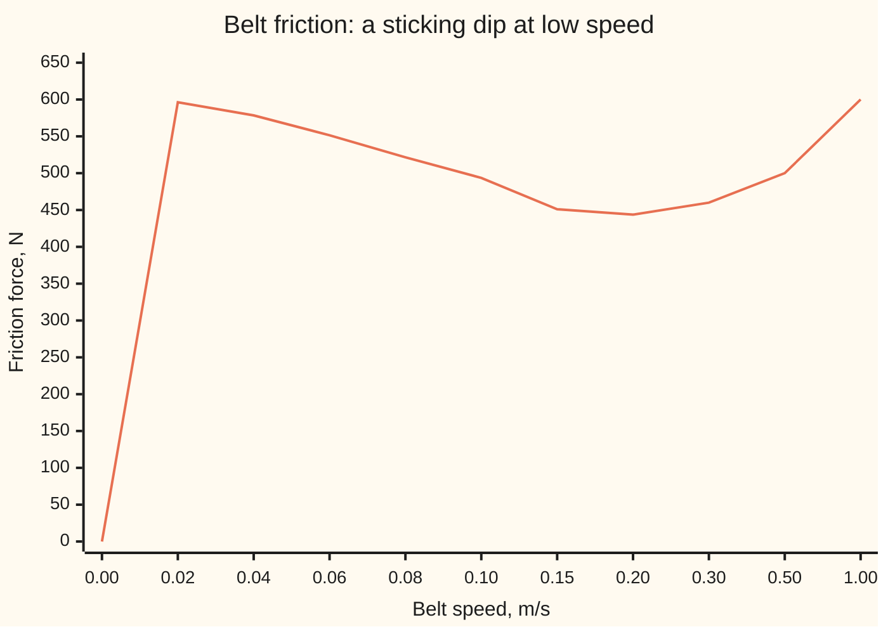
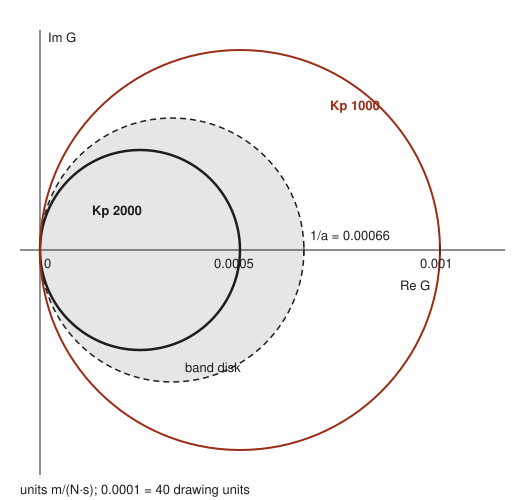
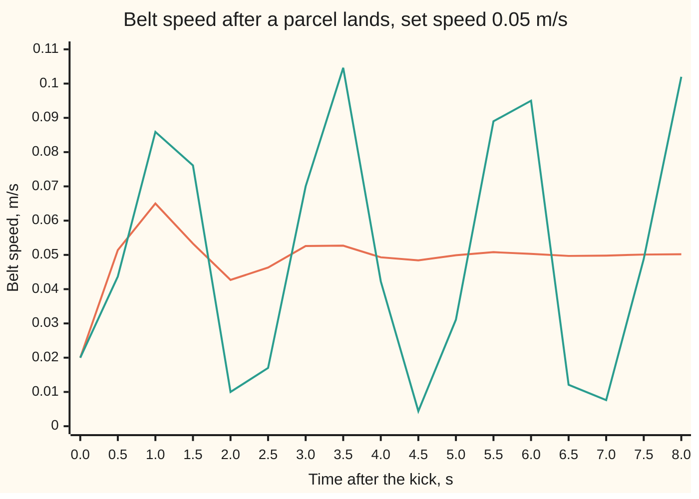

# Passivity: join two parts that only absorb energy and the loop cannot blow up

[Syllabus](../../../SYLLABUS.md) → [Engineering mathematics](../README.md) → [Robustness and Adaptation](../README.md#s10) → Passivity

---

## General Overview

A parcel conveyor in a sorting depot runs its belt at 1.00 m/s most of the day. While staff load awkward items it drops to a creep speed of 0.05 m/s. A PI speed loop drives the motor: one push proportional to the speed error, and one proportional to the error's running total. Belt and load weigh 500 kg on average, anywhere from 200 kg to 800 kg through the day. This belt is longer and heavier than the roller drive on the rest of this shelf, so it is described in straight-line units: kg, m/s and N.

The friction under the belt is the trouble. It takes up to 600 N to break the belt loose from rest. Once it moves, friction falls: 596.2 N at 0.02 m/s, 493.6 N at 0.10 m/s, 443.7 N at 0.20 m/s. Only then does it climb again, by 200 N for each extra m/s. Over that first stretch the friction curve slopes downhill. Downhill friction hands energy back: speed up a little, friction eases, so the belt speeds up more. That is how belts judder: stick, lurch, stick again (stick-slip).

The engineer wants one answer: will the belt hold 0.05 m/s smoothly at every load, while the friction curve drifts with wear and temperature? Nobody knows the curve exactly, and no one can simulate every possible curve.

Passivity answers it with one inequality. A part is **passive** when it can only store or burn the energy it is given, never create it. Join two passive parts in a loop and the stored energy can only fall, so the loop cannot blow up. The change in friction around the set speed is not passive, but its worst behaviour is bounded: the curve's steepest downhill slope is 1515.5 N·s/m (newtons of friction lost per m/s of speed gained). The speed loop's proportional gain is 2000 N·s/m of braking. The controller out-burns what the friction can hand back, with 484.5 N·s/m to spare. So the belt settles, at every load, for every friction curve that never slopes downhill faster than 1515.5 N·s/m.

**If each part of a loop only absorbs energy, the loop's stored energy can only fall and it settles; if one part can hand back energy at most at a known rate, a band condition, then a partner that burns more than that rate makes the loop stable for every nonlinearity inside the band at once.**

**What kind of fact this is:** a theorem (the passivity theorem, and its band form, the circle criterion), proved for this loop on this card in Why it works; the friction curve itself is a model, an assumption that fits real belts well enough, not a law.

### The picture: friction against belt speed



The line is the friction force F(v). It falls from 600 N near rest to 443.7 N at 0.20 m/s, then rises along the 200 N·s/m viscous slope. The model is smoothed through zero speed, so it reads 0 N exactly at rest; a real belt at rest holds anything up to 600 N. The speeds are unevenly spaced, to show the dip.

---

## The formula

Notation first. Write v for the belt speed and v₀ for the set speed, both in m/s. The **speed error** is e = v − v₀, and z is its running total, in metres: how far the belt has fallen behind or run ahead. The motor force is u = F(v₀) − K_p e − K_i z, where F(v₀) is the friction at the set speed. A real PI loop has no separate F(v₀) term: its integral builds up until it supplies that force, and z counts the running total from that resting value. Newton's law M v' = u − F(v), with a prime meaning a rate in time, becomes

$$M e' = -K_p\, e - K_i\, z - \varphi(e), \qquad z' = e, \qquad \varphi(e) = F(v_0 + e) - F(v_0)$$

**Read it aloud:** the speed error is braked by the proportional push, pulled back by the integral push, and shoved around by the change in friction away from its value at the set speed.

The friction change φ is the unknown part. All we ask of it is a **band** (a sector condition): every chord of the friction curve from the set speed has slope at least −a.

$$e\,\varphi(e) \ge -a\,e^2 \;\text{ for all } e, \qquad K_p > a \quad\Longrightarrow\quad V = \tfrac12 M e^2 + \tfrac12 K_i z^2 \;\text{ has }\; V' \le -(K_p - a)\,e^2$$

**Read it aloud:** if the friction change never hands back more than a times the error squared, and the proportional gain beats a, then the stored energy V falls by at least (K_p − a) e² every second, and the belt returns to its set speed.

A loop that is stable for every nonlinearity in a band is called **absolutely stable**; finding such bands for a linear part joined to one unknown curve is the **Lur'e problem**. In the frequency domain the same test reads: the transfer function G(s) = s / (M s² + K_p s + K_i), from a push on the belt to its speed error, must keep G(jω) inside the disk whose diameter runs from 0 to 1/a. That is the **circle criterion**.

| Symbol | Plain meaning | In our example | Push it up and the answer… |
| --- | --- | --- | --- |
| $v$, $v_0$ | belt speed; set speed, m/s | creep 0.05, running 1.00 | — |
| $e$, $z$ | speed error v − v₀, m/s; its running total, m | kick to e = −0.03, z = 0 | V grows as their squares |
| $M$ | belt plus load, kg | 500 (200 to 800 through the day) | slower settling, same verdict |
| $K_p$ | proportional gain: push per m/s of error, N·s/m | 2000 | more margin over a |
| $K_i$ | integral gain: push per metre of lag, N/m | 4000 | different settling, same verdict |
| $F(v)$; $F_s$, $F_c$, $v_s$, $b$, $\varepsilon$ | friction force, N; breakaway force, sliding force, dip speed, viscous slope, smoothing speed | 600 N, 400 N, 0.1 m/s, 200 N·s/m, 0.002 m/s | larger F_s − F_c: deeper dip, larger a |
| $\varphi(e)$ | change in friction from its value at v₀, N | 30.4 N at the kick | — |
| $a$ | band floor: the steepest downhill slope of friction, N·s/m | 1515.5 | past K_p, no guarantee |
| $V$, $V'$ | stored energy, J; its rate, W | 0.2250 J and −0.8881 W at the kick | — |
| $u$, $w$ | motor force, N; push from the friction branch into the belt, −φ(e), N | w = −30.4 N at the kick | — |
| $G(s)$, $s$, $\omega$, $j$ | transfer function from w to e; the Laplace variable; angular frequency, rad/s; √−1 | G(jω) traces a circle of diameter 1/K_p = 0.000500 m/(N·s) | — |
| $\omega_n$, $\zeta$ | natural frequency and damping ratio of the loop with friction ignored | 2.8284 rad/s, 0.7071 | — |

### When it holds

- **Friction depends only on the present speed.** Friction with memory (bristle models, lubricant films that build up) is a dynamic part, and needs its own storage function before it can join the argument.
- **The band covers every set speed the belt runs at.** From 0.05 m/s the local slope is −1357.6 N·s/m, but the worst chord is −1477.0, and the steepest slope anywhere is −1515.5. A K_p of 1400 picked from the local slope at 0.05 m/s carries no guarantee there, and at a set speed of 0.0707 m/s, where the slope itself is −1515.5, the belt judders between 0.0334 and 0.1081 m/s.
- **K_p strictly above a.** At the edge the guarantee is gone: a straight-line friction of slope −2020 N·s/m, just past K_p, multiplies the stored energy by 3.3214 in 30 s; slope −1980 shrinks it to 0.3011.
- **A stiff belt and an instant motor.** Belt stretch or a drive delay adds lag, G stops being positive real (Step 4), and the band then needs an upper end as well, checked with the circle criterion.
- **The test is sufficient, not necessary.** At 0.05 m/s, K_p = 1400 fails the band (worst chord −1477.0), yet the belt settles from the kick, slowly, in 66.719 s. Failing it proves nothing either way.

---

## Why it works

### Step 0: energy bookkeeping, with no solving

Power is force times speed. Give each part of the loop an energy account: how much it holds, and how much flows in through its connection. A passive part never ends up holding more than was paid in. Two passive parts in a loop only trade energy with each other, so the total can only stay or fall. A total that cannot rise cannot run off to infinity. With one part burning energy whenever anything moves, the total falls until nothing moves. This is the Lyapunov argument ([Lyapunov functions](../../08-Differential%20equations%20and%20dynamics/06-Nonlinear%20Dynamics%20in%20the%20Plane/04-lyapunov-functions.md)), with the score built from physics part by part instead of guessed.

### Step 1: the belt with its PI loop is passive

Cut the loop at the friction. The belt side takes a push w, in N, and returns the speed error e, in m/s. The power flowing in is w·e, in W. Take the storage V = ½ M e² + ½ K_i z². By the product rule,

$$V' = M e e' + K_i z z' = e(-K_p e - K_i z + w) + K_i z e = w\,e - K_p e^2.$$

So the stored energy rises by at most the power paid in, minus K_p e² burned. The first half of V is the kinetic energy of the speed error. The second half belongs to the integral term, which acts like a spring of stiffness K_i stretched by the lag z: it stores energy and hands it back, but never makes any. Kinetic energy alone is not a storage. After the kick it falls to 0 J at 0.474 s, then the spring, helped by the friction dip, pushes the belt past its set speed and it rises again to 0.056963 J at 0.972 s.

### Step 2: friction with no dip is passive, and the joined loop settles

The friction side takes e and returns φ(e). The power it absorbs is e·φ(e). If the friction curve only goes uphill, every chord from the set speed has positive slope, so e·φ(e) ≥ 0: it is passive. Join the two sides, w = −φ(e):

$$V' = -K_p e^2 - e\,\varphi(e) \le -K_p e^2.$$

V never rises, so e and z stay bounded. V′ is zero only where e = 0. A motion that stays on e = 0 has e′ = 0, so −K_i z = 0, so z = 0 too. By [LaSalle's principle](../../08-Differential%20equations%20and%20dynamics/06-Nonlinear%20Dynamics%20in%20the%20Plane/05-lasalle-and-the-damped-pendulum.md), every motion ends at e = 0, z = 0: the belt back at its set speed with the integral holding the right force. In general form, this is the **passivity theorem**: two passive parts in negative feedback, one of them burning energy whenever its output is non-zero, make a stable loop. Nothing about either part's inner workings was used.

### Step 3: the dip, and the band that covers it

A sticking dip breaks Step 2. From 0.05 m/s, slowing to 0.02 m/s raises friction to 596.2 N from 565.8 N, so e = −0.03 and φ = +30.4 N: e·φ is negative, and the friction hands energy back.

Suppose instead that every chord has slope at least −a, that is e·φ(e) ≥ −a e². Move a e from one side of the loop to the other. The friction side becomes φ(e) + a e, which is passive, since e(φ + a e) ≥ 0. The belt side now burns only (K_p − a) e². The same calculation gives

$$V' = -(K_p - a)\,e^2 - e\,\big(\varphi(e) + a e\big) \le -(K_p - a)\,e^2,$$

and Step 2's ending applies whenever K_p > a. This is a **loop transformation**: lend the friction enough damping to make it passive, and check the controller can afford the loan. Notice what the proof never used: the shape of φ inside the band, and the mass M. One inequality covers every friction curve in the band and every load on the belt.

Which a? A chord's slope always equals the curve's tangent slope somewhere between its ends (the mean value theorem). So the steepest downhill tangent anywhere bounds every chord from every set speed. For this model, F(v) = F_c + (F_s − F_c) exp(−(v/v_s)²) + b v at positive speed, where exp(x) means e (Euler's number, 2.718…) to the power x, not the speed error. Its slope is

$$F'(v) = b - (F_s - F_c)\,\frac{2v}{v_s^2}\,\exp\!\big(-(v/v_s)^2\big),$$

steepest at v = v_s/√2 = 0.0707 m/s, where

$$a = (F_s - F_c)\,\frac{\sqrt 2}{v_s}\,\exp(-1/2) - b = 1515.5 \text{ N·s/m}.$$

### Step 4: the same test, read in frequencies

The belt side's transfer function is G(s) = s / (M s² + K_p s + K_i). Its reciprocal at s = jω is 1/G(jω) = K_p + j(Mω − K_i/ω): the real part is K_p at every frequency. So 1/G runs up a vertical line, and G itself, plotted in the complex plane as ω runs (its **Nyquist plot**), runs round a circle through 0 with diameter 1/K_p = 0.000500 m/(N·s). The whole circle has Re G ≥ 0. A stable transfer function with Re G(jω) ≥ 0 at every frequency is called **positive real**: it is passivity seen in frequencies, since a part that absorbs power at every frequency absorbs it overall.

The band [−a, ∞) moves the test. After the loop transformation, the belt side is G/(1 − aG), and that is positive real exactly when G(jω) stays inside the disk with diameter from 0 to 1/a = 0.000660 m/(N·s). For K_p = 2000 the circle of diameter 0.000500 sits inside it. For K_p = 1000 the circle's diameter is 0.001, and it sticks out.

<p align="center"></p>

To scale: 40 drawing units per 0.0001 m/(N·s). Black: G(jω) for K_p = 2000. Red: for K_p = 1000. Shaded, dashed: the disk the band allows.

<details>
<summary>Detailed proof: why the band becomes a disk</summary>

Write G for G(jω). Then

$$\operatorname{Re}\frac{G}{1 - aG} = \frac{\operatorname{Re}\big(G\,(1 - a\bar G)\big)}{|1 - aG|^2} = \frac{\operatorname{Re} G - a|G|^2}{|1 - aG|^2}.$$

This is at least 0 exactly when |G|² ≤ (Re G)/a. Writing G = x + jy, that is x² + y² − x/a ≤ 0, or (x − 1/(2a))² + y² ≤ (1/(2a))²: the disk with centre 1/(2a) and radius 1/(2a). For our G, 1/G = K_p + j(Mω − K_i/ω), so Re G / |G|² = Re(1/G) = K_p, and the condition reads K_p ≥ a at every frequency, the time-domain answer again.

</details>

Why must the frequency road and the energy road agree? The **Kalman–Yakubovich–Popov lemma** says that a positive real transfer function always has a quadratic storage function, and the reverse. It holds for a model with no hidden states, and is stated here without proof; the 1963 paper and the book in the sources prove it. Here the storage is V itself, and the frequency test finds the same edge, a = K_p.

### Step 5: every load, every curve in the band

The guarantee does not mention M or the exact friction curve. The simulation checks it: the same kick, three loads, three friction curves. Breakaway force 500 N gives a = 657.8 N·s/m; 400 N, no dip at all, gives a = −200.0, a curve that always goes uphill.

| Load | F_s = 600 N | F_s = 500 N | F_s = 400 N |
| --- | --- | --- | --- |
| 200 kg | settles in 2.103 s | 1.027 s | 1.031 s |
| 500 kg | 4.738 s | 2.455 s | 1.645 s |
| 800 kg | 7.414 s | 3.310 s | 2.041 s |

Heavier loads settle more slowly, and the deepest dip slowest of all. All nine settle.

---

## Worked numbers, by hand

Creep speed 0.05 m/s. A parcel lands and slows the belt to 0.02 m/s: e = −0.03 m/s, z = 0.

| Step | Arithmetic | Value |
| --- | --- | --- |
| loop with friction ignored | ω_n = √(4000/500); ζ = 2000 / (2√(4000 × 500)) | 2.8284 rad/s; 0.7071 |
| where friction is steepest | v_s/√2 = 0.1/√2 | 0.0707 m/s |
| its slope, the band floor | 200 × 14.1421 × 0.6065 = 1715.5278 (factors unrounded), minus b = 200 | a = 1515.5278 N·s/m |
| local slope at creep | 200 − 200 × 10 × 0.7788 = 200 − 1557.6016 (factors unrounded) | −1357.6016 N·s/m |
| margin | 2000 − 1515.5278 | 484.4722 N·s/m |
| stored energy at the kick | ½ × 500 × 0.03² | 0.2250 J |
| friction change | F(0.02) − F(0.05) = 596.2 − 565.8 | φ = 30.4 N |
| rate of V at the kick | −2000 × 0.03² + 0.03 × 30.4 = −1.8000 + 0.9119 | −0.8881 W |
| guaranteed floor | −484.4722 × 0.03² | −0.4360 W |
| frequency check | diameters 1/2000 and 1/1515.5278 | 0.000500 inside 0.000660 |
| **verdict** | K_p > a | **settles: within 1 mm/s of 0.05 m/s after 4.738 s** |

The parcel's landing puts 0.2250 J into the error. The loop drains it at 0.8881 W at first, more than the 0.4360 W the band guarantees, and the belt is back at creep speed in under five seconds.

### What breaks if you drop a piece

| Mistake | Comes out at | What went wrong |
| --- | --- | --- |
| Ignore the dip and call friction passive; choose K_p = 1000 | belt judders between 0.0031 and 0.1052 m/s, every 2.337 s | the dip hands back up to 1515.5 N·s/m; 1000 does not out-burn it |
| Read the band off the local slope at 0.05 m/s (1357.6) and choose K_p = 1400 | run at 0.0707 m/s, the belt swings between 0.0334 and 0.1081 m/s | the band must cover every set speed in use; at 0.0707 m/s the slope is −1515.5, steeper than 1400 |
| Use kinetic energy ½ M e² alone as the storage | it rises from 0 J at 0.474 s to 0.056963 J at 0.972 s, so the proof stalls | the integral term stores energy like a spring and must be counted |
| Read a failed band test as instability | K_p = 1400 at 0.05 m/s fails the band, yet settles in 66.719 s | the band test is sufficient, not necessary |

### The kick, with and without the margin



Orange: K_p = 2000, inside the band; it peaks near 0.065 m/s and settles. Green: K_p = 1000; the belt nearly stops, lurches past 0.10 m/s, and keeps repeating.

---

## Code, from first principles, and it actually runs

The scripts simulate the belt with a fourth-order Runge–Kutta step (RK4) of 0.001 s, with the friction smoothed through zero speed by tanh(v/ε), a smooth step from −1 to 1, with ε = 0.002 m/s, so the step can pass through rest. They take three independent roads to the band edge a* = K_p = 2000 N·s/m. The energy road is the formula of Step 3. The frequency road sweeps G(jω) over 2001 frequencies from 0.001 to 1000 rad/s, with complex numbers written out, and bisects for the largest a that keeps G/(1 − aG) positive real. The time road replaces friction by straight lines of slope −1980 and −2020 N·s/m and watches V shrink or grow. Separately, the band floor a comes from the closed form and from a scan of 20,000 tangent slopes. The nonlinear simulation checks that V never rises and that it drains at least the margin times the integral of e². Every load and friction curve in the table of Step 5 is simulated and must settle.

### Python

```python
# Passivity and absolute stability -- the check behind the card.  Standard library only.
# A conveyor belt (mass M) under a PI speed loop, with sticking friction at low speed.
# Roads: the band test by formula; a frequency sweep with bisection; simulations (RK4).
import math

M, KP, KI = 500.0, 2000.0, 4000.0                   # kg, N*s/m, N/m
FS, FC, VS, B, EPS = 600.0, 400.0, 0.1, 200.0, 0.002  # N, N, m/s, N*s/m, m/s

def fric(v, fs=FS):  # Stribeck friction, N: sticking dip below VS, smoothed through 0
    return math.tanh(v / EPS) * (FC + (fs - FC) * math.exp(-(v / VS) ** 2)) + B * v

def slope(v, fs=FS, h=1e-6):
    return (fric(v + h, fs) - fric(v - h, fs)) / (2 * h)

def sim(v0, e0, kp, m=M, ki=KI, fs=FS, T=10.0, dt=0.001, lin=None):
    # e = speed error (m/s), z = integral of e (m); M e' = -Kp e - Ki z - phi(e), z' = e
    phi = (lambda e: -lin * e) if lin is not None else (lambda e: fric(v0 + e, fs) - fric(v0, fs))
    f = lambda e, z: ((-kp * e - ki * z - phi(e)) / m, e)
    e, z, out = e0, 0.0, []
    for k in range(int(round(T / dt)) + 1):
        out.append((k * dt, e, z))
        a1, b1 = f(e, z); a2, b2 = f(e + dt / 2 * a1, z + dt / 2 * b1)
        a3, b3 = f(e + dt / 2 * a2, z + dt / 2 * b2); a4, b4 = f(e + dt * a3, z + dt * b3)
        e += dt / 6 * (a1 + 2 * a2 + 2 * a3 + a4); z += dt / 6 * (b1 + 2 * b2 + 2 * b3 + b4)
    return out

V = lambda e, z, m=M, ki=KI: 0.5 * m * e * e + 0.5 * ki * z * z      # stored energy, J
settle = lambda out: max([t for t, e, z in out if abs(e) > 0.001] + [0.0])  # last time |e| > 1 mm/s
def swing(out, since):
    v = [e for t, e, z in out if t >= since]
    return min(v), max(v)

def steepest(fs):  # closed form: largest downhill slope of the friction curve, at v = VS/sqrt 2
    return (fs - FC) * math.sqrt(2) / VS * math.exp(-0.5) - B

print(f"plant: M {M:.0f} kg, Kp {KP:.0f} N*s/m, Ki {KI:.0f} N/m; wn {math.sqrt(KI / M):.4f} rad/s, damping ratio {KP / (2 * math.sqrt(KI * M)):.4f}")
vs_chart = [0.0, 0.02, 0.04, 0.06, 0.08, 0.1, 0.15, 0.2, 0.3, 0.5, 1.0]
print("chart, speed m/s    " + " ".join(f"{v:6.2f}" for v in vs_chart))
print("chart, friction N   " + " ".join(f"{fric(v):6.1f}" for v in vs_chart))

# ---- the band: the friction curve's steepest downhill slope ----
a = steepest(FS)
grid = [i * 1e-4 for i in range(1, 20001)]
a_scan = -min(slope(v) for v in grid)
assert abs(a - a_scan) < 1e-3, "closed-form steepest slope disagrees with the scan"
loc = B - (FS - FC) * 2 * 0.05 / VS ** 2 * math.exp(-0.25)
assert abs(loc - slope(0.05)) < 1e-3
print(f"steepest downhill slope a: formula {a:.4f}, scan {a_scan:.4f} N*s/m, at {VS / math.sqrt(2):.4f} m/s")
print(f"hand: {FS - FC:.0f} x {math.sqrt(2) / VS:.4f} x {math.exp(-0.5):.4f} = {a + B:.4f}, minus b {B:.0f} -> a {a:.4f}")
print(f"hand: local at 0.05 m/s: {B:.0f} - {FS - FC:.0f} x 10 x {math.exp(-0.25):.4f} = {B:.0f} - {B - loc:.4f}")
print(f"local slope: at 0.05 m/s {loc:.4f}, at 1.00 m/s {slope(1.0):.4f} N*s/m")
for v0 in (0.05, 1.0):  # worst chord from each operating speed, over every other speed 0..2 m/s
    ch = min((fric(v) - fric(v0)) / (v - v0) for v in grid if abs(v - v0) > 1e-9)
    assert ch >= -a - 1e-6, "a chord steeper than the steepest tangent: mean value theorem broken"
    print(f"worst chord from {v0:.2f} m/s: {ch:.4f} N*s/m (band floor -{a:.4f})")
print(f"band test: Kp {KP:.0f} - a {a:.4f} = margin {KP - a:.4f} N*s/m -> {'PASS' if KP > a else 'FAIL'}")

# ---- road 2: frequency sweep, G(jw) = jw / (Ki - M w^2 + j Kp w), bisection on a ----
ws = [10 ** (-3 + 6 * i / 2000) for i in range(2001)]
G = lambda w, kp=KP: 1j * w / (KI - M * w * w + 1j * kp * w)
def band_ok(x, kp=KP):  # G / (1 - x G) positive real at every swept frequency?
    return all((G(w, kp) / (1 - x * G(w, kp))).real >= 0 for w in ws)
lo, hi = 0.0, 5000.0
for _ in range(60):
    lo, hi = ((lo + hi) / 2, hi) if band_ok((lo + hi) / 2) else (lo, (lo + hi) / 2)
assert abs(lo - KP) < 1e-3, "frequency road disagrees with a* = Kp"
c = 1 / (2 * KP)
rad = [abs(G(w) - c) for w in ws]
assert max(rad) - min(rad) < 1e-12 and abs(max(rad) - c) < 1e-12, "Nyquist plot of G is not the circle"
print(f"frequency road: largest band a* by bisection {lo:.4f} N*s/m (formula: Kp {KP:.4f})")
print(f"Nyquist of G: circle centre {c:.6f}, radius {max(rad):.6f}, diameter 1/Kp {2 * c:.6f} m/(N*s); band disk diameter 1/a {1 / a:.6f}")

# ---- road 3: a straight-line friction of slope -x, just inside and just outside Kp ----
for x in (0.99 * KP, 1.01 * KP):
    o = sim(0.05, -0.03, KP, lin=x, T=30)
    r = V(o[-1][1], o[-1][2]) / V(o[0][1], o[0][2])
    assert (r < 1) == (x < KP), "linear road disagrees with the band edge"
    print(f"linear friction slope -{x:.0f}: V(30 s)/V(0) = {r:.4f}, real part {-(KP - x) / (2 * M):+.4f} 1/s")

# ---- the kick: at creep speed 0.05 m/s a parcel slows the belt to 0.02 m/s ----
o = sim(0.05, -0.03, KP)
Vs = [V(e, z) for t, e, z in o]
assert all(Vs[i + 1] <= Vs[i] + 1e-12 for i in range(len(Vs) - 1)), "stored energy rose"
ph = fric(0.02) - fric(0.05)
print(f"at the kick: F(0.02) {fric(0.02):.1f} - F(0.05) {fric(0.05):.1f} = phi {ph:.1f} N; V' = {-KP * 0.03 ** 2:.4f} + {0.03 * ph:.4f} = {-KP * 0.03 ** 2 + 0.03 * ph:.4f} W; floor {-(KP - a) * 0.03 ** 2:.4f} W")
ie2 = sum(e * e for t, e, z in o[:-1]) * 0.001
assert Vs[0] - Vs[-1] >= (KP - a) * ie2 * 0.999, "energy fell slower than the margin promises"
print("kick, V in J at 0..5 s: " + " ".join(f"{Vs[k * 1000]:.4f}" for k in range(6)) + f"; settles in {settle(o):.3f} s")
print(f"energy drained {Vs[0] - Vs[-1]:.4f} J >= margin x integral of e^2 = {(KP - a) * ie2:.4f} J")
ke = [0.5 * M * e * e for t, e, z in o]
i0 = next(i for i, (t, e, z) in enumerate(o) if e > 0)
ipk = max(range(i0, len(o)), key=lambda i: ke[i])
print(f"kinetic energy alone: {ke[i0]:.6f} J at {o[i0][0]:.3f} s rises to {ke[ipk]:.6f} J at {o[ipk][0]:.3f} s")
o1 = sim(0.05, -0.03, 1000.0, T=40)
print("chart, time s       " + " ".join(f"{k / 2:6.1f}" for k in range(17)))
print("chart, Kp 2000 m/s  " + " ".join(f"{0.05 + o[k * 500][1]:6.4f}" for k in range(17)))
print("chart, Kp 1000 m/s  " + " ".join(f"{0.05 + o1[k * 500][1]:6.4f}" for k in range(17)))
lo1, hi1 = swing(o1, 20)
ups = [t for (t, e, z), (t2, e2, z2) in zip(o1, o1[1:]) if t >= 20 and e < 0 <= e2]
period = (ups[-1] - ups[0]) / (len(ups) - 1)
assert hi1 - lo1 > 0.05, "Kp 1000 should judder"
print(f"Kp 1000 at 0.05 m/s: speed swings {0.05 + lo1:.4f} to {0.05 + hi1:.4f} m/s, period {period:.3f} s")

# ---- every load and every friction curve inside the band ----
print("settle s after the kick   " + "  ".join(f"Fs {fs:.0f} N (a {steepest(fs):.1f})" for fs in (600.0, 500.0, 400.0)))
for m in (200.0, 500.0, 800.0):
    row = []
    for fs in (600.0, 500.0, 400.0):
        oc = sim(0.05, -0.03, KP, m=m, fs=fs, T=20)
        assert abs(oc[-1][1]) < 1e-4, "a covered case failed to settle"
        row.append(f"{settle(oc):19.3f}")
    print(f"load {m:3.0f} kg            " + " ".join(row))

# ---- what breaks ----
w2 = swing(sim(VS / math.sqrt(2), -0.03, 1400.0, T=40), 30)
print(f"break, Kp 1400 at 0.0707 m/s: swings {VS / math.sqrt(2) + w2[0]:.4f} to {VS / math.sqrt(2) + w2[1]:.4f} m/s")
o3 = sim(0.05, -0.03, 1400.0, T=100)   # fails the band at creep speed (worst chord -1477.0), yet settles
assert abs(o3[-1][1]) < 1e-3, "Kp 1400 at creep speed should still settle, slowly"
print(f"break, Kp 1400 at 0.05 m/s: below the worst chord there, no guarantee, yet settles in {settle(o3):.3f} s")

# ---- try changing ----
a7 = steepest(700.0)
w7 = swing(sim(VS / math.sqrt(2), -0.03, KP, fs=700.0, T=40), 30)
print(f"try Fs 700 N: a {a7:.4f} N*s/m; at 0.0707 m/s swings {VS / math.sqrt(2) + w7[0]:.4f} to {VS / math.sqrt(2) + w7[1]:.4f} m/s")
print(f"try Kp 1600: margin {1600 - a:.4f} N*s/m, settles in {settle(sim(0.05, -0.03, 1600.0, T=40)):.3f} s")
print(f"try Ki 8000: settles in {settle(sim(0.05, -0.03, KP, ki=8000.0, T=20)):.3f} s")
print(f"try belt stopped dead, e0 -0.05 m/s: settles in {settle(sim(0.05, -0.05, KP, T=20)):.3f} s")
print(f"figure, circle Kp 2000 c {1 / 4000:.6f} r {1 / 4000:.6f}; circle Kp 1000 c {1 / 2000:.6f} r {1 / 2000:.6f}; band c {1 / (2 * a):.6f} r {1 / (2 * a):.6f}")
print("ALL CHECKS PASS")
```

**Ran 2026-11-11 on macOS, Python 3.14.10, standard library only. All checks passed. Output, pasted from the run:**

```
plant: M 500 kg, Kp 2000 N*s/m, Ki 4000 N/m; wn 2.8284 rad/s, damping ratio 0.7071
chart, speed m/s      0.00   0.02   0.04   0.06   0.08   0.10   0.15   0.20   0.30   0.50   1.00
chart, friction N      0.0  596.2  578.4  551.5  521.5  493.6  451.1  443.7  460.0  500.0  600.0
steepest downhill slope a: formula 1515.5278, scan 1515.5277 N*s/m, at 0.0707 m/s
hand: 200 x 14.1421 x 0.6065 = 1715.5278, minus b 200 -> a 1515.5278
hand: local at 0.05 m/s: 200 - 200 x 10 x 0.7788 = 200 - 1557.6016
local slope: at 0.05 m/s -1357.6016, at 1.00 m/s 200.0000 N*s/m
worst chord from 0.05 m/s: -1477.0081 N*s/m (band floor -1515.5278)
worst chord from 1.00 m/s: -0.0392 N*s/m (band floor -1515.5278)
band test: Kp 2000 - a 1515.5278 = margin 484.4722 N*s/m -> PASS
frequency road: largest band a* by bisection 2000.0000 N*s/m (formula: Kp 2000.0000)
Nyquist of G: circle centre 0.000250, radius 0.000250, diameter 1/Kp 0.000500 m/(N*s); band disk diameter 1/a 0.000660
linear friction slope -1980: V(30 s)/V(0) = 0.3011, real part -0.0200 1/s
linear friction slope -2020: V(30 s)/V(0) = 3.3214, real part +0.0200 1/s
at the kick: F(0.02) 596.2 - F(0.05) 565.8 = phi 30.4 N; V' = -1.8000 + 0.9119 = -0.8881 W; floor -0.4360 W
kick, V in J at 0..5 s: 0.2250 0.0622 0.0209 0.0052 0.0013 0.0003; settles in 4.738 s
energy drained 0.2250 J >= margin x integral of e^2 = 0.1500 J
kinetic energy alone: 0.000000 J at 0.474 s rises to 0.056963 J at 0.972 s
chart, time s          0.0    0.5    1.0    1.5    2.0    2.5    3.0    3.5    4.0    4.5    5.0    5.5    6.0    6.5    7.0    7.5    8.0
chart, Kp 2000 m/s  0.0200 0.0514 0.0650 0.0533 0.0427 0.0463 0.0526 0.0527 0.0493 0.0484 0.0499 0.0508 0.0503 0.0497 0.0498 0.0501 0.0502
chart, Kp 1000 m/s  0.0200 0.0437 0.0859 0.0761 0.0100 0.0170 0.0700 0.1046 0.0423 0.0044 0.0311 0.0890 0.0950 0.0121 0.0076 0.0488 0.1020
Kp 1000 at 0.05 m/s: speed swings 0.0031 to 0.1052 m/s, period 2.337 s
settle s after the kick   Fs 600 N (a 1515.5)  Fs 500 N (a 657.8)  Fs 400 N (a -200.0)
load 200 kg                          2.103               1.027               1.031
load 500 kg                          4.738               2.455               1.645
load 800 kg                          7.414               3.310               2.041
break, Kp 1400 at 0.0707 m/s: swings 0.0334 to 0.1081 m/s
break, Kp 1400 at 0.05 m/s: below the worst chord there, no guarantee, yet settles in 66.719 s
try Fs 700 N: a 2373.2917 N*s/m; at 0.0707 m/s swings 0.0148 to 0.1270 m/s
try Kp 1600: margin 84.4722 N*s/m, settles in 13.386 s
try Ki 8000: settles in 4.885 s
try belt stopped dead, e0 -0.05 m/s: settles in 5.726 s
figure, circle Kp 2000 c 0.000250 r 0.000250; circle Kp 1000 c 0.000500 r 0.000500; band c 0.000330 r 0.000330
ALL CHECKS PASS
```

### Rust

```rust
// Passivity and absolute stability -- the same check as the Python, in Rust.  std only, no crates.
// A conveyor belt (mass M) under a PI speed loop, with sticking friction at low speed.
// Roads: the band test by formula; a frequency sweep with bisection; simulations (RK4).
const M: f64 = 500.0; const KP: f64 = 2000.0; const KI: f64 = 4000.0; // kg, N*s/m, N/m
const FS: f64 = 600.0; const FC: f64 = 400.0; const VS: f64 = 0.1; const B: f64 = 200.0; const EPS: f64 = 0.002;

#[derive(Clone, Copy)]
struct C { re: f64, im: f64 } // a complex number, written out
impl C {
    fn sub(self, o: C) -> C { C { re: self.re - o.re, im: self.im - o.im } }
    fn scale(self, k: f64) -> C { C { re: self.re * k, im: self.im * k } }
    fn div(self, o: C) -> C {
        let d = o.re * o.re + o.im * o.im;
        C { re: (self.re * o.re + self.im * o.im) / d, im: (self.im * o.re - self.re * o.im) / d }
    }
    fn abs(self) -> f64 { (self.re * self.re + self.im * self.im).sqrt() }
}
fn g(w: f64, kp: f64) -> C { C { re: 0.0, im: w }.div(C { re: KI - M * w * w, im: kp * w }) }

fn fric(v: f64, fs: f64) -> f64 { (v / EPS).tanh() * (FC + (fs - FC) * (-(v / VS).powi(2)).exp()) + B * v }
fn slope(v: f64) -> f64 { let h = 1e-6; (fric(v + h, FS) - fric(v - h, FS)) / (2.0 * h) }
fn steepest(fs: f64) -> f64 { (fs - FC) * 2f64.sqrt() / VS * (-0.5f64).exp() - B }

// e = speed error (m/s), z = integral of e (m); M e' = -Kp e - Ki z - phi(e), z' = e
fn sim(v0: f64, e0: f64, kp: f64, m: f64, ki: f64, fs: f64, t_end: f64, lin: Option<f64>) -> Vec<(f64, f64, f64)> {
    let dt = 0.001;
    let phi = |e: f64| match lin { Some(x) => -x * e, None => fric(v0 + e, fs) - fric(v0, fs) };
    let f = |e: f64, z: f64| ((-kp * e - ki * z - phi(e)) / m, e);
    let (mut e, mut z, mut out) = (e0, 0.0, Vec::new());
    for k in 0..=((t_end / dt).round() as usize) {
        out.push((k as f64 * dt, e, z));
        let (a1, b1) = f(e, z); let (a2, b2) = f(e + dt / 2.0 * a1, z + dt / 2.0 * b1);
        let (a3, b3) = f(e + dt / 2.0 * a2, z + dt / 2.0 * b2); let (a4, b4) = f(e + dt * a3, z + dt * b3);
        e += dt / 6.0 * (a1 + 2.0 * a2 + 2.0 * a3 + a4); z += dt / 6.0 * (b1 + 2.0 * b2 + 2.0 * b3 + b4);
    }
    out
}
fn sim0(v0: f64, e0: f64, kp: f64, t_end: f64) -> Vec<(f64, f64, f64)> { sim(v0, e0, kp, M, KI, FS, t_end, None) }
fn vstore(e: f64, z: f64) -> f64 { 0.5 * M * e * e + 0.5 * KI * z * z } // stored energy, J
fn settle(o: &[(f64, f64, f64)]) -> f64 { o.iter().filter(|p| p.1.abs() > 0.001).map(|p| p.0).fold(0.0, f64::max) }
fn swing(o: &[(f64, f64, f64)], since: f64) -> (f64, f64) {
    let v: Vec<f64> = o.iter().filter(|p| p.0 >= since).map(|p| p.1).collect();
    (v.iter().cloned().fold(f64::INFINITY, f64::min), v.iter().cloned().fold(f64::NEG_INFINITY, f64::max))
}
fn row(label: &str, xs: &[f64], w: usize, p: usize) -> String {
    format!("{}{}", label, xs.iter().map(|x| format!("{:w$.p$}", x, w = w, p = p)).collect::<Vec<_>>().join(" "))
}

fn main() {
    println!("plant: M {:.0} kg, Kp {:.0} N*s/m, Ki {:.0} N/m; wn {:.4} rad/s, damping ratio {:.4}", M, KP, KI, (KI / M).sqrt(), KP / (2.0 * (KI * M).sqrt()));
    let vs_chart = [0.0, 0.02, 0.04, 0.06, 0.08, 0.1, 0.15, 0.2, 0.3, 0.5, 1.0];
    println!("{}", row("chart, speed m/s    ", &vs_chart, 6, 2));
    println!("{}", row("chart, friction N   ", &vs_chart.iter().map(|&v| fric(v, FS)).collect::<Vec<_>>(), 6, 1));

    // ---- the band: the friction curve's steepest downhill slope ----
    let a = steepest(FS);
    let grid: Vec<f64> = (1..=20000).map(|i| i as f64 * 1e-4).collect();
    let a_scan = -grid.iter().map(|&v| slope(v)).fold(f64::INFINITY, f64::min);
    assert!((a - a_scan).abs() < 1e-3, "closed-form steepest slope disagrees with the scan");
    let loc = B - (FS - FC) * 2.0 * 0.05 / VS.powi(2) * (-0.25f64).exp();
    assert!((loc - slope(0.05)).abs() < 1e-3);
    println!("steepest downhill slope a: formula {:.4}, scan {:.4} N*s/m, at {:.4} m/s", a, a_scan, VS / 2f64.sqrt());
    println!("hand: {:.0} x {:.4} x {:.4} = {:.4}, minus b {:.0} -> a {:.4}", FS - FC, 2f64.sqrt() / VS, (-0.5f64).exp(), a + B, B, a);
    println!("hand: local at 0.05 m/s: {:.0} - {:.0} x 10 x {:.4} = {:.0} - {:.4}", B, FS - FC, (-0.25f64).exp(), B, B - loc);
    println!("local slope: at 0.05 m/s {:.4}, at 1.00 m/s {:.4} N*s/m", loc, slope(1.0));
    for v0 in [0.05, 1.0] {
        let ch = grid.iter().filter(|&&v| (v - v0).abs() > 1e-9).map(|&v| (fric(v, FS) - fric(v0, FS)) / (v - v0)).fold(f64::INFINITY, f64::min);
        assert!(ch >= -a - 1e-6, "a chord steeper than the steepest tangent: mean value theorem broken");
        println!("worst chord from {:.2} m/s: {:.4} N*s/m (band floor -{:.4})", v0, ch, a);
    }
    println!("band test: Kp {:.0} - a {:.4} = margin {:.4} N*s/m -> {}", KP, a, KP - a, if KP > a { "PASS" } else { "FAIL" });

    // ---- road 2: frequency sweep, G(jw) = jw / (Ki - M w^2 + j Kp w), bisection on a ----
    let ws: Vec<f64> = (0..=2000).map(|i| 10f64.powf(-3.0 + 6.0 * i as f64 / 2000.0)).collect();
    let band_ok = |x: f64| ws.iter().all(|&w| { let gw = g(w, KP); gw.div(C { re: 1.0, im: 0.0 }.sub(gw.scale(x))).re >= 0.0 });
    let (mut lo, mut hi) = (0.0, 5000.0);
    for _ in 0..60 { let mid = (lo + hi) / 2.0; if band_ok(mid) { lo = mid } else { hi = mid } }
    assert!((lo - KP).abs() < 1e-3, "frequency road disagrees with a* = Kp");
    let c = 1.0 / (2.0 * KP);
    let rad: Vec<f64> = ws.iter().map(|&w| g(w, KP).sub(C { re: c, im: 0.0 }).abs()).collect();
    let (rmin, rmax) = (rad.iter().cloned().fold(f64::INFINITY, f64::min), rad.iter().cloned().fold(0.0, f64::max));
    assert!(rmax - rmin < 1e-12 && (rmax - c).abs() < 1e-12, "Nyquist plot of G is not the circle");
    println!("frequency road: largest band a* by bisection {:.4} N*s/m (formula: Kp {:.4})", lo, KP);
    println!("Nyquist of G: circle centre {:.6}, radius {:.6}, diameter 1/Kp {:.6} m/(N*s); band disk diameter 1/a {:.6}", c, rmax, 2.0 * c, 1.0 / a);

    // ---- road 3: a straight-line friction of slope -x, just inside and just outside Kp ----
    for x in [0.99 * KP, 1.01 * KP] {
        let o = sim(0.05, -0.03, KP, M, KI, FS, 30.0, Some(x));
        let (l, f0) = (o[o.len() - 1], o[0]);
        let r = vstore(l.1, l.2) / vstore(f0.1, f0.2);
        assert!((r < 1.0) == (x < KP), "linear road disagrees with the band edge");
        println!("linear friction slope -{:.0}: V(30 s)/V(0) = {:.4}, real part {:+.4} 1/s", x, r, -(KP - x) / (2.0 * M));
    }

    // ---- the kick: at creep speed 0.05 m/s a parcel slows the belt to 0.02 m/s ----
    let o = sim0(0.05, -0.03, KP, 10.0);
    let vs: Vec<f64> = o.iter().map(|p| vstore(p.1, p.2)).collect();
    assert!(vs.windows(2).all(|w| w[1] <= w[0] + 1e-12), "stored energy rose");
    let ph = fric(0.02, FS) - fric(0.05, FS);
    println!("at the kick: F(0.02) {:.1} - F(0.05) {:.1} = phi {:.1} N; V' = {:.4} + {:.4} = {:.4} W; floor {:.4} W", fric(0.02, FS), fric(0.05, FS), ph, -KP * 0.03f64.powi(2), 0.03 * ph, -KP * 0.03f64.powi(2) + 0.03 * ph, -(KP - a) * 0.03f64.powi(2));
    let ie2: f64 = o[..o.len() - 1].iter().map(|p| p.1 * p.1).sum::<f64>() * 0.001;
    assert!(vs[0] - vs[vs.len() - 1] >= (KP - a) * ie2 * 0.999, "energy fell slower than the margin promises");
    let v5: Vec<String> = (0..6).map(|k| format!("{:.4}", vs[k * 1000])).collect();
    println!("kick, V in J at 0..5 s: {}; settles in {:.3} s", v5.join(" "), settle(&o));
    println!("energy drained {:.4} J >= margin x integral of e^2 = {:.4} J", vs[0] - vs[vs.len() - 1], (KP - a) * ie2);
    let ke: Vec<f64> = o.iter().map(|p| 0.5 * M * p.1 * p.1).collect();
    let i0 = o.iter().position(|p| p.1 > 0.0).unwrap();
    let mut ipk = i0;
    for i in i0..o.len() { if ke[i] > ke[ipk] { ipk = i } }
    println!("kinetic energy alone: {:.6} J at {:.3} s rises to {:.6} J at {:.3} s", ke[i0], o[i0].0, ke[ipk], o[ipk].0);
    let o1 = sim0(0.05, -0.03, 1000.0, 40.0);
    println!("{}", row("chart, time s       ", &(0..17).map(|k| k as f64 / 2.0).collect::<Vec<_>>(), 6, 1));
    println!("{}", row("chart, Kp 2000 m/s  ", &(0..17).map(|k| 0.05 + o[k * 500].1).collect::<Vec<_>>(), 6, 4));
    println!("{}", row("chart, Kp 1000 m/s  ", &(0..17).map(|k| 0.05 + o1[k * 500].1).collect::<Vec<_>>(), 6, 4));
    let (lo1, hi1) = swing(&o1, 20.0);
    let ups: Vec<f64> = o1.windows(2).filter(|w| w[0].0 >= 20.0 && w[0].1 < 0.0 && 0.0 <= w[1].1).map(|w| w[0].0).collect();
    let period = (ups[ups.len() - 1] - ups[0]) / (ups.len() - 1) as f64;
    assert!(hi1 - lo1 > 0.05, "Kp 1000 should judder");
    println!("Kp 1000 at 0.05 m/s: speed swings {:.4} to {:.4} m/s, period {:.3} s", 0.05 + lo1, 0.05 + hi1, period);

    // ---- every load and every friction curve inside the band ----
    println!("settle s after the kick   {}", [600.0, 500.0, 400.0].iter().map(|&fs| format!("Fs {:.0} N (a {:.1})", fs, steepest(fs))).collect::<Vec<_>>().join("  "));
    for m in [200.0, 500.0, 800.0] {
        let mut cells = Vec::new();
        for fs in [600.0, 500.0, 400.0] {
            let oc = sim(0.05, -0.03, KP, m, KI, fs, 20.0, None);
            assert!(oc[oc.len() - 1].1.abs() < 1e-4, "a covered case failed to settle");
            cells.push(format!("{:19.3}", settle(&oc)));
        }
        println!("load {:3.0} kg            {}", m, cells.join(" "));
    }

    // ---- what breaks ----
    let vp = VS / 2f64.sqrt();
    let w2 = swing(&sim0(vp, -0.03, 1400.0, 40.0), 30.0);
    println!("break, Kp 1400 at 0.0707 m/s: swings {:.4} to {:.4} m/s", vp + w2.0, vp + w2.1);
    let o3 = sim0(0.05, -0.03, 1400.0, 100.0); // fails the band at creep speed (worst chord -1477.0), yet settles
    assert!(o3[o3.len() - 1].1.abs() < 1e-3, "Kp 1400 at creep speed should still settle, slowly");
    println!("break, Kp 1400 at 0.05 m/s: below the worst chord there, no guarantee, yet settles in {:.3} s", settle(&o3));

    // ---- try changing ----
    let w7 = swing(&sim(vp, -0.03, KP, M, KI, 700.0, 40.0, None), 30.0);
    println!("try Fs 700 N: a {:.4} N*s/m; at 0.0707 m/s swings {:.4} to {:.4} m/s", steepest(700.0), vp + w7.0, vp + w7.1);
    println!("try Kp 1600: margin {:.4} N*s/m, settles in {:.3} s", 1600.0 - a, settle(&sim0(0.05, -0.03, 1600.0, 40.0)));
    println!("try Ki 8000: settles in {:.3} s", settle(&sim(0.05, -0.03, KP, M, 8000.0, FS, 20.0, None)));
    println!("try belt stopped dead, e0 -0.05 m/s: settles in {:.3} s", settle(&sim0(0.05, -0.05, KP, 20.0)));
    println!("figure, circle Kp 2000 c {:.6} r {:.6}; circle Kp 1000 c {:.6} r {:.6}; band c {:.6} r {:.6}", 1.0 / 4000.0, 1.0 / 4000.0, 1.0 / 2000.0, 1.0 / 2000.0, 1.0 / (2.0 * a), 1.0 / (2.0 * a));
    println!("ALL CHECKS PASS");
}
```

**Ran 2026-11-11 on macOS, rustc 1.98.1, no crates. All checks passed. Output, pasted from the run:**

```
plant: M 500 kg, Kp 2000 N*s/m, Ki 4000 N/m; wn 2.8284 rad/s, damping ratio 0.7071
chart, speed m/s      0.00   0.02   0.04   0.06   0.08   0.10   0.15   0.20   0.30   0.50   1.00
chart, friction N      0.0  596.2  578.4  551.5  521.5  493.6  451.1  443.7  460.0  500.0  600.0
steepest downhill slope a: formula 1515.5278, scan 1515.5277 N*s/m, at 0.0707 m/s
hand: 200 x 14.1421 x 0.6065 = 1715.5278, minus b 200 -> a 1515.5278
hand: local at 0.05 m/s: 200 - 200 x 10 x 0.7788 = 200 - 1557.6016
local slope: at 0.05 m/s -1357.6016, at 1.00 m/s 200.0000 N*s/m
worst chord from 0.05 m/s: -1477.0081 N*s/m (band floor -1515.5278)
worst chord from 1.00 m/s: -0.0392 N*s/m (band floor -1515.5278)
band test: Kp 2000 - a 1515.5278 = margin 484.4722 N*s/m -> PASS
frequency road: largest band a* by bisection 2000.0000 N*s/m (formula: Kp 2000.0000)
Nyquist of G: circle centre 0.000250, radius 0.000250, diameter 1/Kp 0.000500 m/(N*s); band disk diameter 1/a 0.000660
linear friction slope -1980: V(30 s)/V(0) = 0.3011, real part -0.0200 1/s
linear friction slope -2020: V(30 s)/V(0) = 3.3214, real part +0.0200 1/s
at the kick: F(0.02) 596.2 - F(0.05) 565.8 = phi 30.4 N; V' = -1.8000 + 0.9119 = -0.8881 W; floor -0.4360 W
kick, V in J at 0..5 s: 0.2250 0.0622 0.0209 0.0052 0.0013 0.0003; settles in 4.738 s
energy drained 0.2250 J >= margin x integral of e^2 = 0.1500 J
kinetic energy alone: 0.000000 J at 0.474 s rises to 0.056963 J at 0.972 s
chart, time s          0.0    0.5    1.0    1.5    2.0    2.5    3.0    3.5    4.0    4.5    5.0    5.5    6.0    6.5    7.0    7.5    8.0
chart, Kp 2000 m/s  0.0200 0.0514 0.0650 0.0533 0.0427 0.0463 0.0526 0.0527 0.0493 0.0484 0.0499 0.0508 0.0503 0.0497 0.0498 0.0501 0.0502
chart, Kp 1000 m/s  0.0200 0.0437 0.0859 0.0761 0.0100 0.0170 0.0700 0.1046 0.0423 0.0044 0.0311 0.0890 0.0950 0.0121 0.0076 0.0488 0.1020
Kp 1000 at 0.05 m/s: speed swings 0.0031 to 0.1052 m/s, period 2.337 s
settle s after the kick   Fs 600 N (a 1515.5)  Fs 500 N (a 657.8)  Fs 400 N (a -200.0)
load 200 kg                          2.103               1.027               1.031
load 500 kg                          4.738               2.455               1.645
load 800 kg                          7.414               3.310               2.041
break, Kp 1400 at 0.0707 m/s: swings 0.0334 to 0.1081 m/s
break, Kp 1400 at 0.05 m/s: below the worst chord there, no guarantee, yet settles in 66.719 s
try Fs 700 N: a 2373.2917 N*s/m; at 0.0707 m/s swings 0.0148 to 0.1270 m/s
try Kp 1600: margin 84.4722 N*s/m, settles in 13.386 s
try Ki 8000: settles in 4.885 s
try belt stopped dead, e0 -0.05 m/s: settles in 5.726 s
figure, circle Kp 2000 c 0.000250 r 0.000250; circle Kp 1000 c 0.000500 r 0.000500; band c 0.000330 r 0.000330
ALL CHECKS PASS
```

The roads agree: the bisection lands on 2000.0000 N·s/m, the formula's K_p, and the straight-line frictions either side of it shrink and grow V. The scan finds the steepest slope 1515.5277 against the formula's 1515.5278, the gap being the finite-difference error. Along the kick, the 0.2250 J drained is more than the 0.1500 J the margin promises.

> [!TIP]
> **Try changing**
> - Guess first: on a cold morning the breakaway force rises to 700 N. Does K_p = 2000 still cover it? The script's "try Fs 700 N" line runs it. The band floor becomes 2373.2917 N·s/m, above 2000, and at 0.0707 m/s the belt swings between 0.0148 and 0.1270 m/s.
> - Guess first: is a thin margin still a guarantee? Run the loop with K_p = 1600, as the "try Kp 1600" line does. The margin is 84.4722 N·s/m; the belt still settles, but takes 13.386 s.
> - Guess first: does a stiffer integral term change the verdict? The "try Ki 8000" line doubles K_i. The band test does not contain K_i, so it still passes; the belt settles in 4.885 s.
> - Guess first: does a bigger kick break it? Start from a dead stop, e = −0.05 m/s (the last try line). The guarantee holds for every error, and the belt settles in 5.726 s.

---

## The usual mistake

> [!warning]
> **"Friction always takes energy, so it is passive."** It is true of the whole friction force: v·F(v) ≥ 0 at every speed, since friction always opposes motion. But the loop holds the belt at a set speed, and what matters is the energy of the *error*. The change in friction around the set speed, φ(e), hands energy back wherever the curve slopes downhill. Trusting the first fact, a designer picks K_p = 1000 and the belt judders between 0.0031 and 0.1052 m/s.
>
> - **Reading the band off the local slope at one set speed.** At 0.05 m/s the slope is −1357.6 N·s/m, so K_p = 1400 looks safe. At 0.0707 m/s, where the slope is −1515.5, the belt then swings between 0.0334 and 0.1081 m/s. The band must cover every set speed the belt runs at.
> - **Counting only the moving mass's energy.** ½ M e² rises from 0 to 0.056963 J after the kick, while the loop is perfectly stable. The integral term is a spring; its energy belongs in V.
> - **Treating a failed test as a proof of instability.** At 0.05 m/s, K_p = 1400 fails the band test (worst chord −1477.0 N·s/m), yet the belt settles in 66.719 s.

---

## Where you meet it in real life

- **Machine-tool slides and conveyors.** Stick-slip at low feed speed is the classic friction failure. The cures are this card's: more velocity damping in the loop than the friction's steepest downhill slope, or friction compensation that shrinks the dip.
- **Robots that touch things.** A robot arm pressing on a surface, or a haptic joystick in a hand, meets an environment nobody can model. If the controller keeps the robot passive and the surface or hand is passive, the contact is stable whatever it is.
- **Electric circuits.** Any network of resistors, capacitors and inductors is passive, and its impedance is positive real. Plugging two such networks together cannot produce a growing oscillation.
- **Power grids with inverters.** Solar and battery inverters are designed to look passive at the frequencies where they meet the grid, so that thousands of them can be connected without a joint study of all of them.
- **Remote control over a delay.** Teleoperated arms send force and speed over a link with delay. Recoding the signals so the link itself is passive keeps the whole chain stable for any delay.

> **Say it back**
> A passive part can store or burn energy but never create it, and two passive parts joined in a loop can only lose stored energy, so the loop settles. The conveyor's belt and PI loop are passive, with the integral term acting as a spring, and they burn K_p e² as they go. Friction with a sticking dip hands energy back, but at most at its steepest downhill slope, a = 1515.5 N·s/m. Because K_p = 2000 is larger, the energy still falls, for every load and every friction curve inside that band. In frequencies, the same test says the loop's Nyquist circle must sit inside the disk from 0 to 1/a.

---

## What this builds on

- [Stability of a state-space model](../04-State%20Space%20and%20Optimal%20Control/05-hurwitz-schur-and-lyapunov-stability.md): the quadratic score, a weighted sum of squares of the state, that certifies a linear loop. Here the storage V = ½ M e² + ½ K_i z² is such a score, built from physics instead of solved for.
- [LaSalle's principle](../../08-Differential%20equations%20and%20dynamics/06-Nonlinear%20Dynamics%20in%20the%20Plane/05-lasalle-and-the-damped-pendulum.md): why an energy that only pauses where the speed error is zero still drives the belt all the way back to its set speed.
- [Lyapunov functions](../../08-Differential%20equations%20and%20dynamics/06-Nonlinear%20Dynamics%20in%20the%20Plane/04-lyapunov-functions.md): the direct method. Passivity is a way of building the Lyapunov function from the parts of a loop.

## Where this goes next

- [Writing down model error](01-model-uncertainty-and-the-small-gain-theorem.md): the other classic loop test. Small gain bounds how much each part amplifies; passivity bounds how much energy each part makes. Each proves loops stable that the other cannot.
- [Robust tests](02-robust-stability-and-robust-performance.md): from "stable for a family" to "still performs well for a family", for linear plants with a bounded error.
- [H-infinity design](03-h-infinity-control-in-outline.md): designing the controller to shrink the worst case, rather than checking a design afterwards.
- [Adapting as you go](04-gain-scheduling-and-adaptive-control.md): model-reference adaptive laws built on a Lyapunov function are proved stable by this bookkeeping, with the learning law chosen so that the estimator is passive; the least-squares loop on that card has no such proof and is shown working by simulation.

This card leaves open what to do when a loop fails the band test but should not need to: how to find a better storage function, or a sharper test, without giving up the guarantee for every curve in the band.

---

## Sources

Verified 2026-11-11: every link below resolves to the publisher's page.

- Zames, George. "On the input-output stability of time-varying nonlinear feedback systems Part one: Conditions derived using concepts of loop gain, conicity, and positivity." *IEEE Transactions on Automatic Control* 11, no. 2 (1966): 228–238. [doi:10.1109/TAC.1966.1098316](https://doi.org/10.1109/TAC.1966.1098316). The passivity theorem and the band (conic sector) test, side by side with small gain.
- Willems, Jan C. "Dissipative dynamical systems part I: General theory." *Archive for Rational Mechanics and Analysis* 45 (1972): 321–351. [doi:10.1007/BF00276493](https://doi.org/10.1007/BF00276493). Storage functions and supply rates: the energy bookkeeping of Steps 0 to 2.
- Kalman, R. E. "Lyapunov functions for the problem of Lur'e in automatic control." *Proceedings of the National Academy of Sciences* 49, no. 2 (1963): 201–205. [doi:10.1073/pnas.49.2.201](https://doi.org/10.1073/pnas.49.2.201). The link between the frequency test and a quadratic storage, used in Step 4.
- Armstrong-Hélouvry, Brian, Pierre Dupont, and Carlos Canudas de Wit. "A survey of models, analysis tools and compensation methods for the control of machines with friction." *Automatica* 30, no. 7 (1994): 1083–1138. [doi:10.1016/0005-1098(94)90209-7](https://doi.org/10.1016/0005-1098(94)90209-7). The low-speed friction dip and the stick-slip it causes; the friction model on this card.
- Brogliato, Bernard, Rogelio Lozano, Bernhard Maschke, and Olav Egeland. *Dissipative Systems Analysis and Control*, 3rd ed. Springer, 2020. [doi:10.1007/978-3-030-19420-8](https://doi.org/10.1007/978-3-030-19420-8). Positive real functions, the Kalman–Yakubovich–Popov lemma with proof, and absolute stability in full.
