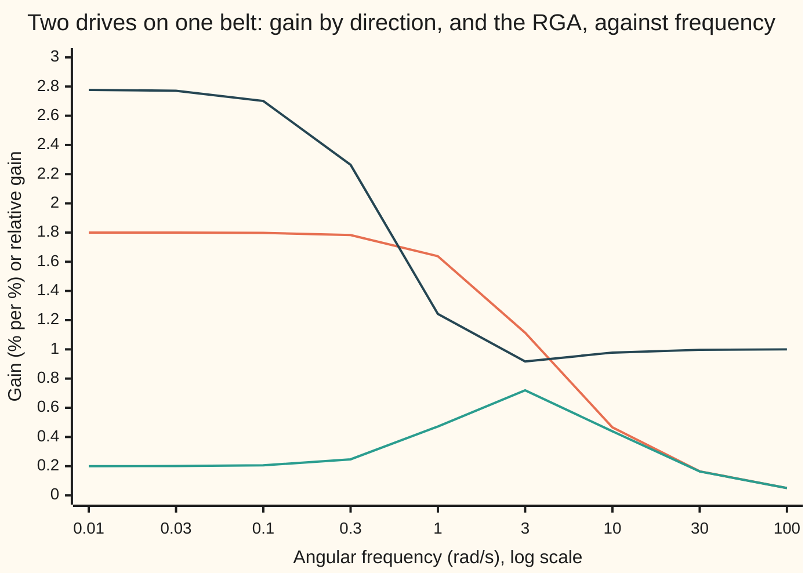

# Several inputs, several outputs: singular values, zeros and the RGA

[Syllabus](../../../SYLLABUS.md) → [Engineering mathematics](../README.md) → [Robustness and Adaptation](../README.md#s10) → Several inputs, several outputs

---

## General Overview

A long parcel conveyor has two drive motors, one at each end, pulling the same belt. Each drive has its own speed loop. The belt runs at 2.0 m/s, and speeds on this card are in percent of that: 1 % is 0.02 m/s.

The belt couples the two ends. Push drive 1 up by 1 % and its own pulley speeds up by 1 %, but the stretched belt also drags the far pulley up by 0.8 %. So the steady gain, from the two drive commands to the two pulley speeds, is not two numbers but a matrix, `[[1, 0.8], [0.8, 1]]` (percent of speed per percent of drive command).

The engineer wants three answers before closing two loops on this plant:

- **How strong is the plant, and in which direction?** Driving both motors the same way gives 1.8 times the push. Driving them against each other, to change the belt's draw (the speed difference that sets its tension), gives only 0.2. The ratio, 9, is the condition number.
- **Which drive should control which pulley?** The relative gain array (RGA) says: drive 1 on pulley 1, with a relative gain of 2.78. The other pairing scores −1.78, and closing it makes the belt run away.
- **Will two separate PI loops (proportional plus integral), each tuned on its own, work together?** They are stable, but they fight. A 1 % step on pulley 1 takes 6.35 s to settle, against 0.78 s for each loop alone. A decoupler (a controller block that undoes the coupling) restores 0.78 s.

Gain of the plant at steady state, by direction of the drive commands:

```
both drives the same way (together)   ████████████████████████████████████  1.8
drives against each other (draw)      ████                                  0.2
```

**A plant with several inputs and outputs has a gain that depends on the direction of the input; its singular values give the largest and smallest gain at each frequency, its zeros are where it loses a direction completely, its relative gain array says which input should control which output, and stability of the whole loop is read from the turns of det(I + L) round zero, where L is the loop gain matrix, plant times controller.**

**What kind of fact this is:** definitions (singular values, zeros, the RGA) and two theorems: the generalised Nyquist criterion and the rule that each row of the RGA sums to 1, both proved on this card in Why it works. The conveyor model is linear and holds only for small speed trims.

---

## The formula

Notation first, in words.

- The transfer function $`G(s)`$ says what a system does to each exponential $`e^{st}`$ ([Transfer functions](../02-Linear%20Systems%20and%20Transforms/02-impulse-response-and-transfer-functions.md)). With two inputs and two outputs, $`G(s)`$ is a 2 × 2 matrix of transfer functions: the **transfer matrix**. Entry $`g_{ij}`$ is the path from input $`j`$ to output $`i`$.
- Engineers write $`j`$ for the square root of −1; the rest of the library writes i. A frequency $`\omega`$ in rad/s enters as $`s = j\omega`$.
- The singular values of a matrix are its stretch factors: the largest and smallest gain it gives any input of length 1 ([The singular value decomposition](../../03-Algebra/07-Eigenvalues%20and%20Symmetric%20Matrices/06-singular-value-decomposition.md)). This card writes them $`\bar\sigma`$ (largest) and $`\underline\sigma`$ (smallest).

The conveyor, inputs $`u_1, u_2`$ (drive speed commands, % of full speed), outputs $`y_1, y_2`$ (pulley speeds, % of 2.0 m/s):

```math
G(s) = g(s)\begin{bmatrix} 1 & k\,h(s) \\ k\,h(s) & 1 \end{bmatrix}, \qquad g(s) = \frac{1}{\tau s + 1}, \qquad h(s) = \frac{1}{\tau_c s + 1}, \qquad k = 0.8.
```

The four tools, each read at one frequency or at one value of $`s`$:

```math
\bar\sigma(G) = \max_{\lVert v\rVert = 1}\lVert Gv\rVert, \quad \underline\sigma(G) = \min_{\lVert v\rVert = 1}\lVert Gv\rVert, \quad \gamma = \frac{\bar\sigma}{\underline\sigma}, \qquad \det G(z) = 0, \qquad \lambda_{11} = \frac{1}{1 - \dfrac{g_{12}\,g_{21}}{g_{11}\,g_{22}}}, \qquad Z = N + P \text{ for } \det\big(I + L(s)\big).
```

**Read it aloud:** at each frequency the plant's gain lies between its smallest and largest singular value, and their ratio is the condition number; a zero is a value of $`s`$ where the matrix loses a direction; the relative gain of pairing input 1 with output 1 is one over one minus the coupling product; and the closed loop has as many unstable poles as the clockwise turns of det(I + L) round zero plus the open loop's own unstable poles.

| Symbol | Plain meaning | In our example | Push it up and the answer… |
| --- | --- | --- | --- |
| $`s`$, $`j`$, $`\omega`$ | the Laplace variable; the square root of −1; angular frequency, rad/s | 0.01 to 100 rad/s on the chart | — |
| $`u_1, u_2`$; $`y_1, y_2`$; $`r`$ | drive speed commands, % of full speed; pulley speeds, % of 2.0 m/s; the speeds asked for | $`r = (1, 0)`$: a 1 % step on pulley 1 | — |
| $`G`$, $`g_{ij}`$ | the transfer matrix and its entries, % per % | $`G(0)`$ = `[[1, 0.8], [0.8, 1]]` | — |
| $`g`$, $`\tau`$; $`h`$, $`\tau_c`$, $`k`$ | each drive's own lag and its time constant; the belt's coupling: its lag, time constant and steady strength | $`\tau`$ = 0.2 s; $`\tau_c`$ = 0.5 s, $`k`$ = 0.8 | $`k`$ to 0.95: condition number 39.0 |
| $`\bar\sigma`$, $`\underline\sigma`$, $`v`$ | largest and smallest gain over input directions $`v`$ of length 1 | 1.8 and 0.2 at $`s = 0`$ | — |
| $`\gamma`$ | condition number, $`\bar\sigma/\underline\sigma`$ | 9.0 | harder to steer the weak direction |
| $`z`$ | a transmission zero: $`G(z)`$ sends some input direction to nothing | −0.4 and −3.6 rad/s | a zero in the right half-plane limits speed |
| $`\Lambda`$, $`\lambda_{ij}`$ | the relative gain array and its entries | $`\lambda_{11}`$ = 2.7778, $`\lambda_{12}`$ = −1.7778 | the loops fight harder |
| $`K`$, $`K_p`$, $`K_i`$, $`D`$ | the controller matrix; each PI loop's gains; the decoupler | $`K = (K_p + K_i/s)\,I`$; 1.0 % per %, 5.0 % per % per s | — |
| $`L`$, $`I`$, $`A, B, C`$ | loop gain matrix $`GK`$; the identity matrix; the loop's state-space matrices (in the fold) | — | — |
| $`\varepsilon_1, \varepsilon_2`$, $`E`$ | the drives' gain errors, as fractions; the diagonal matrix of them | $`\varepsilon_1`$ = −0.2: drive 1 20 % weak | the decoupled loop slows |
| $`N`$, $`P`$, $`Z`$ | clockwise turns of det(I + L) round 0; unstable open-loop poles; unstable closed-loop poles | 0, 0, 0 diagonal; 1, 0, 1 swapped | — |

### When it holds

- **Linear and small.** The model is a small trim round one running speed. A drive at its torque limit, or a belt that slips on its pulley, is a different plant. The trims here stay small: a 1 % step on pulley 1 ends with drive commands of 2.778 % and −2.222 %. The swapped pairing's −835.4 % at 2 s is far outside this range: a real drive hits its limit long before, and the model no longer applies.
- **Square, with the same number of inputs and outputs.** Zeros by the determinant, the RGA by the inverse and the decoupler $`G^{-1}`$ all need a square matrix. A plant with more outputs than inputs cannot hold every output where it is asked.
- **The model is right.** The decoupler and the RGA use the model's numbers. With drive 1 really 20 % weaker, loop 1's steady gain behind the decoupler drops from 1 to 0.4444, couplings of +0.4444 and −0.4444 reappear, and loop 2's gain rises to 1.3556.
- **Scaled inputs and outputs.** Singular values and the condition number depend on units: rescale one output and they change. The RGA does not change with scaling, which is why it is used for pairing.
- **The loop sees the whole matrix.** Each loop checked on its own says nothing about the pair: the swapped pairing has two stable single loops and an unstable whole.

---

## Why it works

### Step 0: a matrix has a size in every direction

A single gain multiplies every signal by one number. A matrix turns a vector of inputs into a vector of outputs, and how much it amplifies depends on the input's direction. No single entry gives the gain. The singular value decomposition does: every matrix is a rotation, a stretch along perpendicular axes, and a second rotation. The largest stretch $`\bar\sigma`$ bounds the gain from above and the smallest $`\underline\sigma`$ from below, in every direction. At each frequency, $`G(j\omega)`$ is a complex matrix, so the plant has a pair of singular values at each frequency.

### Step 1: for this belt the directions are "together" and "against"

The matrix `[[1, a], [a, 1]]` sends $`(1, 1)`$ to $`(1 + a)(1, 1)`$ and $`(1, -1)`$ to $`(1 - a)(1, -1)`$. These two directions are perpendicular. So they are the singular directions, at every frequency, with $`a = k\,h(j\omega)`$:

```math
\bar\sigma = \lvert g\rvert\,\lvert 1 + k h\rvert, \qquad \underline\sigma = \lvert g\rvert\,\lvert 1 - k h\rvert.
```

At steady state, $`g = h = 1`$: the gains are 1.8 together and 0.2 against, with condition number 9. Moving both pulleys up 1 % takes 0.5556 % on each drive. Moving them 1 % apart takes ±2.50 %: the drives work against the belt that ties them.

At 1 rad/s, $`\lvert g\rvert`$ = 0.9806 and $`\lvert h\rvert`$ = 0.8944, and the singular values are 1.6385 and 0.4723. At high frequency the belt's lag stops the coupling, both values approach $`\lvert g\rvert`$, and the plant becomes two separate drives. The weak direction is weak only at low frequency.



Orange: $`\bar\sigma`$, the gain with both drives together. Green: $`\underline\sigma`$, the gain with the drives against each other. Dark: $`\lvert\lambda_{11}\rvert`$, the relative gain of the diagonal pairing. The gap between orange and green, and the RGA above 1, both sit below about 1 rad/s. Labels are rounded; the points are about half a decade apart.

### Step 2: zeros are where a direction is lost

A zero of a single transfer function is a value of $`s`$ where its gain is 0. For a matrix, a **transmission zero** is a value $`z`$ where $`G(z)`$ sends some input direction to nothing, so $`\underline\sigma(G(z)) = 0`$ and $`\det G(z) = 0`$. For the belt,

```math
\det G(s) = g^2\,(1 - k^2 h^2) = g^2\,h^2\big((\tau_c s + 1)^2 - k^2\big),
```

which is zero when $`\tau_c s + 1 = \pm k`$: at $`z = -0.2/\tau_c = -0.4`$ rad/s, in the "against" direction $`(1, -1)`$, and at $`z = -1.8/\tau_c = -3.6`$ rad/s, in the "together" direction $`(1, 1)`$. No single entry of $`G`$ has a zero; the matrix has two.

Both zeros are in the left half-plane (negative real part). That matters: an inverse of $`G`$ has its poles at these zeros, so a decoupler built from $`G^{-1}`$ is stable. A zero in the right half-plane would make it unstable, and would limit how fast any controller could make the loop in that direction, as a right-half-plane zero does for one loop ([Poles and zeros](../02-Linear%20Systems%20and%20Transforms/03-poles-zeros-and-stability.md)).

### Step 3: the RGA compares a loop with the other loop open and closed

Close loop 1, from $`u_1`$ to $`y_1`$. Its plant depends on what loop 2 does.

- **Loop 2 open** ($`u_2 = 0`$): loop 1 sees the gain $`g_{11}`$.
- **Loop 2 closed perfectly** ($`y_2`$ held at 0): then $`u_2 = -g_{21}u_1/g_{22}`$, and loop 1 sees $`g_{11} - g_{12}g_{21}/g_{22}`$.

The relative gain is the ratio of the two:

```math
\lambda_{11} = \frac{g_{11}}{g_{11} - g_{12}\,g_{21}/g_{22}} = \frac{1}{1 - \dfrac{g_{12}\,g_{21}}{g_{11}\,g_{22}}}.
```

For the belt at steady state, $`\lambda_{11} = 1/(1 - 0.64) = 2.7778`$. When loop 2 closes, loop 1's gain falls to $`1/2.7778 = 0.36`$ of what it was tuned for. Pulley 2's loop takes back most of every push drive 1 makes.

The whole array is $`\Lambda = G \circ (G^{-1})^{T}`$, entry by entry. Each row sums to 1, because row $`i`$ sums to $`\sum_j g_{ij}(G^{-1})_{ji} = (GG^{-1})_{ii} = 1`$. So $`\lambda_{12} = 1 - 2.7778 = -1.7778`$.

The pairing rules used in practice:

- Pair on relative gains near 1 at the frequencies where the loops work. Here $`\lvert\lambda_{11}\rvert`$ is 0.917 at 3 rad/s and 0.978 at 10 rad/s: fast changes barely interact.
- Never pair on a negative steady-state relative gain. With loop 2 closed, the loop's steady gain changes sign, and integral action then drives it the wrong way.
- A large relative gain means the plant is sensitive to errors in its inputs (Step 6).

### Step 4: the generalised Nyquist criterion

For one loop, the closed-loop poles are the zeros of $`1 + L(s)`$, and [Nyquist and margins](../03-Feedback%20Control/06-nyquist-criterion-and-stability-margins.md) counts the unstable ones by the turns of $`L(j\omega)`$ round −1. With a loop matrix $`L = GK`$, the outputs are $`y = (I + L)^{-1}L\,r`$, so the closed loop has a pole wherever $`I + L(s)`$ cannot be inverted: wherever $`\det(I + L(s)) = 0`$.

The determinant is the closed-loop pole polynomial over the open-loop pole polynomial. So the argument principle applies to it unchanged. Trace $`s`$ up the imaginary axis, detouring round the integrators at $`s = 0`$ on the right. If $`\det(I + L)`$ turns $`N`$ times clockwise round 0, and the open loop has $`P`$ unstable poles, the closed loop has $`Z = N + P`$ unstable poles.

<details>
<summary>Why det(I + L) is the closed-loop polynomial over the open-loop one</summary>

Write the plant and controller together in state space ([State space](../04-State%20Space%20and%20Optimal%20Control/01-state-space-models-and-the-matrix-exponential.md)) with open-loop matrices $`(A, B, C, 0)`$, so $`L(s) = C(sI - A)^{-1}B`$. Unity feedback $`u = r - y`$ gives the closed-loop matrix $`A - BC`$.

$`\displaystyle \det(sI - A + BC) = \det(sI - A)\,\det\big(I + (sI - A)^{-1}BC\big) = \det(sI - A)\,\det\big(I + C(sI - A)^{-1}B\big),`$

using $`\det(I + XY) = \det(I + YX)`$ in the second step. So $`\det(I + L(s)) = \det(sI - A + BC)/\det(sI - A)`$: closed-loop poles on top, open-loop poles below. Trace the contour clockwise round the right half-plane. By the argument principle, the curve of $`\det(I + L)`$ then turns clockwise round 0 once for each zero inside and back once for each pole inside: $`N = Z - P`$, so $`Z = N + P`$.

</details>

For the two diagonal PI loops, $`\det(I + L)`$ makes 0 turns and $`P`$ = 0, so the closed loop is stable. For the swapped pairing it makes 1 clockwise turn: one unstable pole.

### Step 5: why two good loops fight

Both loops use the same PI controller, $`K_p`$ = 1.0 and $`K_i`$ = 5.0, chosen so that $`K_p + K_i/s = (s + 5)/s`$ cancels the drive lag: each loop alone becomes $`5/s`$, with closed loop $`5/(s + 5)`$, and settles in 0.78 s.

The same controller on both drives acts on "together" and "against" separately, because those directions are the plant's own (Step 1). In each direction the plant is one transfer function, $`g\,(\tau_c s + 1 \pm k)/(\tau_c s + 1)`$, and the loop closes on it like a single loop:

```math
\text{together: } s^2 + 7s + 18 = 0, \qquad \text{against: } s^2 + 7s + 2 = 0.
```

The "together" roots are $`-3.5 \pm 2.3979j`$: fast and well damped.

The "against" loop has only 0.2 of the gain at low frequency, and its polynomial has a slow root at −0.2984 rad/s. That is the fight: drive 1 pushes, the belt pulls pulley 2 along, loop 2 brakes, the belt pulls pulley 1 back, and the difference between the pulleys creeps in at the speed of the slow root. It sits close to the zero at −0.4 rad/s, which pulls a closed-loop pole towards itself.

Swap the pairing, drive 1 on pulley 2. In the "against" direction the loop now sees $`-g\,(\tau_c s + 0.2)/(\tau_c s + 1)`$: a negative gain, with an integrator behind it. The polynomial is $`s^2 - 3s - 2`$, with a root at +3.5616 rad/s. Each loop on its own is stable: its polynomial, $`s^2 + 2s + 8`$, has roots $`-1 \pm 2.6458j`$. Yet the pair runs away, with pulley 1 falling ever faster.

### Step 6: the decoupler, and what it costs

A decoupler is a block $`D(s)`$ placed between the two PI controllers and the drives so that $`GD`$ is diagonal. Here

```math
D(s) = \begin{bmatrix} 1 & k\,h \\ k\,h & 1 \end{bmatrix}^{-1}, \qquad G(s)\,D(s) = g(s)\,I.
```

Each loop then sees its own drive alone and settles in 0.78 s, with pulley 2 untouched. $`D`$ has its poles at the plant's zeros, −0.4 and −3.6 rad/s. They are stable, so $`D`$ can be built. The slow one stays in the drive commands: they creep for several seconds to the same final values, 2.778 % and −2.222 %, that any controller with integral action must reach. The decoupler does not stop the drives fighting; it makes the fight invisible at the pulleys.

The cost is trust in the model. If the drives' real gains are $`(1 + \varepsilon_1, 1 + \varepsilon_2)`$ instead of 1, the steady loop matrix becomes $`G(I + E)G^{-1}`$, whose diagonal entries are

```math
1 + \lambda_{11}\,\varepsilon_1 + \lambda_{12}\,\varepsilon_2.
```

The RGA multiplies the input error. With $`\lambda_{11}`$ = 2.7778 and drive 1 20 % weak, loop 1's steady gain falls to 0.4444: slower, still the right sign. On a distillation column with $`\lambda_{11}`$ = 35.07, the same error gives −6.01. Loop 1's sign flips and its integral action drives it the wrong way. This is why large relative gains rule out decouplers that invert the plant.

---

## Worked numbers, by hand

The conveyor at steady state, $`s = 0`$, where $`g = h = 1`$.

| Step | Arithmetic | Value |
| --- | --- | --- |
| steady gain $`G(0)`$ | $`g = h = 1`$, $`k = 0.8`$ | `[[1, 0.8], [0.8, 1]]` |
| together: $`(1, 1)`$ | $`G(1, 1) = (1.8, 1.8)`$ | $`\bar\sigma = 1.8`$ |
| against: $`(1, -1)`$ | $`G(1, -1) = (0.2, -0.2)`$ | $`\underline\sigma = 0.2`$ |
| condition number | $`1.8/0.2`$ | 9.0 |
| relative gain $`\lambda_{11}`$ | $`1/(1 - 0.8 \times 0.8) = 1/0.36`$ | 2.7778 |
| $`\lambda_{12}`$ | $`1 - 2.7778`$ | −1.7778 |
| drive commands for $`y = (1, 0)`$ | $`G^{-1}(1, 0) = (1, -0.8)/0.36`$ | 2.778 % and −2.222 % |
| zeros | $`(0.5z + 1)^2 = 0.64`$, so $`0.5z + 1 = \pm 0.8`$ | −0.4 and −3.6 rad/s |
| "against" loop | $`0.5s^2 + s + 5(0.5s + 0.2) = 0`$, so $`s^2 + 7s + 2 = 0`$ | −0.2984 and −6.7016 |
| **slowest closed-loop pole** | $`(-7 + \sqrt{41})/2`$ | **−0.2984 rad/s** |

With two separate PI loops, a 1 % step on pulley 1 reaches 0.892 % after 0.5 s, then crawls at the slow pole's pace: it is inside 2 % only after 6.35 s, and pulley 2 is knocked by up to 0.148 %, which is 0.0030 m/s. The decoupled loops settle in 0.78 s and leave pulley 2 alone.

| Design | $`y_1`$ at 0.5 s | 2 % settling of $`y_1`$ | Peak $`\lvert y_2\rvert`$ | Final drive commands |
| --- | --- | --- | --- | --- |
| two separate PI loops | 0.892 % | 6.35 s | 0.148 % | 2.778 %, −2.222 % |
| PI loops behind the decoupler | 0.918 % | 0.78 s | 0.000 % | 2.778 %, −2.222 % |
| swapped pairing | runs away downward: −22.6 % at 1 s, −835.4 % at 2 s | never | — | — |

### What breaks if you drop a piece

| Mistake | Comes out at | What went wrong |
| --- | --- | --- |
| Pair drive 1 with pulley 2 (relative gain −1.7778) | a pole at +3.5616 rad/s; the run grows by a factor $`e^{3.5616}`$ each second | Negative steady relative gain: with the other loop closed, the integral loop pushes the wrong way |
| Tune each loop alone and expect that speed together | expected 0.78 s, got 6.35 s | Closing loop 2 cuts loop 1's low-frequency gain to 0.36 of its tuning; the "against" direction has a slow pole at −0.2984 rad/s |
| Decouple a plant with large relative gains: the distillation column, $`\lambda_{11}`$ = 35.07, one input 20 % weak | decoupled loop gain −6.01 | The input error is multiplied by the RGA; the conveyor's 2.7778 gives 0.4444, still positive |
| Read the gain from the entries (1 and 0.8) | misses the 0.2 direction | The weakest gain is in a direction no entry shows; only $`\underline\sigma`$ finds it |

---

## Code, from first principles, and it actually runs

The scripts write complex arithmetic, 2 × 2 singular values, the RGA, polynomial roots and an RK4 simulation (the fourth-order Runge–Kutta method) by hand. They take **independent roads** to each answer:

- **Singular values, three roads:** the square roots of the eigenvalues of $`G^{H}G`$ (the conjugate transpose times $`G`$); a direct measurement of $`\lVert Gv\rVert`$ over a grid of unit inputs; and the closed form $`\lvert g\rvert\lvert 1 \pm kh\rvert`$.
- **Zeros, two roads:** the formula and a bisection search on the determinant, then a check that $`\underline\sigma`$ is 0 there.
- **Stability, three roads:** the generalised Nyquist turn count; all six closed-loop poles by Durand–Kerner iteration (an update that moves all roots of a polynomial at once); and the simulation, whose slow decay and fast growth must match the hand-computed roots.
- **The RGA, two roads:** the formula, and the simulated final drive command, which must equal $`\lambda_{11}`$ = 2.7778.

### Python

```python
# Multivariable feedback and singular values -- the check behind the card.  Standard library only.
# Two drives share one conveyor belt.  Inputs u1, u2: drive speed commands, % of full speed.
# Outputs y1, y2: belt speed at the two drive pulleys, % of the nominal 2.0 m/s (1 % = 0.02 m/s).
# G(s) = g(s) [[1, k h(s)], [k h(s), 1]]: g = 1/(TAU s + 1) drive lag, h = 1/(TC s + 1) belt lag, k = 0.8.
# Roads: singular values three ways; zeros by formula and bisection; RGA by formula and by simulation;
# stability by the generalised Nyquist winding count, by polynomial roots and by RK4 simulation.
from math import sqrt, atan2, pi, log, exp, cos, sin

TAU, TC, KC, KP, KI = 0.2, 0.5, 0.8, 1.0, 5.0      # s, s, coupling, %/%, %/(% s)
def G(s, k=KC):
    g, h = 1 / (TAU * s + 1), 1 / (TC * s + 1)
    return [[g, k * g * h], [k * g * h, g]]
def svals(M):                     # road 1: square roots of the eigenvalues of M^H M (trace, determinant)
    (a, b), (c, d) = M
    p, q = abs(a) ** 2 + abs(b) ** 2 + abs(c) ** 2 + abs(d) ** 2, abs(a * d - b * c) ** 2
    r = sqrt(max(p * p / 4 - q, 0.0)); return sqrt(p / 2 + r), sqrt(max(p / 2 - r, 0.0))
def stretch(M, n=360, m=72):      # road 2: measure |M v| for unit inputs v = (cos t, e^(j f) sin t)
    hi, lo = 0.0, 1e9
    for i in range(n + 1):
        t = pi / 2 * i / n
        for f in range(m):
            v = (cos(t), complex(cos(2 * pi * f / m), sin(2 * pi * f / m)) * sin(t))
            n2 = sqrt(abs(M[0][0] * v[0] + M[0][1] * v[1]) ** 2 + abs(M[1][0] * v[0] + M[1][1] * v[1]) ** 2)
            hi, lo = max(hi, n2), min(lo, n2)
    return hi, lo
def rga11(M):                     # relative gain: loop 1 with loop 2 open, over loop 1 with loop 2 held perfectly
    (a, b), (c, d) = M; return a / (a - b * c / d)
def pmul(p, q):                   # polynomials as coefficient lists, highest power first
    r = [0.0] * (len(p) + len(q) - 1)
    for i, x in enumerate(p):
        for j, y in enumerate(q): r[i + j] += x * y
    return r
def padd(p, q):
    n = max(len(p), len(q)); return [x + y for x, y in zip([0.0] * (n - len(p)) + p, [0.0] * (n - len(q)) + q)]
def roots(p):                     # Durand-Kerner: all roots of a polynomial at once
    p = [c / p[0] for c in p]; n = len(p) - 1
    z = [complex(0.4, 0.9) ** k for k in range(n)]
    for _ in range(500):
        for i in range(n):
            den = 1
            for j in range(n): den *= (z[i] - z[j]) if j != i else 1
            z[i] -= sum(c * z[i] ** (n - k) for k, c in enumerate(p)) / den
    return sorted((complex(r.real, r.imag if abs(r.imag) > 1e-6 else 0.0) for r in z), key=lambda r: (round(r.real, 6), r.imag))
def closed_poly(swap, k=KC, kp=KP, ki=KI):  # det(s d I + N kn) with d = (TAU s+1)(TC s+1), kn = kp s + ki
    sd, kn = pmul([TAU, 1.0], pmul([TC, 1.0], [1.0, 0.0])), [kp, ki]
    diag, off = padd(sd, pmul([TC, 1.0], kn)), pmul([k], kn)
    if swap: diag, off = padd(sd, pmul([k], kn)), pmul([TC, 1.0], kn)
    return padd(pmul(diag, diag), [-c for c in pmul(off, off)])
def winding(swap):                # generalised Nyquist: turns of det(I + G K) round 0, contour indented at s = 0
    pts = [complex(0, -10 ** (4 - 8 * i / 4000)) for i in range(4001)]
    pts += [1e-4 * complex(cos(a), sin(a)) for a in (-pi / 2 + pi * i / 2000 for i in range(1, 2000))]
    pts += [complex(0, 10 ** (-4 + 8 * i / 4000)) for i in range(4001)]
    total, prev = 0.0, None
    for s in pts:
        kk, ((a, b), (c, d)) = KP + KI / s, G(s)
        if swap: a, b, c, d = b, a, d, c                     # K = k(s) [[0, 1], [1, 0]]: columns swap
        v = (1 + a * kk) * (1 + d * kk) - b * c * kk * kk
        if prev is not None: q = v / prev; total += atan2(q.imag, q.real)
        prev = v
    return round(-total / (2 * pi))   # clockwise turns
def simulate(mode, eps1=0.0, r=(1.0, 0.0), t_end=30.0, dt=1e-3):
    """RK4.  States: drive lags a1, a2; belt lags b1, b2; PI integrals z1, z2; decoupler lags p1, p2."""
    def f(x):
        a1, a2, b1, b2, z1, z2, p1, p2 = x
        y1, y2 = a1 + KC * b2, a2 + KC * b1
        e1, e2 = r[0] - y1, r[1] - y2
        w1, w2 = KP * e1 + KI * z1, KP * e2 + KI * z2
        u1, u2 = (w2, w1) if mode == "swap" else (w1, w2)
        if mode == "decoupled": u1, u2 = w1 - KC * p1, w2 - KC * p2   # D(s) = [[1, k h], [k h, 1]]^-1
        return [((1 + eps1) * u1 - a1) / TAU, (u2 - a2) / TAU, (a1 - b1) / TC, (a2 - b2) / TC,
                e1, e2, (u2 - p1) / TC, (u1 - p2) / TC], (y1, y2, u1, u2)
    x, log_ = [0.0] * 8, []
    for k in range(int(round(t_end / dt)) + 1):
        d, out = f(x); log_.append((k * dt,) + out)
        k2 = f([a + dt / 2 * v for a, v in zip(x, d)])[0]; k3 = f([a + dt / 2 * v for a, v in zip(x, k2)])[0]
        k4 = f([a + dt * v for a, v in zip(x, k3)])[0]
        x = [a + dt / 6 * (p + 2 * q + 2 * s + t) for a, p, q, s, t in zip(x, d, k2, k3, k4)]
    settle = max((row[0] for row in log_ if abs(row[1] - r[0]) > 0.02), default=0.0) + dt
    return log_, settle, max(abs(row[2]) for row in log_)

G0 = G(0)
s1, s2 = svals(G0); b1_, b2_ = stretch(G0)
print(f"steady gain G(0) = [[{G0[0][0]:.1f}, {G0[0][1]:.1f}], [{G0[1][0]:.1f}, {G0[1][1]:.1f}]] (% per %)")
print(f"singular values: {s1:.4f} together, {s2:.4f} against; condition number {s1 / s2:.4f}; measured {b1_:.4f}, {b2_:.4f}")
assert abs(s1 - (1 + KC)) < 1e-12 and abs(s2 - (1 - KC)) < 1e-12 and abs(b1_ - s1) < 1e-3 and abs(b2_ - s2) < 1e-3
print(f"inputs for a 1 % speed difference: +-{0.5 / s2:.2f} %; for 1 % together: {1 / s1:.4f} % each")
w1 = G(1j); a, b = svals(w1); m1, m2 = stretch(w1)
print(f"at 1 rad/s: |g| = {abs(w1[0][0]):.4f}, |h| = {abs(1 / (TC * 1j + 1)):.4f}; sigma {a:.4f}, {b:.4f}; measured {m1:.4f}, {m2:.4f}")
assert abs(m1 - a) < 2e-3 and abs(m2 - b) < 2e-3
print("chart: w (rad/s), sigma_max, sigma_min, |lambda11|")
for w in (0.01, 0.03, 0.1, 0.3, 1, 3, 10, 30, 100):
    M = G(1j * w); a, b = svals(M); g, h = abs(M[0][0]), 1 / (TC * 1j * w + 1)
    assert abs(a - g * abs(1 + KC * h)) < 1e-9 and abs(b - g * abs(1 - KC * h)) < 1e-9   # road 3: sum and difference
    print(f"chart, {w:6.2f}, {a:.3f}, {b:.3f}, {abs(rga11(M)):.3f}")
lam = rga11(G0)
print(f"RGA at s = 0: lambda11 = {lam:.4f}, lambda12 = {1 - lam:.4f}; 1/lambda11 = {1 / lam:.4f}")
z, found, f = sorted([(-1 + KC) / TC, (-1 - KC) / TC]), [], lambda s: (TC * s + 1) ** 2 - KC ** 2
for lo, hi in ((-1.9999, -1e-9), (-10.0, -2.0001)):      # road 2: bisection on (TC s + 1)^2 - k^2
    for _ in range(80): mid = (lo + hi) / 2; lo, hi = (mid, hi) if f(lo) * f(mid) > 0 else (lo, mid)
    found.append(lo)
Mz = G(z[1])
print(f"transmission zeros: {z[1]:.4f} and {z[0]:.4f} rad/s; bisection {found[0]:.4f}, {found[1]:.4f};"
      f" |G(z) (1, -1)| = {abs(Mz[0][0] - Mz[0][1]):.6f}, sigma_min there {svals(Mz)[1]:.6f}")
assert abs(found[0] - z[1]) < 1e-9 and abs(found[1] - z[0]) < 1e-9 and svals(Mz)[1] < 1e-9
for swap in (False, True):
    rt = roots(closed_poly(swap)); name = "swapped" if swap else "diagonal"
    print(f"{name} pairing: det(I+L) turns clockwise round 0: {winding(swap)}; closed-loop poles "
          + ", ".join(f"{p.real:.4f}{p.imag:+.4f}j" for p in rt))
    assert winding(swap) == sum(1 for p in rt if p.real > 0) == (1 if swap else 0)
print(f"by hand: s^2 + 7 s + 2 -> {(-7 + sqrt(41)) / 2:.4f}, {(-7 - sqrt(41)) / 2:.4f}; s^2 + 7 s + 18 -> -3.5000 +- {sqrt(23) / 2:.4f}j;"
      f" s^2 - 3 s - 2 -> {(3 + sqrt(17)) / 2:.4f}; one swapped loop alone: s^2 + 2 s + 8 -> -1.0000 +- {sqrt(7):.4f}j")
for mode in ("separate", "decoupled"):
    lg, ts, pk2 = simulate(mode)
    e10, e20 = 1 - lg[10000][1], 1 - lg[20000][1]
    print(f"{mode:9s} step r1 = 1 %: y1(0.5 s) = {lg[500][1]:.3f} %, 2% settle {ts:.2f} s, peak |y2| {pk2:.3f} %,"
          f" final u = {lg[-1][3]:.3f}, {lg[-1][4]:.3f} %")
    if mode == "separate":
        print(f"  slow mode from the run: {-log(e10 / e20) / 10:.4f} rad/s; in m/s: y2 peak {pk2 * 0.02:.4f} m/s")
        assert abs(-log(e10 / e20) / 10 - (-7 + sqrt(41)) / 2) < 1e-3 and abs(lg[-1][3] - lam) < 1e-3
    else:
        assert pk2 < 1e-6 and ts < 1.0 and abs(lg[-1][3] - lam) < 5e-3
lg, _, _ = simulate("swap", t_end=4.0); gr = log(abs(lg[4000][1] / lg[3000][1]))
print(f"swapped pairing: y1 at 1 s {lg[1000][1]:.1f} %, at 2 s {lg[2000][1]:.1f} %; growth {gr:.4f} per s")
assert abs(gr - (3 + sqrt(17)) / 2) < 1e-3
(_, tw, dw), (_, _, sw) = simulate("decoupled", -0.2), simulate("separate", -0.2)   # drive 1 really 20 % weak
print(f"drive 1 20 % weak: G (I+E) G^-1 at s = 0 = [[{1 - 0.2 * lam:.4f}, {0.2 * KC * lam:.4f}], [{-0.2 * KC * lam:.4f}, {1 + 0.2 * KC * KC * lam:.4f}]];"
      f" decoupled: y1 settles {tw:.2f} s, peak |y2| {dw:.3f} %; separate: peak |y2| {sw:.3f} %")
LV = [[87.8, -86.4], [108.2, -109.6]]; a, b = svals(LV); lv = rga11(LV)
print(f"distillation LV: sigma {a:.2f}, {b:.4f}; condition number {a / b:.1f}; lambda11 {lv:.2f};"
      f" decoupled loop gain with a 20 % weak input {1 - 0.2 * lv:.2f}")
assert 1 - 0.2 * lam > 0 > 1 - 0.2 * lv                    # small RGA survives the error, large RGA flips a sign
for k in (0.5, 0.95):
    p = [r.real for r in roots(closed_poly(False, k)) if abs(r.imag) < 1e-9]
    print(f"try k = {k}: sigma {1 + k:.2f}, {1 - k:.2f}; condition {(1 + k) / (1 - k):.1f}; lambda11 {rga11(G(0, k)):.3f};"
          f" slowest pole {max(p):.4f} rad/s")
print("ALL CHECKS PASS")
```

**Ran 2026-11-23 on macOS, Python 3.14.10, standard library only. All checks passed. Output, pasted from the run:**

```
steady gain G(0) = [[1.0, 0.8], [0.8, 1.0]] (% per %)
singular values: 1.8000 together, 0.2000 against; condition number 9.0000; measured 1.8000, 0.2000
inputs for a 1 % speed difference: +-2.50 %; for 1 % together: 0.5556 % each
at 1 rad/s: |g| = 0.9806, |h| = 0.8944; sigma 1.6385, 0.4723; measured 1.6385, 0.4723
chart: w (rad/s), sigma_max, sigma_min, |lambda11|
chart,   0.01, 1.800, 0.200, 2.777
chart,   0.03, 1.800, 0.201, 2.771
chart,   0.10, 1.798, 0.206, 2.701
chart,   0.30, 1.783, 0.247, 2.264
chart,   1.00, 1.638, 0.472, 1.243
chart,   3.00, 1.114, 0.720, 0.917
chart,  10.00, 0.466, 0.439, 0.978
chart,  30.00, 0.165, 0.164, 0.997
chart, 100.00, 0.050, 0.050, 1.000
RGA at s = 0: lambda11 = 2.7778, lambda12 = -1.7778; 1/lambda11 = 0.3600
transmission zeros: -0.4000 and -3.6000 rad/s; bisection -0.4000, -3.6000; |G(z) (1, -1)| = 0.000000, sigma_min there 0.000000
diagonal pairing: det(I+L) turns clockwise round 0: 0; closed-loop poles -6.7016+0.0000j, -5.0000+0.0000j, -5.0000+0.0000j, -3.5000-2.3979j, -3.5000+2.3979j, -0.2984+0.0000j
swapped pairing: det(I+L) turns clockwise round 0: 1; closed-loop poles -5.0000+0.0000j, -5.0000+0.0000j, -3.5000-2.3979j, -3.5000+2.3979j, -0.5616+0.0000j, 3.5616+0.0000j
by hand: s^2 + 7 s + 2 -> -0.2984, -6.7016; s^2 + 7 s + 18 -> -3.5000 +- 2.3979j; s^2 - 3 s - 2 -> 3.5616; one swapped loop alone: s^2 + 2 s + 8 -> -1.0000 +- 2.6458j
separate  step r1 = 1 %: y1(0.5 s) = 0.892 %, 2% settle 6.35 s, peak |y2| 0.148 %, final u = 2.778, -2.222 %
  slow mode from the run: -0.2984 rad/s; in m/s: y2 peak 0.0030 m/s
decoupled step r1 = 1 %: y1(0.5 s) = 0.918 %, 2% settle 0.78 s, peak |y2| 0.000 %, final u = 2.778, -2.222 %
swapped pairing: y1 at 1 s -22.6 %, at 2 s -835.4 %; growth 3.5616 per s
drive 1 20 % weak: G (I+E) G^-1 at s = 0 = [[0.4444, 0.4444], [-0.4444, 1.3556]]; decoupled: y1 settles 2.19 s, peak |y2| 0.039 %; separate: peak |y2| 0.140 %
distillation LV: sigma 197.21, 1.3914; condition number 141.7; lambda11 35.07; decoupled loop gain with a 20 % weak input -6.01
try k = 0.5: sigma 1.50, 0.50; condition 3.0; lambda11 1.333; slowest pole -0.8074 rad/s
try k = 0.95: sigma 1.95, 0.05; condition 39.0; lambda11 10.256; slowest pole -0.0722 rad/s
ALL CHECKS PASS
```

### Rust

```rust
// Multivariable feedback and singular values -- the same check as multivariable_feedback_and_singular_values_check.py.
// Standard library only, no crates.  Complex numbers are a small struct written out.
// Two drives share one belt.  u1, u2: drive speed commands, % of full speed; y1, y2: belt speed at the
// two drive pulleys, % of the nominal 2.0 m/s.  G(s) = g [[1, k h], [k h, 1]], g = 1/(TAU s + 1), h = 1/(TC s + 1).
use std::f64::consts::PI;
const TAU: f64 = 0.2; const TC: f64 = 0.5; const KC: f64 = 0.8; const KP: f64 = 1.0; const KI: f64 = 5.0;

#[derive(Clone, Copy)]
struct C { re: f64, im: f64 }
impl C {
    fn new(re: f64, im: f64) -> C { C { re, im } }
    fn r(x: f64) -> C { C::new(x, 0.0) }
    fn add(self, o: C) -> C { C::new(self.re + o.re, self.im + o.im) }
    fn sub(self, o: C) -> C { C::new(self.re - o.re, self.im - o.im) }
    fn mul(self, o: C) -> C { C::new(self.re * o.re - self.im * o.im, self.re * o.im + self.im * o.re) }
    fn div(self, o: C) -> C { let d = o.re * o.re + o.im * o.im; C::new((self.re * o.re + self.im * o.im) / d, (self.im * o.re - self.re * o.im) / d) }
    fn abs(self) -> f64 { self.re.hypot(self.im) }
}
type M2 = [[C; 2]; 2];

fn gm(s: C, k: f64) -> M2 {
    let (g, h) = (C::r(1.0).div(C::r(TAU).mul(s).add(C::r(1.0))), C::r(1.0).div(C::r(TC).mul(s).add(C::r(1.0))));
    let c = C::r(k).mul(g).mul(h); [[g, c], [c, g]]
}
fn svals(m: &M2) -> (f64, f64) {
    let p: f64 = m.iter().flatten().map(|x| x.abs().powi(2)).sum();
    let q = m[0][0].mul(m[1][1]).sub(m[0][1].mul(m[1][0])).abs().powi(2);
    let r = (p * p / 4.0 - q).max(0.0).sqrt(); ((p / 2.0 + r).sqrt(), (p / 2.0 - r).max(0.0).sqrt())
}
fn stretch(m: &M2) -> (f64, f64) {
    let (n, k, mut hi, mut lo) = (360, 72, 0.0f64, 1e9f64);
    for i in 0..=n {
        let t = PI / 2.0 * i as f64 / n as f64;
        for f in 0..k {
            let a = 2.0 * PI * f as f64 / k as f64;
            let (v0, v1) = (C::r(t.cos()), C::new(a.cos(), a.sin()).mul(C::r(t.sin())));
            let y0 = m[0][0].mul(v0).add(m[0][1].mul(v1)); let y1 = m[1][0].mul(v0).add(m[1][1].mul(v1));
            let n2 = (y0.abs().powi(2) + y1.abs().powi(2)).sqrt(); hi = hi.max(n2); lo = lo.min(n2);
        }
    }
    (hi, lo)
}
fn rga11(m: &M2) -> C { m[0][0].div(m[0][0].sub(m[0][1].mul(m[1][0]).div(m[1][1]))) }
fn pmul(p: &[f64], q: &[f64]) -> Vec<f64> {
    let mut r = vec![0.0; p.len() + q.len() - 1];
    for (i, x) in p.iter().enumerate() { for (j, y) in q.iter().enumerate() { r[i + j] += x * y; } } r
}
fn padd(p: &[f64], q: &[f64]) -> Vec<f64> {
    let n = p.len().max(q.len());
    (0..n).map(|i| (if i + p.len() >= n { p[i + p.len() - n] } else { 0.0 }) + (if i + q.len() >= n { q[i + q.len() - n] } else { 0.0 })).collect()
}
fn roots(p: &[f64]) -> Vec<C> {
    let (n, p, mut z) = (p.len() - 1, p.iter().map(|c| c / p[0]).collect::<Vec<f64>>(), vec![C::r(1.0)]);
    for _ in 1..n { let l = *z.last().unwrap(); z.push(l.mul(C::new(0.4, 0.9))); }
    for _ in 0..500 {
        for i in 0..n {
            let (mut den, mut num) = (C::r(1.0), C::r(0.0));
            for j in 0..n { if j != i { den = den.mul(z[i].sub(z[j])); } }
            for c in &p { num = num.mul(z[i]).add(C::r(*c)); }
            z[i] = z[i].sub(num.div(den));
        }
    }
    let mut z: Vec<C> = z.into_iter().map(|r| C::new(r.re, if r.im.abs() > 1e-6 { r.im } else { 0.0 })).collect();
    z.sort_by(|a, b| ((a.re * 1e6).round(), a.im).partial_cmp(&((b.re * 1e6).round(), b.im)).unwrap()); z
}
fn closed_poly(swap: bool, k: f64) -> Vec<f64> {
    let (sd, kn) = (pmul(&[TAU, 1.0], &pmul(&[TC, 1.0], &[1.0, 0.0])), [KP, KI]);
    let (diag, off) = if swap { (padd(&sd, &pmul(&[k], &kn)), pmul(&[TC, 1.0], &kn)) }
                      else { (padd(&sd, &pmul(&[TC, 1.0], &kn)), pmul(&[k], &kn)) };
    padd(&pmul(&diag, &diag), &pmul(&off, &off).iter().map(|c| -c).collect::<Vec<f64>>())
}
fn winding(swap: bool) -> i64 {
    let mut pts: Vec<C> = (0..=4000).map(|i| C::new(0.0, -(10f64.powf(4.0 - 8.0 * i as f64 / 4000.0)))).collect();
    for i in 1..2000 { let a = -PI / 2.0 + PI * i as f64 / 2000.0; pts.push(C::new(1e-4 * a.cos(), 1e-4 * a.sin())); }
    for i in 0..=4000 { pts.push(C::new(0.0, 10f64.powf(-4.0 + 8.0 * i as f64 / 4000.0))); }
    let (mut total, mut prev): (f64, Option<C>) = (0.0, None);
    for s in pts {
        let (kk, m, one) = (C::r(KP).add(C::r(KI).div(s)), gm(s, KC), C::r(1.0));
        let (a, b, c, d) = if swap { (m[0][1], m[0][0], m[1][1], m[1][0]) } else { (m[0][0], m[0][1], m[1][0], m[1][1]) };
        let v = one.add(a.mul(kk)).mul(one.add(d.mul(kk))).sub(b.mul(c).mul(kk).mul(kk));
        if let Some(pv) = prev { let q = v.div(pv); total += q.im.atan2(q.re); } prev = Some(v);
    }
    (-total / (2.0 * PI)).round() as i64
}
// mode 0 separate loops, 1 decoupled, 2 swapped pairing.  Returns (log of t, y1, y2, u1, u2), settle, peak |y2|.
fn simulate(mode: u8, eps1: f64, t_end: f64) -> (Vec<[f64; 5]>, f64, f64) {
    let (dt, r) = (1e-3, [1.0, 0.0]);
    let f = |x: &[f64; 8]| -> ([f64; 8], [f64; 4]) {
        let (y1, y2) = (x[0] + KC * x[3], x[1] + KC * x[2]);
        let (e1, e2) = (r[0] - y1, r[1] - y2);
        let (w1, w2) = (KP * e1 + KI * x[4], KP * e2 + KI * x[5]);
        let (u1, u2) = match mode { 2 => (w2, w1), 1 => (w1 - KC * x[6], w2 - KC * x[7]), _ => (w1, w2) };
        ([((1.0 + eps1) * u1 - x[0]) / TAU, (u2 - x[1]) / TAU, (x[0] - x[2]) / TC, (x[1] - x[3]) / TC,
          e1, e2, (u2 - x[6]) / TC, (u1 - x[7]) / TC], [y1, y2, u1, u2])
    };
    let mv = |x: &[f64; 8], d: &[f64; 8], h: f64| -> [f64; 8] { let mut o = *x; for i in 0..8 { o[i] += h * d[i]; } o };
    let (mut x, mut lg) = ([0.0f64; 8], vec![]);
    for k in 0..=((t_end / dt) as f64).round() as usize {
        let (d, o) = f(&x); lg.push([k as f64 * dt, o[0], o[1], o[2], o[3]]);
        let k2 = f(&mv(&x, &d, dt / 2.0)).0; let k3 = f(&mv(&x, &k2, dt / 2.0)).0; let k4 = f(&mv(&x, &k3, dt)).0;
        for i in 0..8 { x[i] += dt / 6.0 * (d[i] + 2.0 * k2[i] + 2.0 * k3[i] + k4[i]); }
    }
    let settle = lg.iter().filter(|w| (w[1] - r[0]).abs() > 0.02).map(|w| w[0]).fold(0.0, f64::max) + dt;
    let pk = lg.iter().map(|w| w[2].abs()).fold(0.0, f64::max); (lg, settle, pk)
}

fn main() {
    let g0 = gm(C::r(0.0), KC);
    let (s1, s2) = svals(&g0); let (b1, b2) = stretch(&g0);
    println!("steady gain G(0) = [[{:.1}, {:.1}], [{:.1}, {:.1}]] (% per %)", g0[0][0].re, g0[0][1].re, g0[1][0].re, g0[1][1].re);
    println!("singular values: {:.4} together, {:.4} against; condition number {:.4}; measured {:.4}, {:.4}", s1, s2, s1 / s2, b1, b2);
    assert!((s1 - (1.0 + KC)).abs() < 1e-12 && (s2 - (1.0 - KC)).abs() < 1e-12 && (b1 - s1).abs() < 1e-3 && (b2 - s2).abs() < 1e-3);
    println!("inputs for a 1 % speed difference: +-{:.2} %; for 1 % together: {:.4} % each", 0.5 / s2, 1.0 / s1);
    let w1 = gm(C::new(0.0, 1.0), KC); let (a, b) = svals(&w1); let (m1, m2) = stretch(&w1);
    println!("at 1 rad/s: |g| = {:.4}, |h| = {:.4}; sigma {:.4}, {:.4}; measured {:.4}, {:.4}", w1[0][0].abs(), C::r(1.0).div(C::new(1.0, TC)).abs(), a, b, m1, m2);
    assert!((m1 - a).abs() < 2e-3 && (m2 - b).abs() < 2e-3);
    println!("chart: w (rad/s), sigma_max, sigma_min, |lambda11|");
    for w in [0.01, 0.03, 0.1, 0.3, 1.0, 3.0, 10.0, 30.0, 100.0] {
        let (m, h) = (gm(C::new(0.0, w), KC), C::r(1.0).div(C::new(1.0, TC * w))); let ((a, b), g) = (svals(&m), m[0][0].abs());
        assert!((a - g * C::r(1.0).add(C::r(KC).mul(h)).abs()).abs() < 1e-9 && (b - g * C::r(1.0).sub(C::r(KC).mul(h)).abs()).abs() < 1e-9);
        println!("chart, {:6.2}, {:.3}, {:.3}, {:.3}", w, a, b, rga11(&m).abs());
    }
    let lam = rga11(&g0).re;
    println!("RGA at s = 0: lambda11 = {:.4}, lambda12 = {:.4}; 1/lambda11 = {:.4}", lam, 1.0 - lam, 1.0 / lam);
    let z = [(-1.0 - KC) / TC, (-1.0 + KC) / TC];
    let (f, mut found) = (|s: f64| (TC * s + 1.0).powi(2) - KC * KC, vec![]);
    for (mut lo, mut hi) in [(-1.9999, -1e-9), (-10.0, -2.0001)] {
        for _ in 0..80 { let mid = (lo + hi) / 2.0; if f(lo) * f(mid) > 0.0 { lo = mid; } else { hi = mid; } } found.push(lo);
    }
    let mz = gm(C::r(z[1]), KC);
    println!("transmission zeros: {:.4} and {:.4} rad/s; bisection {:.4}, {:.4}; |G(z) (1, -1)| = {:.6}, sigma_min there {:.6}",
             z[1], z[0], found[0], found[1], mz[0][0].sub(mz[0][1]).abs(), svals(&mz).1);
    assert!((found[0] - z[1]).abs() < 1e-9 && (found[1] - z[0]).abs() < 1e-9 && svals(&mz).1 < 1e-9);
    for swap in [false, true] {
        let rt = roots(&closed_poly(swap, KC));
        let ps: Vec<String> = rt.iter().map(|p| format!("{:.4}{:+.4}j", p.re, p.im)).collect();
        println!("{} pairing: det(I+L) turns clockwise round 0: {}; closed-loop poles {}", if swap { "swapped" } else { "diagonal" }, winding(swap), ps.join(", "));
        assert!(winding(swap) == rt.iter().filter(|p| p.re > 0.0).count() as i64 && winding(swap) == if swap { 1 } else { 0 });
    }
    println!("by hand: s^2 + 7 s + 2 -> {:.4}, {:.4}; s^2 + 7 s + 18 -> -3.5000 +- {:.4}j; s^2 - 3 s - 2 -> {:.4}; one swapped loop alone: s^2 + 2 s + 8 -> -1.0000 +- {:.4}j",
             (-7.0 + 41f64.sqrt()) / 2.0, (-7.0 - 41f64.sqrt()) / 2.0, 23f64.sqrt() / 2.0, (3.0 + 17f64.sqrt()) / 2.0, 7f64.sqrt());
    for (mode, name) in [(0u8, "separate"), (1u8, "decoupled")] {
        let (lg, ts, pk2) = simulate(mode, 0.0, 30.0);
        let (e10, e20, last) = (1.0 - lg[10000][1], 1.0 - lg[20000][1], lg[lg.len() - 1]);
        println!("{:9} step r1 = 1 %: y1(0.5 s) = {:.3} %, 2% settle {:.2} s, peak |y2| {:.3} %, final u = {:.3}, {:.3} %", name, lg[500][1], ts, pk2, last[3], last[4]);
        if mode == 0 {
            println!("  slow mode from the run: {:.4} rad/s; in m/s: y2 peak {:.4} m/s", -(e10 / e20).ln() / 10.0, pk2 * 0.02);
            assert!((-(e10 / e20).ln() / 10.0 - (-7.0 + 41f64.sqrt()) / 2.0).abs() < 1e-3 && (last[3] - lam).abs() < 1e-3);
        } else {
            assert!(pk2 < 1e-6 && ts < 1.0 && (last[3] - lam).abs() < 5e-3);
        }
    }
    let (lg, _, _) = simulate(2, 0.0, 4.0); let gr = (lg[4000][1] / lg[3000][1]).abs().ln();
    println!("swapped pairing: y1 at 1 s {:.1} %, at 2 s {:.1} %; growth {:.4} per s", lg[1000][1], lg[2000][1], gr);
    assert!((gr - (3.0 + 17f64.sqrt()) / 2.0).abs() < 1e-3);
    let ((_, tw, dw), (_, _, sw)) = (simulate(1, -0.2, 30.0), simulate(0, -0.2, 30.0));
    println!("drive 1 20 % weak: G (I+E) G^-1 at s = 0 = [[{:.4}, {:.4}], [{:.4}, {:.4}]]; decoupled: y1 settles {:.2} s, peak |y2| {:.3} %; separate: peak |y2| {:.3} %",
             1.0 - 0.2 * lam, 0.2 * KC * lam, -0.2 * KC * lam, 1.0 + 0.2 * KC * KC * lam, tw, dw, sw);
    let lvm = [[C::r(87.8), C::r(-86.4)], [C::r(108.2), C::r(-109.6)]]; let ((a, b), lv) = (svals(&lvm), rga11(&lvm).re);
    println!("distillation LV: sigma {:.2}, {:.4}; condition number {:.1}; lambda11 {:.2}; decoupled loop gain with a 20 % weak input {:.2}",
             a, b, a / b, lv, 1.0 - 0.2 * lv);
    assert!(1.0 - 0.2 * lam > 0.0 && 0.0 > 1.0 - 0.2 * lv);
    for k in [0.5, 0.95] {
        let p = roots(&closed_poly(false, k)).iter().filter(|r| r.im.abs() < 1e-9).map(|r| r.re).fold(f64::MIN, f64::max);
        println!("try k = {}: sigma {:.2}, {:.2}; condition {:.1}; lambda11 {:.3}; slowest pole {:.4} rad/s",
                 k, 1.0 + k, 1.0 - k, (1.0 + k) / (1.0 - k), rga11(&gm(C::r(0.0), k)).re, p);
    }
    println!("ALL CHECKS PASS");
}
```

**Ran 2026-11-23 on macOS, rustc 1.98.1, no crates. All checks passed. Output, pasted from the run:**

```
steady gain G(0) = [[1.0, 0.8], [0.8, 1.0]] (% per %)
singular values: 1.8000 together, 0.2000 against; condition number 9.0000; measured 1.8000, 0.2000
inputs for a 1 % speed difference: +-2.50 %; for 1 % together: 0.5556 % each
at 1 rad/s: |g| = 0.9806, |h| = 0.8944; sigma 1.6385, 0.4723; measured 1.6385, 0.4723
chart: w (rad/s), sigma_max, sigma_min, |lambda11|
chart,   0.01, 1.800, 0.200, 2.777
chart,   0.03, 1.800, 0.201, 2.771
chart,   0.10, 1.798, 0.206, 2.701
chart,   0.30, 1.783, 0.247, 2.264
chart,   1.00, 1.638, 0.472, 1.243
chart,   3.00, 1.114, 0.720, 0.917
chart,  10.00, 0.466, 0.439, 0.978
chart,  30.00, 0.165, 0.164, 0.997
chart, 100.00, 0.050, 0.050, 1.000
RGA at s = 0: lambda11 = 2.7778, lambda12 = -1.7778; 1/lambda11 = 0.3600
transmission zeros: -0.4000 and -3.6000 rad/s; bisection -0.4000, -3.6000; |G(z) (1, -1)| = 0.000000, sigma_min there 0.000000
diagonal pairing: det(I+L) turns clockwise round 0: 0; closed-loop poles -6.7016+0.0000j, -5.0000+0.0000j, -5.0000+0.0000j, -3.5000-2.3979j, -3.5000+2.3979j, -0.2984+0.0000j
swapped pairing: det(I+L) turns clockwise round 0: 1; closed-loop poles -5.0000+0.0000j, -5.0000+0.0000j, -3.5000-2.3979j, -3.5000+2.3979j, -0.5616+0.0000j, 3.5616+0.0000j
by hand: s^2 + 7 s + 2 -> -0.2984, -6.7016; s^2 + 7 s + 18 -> -3.5000 +- 2.3979j; s^2 - 3 s - 2 -> 3.5616; one swapped loop alone: s^2 + 2 s + 8 -> -1.0000 +- 2.6458j
separate  step r1 = 1 %: y1(0.5 s) = 0.892 %, 2% settle 6.35 s, peak |y2| 0.148 %, final u = 2.778, -2.222 %
  slow mode from the run: -0.2984 rad/s; in m/s: y2 peak 0.0030 m/s
decoupled step r1 = 1 %: y1(0.5 s) = 0.918 %, 2% settle 0.78 s, peak |y2| 0.000 %, final u = 2.778, -2.222 %
swapped pairing: y1 at 1 s -22.6 %, at 2 s -835.4 %; growth 3.5616 per s
drive 1 20 % weak: G (I+E) G^-1 at s = 0 = [[0.4444, 0.4444], [-0.4444, 1.3556]]; decoupled: y1 settles 2.19 s, peak |y2| 0.039 %; separate: peak |y2| 0.140 %
distillation LV: sigma 197.21, 1.3914; condition number 141.7; lambda11 35.07; decoupled loop gain with a 20 % weak input -6.01
try k = 0.5: sigma 1.50, 0.50; condition 3.0; lambda11 1.333; slowest pole -0.8074 rad/s
try k = 0.95: sigma 1.95, 0.05; condition 39.0; lambda11 10.256; slowest pole -0.0722 rad/s
ALL CHECKS PASS
```

### Lean

Lean proves three steps from Why it works, for matrices of any size, and checks the hand arithmetic.

- Suppose $`G`$ is square and invertible, and $`\Lambda = G \circ (G^{-1})^{T}`$. Then each row of $`\Lambda`$ sums to 1.
- Suppose $`G`$ is invertible, the drives' real gains are $`1 + \varepsilon_j`$, and the decoupler is $`G^{-1}`$. Then diagonal entry $`i`$ of $`G(I + E)G^{-1}`$ is $`1 + \sum_j \lambda_{ij}\varepsilon_j`$.
- Take $`L(s) = C(sI - A)^{-1}B`$, at any $`s`$ where $`\det(sI - A) \ne 0`$. Then $`\det(sI - A + BC) = \det(sI - A)\,\det(I + L(s))`$.
- Lean also checks the steady numbers: the relative gains 2.7778 and −1.7778, the gains 1.8 together and 0.2 against, and condition number 9.
- It checks the drive commands 2.778 % and −2.222 %, and the zeros at −0.4 and −3.6 rad/s.
- It checks the slow root $`(-7 + \sqrt{41})/2`$ of the "against" loop, and the swapped pairing's root $`(3 + \sqrt{17})/2`$.
- It checks loop 1's steady gain 0.4444 behind the decoupler, with drive 1 20 % weak.

Singular values across frequency, the Nyquist turn count, the closed-loop poles and the step responses are left to the Python and Rust checks.

```lean
-- Several inputs, several outputs: every row of the relative gain array of an invertible square matrix sums to 1, a decoupler's loop gain is 1 plus the input errors weighted by the RGA, and det(I + L) is the closed-loop polynomial over the open-loop one.
import Mathlib.LinearAlgebra.Matrix.Hadamard
import Mathlib.LinearAlgebra.Matrix.NonsingularInverse
import Mathlib.LinearAlgebra.Matrix.SchurComplement
import Mathlib.LinearAlgebra.Matrix.Notation
import Mathlib.Data.Real.Sqrt
import Mathlib.Tactic.NormNum
import Mathlib.Tactic.Ring

open Matrix

/-- The relative gain array of a square, invertible gain matrix `G` is `Λ = G ⊙ (G⁻¹)ᵀ`,
entry by entry. Each row of it sums to 1, because row `i` sums to `(G G⁻¹)ᵢᵢ = 1`. -/
theorem rga_row_sum_eq_one {K : Type*} [Field K] {n : Type*} [Fintype n] [DecidableEq n]
    (G : Matrix n n K) (hG : IsUnit G.det) (i : n) :
    ∑ j, (G ⊙ (G⁻¹)ᵀ) i j = 1 := by
  have h := congrFun (congrFun (mul_nonsing_inv G hG) i) i
  simp only [Matrix.mul_apply, Matrix.one_apply_eq] at h
  simpa [hadamard_apply, transpose_apply] using h

/-- If the drives' real gains are `1 + εⱼ` instead of 1, a decoupler `G⁻¹` built from the model
leaves the steady loop matrix `G (I + E) G⁻¹`, and its diagonal entry `i` is
`1 + ∑ⱼ λᵢⱼ εⱼ`: the relative gain array multiplies the input errors. -/
theorem decoupled_loop_diag_eq_one_add_rga_mul_error {K : Type*} [Field K] {n : Type*}
    [Fintype n] [DecidableEq n] (G : Matrix n n K) (hG : IsUnit G.det) (ε : n → K) (i : n) :
    (G * (1 + diagonal ε) * G⁻¹) i i = 1 + ∑ j, (G ⊙ (G⁻¹)ᵀ) i j * ε j := by
  have h1 : G * (1 + diagonal ε) * G⁻¹ = G * G⁻¹ + G * diagonal ε * G⁻¹ := by
    rw [Matrix.mul_add, Matrix.mul_one, Matrix.add_mul]
  rw [h1, mul_nonsing_inv G hG]
  simp only [Matrix.add_apply, Matrix.one_apply_eq, Matrix.mul_apply,
    Matrix.hadamard_apply, Matrix.transpose_apply]
  congr 1
  refine Finset.sum_congr rfl fun j _ => ?_
  rw [← Matrix.mul_apply, Matrix.mul_diagonal]
  ring

/-- With the loop in state space, `L(s) = C (sI - A)⁻¹ B`, unity feedback gives the closed-loop
matrix `A - BC`, and `det(sI - A + BC) = det(sI - A) · det(I + L(s))`: so `det(I + L)` is the
closed-loop pole polynomial over the open-loop one, which is what the generalised Nyquist
criterion counts turns of. -/
theorem det_closed_loop_eq_det_open_loop_mul_det_one_add_loop {K : Type*} [Field K]
    {n m : Type*} [Fintype n] [DecidableEq n] [Fintype m] [DecidableEq m]
    (A : Matrix n n K) (B : Matrix n m K) (C : Matrix m n K) (s : K)
    (hs : IsUnit (s • (1 : Matrix n n K) - A).det) :
    (s • (1 : Matrix n n K) - A + B * C).det
      = (s • (1 : Matrix n n K) - A).det * (1 + C * (s • (1 : Matrix n n K) - A)⁻¹ * B).det := by
  exact det_add_mul B C hs

-- The belt's steady gain G(0) = [[1, 0.8], [0.8, 1]]: its relative gain λ₁₁ is 25/9 = 2.7778.
example : ((!![(1 : ℚ), 4/5; 4/5, 1]) ⊙ (!![(1 : ℚ), 4/5; 4/5, 1])⁻¹ᵀ) 0 0 = 25/9 := by
  rw [inv_def, adjugate_fin_two_of, det_fin_two_of]
  simp [hadamard_apply]
  norm_num

-- λ₁₁ = 1/(1 - 0.8 × 0.8) = 2.7778, and λ₁₂ = 1 - λ₁₁ = -1.7778.
example : (1 : ℚ) / (1 - 4/5 * (4/5)) = 25/9 ∧ 1 - (25/9 : ℚ) = -16/9 := by
  norm_num

-- "Together" (1, 1) is stretched by 1.8 and "against" (1, -1) by 0.2; condition number 9.
example : !![(1 : ℚ), 4/5; 4/5, 1] *ᵥ ![1, 1] = (9/5 : ℚ) • ![1, 1] ∧
    !![(1 : ℚ), 4/5; 4/5, 1] *ᵥ ![1, -1] = (1/5 : ℚ) • ![1, -1] ∧
    (9/5 : ℚ) / (1/5) = 9 := by
  refine ⟨?_, ?_, ?_⟩
  · ext i; fin_cases i <;> simp [mulVec, dotProduct, Fin.sum_univ_two] <;> norm_num
  · ext i; fin_cases i <;> simp [mulVec, dotProduct, Fin.sum_univ_two] <;> norm_num
  · norm_num

-- Drive commands for a 1 % step on pulley 1: 2.778 % and -2.222 %, that is 25/9 and -20/9.
example : !![(1 : ℚ), 4/5; 4/5, 1] *ᵥ ![25/9, -20/9] = ![1, 0] := by
  ext i; fin_cases i <;> simp [mulVec, dotProduct, Fin.sum_univ_two] <;> norm_num

-- The transmission zeros: (0.5 z + 1)² = 0.64 exactly at z = -0.4 and z = -3.6 rad/s.
example (z : ℝ) : (z/2 + 1)^2 = (4/5)^2 ↔ z = -2/5 ∨ z = -18/5 := by
  constructor
  · intro h
    have h2 : (z + 2/5) * (z + 18/5) = 0 := by nlinarith [h]
    rcases mul_eq_zero.mp h2 with h3 | h3
    · left; linarith
    · right; linarith
  · rintro (rfl | rfl) <;> norm_num

-- The "against" loop: 0.5 s² + s + 5 (0.5 s + 0.2) = (s² + 7 s + 2)/2, with slow root (-7 + √41)/2.
example (s : ℝ) : s^2/2 + s + 5 * (s/2 + 1/5) = (s^2 + 7*s + 2)/2 := by
  ring

example : ((-7 + Real.sqrt 41)/2)^2 + 7 * ((-7 + Real.sqrt 41)/2) + 2 = 0 := by
  have h := Real.sq_sqrt (show (0:ℝ) ≤ 41 by norm_num)
  nlinarith [h]

-- The swapped pairing: s² - 3 s - 2 has the unstable root (3 + √17)/2 = 3.5616 rad/s.
example : ((3 + Real.sqrt 17)/2)^2 - 3 * ((3 + Real.sqrt 17)/2) - 2 = 0 ∧ 0 < (3 + Real.sqrt 17)/2 := by
  have h := Real.sq_sqrt (show (0:ℝ) ≤ 17 by norm_num)
  have h2 := Real.sqrt_nonneg 17
  constructor
  · nlinarith [h]
  · linarith

-- Drive 1 20 % weak behind the decoupler: loop 1's steady gain 1 + λ₁₁ ε₁ = 1 - (25/9)(1/5) = 4/9 = 0.4444.
example : (1 : ℚ) + 25/9 * (-1/5) = 4/9 := by
  norm_num

#print axioms rga_row_sum_eq_one
#print axioms decoupled_loop_diag_eq_one_add_rga_mul_error
#print axioms det_closed_loop_eq_det_open_loop_mul_det_one_add_loop
```

**Checked 2026-11-23 on macOS, Lean 4.36.0-rc2, Mathlib v4.36.0-rc2. Every proof is complete and uses only Lean's standard axioms. Output, pasted from the run:**

```
'rga_row_sum_eq_one' depends on axioms: [propext, Classical.choice, Quot.sound]
'decoupled_loop_diag_eq_one_add_rga_mul_error' depends on axioms: [propext, Classical.choice, Quot.sound]
'det_closed_loop_eq_det_open_loop_mul_det_one_add_loop' depends on axioms: [propext, Classical.choice, Quot.sound]
```

> [!TIP]
> **Try changing**
> - Guess first: a looser belt, coupling $`k`$ = 0.5. The singular values become 1.50 and 0.50, condition number 3.0, $`\lambda_{11}`$ = 1.333, and the slowest pole speeds up to −0.8074 rad/s.
> - Guess first: a tighter belt, $`k`$ = 0.95. The condition number jumps to 39.0, $`\lambda_{11}`$ to 10.256, and the slowest pole crawls at −0.0722 rad/s: separate loops become useless for the draw.
> - Guess first: the decoupler with drive 1 really 20 % weak. Pulley 1 now settles in 2.19 s, and pulley 2 is knocked by 0.039 %, still less than the 0.140 % the separate loops allow with the same weak drive.

---

## The usual mistake

> [!warning]
> **Tuning each loop on its own and trusting the pair.** A loop's plant changes when the other loop closes. Here the diagonal loops, each tuned to settle in 0.78 s, take 6.35 s together, because loop 2 leaves loop 1 only 0.36 of its low-frequency gain. The swapped pairing is worse: each loop alone is stable, and together they run away with a pole at +3.5616 rad/s. Check the whole loop, by $`\det(I + L)`$ or by the closed-loop poles.
>
> Smaller traps:
> - **Reading the gain off the entries.** The entries are 1 and 0.8; the gain against the belt is 0.2, in a direction no entry shows.
> - **Pairing on the steady RGA alone.** The steady 2.7778 warns of a slow fight; near the loops' working frequencies $`\lvert\lambda_{11}\rvert`$ is 0.917 to 0.978, which is why the first 0.5 s goes well (0.892 % of the 1 %).
> - **Treating the decoupler as free.** It hides the fight from the pulleys, not from the drives: they still end at 2.778 % and −2.222 %, and a 20 % weak drive cuts the decoupled steady gain to 0.4444.
> - **Comparing condition numbers across units.** Rescale an output from percent to m/s and the condition number changes; the RGA does not.

---

## Where you meet it in real life

- **Distillation columns.** The classic ill-conditioned plant: in the LV model of Skogestad and Postlethwaite (inputs: reflux flow L and boilup V; outputs: the two product purities) the singular values are 197.21 and 1.3914, the condition number 141.7 and $`\lambda_{11}`$ = 35.07. Separating two products is the weak direction, and inverting decouplers fail on it.
- **Paper machines, film lines and steel strip.** Several drives pull one web; speed and tension are the "together" and "against" directions of this card's belt.
- **Building heating and cooling.** Neighbouring zones heat each other through walls, and the RGA decides which damper controls which room.
- **Aircraft.** Elevator and throttle both change pitch and airspeed; flight control is designed on the transfer matrix, with singular values as the gains.
- **Robustness tests with several loops.** The tests on [Writing down model error](01-model-uncertainty-and-the-small-gain-theorem.md) and [Robust tests](02-robust-stability-and-robust-performance.md) carry over with $`\bar\sigma`$ in place of $`\lvert\cdot\rvert`$, and [H-infinity design](03-h-infinity-control-in-outline.md) minimises the peak of $`\bar\sigma`$ over frequency.

> **Say it back**
> A plant with two inputs and two outputs is a transfer matrix, and its gain depends on the direction of the input. The singular values give the largest and smallest gain at each frequency: for two drives on one belt, 1.8 together and 0.2 against, condition number 9. A transmission zero is where the matrix loses a direction; here −0.4 and −3.6 rad/s, both stable, so the plant can be inverted. The relative gain array, 2.78 for the diagonal pairing and −1.78 for the swapped one, says to pair drive 1 with pulley 1 and warns that the two loops will fight, which the closed-loop pole at −0.2984 rad/s confirms. Stability of the whole loop comes from the turns of det(I + L) round zero, not from each loop alone.

---

## What this builds on

- [Robust tests](02-robust-stability-and-robust-performance.md): robust stability and performance for one loop; this card supplies the matrix gain they need with several loops.
- [Writing down model error](01-model-uncertainty-and-the-small-gain-theorem.md): the small gain rule and the H-infinity norm, which use $`\bar\sigma`$ for several inputs and outputs.
- [Nyquist and margins](../03-Feedback%20Control/06-nyquist-criterion-and-stability-margins.md): the argument principle and $`Z = N + P`$, which Step 4 applies to $`\det(I + L)`$.
- [The singular value decomposition](../../03-Algebra/07-Eigenvalues%20and%20Symmetric%20Matrices/06-singular-value-decomposition.md): every matrix as rotate, stretch, rotate, with the stretch factors as its singular values.
- [PID control](../03-Feedback%20Control/07-pid-control-and-tuning.md): the PI loops closed on each drive.

## Where this goes next

- [The structured singular value](07-structured-singular-value.md): when the model error itself is a matrix with a known shape, such as one error per drive, $`\bar\sigma`$ is too cautious, and the structured singular value measures the smallest error of that shape that breaks the loop.

The question this card leaves open: when the model error is one gain error per drive, how much of it can a loop take, and how far does $`\bar\sigma`$, which allows any matrix error, overstate the danger?

---

## Sources

Verified 2026-11-23: every link below resolves to the publisher's page.

- Bristol, E. "On a New Measure of Interaction for Multivariable Process Control." *IEEE Transactions on Automatic Control* 11, no. 1 (1966): 133–134. [doi:10.1109/TAC.1966.1098266](https://doi.org/10.1109/TAC.1966.1098266). The relative gain array and its use for choosing pairings.
- MacFarlane, A. G. J., and I. Postlethwaite. "The Generalized Nyquist Stability Criterion and Multivariable Root Loci." *International Journal of Control* 25, no. 1 (1977): 81–127. [doi:10.1080/00207177708922217](https://doi.org/10.1080/00207177708922217). The Nyquist criterion for a loop matrix, through $`\det(I + L)`$ and its eigenvalues.
- Skogestad, Sigurd, and Manfred Morari. "Implications of Large RGA Elements on Control Performance." *Industrial & Engineering Chemistry Research* 26, no. 11 (1987): 2323–2330. [doi:10.1021/ie00071a025](https://doi.org/10.1021/ie00071a025). Why large relative gains make a plant sensitive to input error and rule out inverting decouplers.
- Skogestad, Sigurd, and Ian Postlethwaite. *Multivariable Feedback Control: Analysis and Design*, 2nd ed. Wiley, 2005. [Publisher page](https://www.wiley.com/en-us/Multivariable+Feedback+Control%3A+Analysis+and+Design%2C+2nd+Edition-p-9780470011683). Singular values of transfer matrices, transmission zeros, the RGA's properties, and the distillation column's LV model.
- Åström, Karl Johan, and Richard M. Murray. *Feedback Systems: An Introduction for Scientists and Engineers*, 2nd ed. Princeton University Press, 2021. [Publisher page](https://press.princeton.edu/books/hardcover/9780691193984/feedback-systems). Multivariable loops and decoupling at an engineering level.
