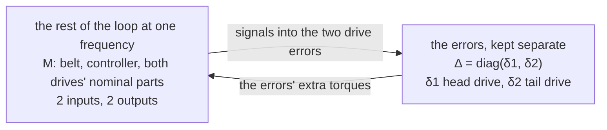
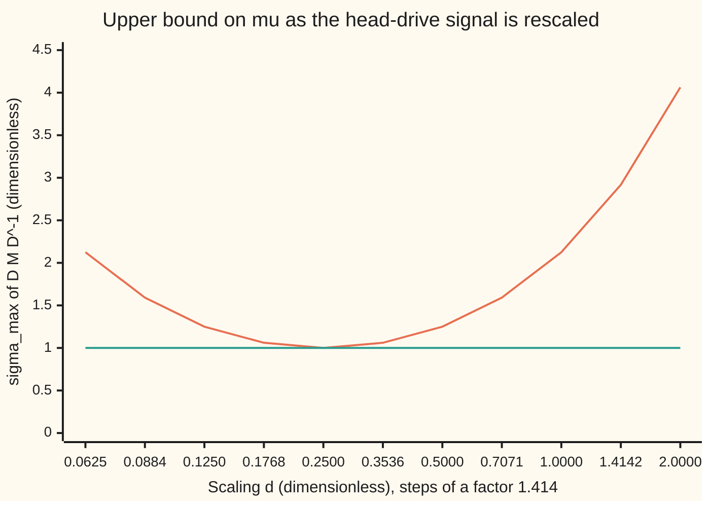

# The structured singular value: robustness when the uncertainty has a known shape

[Syllabus](../../../SYLLABUS.md) → [Engineering mathematics](../README.md) → [Robustness and Adaptation](../README.md#s10) → The structured singular value

---

## General Overview

A long parcel conveyor has two drives: a head drive at the delivery end and a tail drive at the loading end. Both push the same belt, and one speed controller commands both: it sends 80% of its current command to the head drive and 20% to the tail drive. The head motor makes 0.5 N·m of torque per amp and the tail motor 2.0 N·m per amp, so the two deliver equal torque. Each drive's torque gain (newton-metres of torque per amp of current) may sit up to 20% off its nameplate value, set by temperature and wear. The two drives drift separately: the head drive can run 20% strong while the tail drive runs true.

The engineer wants one number: does the speed loop stay stable for every pair of gain errors inside ±20%? The earlier small-gain test answers by treating the error as any 2×2 matrix at all. That includes errors in which the head drive's fault leaks into the tail drive's torque. No real drive does that.

At 2 rad/s, where the loop's phase reaches −180° and a drift can tip it over, the small-gain test reads 2.125, above its limit of 1. It certifies only 9.41% of drift, less than half the rated 20%. The **structured singular value**, written $`\mu`$ (mu), asks the sharper question: how small is the smallest error *of the real shape*, two separate gains, that breaks the loop? For this conveyor the answer is exact. The loop survives every pair of drifts strictly inside ±20%. Only both drives 20% strong at once push it to the edge of stability, a pole on the imaginary axis; any more drift breaks it.

One controller feeding both drives makes the errors' matrix rank one. Counting the errors in amps makes it lopsided, 2 one way and 0.125 the other, because the head drive carries four times the current and the tail motor makes four times the torque per amp. That lopsidedness is what fools the small-gain test.

**The structured singular value is one over the size of the smallest error of the allowed shape that breaks the loop; it sits between the spectral radius and the largest singular value, and rescaling the signals between the error blocks pulls the upper bound down to it.**

**What kind of fact this is:** a definition, with two bounds proved on this card in Why it works. That the D-scaled upper bound equals $`\mu`$ exactly for three or fewer blocks is a theorem stated here and not proved; the card checks it on its example by a brute-force search.

### The picture: the error pulled out of the loop



Schematic. Every part of the loop that is known goes in the box $`M`$. The two unknown drive errors go in the box $`\Delta`$, which may only be diagonal: δ1 acts on the head drive's signal and δ2 on the tail drive's, never across.

---

## The formula

Notation from earlier cards, one line each:

- The largest singular value $`\bar\sigma(A)`$ is the most a matrix $`A`$ can stretch a vector ([Several inputs, several outputs](06-multivariable-feedback-and-singular-values.md)). The small gain rule says a loop of $`A`$ and an error $`\Delta`$ is safe when $`\bar\sigma(A)\,\bar\sigma(\Delta) < 1`$ ([Writing down model error](01-model-uncertainty-and-the-small-gain-theorem.md)).
- The spectral radius $`\rho(A)`$ is the size of the largest eigenvalue of $`A`$ ([Eigenvalues and eigenvectors](../../03-Algebra/07-Eigenvalues%20and%20Symmetric%20Matrices/02-eigenvalues-and-eigenvectors.md)).
- A square matrix is singular (cannot be inverted) exactly when its determinant is zero ([Determinants](../../03-Algebra/05-Solving%20Systems/04-determinants.md)).
- Engineers write $`j`$ for the square root of −1; the rest of the library writes i.

Each drive's error is written as its gain error divided by the 20% tolerance, so $`\lvert\delta_i\rvert \le 1`$ covers the rated range. The loop with error $`\Delta`$ fails at a frequency when a signal can circulate round $`M`$ and $`\Delta`$ unchanged, which happens when $`I - M\Delta`$ is singular. The definition:

```math
\mu_\Delta(M) = \frac{1}{\min\{\,\bar\sigma(\Delta) : \Delta = \mathrm{diag}(\delta_1, \delta_2),\ \det(I - M\Delta) = 0\,\}}
```

and $`\mu_\Delta(M) = 0`$ if no such $`\Delta`$ exists. For a diagonal $`\Delta`$, $`\bar\sigma(\Delta)`$ is the larger of $`\lvert\delta_1\rvert`$ and $`\lvert\delta_2\rvert`$.

The bounds, with $`D = \mathrm{diag}(d, 1)`$ for any $`d > 0`$:

```math
\rho(M) \;\le\; \mu_\Delta(M) \;\le\; \min_{d > 0}\ \bar\sigma(D M D^{-1}) \;\le\; \bar\sigma(M)
```

The conveyor's matrix at $`\omega^*`$ = 2 rad/s, and the scaled matrix at $`d`$ = 0.25:

```math
M = \begin{bmatrix} 0.5 & 2 \\ 0.125 & 0.5 \end{bmatrix}, \qquad D M D^{-1} = \begin{bmatrix} 0.5 & 2d \\ 0.125/d & 0.5 \end{bmatrix} = \begin{bmatrix} 0.5 & 0.5 \\ 0.5 & 0.5 \end{bmatrix}
```

**Where this $`M`$ comes from.** Cut the loop at the two errors (Step 1). Drive $`i`$ gets the share $`a_i`$ of the controller's current command and makes $`k_i`$ N·m per amp. Error $`i`$ sees drive $`i`$'s current times the tolerance $`w`$ = 0.2, and error $`k`$ adds torque through $`k_k`$. Both torques reach the belt speed through one loop, with loop gain $`L`$ and complementary sensitivity $`T = L/(1 + L)`$:

```math
m_{ik}(j\omega) = -\,w\,\frac{a_i\,k_k}{b}\,T(j\omega), \qquad b = a_1k_1 + a_2k_2 = 0.8\ \mathrm{N\,m/A}, \qquad L(s) = \frac{1}{3s}\cdot\frac{4}{s^2 + 0.4s + 4}
```

The $`1/(3s)`$ is the belt's inertia under a proportional speed controller, the second factor a stretch mode of the belt at 2 rad/s with damping ratio 0.1. At $`\omega^*`$ = 2 rad/s the phase of $`L`$ is −180°, $`L`$ = −0.8333 and $`T`$ = −5.0000, which gives exactly the matrix above.

- **Rank one:** row $`i`$ carries $`a_i`$ and column $`k`$ carries $`k_k`$, because every error sees a share of one command.
- **Lopsided:** counted in amps, $`m_{12}`$ = 2 and $`m_{21}`$ = 0.125 differ by 4 × 4 = 16, four times the current in the head drive and four times the torque per amp in the tail motor. Counted in newton-metres, all four entries are 0.5: the scaling of Step 4, with $`d = k_1/k_2`$ = 0.25.

**Read it aloud:** mu is one over the size of the smallest pair of separate drive errors that lets a signal circulate round the loop forever; it is at least the largest eigenvalue's size and at most the largest stretch of the matrix after the best rescaling.

Across frequency, the robust stability test is: the peak of $`\mu_\Delta(M(j\omega))`$ over all angular frequencies $`\omega`$ must stay below 1. This card works at $`\omega^*`$ = 2 rad/s. A real drift can break the loop only where $`M`$ is real, and for this loop that is $`\omega^*`$ alone; $`\mu`$ itself, which lets each error take a phase, peaks just beside it (Worked numbers).

| Symbol | Plain meaning | In our example | Push it up and the answer… |
| --- | --- | --- | --- |
| $`M`$, $`m_{ik}`$ | the known part of the loop as seen by the errors, at one frequency, dimensionless; its entry in row $`i`$, column $`k`$ is the gain from error output $`k`$ back to error input $`i`$ | $`m_{11}`$ = $`m_{22}`$ = 0.5, $`m_{12}`$ = 2, $`m_{21}`$ = 0.125 | a larger $`\mu`$, less robust |
| $`\Delta`$, $`\delta_1`$, $`\delta_2`$, $`I`$ | the error block; the head and tail drives' gain errors, each divided by the 20% tolerance; the 2×2 identity matrix | the breaking pair: $`\delta_1`$ = $`\delta_2`$ = 1, both drives 20% strong | — |
| $`a_i`$, $`k_i`$, $`b`$, $`w`$ | drive $`i`$'s share of the current command; its torque constant, N·m per A; torque per amp of command; the tolerance as a fraction | $`a`$ = (0.8, 0.2), $`k`$ = (0.5, 2.0), $`b`$ = 0.8, $`w`$ = 0.2 | a larger $`w`$: $`\mu`$ grows in proportion |
| $`L`$, $`T`$ | the loop gain round the speed loop; the complementary sensitivity $`L/(1 + L)`$ | $`L`$ = −0.8333, $`T`$ = −5.0000 at $`\omega^*`$ | a taller peak of $`\lvert T\rvert`$: a larger $`\mu`$ |
| $`\mu_\Delta`$, $`1/\mu`$ | the structured singular value for errors of the shape $`\Delta`$; the robustness margin, the fraction of the rated tolerance the loop survives | 1.0000; 1 / 1.0000, so 20.00% of drift | at 1 the rated tolerance just breaks the loop |
| $`\rho`$, $`\lambda`$ | spectral radius: the largest eigenvalue's size; $`\lambda`$ stands for an eigenvalue | 1.0000; $`\lambda`$ = 1 and 0 | a lower bound only |
| $`\bar\sigma`$ | largest singular value: the most a matrix stretches a vector | 2.1250 for $`M`$ | an upper bound only |
| $`D`$, $`d`$ | the scaling matrix $`\mathrm{diag}(d, 1)`$; the factor that rescales the signal through the head drive's error | best $`d`$ = 0.2500 | away from 0.25, the bound rises |
| $`u`$, $`v`$ | two vectors with $`M = uv^{T}`$, possible because $`M`$ has rank one (every row is a multiple of one row); $`u`$ follows the current shares, $`v`$ the torque constants | $`u`$ = (1, 0.25), $`v`$ = (0.5, 2) | — |
| $`U`$, $`\varphi`$ | a diagonal matrix of pure phase turns, $`\mathrm{diag}(1, e^{j\varphi})`$; the turn angle | used on the flipped matrix: $`\varphi`$ = 180° | — |
| $`\omega`$, $`\omega^*`$, $`j`$ | angular frequency, rad/s; the frequency of the worked matrix; the square root of −1 | $`\omega^*`$ = 2 rad/s, where the loop's phase is −180° | — |
| $`z`$, $`s`$, $`K`$ | a signal circling the loop (Step 1); the Laplace variable, so $`s = j\omega`$ is a point on the imaginary axis; the controller, redesigned in D-K iteration | — | — |

### When it holds

- **The errors really are separate.** The diagonal shape says the head drive's fault never shows up in the tail drive's torque. If the drives share a supply whose sag hits both at once, $`\Delta`$ has a different shape and needs a different $`\mu`$. A full 2×2 error brings back $`\bar\sigma`$ (Step 2).
- **Linear, with errors that are complex numbers.** The definition lets each $`\delta_i`$ take any phase, as a fast unmodelled lag would. Drive gains are real numbers, and allowing phases can only make $`\mu`$ larger, so a complex $`\mu`$ is safe but can be pessimistic. Here the breaking pair at $`\omega^*`$ is real, $`\delta_1`$ = $`\delta_2`$ = 1, so the real answer and the complex one agree. Just beside it, at 1.9935 rad/s, $`\mu`$ peaks at 1.0199: errors with a phase break the loop there at 19.61%, which no real drift can do.
- **Every frequency is checked.** $`\mu`$ at one frequency speaks for that frequency only. The test takes the peak over a frequency sweep; this card works at $`\omega^*`$, where real drifts bite, and sweeps the rest in Worked numbers.
- **The tolerance stays inside the rated box.** $`\mu`$ grows in proportion to the tolerance. At ±25% drift the same loop has $`\mu`$ = 1.2500 and margin 0.8000: it survives only 80% of the new box, which is the old 20%.
- **The nominal loop is stable.** As on [Robust tests](02-robust-stability-and-robust-performance.md), the test starts from a stable loop with no error and asks how much error it takes to push a pole across the imaginary axis.

---

## Why it works

### Step 0: a known shape means fewer ways to fail

The small-gain test guards against every 2×2 error of a given size. That set includes errors with cross terms: the head drive's fault pushing torque out of the tail drive. The worst member of that big set may be one no conveyor can produce. Restrict the set to the real shape and the worst member can only get less bad. $`\mu`$ is the exact answer for the restricted set, and the work is to compute it.

### Step 1: why "singular" means "breaks"

Cut the loop at the errors. A signal $`z`$ entering the error block leaves as $`\Delta z`$, passes through $`M`$, and comes back as $`M\Delta z`$. A nonzero signal that returns unchanged after one trip satisfies $`(I - M\Delta)z = 0`$, which is possible exactly when $`\det(I - M\Delta) = 0`$.

At a frequency $`\omega`$, that is a closed-loop pole sitting at $`s = j\omega`$ on the imaginary axis. As the errors grow from zero, the poles move continuously. To go unstable a pole must cross that axis, so it must pass through such a point. The smallest error that does so is the size of error the loop can take, and $`\mu`$ is one over it.

For two separate errors the determinant is short:

```math
\det(I - M\Delta) = 1 - m_{11}\delta_1 - m_{22}\delta_2 + \det(M)\,\delta_1\delta_2
```

For the conveyor, $`\det(M)`$ = 0.5 × 0.5 − 2 × 0.125 = 0, and at $`\delta_1`$ = $`\delta_2`$ = 1 the determinant is 1 − 0.5 − 0.5 + 0 = 0. That pair breaks the loop.

### Step 2: the upper bound, the largest singular value

If $`\bar\sigma(M)\,\bar\sigma(\Delta) < 1`$ then every trip round the loop shrinks every signal, so no signal returns unchanged and $`I - M\Delta`$ is not singular. So any breaking $`\Delta`$ has $`\bar\sigma(\Delta) \ge 1/\bar\sigma(M)`$, which gives $`\mu \le \bar\sigma(M)`$.

This is the small gain rule, and it ignores the shape. It is exact for a full-matrix error: the error $`vu^{T}/(\lvert u\rvert^2\lvert v\rvert^2)`$ has size 1/2.125 = 0.4706 and breaks the loop. That error is not diagonal, so it is not a conveyor error.

### Step 3: the lower bound, the spectral radius

One shape every diagonal block allows is the same number on both drives: $`\Delta = \delta I`$. Then $`\det(I - \delta M) = 0`$ exactly when $`1/\delta`$ is an eigenvalue of $`M`$. The eigenvalue of largest size gives the smallest such $`\delta`$, with size $`1/\rho(M)`$. That error is allowed, so the smallest allowed breaking error is at most that size, and $`\mu \ge \rho(M)`$.

For the conveyor the eigenvalues are 1 and 0 (trace 1, determinant 0), so $`\rho`$ = 1. Now $`1 \le \mu \le 2.125`$: a wide gap.

The lower bound can be sharpened. Turning the phase of one error does not change its size, so for any $`U = \mathrm{diag}(1, e^{j\varphi})`$ the same argument gives $`\mu \ge \rho(MU)`$. The best turn gives $`\mu`$ exactly (a theorem from the 1982 paper in Sources, stated, not proved here), but the search over turns can have many local peaks.

### Step 4: rescaling the signals cannot change stability, but it changes the bound

Measure the signal through the head drive's error in different units: multiply it by $`d`$ on the way in and divide by $`d`$ on the way out. In matrix terms that replaces $`M`$ by $`DMD^{-1}`$. Because $`D`$ and $`\Delta`$ are both diagonal, $`D\Delta D^{-1} = \Delta`$, so

```math
\det(I - DMD^{-1}\Delta) = \det\big(D\,(I - M\Delta)\,D^{-1}\big) = \det(I - M\Delta)
```

Every breaking error of $`M`$ breaks $`DMD^{-1}`$ too: $`\mu`$ is unchanged. The largest singular value is not. Step 2 applied to $`DMD^{-1}`$ gives $`\mu \le \bar\sigma(DMD^{-1})`$ for every $`d`$, so the best $`d`$ gives the tightest bound.

Look at what $`d`$ does to the conveyor's matrix. It multiplies $`m_{12}`$ by $`d`$ and divides $`m_{21}`$ by $`d`$. Their product, 0.25, is the gain of the round trip head-to-tail-to-head, and it is untouched. The diagonal is untouched. Only the lopsided split, 2 one way and 0.125 the other, changes. That lopsidedness is what inflated $`\bar\sigma`$.

<details>
<summary>Finding the best d for the conveyor by hand</summary>

$`DMD^{-1}`$ still has determinant 0, so its second singular value is 0, and the largest singular value equals the square root of the sum of the squared entries:

$`\displaystyle \bar\sigma(DMD^{-1})^2 = 0.25 + 0.25 + 4d^2 + \frac{0.015625}{d^2}`$

The two terms in $`d`$ have a fixed product, 4 × 0.015625 = 0.0625, so their sum is smallest when they are equal: $`4d^2 = 0.015625/d^2`$, so $`d^4 = 0.00390625`$ and $`d`$ = 0.25. Each term is then 0.25, and

$`\displaystyle \bar\sigma(DMD^{-1})^2 = 0.25 + 0.25 + 0.25 + 0.25 = 1`$

In general, $`d^2 = \lvert m_{21}\rvert / \lvert m_{12}\rvert`$ for a rank-one 2×2 matrix: the scaling evens out the two cross gains.

</details>

At $`d`$ = 0.25 the bound is 1, which equals the lower bound $`\rho`$ = 1. The gap is closed: $`\mu`$ = 1 exactly.

### Step 5: a rank-one matrix has a formula

$`M`$ has rank one: the second row is the first times 0.25. So $`M = uv^{T}`$ with $`u`$ = (1, 0.25), the current shares 0.8 and 0.2 rescaled, and $`v`$ = (0.5, 2), the torque constants. For such a matrix the determinant in Step 1 is

```math
\det(I - uv^{T}\Delta) = 1 - \sum_i u_i v_i \delta_i = 1 - m_{11}\delta_1 - m_{22}\delta_2
```

To reach zero with the smallest errors, give every $`\delta_i`$ the same size and the phase that makes each term $`m_{ii}\delta_i`$ positive real. Then that common size times $`\lvert m_{11}\rvert + \lvert m_{22}\rvert`$ must equal 1, so

```math
\mu_\Delta(uv^{T}) = \lvert m_{11}\rvert + \lvert m_{22}\rvert = 0.5 + 0.5 = 1
```

Compare the three numbers for any rank-one matrix: $`\rho = \lvert m_{11} + m_{22}\rvert`$, then $`\mu = \lvert m_{11}\rvert + \lvert m_{22}\rvert`$, then $`\bar\sigma = \lvert u\rvert\,\lvert v\rvert`$. The first inequality is the triangle inequality; the second is the Cauchy–Schwarz inequality. The bounds of the formula, in miniature.

### Step 6: designing for mu, in outline

$`\mu`$ analyses a controller someone already has. **D-K iteration** designs one, alternating two steps:

1. **D-step.** Hold the controller $`K`$ fixed. At each frequency find the best scaling $`d(\omega)`$, as in Step 4, and fit a stable transfer function through those values.
2. **K-step.** Hold the scaling fixed and run an [H-infinity design](03-h-infinity-control-in-outline.md) on the scaled loop $`DMD^{-1}`$.

Each step aims to lower the peak of the upper bound, but the iteration is not guaranteed to reach the best controller. Finding the best $`d`$ with many blocks is a convex problem solved by linear matrix inequalities, which belong to the optimisation wing (wing 15). Computing $`\mu`$ itself exactly is hard in general: for real gain errors, such as these drive tolerances, a 1994 paper (in Sources) showed that it is NP-hard, which means no known method stays fast as the number of blocks grows. That is why the bounds, not $`\mu`$, are what software computes.

---

## Worked numbers, by hand

| Step | Arithmetic | Value |
| --- | --- | --- |
| largest singular value | $`M`$ has determinant 0, so $`\bar\sigma^2`$ = 0.25 + 4 + 0.015625 + 0.25 | $`\bar\sigma`$ = 2.1250 |
| eigenvalues | trace 1, determinant 0: roots of $`\lambda^2 - \lambda`$ | 1.0000 and 0.0000 |
| bounds so far | $`\rho \le \mu \le \bar\sigma`$ | between 1.0000 and 2.1250 |
| best scaling | $`d^2`$ = 0.125 / 2 = 0.0625 | $`d`$ = 0.2500 |
| scaled matrix | 2 × 0.25 = 0.5 and 0.125 / 0.25 = 0.5 | all four entries 0.5000 |
| upper bound | $`\bar\sigma^2`$ = 4 × 0.25 = 1 | 1.0000 |
| check the breaking pair | $`\det(I - M)`$ = 0.5 × 0.5 − 2 × 0.125 | 0.0000 |
| rank-one formula | 0.5 + 0.5 | **$`\mu`$ = 1.0000** |
| tolerance the loop survives | 20% / 1.0000 | **20.00%** |
| what small gain certifies | 20% / 2.1250 | 9.41% |

The loop is stable for every pair of drive drifts strictly inside ±20%. When both drives run 20% strong together it is pushed to the edge of stability, a pole pair on the imaginary axis; any more drift breaks it. There is no reserve: before the drives are allowed to drift more, the controller needs retuning or the drives need calibrating.

### The loop behind M, checked

Each drive delivers half the torque, so here $`\mu(\omega) = w\,\lvert T(j\omega)\rvert`$. Swept over frequency it is a sharp spike at the stretch mode: 0.0849 at 1 rad/s, 0.3559 at 1.9, 1.0000 at 2.0, 0.2770 at 2.1 and 0.0176 at 3 rad/s. A golden-section search puts the peak at 1.0199, at 1.9935 rad/s, where $`M`$ is complex (When it holds).

The closed-loop poles confirm the real-drift answer. Drifts multiply the loop gain by $`1 + 0.1(\delta_1 + \delta_2)`$, so the closed-loop polynomial is $`s^3 + 0.4s^2 + 4s + \tfrac{4}{3}\big(1 + 0.1(\delta_1 + \delta_2)\big)`$. A cubic with positive coefficients is stable exactly when its middle two coefficients multiply to more than the last one: here while $`\delta_1 + \delta_2 < 2`$, which inside the ±20% box fails only at the corner. With both drives drifting by the same $`\delta`$, the slowest poles have real part −0.0016 per s at $`\delta`$ = 0.95, sit on the imaginary axis at ±2j rad/s at $`\delta`$ = 1, and have real part +0.0016 per s at $`\delta`$ = 1.05, where the loop runs away.

### What breaks if you drop a piece

| Mistake | Comes out at | What went wrong |
| --- | --- | --- |
| Using the small-gain test, $`\bar\sigma(M)`$, as the answer | margin 0.4706, so 9.41% instead of 20.00% | It guards against cross-coupled errors no drive can produce |
| Using $`\rho(M)`$ as the answer, on the flipped matrix with second column $`(-2, -0.5)`$ | $`\rho`$ = 0.0000, which claims no error can break the loop | $`\rho`$ is only a lower bound; the true $`\mu`$ is 1.0000, broken by $`\delta_1`$ = 1, $`\delta_2`$ = −1 |
| Scaling the wrong way, $`d`$ = 4 | $`\bar\sigma(DMD^{-1})`$ = 8.0312 | Every $`d`$ gives a valid bound, but only the best one is tight |
| D-scaling a full-matrix error | claims margin 1.0000, yet an error of size 0.4706 gives $`\det(I - M\Delta)`$ = 0.0000 | $`D\Delta D^{-1} = \Delta`$ needs $`\Delta`$ diagonal; a full $`\Delta`$ changes under scaling |
| Keeping the 20% conclusion at 25% drift | $`\mu`$ = 1.2500, margin 0.8000 | $`\mu`$ scales with the tolerance; outside the rated box the loop fails |

For the flipped matrix, the sharpened lower bound of Step 3 repairs the second row: turning the tail drive's phase by 180° gives $`\rho(MU)`$ = 1.0000, and D-scaling also gives 1.0000. The code prints every row.

### The upper bound against the scaling



Orange: the bound $`\bar\sigma(DMD^{-1})`$; at $`d`$ = 1, no scaling, it is the small-gain value 2.125. Green: the true $`\mu`$ = 1, which no scaling changes. The orange curve touches it at $`d`$ = 0.25, and on a log scale it is symmetric about that point.

The three numbers side by side:

```
spectral radius rho, lower bound   ##########                1.0000
mu, the exact answer               ##########                1.0000
best D-scaled bound                ##########                1.0000
largest singular value, unscaled   #####################     2.1250
```

---

## Code, from first principles, and it actually runs

Both programs build the 2×2 algebra by hand: eigenvalues by the quadratic formula, the largest singular value from the eigenvalues of $`M^{H}M`$ (the conjugate transpose times $`M`$), and complex numbers as a small struct in Rust. They take three independent roads to $`\mu`$. Road 1 is the definition: for each candidate $`\delta_2`$ on a polar grid of 720 angles and 2,000 radii up to 4, solve $`\det(I - M\Delta) = 0`$ for $`\delta_1`$ and keep the pair with the smallest larger size. Road 2 is the bounds: $`\rho`$ from below, and a golden-section search over $`\log d`$ for the smallest $`\bar\sigma(DMD^{-1})`$ from above. Road 3 is the rank-one formula. All three agree on 1.0000, and the checks also print every "What breaks" row. They also build $`M`$ from the loop at 2 rad/s, sweep $`\mu`$ over frequency, and find the closed-loop poles with both drives drifting together.

### Python

```python
# Structured singular value -- the check behind the card.  Standard library only.
# One speed controller sends 80 % of its current command to the head drive and 20 % to the tail
# drive; torque constants 0.5 and 2.0 N m/A, each up to 20 % off, independently.  Divided by that
# 20 %, the errors are delta1, delta2, each of size at most 1.  Loop gain L(s) = (1/(3 s)) 4/(s^2 + 0.4 s + 4).
# At 2 rad/s, where its phase is -180 deg, the errors see the matrix M.  The loop breaks where det(I - M Delta) = 0.
# Roads: 1. the definition, by brute force;  2. the bounds rho(M) <= mu <= sigma_max(D M D^-1), the best d
# by golden-section search;  3. the rank-one formula |m11| + |m22|.  Then M from the loop, mu over frequency, poles.
import math

TOL = 20.0                                       # each drive's gain tolerance, %
M = [[0.5, 2.0], [0.125, 0.5]]
FLIP = [[0.5, -2.0], [0.125, -0.5]]              # same sizes, second column negated
SPLIT, KT, KL, WN, ZT = (0.8, 0.2), (0.5, 2.0), 1 / 3, 2.0, 0.1   # current shares; N m/A; 1/s; rad/s; damping

def csqrt(z):                                    # principal square root of a complex number
    z = complex(z); r = abs(z)
    re = math.sqrt((r + z.real) / 2); im = math.sqrt(max(r - z.real, 0.0) / 2)
    return complex(re, im if z.imag >= 0 else -im)

def eig2(m):                                     # both eigenvalues of a 2x2, quadratic formula
    (a, b), (c, d) = m
    tr, det = a + d, a * d - b * c
    disc = csqrt(tr * tr / 4 - det)
    return tr / 2 + disc, tr / 2 - disc

def rho(m): return max(abs(z) for z in eig2(m))   # spectral radius: largest |eigenvalue|

def smax(m):                                     # largest singular value: top eigenvalue of M^H M
    (a, b), (c, d) = m
    p, q = abs(a) ** 2 + abs(c) ** 2, abs(b) ** 2 + abs(d) ** 2
    r = complex(a).conjugate() * b + complex(c).conjugate() * d
    return math.sqrt((p + q) / 2 + math.sqrt(((p - q) / 2) ** 2 + abs(r) ** 2))

def scaled(m, d): return [[m[0][0], m[0][1] * d], [m[1][0] / d, m[1][1]]]   # D M D^-1, D = diag(d, 1)
def rank1(m): return abs(m[0][0]) + abs(m[1][1])  # road 3: mu of a rank-one matrix

def golden(f, lo, hi, n=200):                    # the minimum of f on [lo, hi], golden-section search
    g = (math.sqrt(5) - 1) / 2
    for _ in range(n):
        x1, x2 = hi - g * (hi - lo), lo + g * (hi - lo)
        if f(x1) < f(x2): hi = x2
        else: lo = x1
    return (lo + hi) / 2
def best_d(m):                                   # road 2: golden-section search on log d
    d = math.exp(golden(lambda x: smax(scaled(m, math.exp(x))), math.log(1e-3), math.log(1e3)))
    return d, smax(scaled(m, d))
def loop_M(w, tol=TOL):                          # m_ik = -w a_i k_k T / b at s = j w, with T = L / (1 + L)
    s = 1j * w; L = KL / s * WN ** 2 / (s * s + 2 * ZT * WN * s + WN ** 2); b = SPLIT[0] * KT[0] + SPLIT[1] * KT[1]
    return [[-tol / 100 * SPLIT[i] * KT[k] * L / (1 + L) / b for k in range(2)] for i in range(2)], L
def max_pole(g):                                 # s^3 + 0.4 s^2 + 4 s + (4/3) g: real root by bisection, then s^2 + p s + q
    c0, c1, c2, lo, hi = 2 * ZT * WN, WN ** 2, KL * WN ** 2 * g, -10.0, 0.0
    for _ in range(200):
        m_ = (lo + hi) / 2; lo, hi = (m_, hi) if m_ * m_ * m_ + c0 * m_ * m_ + c1 * m_ + c2 < 0 else (lo, m_)
    p = c0 + lo; q = c1 + lo * p; r = csqrt(p * p / 4 - q)
    return max(lo, -p / 2 + r.real), r.imag

def mu_search(m, nr=2000, na=720, rmax=4.0):     # road 1: the definition, by brute force
    (a, b), (c, d) = m
    det = a * d - b * c
    best = (math.inf, 0j, 0j)
    for k in range(na):
        t = 2 * math.pi * k / na
        e = complex(math.cos(t), math.sin(t))
        for j in range(1, nr + 1):
            d2 = (rmax * j / nr) * e
            den = a - det * d2
            if abs(den) < 1e-12: continue
            d1 = (1 - d * d2) / den              # det(I - M Delta) = 0, solved for delta1
            size = max(abs(d1), abs(d2))
            if size < best[0]: best = (size, d1, d2)
    return 1 / best[0], best[1], best[2]

def rho_turned(m, n=3600):                       # sharper lower bound: max over phi of rho(M U)
    best = (0.0, 0.0)
    for k in range(n):
        t = 2 * math.pi * k / n
        e = complex(math.cos(t), math.sin(t))
        r = rho([[m[0][0], m[0][1] * e], [m[1][0], m[1][1] * e]])
        if r > best[0] + 1e-12: best = (r, 360 * k / n)
    return best

def row(name, value): print(f"{name:<46}{value:>10}")
def mat(m): return "[[" + ", ".join(f"{x:.4f}" for x in m[0]) + "], [" + ", ".join(f"{x:.4f}" for x in m[1]) + "]]"

print(f"M = {mat(M)}, each drive's tolerance {TOL:.0f} %")
LM, Lw = loop_M(WN)
print(f"loop at {WN:.1f} rad/s: b = {SPLIT[0] * KT[0] + SPLIT[1] * KT[1]:.2f} N m/A, L = {Lw.real:.4f}, T = {(Lw / (1 + Lw)).real:.4f}; M from the loop {mat([[x.real for x in rw] for rw in LM])}")
l1, l2 = eig2(M)
print(f"eigenvalues of M: {l1.real:.4f} and {l2.real:.4f}")
r, s = rho(M), smax(M)
row("spectral radius rho(M), lower bound", f"{r:.4f}")
row("largest singular value sigma_max(M)", f"{s:.4f}")
d, up = best_d(M)
row("best scaling d (golden-section search)", f"{d:.4f}")
print(f"D M D^-1 at that d: {mat(scaled(M, d))}")
row("sigma_max(D M D^-1), upper bound", f"{up:.4f}")
mu, d1, d2 = mu_search(M)
print(f"road 1, smallest pair that breaks the loop: delta1 = {d1.real:.3f}, delta2 = {d2.real:.3f}")
row("mu from the definition", f"{mu:.4f}")
r1 = rank1(M)
row("mu from the rank-one formula |m11| + |m22|", f"{r1:.4f}")
det_I = (1 - M[0][0]) * (1 - M[1][1]) - M[0][1] * M[1][0]
row("det(I - M) at delta1 = delta2 = 1", f"{det_I:.4f}")
row("tolerance survived, from mu (%)", f"{TOL / up:.2f}")
row("tolerance certified by sigma_max (%)", f"{TOL / s:.2f}")
ds = [2 ** (k / 2) / 16 for k in range(11)]
print("chart d:     " + " ".join(f"{x:>7.4f}" for x in ds))
print("chart sigma: " + " ".join(f"{smax(scaled(M, x)):>7.4f}" for x in ds))
ws = [1.0, 1.5, 1.8, 1.9, 2.0, 2.1, 2.2, 2.5, 3.0]
print("mu sweep w:  " + " ".join(f"{w:>7.4f}" for w in ws))
print("mu sweep mu: " + " ".join(f"{best_d(loop_M(w)[0])[1]:>7.4f}" for w in ws))
wp = golden(lambda w: -best_d(loop_M(w)[0])[1], 1.5, 2.5, 100); mp = best_d(loop_M(wp)[0])[1]; r1p = rank1(loop_M(wp)[0])
print(f"mu peak {mp:.4f} at {wp:.4f} rad/s, rank-one formula {r1p:.4f}; complex errors survived there {TOL / mp:.2f} %")
ps = [max_pole(1 + TOL / 100 * dl) for dl in (0.95, 1.0, 1.05)]
print("poles, both drives drifting together: " + "; ".join(f"delta {dl:.2f}: largest real part {p[0]:+.4f}, imag {p[1]:.4f}" for dl, p in zip((0.95, 1.0, 1.05), ps)))
print("what breaks:")
print(f"1. small gain on the full matrix: margin {1 / s:.4f}, {TOL / s:.2f} % instead of {TOL / up:.2f} %")
fr = rho(FLIP); fmu, f1, f2 = mu_search(FLIP); fd, fup = best_d(FLIP); ft, fphi = rho_turned(FLIP)
print(f"2. flipped M: rho = {fr:.4f}, but mu = {fmu:.4f} (delta1 = {f1.real:.3f}, delta2 = {f2.real:.3f}), rank-one formula {rank1(FLIP):.4f}")
print(f"   flipped M: D-scaled bound {fup:.4f}, phase-turned rho {ft:.4f} at phi = {fphi:.1f} deg")
row("3. scaling the wrong way, d = 4: sigma_max", f"{smax(scaled(M, 4.0)):.4f}")
u, v = [1.0, M[1][0] / M[0][0]], [M[0][0], M[0][1]]   # M = u v^T, a rank-one matrix
nu, nv = u[0] ** 2 + u[1] ** 2, v[0] ** 2 + v[1] ** 2
full = [[v[i] * u[j] / (nu * nv) for j in range(2)] for i in range(2)]   # Delta = v u^T / (|u|^2 |v|^2)
mf = [[sum(M[i][k] * full[k][j] for k in range(2)) for j in range(2)] for i in range(2)]
det_f = (1 - mf[0][0]) * (1 - mf[1][1]) - mf[0][1] * mf[1][0]
print(f"4. full-matrix error: size {smax(full):.4f}, det(I - M Delta) = {abs(det_f):.4f}; D-scaling would claim {1 / up:.4f}")
big = [[x * 25 / TOL for x in rw] for rw in M]
row("5. tolerance 25 %: mu (D-scaled)", f"{best_d(big)[1]:.4f}")
row("   margin 1/mu", f"{1 / best_d(big)[1]:.4f}")
assert all(abs(M[i][j] - u[i] * v[j]) < 1e-12 for i in range(2) for j in range(2))
assert abs(mu - r1) < 1e-3 and abs(mu - up) < 1e-3 and abs(d - math.sqrt(abs(M[1][0] / M[0][1]))) < 1e-6
assert r <= mu + 1e-9 and up <= s and abs(s - math.sqrt(sum(x * x for rw in M for x in rw))) < 1e-12
assert abs(det_I) < 1e-12 and abs(d1 - 1) < 1e-9 and abs(d2 - 1) < 1e-9 and abs(l1 + l2 - 1) < 1e-12 and abs(l1 * l2) < 1e-12
assert fr < 1e-12 and abs(fmu - 1) < 1e-3 and abs(fup - 1) < 1e-6 and abs(ft - 1) < 1e-9 and abs(f2 + 1) < 1e-9
assert abs(rank1(FLIP) - fmu) < 1e-3 and all(abs(LM[i][k] - M[i][k]) < 1e-12 for i in range(2) for k in range(2))
assert abs(Lw.imag) < 1e-12 and abs(mp - r1p) < 1e-6 and 1 < mp < 1.05 and abs(wp - WN) < 0.02 and ps[0][0] < 0 < ps[2][0] and abs(ps[1][0]) < 1e-9 and abs(ps[1][1] - WN) < 1e-9
assert abs(det_f) < 1e-12 and abs(smax(full) * s - 1) < 1e-12
assert abs(best_d(big)[1] - 1.25 * up) < 1e-9
print("ALL CHECKS PASS")
```

**Ran 2026-11-23 on macOS, Python 3.14.10, standard library only. All checks passed. Output, pasted from the run:**

```
M = [[0.5000, 2.0000], [0.1250, 0.5000]], each drive's tolerance 20 %
loop at 2.0 rad/s: b = 0.80 N m/A, L = -0.8333, T = -5.0000; M from the loop [[0.5000, 2.0000], [0.1250, 0.5000]]
eigenvalues of M: 1.0000 and 0.0000
spectral radius rho(M), lower bound               1.0000
largest singular value sigma_max(M)               2.1250
best scaling d (golden-section search)            0.2500
D M D^-1 at that d: [[0.5000, 0.5000], [0.5000, 0.5000]]
sigma_max(D M D^-1), upper bound                  1.0000
road 1, smallest pair that breaks the loop: delta1 = 1.000, delta2 = 1.000
mu from the definition                            1.0000
mu from the rank-one formula |m11| + |m22|        1.0000
det(I - M) at delta1 = delta2 = 1                 0.0000
tolerance survived, from mu (%)                    20.00
tolerance certified by sigma_max (%)                9.41
chart d:      0.0625  0.0884  0.1250  0.1768  0.2500  0.3536  0.5000  0.7071  1.0000  1.4142  2.0000
chart sigma:  2.1250  1.5910  1.2500  1.0607  1.0000  1.0607  1.2500  1.5910  2.1250  2.9168  4.0625
mu sweep w:   1.0000  1.5000  1.8000  1.9000  2.0000  2.1000  2.2000  2.5000  3.0000
mu sweep mu:  0.0849  0.1002  0.1949  0.3559  1.0000  0.2770  0.1372  0.0464  0.0176
mu peak 1.0199 at 1.9935 rad/s, rank-one formula 1.0199; complex errors survived there 19.61 %
poles, both drives drifting together: delta 0.95: largest real part -0.0016, imag 1.9997; delta 1.00: largest real part +0.0000, imag 2.0000; delta 1.05: largest real part +0.0016, imag 2.0003
what breaks:
1. small gain on the full matrix: margin 0.4706, 9.41 % instead of 20.00 %
2. flipped M: rho = 0.0000, but mu = 1.0000 (delta1 = 1.000, delta2 = -1.000), rank-one formula 1.0000
   flipped M: D-scaled bound 1.0000, phase-turned rho 1.0000 at phi = 180.0 deg
3. scaling the wrong way, d = 4: sigma_max        8.0312
4. full-matrix error: size 0.4706, det(I - M Delta) = 0.0000; D-scaling would claim 1.0000
5. tolerance 25 %: mu (D-scaled)                  1.2500
   margin 1/mu                                    0.8000
ALL CHECKS PASS
```

### Rust

Same numbers, same labels, built with `rustc --edition 2021 -O`.

```rust
// Structured singular value -- the same check as the Python, in Rust.  No crates.
// One speed controller: 80 % of its current command to the head drive, 20 % to the tail; torque constants
// 0.5 and 2.0 N m/A, each up to 20 % off.  Loop gain L(s) = (1/(3 s)) 4/(s^2 + 0.4 s + 4); at 2 rad/s the errors
// see M.  Roads: 1. the definition;  2. rho(M) <= mu <= sigma_max(D M D^-1), golden-section on d;  3. rank one.
use std::ops::{Add, Div, Mul, Sub};
const SPLIT: [f64; 2] = [0.8, 0.2]; const KT: [f64; 2] = [0.5, 2.0];   // current shares; N m/A
const KL: f64 = 1.0 / 3.0; const WN: f64 = 2.0; const ZT: f64 = 0.1;   // loop gain 1/s; stretch mode rad/s; damping
#[derive(Clone, Copy)]
struct C { re: f64, im: f64 }
fn c(re: f64, im: f64) -> C { C { re, im } }
impl Add for C { type Output = C; fn add(self, o: C) -> C { c(self.re + o.re, self.im + o.im) } }
impl Sub for C { type Output = C; fn sub(self, o: C) -> C { c(self.re - o.re, self.im - o.im) } }
impl Mul for C { type Output = C; fn mul(self, o: C) -> C { c(self.re * o.re - self.im * o.im, self.re * o.im + self.im * o.re) } }
impl Div for C { type Output = C; fn div(self, o: C) -> C { let n = o.re * o.re + o.im * o.im; c((self.re * o.re + self.im * o.im) / n, (self.im * o.re - self.re * o.im) / n) } }
impl C {
    fn abs(self) -> f64 { self.re.hypot(self.im) }
    fn conj(self) -> C { c(self.re, -self.im) }
    fn sqrt(self) -> C {                               // principal square root
        let r = self.abs();
        let re = ((r + self.re) / 2.0).sqrt();
        let im = ((r - self.re).max(0.0) / 2.0).sqrt();
        c(re, if self.im >= 0.0 { im } else { -im })
    }
}
type M2 = [[C; 2]; 2];
fn real(m: [[f64; 2]; 2]) -> M2 { [[c(m[0][0], 0.0), c(m[0][1], 0.0)], [c(m[1][0], 0.0), c(m[1][1], 0.0)]] }
fn eig2(m: &M2) -> (C, C) {                            // both eigenvalues, quadratic formula
    let (tr, det) = (m[0][0] + m[1][1], m[0][0] * m[1][1] - m[0][1] * m[1][0]);
    let (disc, h) = ((tr * tr / c(4.0, 0.0) - det).sqrt(), tr / c(2.0, 0.0)); (h + disc, h - disc)
}
fn rho(m: &M2) -> f64 { let (a, b) = eig2(m); a.abs().max(b.abs()) }
fn smax(m: &M2) -> f64 {                               // top eigenvalue of M^H M, square-rooted
    let (a, b, cc, d) = (m[0][0], m[0][1], m[1][0], m[1][1]);
    let p = a.abs().powi(2) + cc.abs().powi(2);
    let q = b.abs().powi(2) + d.abs().powi(2);
    let r = a.conj() * b + cc.conj() * d;
    ((p + q) / 2.0 + (((p - q) / 2.0).powi(2) + r.abs().powi(2)).sqrt()).sqrt()
}
fn scaled(m: &M2, d: f64) -> M2 { [[m[0][0], m[0][1] * c(d, 0.0)], [m[1][0] / c(d, 0.0), m[1][1]]] }
fn rank1(m: &M2) -> f64 { m[0][0].abs() + m[1][1].abs() }   // road 3: mu of a rank-one matrix
fn golden(f: &dyn Fn(f64) -> f64, mut lo: f64, mut hi: f64, n: usize) -> f64 {   // minimum of f on [lo, hi]
    let g = (5f64.sqrt() - 1.0) / 2.0;
    for _ in 0..n { let (x1, x2) = (hi - g * (hi - lo), lo + g * (hi - lo)); if f(x1) < f(x2) { hi = x2; } else { lo = x1; } }
    (lo + hi) / 2.0
}
fn best_d(m: &M2) -> (f64, f64) {                      // road 2: golden-section on log d
    let d = golden(&|x: f64| smax(&scaled(m, x.exp())), (1e-3f64).ln(), (1e3f64).ln(), 200).exp();
    (d, smax(&scaled(m, d)))
}
fn loop_m(w: f64, tol: f64) -> (M2, C) {                         // m_ik = -w a_i k_k T / b at s = j w, T = L / (1 + L)
    let (s, r) = (c(0.0, w), |x: f64| c(x, 0.0));
    let l = r(KL) / s * r(WN * WN) / (s * s + r(2.0 * ZT * WN) * s + r(WN * WN)); let b = SPLIT[0] * KT[0] + SPLIT[1] * KT[1];
    let e = |i: usize, k: usize| r(-tol / 100.0 * SPLIT[i] * KT[k]) * l / (r(1.0) + l) / r(b);
    ([[e(0, 0), e(0, 1)], [e(1, 0), e(1, 1)]], l)
}
fn max_pole(g: f64) -> (f64, f64) {                    // s^3 + 0.4 s^2 + 4 s + (4/3) g: real root, then s^2 + p s + q
    let (c0, c1, c2, mut lo, mut hi) = (2.0 * ZT * WN, WN * WN, KL * WN * WN * g, -10.0f64, 0.0f64);
    for _ in 0..200 { let m = (lo + hi) / 2.0; if m * m * m + c0 * m * m + c1 * m + c2 < 0.0 { lo = m } else { hi = m } }
    let p = c0 + lo; let q = c1 + lo * p; let r = c(p * p / 4.0 - q, 0.0).sqrt();
    (lo.max(-p / 2.0 + r.re), r.im)
}
fn mu_search(m: &M2) -> (f64, C, C) {                  // road 1: the definition, brute force
    let (nr, na, rmax) = (2000, 720, 4.0);
    let det = m[0][0] * m[1][1] - m[0][1] * m[1][0];
    let mut best = (f64::INFINITY, c(0.0, 0.0), c(0.0, 0.0));
    for k in 0..na {
        let t = 2.0 * std::f64::consts::PI * k as f64 / na as f64;
        let e = c(t.cos(), t.sin());
        for j in 1..=nr {
            let d2 = c(rmax * j as f64 / nr as f64, 0.0) * e;
            let den = m[0][0] - det * d2;
            if den.abs() < 1e-12 { continue; }
            let d1 = (c(1.0, 0.0) - m[1][1] * d2) / den;   // det(I - M Delta) = 0, for delta1
            let size = d1.abs().max(d2.abs());
            if size < best.0 { best = (size, d1, d2); }
        }
    }
    (1.0 / best.0, best.1, best.2)
}
fn rho_turned(m: &M2) -> (f64, f64) {                  // max over phi of rho(M diag(1, e^{j phi}))
    let (n, mut best) = (3600, (0.0, 0.0));
    for k in 0..n {
        let t = 2.0 * std::f64::consts::PI * k as f64 / n as f64;
        let e = c(t.cos(), t.sin());
        let r = rho(&[[m[0][0], m[0][1] * e], [m[1][0], m[1][1] * e]]);
        if r > best.0 + 1e-12 { best = (r, 360.0 * k as f64 / n as f64); }
    }
    best
}
fn row(name: &str, value: String) { println!("{:<46}{:>10}", name, value); }
fn mat(m: &M2) -> String { format!("[[{:.4}, {:.4}], [{:.4}, {:.4}]]", m[0][0].re, m[0][1].re, m[1][0].re, m[1][1].re) }
fn main() {
    let tol = 20.0;
    let mr = [[0.5, 2.0], [0.125, 0.5]];
    let m = real(mr);
    let flip = real([[0.5, -2.0], [0.125, -0.5]]);    // same sizes, second column negated
    println!("M = {}, each drive's tolerance {:.0} %", mat(&m), tol);
    let (lm, lw) = loop_m(WN, tol); let tw = lw / (c(1.0, 0.0) + lw);
    println!("loop at {:.1} rad/s: b = {:.2} N m/A, L = {:.4}, T = {:.4}; M from the loop {}", WN, SPLIT[0] * KT[0] + SPLIT[1] * KT[1], lw.re, tw.re, mat(&lm));
    let (l1, l2) = eig2(&m);
    println!("eigenvalues of M: {:.4} and {:.4}", l1.re, l2.re);
    let (r, s) = (rho(&m), smax(&m));
    row("spectral radius rho(M), lower bound", format!("{:.4}", r));
    row("largest singular value sigma_max(M)", format!("{:.4}", s));
    let (d, up) = best_d(&m);
    row("best scaling d (golden-section search)", format!("{:.4}", d));
    println!("D M D^-1 at that d: {}", mat(&scaled(&m, d)));
    row("sigma_max(D M D^-1), upper bound", format!("{:.4}", up));
    let (mu, d1, d2) = mu_search(&m);
    println!("road 1, smallest pair that breaks the loop: delta1 = {:.3}, delta2 = {:.3}", d1.re, d2.re);
    row("mu from the definition", format!("{:.4}", mu));
    let r1 = rank1(&m);
    row("mu from the rank-one formula |m11| + |m22|", format!("{:.4}", r1));
    let det_i = (1.0 - mr[0][0]) * (1.0 - mr[1][1]) - mr[0][1] * mr[1][0];
    row("det(I - M) at delta1 = delta2 = 1", format!("{:.4}", det_i));
    row("tolerance survived, from mu (%)", format!("{:.2}", tol / up));
    row("tolerance certified by sigma_max (%)", format!("{:.2}", tol / s));
    let ds: Vec<f64> = (0..11).map(|k| 2f64.powf(k as f64 / 2.0) / 16.0).collect();
    let line = |v: Vec<f64>| v.iter().map(|x| format!("{:>7.4}", x)).collect::<Vec<_>>().join(" ");
    println!("chart d:     {}", line(ds.clone()));
    println!("chart sigma: {}", line(ds.iter().map(|&x| smax(&scaled(&m, x))).collect()));
    let ws = [1.0, 1.5, 1.8, 1.9, 2.0, 2.1, 2.2, 2.5, 3.0];
    println!("mu sweep w:  {}", line(ws.to_vec()));
    println!("mu sweep mu: {}", line(ws.iter().map(|&w| best_d(&loop_m(w, tol).0).1).collect()));
    let wp = golden(&|w: f64| -best_d(&loop_m(w, tol).0).1, 1.5, 2.5, 100); let mp = best_d(&loop_m(wp, tol).0).1;
    let r1p = rank1(&loop_m(wp, tol).0);
    println!("mu peak {:.4} at {:.4} rad/s, rank-one formula {:.4}; complex errors survived there {:.2} %", mp, wp, r1p, tol / mp);
    let ps: Vec<(f64, f64)> = [0.95, 1.0, 1.05].iter().map(|&dl| max_pole(1.0 + tol / 100.0 * dl)).collect();
    let pl: Vec<String> = [0.95, 1.0, 1.05].iter().zip(ps.iter()).map(|(dl, p)| format!("delta {:.2}: largest real part {:+.4}, imag {:.4}", dl, p.0, p.1)).collect();
    println!("poles, both drives drifting together: {}", pl.join("; "));
    println!("what breaks:");
    println!("1. small gain on the full matrix: margin {:.4}, {:.2} % instead of {:.2} %", 1.0 / s, tol / s, tol / up);
    let fr = rho(&flip);
    let (fmu, f1, f2) = mu_search(&flip);
    let (_, fup) = best_d(&flip);
    let (ft, fphi) = rho_turned(&flip);
    let fr1 = rank1(&flip);
    println!("2. flipped M: rho = {:.4}, but mu = {:.4} (delta1 = {:.3}, delta2 = {:.3}), rank-one formula {:.4}", fr, fmu, f1.re, f2.re, fr1);
    println!("   flipped M: D-scaled bound {:.4}, phase-turned rho {:.4} at phi = {:.1} deg", fup, ft, fphi);
    row("3. scaling the wrong way, d = 4: sigma_max", format!("{:.4}", smax(&scaled(&m, 4.0))));
    let (u, v) = ([1.0, mr[1][0] / mr[0][0]], [mr[0][0], mr[0][1]]);   // M = u v^T, rank one
    let (nu, nv) = (u[0] * u[0] + u[1] * u[1], v[0] * v[0] + v[1] * v[1]);
    let mut full = [[0.0; 2]; 2];                      // Delta = v u^T / (|u|^2 |v|^2)
    let mut mf = [[0.0; 2]; 2];
    for i in 0..2 { for j in 0..2 { full[i][j] = v[i] * u[j] / (nu * nv); } }
    for i in 0..2 { for j in 0..2 { mf[i][j] = mr[i][0] * full[0][j] + mr[i][1] * full[1][j]; } }
    let det_f = (1.0 - mf[0][0]) * (1.0 - mf[1][1]) - mf[0][1] * mf[1][0];
    println!("4. full-matrix error: size {:.4}, det(I - M Delta) = {:.4}; D-scaling would claim {:.4}",
             smax(&real(full)), det_f.abs(), 1.0 / up);
    let big = real([[mr[0][0] * 25.0 / tol, mr[0][1] * 25.0 / tol], [mr[1][0] * 25.0 / tol, mr[1][1] * 25.0 / tol]]);
    let (_, bmu) = best_d(&big);
    row("5. tolerance 25 %: mu (D-scaled)", format!("{:.4}", bmu));
    row("   margin 1/mu", format!("{:.4}", 1.0 / bmu));
    for i in 0..2 { for j in 0..2 { assert!((mr[i][j] - u[i] * v[j]).abs() < 1e-12); } }
    assert!((mu - r1).abs() < 1e-3 && (mu - up).abs() < 1e-3 && (d - (mr[1][0] / mr[0][1]).abs().sqrt()).abs() < 1e-6);
    let frob = mr.iter().flatten().map(|x| x * x).sum::<f64>().sqrt();
    assert!(r <= mu + 1e-9 && up <= s && (s - frob).abs() < 1e-12);
    assert!(det_i.abs() < 1e-12 && (d1 - c(1.0, 0.0)).abs() < 1e-9 && (d2 - c(1.0, 0.0)).abs() < 1e-9);
    assert!((l1 + l2 - c(1.0, 0.0)).abs() < 1e-12 && (l1 * l2).abs() < 1e-12);
    assert!(fr < 1e-12 && (fmu - 1.0).abs() < 1e-3 && (fup - 1.0).abs() < 1e-6 && (ft - 1.0).abs() < 1e-9 && (f2 + c(1.0, 0.0)).abs() < 1e-9);
    assert!(det_f.abs() < 1e-12 && (smax(&real(full)) * s - 1.0).abs() < 1e-12);
    assert!((bmu - 1.25 * up).abs() < 1e-9 && (fr1 - fmu).abs() < 1e-3 && lw.im.abs() < 1e-12);
    for i in 0..2 { for k in 0..2 { assert!((lm[i][k] - m[i][k]).abs() < 1e-12); } }
    assert!((mp - r1p).abs() < 1e-6 && 1.0 < mp && mp < 1.05 && (wp - WN).abs() < 0.02 && ps[0].0 < 0.0 && 0.0 < ps[2].0 && ps[1].0.abs() < 1e-9 && (ps[1].1 - WN).abs() < 1e-9);
    println!("ALL CHECKS PASS");
}
```

**Ran 2026-11-23 on macOS, rustc 1.98.1, no crates. All checks passed. Output, pasted from the run:**

```
M = [[0.5000, 2.0000], [0.1250, 0.5000]], each drive's tolerance 20 %
loop at 2.0 rad/s: b = 0.80 N m/A, L = -0.8333, T = -5.0000; M from the loop [[0.5000, 2.0000], [0.1250, 0.5000]]
eigenvalues of M: 1.0000 and 0.0000
spectral radius rho(M), lower bound               1.0000
largest singular value sigma_max(M)               2.1250
best scaling d (golden-section search)            0.2500
D M D^-1 at that d: [[0.5000, 0.5000], [0.5000, 0.5000]]
sigma_max(D M D^-1), upper bound                  1.0000
road 1, smallest pair that breaks the loop: delta1 = 1.000, delta2 = 1.000
mu from the definition                            1.0000
mu from the rank-one formula |m11| + |m22|        1.0000
det(I - M) at delta1 = delta2 = 1                 0.0000
tolerance survived, from mu (%)                    20.00
tolerance certified by sigma_max (%)                9.41
chart d:      0.0625  0.0884  0.1250  0.1768  0.2500  0.3536  0.5000  0.7071  1.0000  1.4142  2.0000
chart sigma:  2.1250  1.5910  1.2500  1.0607  1.0000  1.0607  1.2500  1.5910  2.1250  2.9168  4.0625
mu sweep w:   1.0000  1.5000  1.8000  1.9000  2.0000  2.1000  2.2000  2.5000  3.0000
mu sweep mu:  0.0849  0.1002  0.1949  0.3559  1.0000  0.2770  0.1372  0.0464  0.0176
mu peak 1.0199 at 1.9935 rad/s, rank-one formula 1.0199; complex errors survived there 19.61 %
poles, both drives drifting together: delta 0.95: largest real part -0.0016, imag 1.9997; delta 1.00: largest real part +0.0000, imag 2.0000; delta 1.05: largest real part +0.0016, imag 2.0003
what breaks:
1. small gain on the full matrix: margin 0.4706, 9.41 % instead of 20.00 %
2. flipped M: rho = 0.0000, but mu = 1.0000 (delta1 = 1.000, delta2 = -1.000), rank-one formula 1.0000
   flipped M: D-scaled bound 1.0000, phase-turned rho 1.0000 at phi = 180.0 deg
3. scaling the wrong way, d = 4: sigma_max        8.0312
4. full-matrix error: size 0.4706, det(I - M Delta) = 0.0000; D-scaling would claim 1.0000
5. tolerance 25 %: mu (D-scaled)                  1.2500
   margin 1/mu                                    0.8000
ALL CHECKS PASS
```

The two outputs match line for line.

### Lean

Lean proves Steps 2 to 5 for any number of separate complex errors, and checks the conveyor arithmetic.

- Take any square matrix $`M`$ and any diagonal $`D`$ with positive entries. Then $`\rho(M) \le \mu_\Delta(M) \le \bar\sigma(DMD^{-1})`$ and $`\mu_\Delta(M) \le \bar\sigma(M)`$.
- Rescaling cannot change stability. Take any such $`D`$. Then $`\mu_\Delta(DMD^{-1}) = \mu_\Delta(M)`$.
- Suppose $`M = uv^{T}`$ has rank one. Then $`\mu_\Delta(M)`$ is the sum of the sizes of its diagonal entries $`m_{ii} = u_iv_i`$.
- The conveyor's $`M`$ equals $`uv^{T}`$ with $`u`$ = (1, 0.25) and $`v`$ = (0.5, 2). Its trace is 1 and its determinant 0.
- Take the breaking pair $`\delta_1`$ = $`\delta_2`$ = 1. Then $`\det(I - M\Delta) = 0`$.
- Take $`d`$ = 0.25, so $`d^2`$ = 0.125 / 2. Then all four entries of $`DMD^{-1}`$ are 0.5.
- The sums of squared entries are 2.125² for $`M`$, 1 at $`d`$ = 0.25, and 8.03125² at $`d`$ = 4.
- The rank-one formula gives 0.5 + 0.5 = 1.
- The flipped matrix has trace 0 and determinant 0. With $`\delta_1`$ = 1 and $`\delta_2`$ = −1, its $`\det(I - M\Delta)`$ is 0.

The best-$`d`$ search, the brute-force definition, the frequency sweep, the poles and the loop behind $`M`$ are left to Python and Rust.

```lean
-- The structured singular value: for errors that are separate complex gains, mu sits between the spectral radius and the largest singular value of every rescaled matrix D M D⁻¹, rescaling leaves mu unchanged, and a rank-one matrix has mu equal to the sum of the sizes of its diagonal entries.
import Mathlib.Analysis.CStarAlgebra.Matrix
import Mathlib.Analysis.Normed.Algebra.Spectrum
import Mathlib.LinearAlgebra.Matrix.Determinant.Basic
import Mathlib.LinearAlgebra.Matrix.Notation
import Mathlib.Tactic.NormNum

open Matrix
open scoped Matrix.Norms.L2Operator

/-- The structured singular value of a square complex matrix `M` for an error made of separate
complex gains, `Δ = diagonal δ`: one over the size of the smallest such error that makes
`I - M Δ` singular, and `0` when no such error exists (`sInf ∅ = 0` and `0⁻¹ = 0` in Lean).
The size of a diagonal error is `‖δ‖ = maxᵢ |δᵢ|`, which is its largest singular value. -/
noncomputable def structuredSingularValue {n : Type*} [Fintype n] [DecidableEq n]
    (M : Matrix n n ℂ) : ℝ :=
  (sInf {r : ℝ | ∃ δ : n → ℂ, ‖δ‖ = r ∧ (1 - M * diagonal δ).det = 0})⁻¹


lemma ssv_one_le_of_det_eq_zero {n : Type*} [Fintype n] [DecidableEq n] (M : Matrix n n ℂ)
    (δ : n → ℂ) (h : (1 - M * diagonal δ).det = 0) : 1 ≤ ‖M‖ * ‖δ‖ := by
  by_contra h'
  push Not at h'
  have hlt : ‖M * diagonal δ‖ < 1 :=
    (norm_mul_le _ _).trans_lt (by rw [l2_opNorm_diagonal]; exact h')
  have hu := isUnit_one_sub_of_norm_lt_one hlt
  rw [Matrix.isUnit_iff_isUnit_det, h] at hu
  exact not_isUnit_zero hu

lemma ssv_nonneg {n : Type*} [Fintype n] [DecidableEq n] (M : Matrix n n ℂ) :
    0 ≤ structuredSingularValue M := by
  unfold structuredSingularValue
  apply inv_nonneg.mpr
  apply Real.sInf_nonneg
  rintro r ⟨δ, rfl, -⟩
  exact norm_nonneg _

lemma ssv_le_norm {n : Type*} [Fintype n] [DecidableEq n] (M : Matrix n n ℂ) :
    structuredSingularValue M ≤ ‖M‖ := by
  unfold structuredSingularValue
  set S := {r : ℝ | ∃ δ : n → ℂ, ‖δ‖ = r ∧ (1 - M * diagonal δ).det = 0} with hS
  by_cases hne : S.Nonempty
  · have hne' := hne
    obtain ⟨r0, δ0, -, h0⟩ := hne'
    have hM : 0 < ‖M‖ := by
      have := ssv_one_le_of_det_eq_zero M δ0 h0
      rcases (norm_nonneg M).lt_or_eq with h | h
      · exact h
      · rw [← h] at this; simp at this; linarith
    have hle : ‖M‖⁻¹ ≤ sInf S := by
      apply le_csInf hne
      rintro r ⟨δ, rfl, hdet⟩
      rw [inv_le_iff_one_le_mul₀' hM]
      exact ssv_one_le_of_det_eq_zero M δ hdet
    exact inv_le_of_inv_le₀ hM hle
  · rw [Set.not_nonempty_iff_eq_empty] at hne
    rw [hne, Real.sInf_empty, _root_.inv_zero]
    exact norm_nonneg _

lemma ssv_det_scale {n : Type*} [Fintype n] [DecidableEq n] (M : Matrix n n ℂ)
    (d : n → ℝ) (hd : ∀ i, 0 < d i) (δ : n → ℂ) :
    (1 - diagonal (fun i => (d i : ℂ)) * M * diagonal (fun i => ((d i)⁻¹ : ℂ)) *
      diagonal δ).det = (1 - M * diagonal δ).det := by
  have e : diagonal (fun i => (d i : ℂ)) * M * diagonal (fun i => ((d i)⁻¹ : ℂ)) *
      diagonal δ = diagonal (fun i => (d i : ℂ)) *
        (M * (diagonal (fun i => ((d i)⁻¹ : ℂ)) * diagonal δ)) := by
    simp only [Matrix.mul_assoc]
  rw [e, det_one_sub_mul_comm, Matrix.mul_assoc, diagonal_mul_diagonal, diagonal_mul_diagonal]
  congr 4
  funext i
  have : (d i : ℂ) ≠ 0 := by exact_mod_cast (hd i).ne'
  field_simp

lemma ssv_det_rank_one {n : Type*} [Fintype n] [DecidableEq n] (u v δ : n → ℂ) :
    (1 - vecMulVec u v * diagonal δ).det = 1 - ∑ i, u i * v i * δ i := by
  have e : vecMulVec u v * diagonal δ =
      replicateCol (Fin 1) u * replicateRow (Fin 1) (v * δ) := by
    ext i j
    rw [mul_diagonal, vecMulVec_apply]
    simp [Matrix.mul_apply, replicateCol, replicateRow, mul_assoc]
  rw [e, det_one_sub_mul_comm, det_unique, Matrix.sub_apply, Matrix.one_apply_eq,
    replicateRow_mul_replicateCol_apply]
  congr 1
  simp only [dotProduct, Pi.mul_apply]
  exact Finset.sum_congr rfl fun i _ => by ring


lemma ssv_norm_le_of_mem_spectrum {n : Type*} [Fintype n] [DecidableEq n] (M : Matrix n n ℂ)
    (k : ℂ) (hk : k ∈ spectrum ℂ M) : ‖k‖ ≤ structuredSingularValue M := by
  rcases eq_or_ne k 0 with rfl | hk0
  · simpa using ssv_nonneg M
  have hdet : (1 - M * diagonal (fun _ => k⁻¹)).det = 0 := by
    rw [spectrum.mem_iff, Algebra.algebraMap_eq_smul_one, Matrix.isUnit_iff_isUnit_det,
      isUnit_iff_ne_zero, not_not] at hk
    have e : 1 - M * diagonal (fun _ : n => k⁻¹) = k⁻¹ • (k • (1 : Matrix n n ℂ) - M) := by
      rw [← smul_one_eq_diagonal, mul_smul_comm, Matrix.mul_one, smul_sub, smul_smul,
        inv_mul_cancel₀ hk0, one_smul]
    rw [e, det_smul, hk, mul_zero]
  unfold structuredSingularValue
  set S := {r : ℝ | ∃ δ : n → ℂ, ‖δ‖ = r ∧ (1 - M * diagonal δ).det = 0} with hS
  have hmem : ‖(fun _ : n => k⁻¹)‖ ∈ S := ⟨_, rfl, hdet⟩
  have hne : S.Nonempty := ⟨_, hmem⟩
  have hM : 0 < ‖M‖ := by
    have := ssv_one_le_of_det_eq_zero M _ hdet
    rcases (norm_nonneg M).lt_or_eq with h | h
    · exact h
    · rw [← h] at this; simp at this; linarith
  have hlow : ‖M‖⁻¹ ≤ sInf S := by
    apply le_csInf hne
    rintro r ⟨δ, rfl, hd⟩
    rw [inv_le_iff_one_le_mul₀' hM]
    exact ssv_one_le_of_det_eq_zero M δ hd
  have hpos : 0 < sInf S := lt_of_lt_of_le (inv_pos.mpr hM) hlow
  have hle : sInf S ≤ ‖(fun _ : n => k⁻¹)‖ := by
    apply csInf_le ⟨0, ?_⟩ hmem
    rintro r ⟨δ, rfl, -⟩
    exact norm_nonneg _
  have hle2 : ‖(fun _ : n => k⁻¹)‖ ≤ ‖k⁻¹‖ :=
    (pi_norm_le_iff_of_nonneg (norm_nonneg _)).mpr fun _ => le_rfl
  calc ‖k‖ = ‖k⁻¹‖⁻¹ := by rw [norm_inv, inv_inv]
    _ ≤ (sInf S)⁻¹ := inv_anti₀ hpos (hle.trans hle2)

lemma ssv_scale_eq {n : Type*} [Fintype n] [DecidableEq n] (M : Matrix n n ℂ)
    (d : n → ℝ) (hd : ∀ i, 0 < d i) :
    structuredSingularValue
      (diagonal (fun i => (d i : ℂ)) * M * diagonal (fun i => ((d i)⁻¹ : ℂ))) =
    structuredSingularValue M := by
  unfold structuredSingularValue
  simp_rw [ssv_det_scale M d hd]

lemma ssv_rank_one_lower {n : Type*} [Fintype n] (u v δ : n → ℂ)
    (hA : 0 < ∑ i, ‖u i * v i‖) (h : ∑ i, u i * v i * δ i = 1) :
    (∑ i, ‖u i * v i‖)⁻¹ ≤ ‖δ‖ := by
  rw [inv_le_iff_one_le_mul₀' hA]
  calc (1 : ℝ) = ‖∑ i, u i * v i * δ i‖ := by rw [h, norm_one]
    _ ≤ ∑ i, ‖u i * v i * δ i‖ := norm_sum_le _ _
    _ ≤ ∑ i, ‖u i * v i‖ * ‖δ‖ := Finset.sum_le_sum fun i _ => by
        rw [norm_mul]
        exact mul_le_mul_of_nonneg_left (norm_le_pi_norm δ i) (norm_nonneg _)
    _ = (∑ i, ‖u i * v i‖) * ‖δ‖ := (Finset.sum_mul _ _ _).symm

/-- The bounds. For separate complex errors, the structured singular value `μ(M)` is at least
the spectral radius of `M` (the size of its largest eigenvalue) and at most the largest
singular value `σ̄(D M D⁻¹)` for every scaling `D = diagonal d` with all `dᵢ > 0`; with no
scaling (`D = I`) this is the small-gain bound `μ(M) ≤ σ̄(M)`. -/
theorem spectralRadius_le_mu_le_scaled_largest_singular_value
    {n : Type*} [Fintype n] [DecidableEq n] (M : Matrix n n ℂ)
    (d : n → ℝ) (hd : ∀ i, 0 < d i) :
    spectralRadius ℂ M ≤ ENNReal.ofReal (structuredSingularValue M) ∧
    structuredSingularValue M ≤
      ‖diagonal (fun i => (d i : ℂ)) * M * diagonal (fun i => ((d i)⁻¹ : ℂ))‖ ∧
    structuredSingularValue M ≤ ‖M‖ := by
  refine ⟨?_, ?_, ssv_le_norm M⟩
  · apply iSup₂_le
    intro k hk
    rw [← ENNReal.ofReal_coe_nnreal, coe_nnnorm]
    apply ENNReal.ofReal_le_ofReal
    rcases mem_quasispectrum_iff.mp hk with h | h
    · rw [h, norm_zero]
      exact ssv_nonneg M
    · exact ssv_norm_le_of_mem_spectrum M k h
  · rw [← ssv_scale_eq M d hd]
    exact ssv_le_norm _

/-- Rescaling the signals between separate error blocks cannot change stability: for every
scaling `D = diagonal d` with all `dᵢ > 0`, `μ(D M D⁻¹) = μ(M)`. -/
theorem mu_scaling_invariant
    {n : Type*} [Fintype n] [DecidableEq n] (M : Matrix n n ℂ)
    (d : n → ℝ) (hd : ∀ i, 0 < d i) :
    structuredSingularValue
      (diagonal (fun i => (d i : ℂ)) * M * diagonal (fun i => ((d i)⁻¹ : ℂ))) =
    structuredSingularValue M := by
  exact ssv_scale_eq M d hd

/-- A rank-one matrix has a formula: if `M = u vᵀ`, then `μ(M) = Σᵢ |mᵢᵢ| = Σᵢ |uᵢ vᵢ|`;
for two blocks, `μ = |m₁₁| + |m₂₂|`. -/
theorem mu_rank_one_eq_sum_abs_diagonal
    {n : Type*} [Fintype n] [DecidableEq n] (u v : n → ℂ) :
    structuredSingularValue (vecMulVec u v) = ∑ i, ‖u i * v i‖ := by
  have hdet : ∀ δ : n → ℂ, (1 - vecMulVec u v * diagonal δ).det = 0 ↔
      ∑ i, u i * v i * δ i = 1 := by
    intro δ
    rw [ssv_det_rank_one, sub_eq_zero, eq_comm]
  unfold structuredSingularValue
  simp_rw [hdet]
  rcases (Finset.sum_nonneg (fun i _ => norm_nonneg (u i * v i)) :
      (0 : ℝ) ≤ ∑ i, ‖u i * v i‖).lt_or_eq with hA | hA
  · set A := ∑ i, ‖u i * v i‖ with hAdef
    have hAc : (A : ℂ) ≠ 0 := by exact_mod_cast hA.ne'
    let δ : n → ℂ := fun i => starRingEnd ℂ (u i * v i) / ((‖u i * v i‖ : ℂ) * A)
    have hsum : ∑ i, u i * v i * δ i = 1 := by
      have : ∀ i, u i * v i * δ i = (‖u i * v i‖ : ℂ) / A := by
        intro i
        rcases eq_or_ne (u i * v i) 0 with h0 | h0
        · simp [δ, h0]
        · have hn : (‖u i * v i‖ : ℂ) ≠ 0 := by exact_mod_cast (norm_pos_iff.mpr h0).ne'
          simp only [δ]
          rw [← mul_div_assoc, Complex.mul_conj']
          field_simp
      rw [Finset.sum_congr rfl fun i _ => this i, ← Finset.sum_div]
      rw [hAdef]
      push_cast
      exact div_self (by exact_mod_cast hA.ne')
    have key : IsLeast {r : ℝ | ∃ δ : n → ℂ, ‖δ‖ = r ∧ ∑ i, u i * v i * δ i = 1} A⁻¹ := by
      refine ⟨⟨δ, le_antisymm ?_ (ssv_rank_one_lower u v δ hA hsum), hsum⟩, ?_⟩
      · refine (pi_norm_le_iff_of_nonneg (inv_nonneg.mpr hA.le)).mpr fun i => ?_
        simp only [δ, norm_div, norm_mul, RCLike.norm_conj, Complex.norm_real, Real.norm_eq_abs,
          abs_norm, abs_of_pos hA]
        rcases eq_or_ne (‖u i‖ * ‖v i‖) 0 with h0 | h0
        · rw [h0]; simp [hA.le]
        · rw [div_mul_cancel_left₀ h0]
      · rintro r ⟨δ', rfl, h⟩
        exact ssv_rank_one_lower u v δ' hA h
    rw [key.csInf_eq, inv_inv]
  · have h0 : ∀ i, u i * v i = 0 := by
      intro i
      have := (Finset.sum_eq_zero_iff_of_nonneg (fun i _ => norm_nonneg (u i * v i))).mp
        hA.symm i (Finset.mem_univ i)
      exact norm_eq_zero.mp this
    have hempty : {r : ℝ | ∃ δ : n → ℂ, ‖δ‖ = r ∧ ∑ i, u i * v i * δ i = 1} = ∅ := by
      ext r
      simp [h0]
    rw [hempty, Real.sInf_empty, _root_.inv_zero, ← hA]

/-! The card's conveyor matrix at 2 rad/s, `M = [[1/2, 2], [1/8, 1/2]] = u vᵀ` with
`u = (1, 1/4)` and `v = (1/2, 2)`. -/

-- M is the rank-one product u vᵀ.
example : vecMulVec ![(1 : ℚ), 1/4] ![1/2, 2] = !![1/2, 2; 1/8, 1/2] := by
  ext i j; fin_cases i <;> fin_cases j <;> norm_num [vecMulVec]

-- Trace 1 and determinant 0, so the eigenvalues are 1 and 0 and ρ(M) = 1.
example : (!![(1 : ℚ)/2, 2; 1/8, 1/2]).trace = 1 := by
  norm_num [Matrix.trace, Fin.sum_univ_two]
example : (!![(1 : ℚ)/2, 2; 1/8, 1/2]).det = 0 := by
  norm_num [Matrix.det_fin_two_of]

-- The breaking pair δ₁ = δ₂ = 1: det(I - M) = 0.
example : (1 - !![(1 : ℚ)/2, 2; 1/8, 1/2]).det = 0 := by
  rw [Matrix.det_fin_two]; norm_num

-- M has rank one, so σ̄(M)² is the sum of the squared entries: 1/4 + 4 + 1/64 + 1/4 = (17/8)².
example : (1 : ℚ)/4 + 4 + 1/64 + 1/4 = (17/8)^2 := by norm_num

-- The best scaling: d² = (1/8)/2 = 1/16, so d = 1/4.
example : ((1 : ℚ)/8) / 2 = (1/4)^2 := by norm_num

-- At d = 1/4 the scaled matrix D M D⁻¹ has all four entries 1/2.
example : diagonal ![(1 : ℚ)/4, 1] * !![1/2, 2; 1/8, 1/2] * diagonal ![4, 1]
    = !![1/2, 1/2; 1/2, 1/2] := by
  ext i j; fin_cases i <;> fin_cases j <;> norm_num [Matrix.mul_apply, Fin.sum_univ_two]

-- Its largest singular value squared is 4 × 1/4 = 1, so the upper bound meets ρ = 1.
example : 4 * ((1 : ℚ)/2)^2 = 1 := by norm_num

-- The rank-one formula: |m₁₁| + |m₂₂| = 1/2 + 1/2 = 1.
example : |(1 : ℚ)/2| + |1/2| = 1 := by norm_num

-- Scaling the wrong way, d = 4: σ̄² = 1/4 + 1/4 + (2·4)² + (1/8/4)² = (8 + 1/32)².
example : (1 : ℚ)/4 + 1/4 + (2 * 4)^2 + (1/8/4)^2 = (8 + 1/32)^2 := by norm_num

-- The flipped matrix [[1/2, -2], [1/8, -1/2]]: trace 0 and determinant 0, so ρ = 0 ...
example : (!![(1 : ℚ)/2, -2; 1/8, -1/2]).trace = 0 := by
  norm_num [Matrix.trace, Fin.sum_univ_two]
example : (!![(1 : ℚ)/2, -2; 1/8, -1/2]).det = 0 := by
  norm_num [Matrix.det_fin_two_of]

-- ... yet δ₁ = 1, δ₂ = -1 breaks it: det(I - M diag(1, -1)) = 0, so μ ≥ 1.
example : (1 - !![(1 : ℚ)/2, -2; 1/8, -1/2] * diagonal ![1, -1]).det = 0 := by
  rw [Matrix.det_fin_two]
  norm_num [Matrix.mul_apply, Matrix.vecMul, dotProduct, Fin.sum_univ_two]

#print axioms ssv_one_le_of_det_eq_zero
#print axioms ssv_nonneg
#print axioms ssv_le_norm
#print axioms ssv_det_scale
#print axioms ssv_det_rank_one
#print axioms ssv_norm_le_of_mem_spectrum
#print axioms ssv_scale_eq
#print axioms ssv_rank_one_lower
#print axioms spectralRadius_le_mu_le_scaled_largest_singular_value
#print axioms mu_scaling_invariant
#print axioms mu_rank_one_eq_sum_abs_diagonal
```

**Checked 2026-11-23 on macOS, Lean 4.36.0-rc2, Mathlib v4.36.0-rc2. Every proof is complete and uses only Lean's standard axioms. Output, pasted from the run:**

```
'ssv_one_le_of_det_eq_zero' depends on axioms: [propext, Classical.choice, Quot.sound]
'ssv_nonneg' depends on axioms: [propext, Classical.choice, Quot.sound]
'ssv_le_norm' depends on axioms: [propext, Classical.choice, Quot.sound]
'ssv_det_scale' depends on axioms: [propext, Classical.choice, Quot.sound]
'ssv_det_rank_one' depends on axioms: [propext, Classical.choice, Quot.sound]
'ssv_norm_le_of_mem_spectrum' depends on axioms: [propext, Classical.choice, Quot.sound]
'ssv_scale_eq' depends on axioms: [propext, Classical.choice, Quot.sound]
'ssv_rank_one_lower' depends on axioms: [propext, Classical.choice, Quot.sound]
'spectralRadius_le_mu_le_scaled_largest_singular_value' depends on axioms: [propext, Classical.choice, Quot.sound]
'mu_scaling_invariant' depends on axioms: [propext, Classical.choice, Quot.sound]
'mu_rank_one_eq_sum_abs_diagonal' depends on axioms: [propext, Classical.choice, Quot.sound]
```

> [!TIP]
> **Try changing**
> Guess first, then run it. The asserts are pinned to the card's numbers, so expect one to stop the run after the new output prints.
> - **Make the cross gains even.** Set `M` to `[[0.5, 0.5], [0.5, 0.5]]`. Guess first: what does the small-gain test read now? It reads 1.0000, the best $`d`$ becomes 1.0000, and $`\mu`$ stays 1.0000: the matrix is already balanced, so scaling has nothing to gain.
> - **Break the rank-one shape.** Set the bottom-right entry of `M` to `0.25`. Guess first: does $`\mu`$ go up or down? Down: the D-scaled bound reads 0.8904, exact for two blocks, and road 1 reads 0.8899, its grid step showing, so the loop now survives 22.46% drift. The rank-one formula still prints 0.7500, which is no longer $`\mu`$, and its assert stops the run.
> - **Relabel the tolerance.** Set `TOL` to `15.0`. Guess first: does $`\mu`$ change? No: $`M`$ is written per unit of tolerance, so $`\mu`$ stays 1.0000 and only the percentages move, to 15.00% and 7.06%. The 25% row becomes 1.6667 and its assert stops the run. To model drives that really drift less, scale `M` instead: `[[0.375, 1.5], [0.09375, 0.375]]` gives $`\mu`$ = 0.7500 by D-scaling. The loop line, which does use the tolerance, already prints that matrix.

---

## The usual mistake

> [!warning]
> **Reading the largest singular value as the answer when the errors are separate.** For the conveyor, $`\bar\sigma(M)`$ = 2.1250 says the loop survives only 9.41% drift, and the engineer retunes a loop that could take the full 20.00%. The small-gain test guards against errors that leak from one drive into the other. When the errors have a known shape, compute $`\mu`$, or at least its D-scaled upper bound.
>
> Smaller traps:
> - **Taking the spectral radius as the answer.** It is only a lower bound. For the flipped matrix it reads 0.0000 while $`\mu`$ is 1.0000.
> - **Reading $`\mu`$ = 1 as safe.** Robust stability needs the peak of $`\mu`$ strictly below 1. At exactly 1 the pair $`\delta_1`$ = $`\delta_2`$ = 1, both drives 20% strong, puts a pole on the imaginary axis.
> - **Checking one frequency.** $`\mu`$ must be below 1 at every frequency; the value at the peak is the one that counts.

---

## Where you meet it in real life

- **Aircraft flight control.** Each aerodynamic coefficient, each actuator and each sensor gets its own uncertain block. Flight-control laws are cleared by plotting the $`\mu`$ upper bound over frequency at each flight condition.
- **Distillation columns.** Two valves, reflux and boil-up, each with its own gain error: a standard textbook case for $`\mu`$ analysis, worked in the Skogestad and Postlethwaite text in Sources.
- **Hard-disk and wafer-stage servos.** Several resonant modes, each with an uncertain frequency and damping, each its own block.
- **Multi-drive conveyors, paper machines and rolling mills.** Several motors share one web of material, each with its own torque-gain tolerance: this card's example at scale.

> **Say it back**
> When the errors in a loop are separate, the small-gain test guards against errors that cannot happen and can be far too cautious. The structured singular value $`\mu`$ is one over the size of the smallest error of the allowed shape that makes $`I - M\Delta`$ singular. It sits between the spectral radius and the largest singular value. Rescaling the signals between separate blocks leaves $`\mu`$ alone but lowers the upper bound, and for the conveyor the best scaling, $`d`$ = 0.25, closes the gap at $`\mu`$ = 1. The loop survives every drift strictly inside ±20%, not just the 9.41% the small-gain test certifies.

---

## What this builds on

- [Several inputs, several outputs](06-multivariable-feedback-and-singular-values.md): the largest singular value as the gain of a matrix, the upper bound on this card.
- [Robust tests](02-robust-stability-and-robust-performance.md): robust stability for one error, the pole-crossing argument used in Step 1, and the open question of separate errors this card answers.
- [H-infinity design](03-h-infinity-control-in-outline.md): the design method run inside each K-step of D-K iteration.
- [Writing down model error](01-model-uncertainty-and-the-small-gain-theorem.md): the error pulled out as a block and the small gain rule.
- [Eigenvalues and eigenvectors](../../03-Algebra/07-Eigenvalues%20and%20Symmetric%20Matrices/02-eigenvalues-and-eigenvectors.md): eigenvalues from a quadratic, the lower bound.

## Where this goes next

- [Describing functions](08-describing-functions-and-limit-cycles.md): leaves linear errors for a nonlinear part, such as a drive that saturates, and asks when the loop settles into a steady oscillation.
- The optimisation wing (wing 15): linear matrix inequalities, the convex problems that find the best scaling when there are many blocks.

The question this card leaves open: when the uncertain gains are real numbers and there are many of them, how close can a computation that stays fast get to the true $`\mu`$?

---

## Sources

Verified 2026-11-23: every link below resolves to the publisher's page.

- Doyle, John C. "Analysis of Feedback Systems with Structured Uncertainties." *IEE Proceedings D: Control Theory and Applications* 129, no. 6 (1982): 242–250. [doi:10.1049/ip-d.1982.0053](https://doi.org/10.1049/ip-d.1982.0053). The definition of $`\mu`$, the D-scaled upper bound, and its exactness for three or fewer blocks.
- Packard, Andrew, and John Doyle. "The Complex Structured Singular Value." *Automatica* 29, no. 1 (1993): 71–109. [doi:10.1016/0005-1098(93)90175-S](https://doi.org/10.1016/0005-1098%2893%2990175-S). The survey: the bounds $`\rho \le \mu \le \bar\sigma`$, the phase-turned lower bound, and the rank-one formula.
- Fan, Michael K. H., André L. Tits, and John C. Doyle. "Robustness in the Presence of Mixed Parametric Uncertainty and Unmodeled Dynamics." *IEEE Transactions on Automatic Control* 36, no. 1 (1991): 25–38. [doi:10.1109/9.62265](https://doi.org/10.1109/9.62265). The real and mixed $`\mu`$ for real gain errors such as drive tolerances.
- Braatz, Richard D., Peter M. Young, John C. Doyle, and Manfred Morari. "Computational Complexity of μ Calculation." *IEEE Transactions on Automatic Control* 39, no. 5 (1994): 1000–1002. [doi:10.1109/9.284879](https://doi.org/10.1109/9.284879). Why software computes bounds: exact $`\mu`$ with real, or mixed real and complex, errors is NP-hard.
- Skogestad, Sigurd, and Ian Postlethwaite. *Multivariable Feedback Control: Analysis and Design*, 2nd ed. Wiley, 2005. [Publisher page](https://www.wiley.com/en-us/Multivariable+Feedback+Control%3A+Analysis+and+Design%2C+2nd+Edition-p-9780470011683). Chapter 8: the M–Δ structure, $`\mu`$ for robust stability, and D-K iteration.
