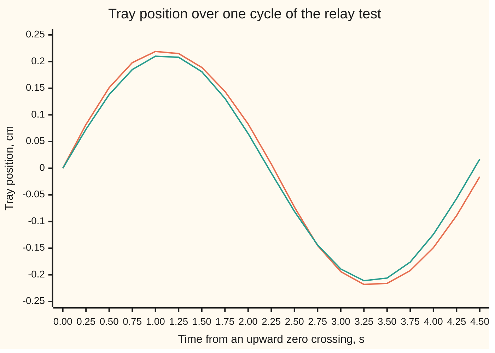
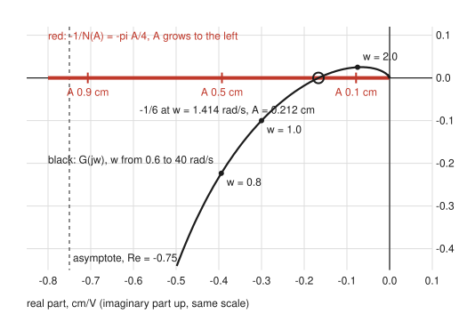

# Describing functions: predict a loop's oscillation by keeping one harmonic

[Syllabus](../../../SYLLABUS.md) → [Engineering mathematics](../README.md) → [Robustness and Adaptation](../README.md#s10) → Describing functions

---

## General Overview

A tray conveyor on a bottling line stops each tray under a filling nozzle. A position loop drives the belt motor: the drive command u, in volts (V), sets the motor torque, and the loop reads the tray position y, in centimetres (cm). The command is limited to ±1 V. The motor and belt answer slowly, with lags (time constants: how long each part takes to respond) of 1 s and 0.5 s.

Through the working day the load changes. Full crates make the belt heavier, so the gains tuned in the morning drift out of date. The engineer wants a quick, safe test that measures the loop again and gives fresh PID gains (proportional, integral and derivative gains).

The standard test is the **relay test**. Replace the controller with a switch (a **relay**) that drives +1 V whenever the tray is behind its target and −1 V whenever it is ahead. The belt does not settle. It rocks back and forth in a steady rhythm: a **limit cycle**, a repeating motion the loop keeps up by itself. In a simulation of this conveyor the tray swings ±0.2200 cm (2.2 mm) with a period of 4.5512 s.

The **describing function** predicts that swing before the test is run. A relay turns a sine wave into a square wave. The motor and belt smooth the square wave back into almost a sine. So treat the relay as a gain on that main sine alone, a gain that depends on how big the sine is. The prediction is ±0.2122 cm and 4.4429 s, within 3.6% and 2.4% of the simulated swing.

**A describing function replaces a nonlinear part of a loop by its gain on the fundamental sine (the lowest-frequency part of its output), a gain that depends on the amplitude; a limit cycle is predicted where the loop gain with that part in it equals −1, which fixes both the amplitude and the frequency of the swing.**

**What kind of fact this is:** an approximation method (harmonic balance), not a theorem. The relay's gain 4/(πA) is exact Fourier arithmetic, proved in Why it works. The prediction of the swing is approximate. This card measures its error against an exact solution and a simulation.

### The picture: the tray during the relay test



Orange: the simulated tray position once the swing has settled, peak 0.2200 cm. Green: the describing function's sine, amplitude 0.2122 cm at 1.4142 rad/s. The shapes nearly match: the belt has filtered the square wave into almost a pure sine.

---

## The formula

Notation first. The loop has one nonlinear part φ (here the relay) and one linear part, the plant G(s). The tray's position error is e = −y: the target is 0 cm and y is the position measured from it. The relay turns e into the drive command u = φ(e), and the plant turns u into y.

The transfer function G(s) says what the plant does to each exponential e^(st) (s is the Laplace variable). For this conveyor

```math
G(s) = \frac{1}{s\,(s+1)\,(s+2)}
```

The factor 1/s is the position adding up the speed. The factors s + 1 and s + 2 are the two lags, 1 s and 0.5 s. At steady state 1 V gives a speed of 0.5 cm/s.

Feed the nonlinear part a sine e = A sin(ωt) and keep only the fundamental of what comes out. The describing function N(A) is that fundamental's size divided by A. A limit cycle needs the sine to come back round the loop unchanged:

```math
N(A) = \frac{b_1(A)}{A}, \quad b_1(A) = \frac{1}{\pi}\int_0^{2\pi} \varphi(A\sin\theta)\,\sin\theta\, d\theta; \qquad \text{limit cycle where } G(j\omega) = -\frac{1}{N(A)}; \qquad \text{relay: } N(A) = \frac{4d}{\pi A}
```

**Read it aloud:** the describing function is the gain on the fundamental sine; a steady swing of amplitude A at frequency ω exists where the plant's frequency response equals minus one over that gain; and a relay of output ±d has gain four d over pi A, which falls as the swing grows.

For a **saturation**, a linear gain K that is clipped at ±1 V, write δ = 1/K for the error at which clipping starts and r = δ/A. Then

```math
N(A) = K \;\text{ for } A \le \delta, \qquad N(A) = \frac{2K}{\pi}\Big(\arcsin r + r\sqrt{1 - r^2}\Big) \;\text{ for } A > \delta
```

**Read it aloud:** a saturation has its full gain K for small swings, and a gain that falls towards zero as the swing grows past the clipping point.

The **relay test** reads the answer backwards. Measure the swing a and its period T_u, and the loop's ultimate gain (the proportional gain that just sustains an oscillation) is about

```math
K_u \approx \frac{4d}{\pi a}, \qquad T_u = \text{period of the swing}, \qquad \omega_u = \frac{2\pi}{T_u}
```

| Symbol | Plain meaning | In our example | Push it up and the answer… |
| --- | --- | --- | --- |
| $`G(s)`$ | plant transfer function, drive command (V) to position (cm) | $`1/(s(s+1)(s+2))`$ | larger G: larger swing |
| $`s`$, $`j`$, $`\omega`$ | the Laplace variable; √−1, written j as engineers do (the rest of the library writes i); angular frequency, rad/s | phase −180° at ω = 1.4142 rad/s | — |
| $`u`$, $`y`$, $`e`$ | drive command, V; tray position, cm; position error −y, cm | u = ±1 V; swing ±0.2200 cm | — |
| $`\varphi(e)`$ | the nonlinear part: relay or saturation | relay, saturation with K = 10 V/cm | — |
| $`d`$ | relay output level, V | 1 V | swing grows in proportion |
| $`A`$, $`a`$ | amplitude of the sine at the nonlinear part, cm; the measured swing in the relay test | predicted 0.2122, measured 0.2200 | — |
| $`\theta`$, $`b_1`$ | angle ωt over one cycle (t is time, s); first Fourier sine coefficient of φ's output, V; in the folds, k numbers the harmonics and G(jkω) = R_k + j I_k | b₁ = 4/π = 1.2732 V at any A, with d = 1 V | — |
| $`N(A)`$ | describing function: the gain on the fundamental, V/cm | 6.0000 at the swing | — |
| $`K`$, $`\delta`$, $`r`$ | saturation slope, V/cm; error where clipping starts, 1/K cm; δ/A | K = 10, δ = 0.1 cm | larger K: larger swing |
| $`K_u`$, $`T_u`$, $`\omega_u`$ | ultimate gain, V/cm; its period, s (P_u on the PID card); its frequency, rad/s | relay test: 5.7861, 4.5512 s, 1.3806 rad/s | — |
| $`K_p`$, $`T_i`$, $`T_d`$ | PID gains: proportional, V/cm; integral time, s; derivative time, s (so K_i = K_p/T_i, K_d = K_p T_d) | 45° rule: 4.0914, 3.4975, 0.8744 | — |
| PM | phase margin: how far the loop's phase is from −180° where its gain is 1 | 46.18° for the 45° rule | more damping, slower |

### When it holds

- **The plant filters out the harmonics.** Here the third harmonic in y is only 0.0231 of the fundamental, and the exact solution and the simulation put the amplitude error at 3.6%. An integrator with a 1 s delay does not filter: the describing function predicts a swing of 0.8106 cm, and the true triangle wave swings 1.0000 cm (simulated 1.0010 cm).
- **The nonlinear part has no memory and is symmetric.** Then N(A) is a real number. A relay with hysteresis (it switches late) has memory, and N(A) becomes complex. A bias, such as a load that always pushes one way, adds a constant term this card leaves out.
- **One nonlinear part, the rest linear and fixed.** Two nonlinear parts, or a plant that changes during the test, break the single gain picture.
- **It is a prediction, not a proof.** It can miss a cycle or report one that does not exist. Here it gets the case K = 5 right: no crossing, and the simulated swing dies to 0.00665 cm after 80 s.

---

## Why it works

### Step 0: close the loop on one sine

Guess that the loop already swings, so the error is a sine. The relay turns it into a square wave. The square wave is a sum of sines at the fundamental frequency and at 3, 5, 7… times it ([Fourier series](../../08-Differential%20equations%20and%20dynamics/09-Fourier%20Series/01-fourier-series-and-orthogonality.md)). The plant passes the fundamental and crushes the rest. What comes back round the loop is close to a sine again.

So check only the fundamental. It must come back with the same size and the same phase. That one condition fixes the two unknowns, amplitude and frequency. This is **harmonic balance**.

### Step 1: the relay's gain on the fundamental

A relay of level d fed A sin θ gives +d for half the cycle and −d for the other half. Its first sine coefficient is

```math
b_1 = \frac{1}{\pi}\int_0^{2\pi} d\,\mathrm{sign}(\sin\theta)\,\sin\theta\, d\theta = \frac{2d}{\pi}\int_0^{\pi} \sin\theta\, d\theta = \frac{4d}{\pi}.
```

So the output's fundamental is (4d/π) sin θ, whatever A is. Divided by A, the gain is N(A) = 4d/(πA). A small swing sees a large gain; a large swing sees a small one. That falling gain is what holds the swing at one size.

### Step 2: the balance condition

Put e = A sin(ωt). The relay's fundamental is N(A) A sin(ωt). The plant multiplies it by G(jω), and the error is minus the result. For the sine to return unchanged,

```math
A = -G(j\omega)\,N(A)\,A \quad\Longrightarrow\quad 1 + N(A)\,G(j\omega) = 0 \quad\Longrightarrow\quad G(j\omega) = -\frac{1}{N(A)}.
```

The relay's N is real and positive, so −1/N lies on the negative real axis. The phase of G must therefore be −180°. For this plant

```math
G(j\omega) = \frac{1}{-3\omega^2 + j\omega(2 - \omega^2)},
```

which is real when ω² = 2. So ω = √2 = 1.4142 rad/s and G(j√2) = −1/6. The magnitude condition reads 4/(πA) = 6, so A = 0.2122 cm. The period is 2π/1.4142 = 4.4429 s.

### Step 3: is the swing stable? Read N as a gain

Treat N(A) as a proportional gain. With a gain k, the curve kG(jω) crosses the negative real axis at −k/6. By the test on the [Nyquist and margins](../03-Feedback%20Control/06-nyquist-criterion-and-stability-margins.md) card, the loop is stable for k below 6 and swings with growing amplitude above 6. Now follow a swing:

- A swing smaller than 0.2122 cm sees a gain above 6, so it grows.
- A swing larger than 0.2122 cm sees a gain below 6, so it shrinks.

Both roads lead to 0.2122 cm, so the limit cycle is stable: nearby swings fall onto it ([Limit cycles](../../08-Differential%20equations%20and%20dynamics/06-Nonlinear%20Dynamics%20in%20the%20Plane/08-limit-cycles-and-van-der-pol.md)). The simulation agrees. Started at 0.01 cm, it settles at 0.2200 cm. Started at 1.00 cm, it settles at 0.2201 cm.

In the Nyquist plane the same test reads: as A grows, the point −1/N(A) moves left along the axis. Where it leaves the region the curve G(jω) encloses, the swing is stable.

<p align="center"></p>

To scale: 480 drawing units per 1 cm/V on both axes. Black: G(jω) for ω from 0.6 to 40 rad/s, passing −0.3942 − 0.2234j at 0.8 rad/s, −0.3000 − 0.1000j at 1.0 rad/s and −0.0750 + 0.0250j at 2.0 rad/s. Red: −1/N(A) = −πA/4, at −0.0785 for A = 0.1 cm, −0.3927 for 0.5 cm and −0.7069 for 0.9 cm. They meet at −0.1667, where A = 0.2122 cm.

### Step 4: how big is the error?

The method dropped the harmonics. Check what they would add. At the swing, the relay's third harmonic is 1/3 of its fundamental, and the plant passes it with 0.0692 times the gain it gives the fundamental. So the third harmonic in y is 0.0231 of the fundamental: small, but not zero.

An exact answer exists for a relay. Keep every odd harmonic of the square wave, add up the plant's response to each, and demand that y crosses zero exactly when the relay switches. That gives ω = 1.3806 rad/s, a period of 4.5511 s and a swing of 0.2200 cm. The simulation gives 4.5512 s and 0.2200 cm.

<details>
<summary>Detailed proof: the exact relay oscillation as a sum over every harmonic</summary>

Suppose the swing is symmetric, with period 2π/ω, and the relay drives u = +d while y < 0, from t = 0 to half a period. As a Fourier series,

$`\displaystyle u(t) = \sum_{k = 1, 3, 5, \dots} \frac{4d}{k\pi}\sin(k\omega t).`$

The plant scales and shifts each sine. Writing G(jkω) = R_k + j I_k,

$`\displaystyle y(t) = \sum_{k \text{ odd}} \frac{4d}{k\pi}\big(R_k \sin(k\omega t) + I_k \cos(k\omega t)\big).`$

The relay switches when y crosses zero, so y(0) = 0:

$`\displaystyle \sum_{k \text{ odd}} \frac{I_k}{k} = 0.`$

This one equation fixes ω; the series then gives y(t) and its peak. The describing function keeps only k = 1, where I₁ = 0 is the phase condition of Step 2. The other terms move the switching frequency down to 1.3806 rad/s. The code sums the first 1000 odd terms; they shrink like 1/k⁴.

</details>

The describing function lands 3.6% low on the amplitude and 2.4% short on the period. For tuning a PID that is close enough, as Step 6 shows.

### Step 5: a saturation turns a runaway into a swing

Now replace the relay with a proportional controller of gain K = 10 V/cm, clipped at ±1 V. The linear analysis says the loop is unstable: 10 is above the ultimate gain 6. The closed-loop poles are −3.3089 and 0.1545 ± 1.7316j, so the swing should grow 1.8 times every cycle, forever.

It does not. Once the swing passes δ = 0.1 cm the drive clips, and the saturation's gain falls. Setting N(A) = 6 with K = 10 gives A = 0.2033 cm, still at 1.4142 rad/s. The simulation settles at 0.2066 cm with a period of 4.4888 s.

<details>
<summary>Detailed proof: the saturation's describing function</summary>

Feed A sin θ with A > δ. The output follows K A sin θ until sin θ = δ/A = r, at θ₁ = arcsin r, then sits at 1 V. By symmetry, four times the first quarter cycle gives

$`\displaystyle b_1 = \frac{4}{\pi}\Big(\int_0^{\theta_1} K A \sin^2\theta\, d\theta + \int_{\theta_1}^{\pi/2} \sin\theta\, d\theta\Big) = \frac{4}{\pi}\Big(K A\Big(\frac{\theta_1}{2} - \frac{\sin 2\theta_1}{4}\Big) + \cos\theta_1\Big).`$

With K A = 1/r, sin 2θ₁ = 2r√(1 − r²) and cos θ₁ = √(1 − r²), this is

$`\displaystyle b_1 = \frac{2}{\pi}\Big(\frac{\theta_1}{r} + \sqrt{1 - r^2}\Big), \qquad N(A) = \frac{b_1}{A} = \frac{2K}{\pi}\Big(\arcsin r + r\sqrt{1 - r^2}\Big),`$

using 1/A = K r. At A = 0.3 cm the formula gives 4.1642 V/cm for K = 10 and 3.9045 for K = 5; a numerical Fourier integral gives the same.

</details>

With K = 5 the gain N(A) never exceeds 5, so it never reaches 6. There is no crossing, and the swing dies away.

### Step 6: from the relay test to PID gains

At the limit cycle, N(a)·|G(jω)| = 1 and the phase is −180°. That is exactly the edge a proportional gain N(a) would put the loop on. So the relay test measures the ultimate gain and its period without ever setting a risky gain by hand: K_u ≈ 4d/(πa) and T_u is the swing's period. The relay level d caps the swing, here at 2.2 mm.

From the simulated test: K_u = 4/(π × 0.2200) = 5.7861 V/cm, against the true 6.0000, and T_u = 4.5512 s, against 4.4429 s.

Two rules turn these into gains, both with the derivative acting on the measurement, so a setpoint step does not jolt the drive:

- **Ziegler–Nichols** ([PID control](../03-Feedback%20Control/07-pid-control-and-tuning.md)): K_p = 0.6 K_u, T_i = T_u/2, T_d = T_u/8. At ω_u the plant's curve sits near −1/K_u, on the −180° line; this controller turns that point to a phase of −154.96°.
- **A chosen phase margin.** Pick the PM wanted, here 45°. Set K_p = K_u cos(PM). Choose T_d, with T_i = 4 T_d, so the controller adds a phase lead of PM at ω_u. The loop then crosses gain 1 at ω_u with that margin.

Each tuned loop gets a 1 mm step in target position, then at 30 s a load change equal to 0.1 V of drive command pushing back.

| Rule | K_p, V/cm | T_i, s | T_d, s | PM | Overshoot | Dip from the load | Largest command |
| --- | --- | --- | --- | --- | --- | --- | --- |
| Ziegler–Nichols | 3.4717 | 2.2756 | 0.5689 | 26.11° | 71.3% | 0.291 mm | 0.365 V |
| 45° margin | 4.0914 | 3.4975 | 0.8744 | 46.18° | 34.4% | 0.225 mm | 0.414 V |

Both loops return to 1.0000 mm and recover from the load, and the command stays inside ±1 V. The 45° rule asked for 45° and got 46.18°. The relay test's errors show up as that small gap, mainly its 2.4% low frequency: at ω_u = 1.3806 rad/s the plant's phase is −178.7°, not −180°. The loop phase stays above −180° at every frequency up to 100 rad/s (lowest −179.6° and −178.9°), so neither loop has a finite gain margin with this ideal derivative.

---

## Worked numbers, by hand

| Step | Arithmetic | Value |
| --- | --- | --- |
| frequency where the phase is −180° | −3ω² + jω(2 − ω²) real when ω² = 2 | ω = 1.4142 rad/s |
| plant gain there | 1/(−3 × 2) | −0.1667 cm/V = −1/6 |
| relay's first harmonic, d = 1 V | 4/π | 1.2732 V |
| balance | 4/(πA) = 6, so A = 4/(6π) | A = 0.2122 cm |
| period | 2π/1.4142 | 4.4429 s |
| check against simulation | 0.2122/0.2200 − 1; 4.4429/4.5512 − 1 | −3.6%; −2.4% |
| relay test, ultimate gain | 4/(π × 0.2200) | 5.7861 V/cm |
| Ziegler–Nichols K_p, T_i, T_d | 0.6 × 5.7861; 4.5512/2; 4.5512/8 | 3.4717 V/cm; 2.2756 s; 0.5689 s |
| 45° rule, K_p | 5.7861 × cos 45° | 4.0914 V/cm |
| **predicted swing** | | **±0.2122 cm every 4.4429 s** |

On the conveyor: the relay test should rock the tray by 2.122 mm every 4.4429 s, and the simulated test rocks it by 2.200 mm every 4.5512 s. That is close enough to trust the gains it gives.

### What breaks if you drop a piece

| Mistake | Comes out at | What went wrong |
| --- | --- | --- |
| Drop the 4/π: take the relay's gain as d/A | A = 0.1667 cm, 24.3% under the simulated swing | the square wave's fundamental is 4/π = 1.2732 times taller than the square wave itself |
| Treat the clipped K = 10 loop as linear | poles 0.1545 ± 1.7316j: the swing grows 1.8 times per cycle without end | the drive clips; the real swing stays at 0.2066 cm |
| Use it on a plant that does not filter: an integrator with a 1 s delay | predicted 0.8106 cm, period 4 s | the plant passes the harmonics; the true swing is a triangle of 1.0000 cm (simulated 1.0010 cm) |
| Use the Ziegler–Nichols gains as they come | 71.3% overshoot on a 1 mm step, PM 26.11° | the rule aims for fast recovery, not a gentle step |

---

## Code, from first principles, and it actually runs

The scripts compute the swing by three independent roads. Road 1 is the describing function, in closed form and again by a numerical Fourier integral of the relay and saturation outputs. Road 2 is the exact relay oscillation, summed over the first 1000 odd harmonics with the switching frequency found by bisection. Road 3 simulates the loop with a fourth-order Runge–Kutta step (RK4) of 0.0001 s and finds the period from zero crossings. The asserts tie the roads together. Then the scripts run the relay test, tune two PIDs, compute their phase margins from the frequency response, and simulate each against a step and a load change.

### Python

```python
# Describing functions and limit cycles -- the check behind the card.  Standard library only.
# A tray conveyor's position loop: drive command u (V) -> belt position y (cm), G(s) = 1/(s(s+1)(s+2)).
# Roads: (1) describing function, closed form and by numerical Fourier integral; (2) the exact relay
# oscillation as a sum over every odd harmonic; (3) RK4 simulation of the loop with the nonlinearity.
import math
PI = math.pi

def G(w):  # G(jw) = 1/(-3w^2 + j w (2 - w^2)), returned as (re, im)
    a, b = -3*w*w, w*(2 - w*w); d = a*a + b*b
    return a/d, -b/d

def phase(w):  # degrees, unwrapped: -90 - atan w - atan(w/2)
    return -90 - math.degrees(math.atan(w) + math.atan(w/2))

def bisect(f, lo, hi, n=100):  # root of f between lo and hi (f changes sign)
    for _ in range(n):
        m = (lo + hi)/2
        if (f(lo) > 0) == (f(m) > 0): lo = m
        else: hi = m
    return (lo + hi)/2

def relay(e): return 1.0 if e > 0 else -1.0
def sat(K): return lambda e: max(-1.0, min(1.0, K*e))
def df_num(nl, A, n=20000):  # first Fourier sine coefficient of nl(A sin t), divided by A
    return sum(nl(A*math.sin((i + 0.5)*2*PI/n))*math.sin((i + 0.5)*2*PI/n) for i in range(n))*2/n/A
def df_sat(K, A):  # saturation of slope K and output limit 1 V, closed form
    r = 1/(K*A)
    return K if r >= 1 else 2*K/PI*(math.asin(r) + r*math.sqrt(1 - r*r))

def sim(nl, y0, tend, dt=1e-4):  # u = -nl(y); returns upward zero crossings and y samples
    x = [y0, 0.0, 0.0]; t = 0.0; ups = []; ys = []
    f = lambda x, u: (x[1], x[2], u - 3*x[2] - 2*x[1])
    while t < tend - 1e-9:
        u = -nl(x[0]); yp = x[0]
        k1 = f(x, u); k2 = f([x[i] + dt/2*k1[i] for i in range(3)], u)
        k3 = f([x[i] + dt/2*k2[i] for i in range(3)], u); k4 = f([x[i] + dt*k3[i] for i in range(3)], u)
        x = [x[i] + dt/6*(k1[i] + 2*k2[i] + 2*k3[i] + k4[i]) for i in range(3)]; t += dt
        if yp < 0 <= x[0]: ups.append(t - dt*x[0]/(x[0] - yp))
        ys.append(x[0])
    return ups, ys

def cycle(ups, ys, dt=1e-4):  # period and amplitude over the last full cycle
    T = ups[-1] - ups[-2]; seg = ys[int(ups[-2]/dt):int(ups[-1]/dt)]
    return T, (max(seg) - min(seg))/2

# ---- the plant: where the phase reaches -180 degrees ----
w180 = bisect(lambda w: phase(w) + 180, 0.1, 10)
g180 = math.hypot(*G(w180))
print(f"plant: phase -180 deg at w {w180:.4f} rad/s (sqrt 2 = {math.sqrt(2):.4f}), |G| {g180:.4f} cm/V = 1/{1/g180:.4f}")
assert abs(w180 - math.sqrt(2)) < 1e-9 and abs(g180 - 1/6) < 1e-9 and abs(math.degrees(math.atan2(G(1)[1], G(1)[0])) - phase(1)) < 1e-9

# ---- road 1: describing function of the relay ----
c1 = df_num(relay, 1.0)
print(f"relay: first harmonic of a +-1 V square wave {c1:.4f} V (4/pi = {4/PI:.4f})")
assert abs(c1 - 4/PI) < 1e-6
A_df = 4/(PI*(1/g180)); T_df = 2*PI/w180
print(f"describing function: 4/(pi A) = {1/g180:.4f}  ->  A {A_df:.4f} cm, period {T_df:.4f} s")
r3 = math.hypot(*G(3*w180))/math.hypot(*G(w180))/3
print(f"third harmonic in y, relative to the fundamental: (1/3) x {r3*3:.4f} = {r3:.4f}")

# ---- road 2: the exact symmetric relay oscillation, every odd harmonic ----
def y_ex(t, w): return sum(4/(k*PI)*(G(k*w)[0]*math.sin(k*w*t) + G(k*w)[1]*math.cos(k*w*t)) for k in range(1, 2000, 2))
w_ex = bisect(lambda w: sum(G(k*w)[1]/k for k in range(1, 2000, 2)), 1.0, 2.0, 60)
T_ex = 2*PI/w_ex; A_ex = max(abs(y_ex(i*T_ex/2000, w_ex)) for i in range(1000))
print(f"exact harmonic sum: w {w_ex:.4f} rad/s, period {T_ex:.4f} s, A {A_ex:.4f} cm")

# ---- road 3: simulate the relay loop from a small and a large start ----
for y0 in (1.0, 0.01):
    ups, ys = sim(relay, y0, 60)
    T_s, A_s = cycle(ups, ys)
    print(f"simulation from y0 {y0:.2f} cm: period {T_s:.4f} s, A {A_s:.4f} cm")
    assert abs(T_s - T_ex) < 2e-3 and abs(A_s - A_ex) < 2e-4
print(f"describing function vs simulation: A {100*(A_df/A_s - 1):+.1f}%, period {100*(T_df/T_s - 1):+.1f}%")
assert abs(A_df/A_s - 1) < 0.05 and abs(T_df/T_s - 1) < 0.03 and abs(A_df/A_s - 1) > 0.01
t0 = ups[-2]; pts = [ys[int((t0 + 0.25*i)/1e-4)] for i in range(19)]
print("chart, simulated y:", " ".join(f"{p:.3f}" for p in pts))
print("chart, DF sine:    ", " ".join(f"{A_df*math.sin(w180*0.25*i):.3f}" for i in range(19)))

# ---- saturation: proportional gain K V/cm, drive limited to +-1 V ----
for Kg in (10.0, 5.0):
    print(f"saturation K {Kg:.0f}: N(0.3 cm) closed form {df_sat(Kg, 0.3):.4f}, integral {df_num(sat(Kg), 0.3):.4f} V/cm")
    assert abs(df_sat(Kg, 0.3) - df_num(sat(Kg), 0.3)) < 1e-4
A_sat = bisect(lambda A: df_sat(10.0, A) - 6, 0.1, 10)
ups, ys = sim(sat(10.0), 0.01, 80); T_s10, A_s10 = cycle(ups, ys)
print(f"saturation K 10: predicted A {A_sat:.4f} cm, period {T_df:.4f} s; simulated A {A_s10:.4f} cm, period {T_s10:.4f} s")
assert abs(A_sat/A_s10 - 1) < 0.05
ups, ys = sim(sat(5.0), 0.3, 80)
print(f"saturation K 5: N <= 5 < 6, no crossing; after 80 s |y| <= {max(abs(v) for v in ys[-50000:]):.5f} cm")
assert max(abs(v) for v in ys[-50000:]) < 1e-2

# ---- relay autotune -> PID, then test it on a 1 mm step and a load change ----
Ku, Tu = 4/(PI*A_s), T_s; wu = 2*PI/Tu
print(f"relay test: Ku {Ku:.4f} V/cm (true 6.0000), Tu {Tu:.4f} s (true {T_df:.4f}); plant phase at wu {wu:.4f} rad/s {phase(wu):.1f} deg")
def pid_test(name, Kp, Ti, Td):
    Ki, Kd = Kp/Ti, Kp*Td
    ph = lambda w: phase(w) + math.degrees(math.atan2(Kd*w - Ki/w, Kp))
    mag = lambda w: math.hypot(*G(w))*math.hypot(Kp, Kd*w - Ki/w)
    wgc = bisect(lambda w: mag(w) - 1, 0.3, 20); PM = 180 + ph(wgc)
    low = min(ph(0.01*1.01**i) for i in range(926))  # phase from 0.01 to 100 rad/s
    x = [0.0]*4; dt = 1e-3; peak = umax = dip = 0.0  # x = y, y', y'', integral of the error
    f = lambda x, d: (x[1], x[2], Kp*(0.1 - x[0]) + Ki*x[3] - Kd*x[1] + d - 3*x[2] - 2*x[1], 0.1 - x[0])
    for i in range(60000):
        d = -0.1 if i >= 30000 else 0.0
        k1 = f(x, d); k2 = f([x[j] + dt/2*k1[j] for j in range(4)], d)
        k3 = f([x[j] + dt/2*k2[j] for j in range(4)], d); k4 = f([x[j] + dt*k3[j] for j in range(4)], d)
        x = [x[j] + dt/6*(k1[j] + 2*k2[j] + 2*k3[j] + k4[j]) for j in range(4)]
        umax = max(umax, abs(Kp*(0.1 - x[0]) + Ki*x[3] - Kd*x[1]))
        if i < 30000: peak = max(peak, x[0])
        else: dip = max(dip, 0.1 - x[0])
    print(f"{name}: Kp {Kp:.4f} V/cm, Ti {Ti:.4f} s, Td {Td:.4f} s; PM {PM:.2f} deg at {wgc:.4f} rad/s; lowest phase to 100 rad/s {low:.1f} deg")
    print(f"  1 mm step: overshoot {100*(peak/0.1 - 1):.1f}%; 0.1 V load at 30 s: dip {10*dip:.3f} mm; y(60 s) {10*x[0]:.4f} mm; max |u| {umax:.3f} V")
    assert low > -180 and abs(x[0] - 0.1) < 1e-3 and umax < 1
    return PM
pm_zn = pid_test("ZN PID", 0.6*Ku, Tu/2, Tu/8)
print(f"ZN moves the point -1/Ku to phase {-180 + math.degrees(math.atan(PI/4 - 1/PI)):.2f} deg at wu")
t45 = math.tan(PI/4); Td45 = (t45 + math.sqrt(t45*t45 + 1))/2/wu  # Ti = 4 Td, phase lead 45 deg at wu
pm_ah = pid_test("45-deg relay PID", Ku*math.cos(PI/4), 4*Td45, Td45)
assert 40 < pm_ah < 50 and pm_zn < 30

# ---- what breaks ----
print(f"break, no 4/pi: A {g180:.4f} cm, {100*(g180/A_s - 1):+.1f}% against the simulation")
r = bisect(lambda s: s**3 + 3*s*s + 2*s + 10, -5, 0)  # real root of s^3 + 3s^2 + 2s + 10
b, c = 3 + r, -10/r; grow, wl = -b/2, math.sqrt(c - b*b/4)  # the other two: s^2 + b s + c
print(f"break, K 10 treated as linear: poles {r:.4f}, {grow:.4f} +- {wl:.4f}j; swing x{math.exp(grow*2*PI/wl):.1f} per cycle; real swing stays at {A_s10:.4f} cm")
assert grow > 0
yd, buf, n = 0.0, [-1.0]*1000, 0; ymax = 0.0  # integrator plus 1 s delay, step 1 ms, relay through the delay
for i in range(20000):
    u = buf[n % 1000]; buf[n % 1000] = -relay(yd); n += 1; yd += 1e-3*u
    if i > 10000: ymax = max(ymax, abs(yd))
print(f"break, integrator + 1 s delay: describing function A {4/PI*2/PI:.4f} cm, period 4 s; exact triangle A {1.0*1000*1e-3:.4f} cm (1 cm/s for 1 s), simulated {ymax:.4f} cm")
assert abs(ymax - 1) < 5e-3
ups, ys = sim(lambda e: 2*relay(e), 0.01, 60); T2, A2 = cycle(ups, ys)
print(f"try relay +-2 V: describing function A {2*A_df:.4f} cm; simulated A {A2:.4f} cm, period {T2:.4f} s")
ups, ys = sim(sat(20.0), 0.01, 80); T20, A20 = cycle(ups, ys)
print(f"try K 20: predicted A {bisect(lambda A: df_sat(20.0, A) - 6, 0.05, 10):.4f} cm; simulated A {A20:.4f} cm, period {T20:.4f} s")
t60 = math.tan(PI/3); Td60 = (t60 + math.sqrt(t60*t60 + 1))/2/wu
pid_test("try 60-deg relay PID", Ku*math.cos(PI/3), 4*Td60, Td60)
print(f"figure, nyquist", " ".join(f"{w}:{G(w)[0]:.4f},{G(w)[1]:.4f}" for w in (0.8, 1.0, 1.4142, 2.0, 3.0)),
      "; -1/N(A)", " ".join(f"{A}:{-PI*A/4:.4f}" for A in (0.1, 0.2122, 0.5, 0.9)))
print("ALL CHECKS PASS")
```

**Ran 2026-11-23 on macOS, Python 3.14.10, standard library only. All checks passed. Output, pasted from the run:**

```
plant: phase -180 deg at w 1.4142 rad/s (sqrt 2 = 1.4142), |G| 0.1667 cm/V = 1/6.0000
relay: first harmonic of a +-1 V square wave 1.2732 V (4/pi = 1.2732)
describing function: 4/(pi A) = 6.0000  ->  A 0.2122 cm, period 4.4429 s
third harmonic in y, relative to the fundamental: (1/3) x 0.0692 = 0.0231
exact harmonic sum: w 1.3806 rad/s, period 4.5511 s, A 0.2200 cm
simulation from y0 1.00 cm: period 4.5516 s, A 0.2201 cm
simulation from y0 0.01 cm: period 4.5512 s, A 0.2200 cm
describing function vs simulation: A -3.6%, period -2.4%
chart, simulated y: 0.000 0.082 0.151 0.198 0.219 0.215 0.189 0.144 0.083 0.008 -0.073 -0.145 -0.194 -0.218 -0.216 -0.192 -0.149 -0.089 -0.016
chart, DF sine:     0.000 0.073 0.138 0.185 0.210 0.208 0.181 0.131 0.065 -0.009 -0.081 -0.144 -0.189 -0.211 -0.206 -0.176 -0.124 -0.057 0.017
saturation K 10: N(0.3 cm) closed form 4.1642, integral 4.1642 V/cm
saturation K 5: N(0.3 cm) closed form 3.9045, integral 3.9045 V/cm
saturation K 10: predicted A 0.2033 cm, period 4.4429 s; simulated A 0.2066 cm, period 4.4888 s
saturation K 5: N <= 5 < 6, no crossing; after 80 s |y| <= 0.00665 cm
relay test: Ku 5.7861 V/cm (true 6.0000), Tu 4.5512 s (true 4.4429); plant phase at wu 1.3806 rad/s -178.7 deg
ZN PID: Kp 3.4717 V/cm, Ti 2.2756 s, Td 0.5689 s; PM 26.11 deg at 1.0670 rad/s; lowest phase to 100 rad/s -179.6 deg
  1 mm step: overshoot 71.3%; 0.1 V load at 30 s: dip 0.291 mm; y(60 s) 1.0000 mm; max |u| 0.365 V
ZN moves the point -1/Ku to phase -154.96 deg at wu
45-deg relay PID: Kp 4.0914 V/cm, Ti 3.4975 s, Td 0.8744 s; PM 46.18 deg at 1.3932 rad/s; lowest phase to 100 rad/s -178.9 deg
  1 mm step: overshoot 34.4%; 0.1 V load at 30 s: dip 0.225 mm; y(60 s) 1.0000 mm; max |u| 0.414 V
break, no 4/pi: A 0.1667 cm, -24.3% against the simulation
break, K 10 treated as linear: poles -3.3089, 0.1545 +- 1.7316j; swing x1.8 per cycle; real swing stays at 0.2066 cm
break, integrator + 1 s delay: describing function A 0.8106 cm, period 4 s; exact triangle A 1.0000 cm (1 cm/s for 1 s), simulated 1.0010 cm
try relay +-2 V: describing function A 0.4244 cm; simulated A 0.4401 cm, period 4.5512 s
try K 20: predicted A 0.2102 cm; simulated A 0.2164 cm, period 4.5306 s
try 60-deg relay PID: Kp 2.8931 V/cm, Ti 5.4066 s, Td 1.3516 s; PM 61.04 deg at 1.3950 rad/s; lowest phase to 100 rad/s -178.7 deg
  1 mm step: overshoot 22.8%; 0.1 V load at 30 s: dip 0.274 mm; y(60 s) 1.0001 mm; max |u| 0.291 V
figure, nyquist 0.8:-0.3942,-0.2234 1.0:-0.3000,-0.1000 1.4142:-0.1667,-0.0000 2.0:-0.0750,0.0250 3.0:-0.0231,0.0179 ; -1/N(A) 0.1:-0.0785 0.2122:-0.1667 0.5:-0.3927 0.9:-0.7069
ALL CHECKS PASS
```

### Rust

```rust
// Describing functions and limit cycles -- the same check as the Python, in Rust.  std only, no crates.
// A tray conveyor's position loop: drive command u (V) -> belt position y (cm), G(s) = 1/(s(s+1)(s+2)).
// Roads: (1) describing function, closed form and by numerical Fourier integral; (2) the exact relay
// oscillation as a sum over every odd harmonic; (3) RK4 simulation of the loop with the nonlinearity.
use std::f64::consts::PI;

fn g(w: f64) -> (f64, f64) { // G(jw) = 1/(-3w^2 + j w (2 - w^2)), returned as (re, im)
    let (a, b) = (-3.0 * w * w, w * (2.0 - w * w)); let d = a * a + b * b;
    (a / d, -b / d)
}
fn gm(w: f64) -> f64 { let (a, b) = g(w); a.hypot(b) }
fn phase(w: f64) -> f64 { -90.0 - (w.atan() + (w / 2.0).atan()).to_degrees() } // degrees, unwrapped
fn bisect(f: &dyn Fn(f64) -> f64, mut lo: f64, mut hi: f64, n: usize) -> f64 {
    for _ in 0..n {
        let m = (lo + hi) / 2.0;
        if (f(lo) > 0.0) == (f(m) > 0.0) { lo = m } else { hi = m }
    }
    (lo + hi) / 2.0
}
fn relay(e: f64) -> f64 { if e > 0.0 { 1.0 } else { -1.0 } }
fn sat(k: f64, e: f64) -> f64 { (k * e).min(1.0).max(-1.0) }
fn df_num(nl: &dyn Fn(f64) -> f64, a: f64) -> f64 { // first Fourier sine coefficient of nl(A sin t), over A
    let n = 20000; let mut s = 0.0;
    for i in 0..n { let t = (i as f64 + 0.5) * 2.0 * PI / n as f64; s += nl(a * t.sin()) * t.sin(); }
    s * 2.0 / n as f64 / a
}
fn df_sat(k: f64, a: f64) -> f64 { // saturation of slope K and output limit 1 V, closed form
    let r = 1.0 / (k * a);
    if r >= 1.0 { k } else { 2.0 * k / PI * (r.asin() + r * (1.0 - r * r).sqrt()) }
}
fn sim(nl: &dyn Fn(f64) -> f64, y0: f64, tend: f64) -> (Vec<f64>, Vec<f64>) { // u = -nl(y)
    let dt = 1e-4; let mut x = [y0, 0.0, 0.0]; let mut t = 0.0; let (mut ups, mut ys) = (vec![], vec![]);
    let f = |x: &[f64; 3], u: f64| [x[1], x[2], u - 3.0 * x[2] - 2.0 * x[1]];
    let add = |x: &[f64; 3], k: &[f64; 3], h: f64| [x[0] + h * k[0], x[1] + h * k[1], x[2] + h * k[2]];
    while t < tend - 1e-9 {
        let u = -nl(x[0]); let yp = x[0];
        let k1 = f(&x, u); let k2 = f(&add(&x, &k1, dt / 2.0), u);
        let k3 = f(&add(&x, &k2, dt / 2.0), u); let k4 = f(&add(&x, &k3, dt), u);
        for i in 0..3 { x[i] = x[i] + dt / 6.0 * (k1[i] + 2.0 * k2[i] + 2.0 * k3[i] + k4[i]); } t += dt;
        if yp < 0.0 && 0.0 <= x[0] { ups.push(t - dt * x[0] / (x[0] - yp)); }
        ys.push(x[0]);
    }
    (ups, ys)
}
fn cycle(ups: &[f64], ys: &[f64]) -> (f64, f64) { // period and amplitude over the last full cycle
    let n = ups.len(); let seg = &ys[(ups[n - 2] / 1e-4) as usize..(ups[n - 1] / 1e-4) as usize];
    let mx = seg.iter().cloned().fold(f64::MIN, f64::max); let mn = seg.iter().cloned().fold(f64::MAX, f64::min);
    (ups[n - 1] - ups[n - 2], (mx - mn) / 2.0)
}
fn pid_test(name: &str, kp: f64, ti: f64, td: f64) -> f64 {
    let (ki, kd) = (kp / ti, kp * td);
    let ph = |w: f64| phase(w) + (kd * w - ki / w).atan2(kp).to_degrees();
    let mag = |w: f64| gm(w) * kp.hypot(kd * w - ki / w);
    let wgc = bisect(&|w| mag(w) - 1.0, 0.3, 20.0, 100); let pm = 180.0 + ph(wgc);
    let low = (0..926).map(|i| ph(0.01 * 1.01f64.powf(i as f64))).fold(f64::MAX, f64::min);
    let (mut x, dt) = ([0.0f64; 4], 1e-3); let (mut peak, mut umax, mut dip) = (0.0f64, 0.0f64, 0.0f64);
    let f = |x: &[f64; 4], d: f64| [x[1], x[2], kp * (0.1 - x[0]) + ki * x[3] - kd * x[1] + d - 3.0 * x[2] - 2.0 * x[1], 0.1 - x[0]];
    let add = |x: &[f64; 4], k: &[f64; 4], h: f64| [x[0] + h * k[0], x[1] + h * k[1], x[2] + h * k[2], x[3] + h * k[3]];
    for i in 0..60000 {
        let d = if i >= 30000 { -0.1 } else { 0.0 };
        let k1 = f(&x, d); let k2 = f(&add(&x, &k1, dt / 2.0), d);
        let k3 = f(&add(&x, &k2, dt / 2.0), d); let k4 = f(&add(&x, &k3, dt), d);
        for j in 0..4 { x[j] = x[j] + dt / 6.0 * (k1[j] + 2.0 * k2[j] + 2.0 * k3[j] + k4[j]); }
        umax = umax.max((kp * (0.1 - x[0]) + ki * x[3] - kd * x[1]).abs());
        if i < 30000 { peak = peak.max(x[0]) } else { dip = dip.max(0.1 - x[0]) }
    }
    println!("{}: Kp {:.4} V/cm, Ti {:.4} s, Td {:.4} s; PM {:.2} deg at {:.4} rad/s; lowest phase to 100 rad/s {:.1} deg", name, kp, ti, td, pm, wgc, low);
    println!("  1 mm step: overshoot {:.1}%; 0.1 V load at 30 s: dip {:.3} mm; y(60 s) {:.4} mm; max |u| {:.3} V", 100.0 * (peak / 0.1 - 1.0), 10.0 * dip, 10.0 * x[0], umax);
    assert!(low > -180.0 && (x[0] - 0.1).abs() < 1e-3 && umax < 1.0);
    pm
}
fn main() {
    // ---- the plant: where the phase reaches -180 degrees ----
    let w180 = bisect(&|w| phase(w) + 180.0, 0.1, 10.0, 100); let g180 = gm(w180);
    println!("plant: phase -180 deg at w {:.4} rad/s (sqrt 2 = {:.4}), |G| {:.4} cm/V = 1/{:.4}", w180, 2f64.sqrt(), g180, 1.0 / g180);
    assert!((w180 - 2f64.sqrt()).abs() < 1e-9 && (g180 - 1.0 / 6.0).abs() < 1e-9 && (g(1.0).1.atan2(g(1.0).0).to_degrees() - phase(1.0)).abs() < 1e-9);
    // ---- road 1: describing function of the relay ----
    let c1 = df_num(&relay, 1.0);
    println!("relay: first harmonic of a +-1 V square wave {:.4} V (4/pi = {:.4})", c1, 4.0 / PI);
    assert!((c1 - 4.0 / PI).abs() < 1e-6);
    let (a_df, t_df) = (4.0 / (PI * (1.0 / g180)), 2.0 * PI / w180);
    println!("describing function: 4/(pi A) = {:.4}  ->  A {:.4} cm, period {:.4} s", 1.0 / g180, a_df, t_df);
    let r3 = gm(3.0 * w180) / gm(w180) / 3.0;
    println!("third harmonic in y, relative to the fundamental: (1/3) x {:.4} = {:.4}", r3 * 3.0, r3);
    // ---- road 2: the exact symmetric relay oscillation, every odd harmonic ----
    let y_ex = |t: f64, w: f64| (1..2000).step_by(2).map(|k| { let k = k as f64; let (a, b) = g(k * w);
        4.0 / (k * PI) * (a * (k * w * t).sin() + b * (k * w * t).cos()) }).sum::<f64>();
    let w_ex = bisect(&|w| (1..2000).step_by(2).map(|k| g(k as f64 * w).1 / k as f64).sum::<f64>(), 1.0, 2.0, 60);
    let t_ex = 2.0 * PI / w_ex;
    let a_ex = (0..1000).map(|i| y_ex(i as f64 * t_ex / 2000.0, w_ex).abs()).fold(f64::MIN, f64::max);
    println!("exact harmonic sum: w {:.4} rad/s, period {:.4} s, A {:.4} cm", w_ex, t_ex, a_ex);
    // ---- road 3: simulate the relay loop from a small and a large start ----
    let (mut t_s, mut a_s, mut ups, mut ys) = (0.0, 0.0, vec![], vec![]);
    for y0 in [1.0, 0.01] {
        let r = sim(&relay, y0, 60.0); ups = r.0; ys = r.1;
        let c = cycle(&ups, &ys); t_s = c.0; a_s = c.1;
        println!("simulation from y0 {:.2} cm: period {:.4} s, A {:.4} cm", y0, t_s, a_s);
        assert!((t_s - t_ex).abs() < 2e-3 && (a_s - a_ex).abs() < 2e-4);
    }
    println!("describing function vs simulation: A {:+.1}%, period {:+.1}%", 100.0 * (a_df / a_s - 1.0), 100.0 * (t_df / t_s - 1.0));
    assert!((a_df / a_s - 1.0).abs() < 0.05 && (t_df / t_s - 1.0).abs() < 0.03 && (a_df / a_s - 1.0).abs() > 0.01);
    let t0 = ups[ups.len() - 2];
    let pts: Vec<String> = (0..19).map(|i| format!("{:.3}", ys[((t0 + 0.25 * i as f64) / 1e-4) as usize])).collect();
    println!("chart, simulated y: {}", pts.join(" "));
    let dfs: Vec<String> = (0..19).map(|i| format!("{:.3}", a_df * (w180 * 0.25 * i as f64).sin())).collect();
    println!("chart, DF sine:     {}", dfs.join(" "));
    // ---- saturation: proportional gain K V/cm, drive limited to +-1 V ----
    for kg in [10.0, 5.0] {
        let (cf, ni) = (df_sat(kg, 0.3), df_num(&|e| sat(kg, e), 0.3));
        println!("saturation K {:.0}: N(0.3 cm) closed form {:.4}, integral {:.4} V/cm", kg, cf, ni);
        assert!((cf - ni).abs() < 1e-4);
    }
    let a_sat = bisect(&|a| df_sat(10.0, a) - 6.0, 0.1, 10.0, 100);
    let (u10, y10) = sim(&|e| sat(10.0, e), 0.01, 80.0); let (t_s10, a_s10) = cycle(&u10, &y10);
    println!("saturation K 10: predicted A {:.4} cm, period {:.4} s; simulated A {:.4} cm, period {:.4} s", a_sat, t_df, a_s10, t_s10);
    assert!((a_sat / a_s10 - 1.0).abs() < 0.05);
    let (_, y5) = sim(&|e| sat(5.0, e), 0.3, 80.0);
    let tail = y5[y5.len() - 50000..].iter().fold(0.0f64, |m, v| m.max(v.abs()));
    println!("saturation K 5: N <= 5 < 6, no crossing; after 80 s |y| <= {:.5} cm", tail);
    assert!(tail < 1e-2);
    // ---- relay autotune -> PID, then test it on a 1 mm step and a load change ----
    let (ku, tu) = (4.0 / (PI * a_s), t_s); let wu = 2.0 * PI / tu;
    println!("relay test: Ku {:.4} V/cm (true 6.0000), Tu {:.4} s (true {:.4}); plant phase at wu {:.4} rad/s {:.1} deg", ku, tu, t_df, wu, phase(wu));
    let pm_zn = pid_test("ZN PID", 0.6 * ku, tu / 2.0, tu / 8.0);
    println!("ZN moves the point -1/Ku to phase {:.2} deg at wu", -180.0 + (PI / 4.0 - 1.0 / PI).atan().to_degrees());
    let t45 = (PI / 4.0).tan(); let td45 = (t45 + (t45 * t45 + 1.0).sqrt()) / 2.0 / wu; // Ti = 4 Td
    let pm_ah = pid_test("45-deg relay PID", ku * (PI / 4.0).cos(), 4.0 * td45, td45);
    assert!(40.0 < pm_ah && pm_ah < 50.0 && pm_zn < 30.0);
    // ---- what breaks ----
    println!("break, no 4/pi: A {:.4} cm, {:+.1}% against the simulation", g180, 100.0 * (g180 / a_s - 1.0));
    let r = bisect(&|s: f64| s * s * s + 3.0 * s * s + 2.0 * s + 10.0, -5.0, 0.0, 100); // real root
    let (b, c) = (3.0 + r, -10.0 / r); let (grow, wl) = (-b / 2.0, (c - b * b / 4.0).sqrt()); // s^2 + b s + c
    println!("break, K 10 treated as linear: poles {:.4}, {:.4} +- {:.4}j; swing x{:.1} per cycle; real swing stays at {:.4} cm", r, grow, wl, (grow * 2.0 * PI / wl).exp(), a_s10);
    assert!(grow > 0.0);
    let (mut yd, mut buf, mut ymax) = (0.0f64, vec![-1.0f64; 1000], 0.0f64); // integrator plus 1 s delay
    for i in 0..20000 {
        let u = buf[i % 1000]; buf[i % 1000] = -relay(yd); yd += 1e-3 * u;
        if i > 10000 { ymax = ymax.max(yd.abs()); }
    }
    println!("break, integrator + 1 s delay: describing function A {:.4} cm, period 4 s; exact triangle A {:.4} cm (1 cm/s for 1 s), simulated {:.4} cm", 4.0 / PI * 2.0 / PI, 1.0 * 1000.0 * 1e-3, ymax);
    assert!((ymax - 1.0).abs() < 5e-3);
    let (u2, y2) = sim(&|e| 2.0 * relay(e), 0.01, 60.0); let (t2, a2) = cycle(&u2, &y2);
    println!("try relay +-2 V: describing function A {:.4} cm; simulated A {:.4} cm, period {:.4} s", 2.0 * a_df, a2, t2);
    let (u20, y20) = sim(&|e| sat(20.0, e), 0.01, 80.0); let (t20, a20) = cycle(&u20, &y20);
    println!("try K 20: predicted A {:.4} cm; simulated A {:.4} cm, period {:.4} s", bisect(&|a| df_sat(20.0, a) - 6.0, 0.05, 10.0, 100), a20, t20);
    let t60 = (PI / 3.0).tan(); let td60 = (t60 + (t60 * t60 + 1.0).sqrt()) / 2.0 / wu;
    pid_test("try 60-deg relay PID", ku * (PI / 3.0).cos(), 4.0 * td60, td60);
    let ny: Vec<String> = [("0.8", 0.8), ("1.0", 1.0), ("1.4142", 1.4142), ("2.0", 2.0), ("3.0", 3.0)].iter()
        .map(|&(s, w)| format!("{}:{:.4},{:.4}", s, g(w).0, g(w).1)).collect();
    let nl: Vec<String> = [("0.1", 0.1), ("0.2122", 0.2122), ("0.5", 0.5), ("0.9", 0.9)].iter()
        .map(|&(s, a)| format!("{}:{:.4}", s, -PI * a / 4.0)).collect();
    println!("figure, nyquist {} ; -1/N(A) {}", ny.join(" "), nl.join(" "));
    println!("ALL CHECKS PASS");
}
```

**Ran 2026-11-23 on macOS, rustc 1.98.1, no crates. All checks passed. Output, pasted from the run:**

```
plant: phase -180 deg at w 1.4142 rad/s (sqrt 2 = 1.4142), |G| 0.1667 cm/V = 1/6.0000
relay: first harmonic of a +-1 V square wave 1.2732 V (4/pi = 1.2732)
describing function: 4/(pi A) = 6.0000  ->  A 0.2122 cm, period 4.4429 s
third harmonic in y, relative to the fundamental: (1/3) x 0.0692 = 0.0231
exact harmonic sum: w 1.3806 rad/s, period 4.5511 s, A 0.2200 cm
simulation from y0 1.00 cm: period 4.5516 s, A 0.2201 cm
simulation from y0 0.01 cm: period 4.5512 s, A 0.2200 cm
describing function vs simulation: A -3.6%, period -2.4%
chart, simulated y: 0.000 0.082 0.151 0.198 0.219 0.215 0.189 0.144 0.083 0.008 -0.073 -0.145 -0.194 -0.218 -0.216 -0.192 -0.149 -0.089 -0.016
chart, DF sine:     0.000 0.073 0.138 0.185 0.210 0.208 0.181 0.131 0.065 -0.009 -0.081 -0.144 -0.189 -0.211 -0.206 -0.176 -0.124 -0.057 0.017
saturation K 10: N(0.3 cm) closed form 4.1642, integral 4.1642 V/cm
saturation K 5: N(0.3 cm) closed form 3.9045, integral 3.9045 V/cm
saturation K 10: predicted A 0.2033 cm, period 4.4429 s; simulated A 0.2066 cm, period 4.4888 s
saturation K 5: N <= 5 < 6, no crossing; after 80 s |y| <= 0.00665 cm
relay test: Ku 5.7861 V/cm (true 6.0000), Tu 4.5512 s (true 4.4429); plant phase at wu 1.3806 rad/s -178.7 deg
ZN PID: Kp 3.4717 V/cm, Ti 2.2756 s, Td 0.5689 s; PM 26.11 deg at 1.0670 rad/s; lowest phase to 100 rad/s -179.6 deg
  1 mm step: overshoot 71.3%; 0.1 V load at 30 s: dip 0.291 mm; y(60 s) 1.0000 mm; max |u| 0.365 V
ZN moves the point -1/Ku to phase -154.96 deg at wu
45-deg relay PID: Kp 4.0914 V/cm, Ti 3.4975 s, Td 0.8744 s; PM 46.18 deg at 1.3932 rad/s; lowest phase to 100 rad/s -178.9 deg
  1 mm step: overshoot 34.4%; 0.1 V load at 30 s: dip 0.225 mm; y(60 s) 1.0000 mm; max |u| 0.414 V
break, no 4/pi: A 0.1667 cm, -24.3% against the simulation
break, K 10 treated as linear: poles -3.3089, 0.1545 +- 1.7316j; swing x1.8 per cycle; real swing stays at 0.2066 cm
break, integrator + 1 s delay: describing function A 0.8106 cm, period 4 s; exact triangle A 1.0000 cm (1 cm/s for 1 s), simulated 1.0010 cm
try relay +-2 V: describing function A 0.4244 cm; simulated A 0.4401 cm, period 4.5512 s
try K 20: predicted A 0.2102 cm; simulated A 0.2164 cm, period 4.5306 s
try 60-deg relay PID: Kp 2.8931 V/cm, Ti 5.4066 s, Td 1.3516 s; PM 61.04 deg at 1.3950 rad/s; lowest phase to 100 rad/s -178.7 deg
  1 mm step: overshoot 22.8%; 0.1 V load at 30 s: dip 0.274 mm; y(60 s) 1.0001 mm; max |u| 0.291 V
figure, nyquist 0.8:-0.3942,-0.2234 1.0:-0.3000,-0.1000 1.4142:-0.1667,-0.0000 2.0:-0.0750,0.0250 3.0:-0.0231,0.0179 ; -1/N(A) 0.1:-0.0785 0.2122:-0.1667 0.5:-0.3927 0.9:-0.7069
ALL CHECKS PASS
```

### Lean

Lean proves both describing-function formulas for every amplitude, and finds where the conveyor plant's phase reaches −180°.

- Take a relay of level $`d`$ and any amplitude $`A > 0`$. Then $`b_1 = 4d/\pi`$, so $`N(A) = 4d/(\pi A)`$.
- Take a saturation of slope $`K > 0`$, clipped at ±1 V, and any $`A > 0`$. Then $`N(A) = K`$ whenever $`A \le \delta`$.
- Take the same saturation with $`A > \delta`$ and $`r = \delta/A`$. Then $`N(A) = (2K/\pi)(\arcsin r + r\sqrt{1 - r^2})`$.
- Take $`G(s) = 1/(s(s+1)(s+2))`$ and any $`\omega > 0`$. Then $`G(j\omega)`$ is real only at $`\omega = \sqrt 2`$, where $`G(j\sqrt 2) = -1/6`$.

The harmonic balance, the 0.2122 cm swing, the simulations and the PID gains are left to the Python and Rust checks.

```lean
-- Describing functions: a relay of output ±d fed A sin θ has first Fourier sine coefficient 4d/π and so describing function 4d/(πA), a saturation of slope K clipped at ±1 has the card's arcsin formula, and the conveyor plant 1/(s(s+1)(s+2)) has phase −180° only at ω = √2, where G(j√2) = −1/6.
import Mathlib.Analysis.SpecialFunctions.Integrals.Basic
import Mathlib.Analysis.SpecialFunctions.Trigonometric.Inverse
import Mathlib.Analysis.SpecialFunctions.Sqrt
import Mathlib.Data.Real.Sign
import Mathlib.Analysis.Complex.Basic

open Real intervalIntegral Complex

set_option autoImplicit false

theorem df_integral_two_pi_of_add_pi (f : ℝ → ℝ) (hf : Continuous f)
    (hp : ∀ x, f (x + π) = f x) :
    ∫ x in (0 : ℝ)..2 * π, f x = 2 * ∫ x in (0 : ℝ)..π, f x := by
  rw [← integral_add_adjacent_intervals (hf.intervalIntegrable 0 π)
    (hf.intervalIntegrable π (2 * π))]
  have h := intervalIntegral.integral_comp_add_right f π (a := 0) (b := π)
  simp only [hp, zero_add] at h
  rw [show π + π = 2 * π by ring] at h
  rw [← h]; ring

#print axioms df_integral_two_pi_of_add_pi

theorem df_integral_pi_of_pi_sub (f : ℝ → ℝ) (hf : Continuous f)
    (hp : ∀ x, f (π - x) = f x) :
    ∫ x in (0 : ℝ)..π, f x = 2 * ∫ x in (0 : ℝ)..π / 2, f x := by
  rw [← integral_add_adjacent_intervals (hf.intervalIntegrable 0 (π / 2))
    (hf.intervalIntegrable (π / 2) π)]
  have h := intervalIntegral.integral_comp_sub_left f π (a := 0) (b := π / 2)
  simp only [hp, sub_zero] at h
  rw [show π - π / 2 = π / 2 by ring] at h
  rw [← h]; ring

#print axioms df_integral_pi_of_pi_sub

theorem df_sat_neg (y : ℝ) : max (-1) (min 1 (-y)) = -max (-1) (min 1 y) := by
  rcases le_total y 1 with h1 | h1 <;> rcases le_total y (-1) with h2 | h2 <;>
    simp [min_def, max_def] <;> split_ifs <;> linarith

#print axioms df_sat_neg

/-- **The relay's describing function.** A relay of output level `d` turns the sine
`A sin θ` (amplitude `A > 0`) into `d · sign(A sin θ)`, a square wave. Its first Fourier sine
coefficient `b₁ = (1/π) ∫₀^{2π} d · sign(A sin θ) · sin θ dθ` equals `4d/π`, whatever `A` is,
and so the describing function `N(A) = b₁/A` is `4d/(πA)`. -/
theorem relay_describing_function (d A : ℝ) (hA : 0 < A) :
    (1 / π) * ∫ θ in (0 : ℝ)..2 * π, d * Real.sign (A * Real.sin θ) * Real.sin θ = 4 * d / π ∧
      ((1 / π) * ∫ θ in (0 : ℝ)..2 * π, d * Real.sign (A * Real.sin θ) * Real.sin θ) / A =
        4 * d / (π * A) := by
  have hpt : ∀ θ : ℝ, d * Real.sign (A * Real.sin θ) * Real.sin θ = d * |Real.sin θ| := by
    intro θ
    rcases lt_trichotomy (Real.sin θ) 0 with h | h | h
    · rw [Real.sign_of_neg (mul_neg_of_pos_of_neg hA h), abs_of_neg h]; ring
    · rw [h]; simp
    · rw [Real.sign_of_pos (mul_pos hA h), abs_of_pos h]; ring
  have habs : ∫ θ in (0 : ℝ)..2 * π, |Real.sin θ| = 4 := by
    rw [df_integral_two_pi_of_add_pi _ (by fun_prop) (fun x => by rw [Real.sin_add_pi, abs_neg])]
    have : ∫ θ in (0 : ℝ)..π, |Real.sin θ| = ∫ θ in (0 : ℝ)..π, Real.sin θ := by
      refine integral_congr (fun x hx => ?_)
      rw [Set.uIcc_of_le Real.pi_pos.le] at hx
      exact abs_of_nonneg (Real.sin_nonneg_of_nonneg_of_le_pi hx.1 hx.2)
    rw [this, integral_sin]; simp; norm_num
  have hI : ∫ θ in (0 : ℝ)..2 * π, d * Real.sign (A * Real.sin θ) * Real.sin θ = 4 * d := by
    simp_rw [hpt]; rw [integral_const_mul, habs]; ring
  rw [hI]
  have hpi := Real.pi_pos.ne'
  constructor
  · field_simp
  · field_simp

/-- **The saturation's describing function.** A saturation of slope `K > 0` clipped at `±1`
turns `A sin θ` (amplitude `A > 0`) into `max (−1) (min 1 (K A sin θ))`. Clipping starts at the
error `δ = 1/K`. Its describing function `N(A) = b₁/A`, with
`b₁ = (1/π) ∫₀^{2π} max (−1) (min 1 (K A sin θ)) · sin θ dθ`, is the full gain `K` when `A ≤ δ`,
and `(2K/π)(arcsin r + r √(1 − r²))` with `r = δ/A` when `A > δ`. -/
theorem saturation_describing_function (K A : ℝ) (hK : 0 < K) (hA : 0 < A) :
    (A ≤ 1 / K →
      ((1 / π) * ∫ θ in (0 : ℝ)..2 * π,
          max (-1) (min 1 (K * (A * Real.sin θ))) * Real.sin θ) / A = K) ∧
    (1 / K < A →
      ((1 / π) * ∫ θ in (0 : ℝ)..2 * π,
          max (-1) (min 1 (K * (A * Real.sin θ))) * Real.sin θ) / A =
        2 * K / π * (Real.arcsin ((1 / K) / A) +
          (1 / K) / A * Real.sqrt (1 - ((1 / K) / A) ^ 2))) := by
  have hpi := Real.pi_pos
  have hKA : 0 < K * A := mul_pos hK hA
  constructor
  · intro hle
    have hKA1 : K * A ≤ 1 := by
      rw [le_div_iff₀ hK] at hle; linarith
    have hpt : ∀ θ : ℝ, max (-1) (min 1 (K * (A * Real.sin θ))) * Real.sin θ =
        (K * A) * Real.sin θ ^ 2 := by
      intro θ
      have h1 := Real.neg_one_le_sin θ
      have h2 := Real.sin_le_one θ
      have hu : K * (A * Real.sin θ) ≤ 1 := by nlinarith
      have hl : -1 ≤ K * (A * Real.sin θ) := by nlinarith
      rw [min_eq_right hu, max_eq_right hl]; ring
    simp_rw [hpt]
    rw [integral_const_mul, integral_sin_sq]
    simp
    field_simp
  · intro hlt
    set r := (1 / K) / A with hr
    have hr0 : 0 < r := by positivity
    have hKAr : K * A * r = 1 := by rw [hr]; field_simp
    have hr1 : r < 1 := by
      rw [hr, div_lt_one hA]; exact hlt
    set α := Real.arcsin r with hα
    have hα0 : 0 ≤ α := Real.arcsin_nonneg.mpr hr0.le
    have hα2 : α ≤ π / 2 := Real.arcsin_le_pi_div_two r
    have hsα : Real.sin α = r := Real.sin_arcsin (by linarith) hr1.le
    have hcα : Real.cos α = Real.sqrt (1 - r ^ 2) := Real.cos_arcsin r
    set f : ℝ → ℝ := fun θ => max (-1) (min 1 (K * (A * Real.sin θ))) * Real.sin θ with hf
    have hfc : Continuous f := by rw [hf]; fun_prop
    have hI : ∫ θ in (0 : ℝ)..2 * π, f θ =
        4 * ((K * A) * ∫ θ in (0 : ℝ)..α, Real.sin θ ^ 2) + 4 * ∫ θ in α..π / 2, Real.sin θ := by
      rw [df_integral_two_pi_of_add_pi f hfc (fun x => by
            simp only [hf, Real.sin_add_pi, mul_neg, df_sat_neg]; ring),
        df_integral_pi_of_pi_sub f hfc (fun x => by simp only [hf, Real.sin_pi_sub]),
        ← integral_add_adjacent_intervals (hfc.intervalIntegrable 0 α)
          (hfc.intervalIntegrable α (π / 2))]
      have e1 : ∫ θ in (0 : ℝ)..α, f θ = ∫ θ in (0 : ℝ)..α, (K * A) * Real.sin θ ^ 2 := by
        refine integral_congr (fun x hx => ?_)
        rw [Set.uIcc_of_le hα0] at hx
        obtain ⟨hx1, hx2⟩ := hx
        have hs0 : 0 ≤ Real.sin x := Real.sin_nonneg_of_nonneg_of_le_pi hx1 (by linarith)
        have hs1 : Real.sin x ≤ r := by
          rw [← hsα]
          exact Real.sin_le_sin_of_le_of_le_pi_div_two (by linarith) hα2 hx2
        have hu : K * (A * Real.sin x) ≤ 1 := by
          have : K * A * Real.sin x ≤ K * A * r := mul_le_mul_of_nonneg_left hs1 hKA.le
          nlinarith
        have hl : -1 ≤ K * (A * Real.sin x) := by
          have : 0 ≤ K * A * Real.sin x := mul_nonneg hKA.le hs0
          nlinarith
        simp only [hf]
        rw [min_eq_right hu, max_eq_right hl]; ring
      have e2 : ∫ θ in α..π / 2, f θ = ∫ θ in α..π / 2, Real.sin θ := by
        refine integral_congr (fun x hx => ?_)
        rw [Set.uIcc_of_le hα2] at hx
        obtain ⟨hx1, hx2⟩ := hx
        have hs1 : r ≤ Real.sin x := by
          rw [← hsα]
          exact Real.sin_le_sin_of_le_of_le_pi_div_two (by linarith) hx2 hx1
        have hu : 1 ≤ K * (A * Real.sin x) := by
          have : K * A * r ≤ K * A * Real.sin x := mul_le_mul_of_nonneg_left hs1 hKA.le
          nlinarith
        simp only [hf]
        rw [min_eq_left hu, max_eq_right (by norm_num)]; ring
      rw [e1, e2, integral_const_mul]; ring
    rw [hI, integral_sin_sq, integral_sin, hsα, hcα]
    simp only [Real.sin_zero, Real.cos_zero, Real.cos_pi_div_two]
    have hpi' := hpi.ne'
    have hA' := hA.ne'
    have hK' := hK.ne'
    rw [show K * A = 1 / r by rw [eq_div_iff hr0.ne']; exact hKAr] 
    field_simp
    rw [hr]
    field_simp
    ring

/-- **Where the conveyor plant's phase reaches −180°.** For `G(s) = 1/(s(s+1)(s+2))` and an
angular frequency `ω > 0`, the frequency response `G(jω)` is real exactly when `ω = √2`, and
there `G(j√2) = −1/6`: a negative real number, so the phase is −180° and `|G| = 1/6`. -/
theorem conveyor_phase_crossover :
    (∀ ω : ℝ, 0 < ω →
      (((1 : ℂ) / ((ω * I) * ((ω * I) + 1) * ((ω * I) + 2))).im = 0 ↔ ω = Real.sqrt 2)) ∧
    (1 : ℂ) / (((Real.sqrt 2 : ℝ) * I) * (((Real.sqrt 2 : ℝ) * I) + 1) *
      (((Real.sqrt 2 : ℝ) * I) + 2)) = -1 / 6 := by
  have hden : ∀ ω : ℝ, ((ω : ℂ) * I) * (((ω : ℂ) * I) + 1) * (((ω : ℂ) * I) + 2) =
      ⟨-3 * ω ^ 2, ω * (2 - ω ^ 2)⟩ := by
    intro ω
    apply Complex.ext <;> simp <;> ring
  constructor
  · intro ω hω
    rw [hden, one_div, Complex.inv_im]
    simp only [Complex.normSq_mk]
    have hpos : 0 < -3 * ω ^ 2 * (-3 * ω ^ 2) + ω * (2 - ω ^ 2) * (ω * (2 - ω ^ 2)) := by
      have : 0 < ω ^ 2 := by positivity
      nlinarith [sq_nonneg (ω * (2 - ω ^ 2))]
    rw [div_eq_zero_iff, neg_eq_zero, mul_eq_zero]
    constructor
    · rintro ((h | h) | h)
      · exact absurd h hω.ne'
      · have h2 : ω ^ 2 = 2 := by linarith
        rw [← h2, Real.sqrt_sq hω.le]
      · exact absurd h hpos.ne'
    · intro h
      left; right
      rw [h, Real.sq_sqrt (by norm_num)]; ring
  · rw [hden]
    have h2 : Real.sqrt 2 ^ 2 = 2 := Real.sq_sqrt (by norm_num)
    rw [h2]
    apply Complex.ext <;> norm_num

-- Worked numbers: the plant's denominator at ω = √2 is −3·2 = −6.
example : (((Real.sqrt 2 : ℝ) : ℂ) * I) * ((((Real.sqrt 2 : ℝ) : ℂ) * I) + 1) *
    ((((Real.sqrt 2 : ℝ) : ℂ) * I) + 2) = -6 := by
  have h : ((Real.sqrt 2 : ℝ) : ℂ) ^ 2 = 2 := by
    rw [← Complex.ofReal_pow, Real.sq_sqrt (by norm_num)]; norm_num
  linear_combination (((Real.sqrt 2 : ℝ) : ℂ) * I * (I ^ 2) + 3 * I ^ 2) * h +
    (3 * 2 + 2 * ((Real.sqrt 2 : ℝ) : ℂ) * I) * Complex.I_sq

-- Worked numbers: the balance 4/(πA) = 6 is met by A = 4/(6π).
example : 4 / (π * (4 / (6 * π))) = 6 := by
  have h := Real.pi_pos.ne'
  field_simp

#print axioms relay_describing_function
#print axioms saturation_describing_function
#print axioms conveyor_phase_crossover
```

**Checked 2026-11-23 on macOS, Lean 4.36.0-rc2, Mathlib v4.36.0-rc2. Every proof is complete and uses only Lean's standard axioms. Output, pasted from the run:**

```
'df_integral_two_pi_of_add_pi' depends on axioms: [propext, Classical.choice, Quot.sound]
'df_integral_pi_of_pi_sub' depends on axioms: [propext, Classical.choice, Quot.sound]
'df_sat_neg' depends on axioms: [propext, Classical.choice, Quot.sound]
'relay_describing_function' depends on axioms: [propext, Classical.choice, Quot.sound]
'saturation_describing_function' depends on axioms: [propext, Classical.choice, Quot.sound]
'conveyor_phase_crossover' depends on axioms: [propext, Classical.choice, Quot.sound]
```

> [!TIP]
> **Try changing**
> - Guess first: double the relay level to ±2 V. Does the period change? The "try relay +-2 V" line runs it. The describing function doubles the swing to 0.4244 cm; the simulation gives 0.4401 cm, and the period stays at 4.5512 s.
> - Guess first: raise the clipped gain to K = 20 V/cm. Bigger swing, or the same? The "try K 20" line: predicted 0.2102 cm, simulated 0.2164 cm with a period of 4.5306 s. The swing barely grows, because the drive spends longer clipped.
> - Guess first: ask the phase-margin rule for 60° instead of 45°. The "try 60-deg relay PID" line gives K_p = 2.8931 V/cm and PM 61.04°. The overshoot falls to 22.8%, but the load dip grows to 0.274 mm.
> - Guess first: set K = 5 in the saturation run. The "saturation K 5" line: no crossing, and the swing is under 0.00665 cm after 80 s.

---

## The usual mistake

> [!warning]
> **Trusting the predicted swing as if it were exact, or as a proof.** The describing function drops every harmonic but one. On this conveyor that costs 3.6% in amplitude, because the plant filters well. On an integrator with a 1 s delay it predicts 0.8106 cm against a true 1.0000 cm. It can also miss a cycle or invent one. Check it by simulation, or use a proven test such as [Passivity](05-passivity-and-absolute-stability.md) when a guarantee is needed.
>
> - **Forgetting the 4/π.** Taking the relay's gain as d/A predicts 0.1667 cm, 24.3% under the simulated 0.2200 cm.
> - **Reading the relay test as the exact ultimate gain.** It gives 5.7861 V/cm; the true value is 6.0000. The error is small, but it is there.
> - **Calling a clipped loop unstable because the linear model is.** The linear K = 10 loop grows 1.8 times per cycle; the real one settles at ±0.2066 cm. The swing is a limit cycle, still unwanted, but bounded.
> - **Using Ziegler–Nichols gains without checking the margin.** They give PM 26.11° and 71.3% overshoot here.

---

## Where you meet it in real life

- **Process controllers with an autotune button.** Temperature, pressure and flow controllers in factories run a relay test at start-up and on request, then compute PID gains from the swing. The swing stays small because the relay level is set small.
- **Conveyors, lifts and machine-tool axes.** A position loop with backlash (slack in a gearbox) or a clipped drive can "hunt": a small steady oscillation around the target. The describing function predicts its size and frequency, and how much gain to remove to stop it.
- **On-off heating.** A thermostat is a relay with hysteresis. The room temperature cycles between the switching points at a rate the describing function predicts from the room's lag.
- **Switching power supplies and sliding-mode control.** A fast switch in a loop gives a small high-frequency ripple, the same kind of limit cycle, and the same calculation estimates it.

> **Say it back**
> A describing function is the gain a nonlinear part has on the fundamental sine, and it depends on the swing's size. A relay of ±d has gain 4d/(πA), which falls as the swing grows. A steady swing exists where G(jω) = −1/N(A): for the conveyor, at 1.4142 rad/s where G = −1/6, giving ±0.2122 cm every 4.4429 s, within 4% of the simulated ±0.2200 cm every 4.5512 s. A clipped controller with too much gain swings at a fixed size instead of running away. The relay test reads the ultimate gain off the measured swing, 5.7861 V/cm, and turns it into PID gains with a chosen phase margin.

---

## What this builds on

- [Passivity](05-passivity-and-absolute-stability.md): the same loop, one linear part and one nonlinear part, treated with a proof. Passivity guarantees no oscillation for a whole band of curves; the describing function predicts the oscillation when the guarantee fails.
- [Nyquist and margins](../03-Feedback%20Control/06-nyquist-criterion-and-stability-margins.md): the frequency-response curve G(jω), the critical point −1 and the phase margin. Here −1 becomes the moving point −1/N(A).
- [PID control](../03-Feedback%20Control/07-pid-control-and-tuning.md): the PID law, the ultimate gain and period, and the Ziegler–Nichols rules that the relay test feeds.
- [Limit cycles](../../08-Differential%20equations%20and%20dynamics/06-Nonlinear%20Dynamics%20in%20the%20Plane/08-limit-cycles-and-van-der-pol.md): what an isolated, self-sustaining rhythm is, and why nearby motions fall onto a stable one.
- [Fourier series](../../08-Differential%20equations%20and%20dynamics/09-Fourier%20Series/01-fourier-series-and-orthogonality.md): the square wave's coefficients 4/(kπ), which give the relay's gain and the exact solution of Step 4.

## Where this goes next

- [Nonlinear design](09-feedback-linearisation-and-sliding-mode.md): from predicting nonlinear behaviour to designing with it. Sliding-mode control uses a relay-like switch on purpose, and the describing function estimates the chatter it leaves.

This card leaves open how to bound the describing function's error in general, so that a predicted swing, or a predicted absence of one, becomes a guarantee.

---

## Sources

Verified 2026-11-23: every link below resolves to the publisher's page.

- Åström, Karl J., and Tore Hägglund. "Automatic tuning of simple regulators with specifications on phase and amplitude margins." *Automatica* 20, no. 5 (1984): 645–651. [doi:10.1016/0005-1098(84)90014-1](https://doi.org/10.1016/0005-1098(84)90014-1). The relay test, its describing-function reading, and tuning for a chosen phase margin.
- Ziegler, J. G., and N. B. Nichols. "Optimum settings for automatic controllers." *Transactions of the ASME* 64 (1942): 759–765. [doi:10.1115/1.4019264](https://doi.org/10.1115/1.4019264). The ultimate-gain tuning rules used in Step 6.
- Mees, A. I., and A. R. Bergen. "Describing functions revisited." *IEEE Transactions on Automatic Control* 20, no. 4 (1975): 473–478. [doi:10.1109/TAC.1975.1101025](https://doi.org/10.1109/TAC.1975.1101025). When the describing function's prediction can be made rigorous, and how far off it can be.
- Åström, Karl Johan, and Richard M. Murray. *Feedback Systems: An Introduction for Scientists and Engineers*. Princeton University Press, 2008. [doi:10.1515/9781400828739](https://doi.org/10.1515/9781400828739). Describing functions in Section 9.5 and relay feedback for PID tuning in Section 10.3.
