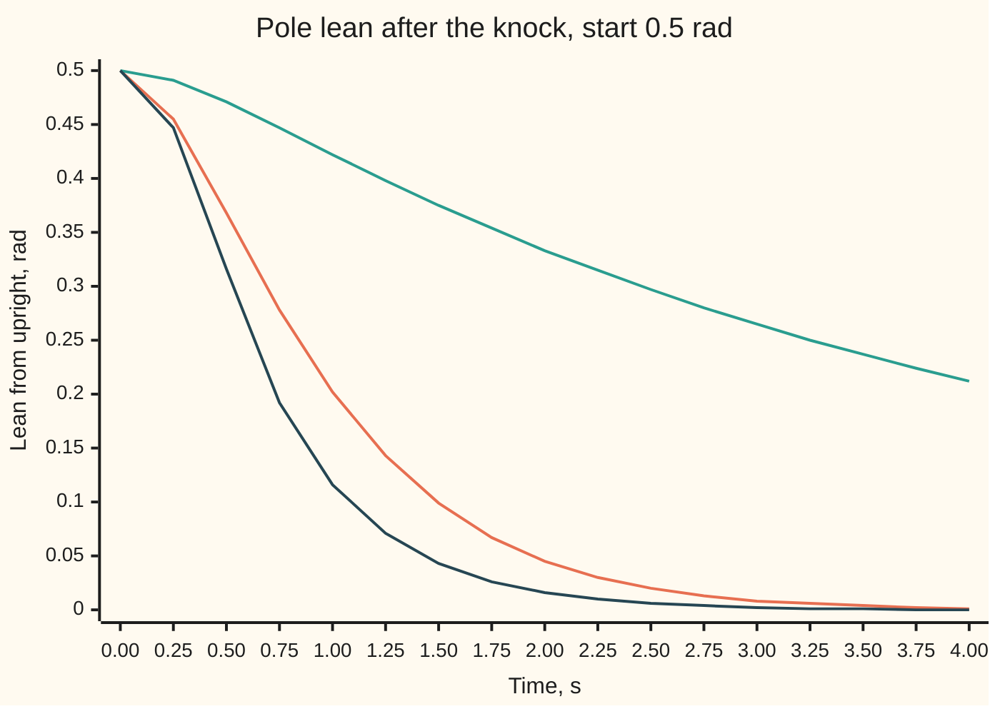
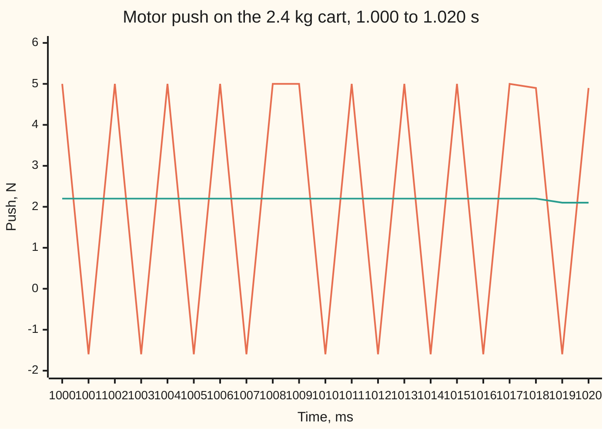

# Nonlinear design: cancel the nonlinearity, or slide along a surface you chose

[Syllabus](../../../SYLLABUS.md) → [Engineering mathematics](../README.md) → [Robustness and Adaptation](../README.md#s10) → Nonlinear design

---

## General Overview

A cart on a rail carries a pole balanced on a hinge: the same rig as the state-space shelf. Gravity g is 9.81 m/s² and the pole's length l is 0.613125 m, so g/l = 16 per s². A knock has left the pole leaning 0.5 rad (28.65°), at rest. The motor pushes the cart with a force F, in newtons. The cart's mass M, with whatever it carries, is 2.0 kg on the drawing. In use it is anywhere from 1.6 to 2.4 kg: known only to ±20%.

The engineer wants one answer: which control law brings the pole upright quickly, at every mass in that range? This shelf's house example, a conveyor whose load changes through the day, obeys a straight-line model; its load only scales a gain. The pole has sin θ and cos θ in its equation, and those curves are what nonlinear design deals with.

There are two classic answers.

- **Cancel the curve.** The controller computes the pole's curved terms from the model and subtracts them, then imposes a straight-line motion chosen in advance. With the true mass, the pole settles in 2.905 s, as designed (2.917 s in continuous time). With a cart 20% heavier than assumed it takes 18.155 s. At 30% heavier, it never comes back: it ends leaning 1.0267 rad.
- **Slide along a surface.** Write θ for the lean in rad and ω for the lean rate in rad/s. Pick a target relation between them, s = ω + 2θ = 0. On it the lean dies away at a rate that contains no mass. Then push towards it hard enough to beat the worst ±20% error. The starting distance from the target is s₀ = 1.0 rad/s, and the design promises to close it at a speed of at least η = 2 rad/s². So the pole reaches the surface within |s₀|/η = 0.5 s at every mass in the range: in 0.162, 0.274 and 0.499 s for 1.6, 2.0 and 2.4 kg. The price is a force that flips almost every millisecond, between 5.0 N and −1.6 N near 1 s (chattering), which a thin boundary layer smooths out.

**Feedback linearisation cancels a known nonlinearity and is exact only when the model is; a sliding-mode law forces the state onto a surface you chose, where the motion no longer depends on the uncertain part, and a switching gain sized to the error bound gets it there within a reaching time no worse than |s₀|/η.**

**What kind of fact this is:** the reaching-time bound is a theorem, proved on this card in Why it works. The pendulum equation is a model (the pole's pull on the cart is ignored, so the cart moves as F/M), not a law. Feedback linearisation is a method whose promise holds only for an exact model.

### The picture: the lean, three ways



Orange: cancellation with the true mass, 2.0 kg. Green: the same law on a 2.4 kg cart; at 4 s the pole still leans 0.212 rad. Dark blue: the sliding-mode law on the 2.4 kg cart, settled in 2.227 s. With these choices of λ and k, that is sooner than even the exact cancellation's 2.905 s.

---

## The formula

Notation first. θ (theta) is the lean from upright, in rad, and ω (omega) is the lean rate, in rad/s. A prime means a rate per second, so θ′ = ω and θ″ is the angular acceleration. The cart's acceleration is F/M. The [Linearisation](../04-State%20Space%20and%20Optimal%20Control/02-linearisation-about-an-equilibrium.md) card wrote the pole's equation with that acceleration as the input u. Here u = F/M, so the mass enters:

```math
\theta'' = \frac{g}{l}\sin\theta - \frac{\cos\theta}{M\,l}\,F
```

**Read it aloud:** gravity tips the pole by 16 sin θ each second squared, and pushing the cart tips it back by the push times cos θ, divided by the mass times the length.

The controller only knows the drawing's mass, $`\hat M = 2.0`$ kg (the hat marks an assumed value). Write $`r = \hat M / M`$ for how far that guess is off: r = 1 is exact, and ±20% in mass means r runs from 2/2.4 = 0.8333 to 2/1.6 = 1.25.

**Cancel the curve (feedback linearisation).** Choose

```math
F_{\mathrm{FL}} = \frac{\hat M\,l}{\cos\theta}\Big(\frac{g}{l}\sin\theta + k\,\theta + k\,\omega\Big) \quad\Longrightarrow\quad \theta'' = -k\,\theta - k\,\omega \;\text{ when } r = 1
```

**Read it aloud:** divide out the motor's grip, add back gravity's tip, and ask for the straight-line motion θ″ = −4θ − 4ω, whose two roots both sit at −2 per s.

**Slide along a surface (sliding mode).** Choose a **sliding surface**, a target relation between the states, and a law that pushes towards it:

```math
s = \omega + \lambda\,\theta, \qquad F_{\mathrm{SM}} = \frac{\hat M\,l}{\cos\theta}\Big(\frac{g}{l}\sin\theta + \lambda\,\omega + K\,\mathrm{sgn}(s)\Big), \qquad K = 0.2\,\Big|\frac{g}{l}\sin\theta + \lambda\,\omega\Big| + 1.2\,\eta
```

Here sgn(s) is the sign of s: +1 when s is positive and −1 otherwise. The gain K is sized to the ±20% bound; Step 4 derives it.

```math
s\,s' \le -\eta\,|s| \quad\Longrightarrow\quad t_{\mathrm{reach}} \le \frac{|s_0|}{\eta}
```

**Read it aloud:** if s always moves towards zero at a speed of at least η, it gets there no later than its starting size divided by η.

| Symbol | Plain meaning | In our example | Push it up and the answer… |
| --- | --- | --- | --- |
| $`\theta`$, $`\omega`$ | lean from upright, rad; lean rate, rad/s | start 0.5 rad, 0 rad/s | larger start: longer reach |
| $`F`$ | motor push on the cart, N | 16.2157 N at the start (sliding) | — |
| $`M`$, $`\hat M`$ | true cart mass; the mass the controller assumes, kg | 1.6 to 2.4; 2.0 | true mass up: cancellation falls short |
| $`r`$ | $`\hat M / M`$: how far the guess is off | 0.8333 to 1.25 | above 1, cancellation settles faster; below 0.8, it loses upright |
| $`g`$, $`l`$ | gravity (NIST CODATA standard gravity, rounded); pole length | 9.81 m/s²; 0.613125 m; g/l = 16 per s² | longer pole: slower fall |
| $`k`$ | gain of the imposed straight-line motion, per s² and per s | 4 | faster on paper, same weakness |
| $`s`$, $`s_0`$, $`V`$ | distance from the surface, ω + λθ, rad/s; its start value; the score $`V = s^2/2`$ | 1.0 rad/s | — |
| $`\lambda`$ | slope of the surface: decay rate of the lean on it, per s | 2 | faster decay on the surface |
| $`\eta`$ | promised reaching speed of s, rad/s² | 2 | reaches sooner, pushes harder |
| $`K`$, $`\Gamma`$ | switching gain, rad/s²; Γ = (g/l) sin θ + λω, the known part of the lean's acceleration that K is sized against | K 3.9342, Γ 7.6708 at the start | larger Γ: larger K needed |
| $`\Phi`$ | boundary-layer width: sgn(s) is replaced by s/Φ when \|s\| < Φ, rad/s | 0.1 | smoother force, looser hold |
| $`t_{\mathrm{reach}}`$ | time to reach s = 0, s | at most 0.5 s | — |

### When it holds

- **The error enters through the push.** The mass only scales the motor's grip, the same channel the law acts through, so a big enough switching gain can overpower it. An error elsewhere, such as an unmodelled lag in the motor, is not covered by this proof.
- **The error stays inside its bound.** With K sized to ±20% and a cart 30% heavier (2.6 kg), the pole still reaches the surface, but at 0.715 s, past the 0.5 s promise.
- **The pole is not horizontal.** Both laws divide by cos θ. At θ = π/2 rad (90°) pushing the cart cannot tip the pole at all.
- **The motor can switch fast and push hard.** The sliding law starts at 16.2157 N and then flips almost every millisecond, between 5.0 N and −1.6 N near 1 s. A motor with inductance, or a belt with stretch, rounds those edges off and turns them into a buzz.
- **Only the lean is controlled.** After 4 s the cart is still moving at 3.2792 m/s. A real rig needs an outer loop on the cart's position, or a long rail.

---

## Why it works

### Step 0: two ways to handle a curve you know

A curved term you can compute can be cancelled, by subtracting it in the controller. What is left is a straight-line system, and the linear design methods of earlier shelves apply to it. That only works as well as the computation.

A curved term you know only up to a bound cannot be cancelled. It can be overpowered. Choose a one-dimensional target, a surface, on which the motion is good whatever the uncertain number. Then push towards that surface harder than the worst error can push away. A score that only ever falls proves the push succeeds: the method of [Lyapunov functions](../../08-Differential%20equations%20and%20dynamics/06-Nonlinear%20Dynamics%20in%20the%20Plane/04-lyapunov-functions.md).

### Step 1: cancellation is exact when the model is

Put $`F_{\mathrm{FL}}`$ into the pole's equation. The factor cos θ cancels, and

```math
\theta'' = \frac{g}{l}\sin\theta - r\Big(\frac{g}{l}\sin\theta + k\,\theta + k\,\omega\Big) = (1 - r)\,\frac{g}{l}\sin\theta - r\,k\,(\theta + \omega).
```

With r = 1 the sine vanishes and θ″ = −4θ − 4ω, a straight-line equation with a double root at −2 per s. Its solution from 0.5 rad at rest is θ(t) = 0.5 (1 + 2t) e^(−2t). At 1 s that is 0.5 × 3 × e^(−2) = 0.2030 rad, and the simulation gives 0.2024 rad. The small gap comes from holding the force fixed over each 1 ms step.

The force appears in θ″, two rates down from θ. That count is called the **relative degree**: here it is 2. One division by the motor's grip, cos θ/(M l), is then enough to cancel. A plant whose push reaches the output only through a chain of states is handled by differentiating the output until the push appears; that general theory is in the sources.

### Step 2: what a wrong mass leaves behind

With r ≠ 1 the leftover (1 − r) 16 sin θ stays in the loop. Near upright, sin θ is about θ, so the loop behaves like θ″ + 4r θ′ + (4r − 16(1 − r)) θ = 0. Its roots, from the quadratic formula:

| Cart mass | r | Roots, per s | What the pole does |
| --- | --- | --- | --- |
| 1.6 kg | 1.25 | −2.5000 ± 1.6583j | settles in 1.352 s |
| 2.0 kg | 1 | −2, −2 | settles in 2.905 s, as designed |
| 2.4 kg | 0.8333 | −3.1196, −0.2137 | settles in 18.155 s |
| 2.6 kg | 0.7692 | −3.2654, +0.1885 | never returns: leans 1.0267 rad at 30 s |

(j is √−1, as engineers write it.) The heavy cart's slow root, −0.2137 per s, is the trouble: the motor delivers only r of the push the law intended, and gravity's uncancelled share fights it. Upright stops attracting when 4r < 16(1 − r), that is when r < 0.8000, or M > 2.5000 kg. The 2.6 kg cart parks the pole at a new lean where the leftover gravity and the weakened push balance.

So cancellation gives an exact design for one mass and no stated margin for the others. The ±20% guarantee has to come from somewhere else.

### Step 3: on the surface, the mass drops out

On the surface s = 0, the lean obeys ω = −2θ, that is θ′ = −2θ. Its solution is θ(t) = θ(t_r) e^(−2(t − t_r)), where t_r is the moment s reaches 0. No mass, no gravity: the motion on the surface is set entirely by the designer's choice λ = 2.

The 2.4 kg cart reaches the surface at 0.499 s with θ = 0.3163 rad. One second later the surface predicts 0.3163 e^(−2) = 0.0428 rad; the simulation gives 0.0429 rad. The 1.6 kg cart reaches it at 0.162 s, with 0.4242 rad, and also tracks e^(−2t) afterwards. Being on the surface is what makes the controller robust (insensitive) to the mass. This is called the **invariance** of sliding mode to an error that enters through the push.

### Step 4: reaching the surface in finite time

Take the score V = s²/2. Its rate is V′ = s s′. Differentiate s = ω + 2θ along the motion, put in the sliding law, and the cos θ cancels as in Step 1:

```math
s' = (1 - r)\Big(\frac{g}{l}\sin\theta + \lambda\,\omega\Big) - r\,K\,\mathrm{sgn}(s).
```

The first term is the model error; the second is the switching push. Ask for the **reaching condition** s s′ ≤ −η|s|: whatever the sign of s, s′ points towards zero at speed at least η. Writing $`\Gamma = \frac{g}{l}\sin\theta + \lambda\,\omega`$ (gamma) for the known part, that needs

```math
r\,K \ge |1 - r|\,|\Gamma| + \eta \quad \text{for every } r \text{ from } 0.8333 \text{ to } 1.25.
```

The fold works the two ends. The answer is K = 0.2|Γ| + 1.2η: 20% of the known part to beat the model error, and 20% extra η because the motor may deliver only five-sixths of the push.

<details>
<summary>The worst mass, and why 0.2 and 1.2</summary>

Divide by r: the gain must be at least $`(|1 - r|\,|\Gamma| + \eta)/r`$ for every r in the range. On r below 1, this is $`(1/r - 1)|\Gamma| + \eta/r`$, which grows as r falls; at r = 5/6 it is

$`\displaystyle \Big(\frac{6}{5} - 1\Big)|\Gamma| + \frac{6}{5}\,\eta = 0.2\,|\Gamma| + 1.2\,\eta.`$

On r above 1, it is $`(1 - 1/r)|\Gamma| + \eta/r`$, at most $`0.2\,|\Gamma| + \eta`$ at r = 5/4, which is smaller. So the heavy end sets the gain, and with K = 0.2|Γ| + 1.2η the heavy cart meets the reaching condition with equality whenever Γ ≥ 0 and s > 0.

</details>

Now the time. Since V′ = s s′ ≤ −η|s| and V = |s|²/2, the size |s| itself falls at a rate of at least η. So |s(t)| ≤ |s₀| − η t, and s must reach zero by t = |s₀|/η. From the knock, s₀ = 0 + 2 × 0.5 = 1.0 rad/s and η = 2 rad/s², so the bound is 0.5 s. Unlike any straight-line loop, which only ever approaches zero, the surface is reached in a finite time. The reason is the switch: K sgn(s) does not fade as s shrinks.

The heavy cart is the worst case, and it uses the whole bound: its s falls at exactly η at the start, and it reaches the surface at 0.499 s. The simulation checks |s(t)| ≤ |s₀| − η t at every millisecond before reaching, for all three masses.

### Step 5: chattering, and the boundary layer that cures it

Once on the surface, the ideal law keeps s at exactly zero by switching infinitely fast. A computer that updates every 1 ms cannot. It overshoots the surface by a tiny amount, flips sgn(s), overshoots back, and so on. That is **chattering**: a force that jumps between two values at the control rate.



Orange: the sign law. It jumps by more than 1 N 885 times in the second after reaching. Green: the boundary-layer law, a steady 2.2 N.

The **boundary layer** replaces sgn(s) by s/Φ when |s| < Φ, clipped to ±1 outside: a steep ramp instead of a step. Outside the layer the law is unchanged, so Step 4 still applies: the layer is reached by (1 − 0.1)/2 = 0.450 s, and the simulation enters it at 0.450 s. Inside, the law is a stiff straight-line loop, and the force has no jumps at all.

The price is precision. Only |s| ≤ Φ is guaranteed, not s = 0, so under a persistent push the lean is held only to within Φ/λ = 0.0500 rad. Here the model error shrinks to nothing at upright, so the pole settles anyway: in 2.320 s against 2.227 s for the sign law.

---

## Worked numbers, by hand

The 2.4 kg cart, the worst mass in the range, at the moment after the knock: θ = 0.5 rad, ω = 0.

| Step | Arithmetic | Value |
| --- | --- | --- |
| start on the surface | s₀ = 0 + 2 × 0.5 | 1.0000 rad/s |
| known part | Γ = 16 sin 0.5 + 2 × 0 | 7.6708 rad/s² |
| switching gain | K₀ = 0.2 × 7.6708 + 1.2 × 2 | 3.9342 rad/s² |
| push factor | $`\hat M`$ l / cos 0.5 = 2 × 0.613125 / cos 0.5 | 1.3973 kg·m |
| sliding push | 1.3973 × (7.6708 + 3.9342) | 16.2157 N |
| cancellation push, for comparison | 1.3973 × (7.6708 + 4 × 0.5) | 13.5131 N |
| how far the guess is off | r = 2 / 2.4 | 0.8333 |
| rate of s | (1 − 0.8333) × 7.6708 − 0.8333 × 3.9342 | −2.0000 rad/s² |
| reaching bound | \|s₀\| / η = 1.0 / 2 | 0.5000 s |
| **simulated reach** | RK4, 1 ms steps | **0.499 s** |

The heavy cart's s falls at exactly −η = −2 rad/s² at the start, so it uses the whole 0.5 s budget, and the simulation confirms it reaches the surface just inside the bound.

### What breaks if you drop a piece

| Mistake | Comes out at | What went wrong |
| --- | --- | --- |
| Cancellation with the drawing's 2.0 kg, real cart 2.6 kg | never returns: leans 1.0267 rad at 30 s | r = 0.7692 is below 0.8; the uncancelled gravity beats the weakened push |
| Sliding gain sized to ±20%, real cart 30% heavy (2.6 kg) | reaches at 0.715 s, past the 0.5 s bound | the bound was wrong, so the guarantee was too |
| Switching gain K = η, with no term for the error | 2.4 kg cart reaches at 1.435 s | the model error pushes away from the surface; only the nominal mass gets η |
| Pure sign switching on a 1 ms controller | 885 jumps of more than 1 N in one second | the sampled switch overshoots the surface every step; a boundary layer removes all of them |

---

## Code, from first principles, and it actually runs

The scripts simulate the true pole with a fourth-order Runge–Kutta step (RK4) of 1 ms, holding each force over its step as a 1 kHz digital controller would. They take three independent roads:

- **The gain.** The formula K = 0.2|Γ| + 1.2η is checked against a brute-force bisection on the plant's own equation at 525 states and 21 masses, with no use of the algebra of Step 4.
- **The reaching time.** The bound |s₀|/η is checked against the simulation, and |s(t)| ≤ |s₀| − ηt at every step before reaching, for 1.6, 2.0 and 2.4 kg.
- **The motion.** The closed forms 0.5(1 + 2t)e^(−2t) for exact cancellation and θ(t_r)e^(−2(t − t_r)) on the surface are checked against the simulation. The roots of Step 2 predict which masses lose upright, and the nonlinear run must agree.

### Python

```python
# Feedback linearisation and sliding mode on the cart pendulum -- the check behind the card.
# Standard library only.  Pole: g/l = 16 per s^2; cart moved by a force F; true cart mass M unknown.
import math

G, L, MH = 9.81, 0.613125, 2.0          # gravity m/s^2, pole length m, assumed cart mass kg
LAM, ETA, PHI = 2.0, 2.0, 0.1           # surface slope 1/s, reaching rate rad/s^2, boundary layer rad/s
TH0, DT = 0.5, 0.001                    # start lean rad; RK4 step and control period s
W2 = G / L                              # 16 per s^2

def lean_acc(th, om, F, M):             # true pole: theta'' = 16 sin(theta) - cos(theta) F / (M l)
    return W2 * math.sin(th) - math.cos(th) * F / (M * L)

def gain(th, om, eta):                  # switching gain sized to +-20 %: K = 0.2|16 sin + 2 om| + 1.2 eta
    return 0.2 * abs(W2 * math.sin(th) + LAM * om) + 1.2 * eta

def law(kind, th, om, k, eta, phi):
    pre = MH * L / math.cos(th)
    if kind == "fl":                    # cancel 16 sin(theta), then impose theta'' = -k theta - k omega
        return pre * (W2 * math.sin(th) + k * th + k * om)
    s = om + LAM * th
    sw = (1.0 if s > 0 else -1.0) if kind == "smc" else max(-1.0, min(1.0, s / phi))
    kk = gain(th, om, eta) if k is None else k
    return pre * (W2 * math.sin(th) + LAM * om + kk * sw)

def run(kind, M, k=None, tend=4.0, eta=ETA, phi=PHI, th0=TH0):   # RK4; force held over each 1 ms step
    th, om, v, out = th0, 0.0, 0.0, []
    for n in range(int(round(tend / DT))):
        F = law(kind, th, om, k, eta, phi)
        out.append((n * DT, th, om, F, v))
        f = lambda a, b: (b, lean_acc(a, b, F, M))
        k1 = f(th, om); k2 = f(th + DT/2*k1[0], om + DT/2*k1[1])
        k3 = f(th + DT/2*k2[0], om + DT/2*k2[1]); k4 = f(th + DT*k3[0], om + DT*k3[1])
        th += DT/6*(k1[0] + 2*k2[0] + 2*k3[0] + k4[0]); om += DT/6*(k1[1] + 2*k2[1] + 2*k3[1] + k4[1])
        v += F / M * DT
    out.append((tend, th, om, law(kind, th, om, k, eta, phi), v))
    return out

def settle(tr):                         # last time |theta| was above 0.01 rad
    return max([t for (t, th, *_ ) in tr if abs(th) > 0.01], default=0.0)

def reach(tr, band=0.0):                # first index where |s| <= band (band 0: s changes sign)
    return next(i for i, (t, th, om, *_ ) in enumerate(tr) if (om + LAM * th <= 0 if band == 0 else abs(om + LAM * th) <= band))

def svals(tr): return [abs(o + LAM * th) for (t, th, o, *_ ) in tr]
def jumps(tr): return sum(1 for a, b in zip(tr, tr[1:]) if abs(a[3] - b[3]) > 1.0)

print(f"pole: g/l = {W2:.4f} per s^2; assumed cart mass {MH} kg, true 1.6 to 2.4 kg (+-20 %)")
s0, G0 = LAM * TH0, W2 * math.sin(TH0); K0 = gain(TH0, 0.0, ETA); pre0 = MH * L / math.cos(TH0)
print(f"hand: s0 = 0 + 2 x 0.5 = {s0:.4f} rad/s; 16 sin 0.5 = {G0:.4f}; K0 = 0.2 x {G0:.4f} + 2.4 = {K0:.4f} rad/s^2")
print(f"hand: Mhat l / cos 0.5 = {pre0:.4f} kg m; F0 linearising {pre0*(G0+4*TH0):.4f} N, sliding {pre0*(G0+K0):.4f} N")
r = MH / 2.4
print(f"hand: heavy cart r = 2/2.4 = {r:.4f}; s'(0) = {1-r:.4f} x {G0:.4f} - {r:.4f} x {K0:.4f} = {(1-r)*G0 - r*K0:.4f} rad/s^2")
print(f"reaching-time bound |s0|/eta = {s0/ETA:.4f} s")
print(f"start lean {TH0} rad = {math.degrees(TH0):.2f} deg; linearising loses upright when r < 16/(16+4) = {W2/(W2+4):.4f}, "
      f"M > {MH*(W2+4)/W2:.4f} kg; layer lean bound Phi/lambda = {PHI/LAM:.4f} rad")

# Road A for the gain: bisection on the true plant over a grid of states and masses, against the formula.
worst = 0.0
for i in range(-12, 13):
    for j in range(-10, 11):
        th, om, need = 0.1 * i, 0.5 * j, 0.0
        for M in [1.6 + 0.04 * q for q in range(21)]:
            for sg in (1.0, -1.0):
                lo, hi = 0.0, 50.0
                for _ in range(60):
                    kk = (lo + hi) / 2
                    sdot = lean_acc(th, om, MH * L / math.cos(th) * (W2 * math.sin(th) + LAM * om + kk * sg), M) + LAM * om
                    lo, hi = (kk, hi) if sg * sdot > -ETA else (lo, kk)
                need = max(need, hi)
        worst = max(worst, abs(need - gain(th, om, ETA)))
print(f"gain road: bisection on the plant, 525 states x 21 masses, largest gap to formula {worst:.2e} rad/s^2")
assert worst < 1e-6

print("linearising law (k = 4), lean after 1 s and settle time to 0.01 rad:")
exact = run("fl", 2.0, 4.0); th1 = exact[1000][1]; pred = TH0 * (1 + 2 * 1.0) * math.exp(-2.0)
tc = next(t for t in (k * 1e-4 for k in range(100000)) if TH0 * (1 + 2 * t) * math.exp(-2 * t) < 0.01)   # continuous design
print(f"  M 2.0 kg: theta(1 s) {th1:.4f} rad, target 0.5 x 3 x e^-2 = {pred:.4f}; settles {settle(exact):.3f} s (continuous design {tc:.3f} s)")
assert abs(th1 - pred) < 2e-3 and abs(settle(exact) - tc) < 0.02
for M in (1.6, 2.4, 2.6):
    rr = MH / M; b, c = 4 * rr, 4 * rr - W2 * (1 - rr); disc = b * b - 4 * c
    roots = f"{(-b - math.sqrt(disc))/2:.4f}, {(-b + math.sqrt(disc))/2:.4f}" if disc >= 0 else \
            f"{-b/2:.4f} +- {math.sqrt(-disc)/2:.4f}j"
    tr = run("fl", M, 4.0, tend=30.0)
    fate = f"never returns: leans {tr[-1][1]:.4f} rad at 30 s" if abs(tr[-1][1]) > 0.01 else f"settles {settle(tr):.3f} s"
    print(f"  M {M} kg: r {rr:.4f}, linear roots {roots} 1/s; {fate}")
    if disc >= 0 and (-b + math.sqrt(disc)) / 2 > 0: assert abs(tr[-1][1]) > 0.1
    if M == 2.4: assert settle(tr) > 5 * settle(exact)

print("sliding law, sign switch (s0 = 1 rad/s, bound 0.5 s):")
for M in (1.6, 2.0, 2.4):
    tr = run("smc", M); n = reach(tr); tr_ = tr[n][0]
    assert tr_ <= s0 / ETA + DT                                              # road B: the bound ...
    assert all(sv <= s0 - ETA * t + 1e-3 for sv, (t, *_ ) in zip(svals(tr[:n]), tr))  # ... all along the path
    p = tr[n][1] * math.exp(-LAM * 1.0)
    print(f"  M {M} kg: reaches {tr_:.3f} s at theta {tr[n][1]:.4f} rad; 1 s later {tr[n+1000][1]:.4f}, surface says "
          f"{p:.4f}; |s| after <= {max(svals(tr[n:])):.4f}; force jumps >1 N in next 1 s: {jumps(tr[n:n+1001])}; settles {settle(tr):.3f} s")
    assert abs(tr[n + 1000][1] - p) < 2e-3
    if M == 2.4: heavy = tr; assert tr_ >= s0 / ETA - 0.01   # the heavy cart uses the whole budget
lay = run("bl", 2.4); nb = reach(lay, PHI)
print(f"boundary layer Phi {PHI} rad/s, M 2.4 kg: enters layer {lay[nb][0]:.3f} s (bound (1 - 0.1)/2 = 0.450 s); "
      f"|s| after <= {max(svals(lay[nb:])):.4f}; force jumps >1 N: {jumps(lay[nb:])}; settles {settle(lay):.3f} s")
assert (s0 - PHI) / ETA - 0.01 <= lay[nb][0] <= (s0 - PHI) / ETA + DT and max(svals(lay[nb:])) <= PHI and jumps(lay[nb:]) == 0
print(f"cart speed at 4 s, sliding run, M 2.0 kg: {run('smc', 2.0)[-1][4]:.4f} m/s")
peak = lambda tr: max(abs(x[3]) for x in tr)
print(f"peak force, M 2.4 kg: linearising {peak(run('fl', 2.4, 4.0)):.4f} N, sliding {peak(heavy):.4f} N")

for M, k, lab in ((2.6, None, "gain sized to 20 %, true mass +30 %"), (2.4, ETA, "K = eta only, no uncertainty term")):
    tb = run("smc", M, k)[reach(run("smc", M, k))][0]
    print(f"break, {lab}: M {M} kg reaches at {tb:.3f} s, bound 0.5000 s")
    assert tb > s0 / ETA
tr = run("smc", 2.4, eta=4.0); print(f"try eta 4, M 2.4 kg: reaches {tr[reach(tr)][0]:.3f} s (bound 0.25), peak force {peak(tr):.4f} N")
tr = run("bl", 2.4, phi=0.5); print(f"try Phi 0.5, M 2.4 kg: settles {settle(tr):.3f} s, force jumps >1 N: {jumps(tr[1:])}")
tr = run("fl", 2.4, 8.0, tend=30.0); print(f"try linearising k 8, M 2.4 kg: settles {settle(tr):.3f} s")
tr = run("smc", 2.4, th0=1.0); print(f"try start 1.0 rad, sliding M 2.4 kg: reaches {tr[reach(tr)][0]:.3f} s (bound 1.0)")
print("chart, time s     " + " ".join(f"{i*0.25:6.2f}" for i in range(17)))
heavyfl = run("fl", 2.4, 4.0)
for lab, tr in (("FL 2.0 kg ", exact), ("FL 2.4 kg ", heavyfl), ("SMC 2.4 kg", heavy)):
    print(f"chart, {lab} " + " ".join(f"{tr[i*250][1]:6.3f}" for i in range(17)))
print("chart2, time ms " + " ".join(f"{1000+i:5d}" for i in range(21)))
print("chart2, sign N  " + " ".join(f"{heavy[1000+i][3]:5.1f}" for i in range(21)))
print("chart2, layer N " + " ".join(f"{lay[1000+i][3]:5.1f}" for i in range(21)))
print("ALL CHECKS PASS")
```

**Ran 2026-11-23 on macOS, Python 3.14.10, standard library only. All checks passed. Output, pasted from the run:**

```
pole: g/l = 16.0000 per s^2; assumed cart mass 2.0 kg, true 1.6 to 2.4 kg (+-20 %)
hand: s0 = 0 + 2 x 0.5 = 1.0000 rad/s; 16 sin 0.5 = 7.6708; K0 = 0.2 x 7.6708 + 2.4 = 3.9342 rad/s^2
hand: Mhat l / cos 0.5 = 1.3973 kg m; F0 linearising 13.5131 N, sliding 16.2157 N
hand: heavy cart r = 2/2.4 = 0.8333; s'(0) = 0.1667 x 7.6708 - 0.8333 x 3.9342 = -2.0000 rad/s^2
reaching-time bound |s0|/eta = 0.5000 s
start lean 0.5 rad = 28.65 deg; linearising loses upright when r < 16/(16+4) = 0.8000, M > 2.5000 kg; layer lean bound Phi/lambda = 0.0500 rad
gain road: bisection on the plant, 525 states x 21 masses, largest gap to formula 1.07e-14 rad/s^2
linearising law (k = 4), lean after 1 s and settle time to 0.01 rad:
  M 2.0 kg: theta(1 s) 0.2024 rad, target 0.5 x 3 x e^-2 = 0.2030; settles 2.905 s (continuous design 2.917 s)
  M 1.6 kg: r 1.2500, linear roots -2.5000 +- 1.6583j 1/s; settles 1.352 s
  M 2.4 kg: r 0.8333, linear roots -3.1196, -0.2137 1/s; settles 18.155 s
  M 2.6 kg: r 0.7692, linear roots -3.2654, 0.1885 1/s; never returns: leans 1.0267 rad at 30 s
sliding law, sign switch (s0 = 1 rad/s, bound 0.5 s):
  M 1.6 kg: reaches 0.162 s at theta 0.4242 rad; 1 s later 0.0572, surface says 0.0574; |s| after <= 0.0054; force jumps >1 N in next 1 s: 852; settles 2.031 s
  M 2.0 kg: reaches 0.274 s at theta 0.3818 rad; 1 s later 0.0515, surface says 0.0517; |s| after <= 0.0031; force jumps >1 N in next 1 s: 1000; settles 2.108 s
  M 2.4 kg: reaches 0.499 s at theta 0.3163 rad; 1 s later 0.0429, surface says 0.0428; |s| after <= 0.0031; force jumps >1 N in next 1 s: 885; settles 2.227 s
boundary layer Phi 0.1 rad/s, M 2.4 kg: enters layer 0.450 s (bound (1 - 0.1)/2 = 0.450 s); |s| after <= 0.0980; force jumps >1 N: 0; settles 2.320 s
cart speed at 4 s, sliding run, M 2.0 kg: 3.2792 m/s
peak force, M 2.4 kg: linearising 13.5131 N, sliding 16.2157 N
break, gain sized to 20 %, true mass +30 %: M 2.6 kg reaches at 0.715 s, bound 0.5000 s
break, K = eta only, no uncertainty term: M 2.4 kg reaches at 1.435 s, bound 0.5000 s
try eta 4, M 2.4 kg: reaches 0.250 s (bound 0.25), peak force 19.5692 N
try Phi 0.5, M 2.4 kg: settles 3.219 s, force jumps >1 N: 0
try linearising k 8, M 2.4 kg: settles 6.008 s
try start 1.0 rad, sliding M 2.4 kg: reaches 0.997 s (bound 1.0)
chart, time s       0.00   0.25   0.50   0.75   1.00   1.25   1.50   1.75   2.00   2.25   2.50   2.75   3.00   3.25   3.50   3.75   4.00
chart, FL 2.0 kg   0.500  0.455  0.368  0.278  0.202  0.143  0.099  0.067  0.045  0.030  0.020  0.013  0.008  0.006  0.004  0.002  0.001
chart, FL 2.4 kg   0.500  0.491  0.471  0.447  0.422  0.398  0.375  0.354  0.333  0.315  0.297  0.280  0.265  0.250  0.237  0.224  0.212
chart, SMC 2.4 kg  0.500  0.447  0.316  0.192  0.116  0.071  0.043  0.026  0.016  0.010  0.006  0.004  0.002  0.001  0.001  0.000  0.000
chart2, time ms  1000  1001  1002  1003  1004  1005  1006  1007  1008  1009  1010  1011  1012  1013  1014  1015  1016  1017  1018  1019  1020
chart2, sign N    5.0  -1.6   5.0  -1.6   5.0  -1.6   5.0  -1.6   5.0   5.0  -1.6   5.0  -1.6   5.0  -1.6   5.0  -1.6   5.0   4.9  -1.6   4.9
chart2, layer N   2.2   2.2   2.2   2.2   2.2   2.2   2.2   2.2   2.2   2.2   2.2   2.2   2.2   2.2   2.2   2.2   2.2   2.2   2.2   2.1   2.1
ALL CHECKS PASS
```

### Rust

```rust
// Feedback linearisation and sliding mode on the cart pendulum -- the check behind the card.
// std only.  Pole: g/l = 16 per s^2; cart moved by a force F; true cart mass M unknown.
const G: f64 = 9.81; const L: f64 = 0.613125; const MH: f64 = 2.0; // gravity, pole length, assumed mass
const LAM: f64 = 2.0; const ETA: f64 = 2.0; const PHI: f64 = 0.1;  // surface slope, reaching rate, layer
const TH0: f64 = 0.5; const DT: f64 = 0.001;                     // start lean rad; step and control period s
const W2: f64 = G / L;                                           // 16 per s^2
#[derive(Clone, Copy, PartialEq)] enum Kind { Fl, Smc, Bl }
type Row = (f64, f64, f64, f64, f64);                            // t, theta, omega, F, cart speed

fn lean_acc(th: f64, _om: f64, f: f64, m: f64) -> f64 { W2 * th.sin() - th.cos() * f / (m * L) }
fn gain(th: f64, om: f64, eta: f64) -> f64 { 0.2 * (W2 * th.sin() + LAM * om).abs() + 1.2 * eta }
fn law(kind: Kind, th: f64, om: f64, k: Option<f64>, eta: f64, phi: f64) -> f64 {
    let pre = MH * L / th.cos();
    if kind == Kind::Fl { let k = k.unwrap(); return pre * (W2 * th.sin() + k * th + k * om); }
    let s = om + LAM * th;
    let sw = if kind == Kind::Smc { if s > 0.0 { 1.0 } else { -1.0 } } else { (s / phi).min(1.0).max(-1.0) };
    let kk = match k { None => gain(th, om, eta), Some(v) => v };
    pre * (W2 * th.sin() + LAM * om + kk * sw)
}
fn run(kind: Kind, m: f64, k: Option<f64>, tend: f64, eta: f64, phi: f64, th0: f64) -> Vec<Row> {
    let (mut th, mut om, mut v, mut out) = (th0, 0.0f64, 0.0f64, Vec::new());
    for n in 0..((tend / DT).round() as usize) {
        let f = law(kind, th, om, k, eta, phi);
        out.push((n as f64 * DT, th, om, f, v));
        let d = |a: f64, b: f64| (b, lean_acc(a, b, f, m));
        let k1 = d(th, om); let k2 = d(th + DT / 2.0 * k1.0, om + DT / 2.0 * k1.1);
        let k3 = d(th + DT / 2.0 * k2.0, om + DT / 2.0 * k2.1); let k4 = d(th + DT * k3.0, om + DT * k3.1);
        th += DT / 6.0 * (k1.0 + 2.0 * k2.0 + 2.0 * k3.0 + k4.0); om += DT / 6.0 * (k1.1 + 2.0 * k2.1 + 2.0 * k3.1 + k4.1);
        v += f / m * DT;
    }
    out.push((tend, th, om, law(kind, th, om, k, eta, phi), v));
    out
}
fn sm(kind: Kind, m: f64) -> Vec<Row> { run(kind, m, None, 4.0, ETA, PHI, TH0) }
fn settle(tr: &[Row]) -> f64 { tr.iter().filter(|x| x.1.abs() > 0.01).map(|x| x.0).fold(0.0, f64::max) }
fn reach(tr: &[Row], band: f64) -> usize {
    tr.iter().position(|x| { let s = x.2 + LAM * x.1; if band == 0.0 { s <= 0.0 } else { s.abs() <= band } }).unwrap()
}
fn svals(tr: &[Row]) -> Vec<f64> { tr.iter().map(|x| (x.2 + LAM * x.1).abs()).collect() }
fn smax(tr: &[Row]) -> f64 { svals(tr).into_iter().fold(0.0, f64::max) }
fn jumps(tr: &[Row]) -> usize { tr.windows(2).filter(|w| (w[0].3 - w[1].3).abs() > 1.0).count() }
fn peak(tr: &[Row]) -> f64 { tr.iter().map(|x| x.3.abs()).fold(0.0, f64::max) }

fn main() {
    println!("pole: g/l = {:.4} per s^2; assumed cart mass {:.1} kg, true 1.6 to 2.4 kg (+-20 %)", W2, MH);
    let (s0, g0) = (LAM * TH0, W2 * TH0.sin()); let k0 = gain(TH0, 0.0, ETA); let pre0 = MH * L / TH0.cos();
    println!("hand: s0 = 0 + 2 x 0.5 = {:.4} rad/s; 16 sin 0.5 = {:.4}; K0 = 0.2 x {:.4} + 2.4 = {:.4} rad/s^2", s0, g0, g0, k0);
    println!("hand: Mhat l / cos 0.5 = {:.4} kg m; F0 linearising {:.4} N, sliding {:.4} N", pre0, pre0 * (g0 + 4.0 * TH0), pre0 * (g0 + k0));
    let r = MH / 2.4;
    println!("hand: heavy cart r = 2/2.4 = {:.4}; s'(0) = {:.4} x {:.4} - {:.4} x {:.4} = {:.4} rad/s^2", r, 1.0 - r, g0, r, k0, (1.0 - r) * g0 - r * k0);
    println!("reaching-time bound |s0|/eta = {:.4} s", s0 / ETA);
    println!("start lean {:.1} rad = {:.2} deg; linearising loses upright when r < 16/(16+4) = {:.4}, M > {:.4} kg; layer lean bound Phi/lambda = {:.4} rad",
             TH0, TH0.to_degrees(), W2 / (W2 + 4.0), MH * (W2 + 4.0) / W2, PHI / LAM);

    // Road A for the gain: bisection on the true plant over a grid of states and masses, against the formula.
    let mut worst = 0.0f64;
    for i in -12..13 { for j in -10..11 {
        let (th, om) = (0.1 * i as f64, 0.5 * j as f64); let mut need = 0.0f64;
        for q in 0..21 { let m = 1.6 + 0.04 * q as f64;
            for sg in [1.0, -1.0] {
                let (mut lo, mut hi) = (0.0f64, 50.0f64);
                for _ in 0..60 {
                    let kk = (lo + hi) / 2.0;
                    let sdot = lean_acc(th, om, MH * L / th.cos() * (W2 * th.sin() + LAM * om + kk * sg), m) + LAM * om;
                    if sg * sdot > -ETA { lo = kk } else { hi = kk }
                }
                need = need.max(hi);
            } }
        worst = worst.max((need - gain(th, om, ETA)).abs());
    } }
    println!("gain road: bisection on the plant, 525 states x 21 masses, largest gap to formula {:.2e} rad/s^2", worst);
    assert!(worst < 1e-6);

    println!("linearising law (k = 4), lean after 1 s and settle time to 0.01 rad:");
    let exact = run(Kind::Fl, 2.0, Some(4.0), 4.0, ETA, PHI, TH0); let th1 = exact[1000].1;
    let pred = TH0 * (1.0 + 2.0 * 1.0) * (-2.0f64).exp();
    let tc = (0..100000).map(|k| k as f64 * 1e-4).find(|&t| TH0 * (1.0 + 2.0 * t) * (-2.0 * t).exp() < 0.01).unwrap(); // continuous design
    println!("  M 2.0 kg: theta(1 s) {:.4} rad, target 0.5 x 3 x e^-2 = {:.4}; settles {:.3} s (continuous design {:.3} s)", th1, pred, settle(&exact), tc);
    assert!((th1 - pred).abs() < 2e-3 && (settle(&exact) - tc).abs() < 0.02);
    for m in [1.6, 2.4, 2.6] {
        let rr = MH / m; let (b, c) = (4.0 * rr, 4.0 * rr - W2 * (1.0 - rr)); let disc = b * b - 4.0 * c;
        let roots = if disc >= 0.0 { format!("{:.4}, {:.4}", (-b - disc.sqrt()) / 2.0, (-b + disc.sqrt()) / 2.0) }
                    else { format!("{:.4} +- {:.4}j", -b / 2.0, (-disc).sqrt() / 2.0) };
        let tr = run(Kind::Fl, m, Some(4.0), 30.0, ETA, PHI, TH0); let last = tr[tr.len() - 1].1;
        let fate = if last.abs() > 0.01 { format!("never returns: leans {:.4} rad at 30 s", last) } else { format!("settles {:.3} s", settle(&tr)) };
        println!("  M {:.1} kg: r {:.4}, linear roots {} 1/s; {}", m, rr, roots, fate);
        if disc >= 0.0 && (-b + disc.sqrt()) / 2.0 > 0.0 { assert!(last.abs() > 0.1); }
        if m == 2.4 { assert!(settle(&tr) > 5.0 * settle(&exact)); }
    }

    println!("sliding law, sign switch (s0 = 1 rad/s, bound 0.5 s):");
    let mut heavy = Vec::new();
    for m in [1.6, 2.0, 2.4] {
        let tr = sm(Kind::Smc, m); let n = reach(&tr, 0.0); let tr_ = tr[n].0;
        assert!(tr_ <= s0 / ETA + DT);                                                   // road B: the bound ...
        assert!(svals(&tr[..n]).iter().zip(tr.iter()).all(|(sv, x)| *sv <= s0 - ETA * x.0 + 1e-3)); // ... all along
        let p = tr[n].1 * (-LAM * 1.0f64).exp();
        println!("  M {:.1} kg: reaches {:.3} s at theta {:.4} rad; 1 s later {:.4}, surface says {:.4}; |s| after <= {:.4}; force jumps >1 N in next 1 s: {}; settles {:.3} s",
                 m, tr_, tr[n].1, tr[n + 1000].1, p, smax(&tr[n..]), jumps(&tr[n..n + 1001]), settle(&tr));
        assert!((tr[n + 1000].1 - p).abs() < 2e-3);
        if m == 2.4 { assert!(tr_ >= s0 / ETA - 0.01); heavy = tr; }                   // the heavy cart uses the whole budget
    }
    let lay = sm(Kind::Bl, 2.4); let nb = reach(&lay, PHI);
    println!("boundary layer Phi {:.1} rad/s, M 2.4 kg: enters layer {:.3} s (bound (1 - 0.1)/2 = 0.450 s); |s| after <= {:.4}; force jumps >1 N: {}; settles {:.3} s",
             PHI, lay[nb].0, smax(&lay[nb..]), jumps(&lay[nb..]), settle(&lay));
    assert!((s0 - PHI) / ETA - 0.01 <= lay[nb].0 && lay[nb].0 <= (s0 - PHI) / ETA + DT && smax(&lay[nb..]) <= PHI && jumps(&lay[nb..]) == 0);
    let nom = sm(Kind::Smc, 2.0);
    println!("cart speed at 4 s, sliding run, M 2.0 kg: {:.4} m/s", nom[nom.len() - 1].4);
    println!("peak force, M 2.4 kg: linearising {:.4} N, sliding {:.4} N", peak(&run(Kind::Fl, 2.4, Some(4.0), 4.0, ETA, PHI, TH0)), peak(&heavy));

    for (m, k, lab) in [(2.6, None, "gain sized to 20 %, true mass +30 %"), (2.4, Some(ETA), "K = eta only, no uncertainty term")] {
        let tr = run(Kind::Smc, m, k, 4.0, ETA, PHI, TH0); let tb = tr[reach(&tr, 0.0)].0;
        println!("break, {}: M {:.1} kg reaches at {:.3} s, bound 0.5000 s", lab, m, tb);
        assert!(tb > s0 / ETA);
    }
    let tr = run(Kind::Smc, 2.4, None, 4.0, 4.0, PHI, TH0);
    println!("try eta 4, M 2.4 kg: reaches {:.3} s (bound 0.25), peak force {:.4} N", tr[reach(&tr, 0.0)].0, peak(&tr));
    let tr = run(Kind::Bl, 2.4, None, 4.0, ETA, 0.5, TH0);
    println!("try Phi 0.5, M 2.4 kg: settles {:.3} s, force jumps >1 N: {}", settle(&tr), jumps(&tr[1..]));
    let tr = run(Kind::Fl, 2.4, Some(8.0), 30.0, ETA, PHI, TH0);
    println!("try linearising k 8, M 2.4 kg: settles {:.3} s", settle(&tr));
    let tr = run(Kind::Smc, 2.4, None, 4.0, ETA, PHI, 1.0);
    println!("try start 1.0 rad, sliding M 2.4 kg: reaches {:.3} s (bound 1.0)", tr[reach(&tr, 0.0)].0);
    let line = |v: Vec<String>| v.join(" ");
    println!("chart, time s     {}", line((0..17).map(|i| format!("{:6.2}", i as f64 * 0.25)).collect()));
    let heavyfl = run(Kind::Fl, 2.4, Some(4.0), 4.0, ETA, PHI, TH0);
    for (lab, tr) in [("FL 2.0 kg ", &exact), ("FL 2.4 kg ", &heavyfl), ("SMC 2.4 kg", &heavy)] {
        println!("chart, {} {}", lab, line((0..17).map(|i| format!("{:6.3}", tr[i * 250].1)).collect()));
    }
    println!("chart2, time ms {}", line((0..21).map(|i| format!("{:5}", 1000 + i)).collect()));
    println!("chart2, sign N  {}", line((0..21).map(|i| format!("{:5.1}", heavy[1000 + i].3)).collect()));
    println!("chart2, layer N {}", line((0..21).map(|i| format!("{:5.1}", lay[1000 + i].3)).collect()));
    println!("ALL CHECKS PASS");
}
```

**Ran 2026-11-23 on macOS, rustc 1.98.1, no crates. All checks passed. Output, pasted from the run:**

```
pole: g/l = 16.0000 per s^2; assumed cart mass 2.0 kg, true 1.6 to 2.4 kg (+-20 %)
hand: s0 = 0 + 2 x 0.5 = 1.0000 rad/s; 16 sin 0.5 = 7.6708; K0 = 0.2 x 7.6708 + 2.4 = 3.9342 rad/s^2
hand: Mhat l / cos 0.5 = 1.3973 kg m; F0 linearising 13.5131 N, sliding 16.2157 N
hand: heavy cart r = 2/2.4 = 0.8333; s'(0) = 0.1667 x 7.6708 - 0.8333 x 3.9342 = -2.0000 rad/s^2
reaching-time bound |s0|/eta = 0.5000 s
start lean 0.5 rad = 28.65 deg; linearising loses upright when r < 16/(16+4) = 0.8000, M > 2.5000 kg; layer lean bound Phi/lambda = 0.0500 rad
gain road: bisection on the plant, 525 states x 21 masses, largest gap to formula 1.07e-14 rad/s^2
linearising law (k = 4), lean after 1 s and settle time to 0.01 rad:
  M 2.0 kg: theta(1 s) 0.2024 rad, target 0.5 x 3 x e^-2 = 0.2030; settles 2.905 s (continuous design 2.917 s)
  M 1.6 kg: r 1.2500, linear roots -2.5000 +- 1.6583j 1/s; settles 1.352 s
  M 2.4 kg: r 0.8333, linear roots -3.1196, -0.2137 1/s; settles 18.155 s
  M 2.6 kg: r 0.7692, linear roots -3.2654, 0.1885 1/s; never returns: leans 1.0267 rad at 30 s
sliding law, sign switch (s0 = 1 rad/s, bound 0.5 s):
  M 1.6 kg: reaches 0.162 s at theta 0.4242 rad; 1 s later 0.0572, surface says 0.0574; |s| after <= 0.0054; force jumps >1 N in next 1 s: 852; settles 2.031 s
  M 2.0 kg: reaches 0.274 s at theta 0.3818 rad; 1 s later 0.0515, surface says 0.0517; |s| after <= 0.0031; force jumps >1 N in next 1 s: 1000; settles 2.108 s
  M 2.4 kg: reaches 0.499 s at theta 0.3163 rad; 1 s later 0.0429, surface says 0.0428; |s| after <= 0.0031; force jumps >1 N in next 1 s: 885; settles 2.227 s
boundary layer Phi 0.1 rad/s, M 2.4 kg: enters layer 0.450 s (bound (1 - 0.1)/2 = 0.450 s); |s| after <= 0.0980; force jumps >1 N: 0; settles 2.320 s
cart speed at 4 s, sliding run, M 2.0 kg: 3.2792 m/s
peak force, M 2.4 kg: linearising 13.5131 N, sliding 16.2157 N
break, gain sized to 20 %, true mass +30 %: M 2.6 kg reaches at 0.715 s, bound 0.5000 s
break, K = eta only, no uncertainty term: M 2.4 kg reaches at 1.435 s, bound 0.5000 s
try eta 4, M 2.4 kg: reaches 0.250 s (bound 0.25), peak force 19.5692 N
try Phi 0.5, M 2.4 kg: settles 3.219 s, force jumps >1 N: 0
try linearising k 8, M 2.4 kg: settles 6.008 s
try start 1.0 rad, sliding M 2.4 kg: reaches 0.997 s (bound 1.0)
chart, time s       0.00   0.25   0.50   0.75   1.00   1.25   1.50   1.75   2.00   2.25   2.50   2.75   3.00   3.25   3.50   3.75   4.00
chart, FL 2.0 kg   0.500  0.455  0.368  0.278  0.202  0.143  0.099  0.067  0.045  0.030  0.020  0.013  0.008  0.006  0.004  0.002  0.001
chart, FL 2.4 kg   0.500  0.491  0.471  0.447  0.422  0.398  0.375  0.354  0.333  0.315  0.297  0.280  0.265  0.250  0.237  0.224  0.212
chart, SMC 2.4 kg  0.500  0.447  0.316  0.192  0.116  0.071  0.043  0.026  0.016  0.010  0.006  0.004  0.002  0.001  0.001  0.000  0.000
chart2, time ms  1000  1001  1002  1003  1004  1005  1006  1007  1008  1009  1010  1011  1012  1013  1014  1015  1016  1017  1018  1019  1020
chart2, sign N    5.0  -1.6   5.0  -1.6   5.0  -1.6   5.0  -1.6   5.0   5.0  -1.6   5.0  -1.6   5.0  -1.6   5.0  -1.6   5.0   4.9  -1.6   4.9
chart2, layer N   2.2   2.2   2.2   2.2   2.2   2.2   2.2   2.2   2.2   2.2   2.2   2.2   2.2   2.2   2.2   2.2   2.2   2.2   2.2   2.1   2.1
ALL CHECKS PASS
```

The roads agree. The bisection matches the gain formula to 1.07e-14 rad/s², rounding error. All three masses reach the surface inside 0.5 s, and the motion after reaching follows the surface: 0.0429 rad simulated against 0.0428 rad predicted for the 2.4 kg cart.

### Lean

Lean proves the reaching-time bound, the switching gain and the cancellation leftover for all values in range, and checks the worked arithmetic.

- Take s continuous in time, with $`s\,s' \le -\eta\,|s|`$ wherever s is not zero, and $`\eta > 0`$. Then s reaches zero by time $`|s_0|/\eta`$.
- Keep those conditions, and let s stay nonzero up to time t. Then $`|s(t)| \le |s_0| - \eta\,t`$.
- Take r anywhere from 5/6 to 5/4, $`\eta > 0`$, and $`K = 0.2\,|\Gamma| + 1.2\,\eta`$. Then $`s' = (1 - r)\,\Gamma - r\,K\,\mathrm{sgn}(s)`$ meets the reaching condition for every s and Γ.
- Take positive M and l, and the pole not horizontal, so $`\cos\theta \ne 0`$. Then the push $`F_{\mathrm{FL}}`$ leaves $`\theta'' = (1 - r)\,\frac{g}{l}\sin\theta - r\,k\,(\theta + \omega)`$.
- The worked numbers check: $`s_0 = 1`$ rad/s, the 0.5 s bound, and r = 5/6 and 5/4 at the two mass ends.
- The heavy end gives the gain's 0.2 = 6/5 − 1 and 1.2 = 6/5.
- The arithmetic for the cancellation limit checks: r = 16/20 = 0.8, that is M = 2.5 kg.
- The boundary-layer arithmetic checks: (1 − 0.1)/2 = 0.450 s and Φ/λ = 0.0500 rad.

The simulations, the gain bisection, the chattering count and the settle times are left to the Python and Rust checks.

```lean
-- Nonlinear design: if the distance s from the sliding surface obeys s s' ≤ -η|s|, then s reaches zero within |s₀|/η, the gain 0.2|Γ| + 1.2η meets that condition for every mass error in ±20%, and exact cancellation leaves (1 - r)(g/l) sin θ - r k (θ + ω).
import Mathlib.Analysis.Calculus.Deriv.Basic
import Mathlib.Analysis.Calculus.MeanValue
import Mathlib.Analysis.SpecialFunctions.Trigonometric.Basic
import Mathlib.Basic.Real.Sign
import Mathlib.Analysis.Calculus.Deriv.MeanValue
import Mathlib.Analysis.Calculus.Deriv.Abs

open Set

/-- The reaching-time bound. Let `s t` be the distance from the sliding surface at time `t`,
continuous from time 0 on, with rate `s' t` wherever it is not yet zero. If the reaching
condition `s s' ≤ -η |s|` holds with `η > 0`, then `s` reaches zero no later than `|s 0| / η`,
and before it does, its size falls at least at speed `η`: `|s t| ≤ |s 0| - η t`. -/
theorem reaching_time_le_abs_s0_div_eta (s s' : ℝ → ℝ) (η : ℝ) (hη : 0 < η)
    (hcont : ContinuousOn s (Ici 0))
    (hderiv : ∀ t, 0 < t → s t ≠ 0 → HasDerivAt s (s' t) t)
    (hreach : ∀ t, 0 < t → s t ≠ 0 → s t * s' t ≤ -η * |s t|) :
    (∃ t, 0 ≤ t ∧ t ≤ |s 0| / η ∧ s t = 0) ∧
      ∀ t, 0 ≤ t → (∀ u ∈ Icc 0 t, s u ≠ 0) → |s t| ≤ |s 0| - η * t := by
  have key : ∀ t, 0 ≤ t → (∀ u ∈ Icc 0 t, s u ≠ 0) → |s t| ≤ |s 0| - η * t := by
    intro t ht hne
    rcases ht.eq_or_lt with h0 | htpos
    · subst h0; simp
    · have hfc : ContinuousOn (fun u => |s u|) (Icc 0 t) :=
        continuous_abs.comp_continuousOn (hcont.mono Icc_subset_Ici_self)
      have hff' : ∀ x ∈ Ioo 0 t, HasDerivAt (fun u => |s u|)
          (if 0 < s x then s' x else -s' x) x := by
        intro x hx
        have hsx : s x ≠ 0 := hne x (Ioo_subset_Icc_self hx)
        have hd := hderiv x hx.1 hsx
        rcases hsx.lt_or_gt with hneg | hpos
        · have h1 := (hasDerivAt_abs_neg hneg).comp x hd
          have e : (if 0 < s x then s' x else -s' x) = -1 * s' x := by
            simp [not_lt.mpr hneg.le]
          rw [e]
          exact h1
        · have h1 := (hasDerivAt_abs_pos hpos).comp x hd
          have e : (if 0 < s x then s' x else -s' x) = 1 * s' x := by
            simp [hpos]
          rw [e]
          exact h1
      obtain ⟨c, hc, hceq⟩ := exists_hasDerivAt_eq_slope (fun u => |s u|) _ htpos hfc hff'
      have hsc : s c ≠ 0 := hne c (Ioo_subset_Icc_self hc)
      have hr := hreach c hc.1 hsc
      have hbound : (if 0 < s c then s' c else -s' c) ≤ -η := by
        rcases hsc.lt_or_gt with hneg | hpos
        · have e : (if 0 < s c then s' c else -s' c) = -s' c := by
            simp [not_lt.mpr hneg.le]
          rw [e]
          rw [abs_of_neg hneg] at hr
          nlinarith
        · have e : (if 0 < s c then s' c else -s' c) = s' c := by
            simp [hpos]
          rw [e]
          rw [abs_of_pos hpos] at hr
          nlinarith
      rw [hceq, sub_zero, div_le_iff₀ htpos] at hbound
      linarith
  refine ⟨?_, key⟩
  by_contra hcon
  push Not at hcon
  have hT : 0 ≤ |s 0| / η := div_nonneg (abs_nonneg _) hη.le
  have hne : ∀ u ∈ Icc 0 (|s 0| / η), s u ≠ 0 := fun u hu => hcon u hu.1 hu.2
  have h1 := key _ hT hne
  rw [mul_div_cancel₀ _ hη.ne', sub_self] at h1
  exact hcon _ hT le_rfl (abs_nonpos_iff.mp h1)

/-- The switching gain sized to ±20% in mass. With `r = M̂ / M` anywhere from `5/6` to `5/4`,
the rate of `s` under the sliding law, `s' = (1 - r) Γ - r K sgn s` with
`K = 0.2 |Γ| + 1.2 η`, meets the reaching condition `s s' ≤ -η |s|`. -/
theorem sliding_gain_meets_reaching_condition (r Γ η s : ℝ)
    (hr₁ : 5 / 6 ≤ r) (hr₂ : r ≤ 5 / 4) (hη : 0 < η) :
    s * ((1 - r) * Γ - r * (|Γ| / 5 + 6 / 5 * η) * Real.sign s) ≤ -η * |s| := by
  have hΓ1 : (1 - r) * Γ ≤ r / 5 * |Γ| := by
    rcases le_or_gt 0 Γ with hg | hg
    · rw [abs_of_nonneg hg]; nlinarith
    · rw [abs_of_neg hg]; nlinarith
  have hΓ2 : -((1 - r) * Γ) ≤ r / 5 * |Γ| := by
    rcases le_or_gt 0 Γ with hg | hg
    · rw [abs_of_nonneg hg]; nlinarith
    · rw [abs_of_neg hg]; nlinarith
  have hη' : η ≤ 6 / 5 * r * η := by nlinarith
  rcases lt_trichotomy s 0 with hs | hs | hs
  · rw [Real.sign_of_neg hs, abs_of_neg hs]
    nlinarith
  · subst hs; simp
  · rw [Real.sign_of_pos hs, abs_of_pos hs]
    nlinarith

/-- Feedback linearisation, Step 1. With true mass `M`, assumed mass `M̂` and `r = M̂ / M`,
putting the cancelling push `F = (M̂ l / cos θ) ((g/l) sin θ + k θ + k ω)` into
`θ'' = (g/l) sin θ - cos θ F / (M l)` leaves `(1 - r)(g/l) sin θ - r k (θ + ω)`,
when the pole is not horizontal. With `r = 1` this is `-k θ - k ω`. -/
theorem feedback_linearisation_leftover (g l M Mhat k θ ω : ℝ)
    (hl : 0 < l) (hM : 0 < M) (hcos : Real.cos θ ≠ 0) :
    g / l * Real.sin θ
        - Real.cos θ / (M * l) * (Mhat * l / Real.cos θ * (g / l * Real.sin θ + k * θ + k * ω))
      = (1 - Mhat / M) * (g / l * Real.sin θ) - Mhat / M * k * (θ + ω) := by
  field_simp
  ring

-- The card's exact worked numbers.
-- Start on the surface: s₀ = 0 + λ θ₀ = 2 × 1/2 = 1 rad/s; bound |s₀|/η = 1/2 s.
example : (0 : ℚ) + 2 * (1 / 2) = 1 := by norm_num
example : |(1 : ℚ)| / 2 = 1 / 2 := by norm_num
-- The mass guess: r = 2/2.4 = 5/6 and r = 2/1.6 = 5/4.
example : (2 : ℚ) / (12 / 5) = 5 / 6 := by norm_num
example : (2 : ℚ) / (8 / 5) = 5 / 4 := by norm_num
-- The gain at the heavy end: 6/5 - 1 = 1/5 (the 0.2) and 1/r = 6/5 (the 1.2).
example : (1 : ℚ) / (5 / 6) - 1 = 1 / 5 ∧ (1 : ℚ) / (5 / 6) = 6 / 5 := by norm_num
-- Cancellation loses upright when r < 16/(16 + 4) = 4/5, that is M > 2 × 5/4 = 5/2 kg.
example : (16 : ℚ) / (16 + 4) = 4 / 5 := by norm_num
example : (2 : ℚ) * (16 + 4) / 16 = 5 / 2 := by norm_num
-- Boundary layer Φ = 1/10: reached by (1 - 1/10)/2 = 9/20 s; lean held within Φ/λ = 1/20 rad.
example : ((1 : ℚ) - 1 / 10) / 2 = 9 / 20 := by norm_num
example : ((1 : ℚ) / 10) / 2 = 1 / 20 := by norm_num

#print axioms reaching_time_le_abs_s0_div_eta
#print axioms sliding_gain_meets_reaching_condition
#print axioms feedback_linearisation_leftover
```

**Checked 2026-11-23 on macOS, Lean 4.36.0-rc2, Mathlib v4.36.0-rc2. Every proof is complete and uses only Lean's standard axioms. Output, pasted from the run:**

```
'reaching_time_le_abs_s0_div_eta' depends on axioms: [propext, Classical.choice, Quot.sound]
'sliding_gain_meets_reaching_condition' depends on axioms: [propext, Classical.choice, Quot.sound]
'feedback_linearisation_leftover' depends on axioms: [propext, Classical.choice, Quot.sound]
```

> [!TIP]
> **Try changing**
> - Guess first: double η to 4 rad/s². The bound halves to 0.25 s, and the 2.4 kg cart reaches at 0.250 s. The peak push rises from 16.2157 N to 19.5692 N: speed costs force.
> - Guess first: widen the boundary layer to Φ = 0.5 rad/s. The push stays smooth, with no jumps, but the 2.4 kg cart settles in 3.219 s instead of 2.320 s: a wider layer holds the surface more loosely.
> - Guess first: can stiffer cancellation gains fix the heavy cart? With k = 8 on the 2.4 kg cart, it settles in 6.008 s. Better than 18.155 s, still twice the design's 2.905 s, and with no guarantee.
> - Guess first: start from 1.0 rad instead. s₀ doubles to 2.0 rad/s, the bound to 1.0 s, and the 2.4 kg cart reaches at 0.997 s.

---

## The usual mistake

> [!warning]
> **"Feedback linearisation makes the pendulum linear."** It makes the *model* linear. The real pole is linear only if the controller's model matches it exactly. With the cart 20% heavier than assumed, the leftover gravity slows settling from 2.905 s to 18.155 s; at 30% heavier the pole never returns and stays leaning at 1.0267 rad. Cancellation needs a robustness check on top, or a sliding term that overpowers the error.
>
> - **Sizing the switching gain to the nominal model.** K = η works for the 2.0 kg cart, but the 2.4 kg cart then reaches the surface at 1.435 s, nearly three times the 0.5 s promise.
> - **Reading s = 0 as "upright".** The 2.4 kg cart reaches the surface at 0.499 s still leaning 0.3163 rad. The surface only fixes how the lean dies away after that.
> - **Coding sgn(s) directly on a sampled controller.** The push jumps almost every millisecond, between 5.0 N and −1.6 N near 1 s, 885 jumps in one second, which wears motors and excites anything flexible.

---

## Where you meet it in real life

- **Robot arms.** "Computed torque" control is feedback linearisation: each joint's torque cancels the arm's gravity, Coriolis and inertia terms from a model, then a linear loop tracks the path. Grabbing an unknown payload is exactly this card's wrong-mass problem.
- **Fly-by-wire aircraft.** "Dynamic inversion" cancels the aircraft's modelled aerodynamics so the pilot's stick commands a chosen response; a robust outer loop covers the model's error.
- **Electric drives and power converters.** Transistors in a motor inverter or a DC-DC converter already switch on and off, so a sliding-mode law fits them naturally; the switching is the hardware, not a defect.
- **Anti-lock brakes.** Some wheel-slip controllers use sliding surfaces, because tyre-road friction is known only within wide bounds, from dry tarmac to ice.

> **Say it back**
> The pole's equation has sin θ and cos θ, and the cart's mass is known only to ±20%. Feedback linearisation subtracts the curved terms and imposes a straight-line motion; with the true mass it settles in 2.905 s, but a 2.4 kg cart takes 18.155 s and a 2.6 kg cart never returns. Sliding mode chooses the surface s = ω + 2θ = 0, on which the lean decays at rate 2 per s whatever the mass. A switching gain K = 0.2|Γ| + 1.2η beats the worst error, so V = s²/2 falls and s reaches zero within |s₀|/η = 0.5 s at every mass in the range. Sign switching chatters on a real controller; a boundary layer of width Φ smooths the push and holds s within Φ instead of at 0.

---

## What this builds on

- [Linearisation](../04-State%20Space%20and%20Optimal%20Control/02-linearisation-about-an-equilibrium.md): the pole's curved equation and its straight-line stand-in near upright. Feedback linearisation is exact everywhere the model is, not just near one point.
- [Stability of a state-space model](../04-State%20Space%20and%20Optimal%20Control/05-hurwitz-schur-and-lyapunov-stability.md): the eigenvalue test that reads the roots of Step 2, deciding which masses still settle.
- [Lyapunov functions](../../08-Differential%20equations%20and%20dynamics/06-Nonlinear%20Dynamics%20in%20the%20Plane/04-lyapunov-functions.md): the direct method. V = s²/2 is a Lyapunov function for the distance to the surface, and its rate gives the reaching time.
- [Passivity](05-passivity-and-absolute-stability.md): an energy argument that covers every nonlinearity in a band at once. Sliding mode makes the same kind of promise for a bounded error, but by overpowering it instead of absorbing it.
- [Writing down model error](01-model-uncertainty-and-the-small-gain-theorem.md): how a ±20% uncertainty is stated as a bound. The switching gain here is sized to exactly that kind of bound.
- [Adapting as you go](04-gain-scheduling-and-adaptive-control.md): the other answer to an unknown mass, estimating it on line instead of overpowering it.
- [Describing functions](08-describing-functions-and-limit-cycles.md): how a switching element in a loop with lag settles into a steady buzz, the tool to predict a chattering amplitude.

## Where this goes next

This card leaves open how to keep finite-time reaching and invariance to the error without a discontinuous push, and how to design for a plant whose error does not enter through the same channel as the push. Higher-order sliding modes and step-by-step (backstepping) designs are the standard tools for those questions.

---

## Sources

Verified 2026-11-23: every link below resolves to the publisher's page.

- Utkin, V. "Variable structure systems with sliding modes." *IEEE Transactions on Automatic Control* 22, no. 2 (1977): 212–222. [doi:10.1109/TAC.1977.1101446](https://doi.org/10.1109/TAC.1977.1101446). Sliding surfaces, the reaching condition and invariance to an error that enters through the push.
- Slotine, J.-J. E. "Sliding controller design for non-linear systems." *International Journal of Control* 40, no. 2 (1984): 421–434. [doi:10.1080/00207178408933284](https://doi.org/10.1080/00207178408933284). The switching gain sized to a bound on the model error, and the boundary layer against chattering.
- Young, K. D., V. I. Utkin, and Ü. Özgüner. "A control engineer's guide to sliding mode control." *IEEE Transactions on Control Systems Technology* 7, no. 3 (1999): 328–342. [doi:10.1109/87.761053](https://doi.org/10.1109/87.761053). Chattering on sampled controllers and real actuators, and the practical cures.
- Hunt, L. R., R. Su, and G. Meyer. "Global transformations of nonlinear systems." *IEEE Transactions on Automatic Control* 28, no. 1 (1983): 24–31. [doi:10.1109/TAC.1983.1103137](https://doi.org/10.1109/TAC.1983.1103137). When a nonlinear plant can be turned into a linear one by state feedback and a change of coordinates.
- Isidori, Alberto. *Nonlinear Control Systems*, 3rd ed. Springer, 1995. [doi:10.1007/978-1-84628-615-5](https://doi.org/10.1007/978-1-84628-615-5). Relative degree and feedback linearisation in full generality, with proofs.
