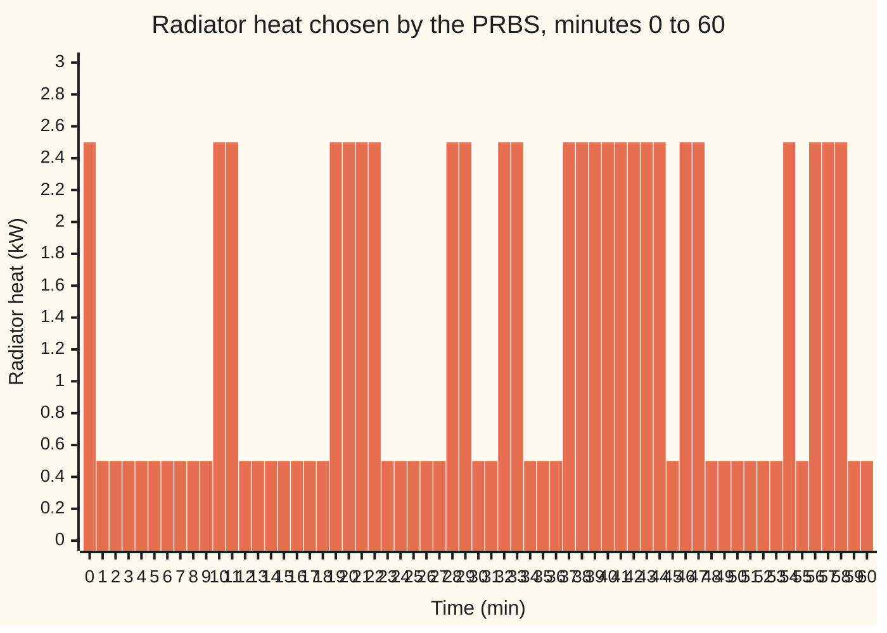
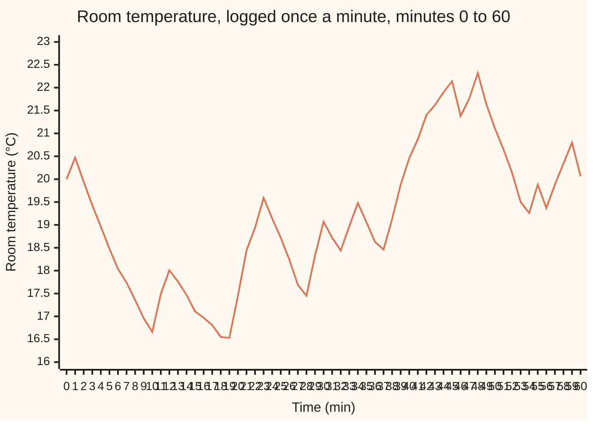
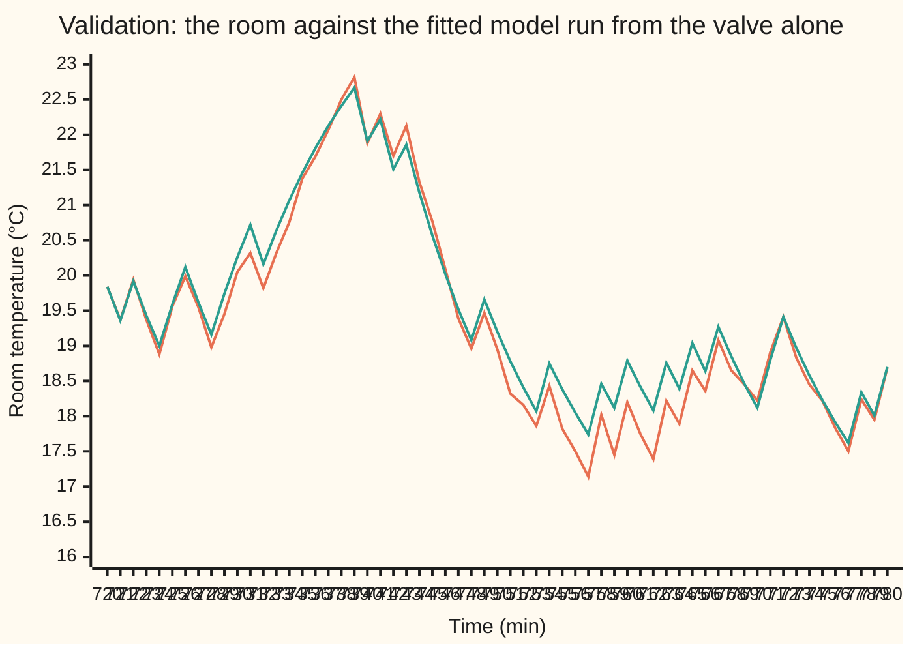

# ARX identification: fit a difference equation to logged data by least squares

[Syllabus](../../../SYLLABUS.md) → [Engineering mathematics](../README.md) → [Models from Data](../README.md#s11) → ARX identification

---

## General Overview

A radiator-heated room, like the one on shelf 03, needs a thermostat, and a thermostat needs a model of the room. The bump test in [PID control](../03-Feedback%20Control/07-pid-control-and-tuning.md) gave one from a single step. This card gets the model from a whole day of ordinary data instead. This room is bigger and slower than shelf 03's, and at one reading a minute its pipe delay is too short to see.

For one day the room is logged once a minute: 1,440 samples. Every minute a valve controller flips a coin-like switch, so the radiator runs at either 0.5 kW or 2.5 kW. The pattern looks random but is fixed in advance. It is a **pseudo-random binary signal** (PRBS): a two-level signal from a shift register that repeats only after 2,047 minutes. Over the day it spends 713 minutes high and 727 minutes low.

The engineer wants two numbers out of the log: how many °C the room settles per kW, and how many minutes the room takes to respond. Those two numbers set the thermostat's gains.

The method assumes a rule: this minute's temperature is a fixed fraction of last minute's, plus a fixed amount per kW of last minute's heat, plus noise. It picks the fraction and amount that miss the log least, in the least-squares sense. The log was generated from a known room, fraction 0.9 and 0.5 °C per kW, so the fit can be graded. It returns 0.9012 and 0.4965: a settled gain of 5.025 °C/kW (true 5.000) and a lag of 9.61 minutes (true 9.49).

### The picture: the first hour of the log





Top: the radiator heat, 0.5 or 2.5 kW, switched by the PRBS. Bottom: the room temperature. A long low stretch cools the room to 16.53 °C at minute 19. A long high stretch warms it to 22.32 °C at minute 48. Short flips leave small ripples. The fit uses all of these: the long stretches show the gain, the short flips show the speed.

**Write the room as a difference equation that is linear in its unknown numbers, stack every logged minute into one tall least-squares problem, and solve the normal equations; the answer is right when the input moved enough, the order passes a test on fresh data, and the noise left over is white.**

**What kind of fact this is:** a method. The room's equation is a model: an assumption that fits well enough, not a law. Inside the model, two facts are theorems proved on this card in Why it works: with white noise the fit homes in on the truth, and with a noisy thermometer it homes in on a predictable wrong value.

---

## The formula

Notation first, in words. Time runs in whole minutes, counted by $`k`$. The room temperature $`y_k`$ is the reading at minute $`k`$, in °C above 20 °C. The input $`u_k`$ is the radiator heat in kW above 1.5 kW, so the PRBS makes $`u_k`$ either +1 or −1. Working with these deviations keeps the model about one operating point, as in [PID control](../03-Feedback%20Control/07-pid-control-and-tuning.md).

An **ARX model** (autoregressive with exogenous input) explains each reading by earlier readings (the autoregressive part, as in [Autoregression](../../09-Probability%20and%20statistics/12-Time%20Series/02-ar-models.md)) and by earlier inputs (exogenous: coming from outside the room), plus a random push $`e_k`$ each minute:

```math
y_k = a_1 y_{k-1} + \dots + a_{n_a} y_{k-n_a} + b_1 u_{k-1} + \dots + b_{n_b} u_{k-n_b} + e_k
```

Write the past values as one list, the **regressor** $`\varphi_k = (y_{k-1}, \dots, y_{k-n_a}, u_{k-1}, \dots, u_{k-n_b})`$, and the unknowns as $`\theta = (a_1, \dots, a_{n_a}, b_1, \dots, b_{n_b})`$. Then each minute reads $`y_k = \varphi_k^{\mathsf T}\theta + e_k`$. Stack the $`N`$ minutes as rows of a matrix $`\Phi`$ and a column $`Y`$. The least-squares estimate and its spread, where $`\sigma_e`$ is the size (standard deviation) of the push $`e_k`$, are

```math
\hat\theta = \left(\Phi^{\mathsf T}\Phi\right)^{-1}\Phi^{\mathsf T}Y, \qquad \mathrm{Cov}(\hat\theta) \approx \sigma_e^2\left(\Phi^{\mathsf T}\Phi\right)^{-1}
```

**Read it aloud:** the best unknowns are the ones whose misses are perpendicular to every column of past data, and their uncertainty shrinks as the data matrix grows.

For the room, $`n_a = n_b = 1`$: $`y_k = a\,y_{k-1} + b\,u_{k-1} + e_k`$. In the z-transform's language ([The z-transform](../02-Linear%20Systems%20and%20Transforms/08-z-transform-and-discrete-time-systems.md)), where $`z^{-1}`$ is the one-step delay, this is the transfer function $`G(z) = b/(z - a)`$, with one pole at $`z = a`$. Two engineering numbers come straight out:

```math
\text{settled gain} = \frac{b}{1-a}, \qquad \text{lag} = \frac{-1\ \text{min}}{\ln a}
```

The gain is where the equation settles when $`u`$ is held: $`y = a y + b u`$. The lag is the time constant $`\tau`$ with $`a = e^{-1\,\text{min}/\tau}`$.

| Symbol | Plain meaning | In our example | Push it up and the answer… |
| --- | --- | --- | --- |
| $`k`$, $`N`$ | minute number; number of logged minutes | 0 to 1,439; $`N`$ = 1,440 | more data: smaller spread, same bias |
| $`y_k`$ | room temperature at minute $`k`$, °C above 20 °C | from −3.47 to +2.32 °C in the first hour | — |
| $`u_k`$, $`M`$ | radiator heat, kW above 1.5 kW; the PRBS period | +1 or −1 kW; $`M`$ = 2,047 min | bigger swings: smaller spread |
| $`a`$ ($`a_1, \dots`$), $`\tau`$ | fraction of the temperature that survives one minute, also the pole of $`G(z)`$; the lag (time constant) | true 0.9 and 9.49 min; fitted 0.9012 and 9.61 min | slower room, longer lag |
| $`b`$ ($`b_1, \dots`$) | °C gained in one minute per kW of last minute's heat | true 0.5 °C/kW; fitted 0.4965 | stronger radiator |
| $`n_a`$, $`n_b`$ | the model's orders: how many past readings and past inputs it uses | (1, 1); tried (0, 1) to (4, 4) | more unknowns, more spread, possible overfit |
| $`e_k`$, $`\sigma_e`$ | the equation error, a fresh random push each minute (draughts, sun); its standard deviation | white, $`\sigma_e`$ = 0.1 °C | bigger spread of $`\hat\theta`$ |
| $`\theta`$, $`\hat\theta`$, $`\varphi_k`$, $`\Phi`$, $`Y`$ | the list of unknowns and its least-squares estimate (a hat marks an estimate); regressor (past values for minute $`k`$); regressors stacked as rows; readings stacked as a column | $`(0.9, 0.5)`$ and $`(0.9012, 0.4965)`$; 1,439 rows of $`(y_{k-1}, u_{k-1})`$ | — |
| $`r_0`$, $`r_1`$ | the input's mean square; its correlation with itself one minute earlier | PRBS: near 1 and 0; step: both near 1 | $`r_1 \to r_0`$: excitation lost |
| $`\varepsilon_k`$, $`\rho(\ell)`$ | residual, the fitted model's miss at minute $`k`$; its correlation with itself $`\ell`$ minutes earlier | white band $`\pm 1.96/\sqrt{N}`$ | — |
| $`w_k`$, $`\sigma_w`$, $`x_k`$, $`V_x`$ | thermometer noise; its standard deviation; the true temperature, so $`y_k = x_k + w_k`$; the variance of $`x_k`$ | cheap thermometer $`\sigma_w`$ = 0.3 °C; $`V_x`$ = 1.3684 °C² | bias in $`\hat a`$ grows |
| $`\zeta_k`$ | instrument: signals correlated with $`\varphi_k`$ but not with the noise | $`(u_{k-2}, u_{k-1})`$ | — |

### When it holds

- **The equation error is white**: each minute's push $`e_k`$ is new, unrelated to earlier pushes. If the noise is coloured (correlated from minute to minute), the fit is biased, and more data does not help. A 0.3 °C thermometer pulls $`\hat a`$ to 0.8443, and the lag comes out 5.91 min instead of 9.49.
- **The input moves enough.** $`\Phi^{\mathsf T}\Phi`$ must be safely invertible. One step leaves a second-order model unable to separate $`b_1`$ from $`b_2`$: $`b_1 = 0.66 \pm 0.10`$ instead of $`0.497 \pm 0.003`$.
- **The order is right.** Too low, and the model misses real dynamics: with no memory, order (0, 1), the miss on fresh data is 1.154 °C, against 0.0984 °C at order (1, 1). Too high only adds spread.
- **The room is linear and stays the same all day.** The model is a straight-line description near 20 °C and 1.5 kW. A radiator's output is not linear in the room temperature over a wide range, and a real valve saturates at its limits ([PID in practice](../03-Feedback%20Control/08-pid-on-real-hardware.md)); a slowly changing room needs the recursive fit of [Adapting as you go](../10-Robustness%20and%20Adaptation/04-gain-scheduling-and-adaptive-control.md).
- **The loop is open.** Here the PRBS sets the valve, not a thermostat. Under feedback, $`u_k`$ depends on past noise, which is safe for ARX with white noise but breaks several other methods.

---

## Why it works

### Step 0: the equation is linear in the unknowns

The unknowns $`a`$ and $`b`$ enter the room's equation only as multipliers. So each minute is one line of an ordinary regression: last minute's temperature and heat explain this minute's temperature. A day gives 1,439 such equations in 2 unknowns. No pair satisfies them all, so take the pair that misses least.

### Step 1: least squares solves the stacked equations

Stack the equations as $`Y = \Phi\theta + e`$. The pair that minimises the sum of squared misses makes the misses perpendicular to every column of $`\Phi`$, so $`\Phi^{\mathsf T}(Y - \Phi\hat\theta) = 0`$. These are the **normal equations**, proved in [Least squares](../../03-Algebra/06-Dot%20Products%20and%20Best%20Fits/04-least-squares.md):

```math
\Phi^{\mathsf T}\Phi\,\hat\theta = \Phi^{\mathsf T}Y
```

For the room, $`\Phi^{\mathsf T}\Phi`$ is a 2×2 table of sums. Its corners are $`\sum y_{k-1}^2`$, $`\sum y_{k-1}u_{k-1}`$ and $`\sum u_{k-1}^2`$. The whole day collapses into five numbers: 2092.40, 29.63, 1439.00, and on the right 1900.38 and 741.13.

### Step 2: with white noise, the fit homes in on the truth

Put $`Y = \Phi\theta + e`$ into the normal equations. The error of the estimate is

```math
\hat\theta - \theta = \left(\tfrac{1}{N}\Phi^{\mathsf T}\Phi\right)^{-1}\tfrac{1}{N}\Phi^{\mathsf T}e
```

The regressor $`\varphi_k`$ holds only values from minute $`k-1`$ and earlier. A white push $`e_k`$ arrives after them, so it is uncorrelated with them. Then $`\tfrac{1}{N}\Phi^{\mathsf T}e = \tfrac{1}{N}\sum \varphi_k e_k`$ averages to zero as $`N`$ grows, and the estimate converges to $`\theta`$. An estimate with this property is **consistent**.

The spread follows from the same line. Treating $`\Phi`$ as fixed, the covariance is $`\sigma_e^2(\Phi^{\mathsf T}\Phi)^{-1}`$. For the room, the standard error of $`\hat a`$ is about $`0.1/\sqrt{2092.40} = 0.0022`$. Over 200 simulated days the fitted $`\hat a`$ averages 0.9000 and spreads by 0.0023. The formula and the simulation agree.

### Step 3: the input must excite the model

The normal equations need $`\Phi^{\mathsf T}\Phi`$ to be safely invertible. Its input block is a table of input correlations. For two input lags it is

```math
\frac{1}{N}\begin{pmatrix}\sum u_{k-1}^2 & \sum u_{k-1}u_{k-2}\\ \sum u_{k-1}u_{k-2} & \sum u_{k-2}^2\end{pmatrix} \approx \begin{pmatrix} r_0 & r_1\\ r_1 & r_0\end{pmatrix}
```

Here $`r_0`$ is the input's mean square and $`r_1`$ its correlation with itself one minute earlier. The eigenvalues are $`r_0 \pm r_1`$. An input is **persistently exciting** of order $`n`$ when the $`n \times n`$ table of this kind has all its eigenvalues safely above zero; then $`n`$ input coefficients can be told apart.

- **A step** of the valve from 1.5 to 2.5 kW holds $`u`$ constant afterwards, so $`u_{k-1} = u_{k-2}`$ almost always, $`r_1 \approx r_0`$ and the smallest eigenvalue is 0.00035. The data only see $`b_1 + b_2`$. The order-2 fit gets the sum right, 0.513, but not the split: $`b_1 = 0.66 \pm 0.10`$, $`b_2 = -0.14 \pm 0.11`$.
- **The PRBS** flips at random, so $`r_1 \approx 0`$ and the smallest eigenvalue is 0.9958. The same order-2 fit gives $`b_1 = 0.497 \pm 0.003`$, $`b_2 = -0.020 \pm 0.013`$ and $`a_2 = -0.030`$: correctly close to the first-order truth.

A maximum-length PRBS of period $`M`$ has $`r_1, r_2, \dots`$ all equal to $`-1/M`$ over a full period, nearly a flat spectrum. That is why it is the standard test signal: two levels, easy on the valve, yet exciting at every frequency.

### Step 4: choose the order on data the fit never saw

Training error, the miss on the data used to fit, falls every time a coefficient is added, as [Overfitting](../../09-Probability%20and%20statistics/09-Regression/08-cross-validation-and-overfitting.md) proves. So fit on the first 12 hours and score the **one-step prediction**, the model's forecast of the next minute, on the last 12 hours:

| Order $`(n_a, n_b)`$ | Training rms miss (°C) | Validation rms miss (°C) | Residual lags outside the white band, of 20 |
| --- | --- | --- | --- |
| (0, 1) | 1.03045 | 1.15423 | 20 |
| (1, 1) | 0.10052 | 0.09840 | 0 |
| (2, 2) | 0.10039 | 0.09836 | 0 |
| (3, 3) | 0.10038 | 0.09836 | 0 |
| (4, 4) | 0.10005 | 0.09872 | 1 |

Adding memory, order (1, 1), cuts the validation miss by a factor of about twelve, down to the 0.1 °C noise floor. Higher orders change it only in the fifth decimal place. The rule used here: take the smallest order within 1% of the best validation score. That is order (1, 1).

The **whiteness test** is the second judge. If the model has caught all the dynamics, its residuals are white: their correlations $`\rho(\ell)`$ for lags $`\ell`$ = 1 to 20 should almost all sit inside $`\pm 1.96/\sqrt{N}`$, with $`N`$ here the number of residuals scored. About 1 lag in 20 strays by chance. Order (1, 1) has none outside. Order (0, 1) has all 20 outside: its residuals still carry the room's memory.

The sternest test is a **free run**: start the fitted model at minute 720 and feed it only the valve signal, never the thermometer. Over the last 12 hours it tracks the room to 0.225 °C rms.



Orange: the logged room, minutes 720 to 780. Green: the order-(1, 1) model, started at 19.84 °C and driven by the valve alone. The gap is the draughts and sun the model cannot know about.

### Step 5: coloured noise biases the fit

Now give the same day a cheap thermometer that adds its own noise $`w_k`$, with $`\sigma_w`$ = 0.3 °C, to each reading. The room itself is unchanged. Write $`x_k`$ for the true temperature and $`y_k = x_k + w_k`$ for the reading. Substituting into the room's equation:

```math
y_k = a\,y_{k-1} + b\,u_{k-1} + \underbrace{e_k + w_k - a\,w_{k-1}}_{\text{coloured}}
```

The new error term contains $`w_{k-1}`$, and so does the regressor $`y_{k-1}`$. Step 2's argument fails: $`\varphi_k`$ and the error are correlated. The fit attributes part of the noise to the room and shrinks $`\hat a`$. The limit has a closed form, derived in the fold:

```math
\hat a \to a\,\frac{V_x}{V_x + \sigma_w^2} = 0.9 \times \frac{1.3684}{1.3684 + 0.09} = 0.8445, \qquad \hat b \to b
```

On the day, plain least squares gives $`\hat a = 0.8443`$. Over 200 days it averages 0.8469 with a spread of 0.0051: the bias stays, while the spread shrinks with more data. The room appears to have a lag of 5.91 min and a gain of 3.257 °C/kW, against 9.49 min and 5.000 °C/kW.

The whiteness test raises the alarm: the residuals' lag-1 correlation is −0.417, and 4 of 20 lags fall outside the band.

<details>
<summary>Where the closed form comes from</summary>

Take a long log, so averages become expectations. The PRBS is close to white with $`u_k = \pm 1`$, so $`E[u_{k-1}^2] = 1`$. The input $`u_{k-1}`$ is unrelated to $`y_{k-1}`$, which depends only on inputs up to $`u_{k-2}`$. So the normal equations divided by $`N`$ become two separate equations:

$`\displaystyle E[y_{k-1}^2]\,\hat a = E[y_k\,y_{k-1}], \qquad 1 \cdot \hat b = E[y_k\,u_{k-1}].`$

The true temperature obeys $`x_k = a x_{k-1} + b u_{k-1} + e_k`$, so its variance is $`V_x = (b^2 + \sigma_e^2)/(1 - a^2) = (0.25 + 0.01)/0.19 = 1.3684`$ °C², and $`E[x_k x_{k-1}] = a V_x`$. The thermometer noise is independent of everything, so $`E[y_{k-1}^2] = V_x + \sigma_w^2`$ and $`E[y_k y_{k-1}] = a V_x`$. Also $`E[y_k u_{k-1}] = b`$. Hence

$`\displaystyle \hat a \to \frac{a V_x}{V_x + \sigma_w^2}, \qquad \hat b \to b.`$

The noise inflates the regressor's variance on the left but adds nothing on the right. The 200-day average, 0.8469, sits 0.0024 above the limit because each day is finite; the gap shrinks as days get longer.

</details>

**The fixes.** Two standard ones keep the white-noise idea but stop the noise reaching the regressor.

- **Instrumental variables** (IV): multiply the equations by an **instrument** $`\zeta_k`$ instead of by $`\varphi_k`$, and solve $`\sum \zeta_k\varphi_k^{\mathsf T}\,\hat\theta = \sum \zeta_k y_k`$. The instrument must be correlated with the regressor but not with the noise. Past inputs qualify: $`\zeta_k = (u_{k-2}, u_{k-1})`$. On the day IV gives $`\hat a = 0.8870`$, $`\hat b = 0.5067`$. Over 200 days it averages 0.9027 with a spread of 0.0229. The bias is gone; the price is ten times the spread of the white-noise fit.
- **Output error**: fit the model's free run, as in Step 4's chart, to the readings. The thermometer noise then appears only in the miss, never in the regressor. The miss is no longer linear in $`a`$, so the fit needs iterations, which is why it gets its name here and is not carried out.

---

## Worked numbers, by hand

The order-(1, 1) fit to the full day, from the five sums of Step 1.

| Step | Arithmetic | Value |
| --- | --- | --- |
| $`\Phi^{\mathsf T}\Phi`$ | $`\sum y_{k-1}^2`$, $`\sum y_{k-1}u_{k-1}`$, $`\sum u_{k-1}^2`$ over 1,439 minutes | 2092.40, 29.63, 1439.00 |
| $`\Phi^{\mathsf T}Y`$ | $`\sum y_k y_{k-1}`$, $`\sum y_k u_{k-1}`$ | 1900.38, 741.13 |
| $`\hat a`$, by Cramer's rule | $`(1900.38 \times 1439.00 - 29.63 \times 741.13)/(2092.40 \times 1439.00 - 29.63^2)`$ | 0.9012 |
| $`\hat b`$, by Cramer's rule | $`(2092.40 \times 741.13 - 29.63 \times 1900.38)/(2092.40 \times 1439.00 - 29.63^2)`$ | 0.4965 °C/kW |
| standard errors | $`0.1/\sqrt{2092.40}`$ and $`0.1/\sqrt{1439}`$ | 0.0022 and 0.0026 |
| settled gain | $`0.4965/(1 - 0.9012)`$ | 5.025 °C/kW |
| lag | $`-1/\ln 0.9012`$ min | 9.61 min |
| **the room** | | **5.0 °C per kW, lag 9.6 minutes** |

Both estimates sit within 0.01 of the truth (0.9, 0.5), well inside two standard errors. A thermostat designer can take a 5 °C/kW gain and a 9.6-minute lag into the lambda rule of [PID control](../03-Feedback%20Control/07-pid-control-and-tuning.md), with zero delay. The Ziegler–Nichols rule divides by the delay, so it needs a finer log that can see one.

### What breaks if you drop a piece

| Mistake | Comes out at | What went wrong |
| --- | --- | --- |
| One step instead of the PRBS, order (2, 2) | $`b_1 = 0.66 \pm 0.10`$, $`b_2 = -0.14 \pm 0.11`$ (PRBS: $`0.497 \pm 0.003`$, $`-0.020 \pm 0.013`$) | A step is persistently exciting of order 1 only; the data cannot split $`b_1`$ from $`b_2`$ |
| Plain least squares with the 0.3 °C thermometer | $`\hat a = 0.8443`$: gain 3.257 °C/kW, lag 5.91 min (true 5.000, 9.49) | Coloured equation error, correlated with $`y_{k-1}`$ |
| No memory, order (0, 1) | validation miss 1.154 °C (order (1, 1): 0.0984) | The room's own memory is missing; residuals fail all 20 whiteness lags |
| Order picked by training error | picks (4, 4) at 0.10005 °C; its validation miss, 0.09872, is the worst of orders 1 to 4 | Training error always falls with more coefficients |

---

## Code, from first principles, and it actually runs

The scripts write out everything: a SplitMix64 random generator with seed 2026 and Box–Muller normal draws, so Python and Rust make the same noise; an 11-bit shift register for the PRBS; Gaussian elimination; and the whiteness test. They simulate the room, then reach the fitted $`(\hat a, \hat b)`$ by **three independent roads**: the normal equations, a Gram–Schmidt QR factorisation that never forms $`\Phi^{\mathsf T}\Phi`$, and recursive least squares, one sample at a time. Two more roads check the statistics: the standard-error formula against the spread over 200 simulated days, and the closed-form bias against the 200-day average.

### Python

```python
# ARX identification of the radiator room: the check behind the card.  Standard library only.
# Roads: normal equations vs Gram-Schmidt QR vs recursive least squares; the standard-error formula
# vs 200 simulated days; the bias closed form vs simulation; instrumental variables as the fix.
from math import sqrt, log, cos, pi
A, B, SE, SW, N = 0.9, 0.5, 0.1, 0.3, 1440  # true room; process and thermometer noise (degC); minutes
M64, state = 0xFFFFFFFFFFFFFFFF, [2026]     # 64-bit mask; SplitMix64 seed
def unif():
    state[0] = (state[0] + 0x9E3779B97F4A7C15) & M64
    z = state[0]
    z = ((z ^ (z >> 30)) * 0xBF58476D1CE4E5B9) & M64
    z = ((z ^ (z >> 27)) * 0x94D049BB133111EB) & M64
    return ((z ^ (z >> 31)) >> 11) / 2.0**53
def gauss(): return sqrt(-2.0 * log(1.0 - unif())) * cos(2.0 * pi * unif())   # Box-Muller, cosine half only
def prbs(n):                                # 11-bit shift register, x^11 + x^9 + 1, period 2047
    reg, out = 0x7FF, []
    for _ in range(n):
        out.append(1.0 if reg & 1 else -1.0)
        reg = ((reg << 1) | (((reg >> 10) ^ (reg >> 8)) & 1)) & 0x7FF
    return out
def day(u):                                 # x: true room (good thermometer), ym: cheap thermometer
    x, ym = [0.0] * N, [0.0] * N
    for k in range(N):
        e, w = SE * gauss(), SW * gauss()
        if k > 0: x[k] = A * x[k - 1] + B * u[k - 1] + e
        ym[k] = x[k] + w
    return x, ym
def rows(y, u, na, nb, s, e):               # regressors phi_k = (y_k-1 .. y_k-na, u_k-1 .. u_k-nb), targets y_k
    return [[y[k - i] for i in range(1, na + 1)] + [u[k - i] for i in range(1, nb + 1)] for k in range(s, e)], y[s:e]
def solve(M, v):                            # Gaussian elimination with partial pivoting
    n = len(v); M = [M[i][:] + [v[i]] for i in range(n)]
    for c in range(n):
        p = max(range(c, n), key=lambda r: abs(M[r][c])); M[c], M[p] = M[p], M[c]
        for r in range(c + 1, n):
            M[r] = [M[r][j] - M[r][c] / M[c][c] * M[c][j] for j in range(n + 1)]
    th = [0.0] * n
    for i in range(n - 1, -1, -1):
        th[i] = (M[i][n] - sum(M[i][j] * th[j] for j in range(i + 1, n))) / M[i][i]
    return th
def gram(P, Z=None):                        # Z^T Phi; with Z = Phi it is the normal-equation matrix
    Z = Z or P
    return [[sum(z[i] * p[j] for z, p in zip(Z, P)) for j in range(len(P[0]))] for i in range(len(Z[0]))]
def zty(Z, t):   return [sum(z[i] * v for z, v in zip(Z, t)) for i in range(len(Z[0]))]
def ls(P, t):    return solve(gram(P), zty(P, t))              # road 1: normal equations
def iv(P, Z, t): return solve(gram(P, Z), zty(Z, t))           # instrumental variables
def qr_ls(P, t):                            # road 2: modified Gram-Schmidt QR, then back-substitution
    n = len(P[0]); Q = [[p[c] for p in P] for c in range(n)]; R = [[0.0] * n for _ in range(n)]
    for c in range(n):
        for j in range(c):
            R[j][c] = sum(a * b for a, b in zip(Q[j], Q[c])); Q[c] = [a - R[j][c] * b for a, b in zip(Q[c], Q[j])]
        R[c][c] = sqrt(sum(a * a for a in Q[c])); Q[c] = [a / R[c][c] for a in Q[c]]
    return solve(R, [sum(a * b for a, b in zip(Q[c], t)) for c in range(n)])
def rls(P, t):                              # road 3: recursive least squares, P0 = 1e6 I, no forgetting
    th, C = [0.0, 0.0], [[1e6, 0.0], [0.0, 1e6]]
    for f, v in zip(P, t):
        Cf = [C[i][0] * f[0] + C[i][1] * f[1] for i in range(2)]
        g = [c / (1.0 + f[0] * Cf[0] + f[1] * Cf[1]) for c in Cf]
        err = v - th[0] * f[0] - th[1] * f[1]
        th = [th[i] + g[i] * err for i in range(2)]
        C = [[C[i][j] - g[i] * Cf[j] for j in range(2)] for i in range(2)]
    return th
def resid(P, t, th): return [v - sum(a * b for a, b in zip(p, th)) for p, v in zip(P, t)]
def rms(r):          return sqrt(sum(v * v for v in r) / len(r))
def se(P, t, th):                           # standard errors: sigma_hat^2 times the diagonal of (Phi^T Phi)^-1
    r, n = resid(P, t, th), len(P[0]); s2 = sum(v * v for v in r) / (len(r) - n)
    return [sqrt(s2 * solve(gram(P), [1.0 * (j == i) for j in range(n)])[i]) for i in range(n)]
def whiteness(r):                           # residual autocorrelation, lags 1-20; count outside +-1.96/sqrt(N)
    s0 = sum(v * v for v in r); rho = [sum(r[k] * r[k - L] for k in range(L, len(r))) / s0 for L in range(1, 21)]
    return rho, sum(abs(p) > 1.96 / sqrt(len(r)) for p in rho)

u = prbs(N); x, ym = day(u)
print(f"valve PRBS: {sum(v > 0 for v in u)} minutes at 2.5 kW, {sum(v < 0 for v in u)} at 0.5 kW")
print("chart valve kW, min 0-60: " + " ".join(f"{1.5 + v:.1f}" for v in u[:61]))
print("chart room degC, min 0-60: " + " ".join(f"{20 + v:.2f}" for v in x[:61]))
P, t = rows(x, u, 1, 1, 1, N); G, g = gram(P), zty(P, t)
th, thq, thr, s = ls(P, t), qr_ls(P, t), rls(P, t), se(P, t, ls(P, t))
print(f"Phi^T Phi = [[{G[0][0]:.2f}, {G[0][1]:.2f}], [{G[1][0]:.2f}, {G[1][1]:.2f}]]  Phi^T y = [{g[0]:.2f}, {g[1]:.2f}]")
print(f"1 normal equations  a = {th[0]:.4f}  b = {th[1]:.4f}  (se {s[0]:.4f}, {s[1]:.4f})")
print(f"2 Gram-Schmidt QR   a = {thq[0]:.4f}  b = {thq[1]:.4f}")
print(f"3 recursive LS      a = {thr[0]:.4f}  b = {thr[1]:.4f}")
print(f"room: gain b/(1-a) = {th[1] / (1 - th[0]):.3f} degC/kW (true 5.000), lag -1/ln a = "
      f"{-1 / log(th[0]):.2f} min (true {-1 / log(A):.2f})")
assert abs(th[0] - A) < 0.01 and abs(th[1] - B) < 0.01
assert all(abs(p - q) < 1e-4 for p, q in zip(th + th, thq + thr))

# input design: one step against the PRBS, for a second-order model
us = [0.0] * 10 + [1.0] * (N - 10); xs, _ = day(us)
def pe(w):                                  # smallest eigenvalue of the 2x2 table of input lags 1 and 2 (Step 3)
    p, q, r = (sum(w[k - i] * w[k - j] for k in range(2, N)) / (N - 2) for i, j in ((1, 1), (2, 2), (1, 2)))
    return (p + q) / 2 - sqrt((p - q) * (p - q) / 4 + r * r)
P2, t2 = rows(xs, us, 2, 2, 2, N); th2 = ls(P2, t2); s2 = se(P2, t2, th2)
Pp, tp = rows(x, u, 2, 2, 2, N); thp = ls(Pp, tp); sp = se(Pp, tp, thp)
print(f"excitation, smallest eigenvalue: step {pe(us):.5f}, PRBS {pe(u):.4f}")
print(f"order 2 from the step: b1 = {th2[2]:.2f} +- {s2[2]:.2f}, b2 = {th2[3]:.2f} +- {s2[3]:.2f}, b1+b2 = {th2[2] + th2[3]:.3f}")
print(f"order 2 from the PRBS: b1 = {thp[2]:.3f} +- {sp[2]:.3f}, b2 = {thp[3]:.3f} +- {sp[3]:.3f}, a2 = {thp[1]:.3f}")
assert pe(us) < 0.01 and pe(u) > 0.9 and s2[2] > 10 * sp[2]

# order choice: fit on the first 12 hours, score on the last 12
print("order  train rms  valid rms  lags outside the whiteness band, of 20")
val = {}
for na, nb in [(0, 1), (1, 1), (2, 2), (3, 3), (4, 4)]:
    Pe, te = rows(x, u, na, nb, 4, 720); Pv, tv = rows(x, u, na, nb, 724, N); tho = ls(Pe, te)
    rv = resid(Pv, tv, tho); val[na] = rms(rv); out = whiteness(rv)[1]
    print(f"({na},{nb})   {rms(resid(Pe, te, tho)):.5f}    {val[na]:.5f}    {out}")
    if na == 1: th1, out1 = tho, out
    if na == 0: out0 = out
sim, err = [x[720]], []
for k in range(721, N): sim.append(th1[0] * sim[-1] + th1[1] * u[k - 1]); err.append(x[k] - sim[-1])
print(f"order 1, free run over the last 12 h: rms {rms(err):.3f} degC")
print("chart measured degC, min 720-780: " + " ".join(f"{20 + v:.2f}" for v in x[720:781]))
print("chart model degC, min 720-780: " + " ".join(f"{20 + v:.2f}" for v in sim[:61]))
assert val[1] < 1.01 * min(val[2], val[3], val[4]) and val[0] > 2 * val[1] and out1 <= 2 < out0

# coloured noise: the cheap thermometer on the same day
Pm, tm = rows(ym, u, 1, 1, 2, N); thm = ls(Pm, tm)
Zm = [[u[k - 2], u[k - 1]] for k in range(2, N)]; thi = iv(Pm, Zm, tm)
rho, outm = whiteness(resid(Pm, tm, thm))
vx = (B * B + SE * SE) / (1 - A * A); abar = A * vx / (vx + SW * SW)
print(f"cheap thermometer, LS: a = {thm[0]:.4f} b = {thm[1]:.4f}; gain {thm[1] / (1 - thm[0]):.3f} degC/kW, "
      f"lag {-1 / log(thm[0]):.2f} min")
print(f"  residual lag-1 correlation {rho[0]:.3f}, lags outside the band {outm} of 20")
print(f"  closed form: a -> 0.9 * {vx:.4f} / ({vx:.4f} + {SW * SW:.2f}) = {abar:.4f}")
print(f"  instrumental variables: a = {thi[0]:.4f} b = {thi[1]:.4f}")

# 200 more days: the spread of the white-noise fit, and the bias of the coloured one
ag, am, ai = [], [], []
for _ in range(200):
    xx, yy = day(u)
    P, t = rows(xx, u, 1, 1, 1, N); ag.append(ls(P, t)[0])
    P, t = rows(yy, u, 1, 1, 2, N); am.append(ls(P, t)[0]); ai.append(iv(P, Zm, t)[0])
mean, sd = (lambda v: sum(v) / len(v)), (lambda v: sqrt(sum((a - mean(v)) ** 2 for a in v) / (len(v) - 1)))
print(f"200 days, good thermometer: mean a {mean(ag):.4f}, spread {sd(ag):.4f} (formula {s[0]:.4f})")
print(f"200 days, cheap thermometer: LS mean a {mean(am):.4f} spread {sd(am):.4f} (closed form {abar:.4f})")
print(f"200 days, cheap thermometer: IV mean a {mean(ai):.4f} spread {sd(ai):.4f}")
print(f"try: thermometer noise 0.1 / 0.5 degC -> a {A * vx / (vx + 0.01):.4f} / {A * vx / (vx + 0.25):.4f}; "
      f"6 hours of data -> spread about {2 * s[0]:.4f}")
assert abs(sd(ag) / s[0] - 1) < 0.2 and abs(mean(am) - abar) < 0.005 and abs(mean(ai) - A) < 0.01 and outm > 3
state[0] = 2026; sq = [1.0 if k // 20 % 2 == 0 else -1.0 for k in range(N)]; Pq, tq = rows(day(sq)[0], sq, 2, 2, 2, N)
thw, sw = ls(Pq, tq), se(Pq, tq, ls(Pq, tq))  # the first day's noise again, with the valve on a 40-minute square wave
print(f"try: square wave of period 40 min -> smallest eigenvalue {pe(sq):.4f}; order 2: b1 = {thw[2]:.3f} +- {sw[2]:.3f}")
print("ALL CHECKS PASS")
```

**Ran 2026-11-23 on macOS, Python 3.14.10, standard library only. All checks passed. Output, pasted from the run:**

```
valve PRBS: 713 minutes at 2.5 kW, 727 at 0.5 kW
chart valve kW, min 0-60: 2.5 0.5 0.5 0.5 0.5 0.5 0.5 0.5 0.5 0.5 2.5 2.5 0.5 0.5 0.5 0.5 0.5 0.5 0.5 2.5 2.5 2.5 2.5 0.5 0.5 0.5 0.5 0.5 2.5 2.5 0.5 0.5 2.5 2.5 0.5 0.5 0.5 2.5 2.5 2.5 2.5 2.5 2.5 2.5 2.5 0.5 2.5 2.5 0.5 0.5 0.5 0.5 0.5 0.5 2.5 0.5 2.5 2.5 2.5 0.5 0.5
chart room degC, min 0-60: 20.00 20.47 19.94 19.43 18.96 18.48 18.04 17.74 17.36 16.96 16.66 17.49 18.01 17.76 17.47 17.11 16.97 16.81 16.55 16.53 17.45 18.44 18.94 19.59 19.14 18.72 18.24 17.69 17.45 18.33 19.07 18.72 18.44 18.97 19.48 19.06 18.63 18.46 19.13 19.88 20.46 20.87 21.40 21.62 21.90 22.14 21.38 21.76 22.32 21.64 21.11 20.65 20.14 19.50 19.26 19.88 19.37 19.88 20.34 20.80 20.06
Phi^T Phi = [[2092.40, 29.63], [29.63, 1439.00]]  Phi^T y = [1900.38, 741.13]
1 normal equations  a = 0.9012  b = 0.4965  (se 0.0022, 0.0026)
2 Gram-Schmidt QR   a = 0.9012  b = 0.4965
3 recursive LS      a = 0.9012  b = 0.4965
room: gain b/(1-a) = 5.025 degC/kW (true 5.000), lag -1/ln a = 9.61 min (true 9.49)
excitation, smallest eigenvalue: step 0.00035, PRBS 0.9958
order 2 from the step: b1 = 0.66 +- 0.10, b2 = -0.14 +- 0.11, b1+b2 = 0.513
order 2 from the PRBS: b1 = 0.497 +- 0.003, b2 = -0.020 +- 0.013, a2 = -0.030
order  train rms  valid rms  lags outside the whiteness band, of 20
(0,1)   1.03045    1.15423    20
(1,1)   0.10052    0.09840    0
(2,2)   0.10039    0.09836    0
(3,3)   0.10038    0.09836    0
(4,4)   0.10005    0.09872    1
order 1, free run over the last 12 h: rms 0.225 degC
chart measured degC, min 720-780: 19.84 19.37 19.94 19.37 18.88 19.56 19.99 19.55 18.98 19.45 20.05 20.32 19.82 20.32 20.76 21.38 21.69 22.07 22.50 22.82 21.88 22.30 21.70 22.13 21.33 20.77 20.09 19.39 18.96 19.47 18.95 18.32 18.16 17.86 18.43 17.82 17.50 17.14 18.02 17.45 18.20 17.75 17.39 18.22 17.89 18.65 18.36 19.08 18.65 18.45 18.22 18.91 19.41 18.83 18.45 18.22 17.83 17.50 18.24 17.95 18.69
chart model degC, min 720-780: 19.84 19.36 19.92 19.43 19.00 19.59 20.12 19.62 19.16 19.74 20.26 20.72 20.16 20.64 21.07 21.46 21.81 22.13 22.41 22.67 21.91 22.22 21.51 21.86 21.18 20.57 20.02 19.52 19.08 19.66 19.20 18.78 18.41 18.07 18.75 18.38 18.05 17.74 18.46 18.12 18.79 18.42 18.08 18.76 18.39 19.04 18.64 19.27 18.85 18.46 18.12 18.80 19.41 18.97 18.58 18.23 17.91 17.62 18.34 18.01 18.70
cheap thermometer, LS: a = 0.8443 b = 0.5072; gain 3.257 degC/kW, lag 5.91 min
  residual lag-1 correlation -0.417, lags outside the band 4 of 20
  closed form: a -> 0.9 * 1.3684 / (1.3684 + 0.09) = 0.8445
  instrumental variables: a = 0.8870 b = 0.5067
200 days, good thermometer: mean a 0.9000, spread 0.0023 (formula 0.0022)
200 days, cheap thermometer: LS mean a 0.8469 spread 0.0051 (closed form 0.8445)
200 days, cheap thermometer: IV mean a 0.9027 spread 0.0229
try: thermometer noise 0.1 / 0.5 degC -> a 0.8935 / 0.7610; 6 hours of data -> spread about 0.0043
try: square wave of period 40 min -> smallest eigenvalue 0.0987; order 2: b1 = 0.492 +- 0.006
ALL CHECKS PASS
```

### Rust

```rust
// ARX identification of the radiator room: the check behind the card.  Rust std only.
// Roads: normal equations vs Gram-Schmidt QR vs recursive least squares; the standard-error formula
// vs 200 simulated days; the bias closed form vs simulation; instrumental variables as the fix.
const A: f64 = 0.9; const B: f64 = 0.5; const SE: f64 = 0.1; const SW: f64 = 0.3; const N: usize = 1440;
type Mat = Vec<Vec<f64>>;
struct Rng(u64); // SplitMix64 and Box-Muller, cosine half only
impl Rng {
    fn unif(&mut self) -> f64 {
        self.0 = self.0.wrapping_add(0x9E3779B97F4A7C15);
        let z = (self.0 ^ (self.0 >> 30)).wrapping_mul(0xBF58476D1CE4E5B9);
        let z = (z ^ (z >> 27)).wrapping_mul(0x94D049BB133111EB);
        ((z ^ (z >> 31)) >> 11) as f64 / 9007199254740992.0
    }
    fn gauss(&mut self) -> f64 { let u1 = 1.0 - self.unif(); (-2.0 * u1.ln()).sqrt() * (2.0 * std::f64::consts::PI * self.unif()).cos() }
}
fn prbs(n: usize) -> Vec<f64> { // 11-bit shift register, x^11 + x^9 + 1, period 2047
    let (mut reg, mut out) = (0x7FFu32, vec![]);
    for _ in 0..n {
        out.push(if reg & 1 == 1 { 1.0 } else { -1.0 });
        reg = ((reg << 1) | (((reg >> 10) ^ (reg >> 8)) & 1)) & 0x7FF;
    }
    out
}
fn day(rng: &mut Rng, u: &[f64]) -> (Vec<f64>, Vec<f64>) { // true room, cheap thermometer
    let (mut x, mut ym) = (vec![0.0; N], vec![0.0; N]);
    for k in 0..N {
        let e = SE * rng.gauss(); let w = SW * rng.gauss();
        if k > 0 { x[k] = A * x[k - 1] + B * u[k - 1] + e; } ym[k] = x[k] + w;
    }
    (x, ym)
}
fn rows(y: &[f64], u: &[f64], na: usize, nb: usize, s: usize, e: usize) -> (Mat, Vec<f64>) {
    let p = (s..e).map(|k| (1..=na).map(|i| y[k - i]).chain((1..=nb).map(|i| u[k - i])).collect()).collect();
    (p, y[s..e].to_vec())
}
fn solve(m0: &Mat, v: &[f64]) -> Vec<f64> { // Gaussian elimination with partial pivoting
    let n = v.len();
    let mut m: Mat = (0..n).map(|i| { let mut r = m0[i].clone(); r.push(v[i]); r }).collect();
    for c in 0..n {
        let mut p = c; for r in c + 1..n { if m[r][c].abs() > m[p][c].abs() { p = r; } } m.swap(c, p);
        for r in c + 1..n {
            let f = m[r][c] / m[c][c];
            for j in 0..=n { m[r][j] -= f * m[c][j]; }
        }
    }
    let mut th = vec![0.0; n];
    for i in (0..n).rev() {
        let s: f64 = (i + 1..n).map(|j| m[i][j] * th[j]).sum(); th[i] = (m[i][n] - s) / m[i][i];
    }
    th
}
fn gram(p: &Mat, z: &Mat) -> Mat { // Z^T Phi
    (0..z[0].len()).map(|i| (0..p[0].len()).map(|j| z.iter().zip(p).map(|(zr, pr)| zr[i] * pr[j]).sum()).collect()).collect()
}
fn zty(z: &Mat, t: &[f64]) -> Vec<f64> {
    (0..z[0].len()).map(|i| z.iter().zip(t).map(|(zr, v)| zr[i] * v).sum()).collect()
}
fn ls(p: &Mat, t: &[f64]) -> Vec<f64> { solve(&gram(p, p), &zty(p, t)) } // road 1
fn iv(p: &Mat, z: &Mat, t: &[f64]) -> Vec<f64> { solve(&gram(p, z), &zty(z, t)) }
fn dot(a: &[f64], b: &[f64]) -> f64 { let mut s = 0.0; for (x, y) in a.iter().zip(b) { s += x * y; } s }
fn qr_ls(p: &Mat, t: &[f64]) -> Vec<f64> { // road 2: modified Gram-Schmidt QR
    let n = p[0].len();
    let mut q: Mat = (0..n).map(|c| p.iter().map(|r| r[c]).collect()).collect();
    let mut r = vec![vec![0.0; n]; n];
    for c in 0..n {
        for j in 0..c {
            r[j][c] = dot(&q[j], &q[c]);
            let qj = q[j].clone(); q[c] = q[c].iter().zip(&qj).map(|(a, b)| a - r[j][c] * b).collect();
        }
        r[c][c] = dot(&q[c], &q[c]).sqrt(); q[c] = q[c].iter().map(|a| a / r[c][c]).collect();
    }
    solve(&r, &(0..n).map(|c| dot(&q[c], t)).collect::<Vec<_>>())
}
fn rls(p: &Mat, t: &[f64]) -> Vec<f64> { // road 3: recursive least squares, P0 = 1e6 I
    let (mut th, mut c) = (vec![0.0, 0.0], vec![vec![1e6, 0.0], vec![0.0, 1e6]]);
    for (f, v) in p.iter().zip(t) {
        let cf: Vec<f64> = (0..2).map(|i| c[i][0] * f[0] + c[i][1] * f[1]).collect();
        let g: Vec<f64> = cf.iter().map(|x| x / (1.0 + f[0] * cf[0] + f[1] * cf[1])).collect();
        let err = v - th[0] * f[0] - th[1] * f[1];
        th = (0..2).map(|i| th[i] + g[i] * err).collect();
        c = (0..2).map(|i| (0..2).map(|j| c[i][j] - g[i] * cf[j]).collect()).collect();
    }
    th
}
fn resid(p: &Mat, t: &[f64], th: &[f64]) -> Vec<f64> { p.iter().zip(t).map(|(r, v)| v - dot(r, th)).collect() }
fn rms(r: &[f64]) -> f64 { (dot(r, r) / r.len() as f64).sqrt() }
fn se(p: &Mat, t: &[f64], th: &[f64]) -> Vec<f64> {
    let (r, n) = (resid(p, t, th), p[0].len());
    let s2 = dot(&r, &r) / (r.len() - n) as f64;
    (0..n).map(|i| (s2 * solve(&gram(p, p), &(0..n).map(|j| if i == j { 1.0 } else { 0.0 }).collect::<Vec<_>>())[i]).sqrt()).collect()
}
fn whiteness(r: &[f64]) -> (Vec<f64>, usize) {
    let rho: Vec<f64> = (1..21).map(|l| (l..r.len()).map(|k| r[k] * r[k - l]).sum::<f64>() / dot(r, r)).collect();
    let out = rho.iter().filter(|p| p.abs() > 1.96 / (r.len() as f64).sqrt()).count();
    (rho, out)
}
fn join(v: &[f64], add: f64, d: usize) -> String { v.iter().map(|x| format!("{:.*}", d, add + x)).collect::<Vec<_>>().join(" ") }
fn mean(v: &[f64]) -> f64 { v.iter().sum::<f64>() / v.len() as f64 } fn sd(v: &[f64]) -> f64 { let m = mean(v); (v.iter().map(|a| (a - m) * (a - m)).sum::<f64>() / (v.len() - 1) as f64).sqrt() }

fn main() {
    let mut rng = Rng(2026);
    let u = prbs(N); let (x, ym) = day(&mut rng, &u);
    println!("valve PRBS: {} minutes at 2.5 kW, {} at 0.5 kW", u.iter().filter(|v| **v > 0.0).count(), u.iter().filter(|v| **v < 0.0).count());
    println!("chart valve kW, min 0-60: {}", join(&u[..61], 1.5, 1));
    println!("chart room degC, min 0-60: {}", join(&x[..61], 20.0, 2));
    let (p, t) = rows(&x, &u, 1, 1, 1, N); let (g, gy) = (gram(&p, &p), zty(&p, &t));
    let (th, thq, thr) = (ls(&p, &t), qr_ls(&p, &t), rls(&p, &t)); let s = se(&p, &t, &th);
    println!("Phi^T Phi = [[{:.2}, {:.2}], [{:.2}, {:.2}]]  Phi^T y = [{:.2}, {:.2}]", g[0][0], g[0][1], g[1][0], g[1][1], gy[0], gy[1]);
    println!("1 normal equations  a = {:.4}  b = {:.4}  (se {:.4}, {:.4})", th[0], th[1], s[0], s[1]);
    println!("2 Gram-Schmidt QR   a = {:.4}  b = {:.4}", thq[0], thq[1]);
    println!("3 recursive LS      a = {:.4}  b = {:.4}", thr[0], thr[1]);
    println!("room: gain b/(1-a) = {:.3} degC/kW (true 5.000), lag -1/ln a = {:.2} min (true {:.2})", th[1] / (1.0 - th[0]), -1.0 / th[0].ln(), -1.0 / A.ln());
    assert!((th[0] - A).abs() < 0.01 && (th[1] - B).abs() < 0.01 && (0..2).all(|i| (th[i] - thq[i]).abs() < 1e-4 && (th[i] - thr[i]).abs() < 1e-4));

    // input design: one step against the PRBS, for a second-order model
    let us: Vec<f64> = (0..N).map(|k| if k < 10 { 0.0 } else { 1.0 }).collect(); let (xs, _) = day(&mut rng, &us);
    let pe = |w: &[f64]| { // smallest eigenvalue of the 2x2 table of input lags 1 and 2 (Step 3)
        let c = |i: usize, j: usize| (2..N).map(|k| w[k - i] * w[k - j]).sum::<f64>() / (N - 2) as f64; let (p, q, r) = (c(1, 1), c(2, 2), c(1, 2));
        (p + q) / 2.0 - ((p - q) * (p - q) / 4.0 + r * r).sqrt() };
    let (p2, t2) = rows(&xs, &us, 2, 2, 2, N); let th2 = ls(&p2, &t2); let s2 = se(&p2, &t2, &th2);
    let (pp, tp) = rows(&x, &u, 2, 2, 2, N); let thp = ls(&pp, &tp); let sp = se(&pp, &tp, &thp);
    println!("excitation, smallest eigenvalue: step {:.5}, PRBS {:.4}", pe(&us), pe(&u));
    println!("order 2 from the step: b1 = {:.2} +- {:.2}, b2 = {:.2} +- {:.2}, b1+b2 = {:.3}", th2[2], s2[2], th2[3], s2[3], th2[2] + th2[3]);
    println!("order 2 from the PRBS: b1 = {:.3} +- {:.3}, b2 = {:.3} +- {:.3}, a2 = {:.3}", thp[2], sp[2], thp[3], sp[3], thp[1]);
    assert!(pe(&us) < 0.01 && pe(&u) > 0.9 && s2[2] > 10.0 * sp[2]);

    // order choice: fit on the first 12 hours, score on the last 12
    println!("order  train rms  valid rms  lags outside the whiteness band, of 20");
    let (mut val, mut th1, mut out1, mut out0) = (vec![0.0; 5], vec![], 0, 0);
    for na in 0..5 {
        let nb = na.max(1);
        let (pe_, te) = rows(&x, &u, na, nb, 4, 720); let (pv, tv) = rows(&x, &u, na, nb, 724, N); let tho = ls(&pe_, &te);
        let rv = resid(&pv, &tv, &tho); val[na] = rms(&rv); let out = whiteness(&rv).1;
        println!("({},{})   {:.5}    {:.5}    {}", na, nb, rms(&resid(&pe_, &te, &tho)), val[na], out);
        if na == 1 { th1 = tho; out1 = out; } else if na == 0 { out0 = out; }
    }
    let (mut sim, mut err) = (vec![x[720]], vec![]);
    for k in 721..N { let nx = th1[0] * sim[sim.len() - 1] + th1[1] * u[k - 1]; sim.push(nx); err.push(x[k] - nx); }
    println!("order 1, free run over the last 12 h: rms {:.3} degC", rms(&err));
    println!("chart measured degC, min 720-780: {}", join(&x[720..781], 20.0, 2));
    println!("chart model degC, min 720-780: {}", join(&sim[..61], 20.0, 2));
    assert!(val[1] < 1.01 * val[2].min(val[3]).min(val[4]) && val[0] > 2.0 * val[1] && out1 <= 2 && out0 > 2);

    // coloured noise: the cheap thermometer on the same day
    let (pm, tm) = rows(&ym, &u, 1, 1, 2, N); let thm = ls(&pm, &tm);
    let zm: Mat = (2..N).map(|k| vec![u[k - 2], u[k - 1]]).collect(); let thi = iv(&pm, &zm, &tm);
    let (rho, outm) = whiteness(&resid(&pm, &tm, &thm));
    let vx = (B * B + SE * SE) / (1.0 - A * A); let abar = A * vx / (vx + SW * SW);
    println!("cheap thermometer, LS: a = {:.4} b = {:.4}; gain {:.3} degC/kW, lag {:.2} min", thm[0], thm[1], thm[1] / (1.0 - thm[0]), -1.0 / thm[0].ln());
    println!("  residual lag-1 correlation {:.3}, lags outside the band {} of 20", rho[0], outm);
    println!("  closed form: a -> 0.9 * {:.4} / ({:.4} + {:.2}) = {:.4}", vx, vx, SW * SW, abar);
    println!("  instrumental variables: a = {:.4} b = {:.4}", thi[0], thi[1]);

    // 200 more days: the spread of the white-noise fit, and the bias of the coloured one
    let (mut ag, mut am, mut ai) = (vec![], vec![], vec![]);
    for _ in 0..200 {
        let (xx, yy) = day(&mut rng, &u);
        let (p, t) = rows(&xx, &u, 1, 1, 1, N); ag.push(ls(&p, &t)[0]);
        let (p, t) = rows(&yy, &u, 1, 1, 2, N); am.push(ls(&p, &t)[0]); ai.push(iv(&p, &zm, &t)[0]);
    }
    println!("200 days, good thermometer: mean a {:.4}, spread {:.4} (formula {:.4})", mean(&ag), sd(&ag), s[0]);
    println!("200 days, cheap thermometer: LS mean a {:.4} spread {:.4} (closed form {:.4})", mean(&am), sd(&am), abar);
    println!("200 days, cheap thermometer: IV mean a {:.4} spread {:.4}", mean(&ai), sd(&ai));
    println!("try: thermometer noise 0.1 / 0.5 degC -> a {:.4} / {:.4}; 6 hours of data -> spread about {:.4}", A * vx / (vx + 0.01), A * vx / (vx + 0.25), 2.0 * s[0]);
    assert!((sd(&ag) / s[0] - 1.0).abs() < 0.2 && (mean(&am) - abar).abs() < 0.005 && (mean(&ai) - A).abs() < 0.01 && outm > 3);
    let sq: Vec<f64> = (0..N).map(|k| if k / 20 % 2 == 0 { 1.0 } else { -1.0 }).collect(); // the valve on a 40-minute square wave
    let (pq, tq) = rows(&day(&mut Rng(2026), &sq).0, &sq, 2, 2, 2, N); let (thw, sw) = (ls(&pq, &tq), se(&pq, &tq, &ls(&pq, &tq))); // first day's noise
    println!("try: square wave of period 40 min -> smallest eigenvalue {:.4}; order 2: b1 = {:.3} +- {:.3}", pe(&sq), thw[2], sw[2]);
    println!("ALL CHECKS PASS");
}
```

**Ran 2026-11-23 on macOS, rustc 1.98.1, no crates. All checks passed. Output, pasted from the run:**

```
valve PRBS: 713 minutes at 2.5 kW, 727 at 0.5 kW
chart valve kW, min 0-60: 2.5 0.5 0.5 0.5 0.5 0.5 0.5 0.5 0.5 0.5 2.5 2.5 0.5 0.5 0.5 0.5 0.5 0.5 0.5 2.5 2.5 2.5 2.5 0.5 0.5 0.5 0.5 0.5 2.5 2.5 0.5 0.5 2.5 2.5 0.5 0.5 0.5 2.5 2.5 2.5 2.5 2.5 2.5 2.5 2.5 0.5 2.5 2.5 0.5 0.5 0.5 0.5 0.5 0.5 2.5 0.5 2.5 2.5 2.5 0.5 0.5
chart room degC, min 0-60: 20.00 20.47 19.94 19.43 18.96 18.48 18.04 17.74 17.36 16.96 16.66 17.49 18.01 17.76 17.47 17.11 16.97 16.81 16.55 16.53 17.45 18.44 18.94 19.59 19.14 18.72 18.24 17.69 17.45 18.33 19.07 18.72 18.44 18.97 19.48 19.06 18.63 18.46 19.13 19.88 20.46 20.87 21.40 21.62 21.90 22.14 21.38 21.76 22.32 21.64 21.11 20.65 20.14 19.50 19.26 19.88 19.37 19.88 20.34 20.80 20.06
Phi^T Phi = [[2092.40, 29.63], [29.63, 1439.00]]  Phi^T y = [1900.38, 741.13]
1 normal equations  a = 0.9012  b = 0.4965  (se 0.0022, 0.0026)
2 Gram-Schmidt QR   a = 0.9012  b = 0.4965
3 recursive LS      a = 0.9012  b = 0.4965
room: gain b/(1-a) = 5.025 degC/kW (true 5.000), lag -1/ln a = 9.61 min (true 9.49)
excitation, smallest eigenvalue: step 0.00035, PRBS 0.9958
order 2 from the step: b1 = 0.66 +- 0.10, b2 = -0.14 +- 0.11, b1+b2 = 0.513
order 2 from the PRBS: b1 = 0.497 +- 0.003, b2 = -0.020 +- 0.013, a2 = -0.030
order  train rms  valid rms  lags outside the whiteness band, of 20
(0,1)   1.03045    1.15423    20
(1,1)   0.10052    0.09840    0
(2,2)   0.10039    0.09836    0
(3,3)   0.10038    0.09836    0
(4,4)   0.10005    0.09872    1
order 1, free run over the last 12 h: rms 0.225 degC
chart measured degC, min 720-780: 19.84 19.37 19.94 19.37 18.88 19.56 19.99 19.55 18.98 19.45 20.05 20.32 19.82 20.32 20.76 21.38 21.69 22.07 22.50 22.82 21.88 22.30 21.70 22.13 21.33 20.77 20.09 19.39 18.96 19.47 18.95 18.32 18.16 17.86 18.43 17.82 17.50 17.14 18.02 17.45 18.20 17.75 17.39 18.22 17.89 18.65 18.36 19.08 18.65 18.45 18.22 18.91 19.41 18.83 18.45 18.22 17.83 17.50 18.24 17.95 18.69
chart model degC, min 720-780: 19.84 19.36 19.92 19.43 19.00 19.59 20.12 19.62 19.16 19.74 20.26 20.72 20.16 20.64 21.07 21.46 21.81 22.13 22.41 22.67 21.91 22.22 21.51 21.86 21.18 20.57 20.02 19.52 19.08 19.66 19.20 18.78 18.41 18.07 18.75 18.38 18.05 17.74 18.46 18.12 18.79 18.42 18.08 18.76 18.39 19.04 18.64 19.27 18.85 18.46 18.12 18.80 19.41 18.97 18.58 18.23 17.91 17.62 18.34 18.01 18.70
cheap thermometer, LS: a = 0.8443 b = 0.5072; gain 3.257 degC/kW, lag 5.91 min
  residual lag-1 correlation -0.417, lags outside the band 4 of 20
  closed form: a -> 0.9 * 1.3684 / (1.3684 + 0.09) = 0.8445
  instrumental variables: a = 0.8870 b = 0.5067
200 days, good thermometer: mean a 0.9000, spread 0.0023 (formula 0.0022)
200 days, cheap thermometer: LS mean a 0.8469 spread 0.0051 (closed form 0.8445)
200 days, cheap thermometer: IV mean a 0.9027 spread 0.0229
try: thermometer noise 0.1 / 0.5 degC -> a 0.8935 / 0.7610; 6 hours of data -> spread about 0.0043
try: square wave of period 40 min -> smallest eigenvalue 0.0987; order 2: b1 = 0.492 +- 0.006
ALL CHECKS PASS
```

### Lean

Lean proves the least-squares facts for any logged data, and checks the day's PRBS counts.

- Take any $`\Phi`$, $`Y`$ and $`\hat\theta`$. Then $`\hat\theta`$ misses least exactly when it solves the normal equations, $`\Phi^{\mathsf T}\Phi\hat\theta = \Phi^{\mathsf T}Y`$.
- Suppose $`\Phi^{\mathsf T}\Phi`$ is invertible: the input moves enough. Then $`\hat\theta = (\Phi^{\mathsf T}\Phi)^{-1}\Phi^{\mathsf T}Y`$ misses strictly less than every other choice of the unknowns.
- Take the input table with rows $`(r_0, r_1)`$ and $`(r_1, r_0)`$. Then its eigenvalues are exactly $`r_0 + r_1`$ and $`r_0 - r_1`$.
- The 11-bit shift register returns to its starting state after 2,047 minutes. Over the 1,440-minute day the valve is high 713 minutes and low 727.

The fitted numbers, consistency under white noise, the coloured-noise bias and the order choice are left to the Python and Rust checks.

```lean
-- ARX identification: the least-squares fit solves the normal equations and is the unique best fit when Φᵀ Φ is invertible, and the two-lag input table has eigenvalues r₀ ± r₁.
import Mathlib.LinearAlgebra.Matrix.NonsingularInverse
import Mathlib.LinearAlgebra.Matrix.ToLin
import Mathlib.LinearAlgebra.Eigenspace.Basic
import Mathlib.LinearAlgebra.Matrix.Notation
import Mathlib.Basic.Real.Basic

open Matrix

/-- The sum of squared misses of the stacked equations `Y = Φ θ + e` for a choice `θ` of the
unknowns: `∑ₖ (Yₖ - (Φ θ)ₖ)²`. -/
noncomputable def sumSqMiss {N n : ℕ} (Φ : Matrix (Fin N) (Fin n) ℝ) (Y : Fin N → ℝ)
    (θ : Fin n → ℝ) : ℝ :=
  ∑ k, (Y k - (Φ *ᵥ θ) k) ^ 2

/-- A real dot product of a vector with itself is never negative. -/
theorem real_dotProduct_self_nonneg {m : ℕ} (v : Fin m → ℝ) : 0 ≤ v ⬝ᵥ v :=
  Finset.sum_nonneg fun i _ => mul_self_nonneg (v i)

#print axioms real_dotProduct_self_nonneg

/-- A real vector whose dot product with itself is zero is the zero vector. -/
theorem real_dotProduct_self_eq_zero {m : ℕ} {v : Fin m → ℝ} (h : v ⬝ᵥ v = 0) : v = 0 := by
  have h' := (Finset.sum_eq_zero_iff_of_nonneg fun i _ => mul_self_nonneg (v i)).1 h
  funext i
  exact mul_self_eq_zero.1 (h' i (Finset.mem_univ i))

#print axioms real_dotProduct_self_eq_zero

/-- Expanding the sum of squared misses around a point `θh`. -/
theorem sumSqMiss_add {N n : ℕ} (Φ : Matrix (Fin N) (Fin n) ℝ) (Y : Fin N → ℝ)
    (θh d : Fin n → ℝ) :
    sumSqMiss Φ Y (θh + d) = sumSqMiss Φ Y θh
      - 2 * ((Φᵀ *ᵥ (Y - Φ *ᵥ θh)) ⬝ᵥ d) + (Φ *ᵥ d) ⬝ᵥ (Φ *ᵥ d) := by
  rw [mulVec_transpose, ← dotProduct_mulVec]
  unfold sumSqMiss
  simp only [mulVec_add, Pi.add_apply, dotProduct, Pi.sub_apply, Finset.mul_sum,
    ← Finset.sum_sub_distrib, ← Finset.sum_add_distrib]
  refine Finset.sum_congr rfl fun k _ => ?_
  ring

#print axioms sumSqMiss_add

/-- The normal equations in residual form. -/
theorem normal_eq_iff_residual {N n : ℕ} (Φ : Matrix (Fin N) (Fin n) ℝ) (Y : Fin N → ℝ)
    (θh : Fin n → ℝ) :
    (Φᵀ * Φ) *ᵥ θh = Φᵀ *ᵥ Y ↔ Φᵀ *ᵥ (Y - Φ *ᵥ θh) = 0 := by
  rw [mulVec_sub, ← mulVec_mulVec, sub_eq_zero, eq_comm]

#print axioms normal_eq_iff_residual

/-- Step 1, the input moves enough: when `Φᵀ Φ` is invertible, the least-squares estimate
`θ̂ = (Φᵀ Φ)⁻¹ Φᵀ Y` misses the stacked equations least of all choices of the unknowns, and it is
the only choice that does: any `θ` other than `θ̂` has a strictly larger sum of squared misses. -/
theorem least_squares_estimate_is_unique_minimiser {N n : ℕ}
    (Φ : Matrix (Fin N) (Fin n) ℝ) (Y : Fin N → ℝ) (hexc : IsUnit (Φᵀ * Φ).det) :
    ∀ θ : Fin n → ℝ, θ ≠ (Φᵀ * Φ)⁻¹ *ᵥ (Φᵀ *ᵥ Y) →
      sumSqMiss Φ Y ((Φᵀ * Φ)⁻¹ *ᵥ (Φᵀ *ᵥ Y)) < sumSqMiss Φ Y θ := by
  intro θ hθ
  set θh := (Φᵀ * Φ)⁻¹ *ᵥ (Φᵀ *ᵥ Y) with hθh
  have hne : (Φᵀ * Φ) *ᵥ θh = Φᵀ *ᵥ Y := by
    rw [hθh, mulVec_mulVec, mul_nonsing_inv _ hexc, one_mulVec]
  have hres := (normal_eq_iff_residual Φ Y θh).1 hne
  have key := sumSqMiss_add Φ Y θh (θ - θh)
  rw [add_sub_cancel, hres, zero_dotProduct] at key
  rw [key]
  have hd : θ - θh ≠ 0 := sub_ne_zero.2 hθ
  have hΦd : Φ *ᵥ (θ - θh) ≠ 0 := by
    intro h0
    apply hd
    have : (Φᵀ * Φ) *ᵥ (θ - θh) = 0 := by rw [← mulVec_mulVec, h0, mulVec_zero]
    calc θ - θh = ((Φᵀ * Φ)⁻¹ * (Φᵀ * Φ)) *ᵥ (θ - θh) := by
          rw [nonsing_inv_mul _ hexc, one_mulVec]
      _ = 0 := by rw [← mulVec_mulVec, this, mulVec_zero]
  have hpos : 0 < (Φ *ᵥ (θ - θh)) ⬝ᵥ (Φ *ᵥ (θ - θh)) := by
    rcases (real_dotProduct_self_nonneg _).lt_or_eq with h | h
    · exact h
    · exact absurd (real_dotProduct_self_eq_zero h.symm) hΦd
  linarith

/-- The normal equations: a choice `θ̂` of the unknowns minimises the sum of squared misses
exactly when its misses `Y - Φ θ̂` are perpendicular to every column of `Φ`, that is
`Φᵀ (Y - Φ θ̂) = 0`, equivalently `Φᵀ Φ θ̂ = Φᵀ Y`. -/
theorem minimiser_iff_normal_equations {N n : ℕ}
    (Φ : Matrix (Fin N) (Fin n) ℝ) (Y : Fin N → ℝ) (θhat : Fin n → ℝ) :
    (∀ θ : Fin n → ℝ, sumSqMiss Φ Y θhat ≤ sumSqMiss Φ Y θ) ↔
      (Φᵀ * Φ) *ᵥ θhat = Φᵀ *ᵥ Y := by
  rw [normal_eq_iff_residual]
  set g := Φᵀ *ᵥ (Y - Φ *ᵥ θhat) with hg
  constructor
  · intro hmin
    by_contra hne
    have hgg : 0 < g ⬝ᵥ g := by
      rcases (real_dotProduct_self_nonneg g).lt_or_eq with h | h
      · exact h
      · exact absurd (real_dotProduct_self_eq_zero h.symm) hne
    set q := (Φ *ᵥ g) ⬝ᵥ (Φ *ᵥ g)
    have hq : 0 ≤ q := real_dotProduct_self_nonneg _
    set t := (g ⬝ᵥ g) / (q + 1)
    have ht : 0 < t := div_pos hgg (by linarith)
    have htq : t * (q + 1) = g ⬝ᵥ g := div_mul_cancel₀ _ (by linarith)
    have key := sumSqMiss_add Φ Y θhat (t • g)
    have h1 := hmin (θhat + t • g)
    rw [← hg] at key
    rw [key, mulVec_smul, dotProduct_smul, smul_dotProduct, dotProduct_smul,
      smul_eq_mul, smul_eq_mul, smul_eq_mul] at h1
    -- h1 : 0 ≤ -2 t (g⬝g) + t² q
    have : t * (t * q) ≤ t * (t * (q + 1)) := by nlinarith
    nlinarith
  · intro h0 θ
    have key := sumSqMiss_add Φ Y θhat (θ - θhat)
    rw [← hg] at key
    rw [add_sub_cancel, h0, zero_dotProduct] at key
    rw [key]
    have := real_dotProduct_self_nonneg (Φ *ᵥ (θ - θhat))
    linarith

/-- Step 3, persistent excitation of order 2: the table of input correlations for two input
lags, `[[r₀, r₁], [r₁, r₀]]`, has eigenvalues exactly `r₀ + r₁` and `r₀ - r₁`. -/
theorem input_table_eigenvalues (r₀ r₁ μ : ℝ) :
    Module.End.HasEigenvalue (Matrix.toLin' !![r₀, r₁; r₁, r₀]) μ ↔
      μ = r₀ + r₁ ∨ μ = r₀ - r₁ := by
  constructor
  · intro h
    obtain ⟨v, hv⟩ := h.exists_hasEigenvector
    have hfv := hv.apply_eq_smul
    have hv0 := hv.2
    have e0 := congrFun hfv 0
    have e1 := congrFun hfv 1
    simp [Matrix.toLin'_apply, Matrix.mulVec, dotProduct, Fin.sum_univ_two] at e0 e1
    have hor : v 0 + v 1 ≠ 0 ∨ v 0 - v 1 ≠ 0 := by
      by_contra hc
      rw [not_or, not_not, not_not] at hc
      apply hv0
      funext i
      fin_cases i <;> simp <;> linarith [hc.1, hc.2]
    rcases hor with h | h
    · left
      have : (μ - (r₀ + r₁)) * (v 0 + v 1) = 0 := by linarith
      rcases mul_eq_zero.1 this with h' | h'
      · linarith
      · exact absurd h' h
    · right
      have : (μ - (r₀ - r₁)) * (v 0 - v 1) = 0 := by linarith
      rcases mul_eq_zero.1 this with h' | h'
      · linarith
      · exact absurd h' h
  · rintro (rfl | rfl)
    · apply Module.End.hasEigenvalue_of_hasEigenvector (x := ![1, 1])
      refine ⟨Module.End.mem_eigenspace_iff.2 ?_, ?_⟩
      · funext i
        fin_cases i <;> simp [Matrix.toLin'_apply, Matrix.mulVec, dotProduct, Fin.sum_univ_two, add_comm]
      · intro h; have := congrFun h 0; simp at this
    · apply Module.End.hasEigenvalue_of_hasEigenvector (x := ![1, -1])
      refine ⟨Module.End.mem_eigenspace_iff.2 ?_, ?_⟩
      · funext i
        fin_cases i <;> simp [Matrix.toLin'_apply, Matrix.mulVec, dotProduct, Fin.sum_univ_two] <;> ring
      · intro h; have := congrFun h 0; simp at this

/-- One step of the card's 11-bit shift register (feedback from bits 10 and 8,
polynomial x¹¹ + x⁹ + 1). -/
def prbsStep (reg : ℕ) : ℕ :=
  ((reg <<< 1) ||| (((reg >>> 10) ^^^ (reg >>> 8)) &&& 1)) &&& 0x7FF

/-- Number of minutes the valve is high (register's low bit is 1) in the first `n` minutes,
starting from the register state `reg`. -/
def prbsHighCount : ℕ → ℕ → ℕ
  | 0, _ => 0
  | n + 1, reg => (reg &&& 1) + prbsHighCount n (prbsStep reg)

-- The PRBS period is 2¹¹ - 1 = 2047 minutes.
example : 2 ^ 11 - 1 = 2047 := by norm_num
-- The register returns to its starting state 0x7FF after 2047 steps.
example : prbsStep^[2047] 0x7FF = 0x7FF := by decide +kernel
-- Over the day of 1,440 minutes the valve is high 713 minutes and low 727.
example : prbsHighCount 1440 0x7FF = 713 := by decide +kernel
example : 1440 - 713 = 727 := by norm_num

#print axioms least_squares_estimate_is_unique_minimiser
#print axioms minimiser_iff_normal_equations
#print axioms input_table_eigenvalues
```

**Checked 2026-11-23 on macOS, Lean 4.36.0-rc2, Mathlib v4.36.0-rc2. Every proof is complete and uses only Lean's standard axioms. Output, pasted from the run:**

```
'real_dotProduct_self_nonneg' depends on axioms: [propext, Classical.choice, Quot.sound]
'real_dotProduct_self_eq_zero' depends on axioms: [propext, Classical.choice, Quot.sound]
'sumSqMiss_add' depends on axioms: [propext, Classical.choice, Quot.sound]
'normal_eq_iff_residual' depends on axioms: [propext, Classical.choice, Quot.sound]
'least_squares_estimate_is_unique_minimiser' depends on axioms: [propext, Classical.choice, Quot.sound]
'minimiser_iff_normal_equations' depends on axioms: [propext, Classical.choice, Quot.sound]
'input_table_eigenvalues' depends on axioms: [propext, Classical.choice, Quot.sound]
```

> [!TIP]
> **Try changing**
> - Guess first: a better thermometer, $`\sigma_w`$ = 0.1 °C instead of 0.3. The closed form gives $`\hat a \to 0.8935`$: small, but still a bias.
> - Guess first: a worse thermometer, $`\sigma_w`$ = 0.5 °C. The closed form gives $`\hat a \to 0.7610`$, a lag under 4 minutes for a 9.5-minute room.
> - Guess first: log for 6 hours instead of 24. The spread of $`\hat a`$ scales as $`1/\sqrt{N}`$, so it doubles, to about 0.0043. Still within 0.01.
> - Guess first: replace the PRBS with a square wave of period 40 minutes in `prbs`. Can the order-2 fit still split $`b_1`$ from $`b_2`$? The wave repeats its last value except at its 2 switches in every 40 minutes, so the smallest eigenvalue falls to 0.0987, under the 0.9 that the excitation assert demands, and the check stops there. But 0.0987 is still well clear of zero: the square wave is persistently exciting of order 2, and the fit gives $`b_1 = 0.492 \pm 0.006`$, twice the PRBS's spread and far tighter than the step's $`\pm 0.10`$.

---

## The usual mistake

> [!warning]
> **Believing a least-squares fit when the noise is coloured.** The fit always returns numbers, and more data only makes them more confident. With the 0.3 °C thermometer the room's lag comes out 5.91 min instead of 9.49, and its gain 3.257 °C/kW instead of 5.000. Over 200 days the average $`\hat a`$ is 0.8469, not 0.9: the error is bias, not bad luck. Always run the whiteness test on the residuals; here it shows a lag-1 correlation of −0.417.
>
> Smaller traps:
> - **Testing with one step.** A step identifies a gain and one lag, but not a second-order model: $`b_1 = 0.66 \pm 0.10`$ where the PRBS gives $`0.497 \pm 0.003`$.
> - **Choosing the order on the training data.** Training error picks order (4, 4) at 0.10005 °C; on fresh data it is the worst of orders 1 to 4, at 0.09872 °C.
> - **Dropping the memory.** A static model, order (0, 1), misses fresh data by 1.154 °C, twelve times the 0.0984 °C of order (1, 1).
> - **Fixing bias with more data.** The cheap-thermometer fit has a spread of 0.0051 over 200 days around a mean of 0.8469, where the truth is 0.9. More minutes shrink the spread, not the gap.

---

## Where you meet it in real life

- **Process plants.** Before a model predictive controller goes live on a distillation column, engineers run step and PRBS tests on its valves for days and fit input–output models like this one, one per pair of signals.
- **Building heating and cooling.** Commissioning tools and smart thermostats fit low-order ARX models of rooms from logged temperatures, heater power and outdoor temperature, then tune their control from the fit.
- **Battery management.** A battery's voltage response to current pulses is fitted as a low-order difference equation, giving the resistances and time constants the charge estimator needs.
- **Motor drives.** Auto-tuning drives inject a short binary test signal, fit the inertia and friction by least squares, and set their speed-loop gains from the result.

> **Say it back**
> A room, a motor or a plant logged at fixed intervals can be described by a difference equation whose unknown coefficients enter linearly. Stacking every logged sample gives one tall least-squares problem, solved by the normal equations. The fit is right when the input excites the model (a PRBS, not a single step), when the order passes a test on data held out from the fit, and when the residuals are white. If the measurement noise is coloured, plain least squares is biased however much data there is; instrumental variables and output-error fits remove the bias. For the radiator room, a day of PRBS data gives 5.0 °C per kW and a 9.6-minute lag.

---

## What this builds on

- [Adapting as you go](../10-Robustness%20and%20Adaptation/04-gain-scheduling-and-adaptive-control.md): recursive least squares on line, with persistence of excitation; this card is the batch fit to a whole log, with the input designed in advance.
- [The z-transform](../02-Linear%20Systems%20and%20Transforms/08-z-transform-and-discrete-time-systems.md): the one-step delay and the pole $`z = a`$ that turn the fitted equation into a transfer function.
- [PID control](../03-Feedback%20Control/07-pid-control-and-tuning.md): the same room fitted from a single bump test, and the tuning rules that use the gain and lag found here.
- [Least squares](../../03-Algebra/06-Dot%20Products%20and%20Best%20Fits/04-least-squares.md): the normal equations and the perpendicular miss behind Step 1.
- [Autoregression](../../09-Probability%20and%20statistics/12-Time%20Series/02-ar-models.md): a series regressed on its own past; ARX adds an input to it.
- [Overfitting](../../09-Probability%20and%20statistics/09-Regression/08-cross-validation-and-overfitting.md): why training error flatters, and why the order is chosen on held-out data.

## Where this goes next

- [Measured Bode plots](02-frequency-response-estimation-and-coherence.md), the next card: the same kind of log read in the frequency domain, without choosing an equation first.
- [Subspace identification](03-subspace-identification-and-hankel-matrices.md): the order and a state-space model read straight from a Hankel matrix of the data, with no equation guessed first.
- [Model reduction](04-minimal-realisations-and-balanced-truncation.md): cutting a large fitted model down to the few states that matter.

The question this card leaves open: when a plant has several inputs and outputs and an unknown order, how can a model be fitted without guessing an equation for every pair of signals?

---

## Sources

Verified 2026-11-23: every link below resolves to the publisher's page.

- Ljung, Lennart. *System Identification: Theory for the User*, 2nd ed. Prentice Hall, 1999. [Publisher page](https://www.informit.com/store/system-identification-theory-for-the-user-9780136566953). ARX model structures, the least-squares estimate and its consistency, persistent excitation, residual tests and order selection.
- Åström, K. J., and P. Eykhoff. "System Identification—A Survey." *Automatica* 7, no. 2 (1971): 123–162. [doi:10.1016/0005-1098(71)90059-8](https://doi.org/10.1016/0005-1098(71)90059-8). The classic survey: least squares for difference equations, the bias caused by correlated noise, and test-signal design.
- Söderström, Torsten, and Petre Stoica. "Instrumental Variable Methods for System Identification." *Circuits, Systems, and Signal Processing* 21, no. 1 (2002): 1–9. [doi:10.1007/BF01211647](https://doi.org/10.1007/BF01211647). Why instruments remove the bias of least squares under coloured noise, and the price in variance.
- Ljung, Lennart. "Perspectives on System Identification." *Annual Reviews in Control* 34, no. 1 (2010): 1–12. [doi:10.1016/j.arcontrol.2009.12.001](https://doi.org/10.1016/j.arcontrol.2009.12.001). Where ARX, output-error and subspace methods sit in the field, and how models are validated.
