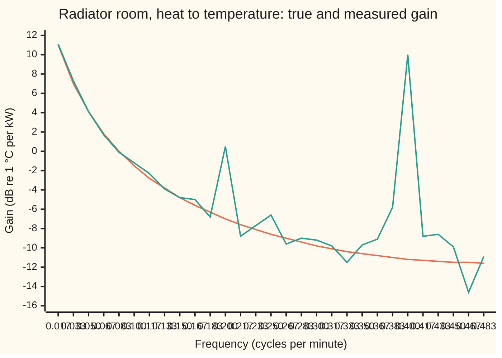
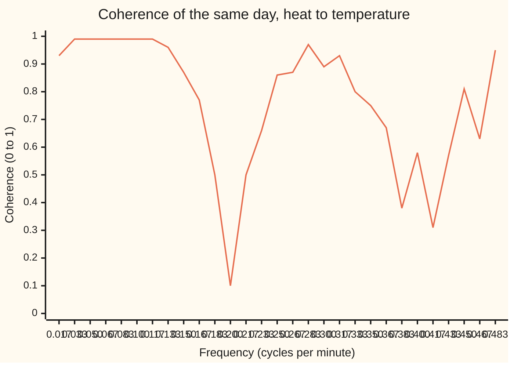

# Measured Bode plots: divide the cross-spectrum by the input spectrum, and trust the coherence

[Syllabus](../../../SYLLABUS.md) → [Engineering mathematics](../README.md) → [Models from Data](../README.md#s11) → Measured Bode plots

---

## General Overview

The radiator room of [ARX identification](01-arx-models-and-least-squares-identification.md) is logged once a minute for a second day: 1,440 readings. A pseudo-random binary signal, a coin-flip-like pattern fixed in advance, switches the radiator between 0.5 kW and 2.5 kW. This day's pattern differs from the first: the valve may switch only on 5-minute marks, to spare it wear, so each setting is held for 5 minutes. The first day's every-minute switching put input power at every frequency; the 5-minute hold leaves gaps, and spotting such gaps is what this card teaches.

The engineer wants the room's **Bode plot**: for radiator heat that wobbles at a steady rate, how far the room temperature swings, and how late ([Bode plots](../02-Linear%20Systems%20and%20Transforms/04-frequency-response-and-bode-plots.md)). The engineer wants it without first assuming a model, and wants to know which parts of it to believe.

The recipe takes four moves. Cut the day into 8 segments of 180 minutes. Take the Fourier transform of the heat and the temperature in each segment. Average the product of the temperature's transform with the heat's mirrored (conjugate) transform. Divide by the heat's average power. That ratio is the measured frequency response.

The data are simulated from a known room, so every answer can be graded.

- At 0.05 cycles a minute (a 20-minute wobble), the measured gain is 1.600 °C per kW against the true 1.596, and the measured phase is −82.3° against the true −80.6°.
- At 0.2 cycles a minute (a 5-minute wobble), the measured gain is 1.064 against the true 0.447, more than twice the truth; counting the phase error too, the measurement is off by 186.5%. Each setting was held for exactly 5 minutes, so the input had no power at that frequency.
- A third number, the **coherence**, tells the two apart without knowing the truth: 0.986 at the good frequency, 0.098 at the bad one.

Fitting a first-order-plus-delay model to the 39 frequencies with coherence at least 0.9 gives a steady gain of 5.00 °C per kW and a lag of 9.22 minutes, against the true 5.00 °C per kW and 9.49 minutes. The best delay is one sample: a valve change first shows in the next minute's reading. That is the one-minute step of the log, not a pipe delay, so a thermostat is tuned with zero delay, as on [ARX identification](01-arx-models-and-least-squares-identification.md).

**Averaging the product of output and input transforms keeps the part of the output the input caused and lets unrelated noise cancel, so cross-spectrum over input spectrum measures the frequency response; the coherence, a number between 0 and 1, is the share of output power the input explains at each frequency, and only where it is near 1 is the measured curve worth fitting.**

**What kind of fact this is:** a method. Two parts are theorems, proved in Why it works: noise unrelated to the input averages out of the cross-spectrum, and the coherence always lies between 0 and 1. The error-bar formula and the coherence of unrelated records are approximations, checked here against 300 simulated days.

### The picture: measured and true gain, and the coherence that says which to believe



Orange: the true gain of the room. Green: the gain measured from the day's data. They agree up to about 0.15 cycles a minute. The green line jumps up at 0.200 (to 0.5 dB) and at 0.400 (to 10.0 dB), the two frequencies where the 5-minute hold put no power. The axis is a list of frequencies, evenly spaced, not a log scale.



Orange: the coherence. It sits at 0.99 where the measured gain follows the truth, and drops to 0.10 at 0.200 cycles a minute, where the measured gain goes wrong.

---

## The formula

Notation first, in words. The input $`u_k`$ is the radiator heat at minute $`k`$, less its day average: close to +1 kW or −1 kW. The room temperature $`y_k`$ is in °C, less its day average. The sample interval is $`T = 1`$ minute. A frequency $`f`$ is in cycles per minute (c/min); 0.05 cycles a minute is 0.833 mHz. Its angular form is $`\omega = 2\pi f`$ in radians per minute. As on the rest of this wing, $`j`$ is the square root of −1 (the rest of the library writes $`i`$).

Cut the record into $`n_d = 8`$ segments of $`L = 180`$ samples. Taper each with the Hann window, a hump that fades the segment in and out ([Windows](../05-Signals/03-windows-and-spectral-leakage.md)). Take its discrete Fourier transform ([The DFT and the FFT](../05-Signals/02-discrete-fourier-transform-and-the-fft.md)): $`U_m(f)`$ for the heat and $`Y_m(f)`$ for the temperature in segment $`m`$. The transform reports values at the frequencies $`f = k/(LT)`$, called bins; here $`k`$ counts bins, not minutes. The card uses bin numbers $`k`$ = 1 to 89. Bin 0 is the removed average. Bin 90, at the Nyquist frequency, is a real number with no phase, so it is left out.

A bar over a complex number is its **conjugate**: $`\overline{p + jq} = p - jq`$, the mirror image that has the opposite angle. The **cross-spectrum** $`S_{yu}`$ averages output times the mirrored input. The **input spectrum** $`S_{uu}`$ and **output spectrum** $`S_{yy}`$ average each signal's power, as in Welch's method on [Spectral estimation](../05-Signals/06-spectral-estimation-and-periodograms.md):

```math
S_{yu}(f) = \frac{1}{n_d}\sum_{m=1}^{n_d} Y_m(f)\,\overline{U_m(f)}, \qquad S_{uu}(f) = \frac{1}{n_d}\sum_{m=1}^{n_d} \lvert U_m(f)\rvert^2, \qquad S_{yy}(f) = \frac{1}{n_d}\sum_{m=1}^{n_d} \lvert Y_m(f)\rvert^2
```

The measured frequency response, the coherence and the error bar on the measured gain are

```math
\hat G(f) = \frac{S_{yu}(f)}{S_{uu}(f)}, \qquad \hat\gamma^2(f) = \frac{\lvert S_{yu}(f)\rvert^2}{S_{uu}(f)\,S_{yy}(f)}, \qquad \frac{\text{scatter of } \lvert\hat G\rvert}{\lvert G\rvert} \approx \sqrt{\frac{1 - \gamma^2}{2\,n_d\,\gamma^2}}
```

**Read it aloud:** the response is the averaged output-times-mirrored-input over the averaged input power; the coherence is the size of that average squared, over the two powers; and the error on the gain shrinks as the coherence nears 1 and as more segments are averaged.

The hat on $`\hat G`$ means "estimated from data", as in the statistics wing. The scaling of the spectra (per hertz, per sample) cancels in both ratios, so it is left out.

The true room is the model of [ARX identification](01-arx-models-and-least-squares-identification.md), $`y_k = 0.9\,y_{k-1} + 0.5\,u_{k-1} + e_k`$, with $`e_k`$ random heat upsets of typical size (standard deviation) 0.1 °C. Its true frequency response is the transfer function of [The z-transform](../02-Linear%20Systems%20and%20Transforms/08-z-transform-and-discrete-time-systems.md) with $`z^{-1} = e^{-j\omega T}`$, the one-step delay:

```math
G(f) = \frac{b\,e^{-j\omega T d}}{1 - a\,e^{-j\omega T}}, \qquad a = 0.9,\ b = 0.5,\ d = 1, \qquad K = \frac{b}{1-a}, \qquad \tau = \frac{-T}{\ln a}
```

This is also the **first-order-plus-delay** model fitted at the end: one lag, set by $`a`$, and a delay $`d`$, the number of samples between a valve setting and the first reading it affects. Here $`d = 1`$ is the one-minute step of the log, not a pipe delay: the room starts to warm as soon as the heat changes, and the next reading is the first to show it. That agrees with [ARX identification](01-arx-models-and-least-squares-identification.md), which tunes with zero delay. Its steady gain $`K`$ is 5.00 °C per kW, and its time constant $`\tau`$ is 9.49 minutes.

| Symbol | Plain meaning | In our example | Push it up and the answer… |
| --- | --- | --- | --- |
| $`u_k`$, $`y_k`$, $`k`$, $`h`$ | radiator heat in kW, less its mean; room temperature in °C, less its mean; minute number (in $`f = k/(LT)`$, the bin number); minutes each setting is held | 1,440 minutes; bins 1 to 89; $`h`$ = 5 | longer $`h`$: input power at fewer frequencies |
| $`T`$, $`f`$, $`\omega`$, $`j`$ | sample interval; frequency in cycles a minute; angular frequency $`2\pi f`$; square root of −1 | 1 min; 0.05; 0.3142 rad/min | gain falls, lag grows |
| $`e_k`$, $`\sigma`$ | random heat upsets; their size | 0.1 °C | coherence falls |
| $`L`$, $`n_d`$, $`m`$ | segment length; number of segments; segment number | 180 min; 8 | more $`n_d`$: smaller error bar |
| $`U_m`$, $`Y_m`$ | tapered Fourier transforms of heat and temperature in segment $`m`$ | Hann taper | — |
| $`S_{uu}`$, $`S_{yy}`$, $`S_{yu}`$, $`S_{vv}`$ | averaged input power, output power and cross-spectrum; power of the noise part $`V_m`$ | zero input power at 0.2 and 0.4 c/min | — |
| $`\overline{x}`$ | complex conjugate: same size, opposite angle | — | — |
| $`G`$, $`\hat G`$ | true and measured frequency response | 1.596 and 1.600 °C per kW at 0.05 c/min | — |
| $`\gamma^2`$, $`\hat\gamma^2`$ | true and measured coherence | 0.990 and 0.986 at 0.05 c/min | estimate more trustworthy |
| $`a`$, $`b`$, $`d`$ | lag factor per minute; °C per kW added each minute; samples from a valve setting to the first reading it affects | 0.9, 0.5, 1 (the log's one-minute step) | slower room; bigger gain; later response |
| $`K`$, $`\tau`$ | steady gain $`b/(1-a)`$; time constant $`-T/\ln a`$ | 5.00 °C per kW; 9.49 min | — |
| $`V_m`$ | the part of $`Y_m`$ the heat did not cause (Why it works) | — | coherence falls |

### When it holds

- **The room is linear and does not change during the day.** The same heat swing must give the same temperature swing at 9 a.m. and at 9 p.m. Sun and occupants count as noise. A response that drifts during the day gives an average curve that fits no single hour.
- **The input has power at every frequency to be measured.** Holding each setting (each bit of the binary signal) for 5 minutes leaves no power at 0.2 and 0.4 cycles a minute. There the estimate is 186.5% and 1053.0% wrong.
- **The noise is unrelated to the input.** That fails in a closed loop. If a thermostat moved the valve in reply to the noise, the cross-spectrum would carry the thermostat's own response, not the room's, and the ratio would be biased.
- **The heat input is measured without noise.** Noise on the input inflates $`S_{uu}`$ but not $`S_{yu}`$, so the measured gain comes out too low.
- **A segment holds many cycles of each frequency.** The 180-minute segment is long against the 9.49-minute time constant, but holds only two cycles at bin 2 (a 90-minute period). There the start-up motion carried across segment edges is large next to two cycles: with the upsets switched off, the error at bin 2 is still 7.7%, against 0.9% at bin 36. With the upsets' scatter on top, this day's estimate is 15.6% off even at coherence 0.962.

---

## Why it works

### Step 0: noise cancels from a product with the input, not from a power

Each segment's output transform is the part the heat caused, plus the rest. Multiply it by the mirrored input transform. The heat-caused part becomes $`G\,\lvert U_m\rvert^2`$: a positive number times the same $`G`$ in every segment, so it piles up. The rest has an angle unrelated to the input's, so its products point in random directions and cancel as segments are added.

The output's own power never cancels anything. Noise adds to it in every segment. That is why dividing output power by input power is the wrong recipe, and why the right one needs the cross-spectrum.

### Step 1: the ratio of averages returns G

In segment $`m`$, write the output transform as the heat's part plus the rest:

```math
Y_m(f) = G(f)\,U_m(f) + V_m(f)
```

Multiply by $`\overline{U_m}`$ and average over the $`n_d`$ segments:

```math
S_{yu} = G\,S_{uu} + \frac{1}{n_d}\sum_{m=1}^{n_d} V_m\,\overline{U_m}
```

The last term has average zero, because the noise is unrelated to the heat. Its typical size shrinks like $`1/\sqrt{n_d}`$. Divide by $`S_{uu}`$: $`\hat G = G`$ plus a shrinking error. The error is large wherever $`S_{uu}`$ is small. Dividing by nearly zero is exactly what goes wrong at 0.2 cycles a minute.

The equation $`Y_m = G\,U_m + V_m`$ is not exact for a finite segment. The room carries heat across segment edges, and that leftover start-up motion lands in $`V_m`$. The Hann taper keeps it small. It is part of why the 300-day scatter in Step 4 runs a little above the formula.

### Step 2: coherence is the share of output power the input explains

Square both sides of Step 1's equation in size and average. The cross terms average to zero for the same reason as before:

```math
S_{yy} \approx \lvert G\rvert^2 S_{uu} + S_{vv}, \qquad \gamma^2 = \frac{\lvert G\rvert^2 S_{uu}}{\lvert G\rvert^2 S_{uu} + S_{vv}}
```

Here $`S_{vv}`$ is the average power of the noise part $`V_m`$. So $`\gamma^2`$ is heat-caused output power over all output power. It is 1 when the heat explains everything and 0 when it explains nothing.

The estimate $`\hat\gamma^2`$ can never leave the range 0 to 1. That is the Cauchy–Schwarz inequality, the rule that an average of products is no bigger than the product of the two root-mean-square sizes. The fold below proves it.

<details>
<summary>Proof: the measured coherence lies between 0 and 1, and is exactly 1 for one segment</summary>

Write $`y_m = Y_m(f)`$ and $`u_m = U_m(f)`$ for one frequency. The coherence is

$`\displaystyle \hat\gamma^2 = \frac{\bigl\lvert \sum_m y_m\,\overline{u_m} \bigr\rvert^2}{\sum_m \lvert u_m\rvert^2 \,\sum_m \lvert y_m\rvert^2}`$

which is at least 0, being a square over a product of positive sums. For the upper bound, set $`c = \sum_m y_m\overline{u_m} / \sum_m \lvert u_m\rvert^2`$, which is $`\hat G`$, and expand the sum of squared misfits, which cannot be negative:

$`\displaystyle 0 \le \sum_m \lvert y_m - c\,u_m\rvert^2 = \sum_m \lvert y_m\rvert^2 - \frac{\bigl\lvert \sum_m y_m\overline{u_m}\bigr\rvert^2}{\sum_m \lvert u_m\rvert^2}`$

Divide by $`\sum_m \lvert y_m\rvert^2`$ and rearrange: $`\hat\gamma^2 \le 1`$. Equality holds only when every misfit $`y_m - c\,u_m`$ is zero, that is, when one complex number $`c`$ maps every segment's input to its output exactly.

With one segment there is always such a number, $`c = y_1/u_1`$. So one segment gives coherence exactly 1 at every frequency, whatever the data. The check prints 1.000000 at all 89 bins.

</details>

### Step 3: the room's coherence follows the input's power

The heat upsets $`e_k`$ pass through the same lag as the heat, $`1/(1 - a\,e^{-j\omega T})`$. So in Step 2's ratio the lag cancels, and what is left is the input's power against the upsets' power:

```math
\gamma^2(f) = \frac{1}{1 + \sigma^2 / \bigl(b^2\,S_{uu}(f)\bigr)}, \qquad S_{uu}(f) = \frac{1}{h}\left(\frac{\sin(\pi h f T)}{\sin(\pi f T)}\right)^2
```

The second formula is the power of a binary signal held for $`h`$ = 5 samples per bit, scaled so white noise of size 1 has power 1. Its numerator is zero when $`hfT`$ is a whole number: at 0.2 and 0.4 cycles a minute. There the true coherence is 0.000, and no amount of averaging rescues the estimate.

At 0.05 cycles a minute the formula gives 0.990, and the day's data measured 0.986.

### Step 4: how far to trust a high coherence

For large $`n_d`$, the measured gain scatters about the true one by the fraction in the formula's error bar (Bendat and Piersol give it with its derivation). At 0.05 cycles a minute it is 3.0% from the measured coherence, or 2.5% from the true coherence 0.990. Over 300 simulated days the measured gain scattered by 3.1%; the extra is the leftover start-up motion of Step 1. At 0.167 cycles a minute (bin 30), with true coherence 0.833, the formula says 11.2% and the 300 days scattered by 11.7%.

Coherence has its own floor. Two records with nothing to do with each other still show a measured coherence of about $`1/n_d`$, because a few random products line up by chance. Over 300 unrelated pairs the mean was 0.120, against the 1/8 = 0.125 of the theory. With 8 segments, a coherence of 0.1 means "no relation". Only values near 1 mean "trust this".

### Step 5: fit a model to the trusted band by linear least squares

A model $`b\,e^{-j\omega Td}/(1 - a\,e^{-j\omega T})`$ is nonlinear in $`a`$. Multiply out the denominator and it becomes linear:

```math
\hat G(f) \approx a\,\hat G(f)\,e^{-j\omega T} + b\,e^{-j\omega T d}
```

Each trusted frequency gives one such equation, in two unknowns $`a`$ and $`b`$. Least squares over the real and imaginary parts gives two normal equations, solved by hand as on [ARX identification](01-arx-models-and-least-squares-identification.md). This trick is Levy's complex-curve fit. Try $`d`$ = 0, 1 and 2 samples and keep the one with the smallest misfit.

Only frequencies with $`\hat\gamma^2 \ge 0.9`$ go in: 39 of the 89, unbroken from bin 1 to bin 26 (0.144 cycles a minute), plus scattered higher bins.

---

## Worked numbers, by hand

At 0.05 cycles a minute (bin 9, a 20-minute wobble), first the true answer, then the measured one.

| Step | Arithmetic | Value |
| --- | --- | --- |
| angular frequency $`\omega T`$ | $`2\pi \times 0.05 \times 1`$ | 0.3142 rad |
| cosine and sine | $`\cos 0.3142`$, $`\sin 0.3142`$ | 0.9511, 0.3090 |
| denominator $`1 - 0.9e^{-j\omega T}`$ | $`(1 - 0.9 \times 0.9511) + j\,0.9 \times 0.3090`$ | 0.1440 + 0.2781j |
| its size and angle | $`\sqrt{0.1440^2 + 0.2781^2}`$; $`\arctan(0.2781/0.1440)`$ | 0.3132; 62.62° |
| true gain | $`0.5 / 0.3132`$ | 1.596 °C per kW |
| delay's angle, $`\omega T`$ in degrees | $`0.05 \times 360°`$ | 18.00° |
| true phase | $`-18.00° - 62.62°`$ | −80.62° |
| measured gain and phase, $`S_{yu}/S_{uu}`$ | from the 8 segments | 1.600 °C per kW, −82.3° |
| measured coherence | $`\lvert S_{yu}\rvert^2 / (S_{uu} S_{yy})`$ | 0.986 |
| error bar | $`\sqrt{(1 - 0.986)/(2 \times 8 \times 0.986)}`$ | 3.0% |
| fitted model from the 39 trusted bins | $`a`$ = 0.8972, $`b`$ = 0.5134, $`d`$ = 1 | |
| fitted steady gain $`b/(1-a)`$ | $`0.5134 / 0.1028`$ | **5.00 °C per kW** |
| fitted time constant $`-1/\ln a`$ | $`-1/\ln 0.8972`$ | **9.22 min** |

A noise-free sine test, simulated minute by minute, also gives 1.5964 °C per kW and −80.62°: the formula and the time domain agree.

So one more kW of radiator heat, held, settles the room 5.00 °C warmer, with a 9.22-minute lag against the true 9.49. The fitted $`d = 1`$ says only that the next reading is the first to show a change, so the thermostat is tuned with zero delay. The measured curve can be trusted up to about 0.144 cycles a minute.

The same table at other frequencies, from the checks:

| Frequency (c/min) | Period (min) | True gain | Measured gain | True phase | Measured phase | Coherence | Error |
| ---: | ---: | ---: | ---: | ---: | ---: | ---: | ---: |
| 0.0111 | 90.0 | 4.169 | 4.634 | −35.6° | −29.6° | 0.962 | 15.6% |
| 0.0278 | 36.0 | 2.587 | 2.607 | −64.0° | −62.4° | 0.987 | 2.9% |
| 0.1000 | 10.0 | 0.841 | 0.872 | −98.8° | −97.7° | 0.992 | 4.2% |
| 0.1500 | 6.7 | 0.577 | 0.575 | −111.1° | −115.5° | 0.875 | 7.6% |
| 0.2000 | 5.0 | 0.447 | 1.064 | −121.9° | −74.0° | 0.098 | 186.5% |
| 0.3000 | 3.3 | 0.325 | 0.346 | −141.8° | −145.7° | 0.893 | 9.6% |
| 0.4000 | 2.5 | 0.277 | 3.167 | −161.0° | 176.3° | 0.579 | 1053.0% |

"Error" is the size of measured minus true, as a share of true. Over the 39 trusted bins the middle error is 5.1%; over the other 50 it is 21.4%.

### What breaks if you drop a piece

| Mistake | Comes out at | What went wrong |
| --- | --- | --- |
| Fit all 89 bins, trusted or not | gain 2.28 °C per kW, lag 3.34 min | The wild points at 0.2 and 0.4 c/min drag the fit; the true room is 5.00 and 9.49 |
| Fit with $`d = 0`$, no one-sample step | gain 4.35 °C per kW, lag 18.16 min; misfit 25.58 against 0.63 | The one-sample step between setting and reading adds phase that rises with frequency; without it the model fakes that phase with a slower lag |
| Use one segment, no averaging | coherence 1.000000 at every bin | One segment always fits exactly (Step 2's fold), so the coherence says nothing |
| Gain from $`\sqrt{S_{yy}/S_{uu}}`$ at 0.183 c/min | 0.646 against the true 0.482 | The upsets' power is counted as if the heat caused it; $`S_{yu}/S_{uu}`$ gives 0.458 |
| Read coherence 0.1 as "a weak link" | unrelated records average 0.120 | With 8 segments, chance alone gives about 1/8 |

---

## Code, from first principles, and it actually runs

The scripts simulate the day with a SplitMix64 random generator written out (seed 2026) and take every Fourier transform by a hand-written Hann-tapered sum. Three roads lead to the room's frequency response: the closed-form $`G`$, a noise-free sine test simulated in time, and Welch's estimate from the noisy day. Then 300 more simulated days check the error-bar formula and the coherence floor of unrelated records, and a least-squares fit recovers $`a`$, $`b`$ and $`d`$. Last, the day is re-made with one setting changed at a time, for the Try box and with the upsets switched off. Every number on the card is printed by both scripts.

### Python

```python
# Measured Bode plot of the radiator room: Welch cross-spectrum over input spectrum, and coherence.
# Standard library only. Roads: (1) the plant's closed-form G; (2) a noise-free sine test simulated
# in time; (3) Welch's estimate from one noisy logged day; Monte Carlo checks the error-bar formula.
import math, cmath
M64 = (1 << 64) - 1
class Rng:  # SplitMix64, then Box-Muller for Gaussian noise
    def __init__(s, seed): s.s = seed
    def u64(s):
        s.s = (s.s + 0x9E3779B97F4A7C15) & M64; z = s.s
        z = ((z ^ (z >> 30)) * 0xBF58476D1CE4E5B9) & M64
        z = ((z ^ (z >> 27)) * 0x94D049BB133111EB) & M64
        return z ^ (z >> 31)
    def uni(s): return ((s.u64() >> 11) + 0.5) / 2.0**53
    def gauss(s): return math.sqrt(-2 * math.log(s.uni())) * math.cos(2 * math.pi * s.uni())

A, B, SIG = 0.9, 0.5, 0.1     # room: y_k = 0.9 y_(k-1) + 0.5 u_(k-1) + e_k, e_k noise 0.1 C
N, HOLD, L, ND = 1440, 5, 180, 8  # one day of minutes; valve held 5 min; 8 segments of 180 min
def day(seed, hold=HOLD, sig=SIG):
    r = Rng(seed); u = []; y = [0.0]
    for _ in range(N // hold): u += [1.0 if r.u64() >> 63 else -1.0] * hold
    for k in range(1, N): y.append(A * y[-1] + B * u[k - 1] + sig * r.gauss())
    mu, my = sum(u) / N, sum(y) / N
    return [v - mu for v in u], [v - my for v in y]
W = [0.5 - 0.5 * math.cos(2 * math.pi * n / L) for n in range(L)]  # Hann taper
CS = [math.cos(2 * math.pi * n / L) for n in range(L)]
SN = [math.sin(2 * math.pi * n / L) for n in range(L)]
def dft(x, k, win=W):
    re = im = 0.0
    for n in range(L):
        re += win[n] * x[n] * CS[k * n % L]; im -= win[n] * x[n] * SN[k * n % L]
    return complex(re, im)
def welch(u, y, k, nseg=ND, win=W):  # returns (G estimate, coherence, sqrt(Syy/Suu))
    suu = syy = 0.0; syu = 0j
    for m in range(nseg):
        U, Y = dft(u[m * L:(m + 1) * L], k, win), dft(y[m * L:(m + 1) * L], k, win)
        suu += U.real ** 2 + U.imag ** 2; syy += Y.real ** 2 + Y.imag ** 2
        syu += Y * U.conjugate()
    return syu / suu, (syu.real ** 2 + syu.imag ** 2) / (suu * syy), math.sqrt(syy / suu)
def G(k, a=A, b=B, d=1):
    z = cmath.exp(-2j * math.pi * k / L); return b * z ** d / (1 - a * z)
def true_coh(k):  # 1 / (1 + noise power / valve power through b): see Step 3
    w = 2 * math.pi * k / L; suu = (math.sin(HOLD * w / 2) / math.sin(w / 2)) ** 2 / HOLD
    return 1 / (1 + SIG ** 2 / (B ** 2 * suu))
db = lambda g: 20 * math.log10(abs(g))
f1 = lambda x: "0.0" if f"{x:.1f}" == "-0.0" else f"{x:.1f}"
deg = lambda g: math.degrees(cmath.phase(g))
f = lambda k: k / L  # cycles per minute

# ---- road 2: a sine test on the noise-free room, 0.05 cycles/min (period 20 min) ----
y, acc = 0.0, 0j
for n in range(1, 3000):  # valve u_n = sin(2 pi f n); keep the last 2000 min, 100 whole periods
    y = A * y + B * math.sin(2 * math.pi * 9 * (n - 1) / L)
    if n >= 1000: acc += y * cmath.exp(-2j * math.pi * 9 * n / L)
gs = 2j * acc / 2000  # the output's sine part, as a complex gain
print(f"sine test at {f(9):.3f} c/min: gain {abs(gs):.4f} C per kW, phase {deg(gs):.2f} deg")
print(f"formula   at {f(9):.3f} c/min: gain {abs(G(9)):.4f} C per kW, phase {deg(G(9)):.2f} deg")
assert abs(gs - G(9)) < 1e-6
w = 2 * math.pi * f(9); re, im = 1 - A * math.cos(w), A * math.sin(w)  # the hand table
print(f"hand: {f(9)} c/min = {1000 * f(9) / 60:.3f} mHz, w {w:.4f} rad/min, cos {math.cos(w):.4f}, sin {math.sin(w):.4f},"
      f" 1-0.9e^-jw = {re:.4f} + {im:.4f}j, size {math.hypot(re, im):.4f}, angle {math.degrees(math.atan2(im, re)):.2f} deg,"
      f" delay angle {math.degrees(w):.2f} deg")

# ---- road 3: Welch on the logged day ----
u, yd = day(2026)
est = {k: welch(u, yd, k) for k in range(1, 90)}  # bins 1..89: 0 is the mean, 90 is real-valued
print("  k  f c/min  period min  true gain  meas gain  true deg  meas deg  coherence  theory  err %")
for k in (2, 5, 9, 18, 27, 36, 54, 72, 89):
    g, c, _ = est[k]
    print(f"{k:3d}  {f(k):.4f}  {1 / f(k):9.1f}  {abs(G(k)):9.3f}  {abs(g):9.3f}  {deg(G(k)):8.1f}"
          f"  {deg(g):8.1f}  {c:9.3f}  {true_coh(k):6.3f}  {100 * abs(g - G(k)) / abs(G(k)):5.1f}")
trust, rest = [k for k in est if est[k][1] >= 0.9], [k for k in est if est[k][1] < 0.9]
def med(ks):  # median error: the middle value, or the mean of the two middle values
    e = sorted(abs(est[k][0] - G(k)) / abs(G(k)) for k in ks); return (e[(len(e) - 1) // 2] + e[len(e) // 2]) / 2
top = next(k for k in est if k not in trust) - 1
print(f"trusted bins (coherence >= 0.9): {len(trust)} of 89, unbroken from bin 1 to bin {top}"
      f" ({f(top):.3f} c/min); median error {100 * med(trust):.1f}%")
print(f"untrusted bins: {len(rest)}, median error {100 * med(rest):.1f}%")
assert med(trust) < 0.08 and med(rest) > 2 * med(trust)
assert all(0 <= est[k][1] <= 1 + 1e-12 for k in est)  # Cauchy-Schwarz
bar = lambda c: 100 * math.sqrt((1 - c) / (c * 2 * ND))
print(f"error bar at 0.05 c/min: sqrt(1-c)/(sqrt(c) sqrt(2*{ND})) = {bar(est[9][1]):.1f}%;"
      f" at 0.4 c/min, from its measured coherence {est[72][1]:.3f}: {bar(est[72][1]):.1f}%")

# ---- Monte Carlo: 300 more days; error bar and the coherence of unrelated records ----
mc = {9: [], 30: []}; null = []
for s in range(300):
    uu, yy = day(5000 + s)
    for k in mc: mc[k].append(welch(uu, yy, k)[0])
    _, yo = day(9000 + s); null.append(welch(uu, yo, 9)[1])
for k in mc:
    rel = [abs(g) / abs(G(k)) for g in mc[k]]; m = sum(rel) / len(rel)
    sd = math.sqrt(sum((r - m) ** 2 for r in rel) / (len(rel) - 1)); c = true_coh(k)
    pred = math.sqrt((1 - c) / (c * 2 * ND))
    print(f"bin {k:2d} ({f(k):.3f} c/min): true coherence {c:.3f}, error bar formula {100 * pred:.1f}%,"
          f" scatter over 300 days {100 * sd:.1f}%")
    assert 0.8 * pred < sd < 1.4 * pred
mn = sum(null) / len(null)
print(f"coherence of unrelated records: mean {mn:.3f}, theory 1/{ND} = {1 / ND:.3f}")
assert abs(mn - 1 / ND) < 0.03

# ---- fit a first-order-plus-delay model G = b z^-d / (1 - a z^-1) by linear least squares ----
def fit(ks, d, e=est):
    s11 = s12 = s22 = r1 = r2 = 0.0
    for k in ks:
        g = e[k][0]; z = cmath.exp(-2j * math.pi * k / L); c1, c2 = g * z, z ** d
        s11 += abs(c1) ** 2; s12 += (c1 * c2.conjugate()).real; s22 += abs(c2) ** 2
        r1 += (g * c1.conjugate()).real; r2 += (g * c2.conjugate()).real
    det = s11 * s22 - s12 ** 2; a = (r1 * s22 - r2 * s12) / det; b = (s11 * r2 - s12 * r1) / det
    res = sum(abs(e[k][0] - G(k, a, b, d)) ** 2 for k in ks)
    return a, b, res
for label, ks in (("trusted", trust), ("all 89 ", list(est))):
    for d in (0, 1, 2):
        a, b, res = fit(ks, d)
        print(f"fit {label} d={d}: a {a:.4f} b {b:.4f} gain {b / (1 - a):.2f} C/kW"
              f" lag {-1 / math.log(a):.2f} min residual {res:.4f}")
a, b, _, d = min((fit(trust, d) + (d,) for d in (0, 1, 2)), key=lambda t: t[2])
print(f"best delay d={d} min; true a {A} b {B} gain {B / (1 - A):.2f} C/kW lag {-1 / math.log(A):.2f} min")
assert d == 1 and abs(a - A) < 0.02 and abs(b - B) < 0.05 and fit(trust, 1)[2] < fit(trust, 0)[2]

# ---- what breaks ----
one = [welch(u, yd, k, 1)[1] for k in range(1, 90)]
print(f"one segment only: coherence min {min(one):.6f} max {max(one):.6f}")
assert abs(min(one) - 1) < 1e-9
print(f"at {f(33):.3f} c/min: true gain {abs(G(33)):.3f}, Syu/Suu {abs(est[33][0]):.3f},"
      f" sqrt(Syy/Suu) {est[33][2]:.3f}")

# ---- chart points ----
ks = list(range(3, 90, 3))
print("chart, f c/min", " ".join(f"{f(k):.3f}" for k in ks))
print("chart, true dB", " ".join(f1(db(G(k))) for k in ks))
print("chart, meas dB", " ".join(f1(db(est[k][0])) for k in ks))
print("chart, coherence", " ".join(f"{est[k][1]:.2f}" for k in ks))
# ---- the Try box, and the noise switched off: the same day re-made with one setting changed ----
for name, seed, hold, sig, win, bins in (("valve held 1 min", 2026, 1, SIG, W, (36,)), ("noise 0.3 C", 2026, HOLD, 0.3, W, ()),
        ("no taper", 2026, HOLD, SIG, [1.0] * L, (9,)), ("seed 7", 7, HOLD, SIG, W, ()), ("noise off", 2026, HOLD, 0.0, W, (2, 36, 72))):
    uu, yy = day(seed, hold, sig); e = {k: welch(uu, yy, k, ND, win) for k in range(1, 90)}; ks = [k for k in e if e[k][1] >= 0.9]
    a, b, _, d = min((fit(ks, d, e) + (d,) for d in (0, 1, 2)), key=lambda t: t[2])
    print(f"try {name}:" + "".join(f" bin {k} error {100 * abs(e[k][0] - G(k)) / abs(G(k)):.1f}%, coherence {e[k][1]:.3f};" for k in bins)
          + f" {len(ks)} trusted bins; fit {b / (1 - a):.2f} C/kW, {-1 / math.log(a):.2f} min")
print("ALL CHECKS PASS")
```

**Ran 2026-11-23 on macOS, Python 3.14.10, standard library only. All checks passed. Output, pasted from the run:**

```
sine test at 0.050 c/min: gain 1.5964 C per kW, phase -80.62 deg
formula   at 0.050 c/min: gain 1.5964 C per kW, phase -80.62 deg
hand: 0.05 c/min = 0.833 mHz, w 0.3142 rad/min, cos 0.9511, sin 0.3090, 1-0.9e^-jw = 0.1440 + 0.2781j, size 0.3132, angle 62.62 deg, delay angle 18.00 deg
  k  f c/min  period min  true gain  meas gain  true deg  meas deg  coherence  theory  err %
  2  0.0111       90.0      4.169      4.634     -35.6     -29.6      0.962   0.992   15.6
  5  0.0278       36.0      2.587      2.607     -64.0     -62.4      0.987   0.992    2.9
  9  0.0500       20.0      1.596      1.600     -80.6     -82.3      0.986   0.990    2.9
 18  0.1000       10.0      0.841      0.872     -98.8     -97.7      0.992   0.981    4.2
 27  0.1500        6.7      0.577      0.575    -111.1    -115.5      0.875   0.924    7.6
 36  0.2000        5.0      0.447      1.064    -121.9     -74.0      0.098   0.000  186.5
 54  0.3000        3.3      0.325      0.346    -141.8    -145.7      0.893   0.884    9.6
 72  0.4000        2.5      0.277      3.167    -161.0     176.3      0.579   0.000  1053.0
 89  0.4944        2.0      0.263      0.297    -178.9    -176.7      0.909   0.832   13.5
trusted bins (coherence >= 0.9): 39 of 89, unbroken from bin 1 to bin 26 (0.144 c/min); median error 5.1%
untrusted bins: 50, median error 21.4%
error bar at 0.05 c/min: sqrt(1-c)/(sqrt(c) sqrt(2*8)) = 3.0%; at 0.4 c/min, from its measured coherence 0.579: 21.3%
bin  9 (0.050 c/min): true coherence 0.990, error bar formula 2.5%, scatter over 300 days 3.1%
bin 30 (0.167 c/min): true coherence 0.833, error bar formula 11.2%, scatter over 300 days 11.7%
coherence of unrelated records: mean 0.120, theory 1/8 = 0.125
fit trusted d=0: a 0.9464 b 0.2330 gain 4.35 C/kW lag 18.16 min residual 25.5846
fit trusted d=1: a 0.8972 b 0.5134 gain 5.00 C/kW lag 9.22 min residual 0.6342
fit trusted d=2: a 0.8780 b 0.2520 gain 2.06 C/kW lag 7.68 min residual 35.7102
fit all 89  d=0: a 0.7110 b -0.0748 gain -0.26 C/kW lag 2.93 min residual 137.0145
fit all 89  d=1: a 0.7412 b 0.5908 gain 2.28 C/kW lag 3.34 min residual 36.0484
fit all 89  d=2: a 0.6866 b 0.0626 gain 0.20 C/kW lag 2.66 min residual 112.3531
best delay d=1 min; true a 0.9 b 0.5 gain 5.00 C/kW lag 9.49 min
one segment only: coherence min 1.000000 max 1.000000
at 0.183 c/min: true gain 0.482, Syu/Suu 0.458, sqrt(Syy/Suu) 0.646
chart, f c/min 0.017 0.033 0.050 0.067 0.083 0.100 0.117 0.133 0.150 0.167 0.183 0.200 0.217 0.233 0.250 0.267 0.283 0.300 0.317 0.333 0.350 0.367 0.383 0.400 0.417 0.433 0.450 0.467 0.483
chart, true dB 11.0 7.0 4.1 1.8 0.0 -1.5 -2.8 -3.8 -4.8 -5.6 -6.3 -7.0 -7.6 -8.1 -8.6 -9.0 -9.4 -9.8 -10.1 -10.4 -10.6 -10.8 -11.0 -11.2 -11.3 -11.4 -11.5 -11.5 -11.6
chart, meas dB 11.1 7.3 4.1 1.7 -0.1 -1.2 -2.3 -3.9 -4.8 -5.0 -6.8 0.5 -8.8 -7.7 -6.6 -9.6 -9.0 -9.2 -9.8 -11.5 -9.7 -9.1 -5.8 10.0 -8.8 -8.6 -9.9 -14.6 -10.9
chart, coherence 0.93 0.99 0.99 0.99 0.99 0.99 0.99 0.96 0.87 0.77 0.50 0.10 0.50 0.66 0.86 0.87 0.97 0.89 0.93 0.80 0.75 0.67 0.38 0.58 0.31 0.57 0.81 0.63 0.95
try valve held 1 min: bin 36 error 7.2%, coherence 0.979; 87 trusted bins; fit 4.90 C/kW, 9.21 min
try noise 0.3 C: 17 trusted bins; fit 4.93 C/kW, 8.69 min
try no taper: bin 9 error 10.6%, coherence 0.940; 18 trusted bins; fit 4.82 C/kW, 9.05 min
try seed 7: 35 trusted bins; fit 5.20 C/kW, 9.72 min
try noise off: bin 2 error 7.7%, coherence 0.977; bin 36 error 0.9%, coherence 0.999; bin 72 error 0.6%, coherence 1.000; 89 trusted bins; fit 4.90 C/kW, 9.29 min
ALL CHECKS PASS
```

### Rust

```rust
// Measured Bode plot of the radiator room: Welch cross-spectrum over input spectrum, and coherence.
// Standard library only, no crates. The same roads as the Python check: (1) the plant's closed-form G;
// (2) a noise-free sine test simulated in time; (3) Welch's estimate from one noisy logged day.
use std::f64::consts::PI;
#[derive(Clone, Copy)]
struct C { re: f64, im: f64 }
impl C {
    fn add(self, o: C) -> C { C { re: self.re + o.re, im: self.im + o.im } }
    fn sub(self, o: C) -> C { C { re: self.re - o.re, im: self.im - o.im } }
    fn mul(self, o: C) -> C { C { re: self.re * o.re - self.im * o.im, im: self.re * o.im + self.im * o.re } }
    fn sc(self, s: f64) -> C { C { re: self.re * s, im: self.im * s } }
    fn conj(self) -> C { C { re: self.re, im: -self.im } }
    fn abs(self) -> f64 { self.re.hypot(self.im) }
    fn div(self, o: C) -> C { let d = o.re * o.re + o.im * o.im; self.mul(o.conj()).sc(1.0 / d) }
    fn pow(self, d: i32) -> C { let mut r = C { re: 1.0, im: 0.0 }; for _ in 0..d { r = r.mul(self); } r }
    fn deg(self) -> f64 { self.im.atan2(self.re).to_degrees() }
}
fn ejm(t: f64) -> C { C { re: t.cos(), im: -t.sin() } } // e^(-j t)
struct Rng { s: u64 } // SplitMix64, then Box-Muller for Gaussian noise
impl Rng {
    fn u64(&mut self) -> u64 {
        self.s = self.s.wrapping_add(0x9E3779B97F4A7C15); let mut z = self.s;
        z = (z ^ (z >> 30)).wrapping_mul(0xBF58476D1CE4E5B9);
        z = (z ^ (z >> 27)).wrapping_mul(0x94D049BB133111EB);
        z ^ (z >> 31)
    }
    fn uni(&mut self) -> f64 { ((self.u64() >> 11) as f64 + 0.5) / 2f64.powi(53) }
    fn gauss(&mut self) -> f64 { let a = self.uni(); (-2.0 * a.ln()).sqrt() * (2.0 * PI * self.uni()).cos() }
}
const A: f64 = 0.9; const B: f64 = 0.5; const SIG: f64 = 0.1; // y_k = 0.9 y_(k-1) + 0.5 u_(k-1) + e_k
const N: usize = 1440; const HOLD: usize = 5; const L: usize = 180; const ND: usize = 8;
fn day(seed: u64, hold: usize, sig: f64) -> (Vec<f64>, Vec<f64>) {
    let mut r = Rng { s: seed }; let mut u = vec![]; let mut y = vec![0.0];
    for _ in 0..N / hold { let v = if r.u64() >> 63 == 1 { 1.0 } else { -1.0 }; for _ in 0..hold { u.push(v); } }
    for k in 1..N { let g = r.gauss(); let p = y[k - 1]; y.push(A * p + B * u[k - 1] + sig * g); }
    let mu = u.iter().sum::<f64>() / N as f64; let my = y.iter().sum::<f64>() / N as f64;
    (u.iter().map(|v| v - mu).collect(), y.iter().map(|v| v - my).collect())
}
struct Dft { w: Vec<f64>, cs: Vec<f64>, sn: Vec<f64> }
impl Dft {
    fn new() -> Dft {
        let t = |n: usize| 2.0 * PI * n as f64 / L as f64;
        Dft { w: (0..L).map(|n| 0.5 - 0.5 * t(n).cos()).collect(), // Hann taper
              cs: (0..L).map(|n| t(n).cos()).collect(), sn: (0..L).map(|n| t(n).sin()).collect() }
    }
    fn at(&self, x: &[f64], k: usize) -> C {
        let (mut re, mut im) = (0.0, 0.0);
        for n in 0..L { re += self.w[n] * x[n] * self.cs[k * n % L]; im -= self.w[n] * x[n] * self.sn[k * n % L]; }
        C { re, im }
    }
    fn welch(&self, u: &[f64], y: &[f64], k: usize, nseg: usize) -> (C, f64, f64) {
        let (mut suu, mut syy, mut syu) = (0.0, 0.0, C { re: 0.0, im: 0.0 });
        for m in 0..nseg {
            let uu = self.at(&u[m * L..(m + 1) * L], k); let yy = self.at(&y[m * L..(m + 1) * L], k);
            suu += uu.re * uu.re + uu.im * uu.im; syy += yy.re * yy.re + yy.im * yy.im;
            syu = syu.add(yy.mul(uu.conj()));
        }
        (syu.sc(1.0 / suu), (syu.re * syu.re + syu.im * syu.im) / (suu * syy), (syy / suu).sqrt())
    }
}
fn spectra(dft: &Dft, u: &[f64], y: &[f64]) -> Vec<(C, f64, f64)> { // bins 1..89; bin 0, the mean, left empty
    (0..90).map(|k| if k == 0 { (C { re: 0.0, im: 0.0 }, 0.0, 0.0) } else { dft.welch(u, y, k, ND) }).collect()
}
fn zk(k: usize) -> C { ejm(2.0 * PI * k as f64 / L as f64) }
fn g(k: usize, a: f64, b: f64, d: i32) -> C { let z = zk(k); z.pow(d).sc(b).div(C { re: 1.0, im: 0.0 }.sub(z.sc(a))) }
fn gt(k: usize) -> C { g(k, A, B, 1) }
fn true_coh(k: usize) -> f64 {
    let w = 2.0 * PI * k as f64 / L as f64;
    let suu = ((HOLD as f64 * w / 2.0).sin() / (w / 2.0).sin()).powi(2) / HOLD as f64;
    1.0 / (1.0 + SIG * SIG / (B * B * suu))
}
fn fit(e: &[(C, f64, f64)], ks: &[usize], d: i32) -> (f64, f64, f64) { // G = b z^-d / (1 - a z^-1), linear least squares
    let (mut s11, mut s12, mut s22, mut r1, mut r2) = (0.0, 0.0, 0.0, 0.0, 0.0);
    for &k in ks {
        let ge = e[k].0; let z = zk(k); let c1 = ge.mul(z); let c2 = z.pow(d);
        s11 += c1.abs().powi(2); s12 += c1.mul(c2.conj()).re; s22 += c2.abs().powi(2);
        r1 += ge.mul(c1.conj()).re; r2 += ge.mul(c2.conj()).re;
    }
    let det = s11 * s22 - s12 * s12; let a = (r1 * s22 - r2 * s12) / det; let b = (s11 * r2 - s12 * r1) / det;
    (a, b, ks.iter().map(|&k| e[k].0.sub(g(k, a, b, d)).abs().powi(2)).sum())
}
fn best(e: &[(C, f64, f64)], ks: &[usize]) -> (f64, f64, f64, i32) { // the delay d = 0, 1 or 2 with the smallest misfit
    let mut bst = (0.0, 0.0, f64::INFINITY, 0); for d in 0..3 { let (a, b, r) = fit(e, ks, d); if r < bst.2 { bst = (a, b, r, d); } } bst
}
fn db(z: C) -> f64 { 20.0 * z.abs().log10() }
fn f1(x: f64) -> String { let t = format!("{:.1}", x); if t == "-0.0" { "0.0".into() } else { t } }
fn f(k: usize) -> f64 { k as f64 / L as f64 }
fn main() {
    // ---- road 2: a sine test on the noise-free room, 0.05 cycles/min (period 20 min) ----
    let (mut y, mut acc) = (0.0, C { re: 0.0, im: 0.0 });
    for n in 1..3000 {
        y = A * y + B * (2.0 * PI * 9.0 * (n - 1) as f64 / L as f64).sin();
        if n >= 1000 { acc = acc.add(ejm(2.0 * PI * 9.0 * n as f64 / L as f64).sc(y)); }
    }
    let gs = C { re: 0.0, im: 2.0 }.mul(acc).sc(1.0 / 2000.0);
    println!("sine test at {:.3} c/min: gain {:.4} C per kW, phase {:.2} deg", f(9), gs.abs(), gs.deg());
    println!("formula   at {:.3} c/min: gain {:.4} C per kW, phase {:.2} deg", f(9), gt(9).abs(), gt(9).deg());
    assert!(gs.sub(gt(9)).abs() < 1e-6);
    let w = 2.0 * PI * f(9); let (re, im) = (1.0 - A * w.cos(), A * w.sin()); // the hand table
    println!("hand: {} c/min = {:.3} mHz, w {:.4} rad/min, cos {:.4}, sin {:.4}, 1-0.9e^-jw = {:.4} + {:.4}j, size {:.4}, angle {:.2} deg, delay angle {:.2} deg",
             f(9), 1000.0 * f(9) / 60.0, w, w.cos(), w.sin(), re, im, re.hypot(im), im.atan2(re).to_degrees(), w.to_degrees());
    // ---- road 3: Welch on the logged day ----
    let dft = Dft::new(); let (u, yd) = day(2026, HOLD, SIG); let est = spectra(&dft, &u, &yd);
    println!("  k  f c/min  period min  true gain  meas gain  true deg  meas deg  coherence  theory  err %");
    for k in [2, 5, 9, 18, 27, 36, 54, 72, 89] { let (ge, c, _) = est[k];
        println!("{:3}  {:.4}  {:9.1}  {:9.3}  {:9.3}  {:8.1}  {:8.1}  {:9.3}  {:6.3}  {:5.1}", k, f(k), 1.0 / f(k),
                 gt(k).abs(), ge.abs(), gt(k).deg(), ge.deg(), c, true_coh(k), 100.0 * ge.sub(gt(k)).abs() / gt(k).abs());
    }
    let trust: Vec<usize> = (1..90).filter(|&k| est[k].1 >= 0.9).collect(); let rest: Vec<usize> = (1..90).filter(|&k| est[k].1 < 0.9).collect();
    let med = |ks: &Vec<usize>| { let mut v: Vec<f64> = ks.iter().map(|&k| est[k].0.sub(gt(k)).abs() / gt(k).abs()).collect();
        v.sort_by(|a, b| a.partial_cmp(b).unwrap()); (v[(v.len() - 1) / 2] + v[v.len() / 2]) / 2.0 }; // the middle value, or the mean of two
    let top = (1..90).find(|k| !trust.contains(k)).unwrap() - 1;
    println!("trusted bins (coherence >= 0.9): {} of 89, unbroken from bin 1 to bin {} ({:.3} c/min); median error {:.1}%",
             trust.len(), top, f(top), 100.0 * med(&trust));
    println!("untrusted bins: {}, median error {:.1}%", rest.len(), 100.0 * med(&rest));
    assert!(med(&trust) < 0.08 && med(&rest) > 2.0 * med(&trust));
    assert!((1..90).all(|k| est[k].1 >= 0.0 && est[k].1 <= 1.0 + 1e-12)); // Cauchy-Schwarz
    let bar = |c: f64| 100.0 * ((1.0 - c) / (c * 2.0 * ND as f64)).sqrt();
    println!("error bar at 0.05 c/min: sqrt(1-c)/(sqrt(c) sqrt(2*{})) = {:.1}%; at 0.4 c/min, from its measured coherence {:.3}: {:.1}%",
             ND, bar(est[9].1), est[72].1, bar(est[72].1));
    // ---- Monte Carlo: 300 more days; error bar and the coherence of unrelated records ----
    let bins = [9usize, 30]; let mut mc: Vec<Vec<C>> = vec![vec![], vec![]]; let mut null = vec![];
    for s in 0..300u64 {
        let (uu, yy) = day(5000 + s, HOLD, SIG);
        for (i, &k) in bins.iter().enumerate() { mc[i].push(dft.welch(&uu, &yy, k, ND).0); }
        let (_, yo) = day(9000 + s, HOLD, SIG); null.push(dft.welch(&uu, &yo, 9, ND).1);
    }
    for (i, &k) in bins.iter().enumerate() {
        let rel: Vec<f64> = mc[i].iter().map(|z| z.abs() / gt(k).abs()).collect();
        let m = rel.iter().sum::<f64>() / rel.len() as f64; let sd = (rel.iter().map(|r| (r - m).powi(2)).sum::<f64>() / (rel.len() - 1) as f64).sqrt();
        let c = true_coh(k); let pred = ((1.0 - c) / (c * 2.0 * ND as f64)).sqrt();
        println!("bin {:2} ({:.3} c/min): true coherence {:.3}, error bar formula {:.1}%, scatter over 300 days {:.1}%",
                 k, f(k), c, 100.0 * pred, 100.0 * sd);
        assert!(0.8 * pred < sd && sd < 1.4 * pred);
    }
    let mn = null.iter().sum::<f64>() / null.len() as f64;
    println!("coherence of unrelated records: mean {:.3}, theory 1/{} = {:.3}", mn, ND, 1.0 / ND as f64);
    assert!((mn - 1.0 / ND as f64).abs() < 0.03);
    // ---- fit a first-order-plus-delay model G = b z^-d / (1 - a z^-1) by linear least squares ----
    let all: Vec<usize> = (1..90).collect();
    for (label, ks) in [("trusted", &trust), ("all 89 ", &all)] { for d in 0..3 { let (a, b, res) = fit(&est, ks, d);
        println!("fit {} d={}: a {:.4} b {:.4} gain {:.2} C/kW lag {:.2} min residual {:.4}", label, d, a, b, b / (1.0 - a), -1.0 / a.ln(), res);
    } }
    let (a, b, _, d) = best(&est, &trust);
    println!("best delay d={} min; true a {} b {} gain {:.2} C/kW lag {:.2} min", d, A, B, B / (1.0 - A), -1.0 / A.ln());
    assert!(d == 1 && (a - A).abs() < 0.02 && (b - B).abs() < 0.05 && fit(&est, &trust, 1).2 < fit(&est, &trust, 0).2);
    // ---- what breaks ----
    let one: Vec<f64> = (1..90).map(|k| dft.welch(&u, &yd, k, 1).1).collect();
    let (lo, hi) = one.iter().fold((f64::INFINITY, f64::NEG_INFINITY), |(l, h), &v| (l.min(v), h.max(v)));
    println!("one segment only: coherence min {:.6} max {:.6}", lo, hi);
    assert!((lo - 1.0).abs() < 1e-9);
    println!("at {:.3} c/min: true gain {:.3}, Syu/Suu {:.3}, sqrt(Syy/Suu) {:.3}", f(33), gt(33).abs(), est[33].0.abs(), est[33].2);
    // ---- chart points ----
    let ks: Vec<usize> = (3..90).step_by(3).collect();
    let join = |v: Vec<String>| v.join(" ");
    println!("chart, f c/min {}", join(ks.iter().map(|&k| format!("{:.3}", f(k))).collect()));
    println!("chart, true dB {}", join(ks.iter().map(|&k| f1(db(gt(k)))).collect()));
    println!("chart, meas dB {}", join(ks.iter().map(|&k| f1(db(est[k].0))).collect()));
    println!("chart, coherence {}", join(ks.iter().map(|&k| format!("{:.2}", est[k].1)).collect()));
    // ---- the Try box, and the noise switched off: the same day re-made with one setting changed ----
    for (name, seed, hold, sig, dt, bins) in [("valve held 1 min", 2026, 1, SIG, &dft, &[36usize][..]),
            ("noise 0.3 C", 2026, HOLD, 0.3, &dft, &[][..]), ("no taper", 2026, HOLD, SIG, &Dft { w: vec![1.0; L], ..Dft::new() }, &[9][..]),
            ("seed 7", 7, HOLD, SIG, &dft, &[][..]), ("noise off", 2026, HOLD, 0.0, &dft, &[2, 36, 72][..])] {
        let (uu, yy) = day(seed, hold, sig); let e = spectra(dt, &uu, &yy); let ks: Vec<usize> = (1..90).filter(|&k| e[k].1 >= 0.9).collect();
        let (a, b, _, _) = best(&e, &ks);
        let at: String = bins.iter().map(|&k| format!(" bin {} error {:.1}%, coherence {:.3};", k, 100.0 * e[k].0.sub(gt(k)).abs() / gt(k).abs(), e[k].1)).collect();
        println!("try {}:{} {} trusted bins; fit {:.2} C/kW, {:.2} min", name, at, ks.len(), b / (1.0 - a), -1.0 / a.ln());
    }
    println!("ALL CHECKS PASS");
}
```

**Ran 2026-11-23 on macOS, rustc 1.98.1, no crates. All checks passed. Output, pasted from the run:**

```
sine test at 0.050 c/min: gain 1.5964 C per kW, phase -80.62 deg
formula   at 0.050 c/min: gain 1.5964 C per kW, phase -80.62 deg
hand: 0.05 c/min = 0.833 mHz, w 0.3142 rad/min, cos 0.9511, sin 0.3090, 1-0.9e^-jw = 0.1440 + 0.2781j, size 0.3132, angle 62.62 deg, delay angle 18.00 deg
  k  f c/min  period min  true gain  meas gain  true deg  meas deg  coherence  theory  err %
  2  0.0111       90.0      4.169      4.634     -35.6     -29.6      0.962   0.992   15.6
  5  0.0278       36.0      2.587      2.607     -64.0     -62.4      0.987   0.992    2.9
  9  0.0500       20.0      1.596      1.600     -80.6     -82.3      0.986   0.990    2.9
 18  0.1000       10.0      0.841      0.872     -98.8     -97.7      0.992   0.981    4.2
 27  0.1500        6.7      0.577      0.575    -111.1    -115.5      0.875   0.924    7.6
 36  0.2000        5.0      0.447      1.064    -121.9     -74.0      0.098   0.000  186.5
 54  0.3000        3.3      0.325      0.346    -141.8    -145.7      0.893   0.884    9.6
 72  0.4000        2.5      0.277      3.167    -161.0     176.3      0.579   0.000  1053.0
 89  0.4944        2.0      0.263      0.297    -178.9    -176.7      0.909   0.832   13.5
trusted bins (coherence >= 0.9): 39 of 89, unbroken from bin 1 to bin 26 (0.144 c/min); median error 5.1%
untrusted bins: 50, median error 21.4%
error bar at 0.05 c/min: sqrt(1-c)/(sqrt(c) sqrt(2*8)) = 3.0%; at 0.4 c/min, from its measured coherence 0.579: 21.3%
bin  9 (0.050 c/min): true coherence 0.990, error bar formula 2.5%, scatter over 300 days 3.1%
bin 30 (0.167 c/min): true coherence 0.833, error bar formula 11.2%, scatter over 300 days 11.7%
coherence of unrelated records: mean 0.120, theory 1/8 = 0.125
fit trusted d=0: a 0.9464 b 0.2330 gain 4.35 C/kW lag 18.16 min residual 25.5846
fit trusted d=1: a 0.8972 b 0.5134 gain 5.00 C/kW lag 9.22 min residual 0.6342
fit trusted d=2: a 0.8780 b 0.2520 gain 2.06 C/kW lag 7.68 min residual 35.7102
fit all 89  d=0: a 0.7110 b -0.0748 gain -0.26 C/kW lag 2.93 min residual 137.0145
fit all 89  d=1: a 0.7412 b 0.5908 gain 2.28 C/kW lag 3.34 min residual 36.0484
fit all 89  d=2: a 0.6866 b 0.0626 gain 0.20 C/kW lag 2.66 min residual 112.3531
best delay d=1 min; true a 0.9 b 0.5 gain 5.00 C/kW lag 9.49 min
one segment only: coherence min 1.000000 max 1.000000
at 0.183 c/min: true gain 0.482, Syu/Suu 0.458, sqrt(Syy/Suu) 0.646
chart, f c/min 0.017 0.033 0.050 0.067 0.083 0.100 0.117 0.133 0.150 0.167 0.183 0.200 0.217 0.233 0.250 0.267 0.283 0.300 0.317 0.333 0.350 0.367 0.383 0.400 0.417 0.433 0.450 0.467 0.483
chart, true dB 11.0 7.0 4.1 1.8 0.0 -1.5 -2.8 -3.8 -4.8 -5.6 -6.3 -7.0 -7.6 -8.1 -8.6 -9.0 -9.4 -9.8 -10.1 -10.4 -10.6 -10.8 -11.0 -11.2 -11.3 -11.4 -11.5 -11.5 -11.6
chart, meas dB 11.1 7.3 4.1 1.7 -0.1 -1.2 -2.3 -3.9 -4.8 -5.0 -6.8 0.5 -8.8 -7.7 -6.6 -9.6 -9.0 -9.2 -9.8 -11.5 -9.7 -9.1 -5.8 10.0 -8.8 -8.6 -9.9 -14.6 -10.9
chart, coherence 0.93 0.99 0.99 0.99 0.99 0.99 0.99 0.96 0.87 0.77 0.50 0.10 0.50 0.66 0.86 0.87 0.97 0.89 0.93 0.80 0.75 0.67 0.38 0.58 0.31 0.57 0.81 0.63 0.95
try valve held 1 min: bin 36 error 7.2%, coherence 0.979; 87 trusted bins; fit 4.90 C/kW, 9.21 min
try noise 0.3 C: 17 trusted bins; fit 4.93 C/kW, 8.69 min
try no taper: bin 9 error 10.6%, coherence 0.940; 18 trusted bins; fit 4.82 C/kW, 9.05 min
try seed 7: 35 trusted bins; fit 5.20 C/kW, 9.72 min
try noise off: bin 2 error 7.7%, coherence 0.977; bin 36 error 0.9%, coherence 0.999; bin 72 error 0.6%, coherence 1.000; 89 trusted bins; fit 4.90 C/kW, 9.29 min
ALL CHECKS PASS
```

### Lean

Lean proves the coherence facts of Step 2's fold, for any number of segments and any segment transforms at one frequency.

- Take any $`n_d`$ segments and any transforms $`U_m`$ and $`Y_m`$. Then the measured coherence $`\hat\gamma^2`$ lies between 0 and 1.
- Suppose $`S_{uu}`$ and $`S_{yy}`$ are both positive. Then $`\hat\gamma^2 = 1`$ exactly when one complex number $`c`$ gives $`Y_m = c\,U_m`$ in every segment.
- Take one segment, with $`U_1`$ and $`Y_1`$ not zero. Then $`\hat\gamma^2 = 1`$, whatever the data.
- Eight segments of 180 minutes make the 1,440-minute day.
- Take bins $`k`$ = 1 to 89. Then $`hk/L = 5k/180`$ is a whole number only at bins 36 and 72 (0.2 and 0.4 cycles a minute).
- The 39 trusted bins and the 50 untrusted bins make the 89 bins used.

The measured numbers, Step 3's input-power formula, the error bar and the fitted model are left to the Python and Rust checks.

```lean
-- Measured Bode plots: the measured coherence |S_yu|^2 / (S_uu S_yy) always lies between 0 and 1, equals 1 exactly when one complex number maps every segment's input to its output, and so is always 1 for a single segment.
import Mathlib.Analysis.Complex.Basic
import Mathlib.Algebra.BigOperators.Fin
import Mathlib.Data.Finset.Sort
import Mathlib.Analysis.InnerProductSpace.PiL2

open ComplexConjugate

/-- The averaged cross-spectrum at one frequency: `S_yu = (1/n_d) * sum_m Y_m * conj(U_m)`,
from the `n_d` segment transforms `Y_m` (output) and `U_m` (input). -/
noncomputable def crossSpectrum {nd : ℕ} (Y U : Fin nd → ℂ) : ℂ :=
  (∑ m, Y m * conj (U m)) / nd

/-- The averaged power spectrum at one frequency: `S_uu = (1/n_d) * sum_m |U_m|^2`. -/
noncomputable def powerSpectrum {nd : ℕ} (U : Fin nd → ℂ) : ℝ :=
  (∑ m, ‖U m‖ ^ 2) / nd

/-- The measured coherence at one frequency: `|S_yu|^2 / (S_uu * S_yy)`. -/
noncomputable def coherence {nd : ℕ} (Y U : Fin nd → ℂ) : ℝ :=
  ‖crossSpectrum Y U‖ ^ 2 / (powerSpectrum U * powerSpectrum Y)

lemma frc_sum_eq_inner {nd : ℕ} (Y U : Fin nd → ℂ) :
    ∑ m, Y m * conj (U m) = inner ℂ (WithLp.toLp 2 U : EuclideanSpace ℂ (Fin nd)) (WithLp.toLp 2 Y) := by
  rw [EuclideanSpace.inner_toLp_toLp]; rfl

#print axioms frc_sum_eq_inner

lemma frc_sum_eq_norm_sq {nd : ℕ} (U : Fin nd → ℂ) :
    ∑ m, ‖U m‖ ^ 2 = ‖(WithLp.toLp 2 U : EuclideanSpace ℂ (Fin nd))‖ ^ 2 := by
  rw [EuclideanSpace.norm_sq_eq]

#print axioms frc_sum_eq_norm_sq

lemma frc_coherence_eq {nd : ℕ} (Y U : Fin nd → ℂ) :
    coherence Y U = ‖∑ m, Y m * conj (U m)‖ ^ 2 / ((∑ m, ‖U m‖ ^ 2) * (∑ m, ‖Y m‖ ^ 2)) := by
  rcases Nat.eq_zero_or_pos nd with h | h
  · subst h; simp [coherence, crossSpectrum, powerSpectrum]
  · have hn : (nd : ℝ) ≠ 0 := by positivity
    unfold coherence crossSpectrum powerSpectrum
    rw [norm_div, Complex.norm_natCast, div_pow, div_mul_div_comm, ← sq,
      div_div_div_cancel_right₀ (pow_ne_zero 2 hn)]

#print axioms frc_coherence_eq

lemma frc_cauchy_schwarz {nd : ℕ} (Y U : Fin nd → ℂ) :
    ‖∑ m, Y m * conj (U m)‖ ^ 2 ≤ (∑ m, ‖U m‖ ^ 2) * (∑ m, ‖Y m‖ ^ 2) := by
  rw [frc_sum_eq_inner, frc_sum_eq_norm_sq, frc_sum_eq_norm_sq, ← mul_pow]
  exact pow_le_pow_left₀ (norm_nonneg _) (norm_inner_le_norm _ _) 2

#print axioms frc_cauchy_schwarz

/-- The card's main claim (Step 2's fold): for any number of segments and any segment
transforms `Y_m`, `U_m` at one frequency, the measured coherence
`|S_yu|^2 / (S_uu S_yy)` lies between 0 and 1 (Cauchy–Schwarz). -/
theorem coherence_between_zero_and_one {nd : ℕ} (Y U : Fin nd → ℂ) :
    0 ≤ coherence Y U ∧ coherence Y U ≤ 1 := by
  rw [frc_coherence_eq]
  have hA : 0 ≤ ∑ m, ‖U m‖ ^ 2 := Finset.sum_nonneg (fun _ _ => by positivity)
  have hB : 0 ≤ ∑ m, ‖Y m‖ ^ 2 := Finset.sum_nonneg (fun _ _ => by positivity)
  exact ⟨by positivity, div_le_one_of_le₀ (frc_cauchy_schwarz Y U) (mul_nonneg hA hB)⟩

/-- Equality case: when the input and output both have power at this frequency, the measured
coherence is exactly 1 if and only if one complex number `c` maps every segment's input to its
output, `Y_m = c * U_m` for every segment `m`. -/
theorem coherence_eq_one_iff_one_gain_fits_all {nd : ℕ} (Y U : Fin nd → ℂ)
    (hU : 0 < powerSpectrum U) (hY : 0 < powerSpectrum Y) :
    coherence Y U = 1 ↔ ∃ c : ℂ, ∀ m, Y m = c * U m := by
  have hA : 0 < ∑ m, ‖U m‖ ^ 2 := by
    by_contra h; rw [not_lt] at h
    exact absurd hU (not_lt.mpr (div_nonpos_of_nonpos_of_nonneg h (Nat.cast_nonneg _)))
  have hB : 0 < ∑ m, ‖Y m‖ ^ 2 := by
    by_contra h; rw [not_lt] at h
    exact absurd hY (not_lt.mpr (div_nonpos_of_nonpos_of_nonneg h (Nat.cast_nonneg _)))
  set u : EuclideanSpace ℂ (Fin nd) := WithLp.toLp 2 U with hu
  set y : EuclideanSpace ℂ (Fin nd) := WithLp.toLp 2 Y with hy
  have hu0 : u ≠ 0 := by
    intro h; rw [frc_sum_eq_norm_sq, ← hu, h] at hA; simp at hA
  have hy0 : y ≠ 0 := by
    intro h; rw [frc_sum_eq_norm_sq, ← hy, h] at hB; simp at hB
  rw [frc_coherence_eq, div_eq_one_iff_eq (mul_pos hA hB).ne', frc_sum_eq_inner,
    frc_sum_eq_norm_sq, frc_sum_eq_norm_sq, ← hu, ← hy, ← mul_pow,
    sq_eq_sq₀ (norm_nonneg _) (by positivity), norm_inner_eq_norm_iff hu0 hy0]
  constructor
  · rintro ⟨r, -, hr⟩
    refine ⟨r, fun m => ?_⟩
    have := congrArg (fun v : EuclideanSpace ℂ (Fin nd) => v m) hr
    simpa [hu, hy] using this
  · rintro ⟨c, hc⟩
    have hYc : Y = c • U := funext fun m => by simp [hc m]
    refine ⟨c, ?_, ?_⟩
    · rintro rfl
      apply hy0
      rw [hy, hYc, zero_smul, WithLp.toLp_zero]
    · rw [hy, hYc, WithLp.toLp_smul]

/-- One segment gives coherence exactly 1, whatever the (nonzero) data: with `n_d = 1` the
number `c = Y_1 / U_1` always fits, so the coherence says nothing without averaging. -/
theorem coherence_one_segment_eq_one (Y U : Fin 1 → ℂ) (hU : U 0 ≠ 0) (hY : Y 0 ≠ 0) :
    coherence Y U = 1 := by
  have hpU : 0 < powerSpectrum U := by simp [powerSpectrum]; positivity
  have hpY : 0 < powerSpectrum Y := by simp [powerSpectrum]; positivity
  rw [coherence_eq_one_iff_one_gain_fits_all Y U hpU hpY]
  refine ⟨Y 0 / U 0, fun m => ?_⟩
  rw [Subsingleton.elim m 0, div_mul_cancel₀ _ hU]

-- The card's whole-number facts: 8 segments of 180 minutes make the 1,440-minute day.
example : 8 * 180 = 1440 := by norm_num

-- With each setting held h = 5 minutes and segments of L = 180 samples, the input has no power at
-- bin k exactly when h k / L is a whole number; among bins 1 to 89 that is bins 36 and 72
-- (0.2 and 0.4 cycles a minute).
example : (Finset.Icc 1 89).filter (fun k => (5 * k) % 180 = 0) = {36, 72} := by decide

-- 39 trusted bins and 50 untrusted bins make the 89 bins used.
example : 39 + 50 = 89 := by norm_num

#print axioms coherence_between_zero_and_one
#print axioms coherence_eq_one_iff_one_gain_fits_all
#print axioms coherence_one_segment_eq_one
```

**Checked 2026-11-23 on macOS, Lean 4.36.0-rc2, Mathlib v4.36.0-rc2. Every proof is complete and uses only Lean's standard axioms. Output, pasted from the run:**

```
'frc_sum_eq_inner' depends on axioms: [propext, Classical.choice, Quot.sound]
'frc_sum_eq_norm_sq' depends on axioms: [propext, Classical.choice, Quot.sound]
'frc_coherence_eq' depends on axioms: [propext, Classical.choice, Quot.sound]
'frc_cauchy_schwarz' depends on axioms: [propext, Classical.choice, Quot.sound]
'coherence_between_zero_and_one' depends on axioms: [propext, Classical.choice, Quot.sound]
'coherence_eq_one_iff_one_gain_fits_all' depends on axioms: [propext, Classical.choice, Quot.sound]
'coherence_one_segment_eq_one' depends on axioms: [propext, Classical.choice, Quot.sound]
```

> [!TIP]
> **Try changing**
> - **Let the valve switch every minute, as on ARX identification.** Guess first: what happens at 0.2 cycles a minute? Set `HOLD` to `1`. The error there falls from 186.5% to 7.2%, coherence rises to 0.979, and 87 of 89 bins are trusted. The fit gives 4.90 °C per kW and 9.21 min.
> - **Triple the heat upsets.** Guess first: does the fit fall apart? Set `SIG = 0.3`. Only 17 bins pass the 0.9 test, yet the fit from them still gives 4.93 °C per kW and 8.69 min. Screening by coherence protects the fit.
> - **Drop the taper.** Guess first: better or worse at 0.05 cycles a minute? Set `W = [1.0] * L`. The error there rises from 2.9% to 10.6%, because the leftover start-up motion at segment edges is no longer faded out. At 0.2 cycles a minute the input power becomes zero up to rounding, and the estimate is meaningless.
> - **Another day.** Guess first: how much does the fit move? Change the seed in `day(2026)` to `day(7)`. The fit gives 5.20 °C per kW and 9.72 min, with 35 trusted bins.

---

## The usual mistake

> [!warning]
> **Trusting the measured curve everywhere it is drawn.** The ratio $`S_{yu}/S_{uu}`$ gives a number at every frequency, including those where the input had no power and the answer is noise divided by nearly zero. Here it reads 1.064 °C per kW at 0.2 cycles a minute, more than twice the true 0.447 and 186.5% off once the phase error is counted, and 3.167 at 0.4, more than ten times too big. Read the coherence first, then the curve.
>
> Smaller traps:
> - **Coherence from one segment.** It is exactly 1 at every frequency, by algebra, not by quality. It needs averaging to mean anything.
> - **Gain from the two powers.** $`\sqrt{S_{yy}/S_{uu}}`$ counts the noise as response: 0.646 against the true 0.482 at 0.183 cycles a minute.
> - **Middling coherence read as middling trust.** At 0.4 cycles a minute the measured coherence is 0.579, yet the estimate is 1053.0% wrong. The true coherence there is 0.000: with only 8 segments the measured value scatters, and here it reads high by chance. Fed 0.579, the error-bar formula promises 21.3%. The real error is the upsets divided by nearly zero input power; with the upsets switched off it falls to 0.6%. Read the coherence against the input design, and trust only values near 1.

---

## Where you meet it in real life

- **Building commissioning.** Before tuning a heating zone's controller, engineers can switch the valve in a known pattern and measure the zone's response, as on this card.
- **Vibration and modal testing.** A hammer or a shaker excites a structure, and its frequency response is computed as cross-spectrum over input spectrum. Coherence dips flag frequencies where the hits put in little force.
- **Sound systems.** Measurement software compares the signal sent to a loudspeaker with what a microphone hears in the hall, and shows the coherence under the response, so the engineer ignores bands masked by crowd noise.
- **Flight testing.** Pilots or computers sweep a control surface through a range of frequencies, and the aircraft's frequency response is measured this way, with coherence used to choose which frequencies the model is fitted to.

> **Say it back**
> To measure a frequency response from logged data, cut the record into segments, take each one's Fourier transform, and average output times mirrored input. Noise unrelated to the input cancels from that average but not from the output's own power. Dividing the cross-spectrum by the input spectrum gives the frequency response. The coherence, between 0 and 1, is the share of output power the input explains, so it marks where the measured curve can be trusted. Fit a model only to the frequencies where the coherence is near 1.

---

## What this builds on

- [ARX identification](01-arx-models-and-least-squares-identification.md): the same room and logging, the model $`y_k = 0.9y_{k-1} + 0.5u_{k-1} + e_k`$ and the least-squares fit used in Step 5.
- [Spectral estimation](../05-Signals/06-spectral-estimation-and-periodograms.md): Welch's averaging of tapered segments, here applied to a pair of signals instead of one.
- [The DFT and the FFT](../05-Signals/02-discrete-fourier-transform-and-the-fft.md): the transform taken of every segment.
- [Bode plots](../02-Linear%20Systems%20and%20Transforms/04-frequency-response-and-bode-plots.md): what a frequency response is, and the gain-and-phase picture this card measures instead of computing.

## Where this goes next

- [Subspace identification](03-subspace-identification-and-hankel-matrices.md): models with several states read straight from the data's Hankel matrix, for plants a first-order fit cannot describe.
- [Model reduction](04-minimal-realisations-and-balanced-truncation.md): cutting a large identified model down to the few states that matter.

The question this card leaves open: when a thermostat must stay in the loop during the test, so the heat answers the noise, how can the room's own response still be measured?

---

## Sources

Verified 2026-11-23: every link below resolves to the publisher's page.

- Welch, P. "The use of fast Fourier transform for the estimation of power spectra: A method based on time averaging over short, modified periodograms." *IEEE Transactions on Audio and Electroacoustics* 15, no. 2 (1967): 70–73. [doi:10.1109/TAU.1967.1161901](https://doi.org/10.1109/TAU.1967.1161901). The averaged, tapered segments behind every spectrum on this card.
- Carter, G. C., C. H. Knapp, and A. H. Nuttall. "Estimation of the magnitude-squared coherence function via overlapped fast Fourier transform processing." *IEEE Transactions on Audio and Electroacoustics* 21, no. 4 (1973): 337–344. [doi:10.1109/TAU.1973.1162496](https://doi.org/10.1109/TAU.1973.1162496). How the coherence estimate behaves, including its bias when the true coherence is zero.
- Levy, E. C. "Complex-curve fitting." *IRE Transactions on Automatic Control* AC-4, no. 1 (1959): 37–43. [doi:10.1109/TAC.1959.6429401](https://doi.org/10.1109/TAC.1959.6429401). Multiplying out the denominator so a transfer function is fitted to frequency-response data by linear least squares, as in Step 5.
- Bendat, Julius S., and Allan G. Piersol. *Random Data: Analysis and Measurement Procedures*, 4th ed. Wiley, 2010. [doi:10.1002/9781118032428](https://doi.org/10.1002/9781118032428). Frequency-response functions from cross-spectra, the coherence function, and the random-error formula used in Step 4.
- Pintelon, Rik, and Johan Schoukens. *System Identification: A Frequency Domain Approach*, 2nd ed. Wiley-IEEE Press, 2012. [doi:10.1002/9781118287422](https://doi.org/10.1002/9781118287422). Nonparametric frequency-response estimates, input design and fitting models in the frequency domain.
