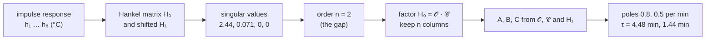

# Subspace identification: the Hankel matrix's rank is the model's order

[Syllabus](../../../SYLLABUS.md) → [Engineering mathematics](../README.md) → [Models from Data](../README.md#s11) → Subspace identification

---

## General Overview

A radiator heats a room, and a sensor clipped to the radiator's panel logs its surface temperature once a minute. Open the valve fully for one minute, then shut it. One minute later the panel is 1.3 °C warmer than it would have been. After two minutes the extra warmth is 0.89 °C, after three 0.637 °C, and it fades from there.

That fading list is the **impulse response** $`h_k`$: the temperature change $`k`$ minutes after a one-minute valve pulse, in °C per valve-minute (one valve-minute is the valve fully open for one minute). On this card the panel's response is exactly $`h_k = 0.8^k + 0.5^k`$. Two stores of heat, called **modes**, are at work: the thin steel face, which loses half its extra heat each minute, and the water inside, which keeps 80% of its extra heat each minute.

An engineer who wants a Kalman filter or a controller for this panel needs a state-space model. The first question is the **order**: how many internal numbers (states) the model needs. The second is how fast each one fades. The [ARX identification](01-arx-models-and-least-squares-identification.md) card fits a difference equation for each trial order and picks the order by testing on fresh data; [Measured Bode plots](02-frequency-response-estimation-and-coherence.md) measures the gain at each frequency. This card reads the order straight from the data.

The method writes the response into a **Hankel matrix**: a square table whose entry in row $`i`$, column $`j`$ is $`h_{i+j-1}`$, so each anti-diagonal (running from lower left to upper right) holds one sample. The 4 × 4 Hankel matrix of the panel has rank 2: only two of its rows are independent. Its singular values (the stretch factors of [The singular value decomposition](../../03-Algebra/07-Eigenvalues%20and%20Symmetric%20Matrices/06-singular-value-decomposition.md)) are 2.442563, 0.070894, 0 and 0.

Factor that matrix into two pieces, and the pieces hand back a model $`(A, B, C)`$ whose poles (the factor each mode keeps per minute) are 0.8 and 0.5. Those are time constants of 4.48 min and 1.44 min, the two heat stores. Add sensor noise of 0.005 °C and all four singular values become non-zero: 2.440234, 0.074121, 0.006184 and 0.001533. But the second is still 12.0 times the third. That gap shows the order is 2, and the noisy data still return poles 0.799152 and 0.486569.

**Stack the impulse response into a Hankel matrix: every entry passes through the model's states, so its rank is the number of states, the singular values show that rank even through noise, and factoring the matrix returns A, B and C.**

**What kind of fact this is:** a theorem (rank of the Hankel matrix equals the order of the smallest model, proved on this card in Why it works) and a method built on it. With noisy data the order becomes a judgement: where the gap in the singular values falls.

### The picture: from logged response to model



The order comes out of the middle box, before any model is built.

---

## The formula

A sampled state-space model steps forward once a minute ([State space](../04-State%20Space%20and%20Optimal%20Control/01-state-space-models-and-the-matrix-exponential.md)): $`x_{k+1} = A x_k + B u_k`$ and $`y_k = C x_k`$. On this card $`A`$ is the one-step matrix, which the State space card calls $`\Phi`$; its $`\Gamma`$ is $`B`$ here. A valve pulse at minute 0 moves the state by $`B`$; each minute multiplies it by $`A`$; the sensor reads it through $`C`$. So the response is

```math
h_k = C A^{k-1} B, \qquad k = 1, 2, 3, \dots
```

Stack it into the Hankel matrix $`H_0`$ and its one-step shift $`H_1`$. Both split into an observability matrix times a controllability matrix ([Can you steer every state, and can you see every state](../04-State%20Space%20and%20Optimal%20Control/03-controllability-and-observability.md)):

```math
H_0 = \begin{bmatrix} h_1 & h_2 & h_3 & h_4 \\ h_2 & h_3 & h_4 & h_5 \\ h_3 & h_4 & h_5 & h_6 \\ h_4 & h_5 & h_6 & h_7 \end{bmatrix} = \underbrace{\begin{bmatrix} C \\ CA \\ CA^2 \\ CA^3 \end{bmatrix}}_{\mathcal{O}} \underbrace{\begin{bmatrix} B & AB & A^2B & A^3B \end{bmatrix}}_{\mathcal{C}}, \qquad H_1 = \mathcal{O}\,A\,\mathcal{C}, \qquad \mathrm{rank}\, H_0 = n
```

The Ho–Kalman method, run with the singular value decomposition as in the eigensystem realisation algorithm (ERA), reads the model off the first $`n`$ singular values and directions:

```math
H_0 \approx U_n \Sigma_n V_n^{\top}, \qquad \mathcal{O} = U_n \Sigma_n^{1/2}, \quad \mathcal{C} = \Sigma_n^{1/2} V_n^{\top}, \qquad A = \Sigma_n^{-1/2}\, U_n^{\top} H_1 V_n\, \Sigma_n^{-1/2}
```

with $`B`$ the first column of $`\mathcal{C}`$ and $`C`$ the first row of $`\mathcal{O}`$.

**Read it aloud:** every sample of the response is the pulse going in through $`B`$, carried by powers of $`A`$, and read out through $`C`$; so the Hankel matrix is "what the sensor can see" times "what the valve can push", its rank is the number of states, and dividing the shifted matrix by those two factors leaves $`A`$.

| Symbol | Plain meaning | In our example | Push it up and the answer… |
| --- | --- | --- | --- |
| $`h_k`$, $`k`$ | impulse response: temperature change $`k`$ minutes after a one-minute valve pulse, °C per valve-minute | $`h_1 = 1.3`$, $`h_2 = 0.89`$, $`h_3 = 0.637`$ | — |
| $`x_k`$, $`u_k`$, $`y_k`$ | state (the model's internal numbers) at minute $`k`$; valve input, valve-minutes; panel temperature change, °C | two states | — |
| $`A`$, $`B`$, $`C`$ | one-step matrix; how the valve enters the state; how the sensor reads the state. $`D`$, the same-minute effect, is 0 here | ERA gives `A = [[0.724968, 0.129922], [0.129922, 0.575032]]` | — |
| $`n`$ | the order: the number of states in the smallest model that fits | 2 | one more row and column in $`A`$ |
| $`H_0`$, $`H_1`$ | Hankel matrix from $`h_1`$ to $`h_7`$; the same shifted one step, $`h_2`$ to $`h_8`$ | 4 × 4 each | — |
| $`\mathcal{O}`$, $`\mathcal{C}`$ | observability matrix (rows $`C, CA, \dots`$); controllability matrix (columns $`B, AB, \dots`$) | 4 × 2 and 2 × 4 | — |
| $`\sigma_i`$ | singular values of $`H_0`$, largest first ("sigma") | 2.442563, 0.070894, 0, 0 | a mode that is stronger in the response gives a larger $`\sigma`$ |
| $`U_n`$, $`\Sigma_n`$, $`V_n`$ | first $`n`$ output directions, singular values (on a diagonal) and input directions of $`H_0`$ | $`n = 2`$ | — |
| $`p`$, $`\tau`$ | pole: the factor a mode keeps each minute; time constant $`\tau = -1\ \text{min} / \ln p`$ | 0.8 and 0.5; 4.48 min and 1.44 min | $`p`$ nearer 1 fades slower, larger $`\tau`$ |
| $`z`$; $`a_1`$, $`a_0`$ | the one-step variable of [The z-transform](../02-Linear%20Systems%20and%20Transforms/08-z-transform-and-discrete-time-systems.md), poles are roots in $`z`$; the recurrence weights in $`h_{k+2} = a_1 h_{k+1} + a_0 h_k`$ | $`z^2 - 1.3z + 0.4 = 0`$; $`a_1 = 1.3`$, $`a_0 = -0.4`$ | — |
| $`T`$ | any invertible 2 × 2 matrix: a change of state coordinates | — | — |
| $`Y_f`$, $`U_f`$, $`X`$ | stacked future outputs, stacked future inputs, and the state sequence, for the input–output version (Step 5) | a day: 1,440 columns | more columns, less noise |

A mode keeps the factor $`p`$ each minute, and $`p = e^{-1\ \text{min}/\tau}`$, so $`\tau = -1\ \text{min} / \ln p`$; $`\ln`$ is the natural logarithm.

### When it holds

- **The panel is linear and does not change (time-invariant).** Fixed $`A`$, $`B`$, $`C`$ make every $`h_k`$ equal $`CA^{k-1}B`$. A valve that sticks, or a boiler whose water temperature drifts during the day, breaks the factorisation and adds rank that is not a heat store.
- **The Hankel matrix is bigger than the order.** A 4 × 4 matrix has rank at most 4. A system with five modes would look like four, so the matrix needs more rows and columns than the order it is meant to detect.
- **Every mode is steerable and visible.** A mode the valve cannot push, or the sensor cannot see, never appears in $`h_k`$. The rank counts only the modes that both reach (the controllable and observable part).
- **The noise is small next to the weakest real singular value.** At 0.005 °C noise the gap $`\sigma_2/\sigma_3`$ is 12.0. At 0.05 °C it is 1.6, and the 4 × 4 matrix cannot tell the fast store from noise.
- **The code takes real poles.** Its 2 × 2 root formula assumes real roots. A lightly damped system (a ringing footbridge) has complex pole pairs; the method is the same, the root-finding needs complex numbers.

---

## Why it works

### Step 0: the state is a narrow pipe between past and future

Everything the valve did in the past reaches the future temperature only through the state: two numbers here. The Hankel matrix is exactly the map "past pulses in, future readings out". Row $`i`$ is the reading $`i - 1`$ minutes from now; column $`j`$ is a pulse $`j`$ minutes ago. A map that squeezes through two numbers cannot have rank above two.

### Step 1: the Hankel matrix factors through the state

Entry $`(i, j)`$ of $`H_0`$ is $`h_{i+j-1} = C A^{i+j-2} B = (C A^{i-1})(A^{j-1} B)`$. The left bracket is row $`i`$ of $`\mathcal{O}`$; the right bracket is column $`j`$ of $`\mathcal{C}`$. So $`H_0 = \mathcal{O}\,\mathcal{C}`$, a 4 × 2 matrix times a 2 × 4 matrix, and its rank is at most 2.

For the panel, one realisation (a set of $`A`$, $`B`$, $`C`$ that reproduces the response) is $`A = \mathrm{diag}(0.8, 0.5)`$, $`B = (0.8, 0.5)`$ and $`C = (1, 1)`$: each state is one heat store, and $`CA^{k-1}B = 0.8^k + 0.5^k`$. The code multiplies its $`\mathcal{O}`$ and $`\mathcal{C}`$ and gets $`H_0`$ back, entry by entry.

### Step 2: the rank is exactly n when the model has no hidden part

If every mode is controllable, $`\mathcal{C}`$ has rank $`n`$; if every mode is observable, $`\mathcal{O}`$ has rank $`n`$. Then the product has rank exactly $`n`$ (proof in the fold). The smallest model that reproduces the response has as many states as the rank.

The panel shows both halves by hand. The top-left 2 × 2 block has determinant $`1.3 \times 0.637 - 0.89^2 = 0.036`$, not zero, so the rank is at least 2. And every row after the second is a mix of the two above it: $`h_{k+2} = 1.3\,h_{k+1} - 0.4\,h_k`$. So the rank is at most 2.

<details>
<summary>Detailed proof: full-rank factors give a product of rank n</summary>

Let $`\mathcal{O}`$ be $`m \times n`$ with rank $`n`$ and $`\mathcal{C}`$ be $`n \times m`$ with rank $`n`$, where $`m \ge n`$. Then $`\mathcal{O}^{\top}\mathcal{O}`$ and $`\mathcal{C}\,\mathcal{C}^{\top}`$ are $`n \times n`$ and invertible. Set

$`\displaystyle L = (\mathcal{O}^{\top}\mathcal{O})^{-1}\mathcal{O}^{\top}, \qquad R = \mathcal{C}^{\top}(\mathcal{C}\,\mathcal{C}^{\top})^{-1}.`$

Then $`L\,H_0\,R = (L\mathcal{O})(\mathcal{C}R) = I_n`$, the $`n \times n`$ identity, which has rank $`n`$. Multiplying a matrix by other matrices never raises its rank, so $`\mathrm{rank}\, H_0 \ge n`$. Step 1 gave $`\mathrm{rank}\, H_0 \le n`$, so the rank is $`n`$.

If a mode is hidden, say unobservable, a non-zero column vector $`w`$ with $`\mathcal{O}w = 0`$ exists. That mode adds nothing to any $`h_k`$, and a smaller model without it gives the same response. So "rank $`n`$" and "smallest model has $`n`$ states" are the same statement.

</details>

### Step 3: the shifted matrix hands over A

Shift every entry by one minute. Entry $`(i, j)`$ of $`H_1`$ is $`h_{i+j} = (CA^{i-1})\,A\,(A^{j-1}B)`$, so $`H_1 = \mathcal{O}\,A\,\mathcal{C}`$. With $`\mathcal{O}`$ and $`\mathcal{C}`$ known, $`A`$ is what remains after dividing them out of $`H_1`$.

The singular value decomposition supplies the two factors. Write $`H_0 = U_n \Sigma_n V_n^{\top}`$ and split the middle evenly: $`\mathcal{O} = U_n\Sigma_n^{1/2}`$ and $`\mathcal{C} = \Sigma_n^{1/2}V_n^{\top}`$. The columns of $`U_n`$ and $`V_n`$ have length 1 and are at right angles, so $`U_n^{\top}U_n = I`$ and $`V_n^{\top}V_n = I`$. Multiply $`H_1`$ by $`\Sigma_n^{-1/2}U_n^{\top}`$ on the left and $`V_n\Sigma_n^{-1/2}`$ on the right, and the factors cancel to leave $`A`$. That is the formula.

The factors are not unique. Any $`\mathcal{O}T`$ and $`T^{-1}\mathcal{C}`$ multiply to the same $`H_0`$. They give the model $`T^{-1}AT`$, $`T^{-1}B`$, $`CT`$: the same panel in other state coordinates. Its poles, its time constants and its $`h_k`$ are unchanged. ERA's $`A`$ for the panel is `[[0.724968, 0.129922], [0.129922, 0.575032]]`, not diagonal, but its trace is 1.3 and its determinant 0.4, so its poles are the roots of $`z^2 - 1.3z + 0.4`$: 0.8 and 0.5.

### Step 4: with noise, the rank becomes a gap

Real readings carry noise, and a noisy matrix has full rank: four non-zero singular values. The singular value decomposition still helps. Keeping the $`n`$ largest singular values gives the closest rank-$`n`$ matrix to the data (the Eckart–Young theorem, on [The singular value decomposition](../../03-Algebra/07-Eigenvalues%20and%20Symmetric%20Matrices/06-singular-value-decomposition.md)). The extra singular values come from the noise and have its size.

So the engineer looks for a drop. For the panel at 0.005 °C noise, $`\sigma_2 = 0.074121`$ and $`\sigma_3 = 0.006184`$: a factor of 12.0. ERA with $`n = 2`$ then returns poles 0.799152 and 0.486569, time constants 4.46 min and 1.39 min. The model's worst error against the true response, over twelve minutes, is 0.002983 °C, smaller than the noise.

### Step 5: the subspace core, when only the valve and sensor logs exist

The house log is a whole day of a pseudo-random valve signal, not a clean pulse. Subspace methods such as N4SID (numerical algorithms for subspace state-space system identification) work on that log directly. In outline:

1. Stack the outputs into a block Hankel matrix $`Y_f`$: column $`j`$ holds the readings at minutes $`j, j+1, j+2, j+3`$. Stack the inputs the same way into $`U_f`$.
2. These satisfy $`Y_f = \mathcal{O}X + (\text{a matrix of } h_k)\,U_f`$, where $`X`$ holds the state at each starting minute.
3. Project out everything the future inputs explain. What remains is $`\mathcal{O}X`$ projected, with rank $`n`$.
4. Its singular values show the order, and its first $`n`$ directions span the same columns as $`\mathcal{O}`$.
5. Rows 2 to 4 of $`\mathcal{O}`$ equal rows 1 to 3 times $`A`$. Solving that by least squares gives $`A`$.

The code runs this core on a noise-free simulated day: 1,440 minutes of the valve swinging 50% above or below its middle setting. The projected matrix has singular values 1.728734, 0.002426, 0 and 0, and the shift step returns poles 0.8 and 0.5 from input–output data alone.

What this card leaves out: with noise, N4SID uses past inputs and outputs as instruments (an oblique projection), weights the matrix before the decomposition, and also returns the noise model and a Kalman gain. Van Overschee and De Moor, in Sources, derive all of it.

---

## Worked numbers, by hand

| Step | Arithmetic | Value |
| --- | --- | --- |
| 1. Response | $`h_k = 0.8^k + 0.5^k`$ for $`k = 1`$ to 7 | 1.3, 0.89, 0.637, 0.4721, 0.35893, 0.277769, 0.217528 °C |
| 2. Hankel matrix | lay $`h_1`$ to $`h_7`$ along the anti-diagonals | the matrix below |
| 3. Rank at least 2 | $`h_1 h_3 - h_2^2 = 1.3 \times 0.637 - 0.89^2`$ | 0.036, not zero |
| 4. Rank at most 2 | solve $`h_3 = a_1 h_2 + a_0 h_1`$, $`h_4 = a_1 h_3 + a_0 h_2`$; check the unused $`h_5`$: $`1.3 \times 0.4721 - 0.4 \times 0.637`$ | $`a_1 = 1.3`$, $`a_0 = -0.4`$; 0.35893 ✓ |
| 5. Poles from the rule | $`z^2 - 1.3z + 0.4 = (z - 0.8)(z - 0.5)`$ | 0.8, 0.5 per minute |
| 6. ERA's $`A`$ | trace $`0.724968 + 0.575032`$; determinant $`0.724968 \times 0.575032 - 0.129922^2`$ | 1.3 and 0.4: same poles |
| 7. Time constants | $`-1/\ln 0.8`$ and $`-1/\ln 0.5`$, in minutes | **4.48 min and 1.44 min** |

```math
H_0 = \begin{bmatrix} 1.3 & 0.89 & 0.637 & 0.4721 \\ 0.89 & 0.637 & 0.4721 & 0.35893 \\ 0.637 & 0.4721 & 0.35893 & 0.277769 \\ 0.4721 & 0.35893 & 0.277769 & 0.217528 \end{bmatrix}
```

The panel needs a two-state model: one heat store that fades with a 4.48-minute time constant and one that fades in 1.44 minutes.

The model was built from $`h_1`$ to $`h_8`$. It predicts $`h_9`$ to $`h_{12}`$ as 0.136171, 0.108351, 0.086388 and 0.068964 °C, exactly the true values: it has learned the panel, not just copied the data.

The singular values, clean and noisy:

| Data | $`\sigma_1`$ | $`\sigma_2`$ | $`\sigma_3`$ | $`\sigma_4`$ | Gap $`\sigma_2/\sigma_3`$ |
| --- | ---: | ---: | ---: | ---: | ---: |
| clean | 2.442563 | 0.070894 | 0 | 0 | none: exact zeros |
| noise 0.005 °C | 2.440234 | 0.074121 | 0.006184 | 0.001533 | 12.0 |
| noise 0.05 °C | 2.420207 | 0.103503 | 0.062931 | 0.015129 | 1.6 |

### What breaks if you drop a piece

The correct answer is order 2, poles 0.8 and 0.5. Each row is computed by the code from the 0.005 °C noisy data unless it says otherwise.

| Mistake | Comes out at | What went wrong |
| --- | --- | --- |
| Count every non-zero singular value | order 4 | noise makes every singular value non-zero; the order is where the values drop, not where they stop |
| Keep only the largest singular value | one pole 0.726360, $`\tau`$ 3.13 min; worst error 0.037882 °C | one store cannot fit two; the order-2 model's worst error is 0.002983 °C |
| Use $`H_0`$ where $`H_1`$ belongs (clean data) | poles 1.000000 and 1.000000 | without the shift, the formula divides $`H_0`$ by its own factors and returns the identity: a panel that never cools |
| Noise 0.05 °C on a 4 × 4 matrix | gap 1.6 | the fast store's $`\sigma_2`$ sinks into the noise; a longer log or a larger matrix is needed |

---

## Code, from first principles, and it actually runs

Both programs build the Hankel matrix, find its singular values, run ERA and read the poles, then repeat it all on noisy data and print every number on this card. No library does the linear algebra. One input and one output make the Hankel matrix symmetric (each entry depends only on $`i + j`$), so its singular values are the sizes of its eigenvalues; the code finds those by Jacobi rotations, which zero the off-diagonal entries one pair at a time. The order is reached **three independent ways**: the floating-point singular values; an exact integer rank by fraction-free (Bareiss) elimination of $`10^{i+j-1}h_{i+j-1} = 8^{i+j-1} + 5^{i+j-1}`$; and the two non-zero singular values again from the 2 × 2 product $`\mathcal{C}\,\mathcal{O}`$, which has the same non-zero eigenvalues as $`\mathcal{O}\,\mathcal{C}`$. The poles are reached **three ways**: ERA, the recurrence $`h_{k+2} = a_1 h_{k+1} + a_0 h_k`$, and the core shared by subspace methods such as N4SID, from a simulated day of valve data. Noise comes from SplitMix64 with seed 2026 and the Box–Muller formula (which turns two uniform random numbers into one bell-curve number), written out in both languages, so both print the same output.

### Python

```python
# Subspace identification: the Hankel matrix's rank is the model's order.
# Standard library only. Radiator panel: h_k = 0.8^k + 0.5^k degC per valve-minute.
from math import sqrt, log, cos, pi
M64, state = (1 << 64) - 1, 2026
def splitmix():                       # SplitMix64 random bits, seed 2026
    global state
    state = (state + 0x9E3779B97F4A7C15) & M64
    z = ((state ^ (state >> 30)) * 0xBF58476D1CE4E5B9) & M64
    z = ((z ^ (z >> 27)) * 0x94D049BB133111EB) & M64
    return z ^ (z >> 31)
def unif(): return ((splitmix() >> 11) + 0.5) / 2.0**53
def gauss(): return sqrt(-2.0 * log(unif())) * cos(2.0 * pi * unif())   # Box-Muller
def jacobi(S):                        # eigenvalues and eigenvectors of a symmetric matrix
    n = len(S); a = [r[:] for r in S]
    V = [[1.0 if i == j else 0.0 for j in range(n)] for i in range(n)]
    for _ in range(60):
        for p in range(n):
            for q in range(p + 1, n):
                if abs(a[p][q]) < 1e-300: continue
                th = (a[q][q] - a[p][p]) / (2.0 * a[p][q])
                t = (1.0 if th >= 0 else -1.0) / (abs(th) + sqrt(th * th + 1.0))
                c = 1.0 / sqrt(t * t + 1.0); s = t * c
                for k in range(n):
                    x, y = a[k][p], a[k][q]; a[k][p] = c * x - s * y; a[k][q] = s * x + c * y
                    x, y = V[k][p], V[k][q]; V[k][p] = c * x - s * y; V[k][q] = s * x + c * y
                for k in range(n):
                    x, y = a[p][k], a[q][k]; a[p][k] = c * x - s * y; a[q][k] = s * x + c * y
    return [a[i][i] for i in range(n)], V
def svd_sym(S):                       # symmetric S: singular values = |eigenvalues|, largest first
    ev, V = jacobi(S); n = len(S)
    idx = sorted(range(n), key=lambda i: -abs(ev[i]))
    U = [[V[r][i] for i in idx] for r in range(n)]
    W = [[V[r][i] * (1.0 if ev[i] >= 0 else -1.0) for i in idx] for r in range(n)]
    return [abs(ev[i]) for i in idx], U, W
def hankel(h, shift): return [[h[i + j + 1 + shift] for j in range(4)] for i in range(4)]
def era(h, n, shift=1):               # Ho-Kalman / ERA: factor H0, read A from the shifted H1
    sig, U, W = svd_sym(hankel(h, 0)); H1 = hankel(h, shift)
    A = [[sum(U[r][a] * H1[r][c] * W[c][b] for r in range(4) for c in range(4))
          / sqrt(sig[a] * sig[b]) for b in range(n)] for a in range(n)]
    return A, [sqrt(sig[a]) * W[0][a] for a in range(n)], [sqrt(sig[a]) * U[0][a] for a in range(n)]
def roots2(M):                        # eigenvalues of a 2x2 matrix (real case), larger first
    tr = M[0][0] + M[1][1]; d = sqrt(tr * tr / 4.0 - (M[0][0] * M[1][1] - M[0][1] * M[1][0]))
    return tr / 2.0 + d, tr / 2.0 - d
def markov(A, B, C, k):               # h_k = C A^(k-1) B
    x = B[:]
    for _ in range(k - 1): x = [sum(A[i][j] * x[j] for j in range(len(x))) for i in range(len(x))]
    return sum(C[i] * x[i] for i in range(len(x)))
def tau(p): return -1.0 / log(p)      # time constant in minutes, one sample = 1 min
def row(v): return " ".join(f"{x:.6f}" for x in v)
h = [None] + [0.8**k + 0.5**k for k in range(1, 13)]
H0 = hankel(h, 0)
print("Hankel H0 from h_1..h_7 (degC per valve-minute):")
for r in H0: print("  " + row(r))
sig, _, _ = svd_sym(H0)
print("singular values, clean:", row(sig), " 2x2 minor h1*h3 - h2^2 = %.6f" % (h[1] * h[3] - h[2] * h[2]))
assert sig[1] > 1e-2 and sig[2] < 1e-12
m, rank, prev = [[8**(i + j + 1) + 5**(i + j + 1) for j in range(4)] for i in range(4)], 0, 1
for k in range(4):                    # Bareiss elimination on 10^(i+j-1) h, exact integers
    piv = next((r for r in range(k, 4) if m[r][k] != 0), None)
    if piv is None: break
    m[k], m[piv] = m[piv], m[k]; rank += 1
    for i in range(k + 1, 4):
        for j in range(k + 1, 4): m[i][j] = (m[i][j] * m[k][k] - m[i][k] * m[k][j]) // prev
        m[i][k] = 0
    prev = m[k][k]
print("exact integer rank of [8^(i+j-1) + 5^(i+j-1)]:", rank)
assert rank == 2

At, Bt, Ct = [[0.8, 0.0], [0.0, 0.5]], [0.8, 0.5], [1.0, 1.0]       # one known realisation
Obs = [[Ct[a] * At[a][a]**k for a in range(2)] for k in range(4)]  # rows C, CA, CA^2, CA^3
Con = [[At[a][a]**k * Bt[a] for k in range(4)] for a in range(2)]  # columns B, AB, A^2B, A^3B
assert max(abs(sum(Obs[i][a] * Con[a][j] for a in range(2)) - H0[i][j]) for i in range(4) for j in range(4)) < 1e-12
s2 = roots2([[sum(Con[a][k] * Obs[k][b] for k in range(4)) for b in range(2)] for a in range(2)])
print("singular values from the 2x2 product Con*Obs:", row(s2))
assert abs(s2[0] - sig[0]) < 1e-9 and abs(s2[1] - sig[1]) < 1e-9

A, B, C = era(h, 2); p = roots2(A)
print("ERA order 2: A =", row(A[0]), "/", row(A[1]), " B =", row(B), " C =", row(C))
print("ERA poles:", row(p), " trace %.6f det %.6f" % (A[0][0] + A[1][1], A[0][0] * A[1][1] - A[0][1] * A[1][0]),
      " time constants (min): %.2f %.2f" % (tau(p[0]), tau(p[1])))
det = h[1] * h[3] - h[2] * h[2]       # recurrence h(k+2) = a1 h(k+1) + a0 h(k), from h_1..h_4
a0 = (h[3] * h[3] - h[2] * h[4]) / det; a1 = (h[1] * h[4] - h[2] * h[3]) / det
q = roots2([[a1, a0], [1.0, 0.0]])
print("recurrence: h(k+2) = %.6f h(k+1) - %.6f h(k); roots %s" % (a1, -a0, row(q)))
assert abs(p[0] - 0.8) < 1e-9 and abs(p[1] - 0.5) < 1e-9 and abs(q[0] - p[0]) < 1e-9 and abs(q[1] - p[1]) < 1e-9
pred = [markov(A, B, C, k) for k in range(9, 13)]
print("model h_9..h_12:", row(pred), " true:", row(h[9:13]))
assert max(abs(pred[i] - h[9 + i]) for i in range(4)) < 1e-9

hn = [None] + [h[k] + 0.005 * gauss() for k in range(1, 9)]
sn, _, _ = svd_sym(hankel(hn, 0))
print("noisy h_1..h_8 (sd 0.005 degC):", row(hn[1:]))
print("singular values, noisy:", row(sn), " gap sigma2/sigma3 = %.1f" % (sn[1] / sn[2]))
assert sn[1] / sn[2] > 5.0 and sn[2] / sn[3] < 5.0
An, Bn, Cn = era(hn, 2); pn = roots2(An)
print("noisy ERA poles:", row(pn), " time constants (min): %.2f %.2f" % (tau(pn[0]), tau(pn[1])))
assert abs(pn[0] - 0.8) < 0.02 and abs(pn[1] - 0.5) < 0.05
err = max(abs(markov(An, Bn, Cn, k) - h[k]) for k in range(1, 13))
print("noisy model, worst error on true h_1..h_12: %.6f degC" % err)

print("WHAT BREAKS")
A1, B1, C1 = era(hn, 1)
e1 = max(abs(markov(A1, B1, C1, k) - h[k]) for k in range(1, 13))
print("order 1: pole %.6f, time constant %.2f min, worst error %.6f degC" % (A1[0][0], tau(A1[0][0]), e1))
assert e1 > 10 * err
print("count every non-zero singular value of the noisy H0: order", sum(1 for s in sn if s > 1e-12))
p0 = roots2(era(h, 2, shift=0)[0])
print("forget the shift (H0 for H1): poles", row(p0))
assert abs(p0[1] - 1.0) < 1e-9
state = 2026
hb = [None] + [h[k] + 0.05 * gauss() for k in range(1, 9)]
sb, _, _ = svd_sym(hankel(hb, 0))
print("noise sd 0.05 degC: singular values", row(sb), " gap %.1f" % (sb[1] / sb[2]))
assert sb[1] / sb[2] < 2.0

N, x, us, ys = 1440, [0.0, 0.0], [], []           # subspace core from a day of valve data
for t in range(N + 4):
    u = 0.5 if splitmix() >> 63 else -0.5         # valve 50% above or below its middle, each minute
    us.append(u); ys.append(Ct[0] * x[0] + Ct[1] * x[1])
    x = [At[0][0] * x[0] + Bt[0] * u, At[1][1] * x[1] + Bt[1] * u]
Uf = [[us[j + i] for j in range(N)] for i in range(4)]
Yf = [[ys[j + i] for j in range(N)] for i in range(4)]
dot = lambda P, Q: [[sum(a * b for a, b in zip(P[i], Q[j])) / N for j in range(4)] for i in range(4)]
YY, YU, UU = dot(Yf, Yf), dot(Yf, Uf), dot(Uf, Uf)
G = [UU[i][:] + [YU[r][i] for r in range(4)] for i in range(4)]   # solve UU X = YU^T, Gauss-Jordan
for k in range(4):
    G[k] = [v / G[k][k] for v in G[k]]
    for i in range(4):
        if i != k: G[i] = [a - G[i][k] * b for a, b in zip(G[i], G[k])]
P = [[YY[i][j] - sum(YU[i][k] * G[k][4 + j] for k in range(4)) for j in range(4)] for i in range(4)]
sp, Up, _ = svd_sym(P)
print("subspace core, inputs projected out: singular values", row(sp))
L = [[sum(Up[k][a] * Up[k][b] for k in range(3)) for b in range(2)] for a in range(2)]
R = [[sum(Up[k][a] * Up[k + 1][b] for k in range(3)) for b in range(2)] for a in range(2)]
d = L[0][0] * L[1][1] - L[0][1] * L[1][0]
Li = [[L[1][1] / d, -L[0][1] / d], [-L[1][0] / d, L[0][0] / d]]
ps = roots2([[sum(Li[i][k] * R[k][j] for k in range(2)) for j in range(2)] for i in range(2)])
print("subspace core poles (shift of the observability block):", row(ps))
assert sp[2] < 1e-9 * sp[1] and abs(ps[0] - 0.8) < 1e-9 and abs(ps[1] - 0.5) < 1e-9
print("ALL CHECKS PASS")
```

**Ran 2026-11-23 on macOS, Python 3.14.10, standard library only. All checks passed. Output, pasted from the run:**

```text
Hankel H0 from h_1..h_7 (degC per valve-minute):
  1.300000 0.890000 0.637000 0.472100
  0.890000 0.637000 0.472100 0.358930
  0.637000 0.472100 0.358930 0.277769
  0.472100 0.358930 0.277769 0.217528
singular values, clean: 2.442563 0.070894 0.000000 0.000000  2x2 minor h1*h3 - h2^2 = 0.036000
exact integer rank of [8^(i+j-1) + 5^(i+j-1)]: 2
singular values from the 2x2 product Con*Obs: 2.442563 0.070894
ERA order 2: A = 0.724968 0.129922 / 0.129922 0.575032  B = 1.128170 -0.165021  C = 1.128170 -0.165021
ERA poles: 0.800000 0.500000  trace 1.300000 det 0.400000  time constants (min): 4.48 1.44
recurrence: h(k+2) = 1.300000 h(k+1) - 0.400000 h(k); roots 0.800000 0.500000
model h_9..h_12: 0.136171 0.108351 0.086388 0.068964  true: 0.136171 0.108351 0.086388 0.068964
noisy h_1..h_8 (sd 0.005 degC): 1.297275 0.886631 0.636495 0.472621 0.359854 0.283801 0.216078 0.174267
singular values, noisy: 2.440234 0.074121 0.006184 0.001533  gap sigma2/sigma3 = 12.0
noisy ERA poles: 0.799152 0.486569  time constants (min): 4.46 1.39
noisy model, worst error on true h_1..h_12: 0.002983 degC
WHAT BREAKS
order 1: pole 0.726360, time constant 3.13 min, worst error 0.037882 degC
count every non-zero singular value of the noisy H0: order 4
forget the shift (H0 for H1): poles 1.000000 1.000000
noise sd 0.05 degC: singular values 2.420207 0.103503 0.062931 0.015129  gap 1.6
subspace core, inputs projected out: singular values 1.728734 0.002426 0.000000 0.000000
subspace core poles (shift of the observability block): 0.800000 0.500000
ALL CHECKS PASS
```

### Rust

```rust
// Subspace identification: the Hankel matrix's rank is the model's order.
// std only. Radiator panel: h_k = 0.8^k + 0.5^k degC per valve-minute.
type Mat = Vec<Vec<f64>>;
struct Rng(u64);
impl Rng {
    fn bits(&mut self) -> u64 { // SplitMix64 random bits, seed 2026
        self.0 = self.0.wrapping_add(0x9E3779B97F4A7C15);
        let mut z = (self.0 ^ (self.0 >> 30)).wrapping_mul(0xBF58476D1CE4E5B9);
        z = (z ^ (z >> 27)).wrapping_mul(0x94D049BB133111EB);
        z ^ (z >> 31)
    }
    fn unif(&mut self) -> f64 { ((self.bits() >> 11) as f64 + 0.5) / 2f64.powi(53) }
    fn gauss(&mut self) -> f64 { // Box-Muller
        let r = (-2.0 * self.unif().ln()).sqrt();
        r * (2.0 * std::f64::consts::PI * self.unif()).cos()
    }
}
fn jacobi(s: &Mat) -> (Vec<f64>, Mat) { // eigenvalues and eigenvectors of a symmetric matrix
    let (n, mut a) = (s.len(), s.clone());
    let mut v: Mat = (0..n).map(|i| (0..n).map(|j| if i == j { 1.0 } else { 0.0 }).collect()).collect();
    for _ in 0..60 {
        for p in 0..n {
            for q in p + 1..n {
                if a[p][q].abs() < 1e-300 { continue; }
                let th = (a[q][q] - a[p][p]) / (2.0 * a[p][q]);
                let t = (if th >= 0.0 { 1.0 } else { -1.0 }) / (th.abs() + (th * th + 1.0).sqrt());
                let c = 1.0 / (t * t + 1.0).sqrt(); let sn = t * c;
                for k in 0..n {
                    let (x, y) = (a[k][p], a[k][q]); a[k][p] = c * x - sn * y; a[k][q] = sn * x + c * y;
                    let (x, y) = (v[k][p], v[k][q]); v[k][p] = c * x - sn * y; v[k][q] = sn * x + c * y;
                }
                for k in 0..n {
                    let (x, y) = (a[p][k], a[q][k]); a[p][k] = c * x - sn * y; a[q][k] = sn * x + c * y;
                }
            }
        }
    }
    ((0..n).map(|i| a[i][i]).collect(), v)
}
fn svd_sym(s: &Mat) -> (Vec<f64>, Mat, Mat) { // symmetric: singular values = |eigenvalues|
    let (ev, v) = jacobi(s);
    let n = s.len();
    let mut idx: Vec<usize> = (0..n).collect();
    idx.sort_by(|&i, &j| (-ev[i].abs()).partial_cmp(&(-ev[j].abs())).unwrap());
    let u: Mat = (0..n).map(|r| idx.iter().map(|&i| v[r][i]).collect()).collect();
    let w: Mat = (0..n).map(|r| idx.iter().map(|&i| v[r][i] * if ev[i] >= 0.0 { 1.0 } else { -1.0 }).collect()).collect();
    (idx.iter().map(|&i| ev[i].abs()).collect(), u, w)
}
fn hankel(h: &[f64], shift: usize) -> Mat { (0..4).map(|i| (0..4).map(|j| h[i + j + 1 + shift]).collect()).collect() }
fn era(h: &[f64], n: usize, shift: usize) -> (Mat, Vec<f64>, Vec<f64>) { // Ho-Kalman / ERA
    let (sig, u, w) = svd_sym(&hankel(h, 0));
    let h1 = hankel(h, shift);
    let a: Mat = (0..n).map(|a| (0..n).map(|b| {
        let mut s = 0.0;
        for r in 0..4 { for c in 0..4 { s += u[r][a] * h1[r][c] * w[c][b]; } }
        s / (sig[a] * sig[b]).sqrt() }).collect()).collect();
    (a, (0..n).map(|a| sig[a].sqrt() * w[0][a]).collect(), (0..n).map(|a| sig[a].sqrt() * u[0][a]).collect())
}
fn roots2(m: &Mat) -> (f64, f64) { // eigenvalues of a 2x2 matrix (real case), larger first
    let tr = m[0][0] + m[1][1];
    let d = (tr * tr / 4.0 - (m[0][0] * m[1][1] - m[0][1] * m[1][0])).sqrt();
    (tr / 2.0 + d, tr / 2.0 - d)
}
fn markov(a: &Mat, b: &[f64], c: &[f64], k: usize) -> f64 { // h_k = C A^(k-1) B
    let mut x = b.to_vec();
    for _ in 0..k - 1 { x = (0..x.len()).map(|i| { let mut s = 0.0; for j in 0..x.len() { s += a[i][j] * x[j]; } s }).collect(); }
    let mut s = 0.0; for i in 0..x.len() { s += c[i] * x[i]; } s
}
fn tau(p: f64) -> f64 { -1.0 / p.ln() } // time constant in minutes, one sample = 1 min
fn row(v: &[f64]) -> String { v.iter().map(|x| format!("{:.6}", x)).collect::<Vec<_>>().join(" ") }
fn main() {
    let mut rng = Rng(2026);
    let mut h = vec![0.0; 13];
    for k in 1..13 { h[k] = 0.8f64.powf(k as f64) + 0.5f64.powf(k as f64); }
    let h0 = hankel(&h, 0);
    println!("Hankel H0 from h_1..h_7 (degC per valve-minute):");
    for r in &h0 { println!("  {}", row(r)); }
    let (sig, _, _) = svd_sym(&h0);
    println!("singular values, clean: {}  2x2 minor h1*h3 - h2^2 = {:.6}", row(&sig), h[1] * h[3] - h[2] * h[2]);
    assert!(sig[1] > 1e-2 && sig[2] < 1e-12);
    let mut m: Vec<Vec<i128>> = (0..4).map(|i| (0..4).map(|j| 8i128.pow(i + j + 1) + 5i128.pow(i + j + 1)).collect()).collect();
    let (mut rank, mut prev) = (0, 1i128);
    for k in 0..4 { // Bareiss elimination on 10^(i+j-1) h, exact integers
        let piv = match (k..4).find(|&r| m[r][k] != 0) { Some(p) => p, None => break };
        m.swap(k, piv); rank += 1;
        for i in k + 1..4 {
            for j in k + 1..4 { m[i][j] = (m[i][j] * m[k][k] - m[i][k] * m[k][j]) / prev; }
            m[i][k] = 0;
        }
        prev = m[k][k];
    }
    println!("exact integer rank of [8^(i+j-1) + 5^(i+j-1)]: {}", rank);
    assert_eq!(rank, 2);
    let (at, bt, ct) = (vec![vec![0.8f64, 0.0], vec![0.0, 0.5]], vec![0.8, 0.5], vec![1.0, 1.0]);
    let obs: Mat = (0..4).map(|k| (0..2).map(|a| ct[a] * at[a][a].powf(k as f64)).collect()).collect();
    let con: Mat = (0..2).map(|a| (0..4).map(|k| at[a][a].powf(k as f64) * bt[a]).collect()).collect();
    for i in 0..4 { for j in 0..4 { assert!((obs[i][0] * con[0][j] + obs[i][1] * con[1][j] - h0[i][j]).abs() < 1e-12); } }
    let small: Mat = (0..2).map(|a| (0..2).map(|b| { let mut s = 0.0; for k in 0..4 { s += con[a][k] * obs[k][b]; } s }).collect()).collect();
    let s2 = roots2(&small);
    println!("singular values from the 2x2 product Con*Obs: {}", row(&[s2.0, s2.1]));
    assert!((s2.0 - sig[0]).abs() < 1e-9 && (s2.1 - sig[1]).abs() < 1e-9);
    let (a, b, c) = era(&h, 2, 1);
    let p = roots2(&a);
    println!("ERA order 2: A = {} / {}  B = {}  C = {}", row(&a[0]), row(&a[1]), row(&b), row(&c));
    println!("ERA poles: {}  trace {:.6} det {:.6}  time constants (min): {:.2} {:.2}", row(&[p.0, p.1]),
        a[0][0] + a[1][1], a[0][0] * a[1][1] - a[0][1] * a[1][0], tau(p.0), tau(p.1));
    let det = h[1] * h[3] - h[2] * h[2]; // recurrence h(k+2) = a1 h(k+1) + a0 h(k), from h_1..h_4
    let a0 = (h[3] * h[3] - h[2] * h[4]) / det;
    let a1 = (h[1] * h[4] - h[2] * h[3]) / det;
    let q = roots2(&vec![vec![a1, a0], vec![1.0, 0.0]]);
    println!("recurrence: h(k+2) = {:.6} h(k+1) - {:.6} h(k); roots {}", a1, -a0, row(&[q.0, q.1]));
    assert!((p.0 - 0.8).abs() < 1e-9 && (p.1 - 0.5).abs() < 1e-9 && (q.0 - p.0).abs() < 1e-9 && (q.1 - p.1).abs() < 1e-9);
    let pred: Vec<f64> = (9..13).map(|k| markov(&a, &b, &c, k)).collect();
    println!("model h_9..h_12: {}  true: {}", row(&pred), row(&h[9..13]));
    for i in 0..4 { assert!((pred[i] - h[9 + i]).abs() < 1e-9); }
    let mut hn = vec![0.0; 9];
    for k in 1..9 { hn[k] = h[k] + 0.005 * rng.gauss(); }
    let (sn, _, _) = svd_sym(&hankel(&hn, 0));
    println!("noisy h_1..h_8 (sd 0.005 degC): {}", row(&hn[1..]));
    println!("singular values, noisy: {}  gap sigma2/sigma3 = {:.1}", row(&sn), sn[1] / sn[2]);
    assert!(sn[1] / sn[2] > 5.0 && sn[2] / sn[3] < 5.0);
    let (an, bn, cn) = era(&hn, 2, 1);
    let pn = roots2(&an);
    println!("noisy ERA poles: {}  time constants (min): {:.2} {:.2}", row(&[pn.0, pn.1]), tau(pn.0), tau(pn.1));
    assert!((pn.0 - 0.8).abs() < 0.02 && (pn.1 - 0.5).abs() < 0.05);
    let err = (1..13).map(|k| (markov(&an, &bn, &cn, k) - h[k]).abs()).fold(0.0, f64::max);
    println!("noisy model, worst error on true h_1..h_12: {:.6} degC", err);
    println!("WHAT BREAKS");
    let (a1m, b1m, c1m) = era(&hn, 1, 1);
    let e1 = (1..13).map(|k| (markov(&a1m, &b1m, &c1m, k) - h[k]).abs()).fold(0.0, f64::max);
    println!("order 1: pole {:.6}, time constant {:.2} min, worst error {:.6} degC", a1m[0][0], tau(a1m[0][0]), e1);
    assert!(e1 > 10.0 * err);
    println!("count every non-zero singular value of the noisy H0: order {}", sn.iter().filter(|&&s| s > 1e-12).count());
    let p0 = roots2(&era(&h, 2, 0).0);
    println!("forget the shift (H0 for H1): poles {}", row(&[p0.0, p0.1]));
    assert!((p0.1 - 1.0).abs() < 1e-9);
    let mut rng = Rng(2026);
    let mut hb = vec![0.0; 9];
    for k in 1..9 { hb[k] = h[k] + 0.05 * rng.gauss(); }
    let (sb, _, _) = svd_sym(&hankel(&hb, 0));
    println!("noise sd 0.05 degC: singular values {}  gap {:.1}", row(&sb), sb[1] / sb[2]);
    assert!(sb[1] / sb[2] < 2.0);
    let nn = 1440; // subspace core from a day of valve data
    let (mut x, mut us, mut ys) = ([0.0f64, 0.0], vec![], vec![]);
    for _ in 0..nn + 4 {
        let u = if rng.bits() >> 63 == 1 { 0.5 } else { -0.5 }; // valve 50% above or below its middle
        us.push(u); ys.push(ct[0] * x[0] + ct[1] * x[1]);
        x = [at[0][0] * x[0] + bt[0] * u, at[1][1] * x[1] + bt[1] * u];
    }
    let dot = |p: &[f64], q: &[f64]| -> Mat { (0..4).map(|i| (0..4).map(|j| {
        let mut s = 0.0; for k in 0..nn { s += p[k + i] * q[k + j]; } s / nn as f64 }).collect()).collect() };
    let (yy, yu, uu) = (dot(&ys, &ys), dot(&ys, &us), dot(&us, &us));
    let mut g: Mat = (0..4).map(|i| { let mut r = uu[i].clone(); for k in 0..4 { r.push(yu[k][i]); } r }).collect();
    for k in 0..4 { // solve UU X = YU^T, Gauss-Jordan
        let pv = g[k][k];
        g[k] = g[k].iter().map(|v| v / pv).collect();
        for i in 0..4 { if i != k { let f = g[i][k]; g[i] = (0..8).map(|j| g[i][j] - f * g[k][j]).collect(); } }
    }
    let pm: Mat = (0..4).map(|i| (0..4).map(|j| { let mut s = 0.0; for k in 0..4 { s += yu[i][k] * g[k][4 + j]; } yy[i][j] - s }).collect()).collect();
    let (sp, up, _) = svd_sym(&pm);
    println!("subspace core, inputs projected out: singular values {}", row(&sp));
    let l: Mat = (0..2).map(|a| (0..2).map(|b| (0..3).map(|k| up[k][a] * up[k][b]).fold(0.0, |s, v| s + v)).collect()).collect();
    let r: Mat = (0..2).map(|a| (0..2).map(|b| (0..3).map(|k| up[k][a] * up[k + 1][b]).fold(0.0, |s, v| s + v)).collect()).collect();
    let d = l[0][0] * l[1][1] - l[0][1] * l[1][0];
    let li = vec![vec![l[1][1] / d, -l[0][1] / d], vec![-l[1][0] / d, l[0][0] / d]];
    let ps = roots2(&(0..2).map(|i| (0..2).map(|j| li[i][0] * r[0][j] + li[i][1] * r[1][j]).collect()).collect());
    println!("subspace core poles (shift of the observability block): {}", row(&[ps.0, ps.1]));
    assert!(sp[2] < 1e-9 * sp[1] && (ps.0 - 0.8).abs() < 1e-9 && (ps.1 - 0.5).abs() < 1e-9);
    println!("ALL CHECKS PASS");
}
```

**Ran 2026-11-23 on macOS, rustc 1.98.1, no crates. All checks passed. Output, pasted from the run:**

```text
Hankel H0 from h_1..h_7 (degC per valve-minute):
  1.300000 0.890000 0.637000 0.472100
  0.890000 0.637000 0.472100 0.358930
  0.637000 0.472100 0.358930 0.277769
  0.472100 0.358930 0.277769 0.217528
singular values, clean: 2.442563 0.070894 0.000000 0.000000  2x2 minor h1*h3 - h2^2 = 0.036000
exact integer rank of [8^(i+j-1) + 5^(i+j-1)]: 2
singular values from the 2x2 product Con*Obs: 2.442563 0.070894
ERA order 2: A = 0.724968 0.129922 / 0.129922 0.575032  B = 1.128170 -0.165021  C = 1.128170 -0.165021
ERA poles: 0.800000 0.500000  trace 1.300000 det 0.400000  time constants (min): 4.48 1.44
recurrence: h(k+2) = 1.300000 h(k+1) - 0.400000 h(k); roots 0.800000 0.500000
model h_9..h_12: 0.136171 0.108351 0.086388 0.068964  true: 0.136171 0.108351 0.086388 0.068964
noisy h_1..h_8 (sd 0.005 degC): 1.297275 0.886631 0.636495 0.472621 0.359854 0.283801 0.216078 0.174267
singular values, noisy: 2.440234 0.074121 0.006184 0.001533  gap sigma2/sigma3 = 12.0
noisy ERA poles: 0.799152 0.486569  time constants (min): 4.46 1.39
noisy model, worst error on true h_1..h_12: 0.002983 degC
WHAT BREAKS
order 1: pole 0.726360, time constant 3.13 min, worst error 0.037882 degC
count every non-zero singular value of the noisy H0: order 4
forget the shift (H0 for H1): poles 1.000000 1.000000
noise sd 0.05 degC: singular values 2.420207 0.103503 0.062931 0.015129  gap 1.6
subspace core, inputs projected out: singular values 1.728734 0.002426 0.000000 0.000000
subspace core poles (shift of the observability block): 0.800000 0.500000
ALL CHECKS PASS
```

### Lean

Lean proves the Hankel factorisation and the rank theorem for any fixed one-input, one-output model, and checks the worked numbers exactly.

- Suppose $`h_k = C A^{k-1} B`$ for every $`k \ge 1`$. Then $`H_0 = \mathcal{O}\,\mathcal{C}`$ and $`H_1 = \mathcal{O}\,A\,\mathcal{C}`$, for a Hankel matrix of any size.
- Suppose also that $`\mathcal{C}`$ with $`n`$ columns and $`\mathcal{O}`$ with $`n`$ rows both have rank $`n`$: every mode is steerable and visible. Then every $`m \times m`$ Hankel matrix with $`m \ge n`$ has rank exactly $`n`$.
- Suppose a second model $`A'`$, $`B'`$, $`C'`$ with $`n'`$ states gives the same $`h_k`$. Then $`n' \ge n`$: no model with fewer states gives the same response.
- The panel's samples $`h_1`$ to $`h_7`$ come out exactly as in step 1; $`h_7`$ is 0.2175277 before rounding.
- The top-left 2 × 2 determinant $`h_1 h_3 - h_2^2`$ is 0.036. The unused sample checks: $`h_5 = 1.3\,h_4 - 0.4\,h_3`$.
- The poles 0.8 and 0.5 are the roots of $`z^2 - 1.3z + 0.4`$.
- The integer matrix $`8^{i+j-1} + 5^{i+j-1}`$ has top-left 2 × 2 determinant 360, not zero.

The singular values, ERA, the noisy data and the subspace core are left to the Python and Rust checks.

```lean
-- Subspace identification: for a fixed linear model x(k+1) = A x(k) + B u(k), y(k) = C x(k), the Hankel matrix of its impulse response h(k) = C A^(k-1) B is the observability matrix times the controllability matrix, so when every state is steerable and visible and the matrix is at least as big as the order n, its rank is exactly n, and no model with fewer states gives the same response.
import Mathlib.LinearAlgebra.Matrix.Rank
import Mathlib.LinearAlgebra.Matrix.Notation
import Mathlib.Basic.Real.Basic
import Mathlib.Tactic.NormNum

open Matrix

/-- The `m × m` Hankel matrix of a response `h`: its entry in row `i`, column `j` (counted from 0)
is `h (i + j + 1)`, so each anti-diagonal holds one sample, from `h 1` in the top-left corner. -/
def hankel (h : ℕ → ℝ) (m : ℕ) : Matrix (Fin m) (Fin m) ℝ :=
  Matrix.of fun i j => h ((i : ℕ) + (j : ℕ) + 1)

/-- The same matrix shifted one step: entry `(i, j)` is `h (i + j + 2)`, from `h 2` to `h (2m)`. -/
def shiftedHankel (h : ℕ → ℝ) (m : ℕ) : Matrix (Fin m) (Fin m) ℝ :=
  Matrix.of fun i j => h ((i : ℕ) + (j : ℕ) + 2)

/-- The observability matrix with `m` rows `C, CA, CA², …, CA^(m-1)`. -/
def obsMat {n : ℕ} (A : Matrix (Fin n) (Fin n) ℝ) (C : Fin n → ℝ) (m : ℕ) :
    Matrix (Fin m) (Fin n) ℝ :=
  Matrix.of fun i k => (C ᵥ* (A ^ (i : ℕ))) k

/-- The controllability matrix with `m` columns `B, AB, A²B, …, A^(m-1)B`. -/
def ctrlMat {n : ℕ} (A : Matrix (Fin n) (Fin n) ℝ) (B : Fin n → ℝ) (m : ℕ) :
    Matrix (Fin n) (Fin m) ℝ :=
  Matrix.of fun k j => ((A ^ (j : ℕ)) *ᵥ B) k

/-- Helper: the Hankel factorization `H₀ = 𝒪 𝒞` and `H₁ = 𝒪 A 𝒞`. -/
theorem hankel_factor_aux {n m : ℕ} (A : Matrix (Fin n) (Fin n) ℝ) (B C : Fin n → ℝ)
    (h : ℕ → ℝ) (hh : ∀ k, 1 ≤ k → h k = C ⬝ᵥ ((A ^ (k - 1)) *ᵥ B)) :
    hankel h m = obsMat A C m * ctrlMat A B m ∧
      shiftedHankel h m = obsMat A C m * A * ctrlMat A B m := by
  constructor
  · ext i j
    have e : ∀ x : Fin n, (obsMat A C m) i x * (ctrlMat A B m) x j
        = (C ᵥ* (A ^ (i : ℕ))) x * ((A ^ (j : ℕ)) *ᵥ B) x := fun _ => rfl
    rw [Matrix.mul_apply, Finset.sum_congr rfl (fun x _ => e x), ← dotProduct,
      ← dotProduct_mulVec, mulVec_mulVec, ← pow_add]
    simp only [hankel, of_apply]
    rw [hh _ (by omega)]
    congr 3
  · ext i j
    have e : ∀ x : Fin n, (obsMat A C m * A) i x * (ctrlMat A B m) x j
        = (C ᵥ* (A ^ ((i : ℕ) + 1))) x * ((A ^ (j : ℕ)) *ᵥ B) x := by
      intro x
      congr 1
      simp only [Matrix.mul_apply, obsMat, of_apply, pow_succ, ← vecMul_vecMul]
      rfl
    rw [Matrix.mul_apply, Finset.sum_congr rfl (fun x _ => e x), ← dotProduct,
      ← dotProduct_mulVec, mulVec_mulVec, ← pow_add]
    simp only [shiftedHankel, of_apply]
    rw [hh _ (by omega)]
    congr 3
    omega

/-- Helper: the `n × n` Hankel matrix of a steerable, visible `n`-state model has rank `n`. -/
theorem hankel_rank_self_aux {n : ℕ} (A : Matrix (Fin n) (Fin n) ℝ) (B C : Fin n → ℝ)
    (h : ℕ → ℝ) (hh : ∀ k, 1 ≤ k → h k = C ⬝ᵥ ((A ^ (k - 1)) *ᵥ B))
    (hc : (ctrlMat A B n).rank = n) (ho : (obsMat A C n).rank = n) :
    (hankel h n).rank = n := by
  rw [(hankel_factor_aux A B C h hh).1]
  have h1 := rank_mul_ge (obsMat A C n) (ctrlMat A B n)
  have h2 := rank_mul_le_right (obsMat A C n) (ctrlMat A B n)
  simp only [Fintype.card_fin] at h1
  omega

#print axioms hankel_factor_aux
#print axioms hankel_rank_self_aux

/-- The Hankel matrix's rank is the model's order. Take a fixed (linear, time-invariant) model
with `n` states whose impulse response is `h k = C A^(k-1) B` for `k = 1, 2, 3, …`. If every
state is steerable (the controllability matrix `[B AB … A^(n-1)B]` has rank `n`) and visible (the
observability matrix with rows `C, CA, …, CA^(n-1)` has rank `n`), then every `m × m` Hankel
matrix of the response with `m ≥ n` has rank exactly `n`. -/
theorem hankel_rank_eq_order {n m : ℕ} (A : Matrix (Fin n) (Fin n) ℝ) (B C : Fin n → ℝ)
    (h : ℕ → ℝ) (hh : ∀ k, 1 ≤ k → h k = C ⬝ᵥ ((A ^ (k - 1)) *ᵥ B)) (hm : n ≤ m)
    (hc : (ctrlMat A B n).rank = n) (ho : (obsMat A C n).rank = n) :
    (hankel h m).rank = n := by
  have hsub : hankel h n = (hankel h m).submatrix (Fin.castLE hm) (Fin.castLE hm) := by
    ext i j; rfl
  have h1 := rank_submatrix_le (hankel h m) (Fin.castLE hm) (Fin.castLE hm)
  rw [← hsub, hankel_rank_self_aux A B C h hh hc ho] at h1
  rw [(hankel_factor_aux A B C h hh).1] at h1 ⊢
  have h2 := rank_mul_le_right (obsMat A C m) (ctrlMat A B m)
  have h3 := rank_le_height (ctrlMat A B m)
  omega

/-- The Hankel matrix factors through the state: `H₀ = 𝒪 𝒞` (observability matrix times
controllability matrix) and the shifted matrix is `H₁ = 𝒪 A 𝒞`, for any model with
`h k = C A^(k-1) B` and any size `m`. -/
theorem hankel_eq_obs_mul_ctrl {n m : ℕ} (A : Matrix (Fin n) (Fin n) ℝ) (B C : Fin n → ℝ)
    (h : ℕ → ℝ) (hh : ∀ k, 1 ≤ k → h k = C ⬝ᵥ ((A ^ (k - 1)) *ᵥ B)) :
    hankel h m = obsMat A C m * ctrlMat A B m ∧
      shiftedHankel h m = obsMat A C m * A * ctrlMat A B m := by
  exact hankel_factor_aux A B C h hh

/-- The order is the smallest model's size. If a model with `n` states, every state steerable
and visible, has response `h`, then any other fixed linear model `(A', B', C')` with `n'` states
that gives the same response `h k = C' A'^(k-1) B'` has at least `n` states. -/
theorem order_le_of_same_response {n n' : ℕ} (A : Matrix (Fin n) (Fin n) ℝ) (B C : Fin n → ℝ)
    (A' : Matrix (Fin n') (Fin n') ℝ) (B' C' : Fin n' → ℝ) (h : ℕ → ℝ)
    (hh : ∀ k, 1 ≤ k → h k = C ⬝ᵥ ((A ^ (k - 1)) *ᵥ B))
    (hh' : ∀ k, 1 ≤ k → h k = C' ⬝ᵥ ((A' ^ (k - 1)) *ᵥ B'))
    (hc : (ctrlMat A B n).rank = n) (ho : (obsMat A C n).rank = n) :
    n ≤ n' := by
  have h1 := hankel_rank_self_aux A B C h hh hc ho
  rw [(hankel_factor_aux A' B' C' h hh').1] at h1
  have h2 := rank_mul_le_right (obsMat A' C' n) (ctrlMat A' B' n)
  have h3 := rank_le_height (ctrlMat A' B' n)
  omega

/-! ### The card's radiator panel, exactly: `h k = 0.8^k + 0.5^k` °C per valve-minute -/

-- Worked numbers, step 1: h₁ … h₆ = 1.3, 0.89, 0.637, 0.4721, 0.35893, 0.277769, and h₇ = 0.2175277
-- exactly (the card rounds it to 0.217528).
example : ((4 : ℚ) / 5) ^ 1 + (1 / 2) ^ 1 = 13 / 10 := by norm_num
example : ((4 : ℚ) / 5) ^ 2 + (1 / 2) ^ 2 = 89 / 100 := by norm_num
example : ((4 : ℚ) / 5) ^ 3 + (1 / 2) ^ 3 = 637 / 1000 := by norm_num
example : ((4 : ℚ) / 5) ^ 4 + (1 / 2) ^ 4 = 4721 / 10000 := by norm_num
example : ((4 : ℚ) / 5) ^ 5 + (1 / 2) ^ 5 = 35893 / 100000 := by norm_num
example : ((4 : ℚ) / 5) ^ 6 + (1 / 2) ^ 6 = 277769 / 1000000 := by norm_num
example : ((4 : ℚ) / 5) ^ 7 + (1 / 2) ^ 7 = 2175277 / 10000000 := by norm_num

-- Step 3: the top-left 2 × 2 minor h₁h₃ − h₂² = 1.3 × 0.637 − 0.89² = 0.036, not zero (rank ≥ 2).
example : (13 / 10 : ℚ) * (637 / 1000) - (89 / 100) ^ 2 = 36 / 1000 := by norm_num

-- Step 4: the recurrence h₅ = 1.3 h₄ − 0.4 h₃ checks on the unused sample (rank ≤ 2).
example : (35893 / 100000 : ℚ) = 13 / 10 * (4721 / 10000) - 2 / 5 * (637 / 1000) := by norm_num

-- Step 5: the poles 0.8 and 0.5 are the roots of z² − 1.3 z + 0.4.
example : ((4 : ℚ) / 5) ^ 2 - 13 / 10 * (4 / 5) + 2 / 5 = 0 := by norm_num
example : ((1 : ℚ) / 2) ^ 2 - 13 / 10 * (1 / 2) + 2 / 5 = 0 := by norm_num

-- Exact integer Hankel matrix 10^(i+j-1) h(i+j-1) = 8^(i+j-1) + 5^(i+j-1): its 2 × 2 minor is 360
-- (0.036 × 10⁴), not zero.
example : (8 ^ 1 + 5 ^ 1 : ℤ) * (8 ^ 3 + 5 ^ 3) - (8 ^ 2 + 5 ^ 2) ^ 2 = 360 := by norm_num

#print axioms hankel_rank_eq_order
#print axioms hankel_eq_obs_mul_ctrl
#print axioms order_le_of_same_response
```

**Checked 2026-11-23 on macOS, Lean 4.36.0-rc2, Mathlib v4.36.0-rc2. Every proof is complete and uses only Lean's standard axioms. Output, pasted from the run:**

```
'hankel_factor_aux' depends on axioms: [propext, Classical.choice, Quot.sound]
'hankel_rank_self_aux' depends on axioms: [propext, Classical.choice, Quot.sound]
'hankel_rank_eq_order' depends on axioms: [propext, Classical.choice, Quot.sound]
'hankel_eq_obs_mul_ctrl' depends on axioms: [propext, Classical.choice, Quot.sound]
'order_le_of_same_response' depends on axioms: [propext, Classical.choice, Quot.sound]
```

> [!TIP]
> **Try changing**
> - Guess first: set the fast pole to 0.8 as well, so $`h_k = 2 \times 0.8^k`$. What order comes out? Answer: 1. Two stores that fade at the same rate act as one, and $`\sigma_2`$ drops to zero.
> - Guess first: raise the noise from 0.005 to 0.05 °C. Can the 4 × 4 matrix still show the order? Answer: no. The gap falls from 12.0 to 1.6, as the table above shows.
> - Guess first: add a third store, $`0.1 \times 0.2^k`$, to $`h_k`$. How many singular values stand clear of zero? Answer: three, and the order-2 assert on the clean singular values fails. The third one is small, because a store that fades fast leaves a faint mark.
> - Guess first: hold the valve at one setting all day in the subspace part. Answer: the projection fails with a division by zero. A constant input carries no information about how the panel responds; the input must keep changing (be persistently exciting, as the ARX identification card puts it).

---

## The usual mistake

> [!warning]
> **Reading the order by counting non-zero singular values.** Measured data always give a full set: the noisy panel gives four non-zero values and "order 4". The order is where the values fall off a cliff, here a factor of 12.0 after the second. Two of the four states would be fitting noise.
>
> Four smaller traps:
> - **Forgetting the shift.** $`A`$ comes from $`H_1`$, the matrix one minute later. Put $`H_0`$ in its place and both poles come out at 1.000000: a panel that never cools.
> - **Reading the states as heat stores.** ERA's $`A`$ is `[[0.724968, 0.129922], [0.129922, 0.575032]]`, not `diag(0.8, 0.5)`. Its states are mixtures in arbitrary coordinates. Only the poles, the time constants and $`h_k`$ are physical.
> - **A Hankel matrix too small for the system.** A 4 × 4 matrix shows at most four states, and with 0.05 °C noise even two were unreadable (gap 1.6). Use more samples than the order you expect, by a wide margin.
> - **Cutting to too few states.** Keep one singular value and the model has one pole, 0.726360, a 3.13-minute time constant that matches neither store; its worst error is 0.037882 °C, against 0.002983 °C for order 2.

---

## Where you meet it in real life

- **Vibration testing of structures.** ERA was built to find the modes of large flexible structures from tap or shaker tests: each pair of complex poles is one vibration frequency with its damping.
- **Building heating and cooling.** Thermal models of rooms and buildings, fitted from logged valve and temperature data, feed predictive controllers ([Predictive control](../04-State%20Space%20and%20Optimal%20Control/10-model-predictive-control.md)). The order says how many heat stores the model needs.
- **Process plants.** N4SID and related subspace methods are standard in system-identification software for chemical and power plants with many inputs and outputs, where guessing an ARX order for every channel is impractical.
- **Estimation.** [The Kalman filter](../04-State%20Space%20and%20Optimal%20Control/07-kalman-filter.md) needs $`A`$, $`B`$, $`C`$ before it can run. Subspace identification is one common way to get them from logs.

> **Say it back**
> The impulse response, laid along the anti-diagonals of a Hankel matrix, factors into "what the sensor can see" times "what the input can push". Both factors have as many columns or rows as the model has states, so the Hankel matrix's rank is the order: 2 for the radiator panel. The singular values show the rank, and with noise the order is where they drop: a factor of 12.0 here. Splitting the singular value decomposition between the two factors, and dividing them out of the one-step-shifted matrix, returns A, B and C. Their poles, 0.8 and 0.5 per minute, are the two heat stores' time constants, 4.48 min and 1.44 min.

---

## What this builds on

- [Can you steer every state, and can you see every state](../04-State%20Space%20and%20Optimal%20Control/03-controllability-and-observability.md): the controllability and observability matrices whose product is the Hankel matrix, and the rank tests that make that product's rank equal to the order.
- [State space](../04-State%20Space%20and%20Optimal%20Control/01-state-space-models-and-the-matrix-exponential.md): the model $`(A, B, C, D)`$ and its once-a-tick stepped form, which this card recovers from data.
- [ARX identification](01-arx-models-and-least-squares-identification.md): least-squares fitting from the logged day, a persistently exciting input, and order chosen by trial on fresh data. This card reads the order from one matrix instead, and suits plants with several states.
- [The singular value decomposition](../../03-Algebra/07-Eigenvalues%20and%20Symmetric%20Matrices/06-singular-value-decomposition.md): the stretch factors that show the rank, and the best low-rank approximation that makes the gap meaningful with noise.

## Where this goes next

- [Model reduction](04-minimal-realisations-and-balanced-truncation.md): the next card. For a model stepped once a sample, the singular values of the Hankel matrix, taken over the whole response, are the Hankel singular values; that card uses their continuous-time version, built from Gramians, and balanced truncation drops the states with the smallest ones.

The question this card leaves open: once the order is known, which states can be dropped on purpose, and how large an error does each one cost?

---

## Sources

Verified 2026-11-23: every link below resolves to the publisher's page.

- Ho, B. L., and R. E. Kalman. "Effective construction of linear state-variable models from input/output functions." *Regelungstechnik* 14 (1966): 545–548. [doi:10.1524/auto.1966.14.112.545](https://doi.org/10.1524/auto.1966.14.112.545). The original realisation: a model from the Hankel matrix of the impulse response.
- Juang, Jer-Nan, and Richard S. Pappa. "An eigensystem realization algorithm for modal parameter identification and model reduction." *Journal of Guidance, Control, and Dynamics* 8, no. 5 (1985): 620–627. [doi:10.2514/3.20031](https://doi.org/10.2514/3.20031). ERA: the singular value decomposition and the shifted Hankel matrix, as used in the code.
- Van Overschee, Peter, and Bart De Moor. "N4SID: Subspace algorithms for the identification of combined deterministic-stochastic systems." *Automatica* 30, no. 1 (1994): 75–93. [doi:10.1016/0005-1098(94)90230-5](https://doi.org/10.1016/0005-1098(94)90230-5). The N4SID algorithm outlined in Step 5.
- Van Overschee, Peter, and Bart De Moor. *Subspace Identification for Linear Systems: Theory, Implementation, Applications*. Kluwer Academic Publishers (now Springer), 1996. [Publisher page](https://link.springer.com/book/10.1007/978-1-4613-0465-4). Chapters 1 and 2: the projections, the noise model and the full derivation this card leaves out.
