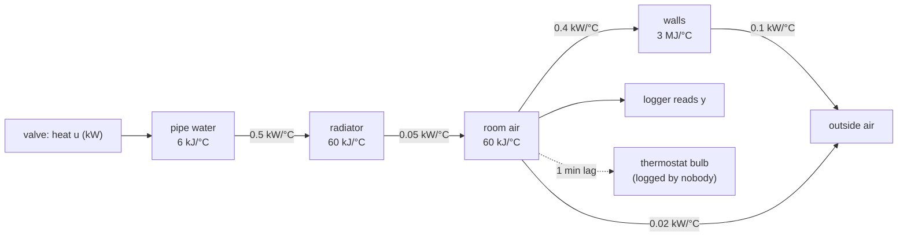
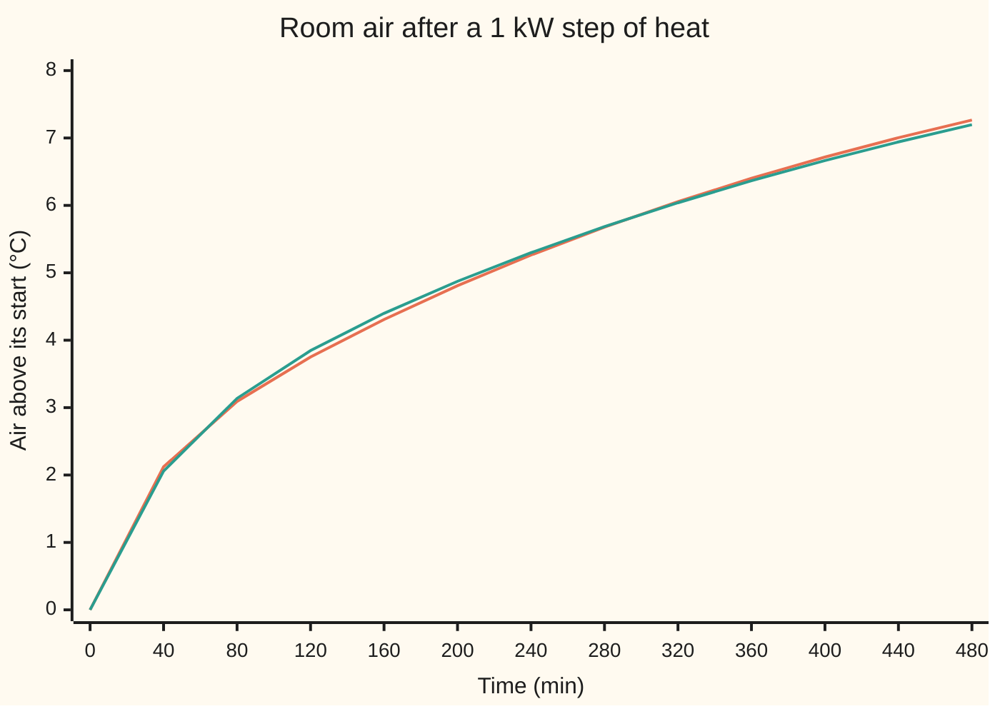

# Model reduction: drop the states that are hard to reach and hard to see

[Syllabus](../../../SYLLABUS.md) → [Engineering mathematics](../README.md) → [Models from Data](../README.md#s11) → Model reduction

---

## General Overview

A room is heated by one radiator. A data logger records the air temperature once a minute while a valve sets how much heat goes into the radiator's water. The engineer has a physics model of the room, built from heat capacities and heat links and checked against a day of such logs. It has four states (internal numbers that step forward in time), each a temperature above the outside air:

- the **pipe** water, which holds 6 kJ per °C;
- the **radiator**, 60 kJ per °C;
- the room **air**, 60 kJ per °C;
- the **walls**, 3 MJ per °C.

Heat goes in at the pipe and comes out through the walls and the windows. Push 1.5 kW in for long enough and the air settles 15 °C above the outside, the same 100 W per degree leak as the room on [Feedback](../03-Feedback%20Control/01-feedback-and-closed-loop-transfer-functions.md).

A cheap thermostat chip must run this model many steps ahead, every minute, inside a predictive controller. Fewer states mean less work. Which states can go, and how much does the room's response change?

Model reduction answers in three moves.

1. **Throw out what can never matter.** A state the valve cannot move, or one the logger cannot feel, adds nothing to the response. The Kalman decomposition (a change of coordinates that sorts states by reachable and seeable) finds such states and removes them exactly.
2. **Measure what is left.** Each remaining direction in the state gets a number $`\sigma`$ (sigma), its **Hankel singular value**: large if the valve reaches it easily *and* the logger sees it clearly. (The name comes from the Hankel matrix of [Subspace identification](03-subspace-identification-and-hankel-matrices.md).)
3. **Drop the small ones.** For the room the four values are 4.347092, 0.735500, 0.083157 and 0.000565 °C per kW. The last two are tiny. Drop them and the 2-state model's air temperature never differs from the 4-state model's by more than 0.1652 °C per kW of valve swing, at any frequency. Theory promised at most twice the dropped values, 2 × (0.083157 + 0.000565) = 0.1674 °C per kW.

**Rewrite the model so that each state is exactly as easy to reach as it is to see; then the Hankel singular values rank the states, and dropping the smallest ones changes the gain at every frequency by no more than twice their sum.**

**What kind of fact this is:** theorems. The Kalman decomposition and the invariance of the Hankel singular values are proved on this card in Why it works. The error bound is stated with the shape of its proof and proved in full in the 1984 papers listed in Sources. The room itself is a model: four lumps of heat joined by fixed links, valid near one operating point.

### The picture: where the heat goes, and what the logger sees



Schematic, not to scale. Each arrow is a heat link, in kW for every °C of difference. The dashed bulb is a fifth state that a first draft of the model included; Step 1 below shows why it can go.

### The step response, before and after the cut



Orange: the full 4-state model. Green: the 2-state model. In the first 8 hours the two curves never differ by more than 0.0988 °C. The air is still climbing at 8 hours because the walls take hours to warm: the slowest motion of the model has a time constant of 436.6 min.

---

## The formula

The model is $`x' = Ax + Bu`$, $`y = Cx`$ ([State space](../04-State%20Space%20and%20Optimal%20Control/01-state-space-models-and-the-matrix-exponential.md)). A prime is a rate of change per minute. A raised $`\top`$ is the transpose (rows turned into columns). The model must be stable: every motion dies away ([Stability of a state-space model](../04-State%20Space%20and%20Optimal%20Control/05-hurwitz-schur-and-lyapunov-stability.md)).

```math
A P + P A^\top + B B^\top = 0, \qquad A^\top Q + Q A + C^\top C = 0, \qquad \sigma_k = \sqrt{\lambda_k(PQ)}
```

```math
\sigma_{r+1} \;\le\; \lVert G - G_r \rVert_\infty \;\le\; 2\,(\sigma_{r+1} + \sigma_{r+2} + \dots + \sigma_n)
```

**Read it aloud:** solve two Lyapunov equations, one for how easily the input reaches each direction and one for how clearly the output sees it; the square roots of the eigenvalues of their product are the Hankel singular values; keep the $`r`$ largest, in balanced coordinates, and the worst-case gain error lies between the first one dropped and twice the sum of all the dropped ones.

The two matrices $`P`$ and $`Q`$ are the **Gramians**. They are the infinite-window versions of the steering and seeing Gramians on [Can you steer every state, and can you see every state](../04-State%20Space%20and%20Optimal%20Control/03-controllability-and-observability.md). Here $`Q`$ is the seeing Gramian, not the LQR state weight of shelf 04.

| Symbol | Plain meaning | In our example | Push it up and the answer… |
| --- | --- | --- | --- |
| $`x`$; $`z`$ | state: pipe, radiator, air, walls, each in °C above outside; $`z`$ the same state in balanced coordinates | $`x`$ has 4 entries | — |
| $`u`$ | input: heat put into the pipe water by the valve, kW | 1 kW step | the air warms by 10 °C per kW, in the end |
| $`y`$ | output: the logged air temperature, °C above outside | 7.266 °C after 480 min of 1 kW | — |
| $`A`$, $`B`$, $`C`$ | how heat flows between the lumps (per minute); where the heat enters (the pipe); what is read (the air) | four capacities and five links, in the picture | — |
| $`n`$, $`r`$ | number of states in the model; number kept | 4; 2 | a larger $`r`$ shrinks the error |
| $`G(s)`$, $`G_r(s)`$ | transfer function of the full and the reduced model, what each does to $`e^{st}`$ | steady gain $`G(0)`$ = 10.0000, $`G_r(0)`$ = 10.1652 °C/kW | — |
| $`\lVert\cdot\rVert_\infty`$ | H-infinity norm: the peak gain over all frequencies ([H-infinity design](../10-Robustness%20and%20Adaptation/03-h-infinity-control-in-outline.md)) | $`\lVert G - G_r\rVert_\infty`$ = 0.1652 °C/kW | — |
| $`\omega`$ | angular frequency, rad/min (divide by 60 for rad/s) | worst error at 0.0789 rad/min | — |
| $`P`$ | reachability Gramian: how much each direction is moved by input energy | diagonal 21.1174, 10.2163, 0.2021, 0.0694 | — |
| $`Q`$ | observability (seeing) Gramian: how much output energy each direction gives back | diagonal 0.0020, 0.2022, 1.1623, 180.7636 | — |
| $`\lambda_k`$; $`\sigma_k`$ | the $`k`$-th eigenvalue, largest first; the $`k`$-th Hankel singular value, in °C/kW | $`\sigma`$ = 4.347092, 0.735500, 0.083157, 0.000565 | larger means the state matters more |
| $`T`$; $`L`$, $`V`$, $`\Sigma`$ | change of coordinates $`z = Tx`$; the factors used to build it, with $`\Sigma`$ the diagonal of the $`\sigma_k`$ (Step 3) | built in the code | — |

### When it holds

- **The model is stable.** The Gramians are integrals over all future time, and they only exist if every motion dies away. Insulate the room perfectly and the integral for the air entry of $`P`$ reaches 0.5082, 0.8766 and 1.6134 after 1000, 2000 and 4000 min. It never settles, so there are no Hankel singular values.
- **The model is linear and its numbers are fixed.** A real radiator passes more heat per degree when it runs hotter, so its link of 0.05 kW/°C holds near one operating point only. Double it and the 2-state error bound grows from 0.1674 to 0.2385 °C/kW. Reduce again at each operating point.
- **The model is minimal before balancing.** A state that is unreachable or unseeable has a zero Hankel singular value, and the balancing step divides by it. Remove it first, as Step 1 does.
- **The bound compares two models, not model and room.** The 0.1674 °C/kW is the price of the cut. Any error the 4-state model already had against the real room comes on top.
- **The bound is on gain over frequency.** It caps the steady error too, since steady is frequency zero. It says nothing direct about the peak of the gap in a step response, which here is 0.0988 °C in the first 8 hours.

---

## Why it works

### Step 0: a state matters only if it is both pushed and felt

Heat put into the pipe shows up in the air only by travelling through states. A state that the valve hardly moves cannot carry much. A state that moves a lot but barely changes the air cannot show much. What a state contributes is roughly the product of the two.

The room shows the trap in measuring only one of them. The pipe is the easiest state to reach: its entry of $`P`$ is 21.1174. It is also the hardest to see: its entry of $`Q`$ is 0.0020. The walls are the reverse: 0.0694 to reach, 180.7636 to see. Neither list alone says which state to drop. And both lists change if the units change: measure the walls in millidegrees and both of their entries move.

Balancing fixes both problems. It picks coordinates in which every direction is exactly as easy to reach as to see. In those coordinates one number per direction, $`\sigma_k`$, says how much that direction matters, and it does not depend on units.

### Step 1: the Kalman decomposition removes what can never matter

The **reachable** directions are those the input can move: the span of $`B, AB, A^2B, \dots`$. The **unseeable** directions are those the output never feels: the vectors $`v`$ with $`Cv = CAv = CA^2v = \dots = 0`$. Both sets are flat subspaces, and $`A`$ maps each into itself.

Choose coordinates that list the reachable-and-seeable directions first, then the rest. Then $`A`$, $`B`$ and $`C`$ take a block form with zeros in fixed places, and the transfer function involves only the first block. This is the **Kalman decomposition**. The first block is a **minimal realisation**: the smallest state-space model with the same transfer function.

The proof is short. Expand the transfer function in powers of $`1/s`$:

```math
G(s) = C(sI - A)^{-1}B = \frac{CB}{s} + \frac{CAB}{s^2} + \frac{CA^2B}{s^3} + \dots
```

In the sorted coordinates the input feeds only reachable states, and unreachable states never become reachable ones. Unseeable states never feed the seen ones, and $`C`$ reads nothing from them. So each coefficient $`CA^kB`$ equals the same product built from the reachable-and-seeable block alone, and so does $`G`$.

The first draft of the room model had a fifth state: the thermostat's sensing bulb, which follows the air with a 1-minute lag. The logger reads the air through its own probe, so the bulb feels the air but nothing feels the bulb. The checks find:

- the reachability matrix $`[B, AB, \dots, A^4B]`$ has rank 5: the valve does move the bulb;
- the observability matrix (rows $`C, CA, \dots, CA^4`$) has rank 4, and its bulb column is 0.0000 0.0000 0.0000 0.0000 0.0000;
- the fifth Hankel singular value is 0.000000;
- the gains of the 4-state and 5-state models agree: 3.067150, 0.857198 and 0.040222 °C/kW at 0.01, 0.1 and 1.0 rad/min.

The bulb goes, with no error at all. The four room states that remain are minimal: their Hankel singular values are all above zero.

### Step 2: the Gramians are energies, and solve linear equations

The reachability Gramian adds up where unit pushes of input carry the state over all later time:

```math
P = \int_0^\infty e^{At} B B^\top e^{A^\top t}\, dt
```

Differentiate the integrand: its rate of change is $`A(\cdot) + (\cdot)A^\top`$. Integrate from 0 to infinity. The integrand starts at $`BB^\top`$ and ends at 0, because every motion dies away. So $`AP + PA^\top = -BB^\top`$, the first Lyapunov equation. The same argument with $`A^\top`$ and $`C^\top`$ gives $`Q`$.

The two Gramians price states in energy:

- The least input energy (the integral of $`u^2`$) that drives the room from rest to a state $`x`$ is $`x^\top P^{-1} x`$. A small $`P`$ in some direction means a large price.
- A state $`x`$ left alone gives back output energy (the integral of $`y^2`$) of $`x^\top Q x`$.

The finite-window version of the first fact is proved on [Can you steer every state, and can you see every state](../04-State%20Space%20and%20Optimal%20Control/03-controllability-and-observability.md). Letting the window run back to minus infinity gives this one.

### Step 3: change coordinates until both Gramians are the same diagonal

Write the state as $`z = Tx`$ for an invertible matrix $`T`$. The model becomes $`(TAT^{-1}, TB, CT^{-1})`$, and the Gramians change as

```math
P \to T P T^\top, \qquad Q \to T^{-\top} Q\, T^{-1}, \qquad PQ \to T\,(PQ)\,T^{-1}
```

The last product is a similarity transform, so the eigenvalues of $`PQ`$ do not change. Their square roots, the Hankel singular values, belong to the input-output behaviour, not to the coordinates or the units.

Balancing picks the $`T`$ that makes both Gramians equal to the same diagonal matrix of $`\sigma_1, \dots, \sigma_n`$. Then direction $`k`$ costs $`1/\sigma_k`$ of input energy per unit squared to reach, and gives back $`\sigma_k`$ of output energy per unit squared. A small $`\sigma_k`$ is hard to reach and hard to see at the same time: the card's title, made exact.

<details>
<summary>How the balancing matrix is built</summary>

Factor $`P = LL^\top`$ with $`L`$ lower triangular (the Cholesky factor). The matrix $`L^\top Q L`$ is symmetric, so it has orthonormal eigenvectors, collected as the columns of $`V`$, and eigenvalues $`\sigma_k^2`$. Let $`\Sigma`$ be the diagonal of $`\sigma_k`$. Take

$`\displaystyle T = \Sigma^{1/2}\, V^\top L^{-1}, \qquad T^{-1} = L\, V\, \Sigma^{-1/2}.`$

Then $`TPT^\top = \Sigma^{1/2} V^\top L^{-1} L L^\top L^{-\top} V \Sigma^{1/2} = \Sigma`$, and $`T^{-\top} Q T^{-1} = \Sigma^{-1/2} V^\top (L^\top Q L) V \Sigma^{-1/2} = \Sigma^{-1/2}\Sigma^2\Sigma^{-1/2} = \Sigma`$. The checks solve the Lyapunov equations again for the balanced model and find both Gramians diagonal, with off-diagonal entries 0.000000.

</details>

### Step 4: cut, and the price of the cut

In balanced coordinates, keep the first $`r`$ entries of $`z`$: the top-left $`r \times r`$ block of $`TAT^{-1}`$, the first $`r`$ entries of $`TB`$ and of $`CT^{-1}`$. That is **balanced truncation**. The reduced model is again stable and balanced, with Hankel singular values $`\sigma_1, \dots, \sigma_r`$.

The error has two limits, stated here and proved in the papers in Sources.

- **No 2-state model can do better than $`\sigma_3`$.** The Hankel operator maps past input to future output, and its singular values are the $`\sigma_k`$. It is the continuous-time cousin of the Hankel matrix on [Subspace identification](03-subspace-identification-and-hankel-matrices.md): past input in, future output out, with time running continuously instead of in steps of a minute. An $`r`$-state model has a Hankel operator of rank $`r`$, and the nearest rank-$`r`$ operator is still $`\sigma_{r+1}`$ away. The peak gain of the error is never smaller than the size of its Hankel operator, so it too is at least $`\sigma_{r+1}`$. The rank argument is the one in [The singular value decomposition](../../03-Algebra/07-Eigenvalues%20and%20Symmetric%20Matrices/06-singular-value-decomposition.md).
- **Balanced truncation costs at most twice the dropped sum.** Drop the states one value at a time. Each drop changes the gain by at most $`2\sigma`$ at any frequency. The errors add, by the triangle inequality, to $`2(\sigma_{r+1} + \dots + \sigma_n)`$.

<details>
<summary>The shape of the proof that one drop costs at most 2σ</summary>

Split the balanced model into the kept part and the last state, which has Hankel singular value $`\sigma`$. Write the balanced $`A`$ in blocks: $`A_{11}`$ for the kept states, $`a_{nn}`$ for the dropped state's own entry, and $`A_{12}`$, $`A_{21}`$ for the links between them. The dropped state's own motion, with the kept states folded in, is described by

$`\displaystyle \varphi(s) = s - a_{nn} - A_{21}\,(sI - A_{11})^{-1}A_{12}.`$

Write the error $`G - G_r`$ as one transfer function. Using the two Lyapunov equations, which in balanced coordinates share the diagonal $`\Sigma`$, one shows that at every angular frequency $`\omega`$ the sizes obey

$`\displaystyle \lvert G(j\omega) - G_r(j\omega)\rvert = \sigma\,\lvert 1 + \Theta(j\omega)\rvert, \qquad \Theta(j\omega) = \frac{\overline{\varphi(j\omega)}}{\varphi(j\omega)},`$

where $`j`$ is the square root of −1, as on the signals shelf, and the bar is the complex conjugate. $`\Theta`$ is all-pass: a complex number's mirror image, divided by the number itself, has size exactly 1 at every frequency. So the error's gain is at most $`\sigma(1 + 1) = 2\sigma`$. The identity is about sizes only; the error itself is not $`\sigma(1 + \Theta)`$. For a repeated value of $`\sigma`$ the argument drops the whole group at once, still at cost $`2\sigma`$. The full algebra is in Enns (1984) and Glover (1984).

</details>

For the room both limits hold with room to spare: $`\sigma_3`$ = 0.0832 ≤ 0.1652 ≤ 0.1674 °C/kW.

---

## Worked numbers, by hand

The room: capacities 0.1, 1, 1 and 50 kW·min/°C (6 kJ, 60 kJ, 60 kJ and 3 MJ per °C); links 0.5, 0.05, 0.4, 0.1 and 0.02 kW/°C. The Gramians and their eigenvalues come from the code; the rest is by hand.

| Step | Arithmetic | Value |
| --- | --- | --- |
| 1. Total leak to outside | walls and outside in series, plus windows: 0.4 × 0.1 / (0.4 + 0.1) + 0.02 | 0.1000 kW/°C |
| 2. Steady gain of the room | 1 / 0.1000 | 10.0000 °C/kW |
| 3. Hankel singular values | square roots of the eigenvalues of $`PQ`$ (code) | 4.347092, 0.735500, 0.083157, 0.000565 |
| 4. How small is the third? | 0.083157 / 4.347092 | 0.0191 |
| 5. Upper limit for 2 states | 2 × (0.083157 + 0.000565) | 0.1674 °C/kW |
| 6. Lower limit for 2 states | $`\sigma_3`$ | 0.0832 °C/kW |
| 7. Steady gain of the 2-state model | from its $`A_r, B_r, C_r`$ (code) | 10.1652 °C/kW |
| 8. Its steady error | 10.1652 − 10.0000 | 0.1652 °C/kW |
| 9. Worst error at any frequency | frequency sweep (code): 0.1652 at 0.0789 rad/min, a 79.6 min cycle | **0.1652 °C/kW, inside 0.0832 to 0.1674** |
| 10. For a full 1.5 kW valve swing | 1.5 × 0.1652; limit 1.5 × 0.1674 | 0.2478 °C; limit 0.2512 °C |

For a valve that swings steadily by 1.5 kW at any one frequency, the 2-state model's air never differs from the 4-state model's by more than a quarter of a degree. That covers steady swings only: the bound is on gain, and a valve switched at the worst moments can open a wider gap in time (When it holds, last bullet). The error is almost flat at low frequencies, which is why the worst frequency and frequency zero give the same 0.1652.

The 2-state model itself, in balanced coordinates, per minute:

```math
A_r = \begin{bmatrix} -0.0045 & -0.0073 \\ -0.0073 & -0.0238 \end{bmatrix}, \qquad B_r = \begin{bmatrix} 0.1976 \\ 0.1870 \end{bmatrix}, \qquad C_r = \begin{bmatrix} 0.1976 & 0.1870 \end{bmatrix}
```

$`C_r`$ is $`B_r`$ turned on its side. That is no accident. In balanced coordinates both Gramians equal the same diagonal, so the $`k`$-th diagonal entries of the two Lyapunov equations read $`2a_{kk}\sigma_k + b_k^2 = 0`$ and $`2a_{kk}\sigma_k + c_k^2 = 0`$. Here $`a_{kk}`$, $`b_k`$ and $`c_k`$ are the $`k`$-th entries of the balanced $`A`$, $`B`$ and $`C`$. So $`c_k = \pm b_k`$ for every state.

The sign can differ. For the full balanced room, $`B`$ is (0.1976, 0.1870, 0.2833, 0.0790) and $`C`$ is (0.1976, 0.1870, −0.2833, 0.0790): the third state, one of the two dropped, has the opposite sign.

### What breaks if you drop a piece

| Mistake | Comes out at | What went wrong |
| --- | --- | --- |
| Keep the air and walls as they stand, drop pipe and radiator | worst error 10.0000 °C/kW | The heat enters at the pipe. Without it the reduced model never warms at all. |
| Keep the 2 directions easiest to reach (use $`P`$ alone) | worst error 7.2659 °C/kW; steady gain 2.7341 instead of 10 | The pipe is easy to reach and nearly invisible. Reachability alone keeps the wrong states. |
| Truncate to 1 state | worst error 1.3058 °C/kW, limit 1.6384 | The dropped $`\sigma_2`$ = 0.7355 is not small. The bound still holds, but the model is poor. |
| Perfectly insulated room | air entry of $`P`$: 0.5082, 0.8766, 1.6134 after 1000, 2000, 4000 min | Heat can never leave, so the model is not stable. The Gramian never settles and the method has nothing to work with. |

---

## Code, from first principles, and it actually runs

The scripts build the room model, then reach each result by at least two independent roads. The Gramians come from the Lyapunov equations solved as 16 linear equations, and again from the integral of $`e^{At}BB^\top e^{A^\top t}`$ by Simpson's rule with the matrix exponential written out as a series. The worst gain error comes from a frequency sweep and is checked against the lower and upper limits from the Hankel singular values. The steady gains come from solving $`Ax = -B`$, and again from a step response simulated by RK4 (fourth-order Runge–Kutta) for 8000 minutes. The bulb's removal is shown three ways: a rank test, a zero Hankel singular value, and equal gains.

### Python

```python
# Model reduction -- the check behind the card. Standard library only.
# Room heated by a radiator: states are temperatures above the outside air (degC),
# x = (pipe water, radiator, room air, walls); input u = heat into the pipe (kW);
# output y = room air (degC). Time in minutes. Capacities in kW*min/degC, links in kW/degC.
import math
def mm(X, Y): return [[sum(X[i][k] * Y[k][j] for k in range(len(Y))) for j in range(len(Y[0]))] for i in range(len(X))]
def tr(X): return [list(r) for r in zip(*X)]
def solve(M, b):                                  # Gaussian elimination, partial pivoting
    n = len(M); a = [M[i][:] + [b[i]] for i in range(n)]
    for c in range(n):
        p = max(range(c, n), key=lambda r: abs(a[r][c])); a[c], a[p] = a[p], a[c]
        for r in range(c + 1, n):
            f = a[r][c] / a[c][c]
            for k in range(c, n + 1): a[r][k] -= f * a[c][k]
    x = [0.0] * n
    for i in reversed(range(n)): x[i] = (a[i][n] - sum(a[i][k] * x[k] for k in range(i + 1, n))) / a[i][i]
    return x
def rank(M, tol=1e-9):                            # rows reduced one by one, relative tolerance
    a = [r[:] for r in M]; big = max(abs(v) for r in a for v in r); rk = 0
    for c in range(len(a[0])):
        p = max(range(rk, len(a)), key=lambda r: abs(a[r][c]), default=None)
        if p is None or abs(a[p][c]) < tol * big: continue
        a[rk], a[p] = a[p], a[rk]
        for r in range(rk + 1, len(a)):
            f = a[r][c] / a[rk][c]; a[r] = [a[r][k] - f * a[rk][k] for k in range(len(a[0]))]
        rk += 1
    return rk
def lyap(A, W):                                   # road 1: solve A X + X A^T + W = 0 as n*n equations
    n = len(A); M = [[0.0] * (n * n) for _ in range(n * n)]
    for i in range(n):
        for j in range(n):
            for k in range(n): M[i*n+j][k*n+j] += A[i][k]; M[i*n+j][i*n+k] += A[j][k]
    v = solve(M, [-W[i][j] for i in range(n) for j in range(n)]); return [v[i*n:(i+1)*n] for i in range(n)]
def gram_by_time(A, b, T, h=0.1):                 # road 2: X = integral of e^{At} b b^T e^{A^T t}, Simpson
    n = len(A); E = [[float(i == j) for j in range(n)] for i in range(n)]; term = [r[:] for r in E]
    for k in range(1, 30): term = [[v * h / k for v in r] for r in mm(term, A)]; E = [[E[i][j] + term[i][j] for j in range(n)] for i in range(n)]
    v = b[:]; X = [[0.0] * n for _ in range(n)]; N = int(round(T / h))
    for s in range(N + 1):
        w = (1 if s in (0, N) else 4 if s % 2 else 2) * h / 3
        X = [[X[i][j] + w * v[i] * v[j] for j in range(n)] for i in range(n)]; v = [sum(E[i][k] * v[k] for k in range(n)) for i in range(n)]
    return X
def chol(P):
    n = len(P); L = [[0.0] * n for _ in range(n)]
    for i in range(n):
        for j in range(i + 1):
            s = P[i][j] - sum(L[i][k] * L[j][k] for k in range(j)); L[i][j] = math.sqrt(s) if i == j else s / L[j][j]
    return L
def jacobi(S):                                    # eigenvalues and eigenvectors of a symmetric matrix
    n = len(S); S = [r[:] for r in S]; V = [[float(i == j) for j in range(n)] for i in range(n)]
    for _ in range(60):
        for p in range(n):
            for q in range(p + 1, n):
                th = 0.5 * math.atan2(2 * S[p][q], S[q][q] - S[p][p]); c, s = math.cos(th), math.sin(th)
                for M in (S, V):
                    for k in range(n): M[k][p], M[k][q] = c * M[k][p] - s * M[k][q], s * M[k][p] + c * M[k][q]
                for k in range(n): S[p][k], S[q][k] = c * S[p][k] - s * S[q][k], s * S[p][k] + c * S[q][k]
    o = sorted(range(n), key=lambda i: -S[i][i]); return [S[i][i] for i in o], [[V[k][i] for i in o] for k in range(n)]
def gain(A, b, c, w):                             # |G(jw)| from the real 2n system for (jwI - A) x = b
    n = len(A); M = [[-A[i][j] for j in range(n)] + [-w * (i == j) for j in range(n)] for i in range(n)]
    M += [[w * (i == j) for j in range(n)] + [-A[i][j] for j in range(n)] for i in range(n)]
    x = solve(M, b + [0.0] * n); return sum(c[i] * x[i] for i in range(n)), sum(c[i] * x[n + i] for i in range(n))
def room(Cp=0.1, Cr=1.0, Ca=1.0, Cw=50.0, Gpr=0.5, Gra=0.05, Gaw=0.4, Gwo=0.1, Gao=0.02):
    A = [[-Gpr/Cp, Gpr/Cp, 0, 0], [Gpr/Cr, -(Gpr+Gra)/Cr, Gra/Cr, 0], [0, Gra/Ca, -(Gra+Gaw+Gao)/Ca, Gaw/Ca], [0, 0, Gaw/Cw, -(Gaw+Gwo)/Cw]]
    return A, [1/Cp, 0, 0, 0], [0, 0, 1, 0]
def hsv(P, Q): L = chol(P); return [math.sqrt(max(e, 0)) for e in jacobi(mm(mm(tr(L), Q), L))[0]]
def gramians(A, b, c): return lyap(A, [[x * y for y in b] for x in b]), lyap(tr(A), [[x * y for y in c] for x in c])
def balance(A, b, c, P, Q):                       # z = T x with T P T^T = T^-T Q T^-1 = diag(sigma)
    L = chol(P); ev, V = jacobi(mm(mm(tr(L), Q), L)); s = [e ** 0.25 for e in ev]; n = len(A)
    Linv = [solve(L, [float(i == j) for i in range(n)]) for j in range(n)]; Linv = tr(Linv)
    T = [[s[i] * v for v in r] for i, r in enumerate(mm(tr(V), Linv))]; Ti = [[r[j] / s[j] for j in range(n)] for r in mm(L, V)]
    return mm(mm(T, A), Ti), [sum(T[i][k] * b[k] for k in range(n)) for i in range(n)], [sum(c[k] * Ti[k][j] for k in range(n)) for j in range(n)], T, Ti
def cut(A, b, c, r): return [row[:r] for row in A[:r]], b[:r], c[:r]
def worst(A1, b1, c1, A2, b2, c2):                # H-infinity norm of the difference: log sweep, then refine
    d = lambda w: math.hypot(*[g1 - g2 for g1, g2 in zip(gain(A1, b1, c1, w), gain(A2, b2, c2, w))])
    ws = [10 ** (-4 + 6 * k / 600) for k in range(601)]; k = max(range(601), key=lambda i: d(ws[i])); lo, hi = ws[max(k-1, 0)], ws[min(k+1, 600)]
    for _ in range(60):
        m1, m2 = lo + (hi - lo) * 0.382, lo + (hi - lo) * 0.618
        if d(m1) > d(m2): hi = m2
        else: lo = m1
    return max(d(0.0), d(lo)), (0.0 if d(0.0) >= d(lo) else lo)
def step(A, b, c, ts, dt=0.05):                   # RK4 on x' = A x + b u, u = 1 kW from t = 0
    n = len(A); x = [0.0] * n; f = lambda x: [sum(A[i][k] * x[k] for k in range(n)) + b[i] for i in range(n)]; out = []; t = 0.0
    for tt in ts:
        while t < tt - 1e-9:
            k1 = f(x); k2 = f([x[i] + dt/2 * k1[i] for i in range(n)]); k3 = f([x[i] + dt/2 * k2[i] for i in range(n)]); k4 = f([x[i] + dt * k3[i] for i in range(n)])
            x = [x[i] + dt/6 * (k1[i] + 2*k2[i] + 2*k3[i] + k4[i]) for i in range(n)]; t += dt
        out.append(sum(c[i] * x[i] for i in range(n)))
    return out
def dc(A, b, c): x = solve(A, b); return -sum(c[i] * x[i] for i in range(len(c)))
f4 = lambda v: " ".join(f"{x:.4f}" for x in v)
f6 = lambda v: " ".join(f"{x:.6f}" for x in v)
A, b, c = room(); n = 4
# ---- 1. Kalman decomposition: the 5-state draft adds the thermostat bulb (1 min lag), driven by the air, logged by nobody ----
A5 = [r + [0.0] for r in A] + [[0, 0, 1.0, 0, -1.0]]; b5 = b + [0.0]; c5 = c + [0.0]
cols, rows = [b5], [c5]                           # columns b, Ab, ..., A^4 b and rows c, cA, ..., cA^4
for _ in range(4): cols.append([sum(A5[i][k] * cols[-1][k] for k in range(5)) for i in range(5)]); rows.append([sum(rows[-1][k] * A5[k][j] for k in range(5)) for j in range(5)])
print(f"5-state draft: reachable rank {rank(tr(cols))}, seeable rank {rank(rows)}; bulb column of the seeable matrix: {f4([r[4] for r in rows])}")
P5, Q5 = gramians(A5, b5, c5); h5 = hsv(P5, Q5)
print(f"5-state Hankel singular values (degC/kW): {f6(h5)}")
assert rank(tr(cols)) == 5 and rank(rows) == 4 and h5[4] < 1e-6 * h5[0]
for w in (0.01, 0.1, 1.0):
    g4, g5 = gain(A, b, c, w), gain(A5, b5, c5, w); print(f"  w = {w} rad/min: |G| 4-state {math.hypot(*g4):.6f}, 5-state {math.hypot(*g5):.6f} degC/kW"); assert abs(g4[0]-g5[0]) + abs(g4[1]-g5[1]) < 1e-12
# ---- 2. the minimal 4-state room: time constants, Gramians two ways ----
D = [0.1, 1.0, 1.0, 50.0]; ev = jacobi([[A[i][j] * math.sqrt(D[i] / D[j]) for j in range(n)] for i in range(n)])[0]
print(f"time constants (min): {f4([-1 / e for e in ev])}")
P, Q = gramians(A, b, c); Pt, Qt = gram_by_time(A, b, 4000.0, 0.05), gram_by_time(tr(A), c, 4000.0, 0.05)
sig = hsv(P, Q); sig_t = hsv(Pt, Qt)
print(f"Hankel singular values (degC/kW), Lyapunov:      {f6(sig)}"); print(f"Hankel singular values (degC/kW), time integral: {f6(sig_t)}")
assert max(abs(x - y) for x, y in zip(sig, sig_t)) < 1e-6
print(f"reachability P diagonal: {f4([P[i][i] for i in range(n)])}"); print(f"seeability Q diagonal: {f4([Q[i][i] for i in range(n)])}")
# ---- 3. balance: both Gramians become diag(sigma) ----
Ab, bb, cb, T, Ti = balance(A, b, c, P, Q); Pb, Qb = gramians(Ab, bb, cb)
print(f"balanced P diagonal: {f6([Pb[i][i] for i in range(n)])}; largest off-diagonal {max(abs(Pb[i][j]) + abs(Qb[i][j]) for i in range(n) for j in range(n) if i != j):.6f}")
print(f"balanced b: {f4(bb)}; balanced c: {f4(cb)}")
assert max(abs(Pb[i][j] - Qb[i][j]) + abs(Pb[i][i] - sig[i]) for i in range(n) for j in range(n)) < 1e-8 and max(abs(bb[i] ** 2 - cb[i] ** 2) for i in range(n)) < 1e-8
# ---- 4. truncate to 2 states and check the bound ----
Ar, br, cr = cut(Ab, bb, cb, 2); err, werr = worst(A, b, c, Ar, br, cr); bound = 2 * (sig[2] + sig[3])
print(f"2-state model: A = [[{Ar[0][0]:.4f}, {Ar[0][1]:.4f}], [{Ar[1][0]:.4f}, {Ar[1][1]:.4f}]], b = ({f4(br)}), c = ({f4(cr)})")
leak = 0.4 * 0.1 / (0.4 + 0.1) + 0.02           # walls in series with the outside, plus the windows (kW/degC)
print(f"steady gain: full {dc(A, b, c):.4f}, 2-state {dc(Ar, br, cr):.4f} degC/kW; leak {leak:.4f} kW/degC, so 1/leak = {1 / leak:.4f}; 1.5 kW holds the air {1.5 * dc(A, b, c):.4f} degC above outside")
print(f"worst gain error {err:.4f} degC/kW at {werr:.4f} rad/min (a {2 * math.pi / werr:.1f} min cycle); lower limit sigma3 {sig[2]:.4f}; bound 2(sigma3 + sigma4) {bound:.4f}")
print(f"sigma3/sigma1 = {sig[2] / sig[0]:.4f}; for a 1.5 kW valve swing: error {1.5 * err:.4f} degC, bound {1.5 * bound:.4f} degC")
assert sig[2] - 1e-9 <= err <= bound and abs(1 / leak - dc(A, b, c)) < 1e-9
ts = list(range(0, 481, 40)); yf, yr = step(A, b, c, ts), step(Ar, br, cr, ts)
print("chart, minutes      " + " ".join(f"{t:7d}" for t in ts)); print("chart, full 4-state " + " ".join(f"{v:7.3f}" for v in yf)); print("chart, 2-state      " + " ".join(f"{v:7.3f}" for v in yr))
fine = list(range(0, 481)); d = max(abs(u - v) for u, v in zip(step(A, b, c, fine), step(Ar, br, cr, fine))); yF, yR = step(A, b, c, [8000])[0], step(Ar, br, cr, [8000])[0]
print(f"largest step gap in the first 8 h: {d:.4f} degC; after 8000 min: full {yF:.4f}, 2-state {yR:.4f}, gap {yR - yF:.4f} degC")
assert abs(yF - dc(A, b, c)) < 1e-3 and abs((yR - yF) - (dc(Ar, br, cr) - dc(A, b, c))) < 1e-3 and d < err
# ---- 5. what breaks ----
An, bn, cn = [[A[i][j] for j in (2, 3)] for i in (2, 3)], [0.0, 0.0], [1.0, 0.0]; en, _ = worst(A, b, c, An, bn, cn); print(f"keep air and walls as they stand: worst gain error {en:.4f} degC/kW (the heat input lands on the dropped pipe)"); assert abs(en - dc(A, b, c)) < 1e-6
evP, VP = jacobi(P); W = [[VP[i][k] for k in range(2)] for i in range(n)]
Ap = mm(mm(tr(W), A), W); bp = [sum(W[i][k] * b[i] for i in range(n)) for k in range(2)]; cp = [sum(c[i] * W[i][k] for i in range(n)) for k in range(2)]
ep, _ = worst(A, b, c, Ap, bp, cp); print(f"keep the 2 most reachable directions only: worst gain error {ep:.4f} degC/kW, steady gain {dc(Ap, bp, cp):.4f}"); assert ep > bound
A1, b1, c1 = cut(Ab, bb, cb, 1); e1, _ = worst(A, b, c, A1, b1, c1); print(f"truncate to 1 state: worst error {e1:.4f}, bound {2 * sum(sig[1:]):.4f} degC/kW")
A3, b3, c3 = cut(Ab, bb, cb, 3); e3, _ = worst(A, b, c, A3, b3, c3); print(f"truncate to 3 states: worst error {e3:.6f}, bound {2 * sig[3]:.6f} degC/kW"); assert e3 <= 2 * sig[3] + 1e-9 and e1 <= 2 * sum(sig[1:])
Ai, bi, ci = room(Gwo=0.0, Gao=0.0); g = [gram_by_time(Ai, bi, H)[2][2] for H in (1000.0, 2000.0, 4000.0)]
print(f"perfectly insulated room: P air entry over 1000, 2000, 4000 min = {f4(g)} (no limit: no Gramian)"); assert g[2] - g[1] > 1.9 * (g[1] - g[0]) > 0.6
for name, kw in (("walls 10 times lighter, Cw = 5", dict(Cw=5.0)), ("pipe link 10 times weaker, Gpr = 0.05", dict(Gpr=0.05)), ("radiator link doubled, Gra = 0.1", dict(Gra=0.1))):
    Av, bv, cv = room(**kw); sv = hsv(*gramians(Av, bv, cv)); print(f"try {name}: sigma {f4(sv)}, 2-state bound {2 * (sv[2] + sv[3]):.4f} degC/kW")
print("ALL CHECKS PASS")
```

**Ran 2026-11-23 on macOS, Python 3.14.10, standard library only. All checks passed. Output, pasted from the run:**

```
5-state draft: reachable rank 5, seeable rank 4; bulb column of the seeable matrix: 0.0000 0.0000 0.0000 0.0000 0.0000
5-state Hankel singular values (degC/kW): 4.347092 0.735500 0.083157 0.000565 0.000000
  w = 0.01 rad/min: |G| 4-state 3.067150, 5-state 3.067150 degC/kW
  w = 0.1 rad/min: |G| 4-state 0.857198, 5-state 0.857198 degC/kW
  w = 1.0 rad/min: |G| 4-state 0.040222, 5-state 0.040222 degC/kW
time constants (min): 436.6409 24.3024 2.0750 0.1817
Hankel singular values (degC/kW), Lyapunov:      4.347092 0.735500 0.083157 0.000565
Hankel singular values (degC/kW), time integral: 4.347092 0.735500 0.083157 0.000566
reachability P diagonal: 21.1174 10.2163 0.2021 0.0694
seeability Q diagonal: 0.0020 0.2022 1.1623 180.7636
balanced P diagonal: 4.347092 0.735500 0.083157 0.000565; largest off-diagonal 0.000000
balanced b: 0.1976 0.1870 0.2833 0.0790; balanced c: 0.1976 0.1870 -0.2833 0.0790
2-state model: A = [[-0.0045, -0.0073], [-0.0073, -0.0238]], b = (0.1976 0.1870), c = (0.1976 0.1870)
steady gain: full 10.0000, 2-state 10.1652 degC/kW; leak 0.1000 kW/degC, so 1/leak = 10.0000; 1.5 kW holds the air 15.0000 degC above outside
worst gain error 0.1652 degC/kW at 0.0789 rad/min (a 79.6 min cycle); lower limit sigma3 0.0832; bound 2(sigma3 + sigma4) 0.1674
sigma3/sigma1 = 0.0191; for a 1.5 kW valve swing: error 0.2478 degC, bound 0.2512 degC
chart, minutes            0      40      80     120     160     200     240     280     320     360     400     440     480
chart, full 4-state   0.000   2.122   3.092   3.751   4.308   4.809   5.263   5.678   6.056   6.402   6.717   7.004   7.266
chart, 2-state        0.000   2.057   3.137   3.846   4.399   4.874   5.298   5.685   6.039   6.366   6.666   6.942   7.197
largest step gap in the first 8 h: 0.0988 degC; after 8000 min: full 10.0000, 2-state 10.1652, gap 0.1652 degC
keep air and walls as they stand: worst gain error 10.0000 degC/kW (the heat input lands on the dropped pipe)
keep the 2 most reachable directions only: worst gain error 7.2659 degC/kW, steady gain 2.7341
truncate to 1 state: worst error 1.3058, bound 1.6384 degC/kW
truncate to 3 states: worst error 0.001130, bound 0.001130 degC/kW
perfectly insulated room: P air entry over 1000, 2000, 4000 min = 0.5082 0.8766 1.6134 (no limit: no Gramian)
try walls 10 times lighter, Cw = 5: sigma 5.4332 0.3900 0.0437 0.0005, 2-state bound 0.0886 degC/kW
try pipe link 10 times weaker, Gpr = 0.05: sigma 4.3802 0.7511 0.1405 0.0092, 2-state bound 0.2993 degC/kW
try radiator link doubled, Gra = 0.1: sigma 4.1795 0.9376 0.1182 0.0011, 2-state bound 0.2385 degC/kW
ALL CHECKS PASS
```

The two roads agree on every Hankel singular value to within one unit in the sixth decimal. The sweep's worst error lies between the two limits. The bulb's fifth value is zero and its column of the observability matrix is all zeros.

### Rust

The same checks, with the same inputs and labels. No crates.

```rust
// Model reduction -- the same check as minimal_realisations_and_balanced_truncation_check.py, in Rust.
// Standard library only, no crates. Room heated by a radiator: states are temperatures above the
// outside air (degC), x = (pipe water, radiator, room air, walls); input u = heat into the pipe (kW);
// output y = room air (degC). Time in minutes. Capacities in kW*min/degC, links in kW/degC.
type M = Vec<Vec<f64>>;
fn mm(x: &M, y: &M) -> M { (0..x.len()).map(|i| (0..y[0].len()).map(|j| (0..y.len()).map(|k| x[i][k] * y[k][j]).sum()).collect()).collect() }
fn tr(x: &M) -> M { (0..x[0].len()).map(|j| (0..x.len()).map(|i| x[i][j]).collect()).collect() }
fn eye(n: usize) -> M { (0..n).map(|i| (0..n).map(|j| if i == j { 1.0 } else { 0.0 }).collect()).collect() }
fn mv(a: &M, v: &[f64]) -> Vec<f64> { a.iter().map(|r| r.iter().zip(v).map(|(p, q)| p * q).sum()).collect() }
fn dot(a: &[f64], b: &[f64]) -> f64 { a.iter().zip(b).map(|(p, q)| p * q).sum() }
fn solve(m: &M, b: &[f64]) -> Vec<f64> { // Gaussian elimination, partial pivoting
    let n = m.len(); let mut a: M = (0..n).map(|i| { let mut r = m[i].clone(); r.push(b[i]); r }).collect();
    for c in 0..n {
        let mut p = c; for r in c..n { if a[r][c].abs() > a[p][c].abs() { p = r; } } a.swap(c, p);
        for r in c + 1..n { let f = a[r][c] / a[c][c]; for k in c..=n { a[r][k] -= f * a[c][k]; } }
    }
    let mut x = vec![0.0; n];
    for i in (0..n).rev() { let s: f64 = (i + 1..n).map(|k| a[i][k] * x[k]).sum(); x[i] = (a[i][n] - s) / a[i][i]; }
    x
}
fn rank(m: &M) -> usize { // rows reduced one by one, relative tolerance
    let mut a = m.clone(); let big = a.iter().flatten().fold(0.0f64, |s, v| s.max(v.abs())); let mut rk = 0;
    for c in 0..a[0].len() {
        if rk >= a.len() { break; }
        let mut p = rk; for r in rk..a.len() { if a[r][c].abs() > a[p][c].abs() { p = r; } }
        if a[p][c].abs() < 1e-9 * big { continue; }
        a.swap(rk, p);
        for r in rk + 1..a.len() { let f = a[r][c] / a[rk][c]; for k in 0..a[0].len() { a[r][k] -= f * a[rk][k]; } }
        rk += 1;
    }
    rk
}
fn lyap(a: &M, w: &M) -> M { // road 1: solve A X + X A^T + W = 0 as n*n equations
    let n = a.len(); let mut m = vec![vec![0.0; n * n]; n * n];
    for i in 0..n { for j in 0..n { for k in 0..n { m[i*n+j][k*n+j] += a[i][k]; m[i*n+j][i*n+k] += a[j][k]; } } }
    let rhs: Vec<f64> = (0..n * n).map(|q| -w[q / n][q % n]).collect(); let v = solve(&m, &rhs);
    (0..n).map(|i| v[i*n..(i+1)*n].to_vec()).collect()
}
fn gram_by_time(a: &M, b: &[f64], t: f64, h: f64) -> M { // road 2: integral of e^{At} b b^T e^{A^T t}, Simpson
    let n = a.len(); let mut e = eye(n); let mut term = eye(n);
    for k in 1..30 { term = mm(&term, a).iter().map(|r| r.iter().map(|v| v * h / k as f64).collect()).collect(); for i in 0..n { for j in 0..n { e[i][j] += term[i][j]; } } }
    let mut v = b.to_vec(); let mut x = vec![vec![0.0; n]; n]; let nn = (t / h).round() as usize;
    for s in 0..=nn {
        let w = (if s == 0 || s == nn { 1.0 } else if s % 2 == 1 { 4.0 } else { 2.0 }) * h / 3.0;
        for i in 0..n { for j in 0..n { x[i][j] += w * v[i] * v[j]; } } v = mv(&e, &v);
    }
    x
}
fn chol(p: &M) -> M {
    let n = p.len(); let mut l = vec![vec![0.0; n]; n];
    for i in 0..n { for j in 0..=i { let s = p[i][j] - (0..j).map(|k| l[i][k] * l[j][k]).sum::<f64>(); l[i][j] = if i == j { s.sqrt() } else { s / l[j][j] }; } }
    l
}
fn jacobi(s0: &M) -> (Vec<f64>, M) { // eigenvalues and eigenvectors of a symmetric matrix
    let n = s0.len(); let mut s = s0.clone(); let mut v = eye(n);
    for _ in 0..60 { for p in 0..n { for q in p + 1..n {
        let th = 0.5 * (2.0 * s[p][q]).atan2(s[q][q] - s[p][p]); let (c, sn) = (th.cos(), th.sin());
        for m in [&mut s, &mut v] { for k in 0..n { let (x, y) = (m[k][p], m[k][q]); m[k][p] = c * x - sn * y; m[k][q] = sn * x + c * y; } }
        for k in 0..n { let (x, y) = (s[p][k], s[q][k]); s[p][k] = c * x - sn * y; s[q][k] = sn * x + c * y; }
    } } }
    let mut o: Vec<usize> = (0..n).collect(); o.sort_by(|&i, &j| s[j][j].partial_cmp(&s[i][i]).unwrap());
    (o.iter().map(|&i| s[i][i]).collect(), (0..n).map(|k| o.iter().map(|&i| v[k][i]).collect()).collect())
}
fn gain(a: &M, b: &[f64], c: &[f64], w: f64) -> (f64, f64) { // G(jw) from the real 2n system for (jwI - A) x = b
    let n = a.len(); let mut m = vec![vec![0.0; 2 * n]; 2 * n];
    for i in 0..n { for j in 0..n { m[i][j] = -a[i][j]; m[n+i][n+j] = -a[i][j]; } m[i][n+i] = -w; m[n+i][i] = w; }
    let mut rhs = b.to_vec(); rhs.extend(vec![0.0; n]); let x = solve(&m, &rhs);
    (dot(c, &x[..n]), dot(c, &x[n..]))
}
struct Room { cp: f64, cr: f64, ca: f64, cw: f64, gpr: f64, gra: f64, gaw: f64, gwo: f64, gao: f64 }
const BASE: Room = Room { cp: 0.1, cr: 1.0, ca: 1.0, cw: 50.0, gpr: 0.5, gra: 0.05, gaw: 0.4, gwo: 0.1, gao: 0.02 };
fn room(r: &Room) -> (M, Vec<f64>, Vec<f64>) {
    let a = vec![vec![-r.gpr / r.cp, r.gpr / r.cp, 0.0, 0.0], vec![r.gpr / r.cr, -(r.gpr + r.gra) / r.cr, r.gra / r.cr, 0.0],
        vec![0.0, r.gra / r.ca, -(r.gra + r.gaw + r.gao) / r.ca, r.gaw / r.ca], vec![0.0, 0.0, r.gaw / r.cw, -(r.gaw + r.gwo) / r.cw]];
    (a, vec![1.0 / r.cp, 0.0, 0.0, 0.0], vec![0.0, 0.0, 1.0, 0.0])
}
fn outer(v: &[f64]) -> M { v.iter().map(|x| v.iter().map(|y| x * y).collect()).collect() }
fn hsv(p: &M, q: &M) -> Vec<f64> { let l = chol(p); jacobi(&mm(&mm(&tr(&l), q), &l)).0.iter().map(|e| e.max(0.0).sqrt()).collect() }
fn gramians(a: &M, b: &[f64], c: &[f64]) -> (M, M) { (lyap(a, &outer(b)), lyap(&tr(a), &outer(c))) }
fn balance(a: &M, b: &[f64], c: &[f64], p: &M, q: &M) -> (M, Vec<f64>, Vec<f64>) { // T P T^T = T^-T Q T^-1 = diag(sigma)
    let n = a.len(); let l = chol(p); let (ev, v) = jacobi(&mm(&mm(&tr(&l), q), &l)); let s: Vec<f64> = ev.iter().map(|e| e.powf(0.25)).collect();
    let linv = tr(&(0..n).map(|j| solve(&l, &(0..n).map(|i| if i == j { 1.0 } else { 0.0 }).collect::<Vec<f64>>())).collect());
    let t: M = mm(&tr(&v), &linv).iter().enumerate().map(|(i, r)| r.iter().map(|x| s[i] * x).collect()).collect();
    let ti: M = mm(&l, &v).iter().map(|r| (0..n).map(|j| r[j] / s[j]).collect()).collect();
    (mm(&mm(&t, a), &ti), mv(&t, b), (0..n).map(|j| (0..n).map(|k| c[k] * ti[k][j]).sum()).collect())
}
fn cut(a: &M, b: &[f64], c: &[f64], r: usize) -> (M, Vec<f64>, Vec<f64>) { (a[..r].iter().map(|row| row[..r].to_vec()).collect(), b[..r].to_vec(), c[..r].to_vec()) }
fn worst(a1: &M, b1: &[f64], c1: &[f64], a2: &M, b2: &[f64], c2: &[f64]) -> (f64, f64) { // H-infinity norm of the difference
    let d = |w: f64| { let (g1, g2) = (gain(a1, b1, c1, w), gain(a2, b2, c2, w)); (g1.0 - g2.0).hypot(g1.1 - g2.1) };
    let ws: Vec<f64> = (0..=600).map(|k| 10f64.powf(-4.0 + 6.0 * k as f64 / 600.0)).collect();
    let mut k = 0; for i in 0..=600 { if d(ws[i]) > d(ws[k]) { k = i; } }
    let (mut lo, mut hi) = (ws[k.saturating_sub(1)], ws[(k + 1).min(600)]);
    for _ in 0..60 { let (m1, m2) = (lo + (hi - lo) * 0.382, lo + (hi - lo) * 0.618); if d(m1) > d(m2) { hi = m2; } else { lo = m1; } }
    if d(0.0) >= d(lo) { (d(0.0), 0.0) } else { (d(lo), lo) }
}
fn step(a: &M, b: &[f64], c: &[f64], ts: &[f64]) -> Vec<f64> { // RK4 on x' = A x + b u, u = 1 kW from t = 0
    let (n, dt) = (a.len(), 0.05); let mut x = vec![0.0; n]; let mut t = 0.0; let mut out = vec![];
    let f = |x: &[f64]| -> Vec<f64> { (0..n).map(|i| dot(&a[i], x) + b[i]).collect() };
    let add = |x: &[f64], k: &[f64], h: f64| -> Vec<f64> { (0..n).map(|i| x[i] + h * k[i]).collect() };
    for &tt in ts {
        while t < tt - 1e-9 { let k1 = f(&x); let k2 = f(&add(&x, &k1, dt / 2.0)); let k3 = f(&add(&x, &k2, dt / 2.0)); let k4 = f(&add(&x, &k3, dt));
            x = (0..n).map(|i| x[i] + dt / 6.0 * (k1[i] + 2.0 * k2[i] + 2.0 * k3[i] + k4[i])).collect(); t += dt; }
        out.push(dot(c, &x));
    }
    out
}
fn dc(a: &M, b: &[f64], c: &[f64]) -> f64 { -dot(c, &solve(a, b)) }
fn f4(v: &[f64]) -> String { v.iter().map(|x| format!("{:.4}", x)).collect::<Vec<_>>().join(" ") }
fn f6(v: &[f64]) -> String { v.iter().map(|x| format!("{:.6}", x)).collect::<Vec<_>>().join(" ") }
fn main() {
    let (a, b, c) = room(&BASE); let n = 4;
    // ---- 1. Kalman decomposition: the 5-state draft adds the thermostat bulb (1 min lag), driven by the air, logged by nobody ----
    let mut a5: M = a.iter().map(|r| { let mut r = r.clone(); r.push(0.0); r }).collect(); a5.push(vec![0.0, 0.0, 1.0, 0.0, -1.0]);
    let (mut b5, mut c5) = (b.clone(), c.clone()); b5.push(0.0); c5.push(0.0);
    let (mut cols, mut rows) = (vec![b5.clone()], vec![c5.clone()]); // columns b, Ab, ..., A^4 b and rows c, cA, ..., cA^4
    for _ in 0..4 { let v = mv(&a5, cols.last().unwrap()); cols.push(v); let w = mv(&tr(&a5), rows.last().unwrap()); rows.push(w); }
    let bulb: Vec<f64> = rows.iter().map(|r| r[4]).collect(); let (rc, ro) = (rank(&tr(&cols)), rank(&rows));
    println!("5-state draft: reachable rank {}, seeable rank {}; bulb column of the seeable matrix: {}", rc, ro, f4(&bulb));
    let (p5, q5) = gramians(&a5, &b5, &c5); let h5 = hsv(&p5, &q5);
    println!("5-state Hankel singular values (degC/kW): {}", f6(&h5));
    assert!(rc == 5 && ro == 4 && h5[4] < 1e-6 * h5[0]);
    for (w, ws) in [(0.01, "0.01"), (0.1, "0.1"), (1.0, "1.0")] {
        let (g4, g5) = (gain(&a, &b, &c, w), gain(&a5, &b5, &c5, w));
        println!("  w = {} rad/min: |G| 4-state {:.6}, 5-state {:.6} degC/kW", ws, g4.0.hypot(g4.1), g5.0.hypot(g5.1)); assert!((g4.0 - g5.0).abs() + (g4.1 - g5.1).abs() < 1e-12);
    }
    // ---- 2. the minimal 4-state room: time constants, Gramians two ways ----
    let dd: [f64; 4] = [0.1, 1.0, 1.0, 50.0]; let sym: M = (0..n).map(|i| (0..n).map(|j| a[i][j] * (dd[i] / dd[j]).sqrt()).collect()).collect();
    println!("time constants (min): {}", f4(&jacobi(&sym).0.iter().map(|e| -1.0 / e).collect::<Vec<f64>>()));
    let (p, q) = gramians(&a, &b, &c); let (pt, qt) = (gram_by_time(&a, &b, 4000.0, 0.05), gram_by_time(&tr(&a), &c, 4000.0, 0.05));
    let (sig, sig_t) = (hsv(&p, &q), hsv(&pt, &qt));
    println!("Hankel singular values (degC/kW), Lyapunov:      {}", f6(&sig)); println!("Hankel singular values (degC/kW), time integral: {}", f6(&sig_t));
    assert!((0..n).all(|i| (sig[i] - sig_t[i]).abs() < 1e-6));
    println!("reachability P diagonal: {}", f4(&(0..n).map(|i| p[i][i]).collect::<Vec<f64>>())); println!("seeability Q diagonal: {}", f4(&(0..n).map(|i| q[i][i]).collect::<Vec<f64>>()));
    // ---- 3. balance: both Gramians become diag(sigma) ----
    let (ab, bb, cb) = balance(&a, &b, &c, &p, &q); let (pb, qb) = gramians(&ab, &bb, &cb); let off = (0..n).flat_map(|i| (0..n).map(move |j| (i, j))).filter(|(i, j)| i != j).fold(0.0f64, |s, (i, j)| s.max(pb[i][j].abs() + qb[i][j].abs()));
    println!("balanced P diagonal: {}; largest off-diagonal {:.6}", f6(&(0..n).map(|i| pb[i][i]).collect::<Vec<f64>>()), off); println!("balanced b: {}; balanced c: {}", f4(&bb), f4(&cb));
    assert!((0..n).all(|i| (0..n).all(|j| (pb[i][j] - qb[i][j]).abs() + (pb[i][i] - sig[i]).abs() < 1e-8)) && (0..n).all(|i| (bb[i] * bb[i] - cb[i] * cb[i]).abs() < 1e-8));
    // ---- 4. truncate to 2 states and check the bound ----
    let (ar, br, cr) = cut(&ab, &bb, &cb, 2); let (err, werr) = worst(&a, &b, &c, &ar, &br, &cr); let bound = 2.0 * (sig[2] + sig[3]);
    println!("2-state model: A = [[{:.4}, {:.4}], [{:.4}, {:.4}]], b = ({}), c = ({})", ar[0][0], ar[0][1], ar[1][0], ar[1][1], f4(&br), f4(&cr));
    let leak = 0.4 * 0.1 / (0.4 + 0.1) + 0.02; // walls in series with the outside, plus the windows (kW/degC)
    println!("steady gain: full {:.4}, 2-state {:.4} degC/kW; leak {:.4} kW/degC, so 1/leak = {:.4}; 1.5 kW holds the air {:.4} degC above outside", dc(&a, &b, &c), dc(&ar, &br, &cr), leak, 1.0 / leak, 1.5 * dc(&a, &b, &c));
    println!("worst gain error {:.4} degC/kW at {:.4} rad/min (a {:.1} min cycle); lower limit sigma3 {:.4}; bound 2(sigma3 + sigma4) {:.4}", err, werr, 2.0 * std::f64::consts::PI / werr, sig[2], bound);
    println!("sigma3/sigma1 = {:.4}; for a 1.5 kW valve swing: error {:.4} degC, bound {:.4} degC", sig[2] / sig[0], 1.5 * err, 1.5 * bound);
    assert!(sig[2] - 1e-9 <= err && err <= bound && (1.0 / leak - dc(&a, &b, &c)).abs() < 1e-9);
    let ts: Vec<f64> = (0..=12).map(|i| 40.0 * i as f64).collect(); let (yf, yr) = (step(&a, &b, &c, &ts), step(&ar, &br, &cr, &ts));
    println!("chart, minutes      {}", ts.iter().map(|t| format!("{:7}", *t as i64)).collect::<Vec<_>>().join(" "));
    println!("chart, full 4-state {}", yf.iter().map(|v| format!("{:7.3}", v)).collect::<Vec<_>>().join(" ")); println!("chart, 2-state      {}", yr.iter().map(|v| format!("{:7.3}", v)).collect::<Vec<_>>().join(" "));
    let fine: Vec<f64> = (0..=480).map(|t| t as f64).collect(); let (sf, sr) = (step(&a, &b, &c, &fine), step(&ar, &br, &cr, &fine));
    let d = (0..fine.len()).fold(0.0f64, |s, i| s.max((sf[i] - sr[i]).abs())); let (y_f, y_r) = (step(&a, &b, &c, &[8000.0])[0], step(&ar, &br, &cr, &[8000.0])[0]);
    println!("largest step gap in the first 8 h: {:.4} degC; after 8000 min: full {:.4}, 2-state {:.4}, gap {:.4} degC", d, y_f, y_r, y_r - y_f);
    assert!((y_f - dc(&a, &b, &c)).abs() < 1e-3 && ((y_r - y_f) - (dc(&ar, &br, &cr) - dc(&a, &b, &c))).abs() < 1e-3 && d < err);
    // ---- 5. what breaks ----
    let an: M = [2, 3].iter().map(|&i| [2, 3].iter().map(|&j| a[i][j]).collect()).collect(); let (en, _) = worst(&a, &b, &c, &an, &[0.0, 0.0], &[1.0, 0.0]);
    println!("keep air and walls as they stand: worst gain error {:.4} degC/kW (the heat input lands on the dropped pipe)", en); assert!((en - dc(&a, &b, &c)).abs() < 1e-6);
    let (_, vp) = jacobi(&p); let w: M = (0..n).map(|i| vp[i][..2].to_vec()).collect();
    let ap = mm(&mm(&tr(&w), &a), &w); let bp = mv(&tr(&w), &b); let cp = mv(&tr(&w), &c);
    let (ep, _) = worst(&a, &b, &c, &ap, &bp, &cp); println!("keep the 2 most reachable directions only: worst gain error {:.4} degC/kW, steady gain {:.4}", ep, dc(&ap, &bp, &cp)); assert!(ep > bound);
    let (a1, b1, c1) = cut(&ab, &bb, &cb, 1); let (e1, _) = worst(&a, &b, &c, &a1, &b1, &c1); let s1: f64 = sig[1..].iter().sum();
    println!("truncate to 1 state: worst error {:.4}, bound {:.4} degC/kW", e1, 2.0 * s1);
    let (a3, b3, c3) = cut(&ab, &bb, &cb, 3); let (e3, _) = worst(&a, &b, &c, &a3, &b3, &c3);
    println!("truncate to 3 states: worst error {:.6}, bound {:.6} degC/kW", e3, 2.0 * sig[3]); assert!(e3 <= 2.0 * sig[3] + 1e-9 && e1 <= 2.0 * s1);
    let (ai, bi, _) = room(&Room { gwo: 0.0, gao: 0.0, ..BASE }); let g: Vec<f64> = [1000.0, 2000.0, 4000.0].iter().map(|&hh| gram_by_time(&ai, &bi, hh, 0.1)[2][2]).collect();
    println!("perfectly insulated room: P air entry over 1000, 2000, 4000 min = {} (no limit: no Gramian)", f4(&g)); assert!(g[2] - g[1] > 1.9 * (g[1] - g[0]) && 1.9 * (g[1] - g[0]) > 0.6);
    for (name, r) in [("walls 10 times lighter, Cw = 5", Room { cw: 5.0, ..BASE }), ("pipe link 10 times weaker, Gpr = 0.05", Room { gpr: 0.05, ..BASE }), ("radiator link doubled, Gra = 0.1", Room { gra: 0.1, ..BASE })] {
        let (av, bv, cv) = room(&r); let (pv, qv) = gramians(&av, &bv, &cv); let sv = hsv(&pv, &qv);
        println!("try {}: sigma {}, 2-state bound {:.4} degC/kW", name, f4(&sv), 2.0 * (sv[2] + sv[3]));
    }
    println!("ALL CHECKS PASS");
}
```

**Ran 2026-11-23 on macOS, rustc 1.98.1, no crates. All checks passed. Output, pasted from the run:**

```
5-state draft: reachable rank 5, seeable rank 4; bulb column of the seeable matrix: 0.0000 0.0000 0.0000 0.0000 0.0000
5-state Hankel singular values (degC/kW): 4.347092 0.735500 0.083157 0.000565 0.000000
  w = 0.01 rad/min: |G| 4-state 3.067150, 5-state 3.067150 degC/kW
  w = 0.1 rad/min: |G| 4-state 0.857198, 5-state 0.857198 degC/kW
  w = 1.0 rad/min: |G| 4-state 0.040222, 5-state 0.040222 degC/kW
time constants (min): 436.6409 24.3024 2.0750 0.1817
Hankel singular values (degC/kW), Lyapunov:      4.347092 0.735500 0.083157 0.000565
Hankel singular values (degC/kW), time integral: 4.347092 0.735500 0.083157 0.000566
reachability P diagonal: 21.1174 10.2163 0.2021 0.0694
seeability Q diagonal: 0.0020 0.2022 1.1623 180.7636
balanced P diagonal: 4.347092 0.735500 0.083157 0.000565; largest off-diagonal 0.000000
balanced b: 0.1976 0.1870 0.2833 0.0790; balanced c: 0.1976 0.1870 -0.2833 0.0790
2-state model: A = [[-0.0045, -0.0073], [-0.0073, -0.0238]], b = (0.1976 0.1870), c = (0.1976 0.1870)
steady gain: full 10.0000, 2-state 10.1652 degC/kW; leak 0.1000 kW/degC, so 1/leak = 10.0000; 1.5 kW holds the air 15.0000 degC above outside
worst gain error 0.1652 degC/kW at 0.0789 rad/min (a 79.6 min cycle); lower limit sigma3 0.0832; bound 2(sigma3 + sigma4) 0.1674
sigma3/sigma1 = 0.0191; for a 1.5 kW valve swing: error 0.2478 degC, bound 0.2512 degC
chart, minutes            0      40      80     120     160     200     240     280     320     360     400     440     480
chart, full 4-state   0.000   2.122   3.092   3.751   4.308   4.809   5.263   5.678   6.056   6.402   6.717   7.004   7.266
chart, 2-state        0.000   2.057   3.137   3.846   4.399   4.874   5.298   5.685   6.039   6.366   6.666   6.942   7.197
largest step gap in the first 8 h: 0.0988 degC; after 8000 min: full 10.0000, 2-state 10.1652, gap 0.1652 degC
keep air and walls as they stand: worst gain error 10.0000 degC/kW (the heat input lands on the dropped pipe)
keep the 2 most reachable directions only: worst gain error 7.2659 degC/kW, steady gain 2.7341
truncate to 1 state: worst error 1.3058, bound 1.6384 degC/kW
truncate to 3 states: worst error 0.001130, bound 0.001130 degC/kW
perfectly insulated room: P air entry over 1000, 2000, 4000 min = 0.5082 0.8766 1.6134 (no limit: no Gramian)
try walls 10 times lighter, Cw = 5: sigma 5.4332 0.3900 0.0437 0.0005, 2-state bound 0.0886 degC/kW
try pipe link 10 times weaker, Gpr = 0.05: sigma 4.3802 0.7511 0.1405 0.0092, 2-state bound 0.2993 degC/kW
try radiator link doubled, Gra = 0.1: sigma 4.1795 0.9376 0.1182 0.0011, 2-state bound 0.2385 degC/kW
ALL CHECKS PASS
```

### Lean

Lean proves the facts of Steps 1 and 3 for models of any size, and checks the room's worked numbers.

- Suppose $`P`$ and $`Q`$ solve the two Lyapunov equations, and $`z = Tx`$ with $`T`$ invertible. Then $`TPT^\top`$ and $`T^{-\top}QT^{-1}`$ solve the Lyapunov equations of the new model.
- Take the same $`T`$. Then the new Gramians multiply to $`T(PQ)T^{-1}`$, which has the same eigenvalues as $`PQ`$. So the Hankel singular values do not change.
- Suppose the unseeable states come last, $`A`$ maps them into themselves, and $`C`$ reads nothing from them. Then every $`CA^kB`$ equals the same product built from the kept block alone.
- Suppose the unreachable states come last, $`A`$ maps the reachable ones into themselves, and $`B`$ feeds only them. Then every $`CA^kB`$ again equals the kept block's product.
- The room's total leak is 0.1 kW/°C, so its steady gain is 10 °C/kW.
- Take a steady 1 kW into the pipe. Then the pipe, radiator, air and walls settle 32, 30, 10 and 8 °C above outside.

The error bound, the Gramian values, balancing and the frequency sweep are left to the Python and Rust checks.

```lean
-- Model reduction: a change of coordinates carries the two Gramians along and leaves the Hankel singular values unchanged, and states that are unseeable or unreachable drop out of every Markov parameter C A^k B.
import Mathlib.LinearAlgebra.Matrix.Charpoly.Basic
import Mathlib.LinearAlgebra.Matrix.NonsingularInverse
import Mathlib.Data.Matrix.ColumnRowPartitioned
import Mathlib.Data.Matrix.Block
import Mathlib.Tactic.NormNum
import Mathlib.Tactic.FinCases
import Mathlib.Data.Real.Basic

open Matrix

/-- Hankel singular values do not depend on the coordinates. Let the Gramians `P` and `Q` of the
model `x' = A x + B u`, `y = C x` solve the two Lyapunov equations `A P + P Aᵀ + B Bᵀ = 0` and
`Aᵀ Q + Q A + Cᵀ C = 0`. Write the state as `z = T x` with `T` invertible, so the model becomes
`(T A T⁻¹, T B, C T⁻¹)`. Then `T P Tᵀ` and `T⁻ᵀ Q T⁻¹` solve the Lyapunov equations of the new
model, their product is the similarity transform `T (P Q) T⁻¹`, and so it has the same
characteristic polynomial as `P Q`: the eigenvalues of `P Q`, whose square roots are the Hankel
singular values, are unchanged. -/
theorem hankel_singular_values_coordinate_free
    {n m p : Type*} [Fintype n] [DecidableEq n] [Fintype m] [Fintype p]
    (A P Q T : Matrix n n ℝ) (B : Matrix n m ℝ) (C : Matrix p n ℝ)
    (hP : A * P + P * Aᵀ + B * Bᵀ = 0)
    (hQ : Aᵀ * Q + Q * A + Cᵀ * C = 0)
    (hT : IsUnit T.det) :
    (T * A * T⁻¹) * (T * P * Tᵀ) + (T * P * Tᵀ) * (T * A * T⁻¹)ᵀ + (T * B) * (T * B)ᵀ = 0 ∧
    (T * A * T⁻¹)ᵀ * ((T⁻¹)ᵀ * Q * T⁻¹) + ((T⁻¹)ᵀ * Q * T⁻¹) * (T * A * T⁻¹)
        + (C * T⁻¹)ᵀ * (C * T⁻¹) = 0 ∧
    (T * P * Tᵀ) * ((T⁻¹)ᵀ * Q * T⁻¹) = T * (P * Q) * T⁻¹ ∧
    ((T * P * Tᵀ) * ((T⁻¹)ᵀ * Q * T⁻¹)).charpoly = (P * Q).charpoly := by
  have h1 : T⁻¹ * T = 1 := Matrix.nonsing_inv_mul T hT
  have h2 : T * T⁻¹ = 1 := Matrix.mul_nonsing_inv T hT
  have h3 : Tᵀ * (T⁻¹)ᵀ = 1 := by rw [← Matrix.transpose_mul, h1, Matrix.transpose_one]
  have key : (T * P * Tᵀ) * ((T⁻¹)ᵀ * Q * T⁻¹) = T * (P * Q) * T⁻¹ := by
    calc (T * P * Tᵀ) * ((T⁻¹)ᵀ * Q * T⁻¹) = T * P * (Tᵀ * (T⁻¹)ᵀ) * Q * T⁻¹ := by
          simp only [Matrix.mul_assoc]
      _ = T * (P * Q) * T⁻¹ := by rw [h3]; simp only [Matrix.mul_one, Matrix.mul_assoc]
  refine ⟨?_, ?_, key, ?_⟩
  · calc (T * A * T⁻¹) * (T * P * Tᵀ) + (T * P * Tᵀ) * (T * A * T⁻¹)ᵀ + (T * B) * (T * B)ᵀ
        = T * A * (T⁻¹ * T) * P * Tᵀ + T * P * (Tᵀ * (T⁻¹)ᵀ) * Aᵀ * Tᵀ + T * (B * Bᵀ) * Tᵀ := by
          simp only [Matrix.transpose_mul, Matrix.mul_assoc]
      _ = T * (A * P + P * Aᵀ + B * Bᵀ) * Tᵀ := by
          rw [h1, h3]; simp only [Matrix.mul_one, Matrix.mul_add, Matrix.add_mul, Matrix.mul_assoc]
      _ = 0 := by rw [hP]; simp
  · calc (T * A * T⁻¹)ᵀ * ((T⁻¹)ᵀ * Q * T⁻¹) + ((T⁻¹)ᵀ * Q * T⁻¹) * (T * A * T⁻¹)
          + (C * T⁻¹)ᵀ * (C * T⁻¹)
        = (T⁻¹)ᵀ * Aᵀ * (Tᵀ * (T⁻¹)ᵀ) * Q * T⁻¹ + (T⁻¹)ᵀ * Q * (T⁻¹ * T) * A * T⁻¹
          + (T⁻¹)ᵀ * (Cᵀ * C) * T⁻¹ := by
          simp only [Matrix.transpose_mul, Matrix.mul_assoc]
      _ = (T⁻¹)ᵀ * (Aᵀ * Q + Q * A + Cᵀ * C) * T⁻¹ := by
          rw [h1, h3]; simp only [Matrix.mul_one, Matrix.mul_add, Matrix.add_mul, Matrix.mul_assoc]
      _ = 0 := by rw [hQ]; simp
  · rw [key]
    have hu : IsUnit T := (Matrix.isUnit_iff_isUnit_det T).mpr hT
    obtain ⟨U, rfl⟩ := hu
    have : (U : Matrix n n ℝ)⁻¹ = ((U⁻¹ : (Matrix n n ℝ)ˣ) : Matrix n n ℝ) := by
      rw [Matrix.coe_units_inv]
    exact Matrix.charpoly_units_conj U (P * Q)

/-- Unseeable states can go. Sort the state as (kept part, unseeable part). The unseeable
directions are mapped into themselves by `A` (so `A` has a zero top-right block) and the output
reads nothing from them (so `C` has a zero right block). Then every Markov parameter `C Aᵏ B`,
and so the transfer function, is the same product built from the kept block alone. -/
theorem unseeable_states_drop_out
    {ι₁ ι₂ m p : Type*} [Fintype ι₁] [DecidableEq ι₁] [Fintype ι₂] [DecidableEq ι₂]
    (A₁₁ : Matrix ι₁ ι₁ ℝ) (A₂₁ : Matrix ι₂ ι₁ ℝ) (A₂₂ : Matrix ι₂ ι₂ ℝ)
    (B₁ : Matrix ι₁ m ℝ) (B₂ : Matrix ι₂ m ℝ) (C₁ : Matrix p ι₁ ℝ) (k : ℕ) :
    fromCols C₁ (0 : Matrix p ι₂ ℝ) * (fromBlocks A₁₁ 0 A₂₁ A₂₂) ^ k * fromRows B₁ B₂
      = C₁ * A₁₁ ^ k * B₁ := by
  have h : ∀ j : ℕ, fromCols C₁ (0 : Matrix p ι₂ ℝ) * (fromBlocks A₁₁ 0 A₂₁ A₂₂) ^ j
      = fromCols (C₁ * A₁₁ ^ j) 0 := by
    intro j
    induction j with
    | zero => simp
    | succ j ih =>
      rw [pow_succ, ← Matrix.mul_assoc, ih, fromCols_mul_fromBlocks]
      simp [pow_succ, Matrix.mul_assoc]
  rw [h, fromCols_mul_fromRows]
  simp

/-- Unreachable states can go. Sort the state as (kept part, unreachable part). The reachable
directions are mapped into themselves by `A` (so `A` has a zero bottom-left block) and the input
feeds only them (so `B` has a zero bottom block). Then every Markov parameter `C Aᵏ B`, and so
the transfer function, is the same product built from the kept block alone. -/
theorem unreachable_states_drop_out
    {ι₁ ι₂ m p : Type*} [Fintype ι₁] [DecidableEq ι₁] [Fintype ι₂] [DecidableEq ι₂]
    (A₁₁ : Matrix ι₁ ι₁ ℝ) (A₁₂ : Matrix ι₁ ι₂ ℝ) (A₂₂ : Matrix ι₂ ι₂ ℝ)
    (B₁ : Matrix ι₁ m ℝ) (C₁ : Matrix p ι₁ ℝ) (C₂ : Matrix p ι₂ ℝ) (k : ℕ) :
    fromCols C₁ C₂ * (fromBlocks A₁₁ A₁₂ 0 A₂₂) ^ k * fromRows B₁ (0 : Matrix ι₂ m ℝ)
      = C₁ * A₁₁ ^ k * B₁ := by
  have h : ∀ j : ℕ, (fromBlocks A₁₁ A₁₂ 0 A₂₂) ^ j * fromRows B₁ (0 : Matrix ι₂ m ℝ)
      = fromRows (A₁₁ ^ j * B₁) 0 := by
    intro j
    induction j with
    | zero => simp
    | succ j ih =>
      rw [pow_succ', Matrix.mul_assoc, ih, fromBlocks_mul_fromRows]
      simp [pow_succ', Matrix.mul_assoc]
  rw [Matrix.mul_assoc, h, fromCols_mul_fromRows]
  simp [Matrix.mul_assoc]

/-! The card's room, in exact fractions: capacities 1/10, 1, 1, 50 kW·min/°C; links 1/2, 1/20,
2/5, 1/10 and 1/50 kW/°C. -/

-- Worked numbers, step 1: walls and outside in series, plus windows, leak 1/10 kW/°C in total.
example : ((2 / 5 : ℚ) * (1 / 10)) / (2 / 5 + 1 / 10) + 1 / 50 = 1 / 10 := by norm_num

-- Worked numbers, step 2: the steady gain is 1 / (1/10) = 10 °C/kW.
example : (1 : ℚ) / (1 / 10) = 10 := by norm_num

-- Steady state under 1 kW: pipe 32, radiator 30, air 10, walls 8 °C solve A x + B = 0,
-- so the air settles 10 °C above outside per kW (G(0) = 10 °C/kW).
example :
    !![-(1/2) / (1/10), (1/2) / (1/10), 0, 0;
       1/2, -(1/2 + 1/20), 1/20, 0;
       0, 1/20, -(1/20 + 2/5 + 1/50), 2/5;
       0, 0, (2/5) / 50, -(2/5 + 1/10) / 50] *ᵥ ![32, 30, 10, 8] + ![1 / (1/10), 0, 0, 0]
      = (0 : Fin 4 → ℚ) := by
  ext i; fin_cases i <;> norm_num [mulVec, dotProduct, Fin.sum_univ_four]

#print axioms hankel_singular_values_coordinate_free
#print axioms unseeable_states_drop_out
#print axioms unreachable_states_drop_out
```

**Checked 2026-11-23 on macOS, Lean 4.36.0-rc2, Mathlib v4.36.0-rc2. Every proof is complete and uses only Lean's standard axioms. Output, pasted from the run:**

```
'hankel_singular_values_coordinate_free' depends on axioms: [propext, Classical.choice, Quot.sound]
'unseeable_states_drop_out' depends on axioms: [propext, Classical.choice, Quot.sound]
'unreachable_states_drop_out' depends on axioms: [propext, Classical.choice, Quot.sound]
```

> [!TIP]
> **Try changing**
> - **Guess first:** keep 3 states instead of 2. Will the error be much smaller than the bound? In `cut(Ab, bb, cb, 3)` the worst error is 0.001130 °C/kW and the bound $`2\sigma_4`$ is 0.001130. Here the bound is met exactly: it cannot be improved in general.
> - **Guess first:** make the walls 10 times lighter, `room(Cw=5.0)`. Easier or harder to cut to 2 states? Easier: the values become 5.4332, 0.3900, 0.0437, 0.0005 and the 2-state bound falls to 0.0886 °C/kW.
> - **Guess first:** a long pipe run, with a link 10 times weaker, `room(Gpr=0.05)`. Does $`\sigma_4`$ grow or shrink? It grows to 0.0092, because the pipe now has a slower motion of its own. The 2-state bound grows to 0.2993 °C/kW.
> - **Guess first:** a hotter radiator, modelled as a doubled link, `room(Gra=0.1)`. Does the 2-state cut still cost 0.1674? No: the values become 4.1795, 0.9376, 0.1182, 0.0011 and the bound 0.2385 °C/kW. A model reduced at one operating point needs checking at the others.

---

## The usual mistake

> [!warning]
> **Cutting states in the coordinates the model came in.** The bound $`2(\sigma_{r+1} + \dots + \sigma_n)`$ is about states in balanced coordinates. Drop the pipe and radiator from the original model and the reduced room never warms: worst error 10.0000 °C/kW against a limit of 0.1674. The states worth keeping are mixtures of the physical ones, and only balancing finds them.
>
> Smaller traps:
> - **Ranking by one Gramian.** Keeping the 2 directions easiest to reach gives a worst error of 7.2659 °C/kW and a steady gain of 2.7341 instead of 10. The same goes for ranking by $`Q`$ alone: each Gramian also changes with the units.
> - **Reducing an unstable model.** With no heat loss the Gramian integral grows without limit (0.5082, 0.8766, 1.6134 after 1000, 2000, 4000 min). Split off the unstable part first and reduce only the stable part.
> - **Expecting the steady gain to survive.** Truncation does not keep it: 10.1652 against 10.0000 °C/kW. The bound covers this error, and a controller with integral action removes it, but a feedforward table built on the 2-state model would be high by 0.1652 °C per kW.
> - **Trusting the bound against the real room.** It compares the 2-state model with the 4-state model. If the 4-state model was fitted badly, the 2-state model inherits every bit of that error.

---

## Where you meet it in real life

- **Building controls.** A detailed thermal model of a building has hundreds of nodes. Balanced truncation cuts it to a handful of states that a predictive controller can run on a small processor.
- **Chip design.** The wiring on a chip is a network of resistors and capacitors with millions of nodes. Circuit simulators shrink it the same way before simulating the signals that travel through it.
- **Flexible structures.** A finite-element model of a satellite boom, a wing or a tall building has thousands of states. Control engineers keep the few vibration patterns that the actuators can excite and the sensors can measure.
- **Identified models.** [Subspace identification](03-subspace-identification-and-hankel-matrices.md) and [ARX identification](01-arx-models-and-least-squares-identification.md) often return more states than the system needs, some of them fitting only noise. The Hankel singular values show which states carry the system and which carry the noise.

> **Say it back**
> A state is worth keeping only if the input can push it and the output can feel it. The Kalman decomposition removes states that fail either test exactly, with no error. Balancing then picks coordinates in which each state is equally easy to reach and to see, and its Hankel singular value says how much it matters. Dropping the states with small values changes the gain by at most twice the dropped sum at every frequency, and at the worst frequency by at least the first value dropped. For the room, two of four states go, and the gain moves by 0.1652 °C/kW against a promised limit of 0.1674.

---

## What this builds on

- [Can you steer every state, and can you see every state](../04-State%20Space%20and%20Optimal%20Control/03-controllability-and-observability.md): the rank tests for reachable and seeable, and the finite-window Gramians whose infinite versions are $`P`$ and $`Q`$.
- [Stability of a state-space model](../04-State%20Space%20and%20Optimal%20Control/05-hurwitz-schur-and-lyapunov-stability.md): the Lyapunov equation, which here computes the two Gramians, and the stability it needs.
- [Subspace identification](03-subspace-identification-and-hankel-matrices.md): the Hankel matrix of a logged response, whose singular values, for a model stepped once a sample, become the Hankel singular values when the response runs to infinity; this card uses the continuous-time version.
- [H-infinity design](../10-Robustness%20and%20Adaptation/03-h-infinity-control-in-outline.md): the H-infinity norm, the peak gain over frequency, in which the error bound is measured.

## Where this goes next

- [Predictive control](../04-State%20Space%20and%20Optimal%20Control/10-model-predictive-control.md): the controller that solves a small planning problem every tick, and the reason a 2-state model is worth having. It runs unchanged on the reduced room.

The question this card leaves open: balanced truncation is close to the best, but not the best; which 2-state model makes the worst-case error as small as it can be, and how close to $`\sigma_3`$ can it get?

---

## Sources

Verified 2026-11-23: every link below resolves to the publisher's page.

- Kalman, R. E. "Mathematical Description of Linear Dynamical Systems." *Journal of the Society for Industrial and Applied Mathematics, Series A: Control* 1, no. 2 (1963): 152–192. [doi:10.1137/0301010](https://doi.org/10.1137/0301010). The decomposition into reachable and seeable parts, and minimal realisations.
- Moore, Bruce C. "Principal Component Analysis in Linear Systems: Controllability, Observability, and Model Reduction." *IEEE Transactions on Automatic Control* 26, no. 1 (1981): 17–32. [doi:10.1109/TAC.1981.1102568](https://doi.org/10.1109/TAC.1981.1102568). Balanced coordinates and balanced truncation.
- Enns, Dale F. "Model Reduction with Balanced Realizations: An Error Bound and a Frequency Weighted Generalization." *The 23rd IEEE Conference on Decision and Control* (1984): 127–132. [doi:10.1109/CDC.1984.272286](https://doi.org/10.1109/CDC.1984.272286). The bound of twice the dropped sum.
- Glover, Keith. "All Optimal Hankel-Norm Approximations of Linear Multivariable Systems and Their L∞-Error Bounds." *International Journal of Control* 39, no. 6 (1984): 1115–1193. [doi:10.1080/00207178408933239](https://doi.org/10.1080/00207178408933239). The lower limit $`\sigma_{r+1}`$, a proof of the upper limit, and the best possible reduced models.
- Antoulas, Athanasios C. *Approximation of Large-Scale Dynamical Systems*. SIAM, 2005. [doi:10.1137/1.9780898718713](https://doi.org/10.1137/1.9780898718713). The textbook treatment of Gramians, the Hankel operator and balanced truncation.
