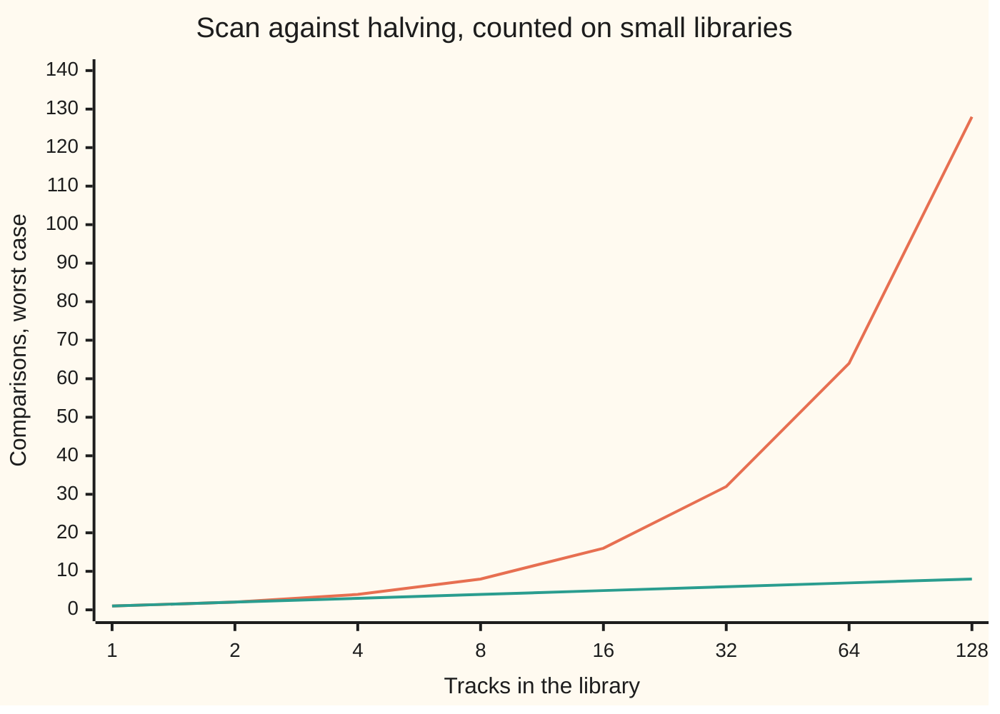
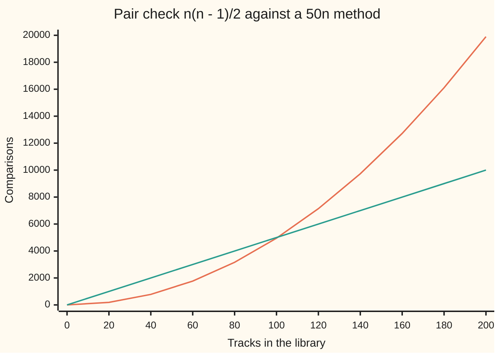

# Big-O: the growth rate of a cost, not its stopwatch reading

[Syllabus](../../../SYLLABUS.md) → [Applied and computational](../README.md) → [Algorithms and Growth](../README.md#s01) → Big-O

---

## General Overview

A phone holds a music library of 1,000,000 tracks. Someone types a title into the search box. How much work does the phone do to find it?

One way is a **scan**: read the titles in order, comparing each with the one typed, until one matches. If the track is last, or missing, that is 1,000,000 comparisons. Another way needs the titles kept in alphabetical order. Open the list in the middle and compare once. The match is either there, or in the first half, or in the second half. Throw the wrong half away and repeat. Each comparison halves what is left, so 20 comparisons always settle it for a million titles. This is **binary search**, called **halving** on this card.

So the scan costs 1,000,000 comparisons and halving costs 20. Double the library to 2,000,000 tracks and the scan costs 2,000,000, while halving costs 21. One cost doubles when the library doubles. The other gains one comparison.

That pattern does not depend on the phone. A phone twice as fast does each comparison in half the time, for both methods, so the scan stays 50,000 times the work. A stopwatch reading changes with the phone. The growth pattern does not, so it is the part worth naming. **Big-O** is the notation that names it: the scan's cost is "order n", written O(n), and halving's is "order log n", written O(log n), where n is the number of tracks.

**Big-O describes how a cost grows as the input grows, ignoring fixed multipliers, so it tells you which method wins at large sizes on any machine.**

**What kind of fact this is:** O, Ω and Θ (a ceiling, a floor and an exact rate of growth, defined in The formula) are definitions. The facts about particular costs are theorems proved in Why it works: halving's worst case is exactly ⌊log2 n⌋ + 1 comparisons (log2 n rounded down, plus 1), and the six standard growth rates rank strictly, each beaten by the next.

### The picture: comparisons to find one track, worst case



The steep line is the scan: it doubles with every doubling of the library. The flat line is halving: it climbs by one per doubling. The x-axis doubles at each step, so the scan's line is drawn bending upward. Both are counted by the code below, not drawn from formulas. At 1,000,000 tracks the two lines stand at 1,000,000 and 20.

---

## The formula

A **cost** here is a count of one named operation, a comparison of two titles, made by a method on an input of size n. Every claim below compares a cost f(n) with a simple yardstick g(n), such as n or log n.

$$f(n) = O(g(n)) \iff \text{there are constants } c > 0 \text{ and } n_0 \text{ with } f(n) \le c \cdot g(n) \text{ for every } n \ge n_0$$

**Read it aloud:** f grows at most like g: past some size, a fixed multiple of g stays above f.

Turn the inequality round and you get the floor. Ask for both and you get the exact rate:

$$f(n) = \Omega(g(n)) \iff f(n) \ge c \cdot g(n) \text{ for every } n \ge n_0, \qquad f(n) = \Theta(g(n)) \iff c_1 \cdot g(n) \le f(n) \le c_2 \cdot g(n) \text{ for every } n \ge n_0$$

**Read it aloud:** Ω says f grows at least like g; Θ says f grows exactly like g, up to a constant, for large n.

For halving, $f(n) = \lfloor \log_2 n \rfloor + 1$ and $g(n) = \log n$, so halving is $\Theta(\log n)$. Inside O( ) the log carries no base: changing the base multiplies a log by a fixed number, and the constant c absorbs it. Outside O( ), this card writes log2 for halving counts. Wing 13 uses O( ) for an error that shrinks toward zero; here n grows.

| Symbol | Plain meaning | In our example | Push it up and the answer… |
| --- | --- | --- | --- |
| $n$ | the input size: tracks in the library | 1,000,000 | every cost grows, each at its own rate |
| $f(n)$ | the cost: comparisons the method makes on n tracks, in its worst case | scan 1,000,000; halving 20 | — |
| $g(n)$ | the yardstick: a plain shape such as 1, log n, n, n log n, n², 2ⁿ | n for the scan | a faster-growing yardstick makes O easier to claim and Ω harder |
| $c$, $c_1$, $c_2$ | fixed positive multipliers, the same for every n | 2 and 3 for a scan costing 2n + 3 | a larger c covers more, but may not depend on n |
| $n_0$ | the size from which the claim must hold | 3 | small sizes are excused |
| $O$, $\Omega$, $\Theta$ | grows at most, at least, exactly like g | the scan is O(n) and Ω(n), so Θ(n) | — |
| $\log_2 n$ | how many halvings take n down to 1 | just under 20 for a million | one more per doubling of n |
| $\lfloor x \rfloor$, $\lceil x \rceil$ | x rounded down, and rounded up, to a whole number | ⌊log2 1,000,000⌋ + 1 = 20 | — |
| $m$, $W(m)$ | titles still in play, and halving's worst-case comparisons on them | W(1,000,000) = 20 | one more per doubling of m |
| $k$ | in the proof fold: one less than the number of binary digits of m | 19 when m is a million | — |
| $2^n$ | n twos multiplied together | 1,024 subsets of 10 tracks | doubles with each extra track |

### When it holds

- **A named operation is counted.** The claim is about comparisons, or steps, never seconds. Mix in a different operation, such as copying a whole title, and the count describes something else.
- **A case is named.** The scan's worst case is 1,000,000 comparisons; its best case is 1. Quote the best case as the cost and the scan looks O(1). Which case to quote is [Which case are you quoting? Worst, average and amortised cost](02-worst-case-average-case-and-amortised.md).
- **n is large.** The definition excuses everything below n₀. At 20 tracks, a method costing n(n − 1)/2 comparisons does 190 against 1,000 for a method costing 50n. The bigger class wins small inputs.
- **c is one fixed number.** If c may grow with n, every cost is O(n) and the notation says nothing. Step 3 shows the failure.
- **The method's own assumptions hold.** Halving's 20 assumes sorted titles. On the unsorted play log it gives wrong answers, and no growth rate rescues a wrong answer.

---

## Why it works

### Step 0: compare growth by ratios, and constants cancel

A cost depends on the machine through a fixed multiplier: a slower phone, or three machine steps per comparison instead of one, multiplies every count by the same number. Divide one method's cost by the other's and a shared multiplier cancels. What survives is how the ratio moves as n grows. If it settles below some fixed number, the first cost is O of the second. If it grows without limit, no constant can save the first method. That is why the definition allows any fixed c and why it only asks about large n.

### Step 1: the scan is Θ(n)

A scan for a missing title compares it with every title once: exactly n comparisons. So f(n) = n, and with c₁ = c₂ = 1 the scan is Θ(n).

Real code does bookkeeping too. Suppose the scan costs 2n + 3 steps: two per track and three to set up. Then 2n + 3 ≥ 2n for every n, so it is Ω(n) with c = 2. For the upper bound, 2n + 3 ≤ 3n once n ≥ 3, so it is O(n) with c = 3 and n₀ = 3. At n = 2 the bound fails, 7 against 6, which is why n₀ exists. The extra 3 and the factor 2 vanish into the constants: 2n + 3 is Θ(n).

### Step 2: halving is Θ(log n), with an exact worst case

Picture m titles still in play. Halving compares with the middle one. If that misses, the target lies on one side, and the larger side holds at most ⌊m/2⌋ titles. In the worst case the target is always on the larger side, so

$$W(m) = 1 + W(\lfloor m/2 \rfloor), \qquad W(0) = 0,$$

where W(m) is the worst-case number of comparisons on m titles. Unwind it: W(n) counts how many times n can be halved, rounding down, before it reaches 0. That count is the number of binary digits of n, which is ⌊log2 n⌋ + 1. For 1,000,000 it is 20; for 2,000,000, 21.

<details>
<summary>Detailed proof: the worst case is exactly ⌊log2 n⌋ + 1</summary>

The sides left by a miss on m titles hold ⌊(m − 1)/2⌋ and ⌈(m − 1)/2⌉ titles, and the larger is ⌊m/2⌋. A target falling in a gap between titles always continues, so the worst-case target can be chosen to fall into the larger side every time: the worst case obeys the recurrence above with equality.

Now suppose $2^k \le m < 2^{k+1}$, so m has k + 1 binary digits. Then $2^{k-1} \le \lfloor m/2 \rfloor < 2^k$: halving removes exactly one digit. By induction on k, W(m) = k + 1. With k = ⌊log2 m⌋ this is the formula.

Since ⌊log2 n⌋ + 1 lies between log2 n and 2 · log2 n for n ≥ 2, halving is Θ(log n).

</details>

The code checks this twice: it runs halving against every title and every gap for every library size from 1 to 300, and at 1,000,000 and 2,000,000 tracks, and the counted worst case equals the formula each time.

### Step 3: proving a claim false

Comparing every track with every other one, to hunt duplicates, costs n(n − 1)/2 comparisons. Is that O(n)? Divide by n: the ratio is (n − 1)/2, and it grows without limit. Whatever c is offered, n(n − 1)/2 > c · n as soon as n ≥ 2c + 2. For c = 1,000 the claim breaks at n = 2,002, and the code finds that size by searching upward. No fixed c survives, so the pair check is not O(n). It is Θ(n²).

### Step 4: the ladder of six growth rates

Six yardsticks cover most costs met in practice. Slowest first:

| Rate | Name | A method on the music library | At n = 1,000,000 |
| --- | --- | --- | --- |
| 1 | constant | read the track in slot k of a list | 1 |
| log n | logarithmic | halving through sorted titles | 20 |
| n | linear | scan for a title | 1,000,000 |
| n log n | n log n | a good sort of the library | 19,931,569 |
| n² | quadratic | compare every pair, n(n − 1)/2 | 499,999,500,000 |
| 2ⁿ | exponential | try every subset of tracks for a playlist | a number with 301,030 digits |

The sort's count comes from [Sorting and searching](05-sorting-and-searching.md); here it is n log2 n. Each rate is O of the next and never the reverse, because each ratio grows without limit. The code prints each rung divided by the one below:

| Ratio | At n = 16 | At n = 1,024 |
| --- | --- | --- |
| log2 n ÷ 1 | 4 | 10 |
| n ÷ log2 n | 4.0 | 102.4 |
| n log2 n ÷ n | 4 | 10 |
| n² ÷ (n log2 n) | 4.0 | 102.4 |
| 2ⁿ ÷ n² | 2⁸ | 2¹⁰⁰⁴ |

Every row grows, so every rung pulls away from the one below. The last row needs a short proof. Adding a track doubles 2ⁿ. It multiplies n² by (n + 1)² ÷ n², which is below 2 once n ≥ 3. At n = 4 both are 16, so from there on 2ⁿ grows faster and stays ahead for good. Staying ahead is not yet pulling away without limit, so one more step: from n = 4 the square grows by at most (5/4)² = 1.5625 per track, so each track multiplies the ratio 2ⁿ ÷ n² by at least 2 ÷ 1.5625 = 1.28. A number multiplied by 1.28 again and again has no ceiling. [Linear versus exponential growth](../../01-Foundations/03-Powers%2C%20Roots%20and%20Logarithms/02-linear-vs-exponential-growth.md) met the same race between adding and doubling.

### Step 5: the doubling test

The ladder has a fingerprint you can measure. Double n and watch the count:

| Rate | Counted at n = 1,000 | Counted at n = 2,000 | What doubling did |
| --- | --- | --- | --- |
| constant | 1 | 1 | nothing |
| logarithmic | 10 | 11 | added one |
| linear | 1,000 | 2,000 | doubled |
| quadratic | 499,500 | 1,999,000 | multiplied by about 4 |

Exponential costs fail the test differently: one extra track doubles them. Trying every subset of 10, 11 and 12 tracks for a 30-minute playlist, with synthetic track lengths of 3 to 7 minutes made by the rule 3 + (7i mod 5) for track i = 0, 1, 2, …, tries 1,024, 2,048 and 4,096 subsets. That is how growth is checked honestly: count at several sizes and read the pattern, rather than time one run.

---

## Worked numbers, by hand

| Step | Arithmetic | Value |
| --- | --- | --- |
| scan, title missing | one comparison per track | 1,000,000 |
| halving, worst case | 1,000,000 halved, rounding down, until 0 | 20 |
| how much more the scan does | 1,000,000 ÷ 20 | 50,000 |
| library doubled, scan | 2 × 1,000,000 | 2,000,000 |
| library doubled, halving | one more halving | 21 |
| pair check against 50n, equal at | n(n − 1)/2 = 50n gives n − 1 = 100 | 101 |
| pair check at a million tracks | 1,000,000 × 999,999 ÷ 2 | **499,999,500,000** |
| 50n at a million tracks | 50 × 1,000,000 | **50,000,000** |

At 101 tracks both methods cost 5,050 comparisons; at a million, the method with the larger constant but the smaller growth rate does about ten thousand times less work.

### The picture: a bigger constant loses early and wins for good



The curving line is the pair check, quadratic with a small constant. The straight line is a method doing 50 steps per track, linear with a large constant. They cross at 101 tracks. A stopwatch run on 20 tracks would crown the pair check, 190 against 1,000, and be wrong for every library worth having.

### What breaks if you drop a piece

| Mistake | Comes out at | What went wrong |
| --- | --- | --- |
| Halving the unsorted play log 7, 3, 9, 1, 5, 8, 2 for track 3 | "not found" after 3 comparisons; a scan finds it at the 2nd | halving assumes sorted titles: it threw away the half holding the 3 |
| Quoting the scan's best case | 1 comparison, so "O(1)" | the first track was the target; the worst case is 1,000,000 |
| Letting c grow with n to call the pair check O(n) | c must be 499,999.5 at a million tracks and 999,999.5 at two million | c has to be one fixed number |
| Counting halvings with log10 | 6 instead of 20 | log10 counts divisions by 10; halving divides by 2. Inside O( ) the two differ only by a constant |

The code prints all four.

---

## Code, from first principles, and it actually runs

The script writes the scan and halving out and lets each count its own comparisons. Every count meets a second road: the scan against n; halving's worst case, found by trying every title and every gap, against ⌊log2 n⌋ + 1 computed by halving the number n itself; the pair check's loop against n(n − 1)/2; the subset search against 2ⁿ, and its playlist count against a running table that never lists a subset. The constants c are found by searching upward and checked against the algebra. Python's `math` supplies only log2 and log10 for two ladder rows.

### Python

```python
# Big-O and growth rates -- the check behind the card.  Standard library only;
# math supplies log2 and log10 for two ladder rows, nothing else.  A cost is a
# count of comparisons or steps, never a time.  Each count is reached twice:
# by a formula, and by running the method and letting it count its own work.
import math

def scan(tracks, target):                # read the titles in order until a match
    count = 0
    for t in tracks:
        count += 1
        if t == target:
            return True, count
    return False, count

def halving(tracks, target):             # binary search: only sound on sorted tracks
    lo, hi, count = 0, len(tracks) - 1, 0
    while lo <= hi:
        mid = (lo + hi) // 2
        count += 1                       # one three-way comparison per probe
        if tracks[mid] == target:
            return True, count
        if tracks[mid] < target:
            lo = mid + 1
        else:
            hi = mid - 1
    return False, count

def halving_worst(n):                    # every track and every gap, as targets
    tracks = list(range(0, 2 * n, 2))    # sorted stand-ins for the titles
    return max(halving(tracks, x)[1] for x in range(-1, 2 * n))

def floor_log2_plus_1(n):                # the formula: halve n down to 0, count
    k = 0
    while n > 0:
        n //= 2
        k += 1
    return k

def pair_check(n):                       # compare every track with every later one
    count = 0
    for i in range(n):
        for j in range(i + 1, n):
            count += 1
    return count

def pairs(n):                            # the formula for the pair check
    return n * (n - 1) // 2

def playlists(n, minutes):               # try every subset of n tracks
    lengths = [3 + 7 * i % 5 for i in range(n)]
    tried = hits = 0
    for mask in range(2 ** n):
        tried += 1
        hits += sum(lengths[i] for i in range(n) if mask >> i & 1) == minutes
    ways = [1] + [0] * minutes           # second road: count by a running table
    for m in lengths:
        for t in range(minutes, m - 1, -1):
            ways[t] += ways[t - m]
    return tried, hits, ways[minutes]

N = 1000000
scan_n = scan(range(N), -1)[1]
half_n, half_2n = halving_worst(N), halving_worst(2 * N)
print(f"library of n = {N} tracks; cost = comparisons; worst case")
print(f"scan: formula n = {N}; counted, title absent = {scan_n}")
print(f"halving: formula floor(log2 n) + 1 = {floor_log2_plus_1(N)}; counted = {half_n}")
print(f"scan / halving = {scan_n // half_n}")
print(f"doubled to {2 * N}: scan {scan(range(2 * N), -1)[1]}, halving {half_2n} "
      f"(formula {floor_log2_plus_1(2 * N)})")
small = all(halving_worst(n) == floor_log2_plus_1(n) for n in range(1, 301))
print(f"halving counted = formula for every n from 1 to 300: {'yes' if small else 'no'}")
print("figure, n, scan, halving:", " | ".join(
    f"{n} {scan(range(n), -1)[1]} {halving_worst(n)}" for n in [1, 2, 4, 8, 16, 32, 64, 128]))
print("doubling test, counted at n = 1000 and n = 2000:")
print(f"  constant, read slot k: 1 -> 1")
print(f"  halving: {halving_worst(1000)} -> {halving_worst(2000)}")
print(f"  scan: {scan(range(1000), -1)[1]} -> {scan(range(2000), -1)[1]}")
print(f"  pair check: {pair_check(1000)} -> {pair_check(2000)}"
      f" (formula n(n-1)/2: {pairs(1000)} -> {pairs(2000)})")
for n in (10, 11, 12):
    tried, hits, table = playlists(n, 30)
    print(f"  every subset of {n} tracks: tried {tried} (2^n = {2 ** n}), "
          f"30-minute playlists {hits} (table {table})")
print(f"ladder at n = {N}:")
print(f"  constant 1; log2 n rounded up {floor_log2_plus_1(N - 1)}; n {N}")
print(f"  n log2 n {int(N * math.log2(N) + 0.5)}; n(n-1)/2 {pairs(N)}")
print(f"  2^n has {int(N * math.log10(2)) + 1} digits")
print("each rung divided by the one below, at n = 16 and n = 1024:")
for name, f in [("log2 n / 1", lambda n, L: f"{L}"), ("n / log2 n", lambda n, L: f"{n / L:.1f}"),
                ("n log2 n / n", lambda n, L: f"{L}"), ("n^2 / (n log2 n)", lambda n, L: f"{n / L:.1f}"),
                ("2^n / n^2", lambda n, L: f"2^{n - 2 * L}")]:
    print(f"  {name}: {f(16, 4)}, {f(1024, 10)}")
sq = max((n + 1) ** 2 / n ** 2 for n in range(4, 1001))      # what one more track does to n^2
step = min(2 * n * n / (n + 1) ** 2 for n in range(4, 1001)) # ... and so to 2^n / n^2
print(f"  2^n / n^2 from n = 4: n^2 grows by at most {sq} per track, so the ratio by at least {step}")
print("Theta(n) for a scan with bookkeeping, 2n + 3 steps:")
upper = all(2 * n + 3 <= 3 * n for n in range(3, 100001))
print(f"  2n + 3 <= 3n for n = 3 to 100000: {'yes' if upper else 'no'}; at n = 2: {2 * 2 + 3} > {3 * 2}")
first = next(n for n in range(1, 10 ** 6) if pairs(n) > 1000 * n)
print(f"n(n-1)/2 <= 1000 n first fails at n = {first} (formula 2c + 2 = {2 * 1000 + 2})")
print("crossover, pair check n(n-1)/2 against 50 n steps:")
tie = next(n for n in range(2, 10 ** 6) if pairs(n) >= 50 * n)
print(f"  equal at n = {tie} (formula 2 x 50 + 1 = {2 * 50 + 1}); counted at n = {tie}: "
      f"{pair_check(tie)} against {50 * tie}")
print(f"  at n = 20: {pair_check(20)} against {50 * 20}; at n = {N}: "
      f"{pairs(N)} against {50 * N}")
print("figure, n, pairs, 50n:", " | ".join(
    f"{n} {pairs(n)} {50 * n}" for n in range(0, 201, 20)))
log = [7, 3, 9, 1, 5, 8, 2]              # the play log, in listening order: unsorted
print(f"mistake, halving the unsorted play log {log} for track 3: found "
      f"{'yes' if halving(log, 3)[0] else 'no'} after {halving(log, 3)[1]}; scan finds it at {scan(log, 3)[1]}")
print(f"mistake, best case quoted: scan finds the first track in {scan(range(N), 0)[1]}, worst {scan_n}")
print(f"mistake, c growing with n: n(n-1)/2 over n is {(N - 1) / 2} at {N}, {(2 * N - 1) / 2} at {2 * N}")
print(f"mistake, log10 for halvings: log10 n = {len(str(N)) - 1}, halvings {half_n}")
assert scan_n == N and half_n == floor_log2_plus_1(N) == 20 and half_2n == 21  # run = formula
assert small and pair_check(2000) == 2000 * 1999 // 2                          # run = formula
assert all(playlists(n, 30)[0] == 2 ** n and playlists(n, 30)[1] == playlists(n, 30)[2]
           for n in (10, 11, 12))                                              # two roads
assert upper and first == 2 * 1000 + 2 and tie == 2 * 50 + 1                 # search = algebra
assert sq == (5 / 4) ** 2 and step == 2 / sq                                  # search = algebra
assert all(2 ** (4 + k) * 25 ** k >= 32 ** k * (4 + k) ** 2 for k in range(21))  # ratio >= 1.28^k
assert halving(log, 3) == (False, 3) and scan(log, 3) == (True, 2)
print("ALL CHECKS PASS")
```

**Ran 2026-11-11 on macOS, Python 3.14.10, standard library only. All checks passed. Output, pasted from the run:**

```
library of n = 1000000 tracks; cost = comparisons; worst case
scan: formula n = 1000000; counted, title absent = 1000000
halving: formula floor(log2 n) + 1 = 20; counted = 20
scan / halving = 50000
doubled to 2000000: scan 2000000, halving 21 (formula 21)
halving counted = formula for every n from 1 to 300: yes
figure, n, scan, halving: 1 1 1 | 2 2 2 | 4 4 3 | 8 8 4 | 16 16 5 | 32 32 6 | 64 64 7 | 128 128 8
doubling test, counted at n = 1000 and n = 2000:
  constant, read slot k: 1 -> 1
  halving: 10 -> 11
  scan: 1000 -> 2000
  pair check: 499500 -> 1999000 (formula n(n-1)/2: 499500 -> 1999000)
  every subset of 10 tracks: tried 1024 (2^n = 1024), 30-minute playlists 40 (table 40)
  every subset of 11 tracks: tried 2048 (2^n = 2048), 30-minute playlists 86 (table 86)
  every subset of 12 tracks: tried 4096 (2^n = 4096), 30-minute playlists 184 (table 184)
ladder at n = 1000000:
  constant 1; log2 n rounded up 20; n 1000000
  n log2 n 19931569; n(n-1)/2 499999500000
  2^n has 301030 digits
each rung divided by the one below, at n = 16 and n = 1024:
  log2 n / 1: 4, 10
  n / log2 n: 4.0, 102.4
  n log2 n / n: 4, 10
  n^2 / (n log2 n): 4.0, 102.4
  2^n / n^2: 2^8, 2^1004
  2^n / n^2 from n = 4: n^2 grows by at most 1.5625 per track, so the ratio by at least 1.28
Theta(n) for a scan with bookkeeping, 2n + 3 steps:
  2n + 3 <= 3n for n = 3 to 100000: yes; at n = 2: 7 > 6
n(n-1)/2 <= 1000 n first fails at n = 2002 (formula 2c + 2 = 2002)
crossover, pair check n(n-1)/2 against 50 n steps:
  equal at n = 101 (formula 2 x 50 + 1 = 101); counted at n = 101: 5050 against 5050
  at n = 20: 190 against 1000; at n = 1000000: 499999500000 against 50000000
figure, n, pairs, 50n: 0 0 0 | 20 190 1000 | 40 780 2000 | 60 1770 3000 | 80 3160 4000 | 100 4950 5000 | 120 7140 6000 | 140 9730 7000 | 160 12720 8000 | 180 16110 9000 | 200 19900 10000
mistake, halving the unsorted play log [7, 3, 9, 1, 5, 8, 2] for track 3: found no after 3; scan finds it at 2
mistake, best case quoted: scan finds the first track in 1, worst 1000000
mistake, c growing with n: n(n-1)/2 over n is 499999.5 at 1000000, 999999.5 at 2000000
mistake, log10 for halvings: log10 n = 6, halvings 20
ALL CHECKS PASS
```

### Rust

Same numbers, same labels, built with `rustc --edition 2021 -O`.

```rust
// Big-O and growth rates -- the same check as the Python, in Rust.  No crates;
// f64's log2 and log10 serve two ladder rows, nothing else.  A cost is a
// count of comparisons or steps, never a time.  Each count is reached twice:
// by a formula, and by running the method and letting it count its own work.
fn scan(tracks: &[i64], target: i64) -> (bool, u64) {    // read the titles in order
    let mut count = 0;
    for &t in tracks {
        count += 1;
        if t == target { return (true, count) }
    }
    (false, count)
}

fn halving(tracks: &[i64], target: i64) -> (bool, u64) { // binary search: sorted only
    let (mut lo, mut hi, mut count) = (0i64, tracks.len() as i64 - 1, 0u64);
    while lo <= hi {
        let mid = (lo + hi) / 2;
        count += 1;                                      // one three-way comparison
        let v = tracks[mid as usize];
        if v == target { return (true, count) }
        if v < target { lo = mid + 1 } else { hi = mid - 1 }
    }
    (false, count)
}

fn halving_worst(n: i64) -> u64 {                        // every track and every gap
    let tracks: Vec<i64> = (0..n).map(|i| 2 * i).collect();
    (-1..2 * n).map(|x| halving(&tracks, x).1).max().unwrap()
}

fn floor_log2_plus_1(mut n: i64) -> u64 {                // halve n down to 0, count
    let mut k = 0;
    while n > 0 { n /= 2; k += 1 }
    k
}

fn pair_check(n: u64) -> u64 {                           // every track against every later one
    let mut count = 0;
    for i in 0..n { for _j in i + 1..n { count += 1 } }
    count
}

fn pairs(n: u64) -> u64 { if n == 0 { 0 } else { n * (n - 1) / 2 } }

fn playlists(n: usize, minutes: usize) -> (u64, u64, u64) { // try every subset
    let lengths: Vec<usize> = (0..n).map(|i| 3 + 7 * i % 5).collect();
    let (mut tried, mut hits) = (0u64, 0u64);
    for mask in 0..(1u64 << n) {
        tried += 1;
        let total: usize = (0..n).filter(|&i| mask >> i & 1 == 1).map(|i| lengths[i]).sum();
        if total == minutes { hits += 1 }
    }
    let mut ways = vec![0u64; minutes + 1];              // second road: a running table
    ways[0] = 1;
    for &m in &lengths {
        for t in (m..=minutes).rev() { ways[t] += ways[t - m] }
    }
    (tried, hits, ways[minutes])
}

fn yn(b: bool) -> &'static str { if b { "yes" } else { "no" } }
fn upto(n: i64) -> Vec<i64> { (0..n).collect() }

fn main() {
    const N: i64 = 1000000;
    let big = upto(2 * N);
    let scan_n = scan(&big[..N as usize], -1).1;
    let (half_n, half_2n) = (halving_worst(N), halving_worst(2 * N));
    println!("library of n = {} tracks; cost = comparisons; worst case", N);
    println!("scan: formula n = {}; counted, title absent = {}", N, scan_n);
    println!("halving: formula floor(log2 n) + 1 = {}; counted = {}", floor_log2_plus_1(N), half_n);
    println!("scan / halving = {}", scan_n / half_n);
    println!("doubled to {}: scan {}, halving {} (formula {})",
             2 * N, scan(&big, -1).1, half_2n, floor_log2_plus_1(2 * N));
    let small = (1..301).all(|n| halving_worst(n) == floor_log2_plus_1(n));
    println!("halving counted = formula for every n from 1 to 300: {}", yn(small));
    let fig: Vec<String> = [1, 2, 4, 8, 16, 32, 64, 128].iter()
        .map(|&n| format!("{} {} {}", n, scan(&upto(n), -1).1, halving_worst(n))).collect();
    println!("figure, n, scan, halving: {}", fig.join(" | "));
    println!("doubling test, counted at n = 1000 and n = 2000:");
    println!("  constant, read slot k: 1 -> 1");
    println!("  halving: {} -> {}", halving_worst(1000), halving_worst(2000));
    println!("  scan: {} -> {}", scan(&upto(1000), -1).1, scan(&upto(2000), -1).1);
    println!("  pair check: {} -> {} (formula n(n-1)/2: {} -> {})",
             pair_check(1000), pair_check(2000), pairs(1000), pairs(2000));
    for n in [10usize, 11, 12] {
        let (tried, hits, table) = playlists(n, 30);
        println!("  every subset of {} tracks: tried {} (2^n = {}), 30-minute playlists {} (table {})",
                 n, tried, 1u64 << n, hits, table);
    }
    let nf = N as f64;
    println!("ladder at n = {}:", N);
    println!("  constant 1; log2 n rounded up {}; n {}", floor_log2_plus_1(N - 1), N);
    println!("  n log2 n {}; n(n-1)/2 {}", (nf * nf.log2() + 0.5) as u64, pairs(N as u64));
    println!("  2^n has {} digits", (nf * 2f64.log10()) as u64 + 1);
    println!("each rung divided by the one below, at n = 16 and n = 1024:");
    let rungs: [(&str, fn(i64, i64) -> String); 5] = [
        ("log2 n / 1", |_n, l| format!("{}", l)),
        ("n / log2 n", |n, l| format!("{:.1}", n as f64 / l as f64)),
        ("n log2 n / n", |_n, l| format!("{}", l)),
        ("n^2 / (n log2 n)", |n, l| format!("{:.1}", n as f64 / l as f64)),
        ("2^n / n^2", |n, l| format!("2^{}", n - 2 * l)),
    ];
    for (name, f) in rungs.iter() { println!("  {}: {}, {}", name, f(16, 4), f(1024, 10)) }
    let sq = (4..1001u64).map(|n| ((n + 1) * (n + 1)) as f64 / (n * n) as f64).fold(0.0, f64::max);
    let step = (4..1001u64).map(|n| (2 * n * n) as f64 / ((n + 1) * (n + 1)) as f64).fold(f64::INFINITY, f64::min);
    println!("  2^n / n^2 from n = 4: n^2 grows by at most {} per track, so the ratio by at least {}", sq, step);
    println!("Theta(n) for a scan with bookkeeping, 2n + 3 steps:");
    let upper = (3..100001i64).all(|n| 2 * n + 3 <= 3 * n);
    println!("  2n + 3 <= 3n for n = 3 to 100000: {}; at n = 2: {} > {}", yn(upper), 2 * 2 + 3, 3 * 2);
    let first = (1..1000000u64).find(|&n| pairs(n) > 1000 * n).unwrap();
    println!("n(n-1)/2 <= 1000 n first fails at n = {} (formula 2c + 2 = {})", first, 2 * 1000 + 2);
    println!("crossover, pair check n(n-1)/2 against 50 n steps:");
    let tie = (2..1000000u64).find(|&n| pairs(n) >= 50 * n).unwrap();
    println!("  equal at n = {} (formula 2 x 50 + 1 = {}); counted at n = {}: {} against {}",
             tie, 2 * 50 + 1, tie, pair_check(tie), 50 * tie);
    println!("  at n = 20: {} against {}; at n = {}: {} against {}",
             pair_check(20), 50 * 20, N, pairs(N as u64), 50 * N);
    let fig2: Vec<String> = (0..201u64).step_by(20)
        .map(|n| format!("{} {} {}", n, pairs(n), 50 * n)).collect();
    println!("figure, n, pairs, 50n: {}", fig2.join(" | "));
    let log: Vec<i64> = vec![7, 3, 9, 1, 5, 8, 2];      // the play log, in listening order
    println!("mistake, halving the unsorted play log {:?} for track 3: found {} after {}; scan finds it at {}",
             log, yn(halving(&log, 3).0), halving(&log, 3).1, scan(&log, 3).1);
    println!("mistake, best case quoted: scan finds the first track in {}, worst {}",
             scan(&big[..N as usize], 0).1, scan_n);
    println!("mistake, c growing with n: n(n-1)/2 over n is {} at {}, {} at {}",
             (nf - 1.0) / 2.0, N, (2.0 * nf - 1.0) / 2.0, 2 * N);
    println!("mistake, log10 for halvings: log10 n = {}, halvings {}", N.to_string().len() - 1, half_n);
    assert!(scan_n == N as u64 && half_n == floor_log2_plus_1(N) && half_n == 20 && half_2n == 21);
    assert!(small && pair_check(2000) == 2000 * 1999 / 2);
    assert!([10usize, 11, 12].iter().all(|&n| {
        let (t, h, w) = playlists(n, 30);
        t == 1u64 << n && h == w
    }));
    assert!(upper && first == 2 * 1000 + 2 && tie == 2 * 50 + 1);
    assert!(sq == (5.0f64 / 4.0).powi(2) && step == 2.0 / sq);
    assert!((0..21u32).all(|k| (1u128 << (4 + k)) * 25u128.pow(k) >= 32u128.pow(k) * ((4 + k) as u128).pow(2)));
    assert!(halving(&log, 3) == (false, 3) && scan(&log, 3) == (true, 2));
    println!("ALL CHECKS PASS");
}
```

**Ran 2026-11-11 on macOS, rustc 1.98.1, no crates. All checks passed. Output, pasted from the run:**

```
library of n = 1000000 tracks; cost = comparisons; worst case
scan: formula n = 1000000; counted, title absent = 1000000
halving: formula floor(log2 n) + 1 = 20; counted = 20
scan / halving = 50000
doubled to 2000000: scan 2000000, halving 21 (formula 21)
halving counted = formula for every n from 1 to 300: yes
figure, n, scan, halving: 1 1 1 | 2 2 2 | 4 4 3 | 8 8 4 | 16 16 5 | 32 32 6 | 64 64 7 | 128 128 8
doubling test, counted at n = 1000 and n = 2000:
  constant, read slot k: 1 -> 1
  halving: 10 -> 11
  scan: 1000 -> 2000
  pair check: 499500 -> 1999000 (formula n(n-1)/2: 499500 -> 1999000)
  every subset of 10 tracks: tried 1024 (2^n = 1024), 30-minute playlists 40 (table 40)
  every subset of 11 tracks: tried 2048 (2^n = 2048), 30-minute playlists 86 (table 86)
  every subset of 12 tracks: tried 4096 (2^n = 4096), 30-minute playlists 184 (table 184)
ladder at n = 1000000:
  constant 1; log2 n rounded up 20; n 1000000
  n log2 n 19931569; n(n-1)/2 499999500000
  2^n has 301030 digits
each rung divided by the one below, at n = 16 and n = 1024:
  log2 n / 1: 4, 10
  n / log2 n: 4.0, 102.4
  n log2 n / n: 4, 10
  n^2 / (n log2 n): 4.0, 102.4
  2^n / n^2: 2^8, 2^1004
  2^n / n^2 from n = 4: n^2 grows by at most 1.5625 per track, so the ratio by at least 1.28
Theta(n) for a scan with bookkeeping, 2n + 3 steps:
  2n + 3 <= 3n for n = 3 to 100000: yes; at n = 2: 7 > 6
n(n-1)/2 <= 1000 n first fails at n = 2002 (formula 2c + 2 = 2002)
crossover, pair check n(n-1)/2 against 50 n steps:
  equal at n = 101 (formula 2 x 50 + 1 = 101); counted at n = 101: 5050 against 5050
  at n = 20: 190 against 1000; at n = 1000000: 499999500000 against 50000000
figure, n, pairs, 50n: 0 0 0 | 20 190 1000 | 40 780 2000 | 60 1770 3000 | 80 3160 4000 | 100 4950 5000 | 120 7140 6000 | 140 9730 7000 | 160 12720 8000 | 180 16110 9000 | 200 19900 10000
mistake, halving the unsorted play log [7, 3, 9, 1, 5, 8, 2] for track 3: found no after 3; scan finds it at 2
mistake, best case quoted: scan finds the first track in 1, worst 1000000
mistake, c growing with n: n(n-1)/2 over n is 499999.5 at 1000000, 999999.5 at 2000000
mistake, log10 for halvings: log10 n = 6, halvings 20
ALL CHECKS PASS
```

The two outputs match line for line.

> [!TIP]
> **Try changing**
> Guess first, then run it. Some asserts are pinned to the card's numbers, so expect them to stop the program.
> - **Guess first:** what does halving cost on 2,000,000 tracks doubled again? Set `N = 2000000`. The doubled line reports 4,000,000 for the scan and 22 for halving. The first assert stops it, since it pins 20 and 21.
> - **Guess first:** where does a 500-step-per-track method meet the pair check? In the `tie =` line change `50 * n` to `500 * n`. The search finds 1,001, and the fourth assert stops it because the formula beside it still says 2 × 50 + 1.
> - **Guess first:** does a shorter playlist change how many subsets are tried? Change `playlists(n, 30)` to `playlists(n, 20)` everywhere. Tried stays 1,024, 2,048 and 4,096; the playlists found become 40, 70 and 109, and the table agrees, so every assert passes. The cost of trying everything does not depend on what you are looking for.
> - **Guess first:** does halving work once the play log is sorted? Set `log = [1, 2, 3, 5, 7, 8, 9]`. Halving finds track 3 after 3 comparisons; the scan needs 3. The last assert stops it, since it pins the unsorted failure.

---

## The usual mistake

> [!warning]
> **Ranking two methods by one run at one size.** A run measures the constant and the growth tangled together, at one n. The pair check beats a 50-step-per-track method on 20 tracks, 190 comparisons against 1,000, and loses on a million, 499,999,500,000 against 50,000,000. Big-O separates the two: the class decides large n, and the constant decides small n. Count at several sizes and read the pattern.
>
> Smaller traps:
> - **Reading O as "exactly".** O is only a ceiling. Halving is O(n) too, and O(2ⁿ): true and useless. To say how fast a cost grows, say Θ. Halving is Θ(log n), 20 at a million tracks, not a million.
> - **Quoting the best case.** The scan finds the first track in 1 comparison. Its worst case is 1,000,000. A cost without its case is not a claim.
> - **A constant that grows.** "n(n − 1)/2 ≤ c · n" works at a million tracks with c = 499,999.5 and fails at two million. A c that moves with n proves nothing.
> - **Halving on unsorted data.** On the play log 7, 3, 9, 1, 5, 8, 2, halving reports track 3 missing after 3 comparisons. The 20-comparison promise holds only for sorted titles.

---

## Where you meet it in real life

- **Search boxes.** A phone's music app, a contacts list and a database index all keep their keys sorted, or in a tree, so a lookup costs about log2 n comparisons, not n. Building that order costs n log n once; [Sorting and searching](05-sorting-and-searching.md) and [Data structures](06-data-structures-heaps-hashes-and-trees.md) pay it.
- **Hunting a bad change.** Version-control tools test the middle commit of a range and halve. A fault hidden among 1,000 changes takes about 10 tests.
- **Spreadsheet lookups.** An approximate-match lookup halves its column, so it assumes the column is sorted; on an unsorted column it returns a wrong row with no warning, exactly the play-log failure.
- **Code that is fine on test data.** A nested loop over every pair of items passes a test on 20 items and stalls on a million: 499,999,500,000 comparisons. The doubling test catches it, because doubling the input quadruples the count.
- **Password and key length.** Trying every key of n bits means trying 2ⁿ keys. Each extra bit doubles the attacker's work, which is why keys grow by bits, not by percentages.

> **Say it back**
> Big-O names how a cost grows with the input, ignoring fixed multipliers such as a phone's speed. O is a ceiling, Ω a floor and Θ both, each holding past some size with one fixed constant. A scan of a million tracks costs a million comparisons and halving costs 20, because each comparison halves what is left: Θ(n) against Θ(log n). The six common rates, 1, log n, n, n log n, n² and 2ⁿ, each lose to the next by a ratio that grows without limit. A run at one size can rank them wrongly, so count at several sizes and read how the count moves when n doubles.

---

## What this builds on

- [Logarithms](../../01-Foundations/03-Powers%2C%20Roots%20and%20Logarithms/05-logarithms.md): log2 n counts how many halvings take n down to 1, which is halving's cost.
- [Linear versus exponential growth](../../01-Foundations/03-Powers%2C%20Roots%20and%20Logarithms/02-linear-vs-exponential-growth.md): adding against multiplying, the two ends of the ladder.

## Where this goes next

- [Which case are you quoting? Worst, average and amortised cost](02-worst-case-average-case-and-amortised.md): the named case every cost must carry, and costs averaged over a long run.
- [Polynomial or exponential](03-polynomial-versus-exponential-time.md): where the ladder splits into what is feasible and what is not.
- [Recurrences](04-recurrences-and-the-master-theorem.md): solving recurrences like halving's W(m) = 1 + W(⌊m/2⌋) for divide-and-conquer methods.
- [Cost in practice](../08-Scientific%20Computing%20Practice/04-computational-cost-and-vectorisation.md): counted operations against a real machine's caches and memory.
- Time and space classes: memory as a cost alongside comparisons.
- [Counting the work](../../16-Numerical%20analysis/01-Floating%20Point%20and%20Error/08-operation-counts-and-cost.md): turning a loop into a cost formula line by line.

Big-O says which method wins for large n; whether the cost quoted is the one you will actually meet, worst, typical or averaged over many calls, is still open.

---

## Sources

Verified 2026-11-11: every link below resolves to the publisher's page.

- Knuth, Donald E. "Big Omicron and Big Omega and Big Theta." *ACM SIGACT News* 8, no. 2 (1976): 18–24. [doi:10.1145/1008328.1008329](https://doi.org/10.1145/1008328.1008329). Fixes the meanings of O, Ω and Θ used on this card.
- Knuth, Donald E. *The Art of Computer Programming*, Volume 3: *Sorting and Searching*, 2nd ed. Addison-Wesley, 1998. [Publisher page](https://www.informit.com/store/art-of-computer-programming-volume-3-sorting-and-searching-9780201896855). Section 6.2.1 analyses binary search's comparison count exactly.
- Sedgewick, Robert, and Kevin Wayne. *Algorithms*, 4th ed. Addison-Wesley, 2011. [Publisher page](https://www.informit.com/store/algorithms-9780321573513). Section 1.4, Analysis of Algorithms: order-of-growth classes and the doubling test, run on real code.
- Kleinberg, Jon, and Éva Tardos. *Algorithm Design*. Pearson. [Publisher page](https://www.pearson.com/en-us/subject-catalog/p/algorithm-design/P200000003259/9780137546350). Chapter 2 sets out asymptotic order of growth and the common running-time classes.
