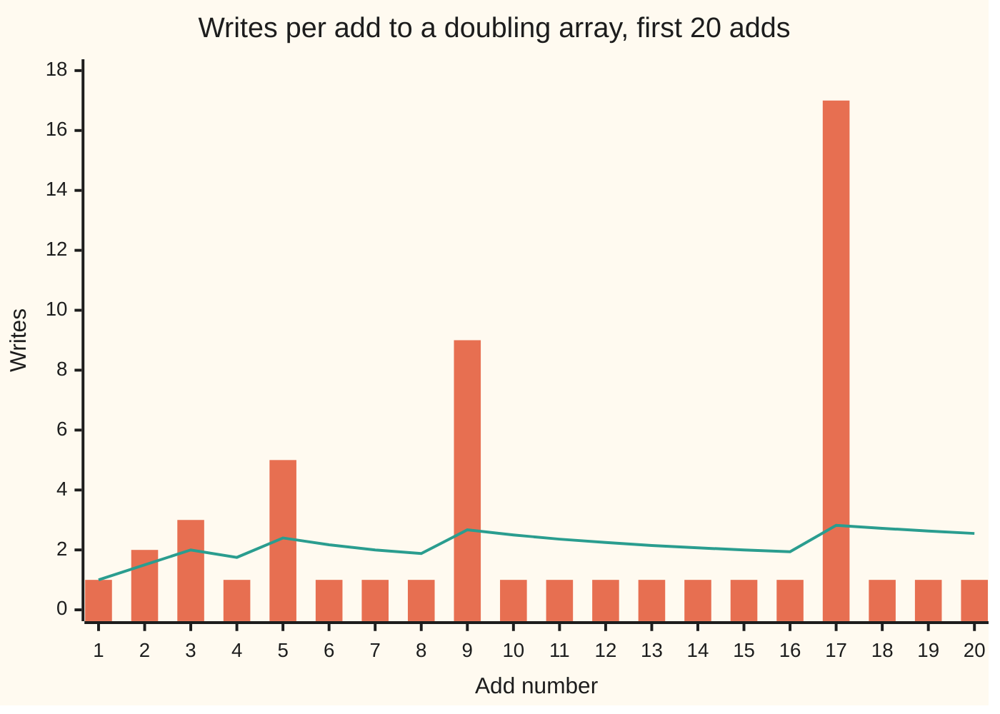

# Which case are you quoting? Worst, average and amortised cost

[Syllabus](../../../SYLLABUS.md) → [Applied and computational](../README.md) → [Algorithms and Growth](../README.md#s01) → Which case are you quoting? Worst, average and amortised cost

---

## General Overview

A phone keeps a playlist of 1,000,000 tracks in an **array**: one block of numbered memory slots, side by side, each holding one track's id. Adding a track to the end is one write into the next empty slot. That is cheap, until the block is full.

When it fills, the phone cannot stretch the block in place. It asks for a new block twice the size, copies every track across, and then writes the new one. Building the playlist up to 1,000,000 tracks this way, the single worst add copies 524,288 tracks first: 524,289 writes for one tap. Yet the whole build costs 2,048,575 writes, about **2.05 per track**.

Both numbers are true. They answer different questions. "How bad can one add be?" is the **worst case**. "What does a long run of adds cost per add?" is the **amortised cost** (amortised: a big bill spread over the many cheap operations before it, as putting a little aside each month pays a yearly bill).

A third question, "how much on a typical search, if the tracks people look for follow some pattern?", is the **average case**. It needs that pattern written down, and it changes when the pattern does.

**A cost is only meaningful with its case named: the worst case is a ceiling for one operation on any input, the average case is a mean over a stated spread of inputs, and the amortised cost is a ceiling on the mean over any run of operations from an empty start, with no probability involved.**

**What kind of fact this is:** three definitions, plus a theorem about the doubling array (no run of n adds to an empty playlist costs more than 3n writes), proved on this card in Why it works.

### The picture: twenty adds, spikes and a flat average



The bars are the true cost of each add. They spike at adds 2, 3, 5, 9 and 17, where the array was full and everything was copied; each copy moves twice as many tracks as the last. The line is the running average: total writes so far divided by adds so far. It never reaches 3. The spikes grow, but they come half as often each time.

---

## The formula

The [Big-O](01-big-o-and-growth-rates.md) card measures how a cost grows with the size n of the input, written O (at most), Ω (at least) and Θ (exactly) up to a constant. That card raises the question of *which* cost is growing and leaves it here. This card names the three choices.

$$W(n) = \max_{x}\, t(x) \qquad A(n) = \sum_{x} p(x)\, t(x) \qquad \frac{1}{n}\sum_{i=1}^{n} c_i \;\le\; \hat c = 3$$

**Read it aloud:** the worst case is the largest cost over every input of size n; the average case is each input's cost weighted by its chance; and for the doubling playlist, the total of n adds to an empty playlist, divided by n, never exceeds 3.

| Symbol | Plain meaning | In our example | Push it up and the answer… |
| --- | --- | --- | --- |
| $n$ | the input size, or the number of operations in a run | 1,000,000 tracks, or adds | every cost here grows with it |
| $x$, $k$ | one input of size n; for the search, the slot $k$ the wanted track sits in | a track in slot $k$ costs $k$ comparisons | a later slot costs more |
| $t(x)$ | the counted cost on input x: a named operation, never seconds | comparisons made by the search | — |
| $W(n)$ | worst case: the largest $t(x)$ over all inputs of size n | 1,000,000 comparisons (track absent) | — |
| $p(x)$ | the chance input x turns up: a stated assumption | 1 in 1,000,000 for each slot | weight on late slots raises $A(n)$ |
| $A(n)$ | average case: mean of $t(x)$ under $p$ | 500,000.5 comparisons | — |
| $c_i$ | true cost of add number $i$, in writes | 1, or 1 plus every track copied | — |
| $\hat c$ | the amortised charge: a flat price per add that always covers the true costs | 3 writes; the run averages 2.05 | — |
| $s$ | size: tracks stored | 1,000,000 | — |
| $m$ | capacity: slots in the block | 1,048,576 | spare room, $m - s$, grows |
| $\Phi$ | potential: $2s - m$, the savings the next copy will need | 951,424 at the end | — |
| $j$ | the power in $2^j$, the largest power of two below n: the biggest single copy | 19, so $2^{19}$ = 524,288 | each step up doubles the worst add |

The search here is **linear search**, the scan from [Big-O](01-big-o-and-growth-rates.md): check slot 1, slot 2, and so on until the track turns up. A track in slot $k$ costs $k$ comparisons. Halving, on the same card, does better on a sorted playlist: it opens the list in the middle and throws away the wrong half each time. This card keeps the plain scan because its cases are easy to see.

### When it holds

- **The worst case needs a fixed size n and a named operation.** Count comparisons, writes, or copies. Count seconds and the answer moves with the phone, the battery and what else is running.
- **The average case needs a stated $p(x)$.** "Each track equally likely" gives 500,000.5. If 9 in 10 searches are for the newest 10,000 tracks, the same code averages 945,500.5. Drop the assumption and the average means nothing.
- **The amortised bound needs geometric growth.** Doubling, or any fixed multiple above 1, keeps the charge constant. Growing by a fixed 1,000 slots instead makes the per-add cost 500.50 and rising with n.
- **The amortised bound covers whole runs from empty, not one operation.** Any single add can still cost 524,289. A system that must never stall, such as audio playback, needs the worst case.
- **Shrinking must lag behind growing.** If the array halves the moment it is half full, an add and an undo at the boundary each cost 524,289. Halving at a quarter full restores a constant.

---

## Why it works

### Step 0: pay a flat price and bank the change

Charge every add 3 writes, whatever it actually costs. Most adds cost 1, so 2 go into a savings account. When the array is full and must double, the savings pay for the copy. If the savings never run out, 3n writes cover any n adds, and 3 is the amortised cost.

The worst and average cases need no such trick: they are a maximum and a mean over inputs. The work is in showing the savings never run out.

### Step 1: the worst case and the average case of a search

Linear search for the track in slot $k$ makes $k$ comparisons. The largest is $k = n$, or a track that is not there, which also checks all n slots. So $W(n) = n$: 1,000,000.

If each of the n slots is equally likely, $p(x) = 1/n$ for each, and

$$A(n) = \frac{1}{n}\,(1 + 2 + \dots + n) = \frac{1}{n}\cdot\frac{n(n+1)}{2} = \frac{n+1}{2}.$$

For n = 1,000,000 that is 500,000.5. The sum $1 + 2 + \dots + n = n(n+1)/2$ comes from writing it forwards and backwards and adding: n pairs, each n + 1.

Change $p$ and the same sum is weighted differently. With 9 in 10 searches spread evenly over the newest 10,000 tracks, the last 10,000 slots (mean slot 995,000.5), and 1 in 10 spread over all slots, $A = 0.9 \times 995{,}000.5 + 0.1 \times 500{,}000.5 = 945{,}500.5$.

### Step 2: where the copies fall

Start empty, with capacity 0. The first add makes 1 slot. After that the array is full exactly when it holds 1, 2, 4, 8, … tracks, and the next add copies them all. So the add that arrives when the array holds a power of two, say 8 tracks, costs 8 + 1 = 9 writes; every other add costs 1. That is the bar chart above: 2, 3, 5, 9, 17.

For n adds, the copies are every power of two below n:

$$1 + 2 + 4 + \dots + 2^{j} = 2^{j+1} - 1 < 2n,$$

where $2^j$ is the largest power of two below n. Each power of two is one more than all the smaller ones together, so the sum is one short of the next. For n = 1,000,000, the largest is 524,288, the copies total 1,048,575 over 21 resizes, and the final capacity is 1,048,576. Add the n writes of the tracks themselves:

$$\sum_{i=1}^{n} c_i = n + 2^{j+1} - 1 < 3n.$$

That is 2,048,575 writes, 2.05 per add. The bound is nearly met just past a power of two: 1,048,577 adds cost 3,145,728, which is 2.999997 per add.

### Step 3: the savings always cover the next copy

Step 2 summed a run from empty. The potential $\Phi = 2s - m$ makes the same argument hold after every single add, which is what "never runs out" means.

Right after a doubling from $m$ to $2m$ slots, the array holds $m + 1$ tracks, so $\Phi = 2$. Each cheap add raises $s$ by one and $\Phi$ by two: the 2 banked writes. By the time the $2m$ slots are full, $\Phi = 2m$, exactly the number of tracks the next copy must move.

- **A cheap add:** true cost 1, $\Phi$ rises by 2. Charge $1 + 2 = 3$.
- **A doubling add,** with $s = m$ before it: true cost $m + 1$. $\Phi$ falls from $2m - m = m$ to $2(m+1) - 2m = 2$, a fall of $m - 2$. Charge $(m + 1) - (m - 2) = 3$.

<details>
<summary>Detailed proof: charge minus true cost is never negative</summary>

Write the amortised cost of the i-th add as $\hat c_i = c_i + \Phi_i - \Phi_{i-1}$: true cost plus change in potential. Summing over a run, the potentials cancel in pairs:

$$\sum_{i=1}^{n} \hat c_i = \sum_{i=1}^{n} c_i + \Phi_n - \Phi_0.$$

Start empty, so $\Phi_0 = 0$. After the first add the array is at least half full, since it doubles only when completely full, so $\Phi_n = 2s - m \ge 0$. Hence $\sum c_i \le \sum \hat c_i$.

Each $\hat c_i$ is at most 3: the two bullets above, plus the very first add, where the true cost is 1 and $\Phi$ goes from 0 to 1, a charge of 2.

So $\sum c_i \le 3n$ for every n, not just at the end. The check tests the inequality after each of the 1,000,000 adds: the bank of 3 per add minus true costs stays at least $\Phi$. At the end the bank holds 951,425 and $\Phi$ is 951,424; the 1 extra is the first add's unused charge.

</details>

### Step 4: why a fixed step fails

Grow by a fixed 1,000 slots instead. Copies happen at 1,000, 2,000, 3,000, … tracks, and their total is 1,000 times $1 + 2 + 3 + \dots$: Step 1's sum again, so it grows like $n^2$. The run costs 500,500,000 writes, 500.50 per add, and the per-add cost keeps rising with n.

Doubling works because each copy is paid for by the adds since the last one: there are half as many of those as tracks to copy, and each banked 2. A fixed step adds only 1,000 new tracks to pay for each ever-larger copy.

Any factor above 1 keeps the charge constant. Growing by half (×1.5) costs 3,099,719 writes, 3.10 per add: more frequent copies, but less wasted space.

---

## Worked numbers, by hand

One million adds to the doubling playlist, counted in writes.

| Step | Arithmetic | Value |
| --- | --- | --- |
| writes of the tracks themselves | one per add | 1,000,000 |
| largest power of two below n | $2^{19}$ | 524,288 |
| copies over all resizes | $1 + 2 + \dots + 524{,}288 = 2 \times 524{,}288 - 1$ | 1,048,575 |
| total writes | 1,000,000 + 1,048,575 | 2,048,575 |
| worst single add | 524,288 copies + 1 write | 524,289 |
| **amortised cost per add** | 2,048,575 ÷ 1,000,000 | **2.05** |

Over the whole build, the playlist did about two writes per track: one to put it in, and on average about one to move it later. No one add is promised to be cheap, but a million adds are promised to cost under 3 million writes.

Both numbers get called the amortised cost: 2.05 is the amortised cost of this 1,000,000-add run, and 3 is the bound that holds for a run of any length (1,048,577 adds reach 2.999997 per add). Quote 3 as the promise.

The search, on the same 1,000,000 tracks:

| Step | Arithmetic | Value |
| --- | --- | --- |
| best case: track in slot 1 | one comparison | 1 |
| worst case: last slot, or absent | every slot checked | 1,000,000 |
| **average, every slot equally likely** | (1,000,000 + 1) ÷ 2 | **500,000.5** |
| average, 9 in 10 for newest 10,000 | 0.9 × 995,000.5 + 0.1 × 500,000.5 | 945,500.5 |

### What breaks if you drop a piece

| Mistake | Comes out at | What went wrong |
| --- | --- | --- |
| Grow by a fixed 1,000 slots, not double | 500,500,000 writes, 500.50 per add | The copies grow like $n^2$; geometric growth was the hypothesis |
| Halve when half full; user adds then undoes at 524,288 tracks, 10 times | 524,289 writes per operation | Every add doubles and every undo halves: no cheap adds to bank savings |
| Quote the worst add as the per-add cost | 524,289,000,000 writes predicted | The true total is 2,048,575: a spike cannot recur every time |
| Quote 500,000.5 for a search for a missing track | 1,000,000 comparisons | An average describes a spread of inputs, not each one |
| Assume uniform searches when 9 in 10 are for the newest 10,000 | 945,500.5 comparisons, not 500,000.5 | The average belongs to its $p(x)$ |

With the shrink rule moved to a quarter full, the same 20 operations cost 26,215.40 writes each on average: one doubling at the start, then single writes. After that doubling every add and undo costs 1 write, so the average falls toward 1 as the run lengthens.

---

## Code, from first principles, and it actually runs

The script builds the playlist for real: a list of fixed size, copied element by element on every resize, with every write counted. It reaches the total by **three independent roads**: that real run, a second simulator that counts copies without moving anything, and the closed form $n + 2^{j+1} - 1$. During the real run it checks the potential argument after every single add. The search cases come from an exhaustive search on a 1,000-track playlist, a slot-by-slot sum over 1,000,000 slots, and the formula $(n+1)/2$. Every "what breaks" row is reproduced. Nothing imported knows the answer.

### Python

```python
# Worst, average and amortised cost -- the check behind the card.  Standard library only.
# A playlist array that doubles when it fills.  Cost is counted in element writes and
# comparisons, never timed.  Every number on the card is printed here.
N = 1_000_000                                   # tracks added to the playlist, one at a time

def c(x):                                       # 1000000 -> "1,000,000"
    return f"{x:,}"

def new_cap(cap):                               # the growth rule: double when full
    return max(1, 2 * cap)

def append_run(n):
    """Really build the array: copy every element on a resize, count every write."""
    slots, size, total, worst, bank, resizes, first = [], 0, 0, 0, 0, 0, []
    for i in range(n):
        cost = 1                                # writing the new track's id
        if size == len(slots):                  # full: allocate a bigger block, copy all across
            bigger = [None] * new_cap(len(slots))
            for j in range(size):
                bigger[j] = slots[j]
                cost += 1
            slots, resizes = bigger, resizes + 1
        slots[size] = i
        size += 1
        total += cost
        worst = max(worst, cost)
        bank += 3 - cost                        # charge 3 per append, pay the true cost
        assert bank >= 2 * size - len(slots) >= 0   # savings cover the potential, every step
        if i < 20:
            first.append(cost)
    assert all(slots[k] == k for k in (0, 1, n // 2, n - 1))   # nothing lost in the copies
    return total, worst, len(slots), resizes, bank, first

def count_run(n, grow, size=0, cap=0):          # second simulator: counts, moves nothing
    total = 0
    for _ in range(n):
        if size == cap:
            total += size
            cap = grow(cap)
        total += 1
        size += 1
    return total

def doubling_formula(n):                        # n writes + copies 1 + 2 + 4 + ... below n
    return n + (1 << (n - 1).bit_length()) - 1

# ---- amortised: one million appends ----
total, worst, cap, resizes, bank, first = append_run(N)
print("playlist array, doubling, n = 1,000,000 appends, cost = element writes")
print(f"{'writes of new tracks':34}{c(N):>14}")
print(f"{'copies during resizes':34}{c(total - N):>14}")
print(f"{'total, counted in the real run':34}{c(total):>14}")
print(f"{'total, second simulator':34}{c(count_run(N, new_cap)):>14}")
print(f"{'total, closed form':34}{c(doubling_formula(N)):>14}")
print(f"{'resizes':34}{resizes:>14}")
print(f"{'final capacity':34}{c(cap):>14}")
print(f"{'worst single append':34}{c(worst):>14}")
print(f"{'amortised cost per append':34}{total / N:>14.2f}")
print(f"{'bank left from 3 per append':34}{c(bank):>14}")
print(f"{'potential 2 x size - capacity':34}{c(2 * N - cap):>14}")
big = 1_048_577                                 # one past a power of two: the bound is tight
tb = doubling_formula(big)
print(f"tight case n = {c(big)}: total {c(tb)}, per append {tb / big:.6f}")
assert total == doubling_formula(N) == count_run(N, new_cap) == 2_048_575
assert worst == (1 << (N - 1).bit_length() - 1) + 1 == 524_289 and cap == 1_048_576
assert total <= 3 * N and tb == count_run(big, new_cap) == 3_145_728 and tb < 3 * big
assert doubling_formula(1 << 20) == count_run(1 << 20, new_cap) == 2_097_151   # exactly full
run = [0]
for x in first:
    run.append(run[-1] + x)
print("chart, cost of appends 1 to 20:", ", ".join(str(x) for x in first))
print("chart, running average:", ", ".join(f"{run[i] / i:.2f}" for i in range(1, 21)))

# ---- worst against average: find a track by checking slots in order ----
def search(lst, target):
    comps = 0
    for x in lst:
        comps += 1
        if x == target:
            return comps
    return comps                                # absent: every slot checked

small = list(range(1000))
every = [search(small, t) for t in small]       # exhaustive: search for every track
playlist = list(range(N))
best, last, absent = search(playlist, 0), search(playlist, N - 1), search(playlist, -1)
summed = skew10 = 0                             # slot pos costs pos comparisons
for pos in range(1, N + 1):                     # every slot, one by one
    summed += pos                               # each slot equally likely
    skew10 += pos * (901 if pos > N - 10_000 else 1)   # 9 in 10 for the newest 10,000 (x 10N)
print()
print("linear search, n = 1,000,000 tracks, cost = comparisons")
print(f"{'best case, track in slot 1':40}{c(best):>12}")
print(f"{'worst case, track in the last slot':40}{c(last):>12}")
print(f"{'worst case, track absent':40}{c(absent):>12}")
print(f"{'average, every slot equally likely':40}{summed / N:>12,.1f}")
print(f"{'average, formula (n + 1) / 2':40}{(N + 1) / 2:>12,.1f}")
print(f"{'mean slot of the newest 10,000':40}{(2 * N - 9_999) / 2:>12,.1f}")
print(f"{'average, 9 in 10 for newest 10,000':40}{skew10 / (10 * N):>12,.1f}")
print(f"small playlist n = 1,000, every track searched: average {sum(every) / 1000:.1f}, worst {c(max(every))}")
assert best == 1 and last == absent == N and summed * 2 == N * (N + 1)
assert sum(every) * 2 == 1000 * 1001 and max(every) == 1000
assert skew10 * 2 == 9 * N * (2 * N - 9_999) + N * (N + 1)   # 0.9 x newest mean + 0.1 x all

# ---- what breaks ----
fixed = count_run(N, lambda cap: cap + 1000)    # grow by a fixed 1,000 slots
x15 = count_run(N, lambda cap: max(1, cap + (cap + 1) // 2))   # grow by half instead of doubling
k = (N - 1) // 1000
def thrash(shrink_at):                          # 10 add/undo pairs at a full 524,288-slot array
    size = cap = 1 << 19
    total = 0
    for _ in range(10):
        total += 1
        if size == cap:
            total += size
            cap *= 2
        size += 1
        total += 1                              # the undo
        size -= 1
        if size <= cap // shrink_at:
            total += size
            cap //= 2
    return total / 20
half, quarter = thrash(2), thrash(4)
print()
print(f"fixed +1,000 growth: total {c(fixed)}, closed form {c(N + 1000 * k * (k + 1) // 2)}, per append {fixed / N:.2f}")
print(f"growth x1.5 instead of x2: total {c(x15)}, per append {x15 / N:.2f}")
print(f"shrink at half full, 10 add/undo pairs at 524,288 tracks: per op {half:,.2f}")
print(f"shrink at quarter full, same 20 operations: per op {quarter:,.2f}")
print(f"worst append quoted as the per-append cost: predicts {c(worst * N)} writes")
assert fixed == N + 1000 * k * (k + 1) // 2 == 500_500_000 and 3 * N < x15 <= 4 * N
assert half == (1 << 19) + 1 and quarter * 20 == (1 << 19) + 20
print("ALL CHECKS PASS")
```

**Ran 2026-11-11 on macOS, Python 3.14.10, standard library only. All checks passed. Output, pasted from the run:**

```
playlist array, doubling, n = 1,000,000 appends, cost = element writes
writes of new tracks                   1,000,000
copies during resizes                  1,048,575
total, counted in the real run         2,048,575
total, second simulator                2,048,575
total, closed form                     2,048,575
resizes                                       21
final capacity                         1,048,576
worst single append                      524,289
amortised cost per append                   2.05
bank left from 3 per append              951,425
potential 2 x size - capacity            951,424
tight case n = 1,048,577: total 3,145,728, per append 2.999997
chart, cost of appends 1 to 20: 1, 2, 3, 1, 5, 1, 1, 1, 9, 1, 1, 1, 1, 1, 1, 1, 17, 1, 1, 1
chart, running average: 1.00, 1.50, 2.00, 1.75, 2.40, 2.17, 2.00, 1.88, 2.67, 2.50, 2.36, 2.25, 2.15, 2.07, 2.00, 1.94, 2.82, 2.72, 2.63, 2.55

linear search, n = 1,000,000 tracks, cost = comparisons
best case, track in slot 1                         1
worst case, track in the last slot         1,000,000
worst case, track absent                   1,000,000
average, every slot equally likely         500,000.5
average, formula (n + 1) / 2               500,000.5
mean slot of the newest 10,000             995,000.5
average, 9 in 10 for newest 10,000         945,500.5
small playlist n = 1,000, every track searched: average 500.5, worst 1,000

fixed +1,000 growth: total 500,500,000, closed form 500,500,000, per append 500.50
growth x1.5 instead of x2: total 3,099,719, per append 3.10
shrink at half full, 10 add/undo pairs at 524,288 tracks: per op 524,289.00
shrink at quarter full, same 20 operations: per op 26,215.40
worst append quoted as the per-append cost: predicts 524,289,000,000 writes
ALL CHECKS PASS
```

### Rust

```rust
// Worst, average and amortised cost -- the check behind the card.  std only.
// A playlist array that doubles when it fills.  Cost is counted in element writes and
// comparisons, never timed.  Every number on the card is printed here.
const N: u64 = 1_000_000; // tracks added to the playlist, one at a time

fn c(x: u64) -> String { // 1000000 -> "1,000,000"
    let s = x.to_string();
    let mut out = String::new();
    for (i, ch) in s.chars().enumerate() {
        if i > 0 && (s.len() - i) % 3 == 0 { out.push(','); }
        out.push(ch);
    }
    out
}

fn cf(x: f64, d: usize) -> String { // a decimal with thousands commas
    let s = format!("{:.*}", d, x);
    let (int, frac) = s.split_at(s.find('.').unwrap());
    format!("{}{}", c(int.parse().unwrap()), frac)
}

fn new_cap(cap: u64) -> u64 { if cap == 0 { 1 } else { 2 * cap } } // double when full

// Really build the array: copy every element on a resize, count every write.
fn append_run(n: u64) -> (u64, u64, u64, u64, i64, Vec<u64>) {
    let (mut slots, mut size, mut total, mut worst): (Vec<u64>, u64, u64, u64) = (Vec::new(), 0, 0, 0);
    let (mut bank, mut resizes, mut first) = (0i64, 0u64, Vec::new());
    for i in 0..n {
        let mut cost = 1; // writing the new track's id
        if size == slots.len() as u64 { // full: allocate a bigger block, copy all across
            let mut bigger = vec![0u64; new_cap(slots.len() as u64) as usize];
            for j in 0..size as usize { bigger[j] = slots[j]; cost += 1; }
            slots = bigger;
            resizes += 1;
        }
        slots[size as usize] = i;
        size += 1;
        total += cost;
        worst = worst.max(cost);
        bank += 3 - cost as i64; // charge 3 per append, pay the true cost
        let phi = 2 * size as i64 - slots.len() as i64;
        assert!(bank >= phi && phi >= 0); // savings cover the potential, every step
        if i < 20 { first.push(cost); }
    }
    for k in [0, 1, n / 2, n - 1] { assert!(slots[k as usize] == k); } // nothing lost
    (total, worst, slots.len() as u64, resizes, bank, first)
}

fn count_run(n: u64, grow: fn(u64) -> u64) -> u64 { // second simulator: counts, moves nothing
    let (mut size, mut cap, mut total) = (0u64, 0u64, 0u64);
    for _ in 0..n {
        if size == cap { total += size; cap = grow(cap); }
        total += 1;
        size += 1;
    }
    total
}

fn doubling_formula(n: u64) -> u64 { // n writes + copies 1 + 2 + 4 + ... below n
    let bits = 64 - (n - 1).leading_zeros();
    n + (1u64 << bits) - 1
}

fn search(lst: &[i64], target: i64) -> u64 {
    let mut comps = 0;
    for &x in lst {
        comps += 1;
        if x == target { return comps; }
    }
    comps // absent: every slot checked
}

fn thrash(shrink_at: u64) -> f64 { // 10 add/undo pairs at a full 524,288-slot array
    let (mut size, mut cap, mut total) = (1u64 << 19, 1u64 << 19, 0u64);
    for _ in 0..10 {
        total += 1;
        if size == cap { total += size; cap *= 2; }
        size += 1;
        total += 1; // the undo
        size -= 1;
        if size <= cap / shrink_at { total += size; cap /= 2; }
    }
    total as f64 / 20.0
}

fn main() {
    // ---- amortised: one million appends ----
    let (total, worst, cap, resizes, bank, first) = append_run(N);
    println!("playlist array, doubling, n = 1,000,000 appends, cost = element writes");
    println!("{:34}{:>14}", "writes of new tracks", c(N));
    println!("{:34}{:>14}", "copies during resizes", c(total - N));
    println!("{:34}{:>14}", "total, counted in the real run", c(total));
    println!("{:34}{:>14}", "total, second simulator", c(count_run(N, new_cap)));
    println!("{:34}{:>14}", "total, closed form", c(doubling_formula(N)));
    println!("{:34}{:>14}", "resizes", resizes);
    println!("{:34}{:>14}", "final capacity", c(cap));
    println!("{:34}{:>14}", "worst single append", c(worst));
    println!("{:34}{:>14.2}", "amortised cost per append", total as f64 / N as f64);
    println!("{:34}{:>14}", "bank left from 3 per append", c(bank as u64));
    println!("{:34}{:>14}", "potential 2 x size - capacity", c(2 * N - cap));
    let big = 1_048_577u64; // one past a power of two: the bound is tight
    let tb = doubling_formula(big);
    println!("tight case n = {}: total {}, per append {:.6}", c(big), c(tb), tb as f64 / big as f64);
    assert!(total == doubling_formula(N) && total == count_run(N, new_cap) && total == 2_048_575);
    assert!(worst == (1u64 << (63 - (N - 1).leading_zeros())) + 1 && worst == 524_289 && cap == 1_048_576);
    assert!(total <= 3 * N && tb == count_run(big, new_cap) && tb == 3_145_728 && tb < 3 * big);
    let full = count_run(1 << 20, new_cap); // exactly full: 2^20 appends
    assert!(doubling_formula(1 << 20) == full && full == 2_097_151);
    let mut run = vec![0u64];
    for &x in &first { let last = *run.last().unwrap(); run.push(last + x); }
    let costs: Vec<String> = first.iter().map(|x| x.to_string()).collect();
    println!("chart, cost of appends 1 to 20: {}", costs.join(", "));
    let avgs: Vec<String> = (1..21).map(|i| format!("{:.2}", run[i] as f64 / i as f64)).collect();
    println!("chart, running average: {}", avgs.join(", "));

    // ---- worst against average: find a track by checking slots in order ----
    let small: Vec<i64> = (0..1000).collect();
    let every: Vec<u64> = small.iter().map(|&t| search(&small, t)).collect(); // exhaustive
    let playlist: Vec<i64> = (0..N as i64).collect();
    let (best, last, absent) = (search(&playlist, 0), search(&playlist, N as i64 - 1), search(&playlist, -1));
    let (mut summed, mut skew10) = (0u64, 0u64); // slot pos costs pos comparisons
    for pos in 1..=N { // every slot, one by one
        summed += pos; // each slot equally likely
        skew10 += pos * if pos > N - 10_000 { 901 } else { 1 }; // 9 in 10 for the newest 10,000 (x 10N)
    }
    let every_sum: u64 = every.iter().sum();
    let every_max = *every.iter().max().unwrap();
    println!();
    println!("linear search, n = 1,000,000 tracks, cost = comparisons");
    println!("{:40}{:>12}", "best case, track in slot 1", c(best));
    println!("{:40}{:>12}", "worst case, track in the last slot", c(last));
    println!("{:40}{:>12}", "worst case, track absent", c(absent));
    println!("{:40}{:>12}", "average, every slot equally likely", cf(summed as f64 / N as f64, 1));
    println!("{:40}{:>12}", "average, formula (n + 1) / 2", cf((N + 1) as f64 / 2.0, 1));
    println!("{:40}{:>12}", "mean slot of the newest 10,000", cf((2 * N - 9_999) as f64 / 2.0, 1));
    println!("{:40}{:>12}", "average, 9 in 10 for newest 10,000", cf(skew10 as f64 / (10 * N) as f64, 1));
    println!("small playlist n = 1,000, every track searched: average {:.1}, worst {}",
             every_sum as f64 / 1000.0, c(every_max));
    assert!(best == 1 && last == N && absent == N && summed * 2 == N * (N + 1));
    assert!(every_sum * 2 == 1000 * 1001 && every_max == 1000);
    assert!(skew10 * 2 == 9 * N * (2 * N - 9_999) + N * (N + 1)); // 0.9 x newest mean + 0.1 x all

    // ---- what breaks ----
    let fixed = count_run(N, |cap| cap + 1000); // grow by a fixed 1,000 slots
    let x15 = count_run(N, |cap| (cap + (cap + 1) / 2).max(1)); // grow by half instead of doubling
    let k = (N - 1) / 1000;
    let (half, quarter) = (thrash(2), thrash(4));
    println!();
    println!("fixed +1,000 growth: total {}, closed form {}, per append {:.2}",
             c(fixed), c(N + 1000 * k * (k + 1) / 2), fixed as f64 / N as f64);
    println!("growth x1.5 instead of x2: total {}, per append {:.2}", c(x15), x15 as f64 / N as f64);
    println!("shrink at half full, 10 add/undo pairs at 524,288 tracks: per op {}", cf(half, 2));
    println!("shrink at quarter full, same 20 operations: per op {}", cf(quarter, 2));
    println!("worst append quoted as the per-append cost: predicts {} writes", c(worst * N));
    assert!(fixed == N + 1000 * k * (k + 1) / 2 && fixed == 500_500_000 && 3 * N < x15 && x15 <= 4 * N);
    assert!(half == ((1u64 << 19) + 1) as f64 && quarter * 20.0 == ((1u64 << 19) + 20) as f64);
    println!("ALL CHECKS PASS");
}
```

**Ran 2026-11-11 on macOS, rustc 1.98.1, no crates. All checks passed. Output, pasted from the run:**

```
playlist array, doubling, n = 1,000,000 appends, cost = element writes
writes of new tracks                   1,000,000
copies during resizes                  1,048,575
total, counted in the real run         2,048,575
total, second simulator                2,048,575
total, closed form                     2,048,575
resizes                                       21
final capacity                         1,048,576
worst single append                      524,289
amortised cost per append                   2.05
bank left from 3 per append              951,425
potential 2 x size - capacity            951,424
tight case n = 1,048,577: total 3,145,728, per append 2.999997
chart, cost of appends 1 to 20: 1, 2, 3, 1, 5, 1, 1, 1, 9, 1, 1, 1, 1, 1, 1, 1, 17, 1, 1, 1
chart, running average: 1.00, 1.50, 2.00, 1.75, 2.40, 2.17, 2.00, 1.88, 2.67, 2.50, 2.36, 2.25, 2.15, 2.07, 2.00, 1.94, 2.82, 2.72, 2.63, 2.55

linear search, n = 1,000,000 tracks, cost = comparisons
best case, track in slot 1                         1
worst case, track in the last slot         1,000,000
worst case, track absent                   1,000,000
average, every slot equally likely         500,000.5
average, formula (n + 1) / 2               500,000.5
mean slot of the newest 10,000             995,000.5
average, 9 in 10 for newest 10,000         945,500.5
small playlist n = 1,000, every track searched: average 500.5, worst 1,000

fixed +1,000 growth: total 500,500,000, closed form 500,500,000, per append 500.50
growth x1.5 instead of x2: total 3,099,719, per append 3.10
shrink at half full, 10 add/undo pairs at 524,288 tracks: per op 524,289.00
shrink at quarter full, same 20 operations: per op 26,215.40
worst append quoted as the per-append cost: predicts 524,289,000,000 writes
ALL CHECKS PASS
```

The two outputs match line for line.

### Lean

Lean proves the doubling playlist's costs for every number of adds n, and the search average for every playlist size n.

- Take n adds to an empty playlist that doubles when full. Then the total is at most 3n writes.
- Take the same n adds. Then the total is exactly $n + 2^{j+1} - 1$ writes, with $2^{j+1}$ the smallest power of two at least n.
- Suppose the playlist has n slots, n at least 1, each slot equally likely. Then linear search averages $(n+1)/2$ comparisons.
- The bar chart's 20 costs and the worked numbers by hand come out exactly as the card states.

Python and Rust cover the rest: the real copying, the potential after every add, other growth and shrink rules, and the 9-in-10 search.

```lean
-- Which case are you quoting? Worst, average and amortised cost: a playlist array that doubles when full costs at most 3n writes for any n adds from empty, exactly n + 2^⌈log₂ n⌉ - 1 writes in total, and linear search over n equally likely slots averages (n + 1)/2 comparisons.
import Mathlib.Data.Nat.Log
import Mathlib.Algebra.BigOperators.Intervals
import Mathlib.Algebra.Order.Field.Basic
import Mathlib.Data.Rat.Defs
import Mathlib.Tactic.NormNum
import Mathlib.Tactic.Ring
import Mathlib.Tactic.FieldSimp
import Mathlib.Algebra.BigOperators.Ring.Finset

open Finset

/-- The doubling array after `n` adds to an empty playlist, as
`(size, capacity, total writes)`. An add writes the new track (1 write); if the
block is full (`size = capacity`) it first copies every stored track into a new
block of capacity `max 1 (2 * capacity)`, so that add costs `size + 1` writes. -/
def doublingRun : ℕ → ℕ × ℕ × ℕ
  | 0 => (0, 0, 0)
  | n + 1 =>
    let s := (doublingRun n).1
    let m := (doublingRun n).2.1
    let t := (doublingRun n).2.2
    if s = m then (s + 1, max 1 (2 * m), t + s + 1) else (s + 1, m, t + 1)

/-- Total writes made by `n` adds to an empty doubling playlist. -/
def doublingTotal (n : ℕ) : ℕ := (doublingRun n).2.2

/-- Closed form of the doubling run. -/
theorem doublingRun_spec (n : ℕ) :
    doublingRun n = (n, if n = 0 then 0 else 2 ^ Nat.clog 2 n, n + 2 ^ Nat.clog 2 n - 1) := by
  induction n with
  | zero => simp [doublingRun]
  | succ n ih =>
    rw [doublingRun, ih]
    simp only
    rcases Nat.eq_zero_or_pos n with rfl | hn
    · simp
    · have hn0 : n ≠ 0 := Nat.pos_iff_ne_zero.mp hn
      simp only [hn0, ↓reduceIte, Nat.succ_ne_zero]
      set c := Nat.clog 2 n with hc
      have hle : n ≤ 2 ^ c := Nat.le_pow_clog (by norm_num) n
      have hmono : c ≤ Nat.clog 2 (n + 1) := Nat.clog_mono_right 2 (Nat.le_succ n)
      have hp : 1 ≤ 2 ^ c := Nat.one_le_two_pow
      split_ifs with h
      · have hc1 : Nat.clog 2 (n + 1) = c + 1 := by
          apply le_antisymm
          · apply Nat.clog_le_of_le_pow
            rw [pow_succ]; omega
          · rw [Nat.succ_le_iff, Nat.lt_clog_iff_pow_lt (by norm_num)]; omega
        rw [hc1, pow_succ]
        refine Prod.ext rfl (Prod.ext ?_ ?_) <;> dsimp only <;> omega
      · have hc1 : Nat.clog 2 (n + 1) = c := by
          apply le_antisymm
          · apply Nat.clog_le_of_le_pow; omega
          · exact hmono
        rw [hc1]
        refine Prod.ext rfl (Prod.ext rfl ?_)
        dsimp only
        omega

#print axioms doublingRun_spec

/-- For `n ≥ 1`, the smallest power of two at least `n` is below `2 n`. -/
theorem two_pow_clog_lt (n : ℕ) (hn : 1 ≤ n) : 2 ^ Nat.clog 2 n < 2 * n := by
  rcases Nat.lt_or_ge 1 n with h | h
  · have h1 := Nat.pow_pred_clog_lt_self (b := 2) (by norm_num) h
    have h2 : 0 < Nat.clog 2 n := Nat.clog_pos (by norm_num) h
    have h3 : 2 ^ Nat.clog 2 n = 2 * 2 ^ (Nat.clog 2 n).pred := by
      rw [← pow_succ']; congr 1; rw [Nat.pred_eq_sub_one]; omega
    omega
  · have : n = 1 := by omega
    subst this; simp

#print axioms two_pow_clog_lt

/-- The sum `1 + 2 + ⋯ + n` in `ℚ`. -/
theorem sum_Icc_one_cast (n : ℕ) : ∑ k ∈ Icc 1 n, (k : ℚ) = (n : ℚ) * ((n : ℚ) + 1) / 2 := by
  induction n with
  | zero => simp
  | succ m ih =>
    rw [Finset.sum_Icc_succ_top (by omega), ih]
    push_cast
    ring

#print axioms sum_Icc_one_cast

/-- The amortised bound: for every `n`, a run of `n` adds to an empty playlist
array that doubles when full costs at most `3 n` writes in total, so the
amortised cost per add is at most 3. -/
theorem doubling_total_le_three_mul (n : ℕ) : doublingTotal n ≤ 3 * n := by
  rcases Nat.eq_zero_or_pos n with rfl | hn
  · decide
  · have h := two_pow_clog_lt n hn
    have e : doublingTotal n = n + 2 ^ Nat.clog 2 n - 1 := by
      simp [doublingTotal, doublingRun_spec n]
    omega

/-- Where the copies fall: the copies are `1 + 2 + 4 + ⋯` up to the largest power
of two below `n`, so the total of `n` adds from empty is exactly
`n + 2^(j+1) - 1`, where `2^(j+1) = 2^⌈log₂ n⌉` is the smallest power of two that
is at least `n`. -/
theorem doubling_total_eq (n : ℕ) : doublingTotal n = n + 2 ^ Nat.clog 2 n - 1 := by
  simp [doublingTotal, doublingRun_spec n]

/-- The average case of linear search: a track in slot `k` costs `k` comparisons,
and if each of the `n` slots is equally likely (chance `1/n` each), the mean cost
is `(n + 1)/2`. -/
theorem linear_search_average_uniform (n : ℕ) (hn : n ≠ 0) :
    ∑ k ∈ Icc 1 n, (1 / (n : ℚ)) * (k : ℚ) = ((n : ℚ) + 1) / 2 := by
  rw [← Finset.mul_sum, sum_Icc_one_cast]
  have : (n : ℚ) ≠ 0 := by exact_mod_cast hn
  field_simp

/-! ### The card's whole-number worked examples -/

-- The first 20 adds: capacity 32, total 51 writes (running average 51/20).
example : doublingRun 20 = (20, 32, 51) := by decide
-- The per-add costs in the chart: 1, 2, 3, 1, 5, 1, 1, 1, 9, then 1s, and 17 at add 17.
example : (List.range 20).map (fun i => doublingTotal (i + 1) - doublingTotal i)
    = [1, 2, 3, 1, 5, 1, 1, 1, 9, 1, 1, 1, 1, 1, 1, 1, 17, 1, 1, 1] := by decide
-- One million adds: largest power of two below n is 2^19 = 524,288, final capacity 2^20.
example : 2 ^ 19 < 1000000 ∧ 1000000 ≤ 2 ^ 20 ∧ 2 ^ 19 = 524288 ∧ 2 ^ 20 = 1048576 := by
  norm_num
-- Copies 1 + 2 + ⋯ + 524,288 = 1,048,575; total 2,048,575 writes, under 3,000,000.
example : ∑ i ∈ range 20, 2 ^ i = 1048575 := by decide
example : 1000000 + 2 ^ 20 - 1 = 2048575 ∧ 2048575 ≤ 3 * 1000000 := by norm_num
-- Worst single add: 524,288 copies plus 1 write.
example : 2 ^ 19 + 1 = 524289 := by norm_num
-- Tight case: 1,048,577 adds cost 3,145,728 writes, still under 3 per add.
example : 1048577 + 2 ^ 21 - 1 = 3145728 ∧ 3145728 < 3 * 1048577 := by norm_num
-- Linear search on 1,000,000 slots: average (1,000,000 + 1)/2 = 500,000.5.
example : ((1000000 : ℚ) + 1) / 2 = 1000001 / 2 := by norm_num
-- 9 in 10 searches for the newest 10,000 (mean slot 995,000.5), 1 in 10 uniform.
example : (2 * 1000000 - 9999 : ℚ) / 2 = 1990001 / 2 := by norm_num
example : (9 / 10 : ℚ) * (1990001 / 2) + (1 / 10) * (1000001 / 2) = 1891001 / 2 := by norm_num
-- Fixed +1,000 growth: copies at 1,000, 2,000, …, 999,000; total 500,500,000 writes.
example : 1000000 + 1000 * (999 * 1000 / 2) = 500500000 := by norm_num
-- Quoting the worst add as the per-add cost predicts 524,289,000,000 writes.
example : 524289 * 1000000 = 524289000000 := by norm_num

#print axioms doubling_total_le_three_mul
#print axioms doubling_total_eq
#print axioms linear_search_average_uniform
```

**Checked 2026-11-14 on macOS, Lean 4.36.0-rc2, Mathlib v4.36.0-rc2. Every proof is complete and uses only Lean's standard axioms. Output, pasted from the run:**

```
'doublingRun_spec' depends on axioms: [propext, Classical.choice, Quot.sound]
'two_pow_clog_lt' depends on axioms: [propext, Classical.choice, Quot.sound]
'sum_Icc_one_cast' depends on axioms: [propext, Classical.choice, Quot.sound]
'doubling_total_le_three_mul' depends on axioms: [propext, Classical.choice, Quot.sound]
'doubling_total_eq' depends on axioms: [propext, Classical.choice, Quot.sound]
'linear_search_average_uniform' depends on axioms: [propext, Classical.choice, Quot.sound]
```

> [!TIP]
> **Try changing**
> Guess first, then run it. The asserts are pinned to the playlist's numbers, so a change usually stops the script at one of them.
> - **Guess first: does a playlist of exactly 1,048,576 tracks cost more or less per add?** Set `N = 1_048_576`. Answer: 2,097,151 writes, 2.00 per add. The same copies are spread over more cheap adds, and the block ends exactly full.
> - **Guess first: is 2 writes per add enough to charge?** Change `bank += 3 - cost` to `bank += 2 - cost`. Answer: no; the in-run assert stops it at the second add, the first one that copies.
> - **Guess first: does growing by half break the proof or the cost?** Change `new_cap` to return `max(1, cap + (cap + 1) // 2)`. Answer: the proof. The in-run assert stops it at the 4th add: after growing by half, fewer cheap adds come before the next copy, so 3 per add no longer banks enough. The cost is still constant, just higher: 3.10 per add, printed in the last section.
> - **Guess first: does shrinking at a third full thrash?** Call `thrash(3)`. Answer: no. After the undo the array is exactly half full, well above a third, so it costs 26,215.40 per operation, the same as a quarter.

---

## The usual mistake

> [!warning]
> **Reading an amortised cost as an average case.** "Constant amortised" is not a probability statement. It holds for every run of adds, chosen by anyone, including an adversary: 1,000,000 adds cost 2,048,575 writes, always. An average case holds only on average over its stated $p(x)$, and a bad input can cost the full 1,000,000 comparisons. Mixing them up gives false guarantees in one direction and needless worry in the other.
>
> - **Quoting the amortised cost for one operation.** One add can cost 524,289 writes. A music app that copies half a million tracks while the audio buffer drains will stutter, even though the amortised cost is 2.05.
> - **Quoting an average with no distribution.** 500,000.5 assumes every slot equally likely. If 9 in 10 searches are for recent tracks at the end, it is 945,500.5.
> - **Growing by a fixed amount.** "Add 1,000 slots each time" sounds generous. Over 1,000,000 adds it costs 500.50 per add, against 2.05 for doubling.
> - **Shrinking as eagerly as growing.** Halving at half full lets one add and one undo cost 524,289 each, forever.

---

## Where you meet it in real life

- **Dynamic arrays in every language.** Python's list, Java's ArrayList, C++'s vector and Rust's Vec all grow by a multiple when full, so appending is amortised constant time. The multiple differs (Java's ArrayList grows by half), and Step 4 shows why any multiple above 1 works.
- **Hash tables.** A table rebuilds itself into a bigger one when it gets too full, the same doubling bill spread the same way; [Data structures](06-data-structures-heaps-hashes-and-trees.md) adds the load factor (the fraction of slots in use) that decides when.
- **Quicksort.** Its average case over random orders is fast and its worst case, a sorted playlist with the first element as pivot (the element the others are split around), is slow; [Sorting and searching](05-sorting-and-searching.md) runs both.
- **Real-time systems.** Audio, games and trading systems care about the worst single operation. They pre-allocate, or copy a few elements at each add so no one add pays for all of them.
- **Randomised methods.** A fourth case, the expected cost over the method's own coin flips for every input, is the subject of [Randomised algorithms](../02-Randomised%20and%20Approximate%20Algorithms/01-randomised-algorithms-and-expectation.md).

> **Say it back**
> A cost means nothing until its case is named. The worst case is the most one operation can cost on any input of size n; the average case is the mean over a stated spread of inputs and changes when that spread does. The amortised cost is the most a run of operations costs per operation, guaranteed with no probability at all. A playlist array that doubles when full has a worst add of 524,289 writes but costs 2,048,575 writes for 1,000,000 adds, under 3 per add, because each copy is paid for by savings from the cheap adds since the last one.

---

## What this builds on

- [Big-O](01-big-o-and-growth-rates.md): O, Ω and Θ, the language for "the worst case is Θ(n) per add, the amortised cost is Θ(1)".

## Where this goes next

- [Data structures](06-data-structures-heaps-hashes-and-trees.md): heaps, hash tables and trees, each quoted with its case: a hash table's lookup is average-case constant, its resizing amortised, and a balanced tree's worst case logarithmic.

The open question: can a structure keep the 3n total and also cap every single add at a constant, so that no add ever stalls?

---

## Sources

Verified 2026-11-11: every link below resolves to the publisher's page.

- Tarjan, Robert E. "Amortized Computational Complexity." *SIAM Journal on Algebraic and Discrete Methods* 6, no. 2 (1985): 306–318. [doi:10.1137/0606031](https://doi.org/10.1137/0606031). The survey that set out amortised analysis and its banker's and physicist's (potential) views, used in Steps 0 and 3.
- Brodnik, Andrej, Svante Carlsson, Erik D. Demaine, J. Ian Munro and Robert Sedgewick. "Resizable Arrays in Optimal Time and Space." In *Algorithms and Data Structures* (WADS 1999), Lecture Notes in Computer Science, 37–48. Springer, 1999. [doi:10.1007/3-540-48447-7_4](https://doi.org/10.1007/3-540-48447-7_4). Growable arrays with constant worst-case cost per add and little wasted space: one answer to the open question above.
- Sedgewick, Robert, and Philippe Flajolet. *An Introduction to the Analysis of Algorithms*, 2nd ed. Addison-Wesley, 2013. [Publisher page](https://www.informit.com/store/introduction-to-the-analysis-of-algorithms-9780321905758). The standard treatment of average-case analysis: costs as means over a stated input model.
