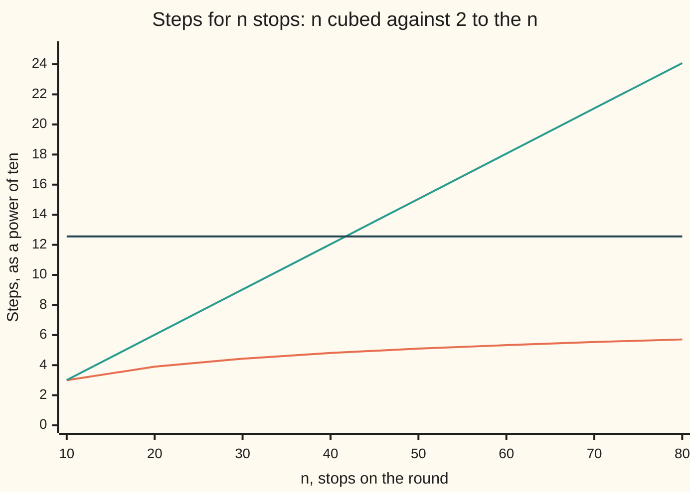

# Polynomial or exponential: the line between doable and hopeless

[Syllabus](../../../SYLLABUS.md) → [Applied and computational](../README.md) → [Algorithms and Growth](../README.md#s01) → Polynomial or exponential

---

## General Overview

A delivery van has 40 drops to make today. The dispatcher's software answers two questions about the same 40 stops.

The first: what is the shortest road distance between every pair of stops? The method tries each stop in turn as a stopover for every pair, so it does 40 × 40 × 40 = 64,000 small checks. At an assumed billion steps a second, that is 64 microseconds.

The second: in what order should the van visit all 40 stops so the whole round is shortest? The exact method with the best known guarantee keeps a record for sets of stops, and 40 stops form 2 × 2 × … × 2, forty twos, = 1,099,511,627,776 sets. At the same billion steps a second, just touching each set once takes 18.3 minutes. Counting that method's real steps gives 2.4 days. Add ten more stops and it takes 10.5 years.

Same van, same 40 stops. Just touching every set once already costs 17,179,869 times the whole first job, and that gap nearly doubles with every stop added.

**A cost that grows like a fixed power of the size, such as n³, gets only a little dearer per extra item, so faster machines carry it a long way; a cost that grows like 2ⁿ doubles per extra item, so faster machines barely move it, and the only cure is a different method.**

**What kind of fact this is:** two definitions (polynomial and exponential cost), and two theorems proved on this card in Why it works: 2ⁿ passes n³ for good at n = 10, and a machine s times faster multiplies a polynomial method's reach but only adds to an exponential one's. That "polynomial" means "doable in practice" is a rule of thumb, not a theorem, and The usual mistake shows where it fails.

### The picture: the two costs, and an hour of work

Each cost is drawn as its power of ten: 12 means a 1 followed by 12 zeros. The flat line is one hour of steps at a billion steps a second.



The orange line is n³: it starts level with the other and then barely rises. The green line is 2ⁿ: a straight climb, because every stop adds the same factor of 2, and on a power-of-ten scale a fixed factor is a fixed step up. The dark flat line is one hour. 2ⁿ crosses it just past 41 stops; n³ never comes near it on this chart.

---

## The formula

Notation first, in words. The **size** n is the number of items the method is handed: here, stops. The **cost** T(n) counts a named step, such as one comparison or one addition, done by the method on an input of size n. The [Big-O](01-big-o-and-growth-rates.md) card reads O(g) as "grows at most like g, up to a constant, for large n".

A method runs in **polynomial time** if its cost is at most c·nᵏ for some fixed numbers c and k: a fixed power of the size. A method runs in **exponential time** if its cost grows like 2ⁿ, or like aⁿ for some fixed a above 1: a fixed factor per item.

What one more item costs:

$$\frac{T(n+1)}{T(n)} = \left(1 + \frac{1}{n}\right)^{k} \ \text{ when } T(n) = n^k, \qquad \frac{T(n+1)}{T(n)} = 2 \ \text{ when } T(n) = 2^n$$

What a machine s times faster buys, inside the same time budget:

$$n_{\text{new}} = s^{1/k}\, n_{\text{old}} \ \text{ for } n^k, \qquad n_{\text{new}} = n_{\text{old}} + \log_2 s \ \text{ for } 2^n$$

**Read it aloud:** one more item nudges a polynomial cost up by a factor close to 1 but always doubles an exponential one, so speed multiplies the size a polynomial method can handle and only adds to the size an exponential method can handle.

| Symbol | Plain meaning | In our example | Push it up and the answer… |
| --- | --- | --- | --- |
| $n$ | the size: items handed to the method | 40 stops | n³ creeps up; 2ⁿ doubles each time |
| $T(n)$ | the cost: named steps done on size n | 64,000 or 1,099,511,627,776 | — |
| $k$ | the fixed power in a polynomial cost | 3 | the crossing with 2ⁿ moves later: 23 for k = 5 |
| $c$ | the fixed constant in front: steps per unit of nᵏ | 1 | every cost scales by it; growth is unchanged |
| $2^n$ | two multiplied by itself n times: the number of sets of n items | 1,099,511,627,776 | — |
| $s$ | how many times faster the new machine is | 1,000 | n³ reach × 10; 2ⁿ reach + about 10 |
| $\log_2 s$ | how many doublings make s | about 10 for s = 1,000 | — |
| $a$ | the fixed factor per item in a general exponential cost aⁿ | 2 | each item multiplies the cost by more |
| $B$ | the budget: the most steps allowed | one hour at a billion steps a second: about 10^12.56 steps | both reaches grow, n³'s far more |
| $n_{\text{old}}, n_{\text{new}}$ | the largest size that fits the budget, before and after the speed-up | 41 and 51 stops, for 2ⁿ in one hour | — |

### When it holds

- **The cost is counted in named steps, the same on every input of that size.** Both methods here do exactly the same steps on any 40-stop chart, so each cost is exact. A method whose cost depends on the input needs its case named: worst, average or amortised ([Which case are you quoting? Worst, average and amortised cost](02-worst-case-average-case-and-amortised.md)).
- **n is large enough for growth to rule.** Below the crossing the order flips: at 8 stops 2ⁿ is 256 against n³ at 512, and the exponential looks cheaper. Judging growth at a small size gets it backwards.
- **The power k and the constant c are modest.** n¹⁰⁰ is polynomial and useless. "Polynomial means doable" is true of the powers met in practice, 1 to 3 or so, not a theorem about all of them.
- **n itself is modest for the power.** A cubic method on a 1,000,000-track music library is 10¹⁸ steps, 31.7 years. Polynomial is necessary for doable, not sufficient.

---

## Why it works

### Step 0: look at what one more item does

The whole difference sits in one question: add one item, and by what factor does the cost go up? For n³ the factor is (41/40)³ when going from 40 to 41, a nudge. For 2ⁿ it is 2, always. A nudge that shrinks toward 1 and a doubling that never shrinks are two different worlds, and every other fact on this card follows from that.

### Step 1: one more stop, both ways

Going from 40 stops to 41:

- **n³:** 64,000 becomes 68,921. The cost is multiplied by 1.077: about 8% more.
- **2ⁿ:** 1,099,511,627,776 becomes 2,199,023,255,552. Doubled.

Each new stop either joins a set or does not, so every old set becomes two new ones. That is why 2ⁿ counts the sets of n stops, and why each stop doubles it.

For n³, the factor is (1 + 1/n)³. As n grows, 1/n shrinks toward 0 and the factor shrinks toward 1. The bigger the job already is, the less one more item hurts.

### Step 2: 2ⁿ passes n³ at 10, and never falls back

From 2 to 9 the cube is ahead: 2⁹ = 512 against 9³ = 729. At 10 the doubling takes over: 2¹⁰ = 1024 against 10³ = 1000.

It stays ahead. Once n is 4 or more, (1 + 1/n)³ is at most (5/4)³, under 2: the cube grows by less than double per step while 2ⁿ grows by exactly double. So if 2ⁿ is ahead at 10, it is still ahead at 11, and at 12, and so on for ever. That is a proof by induction, written out in the fold below.

The same argument beats any fixed power, only later. Against n⁵ the crossing is at 23. Against n¹⁰⁰ it comes much later, but it comes: (1 + 1/n)ᵏ sinks below 2 once n is large enough, whatever k is.

<details>
<summary>Detailed proof: 2ⁿ > n³ for every n from 10 on</summary>

**Base.** 2¹⁰ = 1024 and 10³ = 1000, so 2¹⁰ > 10³.

**Step.** Suppose 2ⁿ > n³ for some n ≥ 10. Then

$$2^{n+1} = 2 \cdot 2^n > 2 n^3 > (n+1)^3,$$

where the last step holds because (n + 1)³ / n³ = (1 + 1/n)³ ≤ (1.1)³ = 1.331 < 2 for n ≥ 10.

So the claim passes from n to n + 1, and it holds for every n ≥ 10. The check also scans every n up to 120 and finds 2ⁿ ≤ n³ exactly from n = 2 to 9.

</details>

### Step 3: what a faster machine buys

Fix a budget of B steps: say an hour at a billion steps a second. The largest size that fits is the n where the cost reaches B.

- **n³:** n³ = B gives n = B^(1/3). A machine s times faster has budget sB, so n becomes (sB)^(1/3) = s^(1/3) · B^(1/3). The reach is **multiplied** by s^(1/3). For s = 1,000, that is × 10.
- **2ⁿ:** 2ⁿ = B gives n = log₂ B, the number of doublings that reach B. With budget sB, n becomes log₂(sB) = log₂ s + log₂ B. The reach is **increased by** log₂ s. For s = 1,000, that is about + 10.

In numbers, with one hour: n³ fits 15,326 stops, and a machine 1,000 times faster fits 153,261. 2ⁿ fits 41 stops, and the same machine fits 51.

### Step 4: why an exponential search must be replaced, not tuned

**Tuning** means making each step cheaper: tighter code, a faster chip, more cores. All of these change only the constant c, which is the same as buying a machine s times faster. Step 3 showed what that buys an exponential method: log₂ s more items. To fit 82 stops in the hour instead of 41 by speed alone, the machine must be 2⁸² ÷ B = 1,343,250,910,683 times faster, about 1.34 × 10¹².

**Replacing** means changing the cost formula itself, and that is the only move that shifts the line. The round's history shows it twice.

1. **Listing every round** costs (40 − 1)!/2 for 40 stops: 1.02 × 10⁴⁶ tours ([The travelling salesman](../../04-Combinatorics%20and%20graphs/11-Tours%20-%20Euler%20and%20Hamilton/04-travelling-salesman-in-outline.md); the factorial outruns every doubling, [Factorials](../../04-Combinatorics%20and%20graphs/01-Counting%20Principles/03-factorial.md)). At a billion a second that is 3.23 × 10²⁹ years.
2. **The set-by-set method** of 1962, from [The travelling salesman](../../04-Combinatorics%20and%20graphs/11-Tours%20-%20Euler%20and%20Hamilton/04-travelling-salesman-in-outline.md), keeps, for each set of stops and each stop in it, the cheapest way to leave the depot, visit that set and stop there ([Dynamic programming](07-dynamic-programming.md)). Its cost grows like n² · 2ⁿ: 203,684,529,045,543 steps for 40 stops, 2.4 days. Replacing the method cut the work by a factor no machine could ever buy.
3. **It is still exponential.** 50 stops take 10.5 years; 60 take 15,627.4 years. No exact method that is polynomial on every chart is known, and whether one can exist is the P versus NP question of the complexity wing (wing 24).

So the next replacement gives up exactness: a polynomial method with a guaranteed bound on how far its round can be from the best. The guarantee needs the triangle inequality, no detour shorter than the direct road, which shortest road distances obey and the code asserts ([Approximation](../02-Randomised%20and%20Approximate%20Algorithms/06-approximation-algorithms.md)). A round proved to be within a known margin today beats a perfect 60-stop round in 15,627.4 years.

---

## Worked numbers, by hand

The 40-stop van, at an assumed billion steps a second.

| Step | Arithmetic | Value |
| --- | --- | --- |
| distance table, n³ | 40 × 40 × 40 | 64,000 steps: 64 microseconds |
| every set of stops, 2ⁿ | forty 2s multiplied | 1,099,511,627,776: 18.3 minutes |
| how many times dearer | 1,099,511,627,776 ÷ 64,000 | 17,179,869 |
| one more stop, n³ | 41³ = 68,921, ÷ 64,000 | × 1.077 |
| one more stop, 2ⁿ | 2⁴¹ = 2,199,023,255,552 | × 2 |
| set-by-set exact round | 39 × 38 × 2³⁷ + 39 | 203,684,529,045,543: 2.4 days |
| same method, 50 and 60 stops | the same formula | 10.5 years; 15,627.4 years |
| one hour, n³ and 2ⁿ | largest n inside the budget | 15,326 stops; 41 stops |
| one hour, machine 1,000 × faster | about 15,326 × 10; 41 + log₂ 1,000, about 10 | **153,261 stops for n³; 51 stops for 2ⁿ** |

A thousand-fold faster machine lets the cubic job handle ten times as many stops, and the exponential job ten more stops.

### What breaks if you drop a piece

| Mistake | Comes out at | What went wrong |
| --- | --- | --- |
| Judging growth at 8 stops | 2⁸ = 256 against 8³ = 512: the exponential looks cheaper | The crossing is at 10; by 40 stops 2ⁿ is 17,179,869 times dearer |
| Tuning instead of replacing | 51 stops in an hour, not 410, on a machine 1,000 times faster | Speed adds log₂ s to an exponential method's reach; it never multiplies it |
| Reading 2⁴⁰ as 40² | 1,600 instead of 1,099,511,627,776 | The base and the power swapped places |
| Taking "polynomial" as "doable" | n³ on 1,000,000 tracks: 1.00 × 10¹⁸ steps, 31.7 years | A fixed power still bites at a huge n; n² there is 16.7 minutes |

The code prints every row.

---

## Code, from first principles, and it actually runs

The code builds a synthetic 40-stop road chart (SplitMix64, seed 2026, each road 5 to 60 miles). It reaches the answers by **three independent roads**. First, it runs the distance table and the set-by-set method while counting their own steps, and checks the counts against the formulas n³ and (n − 1)(n − 2)2ⁿ⁻³ + (n − 1). Second, it finds the cheapest round by listing every order for 6 to 9 stops and checks that the set-by-set method agrees. Third, it finds the crossing and the largest size inside each budget by scanning n upward, and checks those against the proof (crossing at 10) and the formulas B^(1/3) and log₂ B; the same search confirms that 2⁸² ÷ B is the smallest speed-up that fits 82 stops. No time is measured: the times are step counts divided by the stated billion a second.

### Python

```python
# Polynomial or exponential -- the check behind the card.  Standard library only.
# A van's round of 40 stops.  Every cost is a count of named steps, never a stopwatch;
# the times below are those counts divided by an assumed 10^9 steps a second.
# The road chart is synthetic: SplitMix64, seed 2026, each road 5 to 60 miles.
import math
M, RATE, HOUR = (1 << 64) - 1, 10**9, 3600 * 10**9
state = 2026
def rand():                                   # SplitMix64, written out
    global state
    state = (state + 0x9E3779B97F4A7C15) & M
    z = ((state ^ (state >> 30)) * 0xBF58476D1CE4E5B9) & M
    z = ((z ^ (z >> 27)) * 0x94D049BB133111EB) & M
    return z ^ (z >> 31)
def sci(x):                                   # "1.10 x 10^12", built the same way in both languages
    e = 0
    while x >= 10: x, e = x / 10, e + 1
    return f"{x:.2f} x 10^{e}"
def span(steps):                              # a step count read as time at RATE
    s = steps / RATE
    for unit, size in (("million years", 31557600e6), ("years", 31557600.0), ("days", 86400.0),
                       ("hours", 3600.0), ("minutes", 60.0), ("seconds", 1.0)):
        if s >= size: return f"{s / size:,.1f} {unit}"
    return f"{s * 1e6:.0f} microseconds"
N = 40
d = [[0] * N for _ in range(N)]
for i in range(N):
    for j in range(i + 1, N): d[i][j] = d[j][i] = 5 + rand() % 56
def table(n):                                 # shortest road between every pair: try each stop k as a stopover
    t, checks = [row[:n] for row in d[:n]], 0
    for k in range(n):
        for i in range(n):
            for j in range(n):
                checks += 1
                if t[i][k] + t[k][j] < t[i][j]: t[i][j] = t[i][k] + t[k][j]
    return t, checks
t40, checks40 = table(N)
assert checks40 == N ** 3 and table(20)[1] == 8000          # road 1: counted against the formula n^3
assert all(t40[i][j] <= t40[i][k] + t40[k][j] for i in range(N) for j in range(N) for k in range(N))
def set_by_set(n):                            # exact cheapest round from stop 0, counting additions
    best, adds = {}, 0
    for S in range(1, 1 << (n - 1)):          # every set of stops 1..n-1, as a bit mask
        for j in range(1, n):
            if not S >> (j - 1) & 1: continue
            R = S & ~(1 << (j - 1))
            if R == 0: best[S, j] = t40[0][j]; continue
            v = None
            for i in range(1, n):
                if R >> (i - 1) & 1:
                    adds += 1
                    c = best[R, i] + t40[i][j]
                    if v is None or c < v: v = c
            best[S, j] = v
    full = (1 << (n - 1)) - 1
    return min(best[full, j] + t40[j][0] for j in range(1, n)), len(best), adds + n - 1
def brute(n):                                 # road 2: every order of the stops after 0
    def go(last, left, miles):
        if not left: return miles + t40[last][0]
        return min(go(x, [y for y in left if y != x], miles + t40[last][x]) for x in left)
    return go(0, list(range(1, n)), 0)
def hk_adds(n): m = n - 1; return m * (m - 1) * 2 ** (m - 2) + m if n > 2 else n - 1
for n in (6, 7, 8, 9):
    assert set_by_set(n)[0] == brute(n)                      # same cheapest round, two methods
print("set-by-set exact round on the first n stops: steps counted, and growth")
prev = None
for n in range(8, 15):
    miles, recs, adds = set_by_set(n)
    assert adds == hk_adds(n) and recs == (n - 1) * 2 ** (n - 2)   # counted against the formula
    print(f"  n {n:2d}  cheapest {miles:3d} miles  records {recs:7,}  steps {adds:9,}"
          + (f"  x{adds / prev:.3f}" if prev else ""))
    prev = adds
print("the 40-stop round, steps counted or by formula")
rows = [("distance table, n^3 (counted)", checks40), ("every set of stops, 2^n", 2 ** N),
        ("set-by-set exact round", hk_adds(N))]
for label, c in rows: print(f"  {label:31s} {c:>22,}   {span(c)}")
brute40 = 1.0
for k in range(2, N): brute40 *= k
print(f"  listing every round, 39!/2       {sci(brute40 / 2):>21}   {sci(brute40 / 2 / RATE / 31557600)} years")
print(f"  2^40 / 40^3 = {2 ** N // N ** 3:,}")
print(f"  one more stop: 41^3 = {41 ** 3:,} (x{41 ** 3 / N ** 3:.3f}), 2^41 = {2 ** 41:,} (x2)")
for n in (50, 60, 80):
    print(f"  n = {n}: n^3 {span(n ** 3)};  2^n {span(2 ** n)};  set-by-set {span(hk_adds(n))}")
lead = [n for n in range(1, 121) if 2 ** n <= n ** 3]        # road 3: scan for the crossing
print(f"crossing: n^3 >= 2^n for n = {lead[0]} to {lead[-1]}; "
      f"2^9 = {2**9} <= 9^3 = {9**3}; 2^10 = {2**10} > 10^3 = {10**3}; for n^5 it is n = 23")
assert lead == list(range(2, 10)) and all((n + 1) ** 3 < 2 * n ** 3 for n in range(4, 121))
assert max(n for n in range(1, 121) if 2 ** n <= n ** 5) == 22
def largest(cost, budget):                    # step n up until the cost passes the budget
    n = 1
    while cost(n + 1) <= budget: n += 1
    return n
print("largest n inside a budget, by search and by formula")
for name, budget in (("1 hour", HOUR), ("1 hour, 1000x faster", 1000 * HOUR), ("1 day", 24 * HOUR)):
    c, e = largest(lambda n: n ** 3, budget), largest(lambda n: 2 ** n, budget)
    assert c == math.floor(budget ** (1 / 3)) and e == math.floor(math.log2(budget))
    print(f"  {name:21s} n^3: {c:>7,}   2^n: {e}")
print(f"what breaks: n = 8 looks fine: 2^8 = {2**8} < 8^3 = {8**3}")
print(f"what breaks: 1000x faster buys 2^n {largest(lambda n: 2**n, 1000*HOUR)} stops, not {10*41}")
print(f"what breaks: 40^2 = {40**2:,}, not 2^40")
print(f"what breaks: n^3 on 1,000,000 tracks = {sci(1e18)} = {span(10**18)}; n^2 = {span(10**12)}")
s82 = (2 ** 82 + HOUR - 1) // HOUR                           # least speed-up that fits 82 stops
assert largest(lambda n: 2 ** n, s82 * HOUR) == 82 and largest(lambda n: 2 ** n, (s82 - 1) * HOUR) == 81
print(f"what breaks: 82 stops in one hour, by speed alone, needs {s82:,}x = {sci(s82)}")
print("chart, n          " + "".join(f"{n:7d}" for n in range(10, 81, 10)))
print("chart, log10 n^3  " + "".join(f"{3 * math.log10(n):7.2f}" for n in range(10, 81, 10)))
print("chart, log10 2^n  " + "".join(f"{n * math.log10(2):7.2f}" for n in range(10, 81, 10)))
print(f"chart, one hour   {math.log10(HOUR):7.2f}")
print("ALL CHECKS PASS")
```

**Ran 2026-11-11 on macOS, Python 3.14.10, standard library only. All checks passed. Output, pasted from the run:**

```
set-by-set exact round on the first n stops: steps counted, and growth
  n  8  cheapest 120 miles  records     448  steps     1,351
  n  9  cheapest 129 miles  records   1,024  steps     3,592  x2.659
  n 10  cheapest 142 miles  records   2,304  steps     9,225  x2.568
  n 11  cheapest 150 miles  records   5,120  steps    23,050  x2.499
  n 12  cheapest 167 miles  records  11,264  steps    56,331  x2.444
  n 13  cheapest 173 miles  records  24,576  steps   135,180  x2.400
  n 14  cheapest 173 miles  records  53,248  steps   319,501  x2.364
the 40-stop round, steps counted or by formula
  distance table, n^3 (counted)                   64,000   64 microseconds
  every set of stops, 2^n              1,099,511,627,776   18.3 minutes
  set-by-set exact round             203,684,529,045,543   2.4 days
  listing every round, 39!/2                1.02 x 10^46   3.23 x 10^29 years
  2^40 / 40^3 = 17,179,869
  one more stop: 41^3 = 68,921 (x1.077), 2^41 = 2,199,023,255,552 (x2)
  n = 50: n^3 125 microseconds;  2^n 13.0 days;  set-by-set 10.5 years
  n = 60: n^3 216 microseconds;  2^n 36.5 years;  set-by-set 15,627.4 years
  n = 80: n^3 512 microseconds;  2^n 38.3 million years;  set-by-set 29,507.2 million years
crossing: n^3 >= 2^n for n = 2 to 9; 2^9 = 512 <= 9^3 = 729; 2^10 = 1024 > 10^3 = 1000; for n^5 it is n = 23
largest n inside a budget, by search and by formula
  1 hour                n^3:  15,326   2^n: 41
  1 hour, 1000x faster  n^3: 153,261   2^n: 51
  1 day                 n^3:  44,208   2^n: 46
what breaks: n = 8 looks fine: 2^8 = 256 < 8^3 = 512
what breaks: 1000x faster buys 2^n 51 stops, not 410
what breaks: 40^2 = 1,600, not 2^40
what breaks: n^3 on 1,000,000 tracks = 1.00 x 10^18 = 31.7 years; n^2 = 16.7 minutes
what breaks: 82 stops in one hour, by speed alone, needs 1,343,250,910,683x = 1.34 x 10^12
chart, n               10     20     30     40     50     60     70     80
chart, log10 n^3     3.00   3.90   4.43   4.81   5.10   5.33   5.54   5.71
chart, log10 2^n     3.01   6.02   9.03  12.04  15.05  18.06  21.07  24.08
chart, one hour     12.56
ALL CHECKS PASS
```

The counted steps for 8 to 14 stops match the formula exactly. The growth factor per stop starts at 2.659 and sinks toward 2, because the n² in front of 2ⁿ adds less each time.

### Rust

The same checks, with the same seed. Rust has no big integers, so the counts are held in u128, 128-bit whole numbers, which hold 2⁸⁰ with room to spare.

```rust
// Polynomial or exponential -- the same check as the Python file, in Rust.  std only, no crates.
// A van's round of 40 stops.  Every cost is a count of named steps, never a stopwatch;
// the times below are those counts divided by an assumed 10^9 steps a second.
// The road chart is synthetic: SplitMix64, seed 2026, each road 5 to 60 miles.
const N: usize = 40;
const RATE: f64 = 1e9;
const HOUR: u128 = 3600 * 1_000_000_000;

fn rand(state: &mut u64) -> u64 {
    *state = state.wrapping_add(0x9E3779B97F4A7C15);
    let mut z = (*state ^ (*state >> 30)).wrapping_mul(0xBF58476D1CE4E5B9);
    z = (z ^ (z >> 27)).wrapping_mul(0x94D049BB133111EB);
    z ^ (z >> 31)
}
fn commas(x: u128) -> String {
    let s = x.to_string();
    let mut out = String::new();
    for (i, ch) in s.chars().enumerate() {
        if i > 0 && (s.len() - i) % 3 == 0 { out.push(','); }
        out.push(ch);
    }
    out
}
fn sci(mut x: f64) -> String {
    let mut e = 0;
    while x >= 10.0 { x /= 10.0; e += 1; }
    format!("{:.2} x 10^{}", x, e)
}
fn span(steps: f64) -> String {
    let s = steps / RATE;
    let units = [("million years", 31557600e6), ("years", 31557600.0), ("days", 86400.0),
                 ("hours", 3600.0), ("minutes", 60.0), ("seconds", 1.0)];
    for (unit, size) in units {
        if s >= size {
            let v = format!("{:.1}", s / size);
            let (int, frac) = v.split_at(v.len() - 2);
            return format!("{}{} {}", commas(int.parse().unwrap()), frac, unit);
        }
    }
    format!("{:.0} microseconds", s * 1e6)
}
fn table(d: &Vec<Vec<u64>>, n: usize) -> (Vec<Vec<u64>>, u128) {
    let mut t: Vec<Vec<u64>> = d[..n].iter().map(|r| r[..n].to_vec()).collect();
    let mut checks = 0u128;
    for k in 0..n { for i in 0..n { for j in 0..n {
        checks += 1;
        if t[i][k] + t[k][j] < t[i][j] { t[i][j] = t[i][k] + t[k][j]; }
    } } }
    (t, checks)
}
fn set_by_set(t: &Vec<Vec<u64>>, n: usize) -> (u64, u128, u128) {
    let sets = 1usize << (n - 1);
    let mut best = vec![u64::MAX; sets * n];
    let (mut recs, mut adds) = (0u128, 0u128);
    for s in 1..sets {
        for j in 1..n {
            if (s >> (j - 1)) & 1 == 0 { continue; }
            let r = s & !(1 << (j - 1));
            recs += 1;
            if r == 0 { best[s * n + j] = t[0][j]; continue; }
            let mut v = u64::MAX;
            for i in 1..n {
                if (r >> (i - 1)) & 1 == 1 {
                    adds += 1;
                    let c = best[r * n + i] + t[i][j];
                    if c < v { v = c; }
                }
            }
            best[s * n + j] = v;
        }
    }
    let full = sets - 1;
    let tour = (1..n).map(|j| best[full * n + j] + t[j][0]).min().unwrap();
    (tour, recs, adds + (n as u128) - 1)
}
fn go(t: &Vec<Vec<u64>>, last: usize, left: &Vec<usize>, miles: u64) -> u64 {
    if left.is_empty() { return miles + t[last][0]; }
    left.iter().map(|&x| {
        let rest: Vec<usize> = left.iter().copied().filter(|&y| y != x).collect();
        go(t, x, &rest, miles + t[last][x])
    }).min().unwrap()
}
fn hk_adds(n: u128) -> u128 { let m = n - 1; m * (m - 1) * (1u128 << (m - 2)) + m }
fn largest(cost: &dyn Fn(u128) -> u128, budget: u128) -> u128 {
    let mut n = 1;
    while cost(n + 1) <= budget { n += 1; }
    n
}

fn main() {
    let mut state = 2026u64;
    let mut d = vec![vec![0u64; N]; N];
    for i in 0..N { for j in i + 1..N { let r = 5 + rand(&mut state) % 56; d[i][j] = r; d[j][i] = r; } }
    let (t40, checks40) = table(&d, N);
    assert!(checks40 == (N as u128).pow(3) && table(&d, 20).1 == 8000);
    for i in 0..N { for j in 0..N { for k in 0..N { assert!(t40[i][j] <= t40[i][k] + t40[k][j]); } } }
    for n in 6..10 {
        let rest: Vec<usize> = (1..n).collect();
        assert_eq!(set_by_set(&t40, n).0, go(&t40, 0, &rest, 0));
    }
    println!("set-by-set exact round on the first n stops: steps counted, and growth");
    let mut prev = 0u128;
    for n in 8..15usize {
        let (miles, recs, adds) = set_by_set(&t40, n);
        assert!(adds == hk_adds(n as u128) && recs == (n as u128 - 1) << (n - 2));
        let grow = if prev > 0 { format!("  x{:.3}", adds as f64 / prev as f64) } else { String::new() };
        println!("  n {:2}  cheapest {:3} miles  records {:>7}  steps {:>9}{}", n, miles, commas(recs), commas(adds), grow);
        prev = adds;
    }
    println!("the 40-stop round, steps counted or by formula");
    let rows = [("distance table, n^3 (counted)", checks40), ("every set of stops, 2^n", 1u128 << N),
                ("set-by-set exact round", hk_adds(N as u128))];
    for (label, c) in rows { println!("  {:31} {:>22}   {}", label, commas(c), span(c as f64)); }
    let mut brute40 = 1.0f64;
    for k in 2..N { brute40 *= k as f64; }
    println!("  listing every round, 39!/2       {:>21}   {} years", sci(brute40 / 2.0), sci(brute40 / 2.0 / RATE / 31557600.0));
    println!("  2^40 / 40^3 = {}", commas((1u128 << N) / (N as u128).pow(3)));
    println!("  one more stop: 41^3 = {} (x{:.3}), 2^41 = {} (x2)", commas(41u128.pow(3)), 68921.0 / 64000.0, commas(1u128 << 41));
    for n in [50u128, 60, 80] {
        println!("  n = {}: n^3 {};  2^n {};  set-by-set {}", n, span(n.pow(3) as f64), span((1u128 << n) as f64), span(hk_adds(n) as f64));
    }
    let lead: Vec<u128> = (1u128..121).filter(|&n| (1u128 << n) <= n.pow(3)).collect();
    println!("crossing: n^3 >= 2^n for n = {} to {}; 2^9 = {} <= 9^3 = {}; 2^10 = {} > 10^3 = {}; for n^5 it is n = 23",
             lead[0], lead[lead.len() - 1], 1 << 9, 9 * 9 * 9, 1 << 10, 1000);
    assert!(lead == (2u128..10).collect::<Vec<u128>>() && (4u128..121).all(|n| (n + 1).pow(3) < 2 * n.pow(3)));
    assert_eq!((1u128..121).filter(|&n| (1u128 << n) <= n.pow(5)).max().unwrap(), 22);
    println!("largest n inside a budget, by search and by formula");
    let cube = |n: u128| n.pow(3);
    let pow2 = |n: u128| if n >= 127 { u128::MAX } else { 1u128 << n };
    for (name, budget) in [("1 hour", HOUR), ("1 hour, 1000x faster", 1000 * HOUR), ("1 day", 24 * HOUR)] {
        let (c, e) = (largest(&cube, budget), largest(&pow2, budget));
        assert!(c == (budget as f64).powf(1.0 / 3.0).floor() as u128 && e == (budget as f64).log2().floor() as u128);
        println!("  {:21} n^3: {:>7}   2^n: {}", name, commas(c), e);
    }
    println!("what breaks: n = 8 looks fine: 2^8 = {} < 8^3 = {}", 1 << 8, 8 * 8 * 8);
    println!("what breaks: 1000x faster buys 2^n {} stops, not {}", largest(&pow2, 1000 * HOUR), 10 * 41);
    println!("what breaks: 40^2 = {}, not 2^40", commas(40 * 40));
    println!("what breaks: n^3 on 1,000,000 tracks = {} = {}; n^2 = {}", sci(1e18), span(1e18), span(1e12));
    let s82 = ((1u128 << 82) + HOUR - 1) / HOUR; // least speed-up that fits 82 stops
    assert!(largest(&pow2, s82 * HOUR) == 82 && largest(&pow2, (s82 - 1) * HOUR) == 81);
    println!("what breaks: 82 stops in one hour, by speed alone, needs {}x = {}", commas(s82), sci(s82 as f64));
    let ns: Vec<u32> = (1..9).map(|k| 10 * k).collect();
    println!("chart, n          {}", ns.iter().map(|n| format!("{:7}", n)).collect::<String>());
    println!("chart, log10 n^3  {}", ns.iter().map(|&n| format!("{:7.2}", 3.0 * (n as f64).log10())).collect::<String>());
    println!("chart, log10 2^n  {}", ns.iter().map(|&n| format!("{:7.2}", n as f64 * 2f64.log10())).collect::<String>());
    println!("chart, one hour   {:7.2}", (HOUR as f64).log10());
    println!("ALL CHECKS PASS");
}
```

**Ran 2026-11-11 on macOS, rustc 1.98.1, no crates. All checks passed. Output, pasted from the run:**

```
set-by-set exact round on the first n stops: steps counted, and growth
  n  8  cheapest 120 miles  records     448  steps     1,351
  n  9  cheapest 129 miles  records   1,024  steps     3,592  x2.659
  n 10  cheapest 142 miles  records   2,304  steps     9,225  x2.568
  n 11  cheapest 150 miles  records   5,120  steps    23,050  x2.499
  n 12  cheapest 167 miles  records  11,264  steps    56,331  x2.444
  n 13  cheapest 173 miles  records  24,576  steps   135,180  x2.400
  n 14  cheapest 173 miles  records  53,248  steps   319,501  x2.364
the 40-stop round, steps counted or by formula
  distance table, n^3 (counted)                   64,000   64 microseconds
  every set of stops, 2^n              1,099,511,627,776   18.3 minutes
  set-by-set exact round             203,684,529,045,543   2.4 days
  listing every round, 39!/2                1.02 x 10^46   3.23 x 10^29 years
  2^40 / 40^3 = 17,179,869
  one more stop: 41^3 = 68,921 (x1.077), 2^41 = 2,199,023,255,552 (x2)
  n = 50: n^3 125 microseconds;  2^n 13.0 days;  set-by-set 10.5 years
  n = 60: n^3 216 microseconds;  2^n 36.5 years;  set-by-set 15,627.4 years
  n = 80: n^3 512 microseconds;  2^n 38.3 million years;  set-by-set 29,507.2 million years
crossing: n^3 >= 2^n for n = 2 to 9; 2^9 = 512 <= 9^3 = 729; 2^10 = 1024 > 10^3 = 1000; for n^5 it is n = 23
largest n inside a budget, by search and by formula
  1 hour                n^3:  15,326   2^n: 41
  1 hour, 1000x faster  n^3: 153,261   2^n: 51
  1 day                 n^3:  44,208   2^n: 46
what breaks: n = 8 looks fine: 2^8 = 256 < 8^3 = 512
what breaks: 1000x faster buys 2^n 51 stops, not 410
what breaks: 40^2 = 1,600, not 2^40
what breaks: n^3 on 1,000,000 tracks = 1.00 x 10^18 = 31.7 years; n^2 = 16.7 minutes
what breaks: 82 stops in one hour, by speed alone, needs 1,343,250,910,683x = 1.34 x 10^12
chart, n               10     20     30     40     50     60     70     80
chart, log10 n^3     3.00   3.90   4.43   4.81   5.10   5.33   5.54   5.71
chart, log10 2^n     3.01   6.02   9.03  12.04  15.05  18.06  21.07  24.08
chart, one hour     12.56
ALL CHECKS PASS
```

The two outputs are identical, line for line.

> [!TIP]
> **Try changing**
> - Guess first: what does a machine a million times faster buy? The setting: in the list of budgets, change `1000 * HOUR` to `10**6 * HOUR` (the label still says 1000x). The answer: n³ goes from 15,326 to 1,532,618 stops, a hundred times as many; 2ⁿ only from 41 to 61. Every assert still passes.
> - Guess first: where does 2ⁿ pass n⁴ instead of n³? The setting: change `n ** 3` to `n ** 4` in the line marked road 3. The answer: the crossing line prints n = 2 to 16, so 2ⁿ passes n⁴ at 17, not 10 (at 16 both are 65,536); then the assert that pins 2 to 9 stops the script. A bigger power delays the crossing; it never stops it.
> - Guess first: how many steps does the set-by-set method count for 16 stops? The setting: change `range(8, 15)` to `range(8, 17)`. The answer: 1,720,335 steps, ×2.308 on 15 stops. The count still equals the formula, so every assert passes, and the factor keeps sinking toward 2.

---

## The usual mistake

> [!warning]
> **Trying to speed up an exponential search instead of replacing it.** Faster code, faster chips and more cores only change the constant in front. For a 2ⁿ method, a machine 1,000 times faster turns 41 stops in an hour into 51, not 410. Each doubling of speed buys one more stop. The fix is a different formula for the cost: a smarter exact method, a polynomial method with a proven margin, or a smaller question.
>
> Smaller traps:
> - **Testing on a small input.** At 8 stops 2ⁿ is 256 and n³ is 512, so the exponential method looks twice as cheap. At 40 stops it is 17,179,869 times dearer.
> - **Mixing up 2ⁿ and n².** 40² is 1,600. 2⁴⁰ is 1,099,511,627,776. The letter n in the power is the whole danger.
> - **Calling every polynomial cheap.** A cubic method on a 1,000,000-track library is 1.00 × 10¹⁸ steps: 31.7 years. Polynomial is the price of entry, not a promise.
> - **Calling exponential impossible.** 2⁴⁰ steps is 18.3 minutes, and the set-by-set method promises the exact 40-stop round in 2.4 days on any chart. That is the best guarantee known, not what real charts take: solvers that prune the search often finish real 40- or 50-stop charts far sooner, with no promise ([The travelling salesman](../../04-Combinatorics%20and%20graphs/11-Tours%20-%20Euler%20and%20Hamilton/04-travelling-salesman-in-outline.md)). Exponential means the guarantee doubles with each extra item, so it hits a wall within a few more items: 10.5 years at 50 stops.

---

## Where you meet it in real life

- **Delivery and field-service software.** Small rounds are solved exactly; big ones by fast methods with no promise of the best round, or a promised margin. The switch is set by how long the dispatcher can wait, not by 2ⁿ alone: an exact solver that prunes the search often finishes a real chart long before its worst-case guarantee.
- **Passwords and keys.** A key of k bits has 2ᵏ possible values, and each extra bit doubles a guesser's work. Here the exponential is the defence: "k-bit security" means about 2ᵏ steps to break, if the underlying assumption holds.
- **A phone music library.** A playlist feature whose cost is n² does 10¹² steps on 1,000,000 tracks, 16.7 minutes at a billion a second; a cubic one runs for 31.7 years. Even polynomial methods get chosen by their power.
- **Timetabling and rostering.** Choosing which of n shifts each nurse takes has an exponential number of options. Planners use solvers that are fast on typical inputs with no worst-case guarantee, and report how close to the best they got.
- **Chess and other games.** The positions after n moves grow like a fixed factor per move. Programs cannot search deeper by buying hardware alone; they prune the tree, a change of method.

> **Say it back**
> A polynomial cost such as n³ grows by a factor that shrinks toward 1 as the size grows, so a faster machine multiplies the size it can handle. An exponential cost such as 2ⁿ doubles with every item, so a faster machine only adds a few items. For 40 stops, n³ is 64,000 steps and 2ⁿ is 1,099,511,627,776, and 2ⁿ stays ahead from 10 on. A machine 1,000 times faster takes an hour's 2ⁿ job from 41 stops to 51. So an exponential search is fixed by changing the method, not by speeding it up.

---

## What this builds on

- [Big-O](01-big-o-and-growth-rates.md): reading a cost by how it grows, up to a constant, for large n. This card splits growth rates into two families and shows why the split matters more than the constant.
- [The travelling salesman](../../04-Combinatorics%20and%20graphs/11-Tours%20-%20Euler%20and%20Hamilton/04-travelling-salesman-in-outline.md): the round itself, the (n − 1)!/2 count of tours, brute force on six towns and the set-by-set method. This card puts the 40-stop version of that cost beside n³.
- [Factorials](../../04-Combinatorics%20and%20graphs/01-Counting%20Principles/03-factorial.md): the ranking n! above 2ⁿ above n², and Stirling's estimate. This card turns that ranking into steps and hours on a real input.

## Where this goes next

- [Approximation](../02-Randomised%20and%20Approximate%20Algorithms/06-approximation-algorithms.md): the replacement this card argues for. A polynomial method for the round with a proved bound on how far it can land from the best.
- [Recurrences](04-recurrences-and-the-master-theorem.md): the next card. How to read the cost of a method that calls itself, which is where many polynomial and exponential costs come from.
- [Dynamic programming](07-dynamic-programming.md): the set-by-set idea in general. Solve each smaller piece once and write it down, which turned 10⁴⁶ tours into 2.4 days.

The question left open: is there any exact method for the round whose cost is polynomial on every chart? Nobody knows, and that is the P versus NP question.

---

## Sources

Verified 2026-11-11: every link below resolves to the publisher's page.

- Edmonds, Jack. "Paths, Trees, and Flowers." *Canadian Journal of Mathematics* 17 (1965): 449–467. [doi:10.4153/CJM-1965-045-4](https://doi.org/10.4153/CJM-1965-045-4). Proposes polynomial cost as the mark of a good algorithm, the line this card draws.
- Hartmanis, Juris, and Richard E. Stearns. "On the Computational Complexity of Algorithms." *Transactions of the American Mathematical Society* 117 (1965): 285–306. [doi:10.1090/S0002-9947-1965-0170805-7](https://doi.org/10.1090/S0002-9947-1965-0170805-7). Founds the measuring of cost as a function of input size.
- Held, Michael, and Richard M. Karp. "A Dynamic Programming Approach to Sequencing Problems." *Journal of the Society for Industrial and Applied Mathematics* 10, no. 1 (1962): 196–210. [doi:10.1137/0110015](https://doi.org/10.1137/0110015). The set-by-set method for the round, and its n² · 2ⁿ cost.
- Floyd, Robert W. "Algorithm 97: Shortest Path." *Communications of the ACM* 5, no. 6 (1962): 345. [doi:10.1145/367766.368168](https://doi.org/10.1145/367766.368168). The n³ table of shortest distances between every pair of stops.
- Kleinberg, Jon, and Éva Tardos. *Algorithm Design*. Pearson, 2005. [Publisher page](https://www.pearson.com/en-us/subject-catalog/p/algorithm-design/P200000003259). Chapter 2 sets out polynomial time as the working definition of efficient, with running times tabulated at real sizes.
