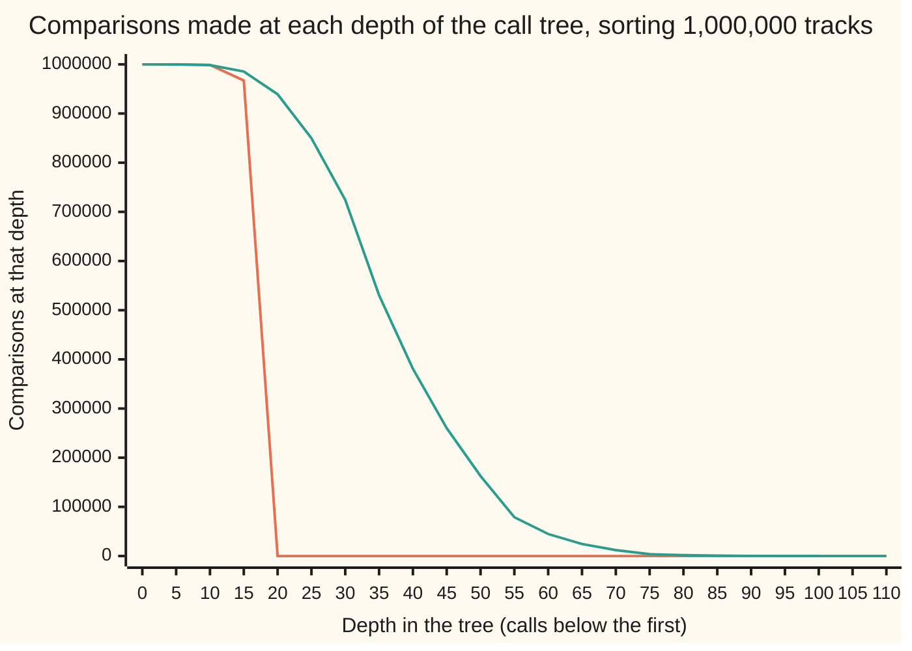

# Recurrences: the cost of a method that calls itself, read off in one line

[Syllabus](../../../SYLLABUS.md) → [Applied and computational](../README.md) → [Algorithms and Growth](../README.md#s01) → Recurrences

---

## General Overview

A phone holds a music library of 1,000,000 tracks, and the app has to list them in title order. It uses merge sort: cut the list in half, put each half in order the same way, then merge the two ordered halves by repeatedly taking whichever front track comes first.

How many comparisons does that cost? The code cannot be counted line by line, because the sorting routine calls itself. But its cost can be written the same way the code is written. The cost on 1,000,000 tracks is the cost on each half, plus the merge, which makes at most one comparison per track placed. A rule that defines a cost from the cost of smaller inputs is a **recurrence** ([Recurrences](../../04-Combinatorics%20and%20graphs/05-Recurrences/01-recurrences-and-fibonacci.md)).

That rule answers the question. Halving 1,000,000 down to single tracks takes 20 rounds, and each round's merges make fewer than 1,000,000 comparisons, so the total is under 20,000,000. The exact worst case is 18,951,425. Sorting a synthetic library counted 18,674,254. Comparing every pair of tracks instead would cost 499,999,500,000.

The combinatorics wing already reads the total off rules of the shape "a copies of size n/b, plus some joining work": that is the master theorem. This card is about the two steps around it: writing the rule from real code, and what to do when the code gives a rule the theorem does not cover.

**Write one cost term for each call the code makes to itself, add the work it does outside those calls, and the shape of that rule gives the total: by the master theorem when it fits, and by adding up the tree of calls one level at a time when it does not.**

**What kind of fact this is:** a method for writing the rule, plus theorems for reading it. The master theorem is proved on [Divide-and-conquer recurrences](../../04-Combinatorics%20and%20graphs/05-Recurrences/07-divide-and-conquer-recurrences.md); the merge sort count and the two shapes outside it are derived here in Why it works.

### The picture: where the comparisons are made



The first line is merge sort: every depth holds all the tracks, so every depth but the last few costs almost 1,000,000, and the tree stops after 20 depths. The second is quicksort with a lopsided split, one tenth against nine tenths. Quicksort splits the list around one chosen track (Step 3 below). Its depths still cost at most 1,000,000 each, but the tree runs to 113 depths and thins out as the small pieces finish. Both totals grow like n log n; the master theorem can only say so for the first.

---

## The formula

The recipe, read straight off the code: one term for each call the routine makes to itself, at the size it passes down, plus the work the routine does outside those calls.

$$T(n) = T(n_1) + T(n_2) + \dots + f(n)$$

**Read it aloud:** the cost on n items is the cost of each smaller call the code makes, plus the work this call does itself. Here $n_1$, $n_2$, … are the sizes the code passes to its calls.

Merge sort calls itself on the two halves, then merges with at most n − 1 comparisons, and a single track costs nothing:

$$T(n) = T(\lfloor n/2 \rfloor) + T(\lceil n/2 \rceil) + (n - 1), \qquad T(1) = 0$$

The brackets $\lfloor\ \rfloor$ and $\lceil\ \rceil$ round down and up, so an odd list splits into two whole pieces.

When the calls are $a$ copies of size $n/b$ and the outside work is $f(n) = n^d$, the master theorem ([Divide-and-conquer recurrences](../../04-Combinatorics%20and%20graphs/05-Recurrences/07-divide-and-conquer-recurrences.md)) reads the answer off in one line. $T(n)$ is:

- $\Theta(n^{\log_b a})$ if $d < \log_b a$;
- $\Theta(n^d \log n)$ if they are equal;
- $\Theta(n^d)$ if $d$ is bigger.

$\Theta(g)$ means "grows exactly like g, up to a constant factor, for large n" ([Big-O](01-big-o-and-growth-rates.md)).

| Code | Calls itself on | Work outside | Rule | Grows like |
| --- | --- | --- | --- | --- |
| merge sort | 2 halves | merge, n | $2T(n/2) + n$ | $n \log n$, flat levels |
| binary search | 1 half | one look | $T(n/2) + 1$ | $\log n$, flat levels |
| Karatsuba multiply | 3 half-length numbers | additions, n | $3T(n/2) + n$ | $n^{1.585}$, bottom heavy |
| Strassen matrix multiply | 7 half-size blocks | additions, $n^2$ | $7T(n/2) + n^2$ | $n^{2.807}$, bottom heavy |
| quicksort, 10% pivot | pieces of 10% and 90% | partition, n | $T(n/10) + T(9n/10) + n$ | $n \log n$, not by the theorem |
| quicksort, sorted input | pieces of 0 and n − 1 | partition, n | $T(n-1) + n$ | $n^2$, not by the theorem |

| Symbol | Plain meaning | In our example | Push it up and the answer… |
| --- | --- | --- | --- |
| $T(n)$ | comparisons (or digit multiplies) on n items | 18,951,425 at n = 1,000,000 | — |
| $n$; $n_1$, $n_2$ | input size: tracks, or digits; the sizes passed to the calls | 1,000,000 tracks; the two halves | rises, at the rate the rule sets |
| $a$ | calls the code makes to itself | 2 for merge sort, 3 for Karatsuba | the bottom of the tree swells |
| $b$ | how many times smaller each call is | 2 | fewer levels |
| $f(n)$ | work done outside the calls | n − 1 comparisons to merge | the top of the tree swells |
| $d$ | the power in $f(n) = n^d$ | 1 | the top takes over |
| $\log_b a$ | the watershed power the theorem compares $d$ with | 1; 1.585 for Karatsuba | the bottom takes over |
| $j$ | depth in the tree, the first call being depth 0 | 0 to 19 | smaller pieces, more of them |
| $x$, $y$; $x_1$, $x_0$ | two numbers to multiply; the top and bottom halves of x's digits | 16 digits; 8 digits each | more digits, more levels |
| $k$ | levels of the tree, $\lceil \log_2 n \rceil$ | 20 | one more level per doubling |
| $H$ | the uneven split's entropy, $-(0.1 \ln 0.1 + 0.9 \ln 0.9)$; ln is the natural log | 0.3251 | a more even split: fewer levels |
| $\Theta(g)$ | grows exactly like g, up to a constant | $\Theta(n \log n)$ | — |

### When it holds

- **Every call's size is fixed by n.** Quicksort's piece sizes depend on the data, so its rule exists only for a named case: the worst case, or a fixed split. Leave the case unnamed and the rule means nothing.
- **The pieces are a fixed fraction of n.** A rule like $T(n-1) + n$ has no $b$, so the theorem is silent; on a sorted playlist it gives n²/2, not n log n.
- **The outside work is a plain power of n.** Work of n log₂ n per call falls between two cases; the tree gives n log² n (n times log n squared), more than ten times the n log n a forced guess gives at 2²⁰ items.
- **The answer is a growth class, not a count.** The theorem says merge sort is $\Theta(n \log n)$; it cannot tell 18,951,425 from 20,000,000. The exact count comes from the recurrence itself.

---

## Why it works

### Step 0: the calls form a tree, and the cost is the sum over its nodes

Each call does its own outside work once, then hands smaller jobs to its children. Draw every call as a node, with the first call at the top. The total cost is the sum of the outside work at every node. The recurrence is that sum written one node at a time; adding it up a level at a time is usually easier.

### Step 1: write merge sort's rule from the code, and solve it exactly

The code makes two calls, on $\lfloor n/2 \rfloor$ and $\lceil n/2 \rceil$ tracks, then a merge loop. Each pass of the loop makes one comparison and places one track, and the last track is placed without a comparison, so the merge costs at most n − 1. That is the rule above.

At depth j there are $2^j$ pieces, together holding all n tracks. Each piece costs its size minus one, so the whole depth costs $n - 2^j$: 999,999 at depth 0, 475,712 at depth 19. With $k = \lceil \log_2 n \rceil$ depths, the total is

$$T(n) = \sum_{j=0}^{k-1} (n - 2^j) = n k - 2^k + 1$$

At 1,000,000 tracks, $k = 20$: 20,000,000 minus 1,048,575 is **18,951,425**. The code checks this three ways: by running the recurrence, by the closed form, and by summing the depths.

No comparison sort can beat $\log_2(n!)$ comparisons in the worst case, or on average over all orders: 18,488,885 here. Each comparison at best halves the orders still possible ([Sorting and searching](05-sorting-and-searching.md)). The counted run on the shuffled library, 18,674,254, sits between that floor and the worst case. The floor does not bind a single lucky order: handed the library already sorted, the same code makes 9,884,992.

<details>
<summary>Why every depth holds n − 2^j comparisons, even when n is not a power of 2</summary>

Splitting into $\lfloor n/2 \rfloor$ and $\lceil n/2 \rceil$ keeps every piece at a depth within one of the others in size. Since $n > 2^{k-1}$, every piece down to depth $k - 1$ holds at least one track. A piece costs its size minus one, and a piece of one track costs 0, which is also its size minus one. Summing size minus one over the $2^j$ pieces gives $n - 2^j$. Adding depths 0 to k − 1 gives $nk - (2^k - 1)$. ∎

</details>

### Step 2: Karatsuba and Strassen, where the trick is one fewer call

Write a 16-digit number as a top half and a bottom half: $x = x_1 \cdot 10^8 + x_0$, and the same for y. The product needs $x_1 y_1$, $x_0 y_0$ and the middle part $x_1 y_0 + x_0 y_1$. Schoolbook multiplication finds the middle with two more products: four calls. Karatsuba's trick gets it from one:

$$x_1 y_0 + x_0 y_1 = (x_1 - x_0)(y_0 - y_1) + x_1 y_1 + x_0 y_0$$

Three calls on half-length numbers, plus some additions: $T(n) = 3T(n/2) + n$. Now $\log_2 3 = 1.585$ beats $d = 1$, so the bottom of the tree wins, and the cost is $3^k$ one-digit multiplies for $2^k$ digits. The run counts 9, 27 and 81 at 4, 8 and 16 digits, multiplying by 3 at each doubling. At 1,024 digits that is 59,049 against the schoolbook's 1,048,576.

Strassen does the same for square tables of numbers (matrices): cut each into four blocks, and seven block products, not eight, rebuild the answer. The rule is $7T(n/2) + n^2$, so the cost grows like $n^{\log_2 7} = n^{2.807}$: 282,475,249 number multiplies for 1,024-by-1,024 against 1,073,741,824. The code reads this count from the rule; it does not run Strassen.

### Step 3: an uneven split, which the theorem does not cover

Quicksort picks one track, the **pivot**, compares every other track with it, and calls itself on the tracks before it and the tracks after it. Suppose the pivot always lands at the 10% mark. Then

$$T(n) = T(\lfloor n/10 \rfloor) + T(n - 1 - \lfloor n/10 \rfloor) + (n - 1)$$

Two calls of different sizes: there is no single $b$, so the master theorem does not apply.

The tree still works. The pieces at any depth hold different tracks, so no depth costs more than n. The short branch runs out quickly; the long one shrinks by 9/10 each time, so the tree has a depth that grows like log n. At most n per depth, over a depth like log n: $\Theta(n \log n)$. The picture shows it: 113 depths, full at first, then thinning.

A sharper count charges each comparison to the track being compared. A track's cost is the number of pivots it met, which is its depth in the tree.

Averaged over all the tracks, a track sits at depth about $\ln n / H$, where $H = 0.3251$ is the split's **entropy**. Entropy is a measure of how evenly the split shares out the tracks, largest for a half-and-half split. That predicts 42,498,413 comparisons; the exact recurrence gives 38,011,396. The gap is the lower-order terms.

Computed from the recurrence at 10,000, 100,000 and 1,000,000 tracks, the cost divided by $n \log_2 n$ is 1.794, 1.862 and 1.907. The ratio is steady, creeping toward its limit 2.132: the sign of n log n with a larger constant than merge sort's, which is 0.951 here and tends to 1. The general result for unequal pieces is the Akra–Bazzi theorem.

### Step 4: two more shapes outside the theorem

**Subtract one, not divide.** Give quicksort a playlist that is already sorted and take the first track as pivot. Every other track is bigger, so one call gets nothing and the other gets n − 1 tracks: $T(n) = T(n-1) + (n - 1)$. There is only one node per depth and n depths, so the total is $(n-1) + (n-2) + \dots + 1 = n(n-1)/2$.

The run counts 499,500 comparisons on 1,000 sorted tracks, and the same code makes 11,365 on 1,000 tracks in random order. At 1,000,000 sorted tracks it would make 499,999,500,000.

**Outside work of n log n.** Suppose each call does its piece's size times $\log_2$ of that size in outside work: $T(n) = 2T(n/2) + n \log_2 n$. At depth j there are $2^j$ pieces of size $n/2^j$, so the depth costs $n(k - j)$ with $k = \log_2 n$.

The depths no longer tie: they shrink slowly. Summing $k + (k-1) + \dots + 1$ gives $n k(k+1)/2$, which grows like $n \log^2 n$. At $2^{20}$ items that is 220,200,960, against 20,971,520 if it is wrongly read as n log n. The rule in general: when the outside work is $n^{\log_b a}$ times a power of log n, the total carries that power plus one.

---

## Worked numbers, by hand

Merge sort on the 1,000,000-track library, worst case.

| Step | Arithmetic | Value |
| --- | --- | --- |
| depths | halve 1,000,000 until single tracks | 20 |
| top depth | one merge of n tracks, n − 1 comparisons | 999,999 |
| depth 19 | n − 2¹⁹ | 475,712 |
| the ceiling | 20 depths × 1,000,000 | 20,000,000 |
| what the depths give back | 2²⁰ − 1 | 1,048,575 |
| worst case | 20,000,000 − 1,048,575 | **18,951,425** |
| counted on the synthetic library | the run's own tally | **18,674,254** |
| floor for any comparison sort, worst case or average | $\log_2(1{,}000{,}000!)$ | 18,488,885 |
| every pair of tracks | 1,000,000 × 999,999 / 2 | 499,999,500,000 |

Sorting the library costs under 19 million comparisons, where comparing every pair would cost about half a million million.

### What breaks if you drop a piece

| Mistake | Comes out at | What went wrong |
| --- | --- | --- |
| Quicksort, first track as pivot, on a sorted playlist | 499,999,500,000 at 1,000,000 tracks; 499,500 at 1,000 | Every split is 0 and n − 1: the rule is $T(n-1) + n$, not halving |
| Karatsuba read as n log n because it halves | 10,240 at 1,024 digits | Three calls, not two: 59,049 one-digit multiplies alone |
| Strassen written with eight block products | 1,073,741,824 | Seven calls give 282,475,249 |
| Work of n log n per call forced into the flat case | 20,971,520 at 2²⁰ items | Depths shrink slowly: 220,200,960 |

The code prints all four.

---

## Code, from first principles, and it actually runs

The library is 1,000,000 synthetic track keys from SplitMix64, a small random-number generator written out in both languages, seed 2026. Merge sort runs on it and counts its own comparisons, then runs again on the library already sorted. Each rule is then totalled by independent roads: the recurrence run as a table from 1 up to n, a closed form, and a level-by-level sum of the tree, which never uses the recurrence. Quicksort runs on 1,000 sorted tracks and on 1,000 in random order, and Karatsuba runs on real 4-, 8- and 16-digit numbers, counting one-digit multiplies and checking the product. Five roads in all.

### Python

```python
# Recurrences and the master theorem -- the check behind the card.  A phone
# library of 1,000,000 tracks (synthetic: 64-bit keys from SplitMix64, seed
# 2026) is sorted by merge sort, and each recurrence written from real code is
# totalled two ways: by the recurrence itself, and by a closed form, a level-by-
# level sum of the recursion tree, or a run that counts its own operations.
from math import log, log2                  # logs for printing and bounds only
N, SEED, M = 1_000_000, 2026, 0xFFFFFFFFFFFFFFFF
def splitmix(state):                        # SplitMix64, written out
    state = (state + 0x9E3779B97F4A7C15) & M
    z = state
    z = ((z ^ (z >> 30)) * 0xBF58476D1CE4E5B9) & M
    z = ((z ^ (z >> 27)) * 0x94D049BB133111EB) & M
    return state, z ^ (z >> 31)
def merge_sort(xs, tally):                  # T(n) = T(floor n/2) + T(ceil n/2) + merge
    if len(xs) < 2: return xs
    h = len(xs) // 2
    a, b = merge_sort(xs[:h], tally), merge_sort(xs[h:], tally)
    out, i, j = [], 0, 0
    while i < len(a) and j < len(b):
        tally[0] += 1
        if a[i] <= b[j]: out.append(a[i]); i += 1
        else: out.append(b[j]); j += 1
    return out + a[i:] + b[j:]
def quicksort_first(xs):                    # pivot = first track; returns comparisons
    xs, count, stack = xs[:], 0, [(0, len(xs) - 1)]
    while stack:
        lo, hi = stack.pop()
        if lo >= hi: continue
        p, store = xs[lo], lo
        for i in range(lo + 1, hi + 1):
            count += 1
            if xs[i] < p: store += 1; xs[i], xs[store] = xs[store], xs[i]
        xs[lo], xs[store] = xs[store], xs[lo]
        stack += [(lo, store - 1), (store + 1, hi)]
    return count
def karatsuba(x, y, n, tally):              # x, y below 10^n; 3 half-size products
    if n == 1: tally[0] += 1; return x * y
    m = n // 2; p = 10 ** m
    x1, x0, y1, y0 = x // p, x % p, y // p, y % p
    z2, z0 = karatsuba(x1, y1, m, tally), karatsuba(x0, y0, m, tally)
    sign = (1 if x1 >= x0 else -1) * (1 if y0 >= y1 else -1)
    z1 = sign * karatsuba(abs(x1 - x0), abs(y0 - y1), m, tally) + z2 + z0
    return z2 * p * p + z1 * p + z0
def case(a, b, d):                          # the master theorem: d against log_b a
    w = log(a) / log(b)
    if abs(d - w) < 1e-12: return f"case 2, flat levels: n^{w:.3f} log n"
    return f"case 1, bottom heavy: n^{w:.3f}" if d < w else f"case 3, top heavy: n^{d:.3f}"
state, keys = SEED, []
for _ in range(N):
    state, k = splitmix(state)
    keys.append(k)
tally = [0]
library = merge_sort(keys, tally)
lucky = [0]; merge_sort(library, lucky)     # the same library handed over already sorted
W = [0] * (N + 1)                           # worst-case merge sort, by the recurrence
Q = [0] * (N + 1)                           # quicksort with the pivot at 10% rank
for n in range(2, N + 1):
    W[n] = W[n // 2] + W[n - n // 2] + n - 1
    Q[n] = Q[n // 10] + Q[n - 1 - n // 10] + n - 1
def closed_w(n):                            # n ceil(log2 n) - 2^ceil(log2 n) + 1
    k = (n - 1).bit_length()
    return n * k - 2 ** k + 1
def level_costs(n, split):                  # the recursion tree, one depth at a time
    level, rows = {n: 1}, []
    while level:
        rows.append(sum((s - 1) * c for s, c in level.items()))
        nxt = {}
        for s, c in level.items():
            for child in split(s):
                if child >= 2: nxt[child] = nxt.get(child, 0) + c
        level = nxt
    return rows
merge_rows = level_costs(N, lambda s: (s // 2, s - s // 2))
quick_rows = level_costs(N, lambda s: (s // 10, s - 1 - s // 10))
floor_bits = sum(log2(i) for i in range(2, N + 1))
H = -(0.1 * log(0.1) + 0.9 * log(0.9))      # the split's entropy, in nats
sorted_cmp = quicksort_first(library[:1000])
shuffled_cmp = quicksort_first(keys[:1000])
k_counts = []
for n, (x, y) in [(4, (3141, 2718)), (8, (31415926, 27182818)), (16, (3141592653589793, 2718281828459045))]:
    t = [0]; prod = karatsuba(x, y, n, t); k_counts.append(t[0])
K, NL = 20, 2 ** 20                         # the n log n join, on 2^20 tracks
join_rows = [2 ** j * (NL >> j) * (K - j) for j in range(K)]
print(f"library: {N} tracks, synthetic, SplitMix64 seed {SEED}; sorted: {'yes' if all(library[i] <= library[i + 1] for i in range(N - 1)) else 'no'}")
print(f"merge sort, comparisons counted on this library: {tally[0]}")
print(f"merge sort, the library handed over sorted:      {lucky[0]}")
print(f"merge sort, worst case by the recurrence:        {W[N]}")
print(f"merge sort, worst case by the closed form:       {closed_w(N)}")
print(f"merge sort, worst case by summing tree levels:   {sum(merge_rows)} over {len(merge_rows)} levels")
print(f"level 0 costs {merge_rows[0]}, level 19 costs {merge_rows[19]}; 2^20 - 1 = {2 ** 20 - 1}; 20 x n - (2^20 - 1) = {20 * N - (2 ** 20 - 1)}")
print(f"tree bound, 20 levels x {N}:                {20 * N}")
print(f"floor for any comparison sort, log2(n!):         {floor_bits:.0f}")
print(f"comparing every pair of tracks, n(n-1)/2:        {N * (N - 1) // 2}")
for n in (10_000, 100_000, 1_000_000):
    print(f"n = {n:>7}: merge worst / (n log2 n) = {W[n] / (n * log2(n)):.3f}, 10% pivot / (n log2 n) = {Q[n] / (n * log2(n)):.3f}")
print(f"quicksort, pivot at 10% rank, by the recurrence: {Q[N]}")
print(f"quicksort, pivot at 10% rank, by tree levels:    {sum(quick_rows)} over {len(quick_rows)} levels")
print(f"uneven-split estimate n ln n / H, H = {H:.4f}:    {N * log(N) / H:.0f}; ratio's limit ln 2 / H = {log(2) / H:.3f}")
print(f"first-element pivot, 1000 tracks already sorted: {sorted_cmp}  (n(n-1)/2 = {1000 * 999 // 2})")
print(f"first-element pivot, 1000 tracks in random order: {shuffled_cmp}")
print(f"the sorted case at 1,000,000 tracks: {N * (N - 1) // 2}")
print(f"karatsuba one-digit multiplies at 4, 8, 16 digits: {k_counts}; product right: {'yes' if prod == x * y else 'no'}")
print(f"karatsuba {x} x {y} = {prod}")
print(f"karatsuba at 1024 digits: 3^10 = {3 ** 10}; schoolbook 1024^2 = {1024 ** 2}; read as n log2 n: {1024 * 10}")
print(f"strassen at 1024 x 1024: 7^10 = {7 ** 10}; schoolbook 8^10 = {8 ** 10}")
for name, a, b, d in [("merge sort  2T(n/2)+n  ", 2, 2, 1), ("binary search T(n/2)+1 ", 1, 2, 0),
                      ("karatsuba   3T(n/2)+n  ", 3, 2, 1), ("strassen    7T(n/2)+n^2", 7, 2, 2)]:
    print(f"{name}  {case(a, b, d)}")
print(f"n log n join, 2^20 tracks, by levels: {sum(join_rows)}; closed form n k(k+1)/2: {NL * K * (K + 1) // 2}; read as n log2 n: {NL * K}")
depths = list(range(0, len(quick_rows), 5))
print(f"figure, depths {depths}")
print(f"figure, merge sort {[merge_rows[d] if d < len(merge_rows) else 0 for d in depths]}")
print(f"figure, 10% pivot  {quick_rows[::5]}")
assert all(library[i] <= library[i + 1] for i in range(N - 1)) and len(library) == N
assert W[N] == closed_w(N) == sum(merge_rows) == 18951425        # three roads to one number
assert lucky[0] < floor_bits < tally[0] <= W[N] < 20 * N          # sorted order beats the floor; this shuffle did not
assert Q[N] == sum(quick_rows) and 0.8 < Q[N] / (N * log(N) / H) < 1.0
assert sorted_cmp == 1000 * 999 // 2 and shuffled_cmp < sorted_cmp // 20
assert k_counts == [9, 27, 81] and prod == x * y                  # counted, against 3^k
assert sum(join_rows) == NL * K * (K + 1) // 2 and sum(join_rows) > 10 * NL * K
print("ALL CHECKS PASS")
```

**Ran 2026-11-11 on macOS, Python 3.14.10, standard library only. All checks passed. Output, pasted from the run:**

```
library: 1000000 tracks, synthetic, SplitMix64 seed 2026; sorted: yes
merge sort, comparisons counted on this library: 18674254
merge sort, the library handed over sorted:      9884992
merge sort, worst case by the recurrence:        18951425
merge sort, worst case by the closed form:       18951425
merge sort, worst case by summing tree levels:   18951425 over 20 levels
level 0 costs 999999, level 19 costs 475712; 2^20 - 1 = 1048575; 20 x n - (2^20 - 1) = 18951425
tree bound, 20 levels x 1000000:                20000000
floor for any comparison sort, log2(n!):         18488885
comparing every pair of tracks, n(n-1)/2:        499999500000
n =   10000: merge worst / (n log2 n) = 0.930, 10% pivot / (n log2 n) = 1.794
n =  100000: merge worst / (n log2 n) = 0.945, 10% pivot / (n log2 n) = 1.862
n = 1000000: merge worst / (n log2 n) = 0.951, 10% pivot / (n log2 n) = 1.907
quicksort, pivot at 10% rank, by the recurrence: 38011396
quicksort, pivot at 10% rank, by tree levels:    38011396 over 113 levels
uneven-split estimate n ln n / H, H = 0.3251:    42498413; ratio's limit ln 2 / H = 2.132
first-element pivot, 1000 tracks already sorted: 499500  (n(n-1)/2 = 499500)
first-element pivot, 1000 tracks in random order: 11365
the sorted case at 1,000,000 tracks: 499999500000
karatsuba one-digit multiplies at 4, 8, 16 digits: [9, 27, 81]; product right: yes
karatsuba 3141592653589793 x 2718281828459045 = 8539734222673565677848730527685
karatsuba at 1024 digits: 3^10 = 59049; schoolbook 1024^2 = 1048576; read as n log2 n: 10240
strassen at 1024 x 1024: 7^10 = 282475249; schoolbook 8^10 = 1073741824
merge sort  2T(n/2)+n    case 2, flat levels: n^1.000 log n
binary search T(n/2)+1   case 2, flat levels: n^0.000 log n
karatsuba   3T(n/2)+n    case 1, bottom heavy: n^1.585
strassen    7T(n/2)+n^2  case 1, bottom heavy: n^2.807
n log n join, 2^20 tracks, by levels: 220200960; closed form n k(k+1)/2: 220200960; read as n log2 n: 20971520
figure, depths [0, 5, 10, 15, 20, 25, 30, 35, 40, 45, 50, 55, 60, 65, 70, 75, 80, 85, 90, 95, 100, 105, 110]
figure, merge sort [999999, 999968, 998976, 967232, 0, 0, 0, 0, 0, 0, 0, 0, 0, 0, 0, 0, 0, 0, 0, 0, 0, 0, 0]
figure, 10% pivot  [999999, 999937, 998514, 985365, 939170, 849819, 724190, 530398, 380989, 260009, 162730, 78966, 44809, 24487, 12049, 3746, 1718, 784, 315, 54, 21, 9, 3]
ALL CHECKS PASS
```

### Rust

Same numbers, same labels, built with `rustc --edition 2021 -O`.

```rust
// Recurrences and the master theorem -- the same check as the Python, in Rust.
// No crates.  A phone library of 1,000,000 tracks (synthetic: 64-bit keys from
// SplitMix64, seed 2026) is sorted by merge sort, and each recurrence written
// from real code is totalled two ways: by the recurrence itself, and by a closed
// form, a level-by-level sum of the recursion tree, or a run that counts itself.
use std::collections::BTreeMap;
const N: usize = 1_000_000;
const SEED: u64 = 2026;
fn splitmix(state: u64) -> (u64, u64) {     // SplitMix64, written out
    let state = state.wrapping_add(0x9E3779B97F4A7C15);
    let mut z = state;
    z = (z ^ (z >> 30)).wrapping_mul(0xBF58476D1CE4E5B9);
    z = (z ^ (z >> 27)).wrapping_mul(0x94D049BB133111EB);
    (state, z ^ (z >> 31))
}
fn merge_sort(xs: &[u64], tally: &mut u64) -> Vec<u64> {   // T(floor n/2) + T(ceil n/2) + merge
    if xs.len() < 2 { return xs.to_vec() }
    let h = xs.len() / 2;
    let (a, b) = (merge_sort(&xs[..h], tally), merge_sort(&xs[h..], tally));
    let (mut out, mut i, mut j) = (Vec::with_capacity(xs.len()), 0, 0);
    while i < a.len() && j < b.len() {
        *tally += 1;
        if a[i] <= b[j] { out.push(a[i]); i += 1 } else { out.push(b[j]); j += 1 }
    }
    out.extend_from_slice(&a[i..]);
    out.extend_from_slice(&b[j..]);
    out
}
fn quicksort_first(src: &[u64]) -> u64 {    // pivot = first track; returns comparisons
    let (mut xs, mut count, mut stack) = (src.to_vec(), 0u64, vec![(0i64, src.len() as i64 - 1)]);
    while let Some((lo, hi)) = stack.pop() {
        if lo >= hi { continue }
        let (p, mut store) = (xs[lo as usize], lo as usize);
        for i in (lo as usize + 1)..=(hi as usize) {
            count += 1;
            if xs[i] < p { store += 1; xs.swap(i, store) }
        }
        xs.swap(lo as usize, store);
        stack.push((lo, store as i64 - 1));
        stack.push((store as i64 + 1, hi));
    }
    count
}
fn karatsuba(x: i128, y: i128, n: u32, tally: &mut u64) -> i128 {   // 3 half-size products
    if n == 1 { *tally += 1; return x * y }
    let m = n / 2;
    let p = 10i128.pow(m);
    let (x1, x0, y1, y0) = (x / p, x % p, y / p, y % p);
    let (z2, z0) = (karatsuba(x1, y1, m, tally), karatsuba(x0, y0, m, tally));
    let sign = (if x1 >= x0 { 1 } else { -1 }) * (if y0 >= y1 { 1 } else { -1 });
    let z1 = sign * karatsuba((x1 - x0).abs(), (y0 - y1).abs(), m, tally) + z2 + z0;
    z2 * p * p + z1 * p + z0
}
fn case(a: f64, b: f64, d: f64) -> String { // the master theorem: d against log_b a
    let w = a.ln() / b.ln();
    if (d - w).abs() < 1e-12 { return format!("case 2, flat levels: n^{:.3} log n", w) }
    if d < w { format!("case 1, bottom heavy: n^{:.3}", w) } else { format!("case 3, top heavy: n^{:.3}", d) }
}
fn closed_w(n: u64) -> u64 {                // n ceil(log2 n) - 2^ceil(log2 n) + 1
    let k = 64 - (n - 1).leading_zeros() as u64;
    n * k - (1u64 << k) + 1
}
fn level_costs(n: u64, split: fn(u64) -> [u64; 2]) -> Vec<u64> {   // the tree, one depth at a time
    let (mut level, mut rows) = (BTreeMap::from([(n, 1u64)]), Vec::new());
    while !level.is_empty() {
        rows.push(level.iter().map(|(s, c)| (s - 1) * c).sum());
        let mut nxt: BTreeMap<u64, u64> = BTreeMap::new();
        for (&s, &c) in &level {
            for child in split(s) { if child >= 2 { *nxt.entry(child).or_insert(0) += c } }
        }
        level = nxt;
    }
    rows
}
fn main() {
    let (mut state, mut keys) = (SEED, Vec::with_capacity(N));
    for _ in 0..N { let (s, k) = splitmix(state); state = s; keys.push(k) }
    let mut tally = 0u64;
    let library = merge_sort(&keys, &mut tally);
    let mut lucky = 0u64;
    merge_sort(&library, &mut lucky);                // the same library handed over already sorted
    let in_order = library.windows(2).all(|w| w[0] <= w[1]);
    let (mut w, mut q) = (vec![0u64; N + 1], vec![0u64; N + 1]);
    for n in 2..=N {
        w[n] = w[n / 2] + w[n - n / 2] + n as u64 - 1;
        q[n] = q[n / 10] + q[n - 1 - n / 10] + n as u64 - 1;
    }
    let merge_rows = level_costs(N as u64, |s| [s / 2, s - s / 2]);
    let quick_rows = level_costs(N as u64, |s| [s / 10, s - 1 - s / 10]);
    let (merge_sum, quick_sum): (u64, u64) = (merge_rows.iter().sum(), quick_rows.iter().sum());
    let floor_bits: f64 = (2..=N).map(|i| (i as f64).log2()).sum();
    let h = -(0.1f64 * 0.1f64.ln() + 0.9 * 0.9f64.ln());   // the split's entropy, in nats
    let nf = N as f64;
    let (sorted_cmp, shuffled_cmp) = (quicksort_first(&library[..1000]), quicksort_first(&keys[..1000]));
    let mut k_counts = Vec::new();
    let (mut prod, mut x, mut y) = (0i128, 0i128, 0i128);
    for (n, (a, b)) in [(4u32, (3141i128, 2718i128)), (8, (31415926, 27182818)), (16, (3141592653589793, 2718281828459045))] {
        let mut t = 0u64; prod = karatsuba(a, b, n, &mut t); k_counts.push(t); x = a; y = b;
    }
    let (k, nl) = (20u64, 1u64 << 20);         // the n log n join, on 2^20 tracks
    let join_sum: u64 = (0..k).map(|j| (1u64 << j) * (nl >> j) * (k - j)).sum();
    let all_pairs = (N as u64) * (N as u64 - 1) / 2;
    println!("library: {} tracks, synthetic, SplitMix64 seed {}; sorted: {}", N, SEED, if in_order { "yes" } else { "no" });
    println!("merge sort, comparisons counted on this library: {}", tally);
    println!("merge sort, the library handed over sorted:      {}", lucky);
    println!("merge sort, worst case by the recurrence:        {}", w[N]);
    println!("merge sort, worst case by the closed form:       {}", closed_w(N as u64));
    println!("merge sort, worst case by summing tree levels:   {} over {} levels", merge_sum, merge_rows.len());
    println!("level 0 costs {}, level 19 costs {}; 2^20 - 1 = {}; 20 x n - (2^20 - 1) = {}", merge_rows[0], merge_rows[19], (1u64 << 20) - 1, 20 * N - ((1 << 20) - 1));
    println!("tree bound, 20 levels x {}:                {}", N, 20 * N);
    println!("floor for any comparison sort, log2(n!):         {:.0}", floor_bits);
    println!("comparing every pair of tracks, n(n-1)/2:        {}", all_pairs);
    for n in [10_000usize, 100_000, 1_000_000] {
        let nl2 = n as f64 * (n as f64).log2();
        println!("n = {:>7}: merge worst / (n log2 n) = {:.3}, 10% pivot / (n log2 n) = {:.3}", n, w[n] as f64 / nl2, q[n] as f64 / nl2);
    }
    println!("quicksort, pivot at 10% rank, by the recurrence: {}", q[N]);
    println!("quicksort, pivot at 10% rank, by tree levels:    {} over {} levels", quick_sum, quick_rows.len());
    println!("uneven-split estimate n ln n / H, H = {:.4}:    {:.0}; ratio's limit ln 2 / H = {:.3}", h, nf * nf.ln() / h, 2f64.ln() / h);
    println!("first-element pivot, 1000 tracks already sorted: {}  (n(n-1)/2 = {})", sorted_cmp, 1000 * 999 / 2);
    println!("first-element pivot, 1000 tracks in random order: {}", shuffled_cmp);
    println!("the sorted case at 1,000,000 tracks: {}", all_pairs);
    println!("karatsuba one-digit multiplies at 4, 8, 16 digits: {:?}; product right: {}", k_counts, if prod == x * y { "yes" } else { "no" });
    println!("karatsuba {} x {} = {}", x, y, prod);
    println!("karatsuba at 1024 digits: 3^10 = {}; schoolbook 1024^2 = {}; read as n log2 n: {}", 3u64.pow(10), 1024u64 * 1024, 1024 * 10);
    println!("strassen at 1024 x 1024: 7^10 = {}; schoolbook 8^10 = {}", 7u64.pow(10), 8u64.pow(10));
    for (name, a, b, d) in [("merge sort  2T(n/2)+n  ", 2.0, 2.0, 1.0), ("binary search T(n/2)+1 ", 1.0, 2.0, 0.0),
                            ("karatsuba   3T(n/2)+n  ", 3.0, 2.0, 1.0), ("strassen    7T(n/2)+n^2", 7.0, 2.0, 2.0)] {
        println!("{}  {}", name, case(a, b, d));
    }
    println!("n log n join, 2^20 tracks, by levels: {}; closed form n k(k+1)/2: {}; read as n log2 n: {}", join_sum, nl * k * (k + 1) / 2, nl * k);
    let depths: Vec<usize> = (0..quick_rows.len()).step_by(5).collect();
    let merge_pts: Vec<u64> = depths.iter().map(|&d| if d < merge_rows.len() { merge_rows[d] } else { 0 }).collect();
    let quick_pts: Vec<u64> = depths.iter().map(|&d| quick_rows[d]).collect();
    println!("figure, depths {:?}", depths);
    println!("figure, merge sort {:?}", merge_pts);
    println!("figure, 10% pivot  {:?}", quick_pts);
    assert!(in_order && library.len() == N);
    assert!(w[N] == closed_w(N as u64) && w[N] == merge_sum && merge_sum == 18951425);   // three roads
    assert!((lucky as f64) < floor_bits && floor_bits < tally as f64 && tally <= w[N] && w[N] < 20 * N as u64);  // sorted beats the floor, the shuffle not
    assert!(q[N] == quick_sum && 0.8 < q[N] as f64 / (nf * nf.ln() / h) && q[N] as f64 / (nf * nf.ln() / h) < 1.0);
    assert!(sorted_cmp == 1000 * 999 / 2 && shuffled_cmp < sorted_cmp / 20);
    assert!(k_counts == vec![9, 27, 81] && prod == x * y);                              // counted, against 3^k
    assert!(join_sum == nl * k * (k + 1) / 2 && join_sum > 10 * nl * k);
    println!("ALL CHECKS PASS");
}
```

**Ran 2026-11-11 on macOS, rustc 1.98.1, no crates. All checks passed. Output, pasted from the run:**

```
library: 1000000 tracks, synthetic, SplitMix64 seed 2026; sorted: yes
merge sort, comparisons counted on this library: 18674254
merge sort, the library handed over sorted:      9884992
merge sort, worst case by the recurrence:        18951425
merge sort, worst case by the closed form:       18951425
merge sort, worst case by summing tree levels:   18951425 over 20 levels
level 0 costs 999999, level 19 costs 475712; 2^20 - 1 = 1048575; 20 x n - (2^20 - 1) = 18951425
tree bound, 20 levels x 1000000:                20000000
floor for any comparison sort, log2(n!):         18488885
comparing every pair of tracks, n(n-1)/2:        499999500000
n =   10000: merge worst / (n log2 n) = 0.930, 10% pivot / (n log2 n) = 1.794
n =  100000: merge worst / (n log2 n) = 0.945, 10% pivot / (n log2 n) = 1.862
n = 1000000: merge worst / (n log2 n) = 0.951, 10% pivot / (n log2 n) = 1.907
quicksort, pivot at 10% rank, by the recurrence: 38011396
quicksort, pivot at 10% rank, by tree levels:    38011396 over 113 levels
uneven-split estimate n ln n / H, H = 0.3251:    42498413; ratio's limit ln 2 / H = 2.132
first-element pivot, 1000 tracks already sorted: 499500  (n(n-1)/2 = 499500)
first-element pivot, 1000 tracks in random order: 11365
the sorted case at 1,000,000 tracks: 499999500000
karatsuba one-digit multiplies at 4, 8, 16 digits: [9, 27, 81]; product right: yes
karatsuba 3141592653589793 x 2718281828459045 = 8539734222673565677848730527685
karatsuba at 1024 digits: 3^10 = 59049; schoolbook 1024^2 = 1048576; read as n log2 n: 10240
strassen at 1024 x 1024: 7^10 = 282475249; schoolbook 8^10 = 1073741824
merge sort  2T(n/2)+n    case 2, flat levels: n^1.000 log n
binary search T(n/2)+1   case 2, flat levels: n^0.000 log n
karatsuba   3T(n/2)+n    case 1, bottom heavy: n^1.585
strassen    7T(n/2)+n^2  case 1, bottom heavy: n^2.807
n log n join, 2^20 tracks, by levels: 220200960; closed form n k(k+1)/2: 220200960; read as n log2 n: 20971520
figure, depths [0, 5, 10, 15, 20, 25, 30, 35, 40, 45, 50, 55, 60, 65, 70, 75, 80, 85, 90, 95, 100, 105, 110]
figure, merge sort [999999, 999968, 998976, 967232, 0, 0, 0, 0, 0, 0, 0, 0, 0, 0, 0, 0, 0, 0, 0, 0, 0, 0, 0]
figure, 10% pivot  [999999, 999937, 998514, 985365, 939170, 849819, 724190, 530398, 380989, 260009, 162730, 78966, 44809, 24487, 12049, 3746, 1718, 784, 315, 54, 21, 9, 3]
ALL CHECKS PASS
```

The two outputs match line for line.

### Lean

Lean proves the exact totals for merge sort's rule and the two shapes outside the master theorem, and checks the worked numbers.

- Suppose $T(1) = 0$ and merge sort's rule holds for every $n \ge 2$. Then $T(n) = nk - 2^k + 1$ for every $n \ge 1$, with $k = \lceil \log_2 n \rceil$.
- Suppose $T(1) = 0$ and $T(n) = T(n-1) + (n-1)$ for every $n \ge 2$. Then $T(n) = n(n-1)/2$ for every $n \ge 1$.
- Suppose $T(1) = 0$ and $T(n) = 2T(n/2) + n \log_2 n$ whenever n is a power of 2. Then $T(n) = nk(k+1)/2$ for every $n = 2^k$.
- 1,000,000 tracks take 20 depths. The worst case is 20,000,000 minus 1,048,575, which is 18,951,425.
- At 2²⁰ tracks the worst case becomes 19,922,945.
- Comparing every pair of 1,000,000 tracks costs 499,999,500,000, and the sorted playlist of 1,000 tracks costs 499,500.
- Karatsuba's one-product middle term checks out on 3141 and 2718, and so does the 16-digit product.
- Karatsuba at 1,024 digits makes 59,049 one-digit multiplies, against 1,048,576 for the schoolbook and 10,240 for the n log n misreading.
- Strassen at 1,024 by 1,024 makes 282,475,249 multiplies, against 1,073,741,824 with eight block products.
- Outside work of n log n at 2²⁰ items totals 220,200,960, against 20,971,520 when read as n log n.

The sorting runs, the 10% pivot split and the floor for any comparison sort are left to the Python and Rust checks.

```lean
-- Recurrences: the merge sort rule T(n) = T(⌊n/2⌋) + T(⌈n/2⌉) + (n − 1), T(1) = 0, totals exactly n·k − 2^k + 1 with k = ⌈log₂ n⌉, and the two shapes outside the master theorem total n(n − 1)/2 and n·k(k + 1)/2.
import Mathlib.Data.Nat.Log
import Mathlib.Tactic.NormNum
import Mathlib.Tactic.Ring
import Mathlib.Tactic.LinearCombination
import Mathlib.Tactic.Linarith

/-- Helper: the closed form holds for any exponent j with n ≤ 2^j ≤ 2n. -/
theorem merge_sort_closed_form_aux (T : ℕ → ℕ) (h1 : T 1 = 0)
    (hrec : ∀ n, 2 ≤ n → T n = T (n / 2) + T (n - n / 2) + (n - 1)) :
    ∀ n : ℕ, 1 ≤ n → ∀ j : ℕ, n ≤ 2 ^ j → 2 ^ j ≤ 2 * n →
      (T n : ℤ) = (n : ℤ) * (j : ℤ) - (2 : ℤ) ^ j + 1 := by
  intro n
  induction n using Nat.strong_induction_on with
  | _ n ih =>
    intro hn j hj1 hj2
    rcases Nat.lt_or_ge n 2 with h | h
    · have hn1 : n = 1 := by omega
      subst hn1
      rcases j with _ | _ | j
      · simp [h1]
      · simp [h1]
      · exfalso
        have : 2 ^ (j + 2) = 4 * 2 ^ j := by ring
        have : 1 ≤ 2 ^ j := Nat.one_le_two_pow
        omega
    · rcases j with _ | i
      · simp at hj1; omega
      have hp : 2 ^ (i + 1) = 2 * 2 ^ i := by ring
      have hab : n / 2 + (n - n / 2) = n := by omega
      have hcond : n / 2 ≤ 2 ^ i ∧ 2 ^ i ≤ 2 * (n / 2) ∧
          n - n / 2 ≤ 2 ^ i ∧ 2 ^ i ≤ 2 * (n - n / 2) := by
        rcases i with _ | i
        · simp at *; omega
        · have : 2 ^ (i + 1) = 2 * 2 ^ i := by ring
          omega
      have ha := ih (n / 2) (by omega) (by omega) i hcond.1 hcond.2.1
      have hb := ih (n - n / 2) (by omega) (by omega) i hcond.2.2.1 hcond.2.2.2
      rw [hrec n h]
      have habz : ((n / 2 : ℕ) : ℤ) + ((n - n / 2 : ℕ) : ℤ) = (n : ℤ) := by exact_mod_cast hab
      have hn1z : ((n - 1 : ℕ) : ℤ) = (n : ℤ) - 1 := by omega
      have : (2 : ℤ) ^ (i + 1) = 2 * 2 ^ i := by ring
      rw [Nat.cast_add, Nat.cast_add, hn1z, ha, hb, this, Nat.cast_add, Nat.cast_one]
      linear_combination (↑i : ℤ) * habz

#print axioms merge_sort_closed_form_aux

/-- Merge sort's worst case, solved exactly. If a cost satisfies the rule read off the code,
T(n) = T(⌊n/2⌋) + T(⌈n/2⌉) + (n − 1) for n ≥ 2 with T(1) = 0, then for every n ≥ 1
the total is n·k − 2^k + 1, where k = ⌈log₂ n⌉ is the number of depths in the call tree.
(⌈n/2⌉ is written n − ⌊n/2⌋; the closed form is stated over the integers so nothing is cut off.) -/
theorem merge_sort_worst_case_closed_form (T : ℕ → ℕ) (h1 : T 1 = 0)
    (hrec : ∀ n, 2 ≤ n → T n = T (n / 2) + T (n - n / 2) + (n - 1)) :
    ∀ n, 1 ≤ n → (T n : ℤ) = n * Nat.clog 2 n - 2 ^ Nat.clog 2 n + 1 := by
  intro n hn
  apply merge_sort_closed_form_aux T h1 hrec n hn
  · exact Nat.le_pow_clog (by norm_num) n
  · rcases Nat.lt_or_ge n 2 with h | h
    · have : n = 1 := by omega
      subst this
      simp
    · have hlt := Nat.pow_pred_clog_lt_self (b := 2) (by norm_num) (x := n) (by omega)
      have hpos := Nat.clog_pos (b := 2) (n := n) (by norm_num) (by omega)
      obtain ⟨c, hc⟩ : ∃ c, Nat.clog 2 n = c + 1 := ⟨Nat.clog 2 n - 1, by omega⟩
      rw [hc] at hlt ⊢
      simp only [Nat.pred_succ] at hlt
      have : 2 ^ (c + 1) = 2 * 2 ^ c := by ring
      omega

/-- Subtract one, not divide: quicksort with the first track as pivot on a sorted playlist.
If T(n) = T(n − 1) + (n − 1) for n ≥ 2 with T(1) = 0, then T(n) = n(n − 1)/2 for every n ≥ 1. -/
theorem subtract_one_rule_total (T : ℕ → ℕ) (h1 : T 1 = 0)
    (hrec : ∀ n, 2 ≤ n → T n = T (n - 1) + (n - 1)) :
    ∀ n, 1 ≤ n → T n = n * (n - 1) / 2 := by
  have key : ∀ m, T (m + 1) * 2 = (m + 1) * m := by
    intro m
    induction m with
    | zero => simp [h1]
    | succ m ih =>
      have h := hrec (m + 2) (by omega)
      simp only [show m + 2 - 1 = m + 1 by omega] at h
      rw [show m + 1 + 1 = m + 2 by omega, h, add_mul, ih]
      ring
  intro n hn
  obtain ⟨m, rfl⟩ : ∃ m, n = m + 1 := ⟨n - 1, by omega⟩
  rw [show m + 1 - 1 = m by omega, ← key m, Nat.mul_div_cancel _ (by norm_num)]

/-- Outside work of n log n: if T(n) = 2T(n/2) + n·log₂ n on sizes n = 2^k, with T(1) = 0,
then T(n) = n·k(k + 1)/2, which grows like n log² n, not n log n. -/
theorem n_log_n_work_total (T : ℕ → ℕ) (h1 : T 1 = 0)
    (hrec : ∀ k, T (2 ^ (k + 1)) = 2 * T (2 ^ k) + 2 ^ (k + 1) * (k + 1)) :
    ∀ k, T (2 ^ k) = 2 ^ k * k * (k + 1) / 2 := by
  have key : ∀ k, 2 * T (2 ^ k) = 2 ^ k * k * (k + 1) := by
    intro k
    induction k with
    | zero => simp [h1]
    | succ k ih =>
      calc 2 * T (2 ^ (k + 1)) = 2 * (2 * T (2 ^ k)) + 2 * (2 ^ (k + 1) * (k + 1)) := by
            rw [hrec]; ring
        _ = 2 * (2 ^ k * k * (k + 1)) + 2 * (2 ^ (k + 1) * (k + 1)) := by rw [ih]
        _ = 2 ^ (k + 1) * (k + 1 : ℕ) * (k + 1 + 1) := by ring
  intro k
  rw [← key k, Nat.mul_div_cancel_left _ (by norm_num)]

-- The card's worked numbers.
-- 1,000,000 tracks take k = 20 depths.
example : Nat.clog 2 1000000 = 20 := by decide
-- Depth 0 costs 999,999 and depth 19 costs 1,000,000 − 2^19 = 475,712.
example : 1000000 - 2 ^ 0 = 999999 := by norm_num
example : 1000000 - 2 ^ 19 = 475712 := by norm_num
-- The ceiling, what the depths give back, and the worst case.
example : 20 * 1000000 = 20000000 := by norm_num
example : 2 ^ 20 - 1 = 1048575 := by norm_num
example : (1000000 * 20 - 2 ^ 20 + 1 : ℤ) = 18951425 := by norm_num
-- At N = 2^20 the worst case becomes 19,922,945.
example : (2 ^ 20 * 20 - 2 ^ 20 + 1 : ℤ) = 19922945 := by norm_num
-- Comparing every pair of 1,000,000 tracks; the sorted-playlist quicksort on 1,000 tracks.
example : 1000000 * (1000000 - 1) / 2 = 499999500000 := by norm_num
example : 1000 * (1000 - 1) / 2 = 499500 := by norm_num
-- Karatsuba's middle term from one product, on the card's 4-digit numbers 3141 and 2718.
example : (31 * 18 + 41 * 27 : ℤ) = (31 - 41) * (18 - 27) + 31 * 27 + 41 * 18 := by norm_num
example : (3141592653589793 : ℕ) * 2718281828459045 = 8539734222673565677848730527685 := by norm_num
-- Karatsuba at 1,024 digits against the schoolbook and the n log n misreading.
example : 3 ^ 10 = 59049 ∧ 1024 ^ 2 = 1048576 ∧ 1024 * 10 = 10240 := by norm_num
-- Karatsuba's counts at 4, 8 and 16 digits.
example : 3 ^ 2 = 9 ∧ 3 ^ 3 = 27 ∧ 3 ^ 4 = 81 := by norm_num
-- Strassen at 1,024 by 1,024: seven block products against eight.
example : 7 ^ 10 = 282475249 ∧ 8 ^ 10 = 1073741824 := by norm_num
-- Outside work of n log n at 2^20 items, against the n log n misreading.
example : 2 ^ 20 * 20 * (20 + 1) / 2 = 220200960 := by norm_num
example : 2 ^ 20 * 20 = 20971520 := by norm_num

#print axioms merge_sort_worst_case_closed_form
#print axioms subtract_one_rule_total
#print axioms n_log_n_work_total
```

**Checked 2026-11-14 on macOS, Lean 4.36.0-rc2, Mathlib v4.36.0-rc2. Every proof is complete and uses only Lean's standard axioms. Output, pasted from the run:**

```
'merge_sort_closed_form_aux' depends on axioms: [propext, Classical.choice, Quot.sound]
'merge_sort_worst_case_closed_form' depends on axioms: [propext, Classical.choice, Quot.sound]
'subtract_one_rule_total' depends on axioms: [propext, Classical.choice, Quot.sound]
'n_log_n_work_total' depends on axioms: [propext, Classical.choice, Quot.sound]
```

> [!TIP]
> **Try changing**
> Guess first, then run it. The asserts are pinned to the card's numbers, so some changes stop the program.
> - **A different library.** Set `SEED` to `7`. The counted comparisons move to 18,674,294, still between the floor and the worst case, and every check passes. Only the worst-case ceiling holds for every order: the floor binds the worst case and the average, and the sorted library still makes 9,884,992, under it.
> - **A power of 2.** Set `N` to `2 ** 20`. The worst case becomes 19,922,945, the closed form agrees, and the assert pinned to 18,951,425 stops it.
> - **The pivot in the middle.** Change both `n // 10` in the `Q` line to `n // 2`. The split is now even and the cost drops to 17,951,445. The tree in `quick_rows` still splits at 10%, so it no longer matches the rule, and the 10% estimate no longer fits either; that assert stops it.
> - **Four products, not three.** In `karatsuba`, compute `z1` as `karatsuba(x1, y0, m, tally) + karatsuba(x0, y1, m, tally)`. The product is still right, but the counts become 16, 64 and 256, and the Karatsuba assert stops it.

---

## The usual mistake

> [!warning]
> **Writing quicksort's rule without naming the case.** Quicksort's piece sizes are set by the data, so there is no rule to write until a case is named. With the pivot at the 10% mark the rule is $T(n/10) + T(9n/10) + n$: 38,011,396 comparisons at 1,000,000 tracks. With the first track as pivot on a sorted playlist it is $T(n-1) + n$: 499,999,500,000, against about 19 million for merge sort.
>
> - **Reading every halving rule as n log n.** [Divide-and-conquer recurrences](../../04-Combinatorics%20and%20graphs/05-Recurrences/07-divide-and-conquer-recurrences.md) opens on this trap. Karatsuba halves and makes three calls: 59,049 one-digit multiplies alone at 1,024 digits, not 10,240. Strassen makes seven: $n^{2.807}$, not $n^2 \log n$.
> - **Forcing a rule into a case it does not fit.** Work of n log₂ n per call is in no case of the basic theorem; read as n log n it gives 20,971,520 at 2²⁰ items, against a true 220,200,960.
> - **Taking the growth class as the count.** Θ(n log n) does not say 20,000,000. The worst case is 18,951,425, and a real run made 18,674,254.
> - **Leaving the outside work uncounted.** Dropping the merge gives $T(n) = 2T(n/2)$, which counts 0 comparisons: the merge is where all the work is done.

---

## Where you meet it in real life

- **Sorting in a music app or a spreadsheet.** Python's sort, and Java's sort for lists of objects, merge ordered runs, so their worst case grows like merge sort's: double the tracks and the comparisons a little more than double.
- **Long-number arithmetic.** Python's own whole-number multiplication switches from the schoolbook method to Karatsuba once numbers get long enough, and big-number libraries behind cryptography software do the same.
- **Matrix multiplication.** Strassen's seven products were the first proof that multiplying matrices costs less than $n^3$, and some large-matrix libraries use the trick for big blocks.
- **Defending quicksort.** Library quicksorts choose pivots carefully, and some switch to a different sort when the call tree gets too deep, because the sorted-input rule $T(n-1) + n$ is a real risk.

> **Say it back**
> To cost a method that calls itself, write one term for each call it makes, at the size it passes down, and add the work it does outside the calls. Merge sort gives two half-size calls plus a merge: 18,951,425 comparisons at worst for 1,000,000 tracks. When the calls are equal fractions of n and the outside work is a power of n, the master theorem gives the growth in one line; Karatsuba's three calls make it $n^{1.585}$. When the pieces are uneven, shrink by subtraction, or the outside work carries a log, add up the tree level by level instead. A 10% pivot still gives n log n, a sorted playlist with a first-track pivot gives n²/2.

---

## What this builds on

- [Big-O](01-big-o-and-growth-rates.md): what "grows like n log n" means, and why constants are dropped.
- [Divide-and-conquer recurrences](../../04-Combinatorics%20and%20graphs/05-Recurrences/07-divide-and-conquer-recurrences.md): the master theorem's three cases, proved by adding up the tree.
- [Recurrences](../../04-Combinatorics%20and%20graphs/05-Recurrences/01-recurrences-and-fibonacci.md): rules that define a value from smaller ones, and the starting values they need.

## Where this goes next

- [Sorting and searching](05-sorting-and-searching.md): merge sort, quicksort and binary search in full, and why no comparison sort beats the n log n floor.
- [Dynamic programming](07-dynamic-programming.md): when the calls overlap, store each answer once and the tree collapses to a table.

This card costs quicksort in its worst case and for a fixed split. What it costs on average over every order of the playlist needs expectation (an average weighted by probability), and is the question this card leaves open. [Sorting and searching](05-sorting-and-searching.md) answers it by counting which pairs of tracks ever meet.

---

## Sources

Verified 2026-11-11: every link below resolves to the publisher's page.

- Erickson, Jeff. *Algorithms*, 1st ed., 2019. [Book page and full text](https://jeffe.cs.illinois.edu/teaching/algorithms/). Chapter 1 writes merge sort, quicksort and Karatsuba as recurrences and solves them with recursion trees.
- Bentley, Jon Louis, Dorothea Haken, and James B. Saxe. "A general method for solving divide-and-conquer recurrences." *ACM SIGACT News* 12, no. 3 (1980). [doi:10.1145/1008861.1008865](https://doi.org/10.1145/1008861.1008865). The master theorem as one lookup.
- Akra, Mohamad, and Louay Bazzi. "On the solution of linear recurrence equations." *Computational Optimization and Applications* 10, no. 2 (1998). [doi:10.1023/A:1018373005182](https://doi.org/10.1023/A:1018373005182). The general result for unequal pieces, such as the 10% split.
- Hoare, C. A. R. "Quicksort." *The Computer Journal* 5, no. 1 (1962). [doi:10.1093/comjnl/5.1.10](https://doi.org/10.1093/comjnl/5.1.10). The original quicksort, with its cost analysis.
- Strassen, Volker. "Gaussian elimination is not optimal." *Numerische Mathematik* 13 (1969). [doi:10.1007/BF02165411](https://doi.org/10.1007/BF02165411). The seven-product rule for matrices.
