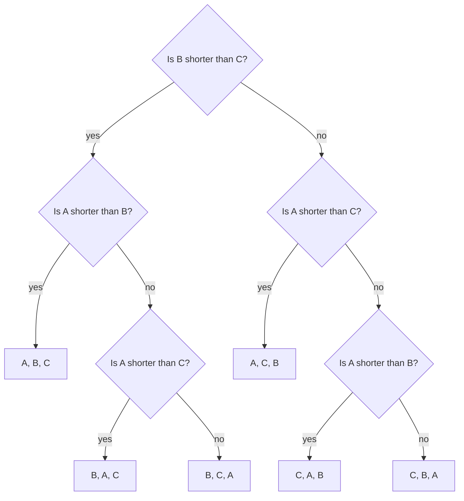

# Sorting and searching: merge sort, quicksort, binary search and the n log n floor

[Syllabus](../../../SYLLABUS.md) → [Applied and computational](../README.md) → [Algorithms and Growth](../README.md#s01) → Sorting and searching

---

## General Overview

A phone holds 1,000,000 tracks. Type a title and the track appears at once. The phone does not read a million titles. It keeps them in order, looks at the middle one, throws away the half that cannot hold the title, and looks at the middle again. At most 20 looks find any track, not 1,000,000. That is **binary search**, and it works only on a list that is already sorted.

So the library has to be sorted first, and sorting costs more. The honest unit of cost is the **comparison**: one question of the form "does this track come before that one?". Take eight tracks, their lengths in seconds: 214, 187, 263, 198, 305, 241, 176, 229. **Merge sort** (sort each half, then zip the two sorted halves together) puts them in order with 16 comparisons. **Quicksort** (pick one track as the **pivot**, split the rest into shorter and longer, then repeat on each side) uses 13.

Could a cleverer method always do much better? No. Eight tracks can arrive in 40,320 different orders, and one yes-or-no answer can at best halve the orders still possible. Fifteen answers can tell apart only 32,768 orders, so some arrival order forces a 16th question. For the whole library the same count says no comparison method can beat 18,488,884.8 comparisons in the worst case, which is about n log2 n for n tracks. Merge sort, at 18,674,254 on a shuffled library, comes close to that floor.

**A sort that only compares pairs must tell all n! orders apart, so on its worst order, and on average, it needs at least log2 n! comparisons, about n log2 n; merge sort is never far above that, quicksort gets near it on average, and a sorted list then answers any lookup in about log2 n halvings.**

**What kind of fact this is:** a theorem, proved on this card in Why it works: the floor holds for every comparison sort, and the cost of each method is proved here or on [Recurrences](04-recurrences-and-the-master-theorem.md) and checked by brute force on all 40,320 orders of the eight tracks.

### The picture: three tracks need three questions

Call three of the tracks A (214 seconds), B (187) and C (263). Any comparison sort is a tree of questions; this one is merge sort's, which first sorts B and C, then merges A in. Each yes or no sends the run down one branch, and each end point is one finished order.



Schematic. Three tracks have 3! = 6 orders, so the tree needs 6 end points. Two questions reach at most 2^2 = 4, so some path must ask 3. The real tracks answer yes, no, yes and land on B, A, C, which is 187, 214, 263, after 3 questions. When A is the shortest, 2 questions are enough: a lucky order can finish early, but not every order can.

Merge sort and binary search already run, with code, as the two worked examples in [Divide-and-conquer recurrences](../../04-Combinatorics%20and%20graphs/05-Recurrences/07-divide-and-conquer-recurrences.md). This card adds sorting by partitioning, the proof of the floor, and the eight tracks sorted by hand both ways.

---

## The formula

Notation first, in words. n is the number of tracks. n! ("n factorial") is n × (n − 1) × … × 2 × 1, the number of orders n different tracks can arrive in ([Factorials](../../04-Combinatorics%20and%20graphs/01-Counting%20Principles/03-factorial.md)). log2 x is the power of 2 that gives x: how many times x can be halved before it reaches 1. C(n) is the number of comparisons a sorting method makes on n tracks, in its worst case.

$$C(n) \;\ge\; \log_2 n! \;\approx\; n\log_2 n \;-\; n\log_2 e$$

**Read it aloud:** any method that sorts n different items only by comparing pairs needs at least log2 of n factorial comparisons on its worst input, and also on average over all n! inputs, and that number is a little under n log2 n.

Each method has its own count. Square brackets that close at the top, ⌈x⌉, round x up to a whole number; closing at the bottom, ⌊x⌋, round it down. H_n is the **harmonic number** 1 + 1/2 + 1/3 + … + 1/n, which grows like the natural log of n.

| Method | Comparisons | Eight tracks | 1,000,000 tracks |
| --- | --- | ---: | ---: |
| the floor, any method | $\log_2 n!$ | 15.2992 | 18,488,884.8 |
| merge sort, worst order | $n\lceil\log_2 n\rceil - 2^{\lceil\log_2 n\rceil} + 1$ | 17 | 18,951,425 |
| quicksort, average over all orders | $2(n+1)H_n - 4n$ | 16.9214 | 24,785,482.2 |
| quicksort, order already sorted | $n(n-1)/2$ | 28 | 499,999,500,000 |
| binary search, most looks | $\lfloor\log_2 n\rfloor + 1$ | 4 | 20 |

In the shorthand of [Big-O](01-big-o-and-growth-rates.md), where Θ(g) means "grows exactly like g, up to a constant, for large n": the floor, merge sort and average quicksort are all Θ(n log n), quicksort's worst case is Θ(n²), and binary search is Θ(log n).

| Symbol | Plain meaning | In our example | Push it up and the answer… |
| --- | --- | --- | --- |
| $n$ | how many tracks | 8, then 1,000,000 | every count grows |
| $n!$ | how many arrival orders n different tracks have | 40,320 | the floor rises by log2 of the factor |
| $\log_2 x$, $\ln x$ | the power of 2 that gives x: how many halvings take x down to 1; ln x, the natural log, is the power of e that gives x | log2 40,320 = 15.2992 | — |
| $C(n)$ | comparisons a sort makes on its worst input | 17 for merge sort | — |
| $e$, $\pi$ | the base of natural logs; the circle number | both appear in Stirling's estimate | — |
| $\lceil x\rceil$, $\lfloor x\rfloor$ | x rounded up, x rounded down | ⌈15.2992⌉ = 16 | — |
| $H_n$ | 1 + 1/2 + … + 1/n | H_8 = 2.7179 | quicksort's average rises |
| $k$ | number of yes-or-no questions asked | 3 for three tracks | 2^k more orders can be told apart |
| $d$ | how deep one end point sits in the question tree | 2 or 3 in the picture | that order costs more |
| $L$ | how many end points a question tree has | at least 40,320 for eight tracks | the average depth rises |
| $i$, $j$ | two tracks' ranks in the final order, i below j | 1 for the shortest, 8 for the longest | — |
| $g$, $m$ | the gap j − i between two ranks, and m = g + 1 | gap 7, m = 8 for shortest against longest | the pair is less likely to be compared |

### When it holds

- **Comparisons only.** The floor counts questions of the form "is x before y?". A method that reads the key's value directly is not bound by it: counting sort tallies 1,000,000 whole-second lengths into 361 slots with 0 comparisons.
- **Every order possible.** The count n! assumes different tracks. With many equal keys there are fewer distinct orders and the floor drops.
- **Worst case, or average over all orders.** The floor does not bind each single input. Quicksort sorted our eight in 13, under the floor of 16, because this order was lucky. See [Which case are you quoting? Worst, average and amortised cost](02-worst-case-average-case-and-amortised.md).
- **Quicksort's average assumes a random arrival order.** Hand it a playlist that is already sorted, with the first track as pivot, and it makes 28 comparisons on eight tracks and 499,500 on 1,000.
- **Binary search needs the list sorted.** On the unsorted eight it searches for 305 and reports "not there" after 4 looks, although 305 is in the list.

---

## Why it works

### Step 0: one answer at most halves the possibilities

Before any question, every one of the n! arrival orders is still possible. A comparison has two answers. Whatever the method, one answer keeps some of the orders and the other keeps the rest, so one of the two keeps at least half. Follow the bigger half each time: after k questions at least n!/2^k orders are still possible on that path. The method is finished only when one order is left, so on its worst input it needs 2^k ≥ n!.

### Step 1: every comparison sort is a tree of questions, and each order needs its own end point

Write the method out as in the picture. Each question is a branch point. Each end point says "this is the order; rearrange this way". Two different arrival orders cannot share an end point. If they did, the method would apply the same rearrangement to both, and at least one would come out wrong.

So the tree has at least n! end points. A tree in which no path asks more than k questions has at most 2^k end points. Hence k ≥ log2 n!. For eight tracks, log2 40,320 = 15.2992, so 16 questions on the worst order.

The check makes this concrete. It runs merge sort on all 40,320 orders and records each run's string of yes-and-no answers. It finds 40,320 different strings: 40,320 end points, one per order.

### Step 2: the average obeys the same floor

A lucky order can stop early, as the picture shows. But the average depth over all n! orders is still at least log2 n!.

<details>
<summary>Detailed proof: the average depth of L end points is at least log2 L</summary>

Give the start of the tree a share of 1. Each question splits its share in halves between its two branches. An end point at depth d (d questions from the start) then holds a share of 2^(−d), and all the shares together add up to at most 1.

There are L end points, so their average share is at most 1/L. The curve 2^(−x) bends upward, so the average of 2^(−d) over the end points is at least 2 raised to minus the average d (Jensen's inequality: for a curve that bends upward, the average of the outputs is at least the output at the average). Put together: 2^(−average d) ≤ 1/L, so the average d is at least log2 L.

</details>

On all 40,320 orders merge sort averages 15.7333 comparisons and quicksort 16.9214. Both sit above 15.2992, as they must.

### Step 3: how big log2 n! is

log2 n! is log2 1 + log2 2 + … + log2 n. [Stirling's approximation](../../06-Calculus%20and%20analysis/06-Series/09-stirlings-approximation.md) says n! is close to the square root of 2πn times (n/e)^n, which turns into

$$\log_2 n! \approx n\log_2 n - n\log_2 e + \tfrac12\log_2(2\pi n).$$

For the library both the exact sum and Stirling's estimate give 18,488,884.8, against n log2 n = 19,931,568.6. So the floor is Θ(n log n): no comparison sort can grow more slowly than n log n.

### Step 4: merge sort meets the floor

Merging two sorted piles costs at most one comparison fewer than the tracks in them. Each comparison places one track, and the last one is placed free. Halving down to single tracks takes ⌈log2 n⌉ levels, 20 for the library, so merge sort costs at most about n comparisons per level and n log2 n in all. [Recurrences](04-recurrences-and-the-master-theorem.md) reads that total off T(n) = 2T(n/2) + n in one line. The exact worst case, summed level by level there, is n⌈log2 n⌉ − 2^⌈log2 n⌉ + 1: 17 for eight tracks, one above the floor of 16, and 18,951,425 for the library.

### Step 5: quicksort sorts by partitioning, and its average comes from counting pairs

Quicksort does its work before the recursion instead of after. It takes the first track as pivot, compares every other track with it once, and puts the shorter ones on its left and the longer ones on its right. The pivot is now in its final place. Then it does the same to each side.

Number the tracks by their rank in the final order, 1 for the shortest. Take two ranks i and j, with i below j. They are compared only if one of them is a pivot when they are still on the same side. Look at the ranks i, i + 1, …, j. While no pivot from that run has been chosen, all of them stay together. The first pivot chosen from that run decides everything. If it is i or j, those two are compared. If it lies strictly between them, i goes left, j goes right, and they never meet.

When every arrival order is equally likely, each of those j − i + 1 ranks is equally likely to be chosen first. So i and j are compared with probability 2/(j − i + 1). Add that up over all pairs:

$$\sum_{i<j}\frac{2}{j-i+1} \;=\; 2(n+1)H_n - 4n.$$

<details>
<summary>Detailed proof: adding up the pairs</summary>

Group the pairs by their gap g = j − i. There are n − g pairs with gap g, each compared with probability 2/(g + 1). Write m = g + 1, which runs from 2 to n:

$$\sum_{m=2}^{n}\frac{2(n+1-m)}{m} = 2(n+1)\sum_{m=2}^{n}\frac1m - 2(n-1) = 2(n+1)(H_n - 1) - 2(n-1) = 2(n+1)H_n - 4n.$$

</details>

For eight tracks that is 16.9214 on average. The check runs quicksort on all 40,320 orders: 682,272 comparisons in total, exactly 40,320 times the formula. Since H_n grows like ln n, the average is about 2n ln n, which is 2 ln 2 times n log2 n: the same growth as the floor, with a larger constant.

One worst case is the sorted list. The first track is then the shortest, so every split peels off one track: (n − 1) + (n − 2) + … + 1 = n(n − 1)/2 comparisons. That is 28 for eight tracks.

### Step 6: binary search halves the live range

Binary search keeps a live range of positions that could hold the target. One look at the middle either finds it or rules out the middle and one whole side, so the live range at least halves, rounding down. A range of n positions survives at most ⌊log2 n⌋ + 1 looks. log2 of 1,000,000 is just under 20, so 20 looks are the most, and the check finds exactly 20 for the hardest tracks, 18.9514 on average over all 1,000,000.

No comparison search does better. Each look either finds the track, and stops, or sends the search left or right. So the first look can name 1 position, the second 2 more, the third 4 more: k looks can name at most 1 + 2 + … + 2^(k − 1) = 2^k − 1 positions. Nineteen looks reach 2^19 − 1 = 524,287 positions, too few for 1,000,000; twenty reach 1,048,575. So some track needs 20 looks.

---

## Worked numbers, by hand

Merge sort on 214, 187, 263, 198, 305, 241, 176, 229 (seconds):

| Step | Arithmetic | Value |
| --- | --- | --- |
| sort the four pairs | 214 v 187, 263 v 198, 305 v 241, 176 v 229: one comparison each | 1 + 1 + 1 + 1 |
| merge 187, 214 with 198, 263 | 187 first, 198 next, 214 next; 263 left over, placed free | 3 |
| merge 241, 305 with 176, 229 | 176 first, 229 next; 241 and 305 placed free | 2 |
| final merge | 176, 187, 198, 214, 229, 241, 263 each placed by one comparison; 305 free | 7 |
| **merge sort** | 4 + 3 + 2 + 7 | **16** |

Quicksort on the same eight, first track as pivot:

| Step | Arithmetic | Value |
| --- | --- | --- |
| pivot 214 | 7 other tracks compared: shorter 187, 198, 176; longer 263, 305, 241, 229 | 7 |
| pivot 187 on 187, 198, 176 | 2 compared: 176 shorter, 198 longer | 2 |
| pivot 263 on 263, 305, 241, 229 | 3 compared: 241, 229 shorter, 305 longer | 3 |
| pivot 241 on 241, 229 | 1 compared | 1 |
| **quicksort** | 7 + 2 + 3 + 1 | **13** |
| the floor | log2 40,320 = 15.2992, round up | 16 |
| binary search for 263 in 176, 187, 198, 214, 229, 241, 263, 305 | look at the middle, 214: go right; then 241: go right; then 263: found | **3 looks** |

Both methods give 176, 187, 198, 214, 229, 241, 263, 305. Merge sort's 16 is right on the floor; quicksort's 13 is below it only because this order happened to suit it, and the floor promises nothing about one order. Over all 40,320 orders quicksort averages 16.9214 and merge sort 15.7333, and their worst cases are 28 and 17.

### What breaks if you drop a piece

| Mistake | Comes out at | What went wrong |
| --- | --- | --- |
| quicksort, first track as pivot, on a playlist of 1,000 already sorted | 499,500 comparisons, against 4,932 for merge sort | each pivot is the shortest track left, so each split peels off one track |
| the same on the whole sorted library | 499,999,500,000 comparisons | n(n − 1)/2 grows like n², not n log n |
| binary search on the unsorted eight, looking for 305 | "not there" after 4 looks | halving assumes everything left of the middle is shorter |
| expecting the floor to limit counting sort | 0 comparisons, 1,000,000 + 361 steps | it reads each length as a number; the floor counts comparisons only |

Every number in both tables is printed by the code below.

---

## Code, from first principles, and it actually runs

Nothing imported sorts or searches: no `sorted`, no `bisect`, no library sort in Rust. Merge sort, quicksort and binary search are written out and count their own comparisons. The answer is reached four independent ways: the floor log2 n! as a formula; brute force over all 40,320 orders of the eight tracks, which finds merge sort's worst case of 17 and 40,320 different answer strings; quicksort's pair-count formula against its exhaustive total; and seeded runs on 1,000,000 synthetic keys (64-bit numbers from the SplitMix64 generator, seed 2026, standing in for titles), checked against the bounds and against quicksort's average within four standard deviations. The library's whole-second lengths for counting sort are 120 plus each key's remainder after dividing by 361.

### Python

```python
# Sorting and searching -- the check behind the card.  Standard library only:
# no sorted(), no bisect, no heapq.  Every sort and search is written out here
# and counts its own comparisons.  Roads: the decision-tree floor log2 n!,
# every one of the 40,320 orders of the eight tracks, the quicksort pair-count
# formula, and seeded runs on 1,000,000 synthetic keys from SplitMix64.
from math import log2, e, pi, sqrt
from itertools import permutations

def merge_sort(a, t):                # t = [comparisons, answer record or None, log or None]
    if len(a) <= 1:
        return a
    left, right = merge_sort(a[:len(a) // 2], t), merge_sort(a[len(a) // 2:], t)
    out, i, j, before = [], 0, 0, t[0]
    while i < len(left) and j < len(right):
        t[0] += 1
        take_left = left[i] <= right[j]          # ties go left, so equal keys keep their order
        if t[1] is not None:
            t[1].append(take_left)
        if take_left:
            out.append(left[i]); i += 1
        else:
            out.append(right[j]); j += 1
    if t[2] is not None:
        t[2].append(t[0] - before)
    return out + left[i:] + right[j:]

def quicksort(a, t, middle=False):   # partition around a pivot; an explicit stack, no recursion
    a, stack = list(a), [(0, len(a))]
    while stack:
        lo, hi = stack.pop()
        if hi - lo <= 1:
            continue
        if middle:
            m = (lo + hi) // 2; a[lo], a[m] = a[m], a[lo]
        p, less, more = a[lo], [], []
        for x in a[lo + 1:hi]:
            t[0] += 1                            # every other track meets the pivot once
            (less if x < p else more).append(x)
        if t[2] is not None:
            t[2].append((p, hi - lo - 1))
        a[lo:hi] = less + [p] + more
        stack += [(lo + len(less) + 1, hi), (lo, lo + len(less))]
    return a

def search(a, x):                    # halve the live range until x turns up
    lo, hi, probes = 0, len(a) - 1, 0
    while lo <= hi:
        mid = (lo + hi) // 2; probes += 1
        if a[mid] == x:
            return mid, probes
        if a[mid] < x: lo = mid + 1
        else: hi = mid - 1
    return -1, probes

def plain_sum(xs):                  # left to right, as the Rust does (sum() compensates)
    s = 0.0
    for x in xs:
        s += x
    return s
def floor_bits(n): return plain_sum(log2(k) for k in range(2, n + 1))  # log2 n!, the floor
def merge_worst(n): c = (n - 1).bit_length(); return n * c - 2 ** c + 1
def is_sorted(a): return all(a[i] <= a[i + 1] for i in range(len(a) - 1))
def yn(claim): return "yes" if claim else "no"
def comps(f, a, **kw): t = [0, None, None]; f(a, t, **kw); return t[0]

tracks = [214, 187, 263, 198, 305, 241, 176, 229]          # lengths in seconds
tm, tq = [0, None, []], [0, None, []]
by_merge, by_quick = merge_sort(tracks, tm), quicksort(tracks, tq)
print(f"eight tracks (seconds): {tracks}")
print(f"merge sort -> {by_merge}: comparisons per merge {tm[2]}, total {tm[0]}")
print(f"quicksort, first track as pivot: (pivot, comparisons) {tq[2]}, total {tq[0]}, same order: {yn(by_quick == by_merge)}")
found = [search(by_merge, x)[1] for x in by_merge]
print(f"binary search for 263: position {search(by_merge, 263)[0]}, probes {search(by_merge, 263)[1]}; probes for each track {found}, most {max(found)}")
n8 = 1
for k in range(2, 9):
    n8 *= k
three = [comps(merge_sort, list(o)) for o in permutations(tracks[:3])]
print(f"three tracks: 3! = {len(three)} orders; log2 6 = {floor_bits(3):.4f}; 2^2 = {2 ** 2} < 6; merge sort asks "
      f"{comps(merge_sort, tracks[:3])} on 214, 187, 263, fewest {min(three)}, most {max(three)}")
print(f"8! = {n8} orders; floor log2 8! = {floor_bits(8):.4f}; 2^15 = {2 ** 15}, so at least 16 in the worst case")
mtot = mmax = qtot = qmax = 0
records = set()
for order in permutations(tracks):
    t = [0, [], None]; merge_sort(list(order), t); records.add(tuple(t[1]))
    mtot += t[0]; mmax = max(mmax, t[0])
    c = comps(quicksort, list(order)); qtot += c; qmax = max(qmax, c)
harm8 = sum(n8 // k for k in range(1, 9))                  # 8! times H_8, a whole number
q_formula = 2 * 9 * harm8 - 4 * 8 * n8                     # 8! times (2(n+1)H_n - 4n)
print(f"all {n8} orders, merge sort: worst {mmax} (bound n*ceil(log2 n) - 2^ceil(log2 n) + 1 = {merge_worst(8)}), average {mtot / n8:.4f}")
print(f"all {n8} orders, quicksort: worst {qmax} = 8*7/2, total {qtot}, formula total {q_formula}, average {qtot / n8:.4f}, H_8 = {harm8 / n8:.4f}")
print(f"different yes/no answer records under merge sort: {len(records)}")
M = (1 << 64) - 1
def splitmix(s):
    s = (s + 0x9E3779B97F4A7C15) & M
    z = ((s ^ (s >> 30)) * 0xBF58476D1CE4E5B9) & M
    z = ((z ^ (z >> 27)) * 0x94D049BB133111EB) & M
    return s, z ^ (z >> 31)
N, s, keys = 1_000_000, 2026, []
for _ in range(N):
    s, k = splitmix(s); keys.append(k)
lib_floor = floor_bits(N)
stirling = N * log2(N) - N * log2(e) + 0.5 * log2(2 * pi * N)
print(f"library: {N} synthetic keys, SplitMix64 seed 2026")
print(f"floor log2 n! = {lib_floor:.1f}; Stirling {stirling:.1f}; n log2 n = {N * log2(N):.1f}")
t = [0, None, None]; lib = merge_sort(keys, t)
print(f"merge sort counted {t[0]}; worst-case bound {merge_worst(N)}; in order: {yn(is_sorted(lib))}")
qs = comps(quicksort, keys)
q_mean = 2 * (N + 1) * plain_sum(1 / k for k in range(1, N + 1)) - 4 * N
q_sd = sqrt(7 - 2 * pi * pi / 3) * N
print(f"quicksort counted {qs}; average 2(n+1)H_n - 4n = {q_mean:.1f}; sd {q_sd:.1f}; off by {(qs - q_mean) / q_sd:.2f} sd")
probes = [search(lib, x) for x in lib]
right = all(p[0] == i for i, p in enumerate(probes))
most, avg = max(p[1] for p in probes), sum(p[1] for p in probes) / N
print(f"binary search for all {N} keys: all found where they sit: {yn(right)}; most {most} probes, average {avg:.4f}")
print(f"k looks name at most 2^k - 1 positions: 2^{most - 1} - 1 = {2 ** (most - 1) - 1} < {N} <= 2^{most} - 1 = {2 ** most - 1}")
playlist = lib[:1000]
print(f"sorted playlist of 1000: first-pivot quicksort {comps(quicksort, playlist)} = 1000*999/2; merge sort {comps(merge_sort, playlist)}")
print(f"whole library already sorted, first-pivot quicksort: {N * (N - 1) // 2}")
print(f"unsorted eight, binary search for 305: position {search(tracks, 305)[0]} after {search(tracks, 305)[1]} probes")
secs = [120 + k % 361 for k in keys]                       # whole-second lengths, 2:00 to 8:00
tally = [0] * 361
for x in secs:
    tally[x - 120] += 1
by_count = [120 + v for v in range(361) for _ in range(tally[v])]
print(f"counting sort on whole-second lengths: 0 comparisons, {N} + 361 steps, in order: {yn(is_sorted(by_count))}")
ordered8 = by_merge
print(f"try: eight already in order, merge sort {comps(merge_sort, ordered8)}, quicksort {comps(quicksort, ordered8)}")
print(f"try: middle track as pivot on the sorted 1000: {comps(quicksort, playlist, middle=True)}")
print(f"try: 2000000 tracks, floor {floor_bits(2 * N):.1f}, binary search at most {(2 * N).bit_length()} probes")
print(f"try: 16 tracks, floor {floor_bits(16):.4f}, merge sort worst {merge_worst(16)}")
assert mmax == merge_worst(8) and mmax >= 16 > floor_bits(8)       # brute force meets the bound
assert mtot / n8 >= floor_bits(8) and qtot / n8 >= floor_bits(8)   # the floor binds the average too
assert qtot == q_formula and qmax == 8 * 7 // 2 and by_quick == by_merge  # pair-count formula
assert len(records) == n8 and max(three) == 3 > floor_bits(3)        # every order needs its own leaf
assert is_sorted(lib) and t[0] <= merge_worst(N) and abs(qs - q_mean) < 4 * q_sd
assert right and most == N.bit_length() and comps(quicksort, playlist) == 1000 * 999 // 2
assert by_count == merge_sort(secs, [0, None, None]) and search(tracks, 305)[0] == -1
print("ALL CHECKS PASS")
```

**Ran 2026-11-11 on macOS, Python 3.14.10, standard library only. All checks passed. Output, pasted from the run:**

```
eight tracks (seconds): [214, 187, 263, 198, 305, 241, 176, 229]
merge sort -> [176, 187, 198, 214, 229, 241, 263, 305]: comparisons per merge [1, 1, 3, 1, 1, 2, 7], total 16
quicksort, first track as pivot: (pivot, comparisons) [(214, 7), (187, 2), (263, 3), (241, 1)], total 13, same order: yes
binary search for 263: position 6, probes 3; probes for each track [3, 2, 3, 1, 3, 2, 3, 4], most 4
three tracks: 3! = 6 orders; log2 6 = 2.5850; 2^2 = 4 < 6; merge sort asks 3 on 214, 187, 263, fewest 2, most 3
8! = 40320 orders; floor log2 8! = 15.2992; 2^15 = 32768, so at least 16 in the worst case
all 40320 orders, merge sort: worst 17 (bound n*ceil(log2 n) - 2^ceil(log2 n) + 1 = 17), average 15.7333
all 40320 orders, quicksort: worst 28 = 8*7/2, total 682272, formula total 682272, average 16.9214, H_8 = 2.7179
different yes/no answer records under merge sort: 40320
library: 1000000 synthetic keys, SplitMix64 seed 2026
floor log2 n! = 18488884.8; Stirling 18488884.8; n log2 n = 19931568.6
merge sort counted 18674254; worst-case bound 18951425; in order: yes
quicksort counted 24540918; average 2(n+1)H_n - 4n = 24785482.2; sd 648277.5; off by -0.38 sd
binary search for all 1000000 keys: all found where they sit: yes; most 20 probes, average 18.9514
k looks name at most 2^k - 1 positions: 2^19 - 1 = 524287 < 1000000 <= 2^20 - 1 = 1048575
sorted playlist of 1000: first-pivot quicksort 499500 = 1000*999/2; merge sort 4932
whole library already sorted, first-pivot quicksort: 499999500000
unsorted eight, binary search for 305: position -1 after 4 probes
counting sort on whole-second lengths: 0 comparisons, 1000000 + 361 steps, in order: yes
try: eight already in order, merge sort 12, quicksort 28
try: middle track as pivot on the sorted 1000: 8276
try: 2000000 tracks, floor 38977758.8, binary search at most 21 probes
try: 16 tracks, floor 44.2501, merge sort worst 49
ALL CHECKS PASS
```

### Rust

Same numbers, same labels, built with `rustc --edition 2021 -O`.

```rust
// Sorting and searching -- the same check as the Python, in Rust.  No crates,
// and no sort(), binary_search() or BinaryHeap: every sort and search is
// written out here and counts its own comparisons.  Roads: the decision-tree
// floor log2 n!, every one of the 40,320 orders of the eight tracks, the
// quicksort pair-count formula, and seeded runs on 1,000,000 SplitMix64 keys.
use std::collections::HashSet;
use std::f64::consts::{E, PI};

struct T { c: u64, rec: Option<Vec<bool>>, mlog: Option<Vec<u64>>, qlog: Option<Vec<(u64, u64)>> }
fn tally() -> T { T { c: 0, rec: None, mlog: None, qlog: None } }

fn merge_sort(a: &[u64], t: &mut T) -> Vec<u64> {
    if a.len() <= 1 { return a.to_vec(); }
    let (left, right) = (merge_sort(&a[..a.len() / 2], t), merge_sort(&a[a.len() / 2..], t));
    let (mut out, mut i, mut j, before) = (Vec::new(), 0, 0, t.c);
    while i < left.len() && j < right.len() {
        t.c += 1;
        let take_left = left[i] <= right[j];      // ties go left, so equal keys keep their order
        if let Some(r) = t.rec.as_mut() { r.push(take_left); }
        if take_left { out.push(left[i]); i += 1; } else { out.push(right[j]); j += 1; }
    }
    if let Some(l) = t.mlog.as_mut() { l.push(t.c - before); }
    out.extend_from_slice(&left[i..]);
    out.extend_from_slice(&right[j..]);
    out
}

fn quicksort(src: &[u64], t: &mut T, middle: bool) -> Vec<u64> {  // explicit stack, no recursion
    let (mut a, mut stack) = (src.to_vec(), vec![(0usize, src.len())]);
    while let Some((lo, hi)) = stack.pop() {
        if hi - lo <= 1 { continue; }
        if middle { a.swap(lo, (lo + hi) / 2); }
        let (p, mut less, mut more) = (a[lo], Vec::new(), Vec::new());
        for &x in &a[lo + 1..hi] {
            t.c += 1;                              // every other track meets the pivot once
            if x < p { less.push(x) } else { more.push(x) }
        }
        if let Some(l) = t.qlog.as_mut() { l.push((p, (hi - lo - 1) as u64)); }
        let nl = less.len();
        less.push(p);
        less.extend(more);
        a[lo..hi].copy_from_slice(&less);
        stack.push((lo + nl + 1, hi));
        stack.push((lo, lo + nl));
    }
    a
}

fn search(a: &[u64], x: u64) -> (i64, u64) {       // halve the live range until x turns up
    let (mut lo, mut hi, mut probes) = (0i64, a.len() as i64 - 1, 0u64);
    while lo <= hi {
        let mid = (lo + hi) / 2;
        probes += 1;
        if a[mid as usize] == x { return (mid, probes); }
        if a[mid as usize] < x { lo = mid + 1 } else { hi = mid - 1 }
    }
    (-1, probes)
}

fn floor_bits(n: u64) -> f64 { let mut s = 0.0; for k in 2..=n { s += (k as f64).log2(); } s }
fn bits(n: u64) -> u32 { 64 - n.leading_zeros() }
fn merge_worst(n: u64) -> u64 { let c = bits(n - 1); n * c as u64 - (1u64 << c) + 1 }
fn is_sorted(a: &[u64]) -> bool { a.windows(2).all(|w| w[0] <= w[1]) }
fn yn(claim: bool) -> &'static str { if claim { "yes" } else { "no" } }
fn mc(a: &[u64]) -> u64 { let mut t = tally(); merge_sort(a, &mut t); t.c }
fn qc(a: &[u64], middle: bool) -> u64 { let mut t = tally(); quicksort(a, &mut t, middle); t.c }

fn splitmix(s: &mut u64) -> u64 {
    *s = s.wrapping_add(0x9E3779B97F4A7C15);
    let mut z = (*s ^ (*s >> 30)).wrapping_mul(0xBF58476D1CE4E5B9);
    z = (z ^ (z >> 27)).wrapping_mul(0x94D049BB133111EB);
    z ^ (z >> 31)
}

fn main() {
    let tracks: Vec<u64> = vec![214, 187, 263, 198, 305, 241, 176, 229];   // lengths in seconds
    let mut tm = tally(); tm.mlog = Some(vec![]);
    let mut tq = tally(); tq.qlog = Some(vec![]);
    let (by_merge, by_quick) = (merge_sort(&tracks, &mut tm), quicksort(&tracks, &mut tq, false));
    println!("eight tracks (seconds): {:?}", tracks);
    println!("merge sort -> {:?}: comparisons per merge {:?}, total {}", by_merge, tm.mlog.unwrap(), tm.c);
    println!("quicksort, first track as pivot: (pivot, comparisons) {:?}, total {}, same order: {}",
             tq.qlog.unwrap(), tq.c, yn(by_quick == by_merge));
    let found: Vec<u64> = by_merge.iter().map(|&x| search(&by_merge, x).1).collect();
    let s263 = search(&by_merge, 263);
    println!("binary search for 263: position {}, probes {}; probes for each track {:?}, most {}",
             s263.0, s263.1, found, found.iter().max().unwrap());
    let n8: u64 = (2..=8).product();
    let p3: [[usize; 3]; 6] = [[0, 1, 2], [0, 2, 1], [1, 0, 2], [1, 2, 0], [2, 0, 1], [2, 1, 0]];
    let three: Vec<u64> = p3.iter().map(|o| mc(&[tracks[o[0]], tracks[o[1]], tracks[o[2]]])).collect();
    println!("three tracks: 3! = {} orders; log2 6 = {:.4}; 2^2 = {} < 6; merge sort asks {} on 214, 187, 263, fewest {}, most {}",
             three.len(), floor_bits(3), 1u64 << 2, mc(&tracks[..3]), three.iter().min().unwrap(), three.iter().max().unwrap());
    println!("8! = {} orders; floor log2 8! = {:.4}; 2^15 = {}, so at least 16 in the worst case", n8, floor_bits(8), 1u64 << 15);
    let (mut mtot, mut mmax, mut qtot, mut qmax) = (0u64, 0u64, 0u64, 0u64);
    let mut records: HashSet<Vec<bool>> = HashSet::new();
    let (mut p, mut ctr, mut i) = (tracks.clone(), vec![0usize; 8], 0usize);   // Heap's algorithm
    loop {
        let mut t = tally(); t.rec = Some(vec![]);
        merge_sort(&p, &mut t);
        mtot += t.c; mmax = mmax.max(t.c); records.insert(t.rec.unwrap());
        let c = qc(&p, false); qtot += c; qmax = qmax.max(c);
        while i < 8 && ctr[i] >= i { ctr[i] = 0; i += 1; }
        if i == 8 { break; }
        if i % 2 == 0 { p.swap(0, i) } else { p.swap(ctr[i], i) }
        ctr[i] += 1; i = 1;
    }
    let harm8: u64 = (1..=8).map(|k| n8 / k).sum();            // 8! times H_8, a whole number
    let q_formula = 2 * 9 * harm8 - 4 * 8 * n8;                 // 8! times (2(n+1)H_n - 4n)
    println!("all {} orders, merge sort: worst {} (bound n*ceil(log2 n) - 2^ceil(log2 n) + 1 = {}), average {:.4}",
             n8, mmax, merge_worst(8), mtot as f64 / n8 as f64);
    println!("all {} orders, quicksort: worst {} = 8*7/2, total {}, formula total {}, average {:.4}, H_8 = {:.4}",
             n8, qmax, qtot, q_formula, qtot as f64 / n8 as f64, harm8 as f64 / n8 as f64);
    println!("different yes/no answer records under merge sort: {}", records.len());
    let n: u64 = 1_000_000;
    let mut s: u64 = 2026;
    let keys: Vec<u64> = (0..n).map(|_| splitmix(&mut s)).collect();
    let nf = n as f64;
    let lib_floor = floor_bits(n);
    let stirling = nf * nf.log2() - nf * E.log2() + 0.5 * (2.0 * PI * nf).log2();
    println!("library: {} synthetic keys, SplitMix64 seed 2026", n);
    println!("floor log2 n! = {:.1}; Stirling {:.1}; n log2 n = {:.1}", lib_floor, stirling, nf * nf.log2());
    let mut t = tally();
    let lib = merge_sort(&keys, &mut t);
    println!("merge sort counted {}; worst-case bound {}; in order: {}", t.c, merge_worst(n), yn(is_sorted(&lib)));
    let qs = qc(&keys, false);
    let mut h = 0.0;
    for k in 1..=n { h += 1.0 / k as f64; }
    let q_mean = 2.0 * (nf + 1.0) * h - 4.0 * nf;
    let q_sd = (7.0 - 2.0 * PI * PI / 3.0).sqrt() * nf;
    println!("quicksort counted {}; average 2(n+1)H_n - 4n = {:.1}; sd {:.1}; off by {:.2} sd",
             qs, q_mean, q_sd, (qs as f64 - q_mean) / q_sd);
    let probes: Vec<(i64, u64)> = lib.iter().map(|&x| search(&lib, x)).collect();
    let right = probes.iter().enumerate().all(|(i, p)| p.0 == i as i64);
    let most = probes.iter().map(|p| p.1).max().unwrap();
    let avg = probes.iter().map(|p| p.1).sum::<u64>() as f64 / nf;
    println!("binary search for all {} keys: all found where they sit: {}; most {} probes, average {:.4}", n, yn(right), most, avg);
    println!("k looks name at most 2^k - 1 positions: 2^{} - 1 = {} < {} <= 2^{} - 1 = {}", most - 1, (1u64 << (most - 1)) - 1, n, most, (1u64 << most) - 1);
    let playlist = &lib[..1000];
    println!("sorted playlist of 1000: first-pivot quicksort {} = 1000*999/2; merge sort {}", qc(playlist, false), mc(playlist));
    println!("whole library already sorted, first-pivot quicksort: {}", n * (n - 1) / 2);
    let s305 = search(&tracks, 305);
    println!("unsorted eight, binary search for 305: position {} after {} probes", s305.0, s305.1);
    let secs: Vec<u64> = keys.iter().map(|k| 120 + k % 361).collect();   // whole-second lengths
    let mut counts = vec![0usize; 361];
    for &x in &secs { counts[(x - 120) as usize] += 1; }
    let by_count: Vec<u64> = (0..361u64).flat_map(|v| std::iter::repeat(120 + v).take(counts[v as usize])).collect();
    println!("counting sort on whole-second lengths: 0 comparisons, {} + 361 steps, in order: {}", n, yn(is_sorted(&by_count)));
    println!("try: eight already in order, merge sort {}, quicksort {}", mc(&by_merge), qc(&by_merge, false));
    println!("try: middle track as pivot on the sorted 1000: {}", qc(playlist, true));
    println!("try: 2000000 tracks, floor {:.1}, binary search at most {} probes", floor_bits(2 * n), bits(2 * n));
    println!("try: 16 tracks, floor {:.4}, merge sort worst {}", floor_bits(16), merge_worst(16));
    assert!(mmax == merge_worst(8) && mmax >= 16 && 16.0 > floor_bits(8));   // brute force meets the bound
    assert!(mtot as f64 / n8 as f64 >= floor_bits(8) && qtot as f64 / n8 as f64 >= floor_bits(8));
    assert!(qtot == q_formula && qmax == 8 * 7 / 2 && by_quick == by_merge);  // pair-count formula
    assert!(records.len() as u64 == n8 && *three.iter().max().unwrap() == 3);   // every order its own leaf
    assert!(is_sorted(&lib) && t.c <= merge_worst(n) && (qs as f64 - q_mean).abs() < 4.0 * q_sd);
    assert!(right && most == bits(n) as u64 && qc(playlist, false) == 1000 * 999 / 2);
    assert!(by_count == merge_sort(&secs, &mut tally()) && s305.0 == -1);
    println!("ALL CHECKS PASS");
}
```

**Ran 2026-11-11 on macOS, rustc 1.98.1, no crates. All checks passed. Output, pasted from the run:**

```
eight tracks (seconds): [214, 187, 263, 198, 305, 241, 176, 229]
merge sort -> [176, 187, 198, 214, 229, 241, 263, 305]: comparisons per merge [1, 1, 3, 1, 1, 2, 7], total 16
quicksort, first track as pivot: (pivot, comparisons) [(214, 7), (187, 2), (263, 3), (241, 1)], total 13, same order: yes
binary search for 263: position 6, probes 3; probes for each track [3, 2, 3, 1, 3, 2, 3, 4], most 4
three tracks: 3! = 6 orders; log2 6 = 2.5850; 2^2 = 4 < 6; merge sort asks 3 on 214, 187, 263, fewest 2, most 3
8! = 40320 orders; floor log2 8! = 15.2992; 2^15 = 32768, so at least 16 in the worst case
all 40320 orders, merge sort: worst 17 (bound n*ceil(log2 n) - 2^ceil(log2 n) + 1 = 17), average 15.7333
all 40320 orders, quicksort: worst 28 = 8*7/2, total 682272, formula total 682272, average 16.9214, H_8 = 2.7179
different yes/no answer records under merge sort: 40320
library: 1000000 synthetic keys, SplitMix64 seed 2026
floor log2 n! = 18488884.8; Stirling 18488884.8; n log2 n = 19931568.6
merge sort counted 18674254; worst-case bound 18951425; in order: yes
quicksort counted 24540918; average 2(n+1)H_n - 4n = 24785482.2; sd 648277.5; off by -0.38 sd
binary search for all 1000000 keys: all found where they sit: yes; most 20 probes, average 18.9514
k looks name at most 2^k - 1 positions: 2^19 - 1 = 524287 < 1000000 <= 2^20 - 1 = 1048575
sorted playlist of 1000: first-pivot quicksort 499500 = 1000*999/2; merge sort 4932
whole library already sorted, first-pivot quicksort: 499999500000
unsorted eight, binary search for 305: position -1 after 4 probes
counting sort on whole-second lengths: 0 comparisons, 1000000 + 361 steps, in order: yes
try: eight already in order, merge sort 12, quicksort 28
try: middle track as pivot on the sorted 1000: 8276
try: 2000000 tracks, floor 38977758.8, binary search at most 21 probes
try: 16 tracks, floor 44.2501, merge sort worst 49
ALL CHECKS PASS
```

The two outputs match line for line.

> [!TIP]
> **Try changing**
> Guess first, then make the change and run it. Each answer is also printed on a line starting `try:`, so it can be read without editing.
> - **Hand over the eight already in order.** Set `tracks` to `[176, 187, 198, 214, 229, 241, 263, 305]` (inside `vec![]` in Rust). Guess both counts. Merge sort drops to 12; quicksort climbs to its worst, 28. The last assert then stops the run, because binary search on the sorted eight finds 305.
> - **Take the middle track as pivot** on the sorted 1,000: in the `sorted playlist` line, add `middle=True` to the quicksort count (`qc(playlist, true)` in Rust). Guess how far 499,500 falls. It falls to 8,276, and every check still passes.
> - **Double the library to 2,000,000.** Set `N` to `2_000_000` (`n` in Rust). Guess the extra binary-search looks. One: at most 21. The floor becomes 38,977,758.8.
> - **Sort 16 tracks.** Guess the floor first. The last `try:` line calls `floor_bits(16)` and `merge_worst(16)`: 44.2501 and 49; change its 16 to try other sizes. Adding eight lengths to `tracks` instead would send the brute force through all 16! orders, far too many to run.

---

## The usual mistake

> [!warning]
> **"Quicksort is n log n."** Only on average over random orders. With the first track as pivot, an already sorted playlist is a worst case: 499,500 comparisons for 1,000 tracks and 499,999,500,000 for the library, where merge sort needs at most 18,951,425. Libraries guard against this by choosing the pivot at random or from the middle; the random choice is in [Randomised algorithms](../02-Randomised%20and%20Approximate%20Algorithms/01-randomised-algorithms-and-expectation.md).
>
> - **Reading the floor as a promise about every input.** Quicksort sorted our eight in 13, under the floor of 16. The floor binds the worst case and the average: 28 and 16.9214.
> - **Searching a list that is not sorted.** Binary search on the unsorted eight misses 305 after 4 looks.
> - **Taking n log2 n as the floor itself.** For the library n log2 n is 19,931,568.6 but the floor is 18,488,884.8. Merge sort's 18,674,254 sits between them: under n log2 n, yet never under the floor.
> - **Applying the floor to a method that does not compare.** Counting sort on whole-second lengths makes 0 comparisons and 1,000,000 + 361 steps.

---

## Where you meet it in real life

- **A phone's music library.** Sorting by title once makes every later search a matter of 20 looks.
- **Databases.** A sorted index lets a query jump to a range of rows instead of reading every row, and two sorted tables are joined by a merge exactly like merge sort's.
- **Logs bigger than memory.** A year of play logs is sorted in chunks that fit in memory, then the sorted chunks are merged from disk: external merge sort.
- **Sorting by two keys.** Sort the library by album, then by artist with a **stable** sort (one that keeps equal keys in their old order). Each artist's albums stay in order. Merge sort is stable because ties go to the left pile.
- **Programming languages.** Built-in sorts are merge-based or quicksort-based, with guards against the sorted-input trap, and none beats the n log n floor in the worst case.

> **Say it back**
> A comparison sort must tell all n! arrival orders apart, and each yes-or-no answer at most halves what is possible. So it needs at least log2 n! comparisons, worst case and on average, and Stirling makes that about n log2 n. Merge sort sorts the halves and merges them, never more than about n log2 n. Quicksort splits around a pivot and averages 2(n + 1)H_n − 4n, but a sorted input with the first track as pivot costs n(n − 1)/2. A sorted list answers any lookup in about log2 n looks: 20 for a million tracks.

---

## What this builds on

- [Recurrences](04-recurrences-and-the-master-theorem.md): reads merge sort's T(n) = 2T(n/2) + n off as n log n.
- [Factorials](../../04-Combinatorics%20and%20graphs/01-Counting%20Principles/03-factorial.md): n! counts the orders a sort must tell apart.
- [Stirling's approximation](../../06-Calculus%20and%20analysis/06-Series/09-stirlings-approximation.md): turns log2 n! into n log2 n minus a correction.
- [Divide-and-conquer recurrences](../../04-Combinatorics%20and%20graphs/05-Recurrences/07-divide-and-conquer-recurrences.md): merge sort and binary search already run there, with their recurrences solved.

## Where this goes next

- [Data structures](06-data-structures-heaps-hashes-and-trees.md): heaps and search trees keep a library in order while tracks are added and removed.
- [Randomised algorithms](../02-Randomised%20and%20Approximate%20Algorithms/01-randomised-algorithms-and-expectation.md): a random pivot turns quicksort's average into a promise on every input, holding on average over the method's own coin flips.

The floor limits comparisons only, so the question left open is how much faster a sort can go when it is allowed to read the keys themselves.

---

## Sources

Verified 2026-11-11: every link below resolves to the publisher's page.

- Knuth, Donald E. *The Art of Computer Programming, Volume 3: Sorting and Searching*, 2nd ed. Addison-Wesley, 1998. [Publisher page](https://www.informit.com/store/art-of-computer-programming-volume-3-sorting-and-searching-9780201896855). Merge sort's exact worst case, the comparison floor, binary search, and quicksort's standard deviation, used for the check's tolerance.
- Hoare, C. A. R. "Quicksort." *The Computer Journal* 5(1), 1962, 10–16. [doi:10.1093/comjnl/5.1.10](https://doi.org/10.1093/comjnl/5.1.10). The original sorting by partitioning.
- Sedgewick, Robert. "The analysis of Quicksort programs." *Acta Informatica* 7(4), 1977, 327–355. [doi:10.1007/BF00289467](https://doi.org/10.1007/BF00289467). A detailed analysis of quicksort programs; the exact 2(n + 1)H_n − 4n count used on this card is derived in full in Step 5.
- Ford, Lester R., and Selmer M. Johnson. "A tournament problem." *The American Mathematical Monthly* 66(5), 1959, 387–389. [doi:10.1080/00029890.1959.11989306](https://doi.org/10.1080/00029890.1959.11989306). A comparison sort that sorts eight items in 16 comparisons, meeting the floor exactly.
