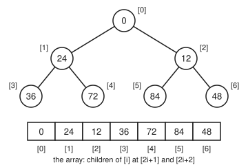

# Data structures: what each one makes cheap, and what it makes dear

[Syllabus](../../../SYLLABUS.md) → [Applied and computational](../README.md) → [Algorithms and Growth](../README.md#s01) → Data structures

---

## General Overview

A four-day festival sells 60,000 tickets. At the gate a scanner reads each ticket's code and must answer one question fast: is this a real ticket?

Meanwhile the production desk runs 480 sets across the weekend, one starting every 12 minutes somewhere on site. The bookings came in months ago in no particular order. All weekend the desk asks a different question, over and over: which set goes on next?

Store the 60,000 codes in a plain list and the scanner checks them one by one: 30,000.5 comparisons for a real ticket on average, all 60,000 for a fake. Store them in a **hash table** (an array of buckets, with a formula that turns a code into a bucket number) and a real ticket costs 1.3730 comparisons on average in this synthetic run.

Keep the 480 sets in a plain list and finding the next one over the weekend costs 114,960 comparisons. Keep them in a **binary heap** (a tree that always holds the smallest item at the top) and the whole weekend costs 7,226.

Neither is better in general. The hash table cannot say which set comes next; the heap cannot find one ticket without searching everything. Choosing a structure means listing the questions first.

**A data structure is a promise about where each item sits; that promise makes some operations cheap, and keeping it costs something on every change, so you pick the structure whose cheap operations are the ones you do most.**

**What kind of fact this is:** theorems about counted costs, proved on this card in Why it works (the hash-table costs assume a hash that spreads codes evenly), plus a method for choosing, checked on a synthetic run.

### The picture: the heap behind the stage desk

<p align="center"></p>

The top of the stage heap after all 480 bookings (schematic). Each parent's start minute is smaller than its children's, so the next set, minute 0, sits on top. The row below is how the computer stores it: a plain array, no pointers (stored memory addresses that link one item to another).

---

## The formula

Costs count one named operation: comparing two keys (a ticket code, a start minute). $O(g)$, from [Big-O](01-big-o-and-growth-rates.md), reads "grows at most like $g$, up to a constant, for large $n$". Each cost names its case: worst (the slowest single operation), expected (the average over the hash's random spread) or amortised (the average over a long run of operations).

| Structure | Find a given item | Find the smallest | Insert | Remove | Read out in order |
| --- | --- | --- | --- | --- | --- |
| Array, unsorted | $O(n)$ | $O(n)$ | $O(1)$ amortised, at the end | $O(n)$ | sort first |
| Array, sorted | $O(\log n)$, binary search | $O(1)$ | $O(n)$ moves | $O(n)$ moves | free |
| Linked list | $O(n)$ | $O(n)$ | $O(1)$ at a spot already found | $O(1)$ at a spot already found | no |
| Stack | top item only | no | $O(1)$, on top | $O(1)$, from the top | no |
| Queue | front item only | no | $O(1)$, at the back | $O(1)$, from the front | no |
| Hash table | $1 + \alpha/2$ expected | $O(n)$ | $O(1)$ expected | $O(1)$ expected | no |
| Binary heap | $O(n)$ | $O(1)$ | $O(\log n)$ worst | $O(\log n)$ worst, smallest only | no |
| Balanced search tree | $O(\log n)$ worst | $O(\log n)$ | $O(\log n)$ worst | $O(\log n)$ worst | free |

Behind the hash-table and tree rows sit exact results. For a hash table whose buckets hold chains (short lists):

$$C_{\text{hit}} = 1 + \frac{n-1}{2m} \approx 1 + \frac{\alpha}{2}, \qquad C_{\text{miss}} = \frac{n}{m} = \alpha$$

**Read it aloud:** with $n$ items spread evenly over $m$ buckets, a search for an item that is there compares about one plus half the load; a search for one that is not compares the whole load.

For a binary heap and for an AVL tree (named by its inventors' initials: a search tree whose two sides never differ in height by more than one):

$$h_{\text{heap}} = \lfloor \log_2 n \rfloor, \qquad N(h) = N(h-1) + N(h-2) + 1$$

The heap's height is only $\lfloor \log_2 n \rfloor$. The fewest items $N(h)$ an AVL tree of height $h$ can hold grows like the Fibonacci numbers, so its height stays a fixed multiple of $\log_2 n$.

This card introduces the **load factor** $\alpha$: items per bucket, $n/m$.

| Symbol | Plain meaning | In our example | Push it up and the answer… |
| --- | --- | --- | --- |
| $n$ | items stored | 60,000 tickets; 480 sets | every cost grows, at the rate the table says |
| $m$ | buckets in the hash table | 80,000 | searches get cheaper, memory gets dearer |
| $\alpha$ | load factor, items per bucket, $n/m$ | 0.75 | chains lengthen and searches slow |
| $C_{\text{hit}}$ | expected comparisons to find a real ticket | 1.3750 | — |
| $C_{\text{miss}}$ | expected comparisons to reject a fake | 0.7500 | — |
| $h$ | height: edges from the root down to the deepest item | 8 for the heap | each operation walks further |
| $\lfloor x \rfloor$ | $x$ rounded down to a whole number | $\lfloor \log_2 480 \rfloor = 8$ | — |
| $i$, $j$ | $i$: a position in the heap's array, from 0; $j$: the order a ticket was stored in | the children of 1 are 3 and 4 | — |
| $N(h)$ | fewest items an AVL tree of height $h$ can hold | $N(11) = 376$ | — |
| $O(g)$ | grows at most like $g$, up to a constant | $O(\log n)$ for the heap | — |
| $F(k)$, $\varphi$ | the Fibonacci numbers 1, 1, 2, 3, 5, …; their growth factor, the golden ratio | $N(h) + 1 = F(h+3)$ | — |

### When it holds

- **The hash spreads keys evenly.** The formula for $C_{\text{hit}}$ assumes each code is equally likely to land in any bucket. A hash that adds up the characters crowds all 60,000 tickets into a few dozen buckets, and a real ticket then costs 1,388.8 comparisons.
- **The table grows with its contents.** The $O(1)$ holds only while $\alpha$ stays bounded. Keep $m$ at 8,000 for 60,000 tickets and $\alpha = 7.5$: a fake costs 7.5045 comparisons. Real tables double $m$ when $\alpha$ passes a limit.
- **The heap keeps its shape.** $\lfloor \log_2 n \rfloor$ needs every level full except the last, filled from the left.
- **The search tree rebalances.** A plain search tree fed the sets in time order grows into a single chain 479 deep. The $O(\log n)$ row is for a tree that repairs itself after each insert.
- **Costs count comparisons, not seconds.** Memory layout matters on a real machine; an array, its items side by side, often beats a structure with the same count.

---

## Why it works

### Step 0: order is something you pay to keep

Every structure answers some questions by *knowing where to look*. A sorted array knows the smallest item is first; a heap knows it is at the root; a hash table knows which bucket a code must be in. Every change to the data must keep that promise true, and keeping it is the cost.

The weaker the promise, the cheaper it is to keep. A heap promises only that each parent beats its children, not a full order, so it is repaired along one path instead of across the whole array. A hash table promises nothing about order, so it pays almost nothing, and can answer no question about order.

### Step 1: arrays, linked lists, stacks and queues

An **array** stores items side by side, so item $i$ is found by arithmetic in one step, but inserting in the middle shifts everything after it. A **linked list** stores each item with a pointer to the next: inserting after a known item is one pointer change, but reaching item $i$ means following $i$ pointers.

A **stack** (last in, first out, like the flight cases on a truck) and a **queue** (first in, first out, like the line at the gate) are arrays or lists used at their ends only. Giving up access to the middle is what makes every operation $O(1)$.

Why appends to an array that doubles when full are $O(1)$ amortised is on [Which case are you quoting? Worst, average and amortised cost](02-worst-case-average-case-and-amortised.md). Binary search (check the middle item, keep the half that can hold the target) on a sorted array, $\lfloor \log_2 n \rfloor + 1$ comparisons at worst, is on [Sorting and searching](05-sorting-and-searching.md): 16 for 60,000 tickets.

### Step 2: a binary heap is a full tree that lives in an array

The tree words come from [Rooted trees](../../04-Combinatorics%20and%20graphs/10-Trees%20and%20Cheapest%20Routes/02-rooted-and-binary-trees.md): root, parent, child, depth, height, and the count $2^{h+1} - 1$ for a perfect binary tree of height $h$.

A **binary heap** keeps two rules. **Shape:** every level is full except possibly the last, which fills from the left. **Order:** every parent is no larger than its children. The order rule means the smallest item is at the root.

The shape rule fixes the height. Levels $0$ to $h-1$ are full, so they hold $2^h - 1$ items, and level $h$ holds at least one more. So $2^h \le n \le 2^{h+1} - 1$, which means $h = \lfloor \log_2 n \rfloor$. For 480 sets, $h = 8$.

The shape rule also removes the pointers. Number the items level by level, left to right, from 0. Then the children of position $i$ are $2i+1$ and $2i+2$, and its parent is $\lfloor (i-1)/2 \rfloor$. The figure shows it: position 1 holds 24, and its children 36 and 72 sit at 3 and 4.

**Insert:** put the new item in the next free slot at the end of the array, then compare it with its parent and swap while it is smaller. One comparison per level climbed, so at most $h$.

**Remove the smallest:** take the root. Move the last item into the root's place, then sift it down: compare the two children (one comparison), compare the smaller child with it (another), swap if the child is smaller. Two comparisons per level, so at most $2h$.

Each repair walks one path from root to leaf, at most $\lfloor \log_2 n \rfloor$ edges long. That is the whole reason the heap is fast.

### Step 3: a hash table is an array plus a function

If ticket codes were the numbers 1 to 60,000, an array indexed by the number would find any ticket in one step. Real codes are long and random-looking so no one can guess one. A **hash function** turns any code into a big random-looking number; its remainder after dividing by $m$ picks a bucket. Codes in the same bucket form a **chain**, searched from the front.

Now count. Assume each code lands in each bucket with chance $1/m$, independently.

**A fake ticket** has to be compared against every code in its bucket. Each of the $n$ real codes is in that bucket with chance $1/m$. Adding up these chances gives the expected chain length: $n/m = \alpha$. For the gate, 0.7500.

**A real ticket** joined the end of its chain when it was stored. The ticket stored $j$-th finds, on average, $(j-1)/m$ earlier tickets ahead of it in its chain, so finding it costs $1 + (j-1)/m$ comparisons. Average over $j = 1$ to $n$: the mean of $0, 1, \dots, n-1$ is $(n-1)/2$, which gives $C_{\text{hit}} = 1 + (n-1)/(2m)$. For the gate, $1 + 59{,}999/160{,}000 = 1.3750$.

Both numbers depend only on the ratio $\alpha$: double the tickets and the buckets, and a search costs the same. That is "$O(1)$ expected", and it rests entirely on the even spread.

### Step 4: a balanced search tree keeps order and stays short

A **binary search tree** keeps each item's smaller keys in its left subtree (its left child and everything below it) and larger keys in its right. A search goes left or right at each item: one comparison per level. Unlike a heap or hash table, it lists everything in order and answers "which sets start between these two times?".

Its cost is its height, which a plain search tree does not control. Fed the sets in time order, each new set becomes the right child of the last: a chain 479 deep, 240.50 comparisons on average.

An **AVL tree** adds one rule: at every item, the heights of the left and right subtrees differ by at most one. When an insert breaks the rule, a **rotation** (lifting a child into its parent's place, a few pointer changes) repairs it, and one single or double rotation per insert is enough.

The rule caps the height. Let $N(h)$ be the fewest items an AVL tree of height $h$ can hold. The thinnest such tree has a root, one subtree of height $h-1$ and, as thin as the rule allows, one of height $h-2$. So $N(h) = N(h-1) + N(h-2) + 1$, starting $N(0) = 1$, $N(1) = 2$: 1, 2, 4, 7, 12, 20, 33, 54, 88, 143, 232, 376. The next value is beyond 480, so no AVL tree on 480 sets is taller than 11.

<details>
<summary>Why the Fibonacci numbers appear, and why that means logarithmic height</summary>

Add 1 to both sides: $N(h) + 1 = (N(h-1) + 1) + (N(h-2) + 1)$. So $N(h) + 1$ obeys the Fibonacci rule, and with $N(0) + 1 = 2$ and $N(1) + 1 = 3$ it is the Fibonacci number $F(h+3)$, where $F(1) = F(2) = 1$. The code checks this for $h = 0$ to 29.

Fibonacci numbers grow by a factor approaching the golden ratio $\varphi = (1 + \sqrt 5)/2$ each step. So $N(h)$, and with it any $n \ge N(h)$, grows at least like $\varphi^h$; taking logarithms, $h$ is at most a constant times $\log_2 n$. The constant is $1/\log_2 \varphi$, a little under one and a half. An AVL tree on 60,000 tickets therefore has height at most 21; binary search on a sorted array needs at most 16 comparisons.

</details>

---

## Worked numbers, by hand

The gate, one ticket at a time, then the stage desk over the whole weekend.

| Step | Arithmetic | Value |
| --- | --- | --- |
| load factor | 60,000 ÷ 80,000 | 0.75 |
| real ticket, hash table | 1 + 59,999 ÷ 160,000 | 1.3750 |
| real ticket, hash table, in the run | counted over all 60,000 | 1.3730 |
| fake ticket, hash table | 60,000 ÷ 80,000 | 0.7500 |
| real ticket, unsorted list | (60,000 + 1) ÷ 2 | 30,000.5 |
| any ticket, sorted list, worst | halve 60,000 until nothing is left | 16 |
| heap height for 480 sets | 480 lies between $2^8$ and $2^9$ | 8 |
| next set, unsorted list, all weekend | 479 + 478 + … + 1 = 480 × 479 ÷ 2 | 114,960 |
| heap inserts, all 480, counted | at most 3,338 by the height bound | 1,011 |
| heap removals, all 480, counted | at most 6,660 by the height bound | 6,215 |
| **heap, whole weekend** | 1,011 + 6,215 | **7,226** |

The stage desk does its whole weekend's bookkeeping in 7,226 comparisons, against 114,960 with a plain list, and the gate rejects a fake ticket after looking at fewer than one code on average.

Inserts run far under their bound: a new booking climbs only until its parent starts earlier, which usually takes one or two comparisons, not the eight the height allows. Removals run close to it: the item moved to the root came from the bottom, and usually sinks most of the way back.

```
the stage desk, all weekend: comparisons
unsorted list   ████████████████████████████████████████  114960
binary heap     ██▌                                         7226
```

The sorted array finds the next set for free, but keeping it sorted moved 55,918 items as bookings arrived, near the 57,480 expected for a random order. Moves are a different operation from comparisons, so they get no bar beside them.

Listing the questions first picks every structure the festival needs:

- *Is this ticket real?* An exact lookup and nothing else: hash table.
- *Which set is next?* The smallest, while bookings still arrive: binary heap.
- *Which sets start in the next two hours?* A range, in order: balanced search tree.
- *Who is next in the line at the gate?* First in, first out: queue.
- *Undo the desk's last change.* Last in, first out: stack.
- *Slot a set in right after a known one, in a running order edited mid-show.* An insert at a spot already found: linked list.
- *Which set is listed at a given place in the printed programme?* A position, found by arithmetic: array.

### What breaks if you drop a piece

| Mistake | Comes out at | What went wrong |
| --- | --- | --- |
| Hash by adding up the code's characters | 1,388.8 comparisons per real ticket, 2,520.3 per fake; longest chain 3,848 | The sums of all 60,000 codes fall in a narrow range, so the codes crowd into a few dozen buckets |
| Never grow the table: $m$ stays 8,000 | 4.7470 per real ticket, 7.5045 per fake | The load factor reached 7.5; the cost tracks $\alpha$, not $n$ |
| Plain search tree, sets typed in time order | height 479, 240.50 comparisons on average | Sorted input builds a chain; the AVL tree on the same input has height 8, average 7.95 |
| Plain list for "which set is next?" | 114,960 comparisons | Every call rescans what is left; the heap needs 7,226 |

The code prints all four. The first is Step 3's assumption failing: the formula still says 1.3750, but the hash no longer spreads the codes. A plain tree fed the shuffled bookings does reasonably, height 16 and 10.14 comparisons, but nothing guarantees it.

---

## Code, from first principles, and it actually runs

Nothing is imported. The festival's data comes from stated rules: real ticket codes T000001 to T060000, fakes T060001 to T120000, and 480 start minutes shuffled by SplitMix64 (a small, standard pseudo-random number generator) with seed 2026 (its starting value). The numbered codes are a stand-in, easy to state; the table treats them as text, as it would random-looking real codes.

The code writes out:

- the FNV-1a hash (FNV is its designers' initials; 1a is the variant that mixes in each byte before multiplying), checked against the standard's test vectors (published inputs with their correct outputs);
- a scrambler, a chained hash table and a binary heap;
- a search tree with an AVL switch, built on both orders and checked so that at every item the two sides differ in height by at most one.

It takes three roads:

- the closed forms, exact formulas ($1 + (n-1)/(2m)$, $\alpha$, $n(n-1)/2$, $\lfloor \log_2 n \rfloor$, the Fibonacci identity);
- a run that counts its own comparisons;
- brute force, a scan for the smallest set that must call the sets in the same order as the heap.

### Python

```python
# Data structures -- the check behind the card.  Nothing is imported.  A synthetic festival:
# 60,000 tickets T000001..T060000 at the gate in a hash table; 480 sets, one every 12 minutes,
# booked in a SplitMix64 shuffle (seed 2026) and called by a heap.  Costs are counts, not time.
M64 = (1 << 64) - 1
def mix(z):                                    # SplitMix64's scrambler: every bit stirs every bit
    z = ((z ^ (z >> 30)) * 0xBF58476D1CE4E5B9) & M64
    z = ((z ^ (z >> 27)) * 0x94D049BB133111EB) & M64
    return z ^ (z >> 31)
def fnv1a(code):                               # FNV-1a 64-bit over the bytes (RFC 9923)
    h = 0xCBF29CE484222325
    for b in code.encode(): h = ((h ^ b) * 0x100000001B3) & M64
    return h
def good_hash(code): return mix(fnv1a(code))   # FNV-1a, then mixed
def byte_sum(code): return sum(code.encode())  # the bad hash: add the characters up
def floor_log2(x): return x.bit_length() - 1
def out(label, *values): print(f"{label:<41}" + " ".join(str(v) for v in values))

# ---- road 1 for tickets: build the chains, count what a search would compare --
def gate(n, m, hashf):
    chains = [[] for _ in range(m)]
    for k in range(1, n + 1):
        chains[hashf(f"T{k:06d}") % m].append(f"T{k:06d}")    # new code joins the end
    assert all(f"T{k:06d}" in chains[hashf(f"T{k:06d}") % m] for k in range(1, n + 1))
    hits = sum(len(c) * (len(c) + 1) // 2 for c in chains)    # the p-th in a chain costs p
    misses = sum(len(chains[hashf(f"T{k:06d}") % m]) for k in range(n + 1, 2 * n + 1))
    return hits / n, misses / n, max(len(c) for c in chains)  # a fake costs its whole chain
N_T, M_B = 60000, 80000
hit, miss, longest = gate(N_T, M_B, good_hash)
hit_f, miss_f = 1 + (N_T - 1) / (2 * M_B), N_T / M_B   # road 2: the expected values
bad_hit, bad_miss, bad_longest = gate(N_T, M_B, byte_sum)
full_hit, full_miss, _ = gate(N_T, 8000, good_hash)          # never resized: alpha 7.5
probes, lo, hi = 0, 0, N_T                                   # sorted list, binary search:
while lo < hi: probes += 1; hi = (lo + hi) // 2              # worst case halvings
out("gate: n, m, alpha = n/m", N_T, M_B, f"{N_T / M_B:.2f}")
out("hash, real ticket: run, formula", f"{hit:.4f}", f"{hit_f:.4f}")
out("hash, fake ticket: run, formula", f"{miss:.4f}", f"{miss_f:.4f}")
out("hash, longest chain", longest)
out("FNV-1a test vectors 'a', 'foobar'", f"{fnv1a('a'):016x}", f"{fnv1a('foobar'):016x}")
out("scan a list: real ticket avg, fake", f"{(N_T + 1) / 2:.1f}", N_T)
out("binary search, worst", probes)
out("bad hash (byte sum): real, fake, longest", f"{bad_hit:.1f}", f"{bad_miss:.1f}", bad_longest)
out("m = 8000: real, fake, formula", f"{full_hit:.4f}", f"{full_miss:.4f}", f"{1 + (N_T - 1) / 16000:.4f}")

# ---- the stage: 480 start minutes, booked in a shuffled order ------------------
state = 2026
def splitmix():
    global state
    state = (state + 0x9E3779B97F4A7C15) & M64
    return mix(state)
N_S = 480
booked = [12 * k for k in range(N_S)]
for i in range(N_S - 1, 0, -1):                              # Fisher-Yates shuffle
    j = splitmix() % (i + 1); booked[i], booked[j] = booked[j], booked[i]
heap, cmp_up, cmp_down = [], 0, 0
for t in booked:                                             # insert: sift up
    heap.append(t); i = len(heap) - 1
    while i > 0:
        cmp_up += 1; p = (i - 1) // 2
        if heap[p] <= heap[i]: break
        heap[p], heap[i] = heap[i], heap[p]; i = p
top7, called = heap[:7], []
while heap:                                                  # extract-min: sift down
    called.append(heap[0]); last = heap.pop()
    if not heap: break
    heap[0], i = last, 0
    while 2 * i + 1 < len(heap):
        c = 2 * i + 1
        if c + 1 < len(heap):
            cmp_down += 1
            if heap[c + 1] < heap[c]: c += 1
        cmp_down += 1
        if heap[i] <= heap[c]: break
        heap[i], heap[c] = heap[c], heap[i]; i = c
pool, brute, scan_cmp, sorted_moves = list(booked), [], 0, 0 # road 2: scan for the smallest
for _ in range(N_S):
    b = 0
    for j in range(1, len(pool)): scan_cmp += 1; b = j if pool[j] < pool[b] else b
    brute.append(pool.pop(b))
for k, t in enumerate(booked):                               # sorted array: moves on insert
    sorted_moves += sum(1 for s in booked[:k] if s > t)
bound_up = sum(floor_log2(k) for k in range(1, N_S + 1))
bound_down = 2 * sum(floor_log2(k) for k in range(1, N_S))
scan_total = N_S * (N_S - 1) // 2
out("heap height, floor(log2 480)", floor_log2(N_S))
out("heap inserts: comparisons, bound", cmp_up, bound_up)
out("heap extracts: comparisons, bound", cmp_down, bound_down)
out("heap, whole weekend", cmp_up + cmp_down)
out("unsorted list: comparisons, n(n-1)/2", scan_cmp, scan_total)
out("sorted array: moves, n(n-1)/4", sorted_moves, N_S * (N_S - 1) // 4)
out("first five sets called, minutes", f"{called[:5]}")
# ---- search trees: plain against AVL (heights differ by at most one) ----------
def build(keys, balance):
    K, L, R, H = [], [], [], []
    def ht(t): return H[t] if t >= 0 else -1
    def fix(t): H[t] = 1 + max(ht(L[t]), ht(R[t]))
    def rot(t, left):                                        # left: lift the right child
        s = R[t] if left else L[t]
        if left: R[t], L[s] = L[s], t
        else: L[t], R[s] = R[s], t
        fix(t); fix(s); return s
    def ins(t, key):
        if t < 0: K.append(key); L.append(-1); R.append(-1); H.append(0); return len(K) - 1
        if key < K[t]: L[t] = ins(L[t], key)
        else: R[t] = ins(R[t], key)
        fix(t); b = ht(L[t]) - ht(R[t])
        if balance and b > 1:
            if key > K[L[t]]: L[t] = rot(L[t], True)
            return rot(t, False)
        if balance and b < -1:
            if key < K[R[t]]: R[t] = rot(R[t], False)
            return rot(t, True)
        return t
    def cost(t, d): return 0 if t < 0 else d + 1 + cost(L[t], d + 1) + cost(R[t], d + 1)
    def tall(t): return -1 if t < 0 else 1 + max(tall(L[t]), tall(R[t]))   # recounted, not stored
    root = -1
    for key in keys: root = ins(root, key)
    return H[root], cost(root, 0) / len(keys), all(abs(tall(L[t]) - tall(R[t])) <= 1 for t in range(len(K)))
in_order = [12 * k for k in range(N_S)]
plain_sorted, plain_shuf, avl_sorted = build(in_order, False), build(booked, False), build(in_order, True)
avl_shuf = build(booked, True)
mins, fib = [1, 2], [0, 1]                                   # fewest keys an AVL tree of height h holds
while len(mins) < 30: mins.append(mins[-1] + mins[-2] + 1)
while len(fib) < 34: fib.append(fib[-1] + fib[-2])
avl_bound, avl_bound_t = (max(h for h in range(30) if mins[h] <= n) for n in (N_S, N_T))
out("plain tree, time order: height, avg", plain_sorted[0], f"{plain_sorted[1]:.2f}")
out("plain tree, booking order: height, avg", plain_shuf[0], f"{plain_shuf[1]:.2f}")
out("AVL tree, time order: height, avg", avl_sorted[0], f"{avl_sorted[1]:.2f}")
out("AVL tree, booking order: height, avg", avl_shuf[0], f"{avl_shuf[1]:.2f}")
out("fewest keys, AVL height 0..11", f"{mins[:12]}")
out("AVL height cap, 480 and 60000 keys", avl_bound, avl_bound_t)
print("figure," + ";".join(f"{v}@{360 * (2 * (i + 1 - 2 ** floor_log2(i + 1)) + 1) / 2 ** (floor_log2(i + 1) + 1):.0f},"
                          f"{30 + 55 * floor_log2(i + 1)}" for i, v in enumerate(top7)))
assert abs(hit - hit_f) < 0.015 and abs(miss - miss_f) < 0.015      # run meets expectation
assert called == brute == in_order                                 # heap order = brute force
assert cmp_up <= bound_up and cmp_down <= bound_down and probes == floor_log2(N_T) + 1
assert scan_cmp == scan_total and plain_sorted[0] == N_S - 1 and avl_sorted[0] <= avl_bound
assert all(mins[h] == fib[h + 3] - 1 for h in range(30)) and bad_hit > 100 * hit
assert fnv1a("a") == 0xAF63DC4C8601EC8C and fnv1a("foobar") == 0x85944171F73967E8  # the standard's vectors
assert avl_sorted[2] and avl_shuf[2] and avl_shuf[0] <= avl_bound   # every item balanced, both orders
print("ALL CHECKS PASS")
```

**Ran 2026-11-11 on macOS, Python 3.14.10, standard library only. All checks passed. Output, pasted from the run:**

```
gate: n, m, alpha = n/m                  60000 80000 0.75
hash, real ticket: run, formula          1.3730 1.3750
hash, fake ticket: run, formula          0.7502 0.7500
hash, longest chain                      6
FNV-1a test vectors 'a', 'foobar'        af63dc4c8601ec8c 85944171f73967e8
scan a list: real ticket avg, fake       30000.5 60000
binary search, worst                     16
bad hash (byte sum): real, fake, longest 1388.8 2520.3 3848
m = 8000: real, fake, formula            4.7470 7.5045 4.7499
heap height, floor(log2 480)             8
heap inserts: comparisons, bound         1011 3338
heap extracts: comparisons, bound        6215 6660
heap, whole weekend                      7226
unsorted list: comparisons, n(n-1)/2     114960 114960
sorted array: moves, n(n-1)/4            55918 57480
first five sets called, minutes          [0, 12, 24, 36, 48]
plain tree, time order: height, avg      479 240.50
plain tree, booking order: height, avg   16 10.14
AVL tree, time order: height, avg        8 7.95
AVL tree, booking order: height, avg     10 8.15
fewest keys, AVL height 0..11            [1, 2, 4, 7, 12, 20, 33, 54, 88, 143, 232, 376]
AVL height cap, 480 and 60000 keys       11 21
figure,0@180,30;24@90,85;12@270,85;36@45,140;72@135,140;84@225,140;48@315,140
ALL CHECKS PASS
```

### Rust

Same numbers, same labels, built with `rustc --edition 2021 -O`.

```rust
// Data structures -- the same check as the Python, in Rust.  No crates.  The same synthetic
// festival: 60,000 tickets through a hash table, 480 sets (SplitMix64, seed 2026) through a heap.
fn mix(mut z: u64) -> u64 {                    // SplitMix64's scrambler: every bit stirs every bit
    z = (z ^ (z >> 30)).wrapping_mul(0xBF58476D1CE4E5B9);
    z = (z ^ (z >> 27)).wrapping_mul(0x94D049BB133111EB);
    z ^ (z >> 31)
}
fn fnv1a(code: &str) -> u64 {                  // FNV-1a 64-bit over the bytes (RFC 9923)
    let mut h: u64 = 0xCBF29CE484222325;
    for b in code.bytes() { h = (h ^ b as u64).wrapping_mul(0x100000001B3); }
    h
}
fn good_hash(code: &str) -> u64 { mix(fnv1a(code)) }   // FNV-1a, then mixed
fn byte_sum(code: &str) -> u64 { code.bytes().map(|b| b as u64).sum() }  // the bad hash
fn floor_log2(x: usize) -> usize { (usize::BITS - 1 - x.leading_zeros()) as usize }
fn out(label: &str, values: &[String]) { println!("{:<41}{}", label, values.join(" ")); }
macro_rules! s { ($($v:expr),*) => { &[$(format!("{}", $v)),*] }; }
fn code(k: usize) -> String { format!("T{:06}", k) }

// ---- road 1 for tickets: build the chains, count what a search would compare --
fn gate(n: usize, m: usize, hashf: fn(&str) -> u64) -> (f64, f64, usize) {
    let mut chains: Vec<Vec<String>> = vec![Vec::new(); m];
    for k in 1..=n { chains[(hashf(&code(k)) % m as u64) as usize].push(code(k)); }
    assert!((1..=n).all(|k| chains[(hashf(&code(k)) % m as u64) as usize].contains(&code(k))));
    let hits: usize = chains.iter().map(|c| c.len() * (c.len() + 1) / 2).sum();
    let misses: usize = (n + 1..=2 * n).map(|k| chains[(hashf(&code(k)) % m as u64) as usize].len()).sum();
    (hits as f64 / n as f64, misses as f64 / n as f64, chains.iter().map(|c| c.len()).max().unwrap())
}
// ---- search trees: plain against AVL (heights differ by at most one) ----------
struct Tree { k: Vec<usize>, l: Vec<i64>, r: Vec<i64>, h: Vec<i64>, balance: bool }
impl Tree {
    fn ht(&self, t: i64) -> i64 { if t >= 0 { self.h[t as usize] } else { -1 } }
    fn fix(&mut self, t: i64) { let u = t as usize; self.h[u] = 1 + self.ht(self.l[u]).max(self.ht(self.r[u])); }
    fn rot(&mut self, t: i64, left: bool) -> i64 {           // left: lift the right child
        let u = t as usize;
        let s = if left { self.r[u] } else { self.l[u] };
        let v = s as usize;
        if left { self.r[u] = self.l[v]; self.l[v] = t; } else { self.l[u] = self.r[v]; self.r[v] = t; }
        self.fix(t); self.fix(s); s
    }
    fn ins(&mut self, t: i64, key: usize) -> i64 {
        if t < 0 { self.k.push(key); self.l.push(-1); self.r.push(-1); self.h.push(0); return self.k.len() as i64 - 1; }
        let u = t as usize;
        if key < self.k[u] { let c = self.ins(self.l[u], key); self.l[u] = c; }
        else { let c = self.ins(self.r[u], key); self.r[u] = c; }
        self.fix(t);
        let b = self.ht(self.l[u]) - self.ht(self.r[u]);
        if self.balance && b > 1 {
            if key > self.k[self.l[u] as usize] { let c = self.rot(self.l[u], true); self.l[u] = c; }
            return self.rot(t, false);
        }
        if self.balance && b < -1 {
            if key < self.k[self.r[u] as usize] { let c = self.rot(self.r[u], false); self.r[u] = c; }
            return self.rot(t, true);
        }
        t
    }
    fn cost(&self, t: i64, d: usize) -> usize {
        if t < 0 { 0 } else { d + 1 + self.cost(self.l[t as usize], d + 1) + self.cost(self.r[t as usize], d + 1) }
    }
    fn tall(&self, t: i64) -> i64 { if t < 0 { -1 } else { 1 + self.tall(self.l[t as usize]).max(self.tall(self.r[t as usize])) } }
}
fn build(keys: &[usize], balance: bool) -> (i64, f64, bool) {
    let mut tr = Tree { k: vec![], l: vec![], r: vec![], h: vec![], balance };
    let mut root = -1;
    for &key in keys { root = tr.ins(root, key); }
    let even = (0..tr.k.len()).all(|u| (tr.tall(tr.l[u]) - tr.tall(tr.r[u])).abs() <= 1);
    (tr.h[root as usize], tr.cost(root, 0) as f64 / keys.len() as f64, even)
}

fn main() {
    let (n_t, m_b) = (60000usize, 80000usize);
    let (hit, miss, longest) = gate(n_t, m_b, good_hash);
    let (hit_f, miss_f) = (1.0 + (n_t - 1) as f64 / (2 * m_b) as f64, n_t as f64 / m_b as f64);
    let (bad_hit, bad_miss, bad_longest) = gate(n_t, m_b, byte_sum);
    let (full_hit, full_miss, _) = gate(n_t, 8000, good_hash);     // never resized: alpha 7.5
    let (mut probes, lo, mut hi) = (0, 0, n_t);                    // binary search, worst case
    while lo < hi { probes += 1; hi = (lo + hi) / 2; }
    out("gate: n, m, alpha = n/m", s!(n_t, m_b, format!("{:.2}", n_t as f64 / m_b as f64)));
    out("hash, real ticket: run, formula", s!(format!("{:.4}", hit), format!("{:.4}", hit_f)));
    out("hash, fake ticket: run, formula", s!(format!("{:.4}", miss), format!("{:.4}", miss_f)));
    out("hash, longest chain", s!(longest));
    out("FNV-1a test vectors 'a', 'foobar'", s!(format!("{:016x}", fnv1a("a")), format!("{:016x}", fnv1a("foobar"))));
    out("scan a list: real ticket avg, fake", s!(format!("{:.1}", (n_t + 1) as f64 / 2.0), n_t));
    out("binary search, worst", s!(probes));
    out("bad hash (byte sum): real, fake, longest", s!(format!("{:.1}", bad_hit), format!("{:.1}", bad_miss), bad_longest));
    out("m = 8000: real, fake, formula", s!(format!("{:.4}", full_hit), format!("{:.4}", full_miss),
        format!("{:.4}", 1.0 + (n_t - 1) as f64 / 16000.0)));

    // ---- the stage: 480 start minutes, booked in a shuffled order --------------
    let (n_s, mut state) = (480usize, 2026u64);
    let mut booked: Vec<usize> = (0..n_s).map(|k| 12 * k).collect();
    for i in (1..n_s).rev() {                                      // Fisher-Yates shuffle
        state = state.wrapping_add(0x9E3779B97F4A7C15);
        let j = (mix(state) % (i as u64 + 1)) as usize;
        booked.swap(i, j);
    }
    let (mut heap, mut cmp_up, mut cmp_down): (Vec<usize>, usize, usize) = (vec![], 0, 0);
    for &t in &booked {                                            // insert: sift up
        heap.push(t);
        let mut i = heap.len() - 1;
        while i > 0 {
            cmp_up += 1;
            let p = (i - 1) / 2;
            if heap[p] <= heap[i] { break; }
            heap.swap(p, i); i = p;
        }
    }
    let (top7, mut called): (Vec<usize>, Vec<usize>) = (heap[..7].to_vec(), vec![]);
    while !heap.is_empty() {                                       // extract-min: sift down
        called.push(heap[0]);
        let last = heap.pop().unwrap();
        if heap.is_empty() { break; }
        heap[0] = last;
        let mut i = 0;
        while 2 * i + 1 < heap.len() {
            let mut c = 2 * i + 1;
            if c + 1 < heap.len() { cmp_down += 1; if heap[c + 1] < heap[c] { c += 1; } }
            cmp_down += 1;
            if heap[i] <= heap[c] { break; }
            heap.swap(i, c); i = c;
        }
    }
    let (mut pool, mut brute, mut scan_cmp, mut sorted_moves) = (booked.clone(), vec![], 0usize, 0usize);
    for _ in 0..n_s {                                              // road 2: scan for the smallest
        let mut b = 0;
        for j in 1..pool.len() { scan_cmp += 1; if pool[j] < pool[b] { b = j; } }
        brute.push(pool.remove(b));
    }
    for (k, &t) in booked.iter().enumerate() {                     // sorted array: moves on insert
        sorted_moves += booked[..k].iter().filter(|&&x| x > t).count();
    }
    let bound_up: usize = (1..=n_s).map(floor_log2).sum();
    let bound_down: usize = 2 * (1..n_s).map(floor_log2).sum::<usize>();
    let scan_total = n_s * (n_s - 1) / 2;
    out("heap height, floor(log2 480)", s!(floor_log2(n_s)));
    out("heap inserts: comparisons, bound", s!(cmp_up, bound_up));
    out("heap extracts: comparisons, bound", s!(cmp_down, bound_down));
    out("heap, whole weekend", s!(cmp_up + cmp_down));
    out("unsorted list: comparisons, n(n-1)/2", s!(scan_cmp, scan_total));
    out("sorted array: moves, n(n-1)/4", s!(sorted_moves, n_s * (n_s - 1) / 4));
    out("first five sets called, minutes", s!(format!("{:?}", &called[..5])));
    let in_order: Vec<usize> = (0..n_s).map(|k| 12 * k).collect();
    let (plain_sorted, plain_shuf, avl_sorted) = (build(&in_order, false), build(&booked, false), build(&in_order, true));
    let avl_shuf = build(&booked, true);
    let (mut mins, mut fib): (Vec<u64>, Vec<u64>) = (vec![1, 2], vec![0, 1]);   // fewest keys at height h
    while mins.len() < 30 { let x = mins[mins.len() - 1] + mins[mins.len() - 2] + 1; mins.push(x); }
    while fib.len() < 34 { let x = fib[fib.len() - 1] + fib[fib.len() - 2]; fib.push(x); }
    let cap = |n: usize| (0..30).filter(|&h| mins[h] <= n as u64).max().unwrap();   // tallest AVL height
    let (avl_bound, avl_bound_t) = (cap(n_s), cap(n_t));
    out("plain tree, time order: height, avg", s!(plain_sorted.0, format!("{:.2}", plain_sorted.1)));
    out("plain tree, booking order: height, avg", s!(plain_shuf.0, format!("{:.2}", plain_shuf.1)));
    out("AVL tree, time order: height, avg", s!(avl_sorted.0, format!("{:.2}", avl_sorted.1)));
    out("AVL tree, booking order: height, avg", s!(avl_shuf.0, format!("{:.2}", avl_shuf.1)));
    out("fewest keys, AVL height 0..11", s!(format!("{:?}", &mins[..12])));
    out("AVL height cap, 480 and 60000 keys", s!(avl_bound, avl_bound_t));
    let fig: Vec<String> = top7.iter().enumerate().map(|(i, v)| {
        let lv = floor_log2(i + 1);
        format!("{}@{:.0},{}", v, 360.0 * (2 * (i + 1 - (1 << lv)) + 1) as f64 / (1u64 << (lv + 1)) as f64, 30 + 55 * lv)
    }).collect();
    println!("figure,{}", fig.join(";"));
    assert!((hit - hit_f).abs() < 0.015 && (miss - miss_f).abs() < 0.015);   // run meets expectation
    assert!(called == brute && called == in_order);                          // heap order = brute force
    assert!(cmp_up <= bound_up && cmp_down <= bound_down && probes == floor_log2(n_t) + 1);
    assert!(scan_cmp == scan_total && plain_sorted.0 == n_s as i64 - 1 && avl_sorted.0 <= avl_bound as i64);
    assert!((0..30).all(|h| mins[h] == fib[h + 3] - 1) && bad_hit > 100.0 * hit);
    assert!(fnv1a("a") == 0xAF63DC4C8601EC8C && fnv1a("foobar") == 0x85944171F73967E8);   // the standard's vectors
    assert!(avl_sorted.2 && avl_shuf.2 && avl_shuf.0 <= avl_bound as i64);   // every item balanced, both orders
    println!("ALL CHECKS PASS");
}
```

**Ran 2026-11-11 on macOS, rustc 1.98.1, no crates. All checks passed. Output, pasted from the run:**

```
gate: n, m, alpha = n/m                  60000 80000 0.75
hash, real ticket: run, formula          1.3730 1.3750
hash, fake ticket: run, formula          0.7502 0.7500
hash, longest chain                      6
FNV-1a test vectors 'a', 'foobar'        af63dc4c8601ec8c 85944171f73967e8
scan a list: real ticket avg, fake       30000.5 60000
binary search, worst                     16
bad hash (byte sum): real, fake, longest 1388.8 2520.3 3848
m = 8000: real, fake, formula            4.7470 7.5045 4.7499
heap height, floor(log2 480)             8
heap inserts: comparisons, bound         1011 3338
heap extracts: comparisons, bound        6215 6660
heap, whole weekend                      7226
unsorted list: comparisons, n(n-1)/2     114960 114960
sorted array: moves, n(n-1)/4            55918 57480
first five sets called, minutes          [0, 12, 24, 36, 48]
plain tree, time order: height, avg      479 240.50
plain tree, booking order: height, avg   16 10.14
AVL tree, time order: height, avg        8 7.95
AVL tree, booking order: height, avg     10 8.15
fewest keys, AVL height 0..11            [1, 2, 4, 7, 12, 20, 33, 54, 88, 143, 232, 376]
AVL height cap, 480 and 60000 keys       11 21
figure,0@180,30;24@90,85;12@270,85;36@45,140;72@135,140;84@225,140;48@315,140
ALL CHECKS PASS
```

The two outputs match line for line. The `figure,` line gives each heap item and its centre in the drawing.

### Lean

Lean proves the heap height, both hash-table costs and the AVL count for every $n$, $m$ and $h$, and checks the worked numbers.

- Take a binary heap of $n \ge 1$ items in array positions 0 to $n-1$. Then every position reaches the root within $\lfloor \log_2 n \rfloor$ parent steps.
- Take the same heap. Then the last position, $n-1$, needs all $\lfloor \log_2 n \rfloor$ steps, so the height is exactly $\lfloor \log_2 n \rfloor$.
- Suppose each of $n \ge 1$ codes lands in each of $m \ge 1$ buckets with chance $1/m$, independently. Then a real ticket costs $C_{\text{hit}} = 1 + (n-1)/(2m)$ on average.
- Take the same spread and any one bucket. Then its chain holds $n/m = \alpha$ codes on average, so a fake ticket costs $C_{\text{miss}} = \alpha$.
- Take $N(h)$ as defined by the rule $N(h) = N(h-1) + N(h-2) + 1$, with $N(0) = 1$, $N(1) = 2$. Then $N(h) + 1 = F(h+3)$ for every $h$.
- Lean also checks the worked numbers: $\lfloor \log_2 480 \rfloor = 8$, 16 binary-search comparisons, and the bounds 3,338 and 6,660.
- It also checks 114,960 for the plain list, $N(0)$ to $N(11)$, and the AVL height caps 11 and 21.

The counted runs, the 60,000 hashed tickets, the bad hash and the trees actually built are left to the Python and Rust checks.

```lean
-- Data structures: a binary heap of n items stored in an array is exactly ⌊log₂ n⌋ levels tall, chained hashing under an even spread costs 1 + (n-1)/(2m) comparisons per hit and n/m per miss, and the fewest items N(h) in an AVL tree of height h satisfy N(h) + 1 = F(h + 3).
import Mathlib.Data.Nat.Log
import Mathlib.Data.Nat.Fib.Basic
import Mathlib.Data.Fintype.Pi
import Mathlib.Algebra.BigOperators.Fin
import Mathlib.Algebra.Order.Field.Rat
import Mathlib.Tactic.NormNum
import Mathlib.Algebra.BigOperators.Intervals
import Mathlib.Order.Interval.Finset.Fin
import Mathlib.Tactic

/-- The fewest items an AVL tree of height `h` can hold, by the card's recurrence:
`N(0) = 1`, `N(1) = 2`, `N(h) = N(h-1) + N(h-2) + 1` (a root, one subtree of height `h-1`
and the thinnest the balance rule allows, one of height `h-2`). -/
def avlMinSize : ℕ → ℕ
  | 0 => 1
  | 1 => 2
  | h + 2 => avlMinSize (h + 1) + avlMinSize h + 1

lemma heap_iter_add_one (k j : ℕ) :
    (fun j : ℕ => (j - 1) / 2)^[k] j + 1 = max ((j + 1) / 2 ^ k) 1 := by
  induction k with
  | zero => simp
  | succ k ih =>
    rw [Function.iterate_succ_apply', pow_succ, ← Nat.div_div_eq_div_mul]
    generalize (fun j : ℕ => (j - 1) / 2)^[k] j = y at ih ⊢
    generalize (j + 1) / 2 ^ k = q at ih ⊢
    omega

lemma heap_iter_eq_zero_iff (k j : ℕ) :
    (fun j : ℕ => (j - 1) / 2)^[k] j = 0 ↔ j + 1 < 2 ^ (k + 1) := by
  have h := heap_iter_add_one k j
  have h2 : (j + 1) / 2 ^ k < 2 ↔ j + 1 < 2 * 2 ^ k := Nat.div_lt_iff_lt_mul (by positivity)
  rw [pow_succ, mul_comm (2 ^ k)]
  omega

lemma card_filter_fun_eq (n m : ℕ) (i : Fin n) (F : ({k // k ≠ i} → Fin m) → Fin m) :
    (Finset.univ.filter fun h : Fin n → Fin m => h i = F (fun k => h k)).card = m ^ (n - 1) := by
  have : (Finset.univ.filter fun h : Fin n → Fin m => h i = F (fun k => h k)).card
      = (Finset.univ : Finset ({k // k ≠ i} → Fin m)).card := by
    refine Finset.card_nbij' (fun h k => h k)
      (fun r k => if hk : k = i then F r else r ⟨k, hk⟩) ?_ ?_ ?_ ?_
    · intro a _; simp
    · intro r _
      simp only [Finset.coe_filter, Finset.mem_univ, true_and, Set.mem_ofPred_eq, dite_true]
      congr 1
      funext k
      simp [k.2]
    · intro h hh
      simp only [Finset.coe_filter, Finset.mem_univ, true_and, Set.mem_ofPred_eq] at hh
      funext k
      by_cases hk : k = i
      · subst hk; simp [hh]
      · simp [hk]
    · intro r _
      funext k
      simp [k.2]
  rw [this, Finset.card_univ, Fintype.card_fun, Fintype.card_subtype_compl]
  simp

lemma hash_hit_sum (n m : ℕ) (j : Fin n) :
    ∑ h : Fin n → Fin m, (Finset.univ.filter fun i : Fin n => i < j ∧ h i = h j).card
      = (j : ℕ) * m ^ (n - 1) := by
  simp_rw [Finset.card_filter]
  rw [Finset.sum_comm]
  have : ∀ i : Fin n, (∑ h : Fin n → Fin m, if i < j ∧ h i = h j then 1 else 0)
      = if i < j then m ^ (n - 1) else 0 := by
    intro i
    by_cases hij : i < j
    · have hne : j ≠ i := ne_of_gt hij
      simp only [hij, true_and, ite_true]
      rw [← Finset.card_filter]
      exact card_filter_fun_eq n m i (fun r => r ⟨j, hne⟩)
    · simp [hij]
  rw [Finset.sum_congr rfl (fun i _ => this i), ← Finset.sum_filter, Finset.sum_const,
    smul_eq_mul, Finset.filter_gt_eq_Iio, Fin.card_Iio]

lemma hash_miss_sum (n m : ℕ) (b : Fin m) :
    ∑ h : Fin n → Fin m, (Finset.univ.filter fun i : Fin n => h i = b).card
      = n * m ^ (n - 1) := by
  simp_rw [Finset.card_filter]
  rw [Finset.sum_comm]
  have : ∀ i : Fin n, (∑ h : Fin n → Fin m, if h i = b then 1 else 0) = m ^ (n - 1) := by
    intro i
    rw [← Finset.card_filter]
    exact card_filter_fun_eq n m i (fun _ => b)
  rw [Finset.sum_congr rfl (fun i _ => this i)]
  simp

lemma sum_fin_val_rat (n : ℕ) : ∑ j : Fin n, ((j : ℕ) : ℚ) = (n : ℚ) * ((n : ℚ) - 1) / 2 := by
  rw [Fin.sum_univ_eq_sum_range (fun j => (j : ℚ)), ← Nat.cast_sum]
  have h := Finset.sum_range_id_mul_two n
  rcases n with _ | n
  · simp
  · have h' : ((∑ i ∈ Finset.range (n + 1), i : ℕ) : ℚ) * 2 = ((n + 1 : ℕ) : ℚ) * (n : ℚ) := by
      exact_mod_cast h
    push_cast at h' ⊢
    linarith

#print axioms heap_iter_add_one
#print axioms heap_iter_eq_zero_iff
#print axioms card_filter_fun_eq
#print axioms hash_hit_sum
#print axioms hash_miss_sum
#print axioms sum_fin_val_rat

/-- A binary heap of `n ≥ 1` items lives in array positions `0, …, n-1`, and the parent of
position `i` is `⌊(i-1)/2⌋`. Its height is exactly `⌊log₂ n⌋`: every position reaches the root
in at most `⌊log₂ n⌋` parent steps, and the last position needs all of them. So sift-up and
sift-down walk at most `⌊log₂ n⌋` levels. -/
theorem heap_height_eq_floor_log2 (n : ℕ) (hn : 0 < n) :
    (∀ i < n, (fun j : ℕ => (j - 1) / 2)^[Nat.log 2 n] i = 0) ∧
    (∀ k < Nat.log 2 n, (fun j : ℕ => (j - 1) / 2)^[k] (n - 1) ≠ 0) := by
  constructor
  · intro i hi
    rw [heap_iter_eq_zero_iff]
    have := Nat.lt_pow_succ_log_self (by norm_num : 1 < 2) n
    omega
  · intro k hk
    rw [Ne, heap_iter_eq_zero_iff]
    have h1 := Nat.pow_log_le_self 2 (Nat.pos_iff_ne_zero.mp hn)
    have h2 : 2 ^ (k + 1) ≤ 2 ^ Nat.log 2 n := Nat.pow_le_pow_right (by norm_num) hk
    omega

/-- Chained hashing with `n` items in `m` buckets, each item landing in each bucket with chance
`1/m`, independently (every hash `Fin n → Fin m` equally likely). The `j`-th stored item sits
behind the earlier items in its bucket, so finding it costs one plus that count. Averaged over
items and hashes, a hit costs `1 + (n-1)/(2m)`; a miss in any bucket compares the whole chain,
`n/m` on average. -/
theorem chained_hash_expected_costs (n m : ℕ) (hn : 0 < n) (hm : 0 < m) :
    (∑ h : Fin n → Fin m, ∑ j : Fin n,
        (1 + ((Finset.univ.filter fun i : Fin n => i < j ∧ h i = h j).card : ℚ)))
        / ((Fintype.card (Fin n → Fin m) : ℚ) * n)
      = 1 + ((n : ℚ) - 1) / (2 * m) ∧
    ∀ b : Fin m,
      (∑ h : Fin n → Fin m, ((Finset.univ.filter fun i : Fin n => h i = b).card : ℚ))
          / (Fintype.card (Fin n → Fin m) : ℚ)
        = (n : ℚ) / m := by
  obtain ⟨k, rfl⟩ : ∃ k, n = k + 1 := ⟨n - 1, by omega⟩
  have hm' : (m : ℚ) ≠ 0 := by exact_mod_cast hm.ne'
  constructor
  · rw [Finset.sum_comm]
    simp only [Finset.sum_add_distrib, Finset.sum_const, Finset.card_univ, nsmul_eq_mul,
      mul_one]
    have hs : ∀ j : Fin (k + 1), ∑ h : Fin (k + 1) → Fin m,
        ((Finset.univ.filter fun i : Fin (k + 1) => i < j ∧ h i = h j).card : ℚ)
          = ((j : ℕ) : ℚ) * (m : ℚ) ^ k := by
      intro j
      rw [← Nat.cast_sum, hash_hit_sum]
      simp
    rw [Finset.sum_congr rfl (fun j _ => hs j), ← Finset.sum_mul, sum_fin_val_rat]
    simp only [Fintype.card_fun, Fintype.card_fin]
    push_cast
    field_simp
    ring
  · intro b
    rw [← Nat.cast_sum, hash_miss_sum]
    simp only [Fintype.card_fun, Fintype.card_fin]
    push_cast
    field_simp
    ring

/-- The fewest items an AVL tree of height `h` can hold, plus one, is the Fibonacci number
`F(h+3)` (with `F(1) = F(2) = 1`). -/
theorem avl_min_size_add_one_eq_fib (h : ℕ) : avlMinSize h + 1 = Nat.fib (h + 3) := by
  induction h using Nat.strong_induction_on with
  | _ h ih =>
    match h with
    | 0 => decide
    | 1 => decide
    | h + 2 =>
      rw [avlMinSize, show h + 2 + 3 = (h + 3) + 2 by ring, Nat.fib_add_two,
        show h + 3 + 1 = h + 1 + 3 by ring, ← ih (h + 1) (by omega), ← ih h (by omega)]
      ring


-- The card's worked numbers.
example : Nat.log 2 480 = 8 := by decide
example : (fun j : ℕ => (j - 1) / 2)^[8] 479 = 0 := by decide
example : (fun j : ℕ => (j - 1) / 2)^[7] 479 ≠ 0 := by decide
example : (3 - 1) / 2 = 1 ∧ (4 - 1) / 2 = 1 := by decide
example : Nat.log 2 60000 + 1 = 16 := by decide
example : 480 * 479 / 2 = 114960 := by norm_num
example : 960 * 959 / 2 = 460320 := by norm_num
example : 1011 + 6215 = 7226 := by norm_num
example : ∑ k ∈ Finset.Icc 1 480, Nat.log 2 k = 3338 := by decide +kernel
example : 2 * ∑ k ∈ Finset.Icc 1 479, Nat.log 2 k = 6660 := by decide +kernel
example : 480 * 479 / 4 = 57480 := by norm_num
example : (60000 : ℚ) / 80000 = 3 / 4 := by norm_num
example : (List.range 12).map avlMinSize = [1, 2, 4, 7, 12, 20, 33, 54, 88, 143, 232, 376] := by decide
example : avlMinSize 11 ≤ 480 ∧ 480 < avlMinSize 12 := by decide
example : avlMinSize 21 ≤ 60000 ∧ 60000 < avlMinSize 22 := by decide

#print axioms heap_height_eq_floor_log2
#print axioms chained_hash_expected_costs
#print axioms avl_min_size_add_one_eq_fib
```

**Checked 2026-11-14 on macOS, Lean 4.36.0-rc2, Mathlib v4.36.0-rc2. Every proof is complete and uses only Lean's standard axioms. Output, pasted from the run:**

```
'heap_iter_add_one' depends on axioms: [propext, Classical.choice, Quot.sound]
'heap_iter_eq_zero_iff' depends on axioms: [propext, Classical.choice, Quot.sound]
'card_filter_fun_eq' depends on axioms: [propext, Classical.choice, Quot.sound]
'hash_hit_sum' depends on axioms: [propext, Classical.choice, Quot.sound]
'hash_miss_sum' depends on axioms: [propext, Classical.choice, Quot.sound]
'sum_fin_val_rat' depends on axioms: [propext, Classical.choice, Quot.sound]
'heap_height_eq_floor_log2' depends on axioms: [propext, Classical.choice, Quot.sound]
'chained_hash_expected_costs' depends on axioms: [propext, Classical.choice, Quot.sound]
'avl_min_size_add_one_eq_fib' depends on axioms: [propext, Quot.sound]
```

> [!TIP]
> **Try changing**
> Guess first, then run it. An assert is a line that stops the program when a number comes out wrong.
> - **Fewer buckets.** Set `M_B` to `60000`, so $\alpha = 1$. Guess the cost of a real ticket. The formula says 1.5000 and the run gives 1.5053; a fake now costs 1.0010. Every assert still passes, because the formula moves with $m$.
> - **Twice the sets.** Set `N_S` to `960`. The plain list's weekend cost quadruples to 460,320. The heap's only a little more than doubles, to 16,505. The AVL tree's height rises by one, to 9.
> - **A different booking order.** Set the seed `state` to `7`. The heap's total moves only slightly, to 7,223, but the plain tree built in booking order grows from height 16 to 19.
> - **Switch off the balancing.** Change `build(in_order, True)` to `False`. The "AVL" tree grows to height 479, and the fourth assert stops it.

---

## The usual mistake

> [!warning]
> **Reaching for a hash table for everything.** A hash table answers exactly one question fast: "is this key here, and what is stored with it?" It cannot say which item is smallest, which comes next, or what lies between two values.
>
> Asked "which set is next?", it must scan all of its buckets, which is the 114,960-comparison plain list again. The stage desk needs a heap. A desk that also needs "everything starting in the next two hours" needs a balanced tree.
>
> - **Trusting $O(1)$ without checking the hash.** Adding up characters crowds 60,000 codes into a few dozen buckets: 1,388.8 comparisons per real ticket, not 1.3730.
> - **Forgetting to grow the table.** At 8,000 buckets a fake costs 7.5045 comparisons, against 0.7500 at 80,000.
> - **Feeding sorted data to a plain search tree.** Typed in time order, it becomes a chain 479 deep.
> - **Thinking a heap is sorted.** Only the root is guaranteed. Reading the array left to right gives 0, 24, 12, 36: not in order.

---

## Where you meet it in real life

- **Your phone's music library.** A million tracks, found by ID through a hash table; listing albums from a range of years needs a sorted index or balanced tree.
- **Operating-system schedulers.** The next task to run, the next timer to fire: priority queues (structures that always hand back the most urgent item next), usually heaps or balanced trees.
- **Databases.** A column index is usually a B-tree, a wide balanced tree, because queries ask for ranges; a hash index serves exact matches only.
- **Route planners.** Dijkstra's method keeps "the closest place not yet settled" in a heap; see [Graph algorithms as code](09-graph-algorithms-in-practice.md).
- **Undo and the back button** are stacks; **print jobs and network packets** wait in queues.

> **Say it back**
> A data structure is a promise about where items sit, and the promise makes some questions cheap and every change a little dearer. A hash table finds a given key in about $1 + \alpha/2$ comparisons, but only if the hash spreads keys evenly and the table grows with them; it knows nothing about order. A binary heap keeps the smallest item on top of a full tree stored in an array, so inserting and removing cost at most $\lfloor \log_2 n \rfloor$ levels. A balanced search tree keeps full order at a guaranteed logarithmic height. At the festival, the gate hashes tickets and the stage desk runs a heap: 1.3730 comparisons a ticket and 7,226 for the whole weekend.

---

## What this builds on

- [Which case are you quoting? Worst, average and amortised cost](02-worst-case-average-case-and-amortised.md): the three kinds of cost quoted in the table, and why a doubling array's appends are $O(1)$ on average over many.
- [Sorting and searching](05-sorting-and-searching.md): binary search on a sorted array, the 16-comparison baseline every structure here is measured against.
- [Rooted trees](../../04-Combinatorics%20and%20graphs/10-Trees%20and%20Cheapest%20Routes/02-rooted-and-binary-trees.md): root, depth, height and the $2^{h+1} - 1$ count that fixes a heap's height.

## Where this goes next

- [Graph algorithms as code](09-graph-algorithms-in-practice.md): the heap running inside Dijkstra's method, beside union-find and other structures that make graph theorems fast.
- [Hashing for size](../02-Randomised%20and%20Approximate%20Algorithms/04-hashing-bloom-filters-and-sketches.md): what happens when even a hash table is too big, and a structure answers "probably yes" or "certainly no" in a fixed number of bits.

The question this card leaves open: can a hash be chosen so that no input, however hostile, crowds the buckets?

---

## Sources

Verified 2026-11-11: every link below resolves to the publisher's page.

- Williams, J. W. J. "Algorithm 232: Heapsort." *Communications of the ACM* 7, no. 6 (1964): 347–348. [doi:10.1145/512274.3734138](https://doi.org/10.1145/512274.3734138). The binary heap stored in an array, with the sift-up and sift-down repairs used here.
- Carter, J. Lawrence, and Mark N. Wegman. "Universal Classes of Hash Functions." *Journal of Computer and System Sciences* 18, no. 2 (1979): 143–154. [doi:10.1016/0022-0000(79)90044-8](https://doi.org/10.1016/0022-0000(79)90044-8). How to choose a hash at random so that the even-spread assumption holds on average for every input.
- Knuth, Donald E. *The Art of Computer Programming, Volume 3: Sorting and Searching*, 2nd ed. Addison-Wesley. [Publisher page](https://www.informit.com/store/art-of-computer-programming-volume-3-sorting-and-searching-9780201896855). The analysis of chained hashing and of AVL trees, including the Fibonacci height bound.
- Noll, L., K.-P. Vo, D. Eastlake and T. Hansen. "The FNV Non-Cryptographic Hash Algorithm." RFC 9923, February 2026. [doi:10.17487/RFC9923](https://doi.org/10.17487/RFC9923). The FNV-1a hash and its 64-bit constants, written out in the code.
