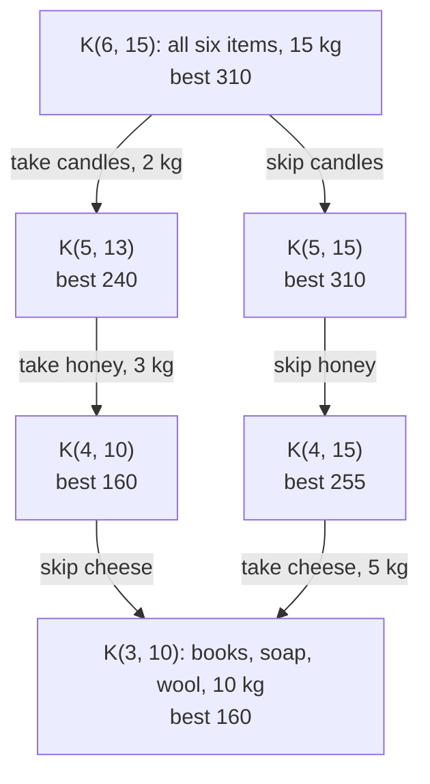
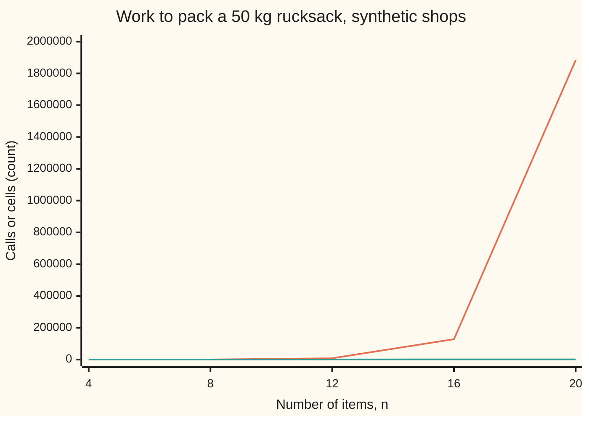

# Dynamic programming: solve each small piece once and write the answer down

[Syllabus](../../../SYLLABUS.md) → [Applied and computational](../README.md) → [Algorithms and Growth](../README.md#s01) → Dynamic programming

---

## General Overview

A trader walks to a hill-top fair with one rucksack. It holds 15 kg. Six items are on the table at home, and each goes in whole or stays behind:

| Item | books | soap | wool | cheese | honey | candles |
| --- | ---: | ---: | ---: | ---: | ---: | ---: |
| Weight, kg | 6 | 4 | 7 | 5 | 3 | 2 |
| Sells for, £ | 100 | 60 | 135 | 95 | 80 | 50 |

Which items fetch the most money? Six items allow 64 packings, 40 of which fit. Checking all 64 works today. With 20 items there are 1,048,576 packings, and every extra item doubles the count.

Dynamic programming asks smaller questions instead: "what is the most money from the first few items, with this much room left?" There are only 7 × 16 = 112 such questions here: 0 to 6 items, 0 to 15 kg of room. Each is answered from two answers already written down, once, in a table. The last cell gives **£310: wool, cheese and honey, exactly 15 kg**. Packing the best value per kilogram first gives only £265.

The same small question turns up again and again inside a plain search. That repetition is what the method exploits: answer it once, write it down, look it up after.

**Dynamic programming solves a problem whose best answer is built from best answers to smaller copies of itself, and whose smaller copies repeat, by answering each different copy once and storing it in a table.**

**What kind of fact this is:** a method of algorithm design. That the table gives the true best packing is a theorem, proved on this card in Why it works, and the code checks it against all 64 packings.

### The picture: one small question reached by two roads



Schematic: a corner of the search, not all of it. Each box is a small question: the best money from the first $i$ items with $w$ kg of room, written K($i$, $w$). Candles and honey together weigh 5 kg, the same as the cheese, so two different paths leave the same three items and the same 10 kg. A plain search solves K(3, 10) twice; a table solves it once.

---

## The formula

Notation first, in words. The items are numbered 1 to $n$ in the order of the table above. Item $i$ weighs $m_i$ kg and sells for $v_i$ pounds. $W$ is the rucksack's limit. $K(i, w)$, read "K of i and w", is the most money that can be packed from items 1 to $i$ alone into $w$ kg of room.

$$K(i, w) = \max\Big( K(i-1,\, w),\;\; v_i + K(i-1,\, w - m_i) \Big), \qquad K(0, w) = 0$$

The second option counts only when item $i$ fits, $m_i \le w$. The answer is $K(n, W)$.

**Read it aloud:** the best from the first $i$ items is the better of leaving item $i$ out, or putting it in and filling the room that remains from the items before it; with no items, nothing is packed.

| Symbol | Plain meaning | In our example | Push it up and the answer… |
| --- | --- | --- | --- |
| $n$ | number of items | 6 | can only rise; the table gains a row |
| $W$ | the rucksack's limit, kg | 15 | can only rise; the table gains columns |
| $i$ | how many items, counted from the first, are in play | 0 to 6 | can only rise |
| $w$ | room still free, kg | 0 to 15 | can only rise |
| $m_i$ | weight of item $i$, kg | wool, item 3: 7 | falls or stays |
| $v_i$ | money item $i$ sells for, £ | wool: 135 | rises or stays |
| $K(i, w)$ | most money from items 1 to $i$ in $w$ kg | $K(3, 10)$ = 160, $K(6, 15)$ = 310 | — |
| $P$ | a best packing, used in the proof | wool, cheese, honey | — |
| $T(n)$ | calls a plain recursion makes on $n$ items when all fit | $T(8)$ = 511 | doubles, plus one, per item |
| $\Theta(\cdot)$ | "grows exactly like, up to a constant" | $\Theta(nW)$ cells | — |

Each cell takes one comparison, so filling the table costs $n(W+1)$ cells: 6 × 16 = 96 here. In the notation of [Big-O](01-big-o-and-growth-rates.md), that is $\Theta(nW)$: it grows exactly like $n$ times $W$, up to a constant.

### When it holds

- **Best answers are built from best answers** (optimal substructure). Take item $i$ out of a best packing, and what is left is a best packing of the earlier items in the remaining room. It fails if items interact: a bonus for cheese and honey sold together means the remaining room alone no longer fixes what the rest is worth, and the question must also remember what is already packed.
- **The small questions repeat** (overlapping subproblems). Without repeats, storing answers saves nothing. Items weighing 1, 2, 4, 8, 16 and 32 kg in 63 kg of room leave a different room after every choice: 127 calls with a notebook or without one.
- **Weights are whole numbers, and the limit $W$ is small.** The table has one column per kilogram. Measure the same items in grams and it needs 6 × 15,001 = 90,006 cells, not 96. The cost grows with the size of the number $W$, not with the number of digits needed to write it. If the size of the input counts those digits as well as the items, this cost is exponential, so it is not polynomial time in the sense of [Polynomial or exponential](03-polynomial-versus-exponential-time.md). Such a method is called **pseudo-polynomial**: polynomial in the value of $W$, not in its length.
- **Each item is used at most once.** That is why the "take" option looks one row up, at $K(i-1, \cdot)$. Unlimited copies of each item is a different problem with a different table.

---

## Why it works

### Step 0: a small question with few versions

The packings number $2^n$. The small questions number only $(n+1)(W+1)$, because a small question is fixed by two whole numbers: how many items are in play and how much room is free. If each small question can be answered from smaller ones, the whole problem costs about as much as the number of small questions, not the number of packings.

The same idea runs a backward toll-road plan on [Dynamic programming](../../08-Differential%20equations%20and%20dynamics/12-Calculus%20of%20Variations%20and%20Optimal%20Control/07-dynamic-programming-and-the-bellman-equation.md), which proves Bellman's principle of optimality: any tail of a best plan is itself a best plan. Here the same cut-and-paste argument gives the rucksack's rule.

### Step 1: optimal substructure, by cut and paste

Take a best packing $P$ from items 1 to $i$ in $w$ kg. Item $i$ is either in $P$ or not.

- **Not in $P$.** Then $P$ uses only items 1 to $i-1$ in $w$ kg. If some packing of those did better, it would also beat $P$ here. So $P$ is worth exactly $K(i-1, w)$.
- **In $P$.** Then the rest of $P$ uses items 1 to $i-1$ in $w - m_i$ kg. If a better rest existed, paste it next to item $i$: the total would still fit and beat $P$. So $P$ is worth exactly $v_i + K(i-1, w - m_i)$.

Every packing falls in one case, so the best is the larger of the two. In the example, the best for 15 kg either skips the candles, worth $K(5, 15)$ = 310, or takes them and fills 13 kg from the first five, 50 + 240 = 290. The table keeps 310.

<details>
<summary>Detailed proof, by induction on i</summary>

Claim: for every $i$ from 0 to $n$ and every $w$ from 0 to $W$, the number $K(i, w)$ computed by the rule equals the most money over all packings that use only items 1 to $i$ and weigh at most $w$.

Base, $i = 0$: the only packing is empty, worth 0, and $K(0, w) = 0$.

Step: assume the claim for $i - 1$ and every room. Split the packings of items 1 to $i$ within $w$ by whether they contain item $i$. Those without it are exactly the packings of items 1 to $i - 1$ within $w$, whose best is $K(i-1, w)$ by assumption. Those with it exist only if $m_i \le w$; each is item $i$ plus a packing of items 1 to $i-1$ within $w - m_i$, so its worth is $v_i$ plus that packing's worth, and the best is $v_i + K(i-1, w - m_i)$ by assumption. The best overall is the larger of the two groups' bests, which is the rule. By [Induction](../../01-Foundations/06-Proof/04-proof-by-induction.md), the claim holds at $i = n$, $w = W$.

</details>

### Step 2: overlapping subproblems, counted

Written as a function that calls itself, the rule is correct but wasteful. On the six items, a plain recursion makes 96 calls but meets only 55 different questions. K(3, 10) is asked twice, as in the picture.

With six items the waste is small. It grows like the packings. When every item fits, each call makes two more, so $n$ items cost $2^{n+1} - 1$ calls. The code builds synthetic shops from a stated seed: weights 1 to 10 kg, prices £10 to £99, a 50 kg rucksack. In the shops of 8 and 12 items every item fits at once, so 8 items take 511 calls and 12 take 8,191. By 16 items the weights add up to more than 50 kg and some branches run out of room, yet 20 items still take 1,883,476 calls. The different questions never exceed $(n+1)(W+1)$: at 20 items only 725 are ever asked.

Counting calls when everything fits gives $T(n) = 2T(n-1) + 1$ with $T(0) = 1$: the Tower of Hanoi rule on [Recurrences](../../04-Combinatorics%20and%20graphs/05-Recurrences/01-recurrences-and-fibonacci.md), with a different seed.

### Step 3: write each answer down, one of two ways

**Memoise backwards.** Keep the recursion, starting from $K(6, 15)$, and add a notebook: before working on a question, look it up; after, write the answer in. This is **memoisation** (from "memo", a note to oneself). On the rucksack it makes 71 calls instead of 96 and solves each of the 55 questions once. It only ever touches the questions the answer needs.

**Fill a table forwards.** Start at row $i = 0$, all zeros, and fill each row left to right from the row above. Every cell's two ingredients are ready when it is reached. This costs exactly $n(W+1)$ cells, 96 here, and needs no recursion. It fills some cells no path ever uses, but it is simple, and its loops are easy to count.

Both give £310. The difference is the order of the work, not the rule.



The orange line is the plain recursion's calls: 31, 511, 8,191, 128,044, 1,883,476. The green line is the table's cells: 204, 408, 612, 816, 1,020. It grows in step with $n$ and hugs the axis.

### Step 4: read the packing back

The table holds money, not items. To recover the items, start at $K(6, 15)$ and walk up. If a cell equals the one above it, item $i$ was left out. If it differs, item $i$ went in: subtract its weight from the room and continue one row up. No extra search is needed.

---

## Worked numbers, by hand

The whole table. Row $i$ uses items 1 to $i$; column $w$ is the room in kg.

| $i$ \ $w$ | 0 | 1 | 2 | 3 | 4 | 5 | 6 | 7 | 8 | 9 | 10 | 11 | 12 | 13 | 14 | 15 |
| --- | ---: | ---: | ---: | ---: | ---: | ---: | ---: | ---: | ---: | ---: | ---: | ---: | ---: | ---: | ---: | ---: |
| 0 | 0 | 0 | 0 | 0 | 0 | 0 | 0 | 0 | 0 | 0 | 0 | 0 | 0 | 0 | 0 | 0 |
| 1 books | 0 | 0 | 0 | 0 | 0 | 0 | 100 | 100 | 100 | 100 | 100 | 100 | 100 | 100 | 100 | 100 |
| 2 soap | 0 | 0 | 0 | 0 | 60 | 60 | 100 | 100 | 100 | 100 | 160 | 160 | 160 | 160 | 160 | 160 |
| 3 wool | 0 | 0 | 0 | 0 | 60 | 60 | 100 | 135 | 135 | 135 | 160 | 195 | 195 | 235 | 235 | 235 |
| 4 cheese | 0 | 0 | 0 | 0 | 60 | 95 | 100 | 135 | 135 | 155 | 160 | 195 | 230 | 235 | 235 | 255 |
| 5 honey | 0 | 0 | 0 | 80 | 80 | 95 | 100 | 140 | 175 | 180 | 215 | 215 | 235 | 240 | 275 | 310 |
| 6 candles | 0 | 0 | 50 | 80 | 80 | 130 | 130 | 145 | 175 | 190 | 225 | 230 | 265 | 265 | 285 | 310 |

| Step | Arithmetic | Value |
| --- | --- | --- |
| books alone, 6 kg free | they fit: max(0, 100 + 0) | $K(1, 6)$ = 100 |
| add soap, 10 kg free | max($K(1, 10)$, 60 + $K(1, 6)$) = max(100, 160) | $K(2, 10)$ = 160 |
| add wool, 15 kg free | max($K(2, 15)$, 135 + $K(2, 8)$) = max(160, 135 + 100) | $K(3, 15)$ = 235 |
| add cheese, 15 kg free | max($K(3, 15)$, 95 + $K(3, 10)$) = max(235, 95 + 160) | $K(4, 15)$ = 255 |
| add honey, 15 kg free | max($K(4, 15)$, 80 + $K(4, 12)$) = max(255, 80 + 230) | $K(5, 15)$ = 310 |
| add candles, 15 kg free | max($K(5, 15)$, 50 + $K(5, 13)$) = max(310, 50 + 240) | $K(6, 15)$ = 310 |
| read back: candles? | $K(6, 15)$ = $K(5, 15)$ = 310 | out, 15 kg free |
| honey? | $K(5, 15)$ = 310 ≠ $K(4, 15)$ = 255 | in, 15 − 3 = 12 kg free |
| cheese? | $K(4, 12)$ = 230 ≠ $K(3, 12)$ = 195 | in, 12 − 5 = 7 kg free |
| wool? | $K(3, 7)$ = 135 ≠ $K(2, 7)$ = 100 | in, 7 − 7 = 0 kg free |
| the packing | 135 + 95 + 80, weighing 7 + 5 + 3 = 15 kg | **£310** |

The trader should carry wool, cheese and honey: £310, with not a gram of the 15 kg wasted. No other packing of the 64 does better.

### What breaks if you drop a piece

| Mistake | Comes out at | What went wrong |
| --- | --- | --- |
| Greedy: best value per kg first | £265: honey, candles, wool | The two best-per-kg items leave 10 kg, wool takes 7, and 3 kg sit empty |
| Greedy: dearest item first | £285: wool, books, candles | Books are dear but heavy; they crowd out cheese and honey |
| One row, filled left to right | £400 | The "take" option reads a cell already updated this row, so an item is packed again and again |
| Notebook keyed on $i$ alone, room forgotten | £520 | The answer for one room is reused for another; the rucksack would weigh more than 15 kg |

The code prints all four. £400 and £520 beat the true best, which is the giveaway: no honest method can beat 310.

---

## Code, from first principles, and it actually runs

Nothing is imported. Three roads reach the answer: the table filled forwards, the recursion run backwards (plain, then memoised), and brute force over all 64 packings. The plain recursion counts its calls and records how often each question is asked. A generator written out in both languages, SplitMix64 with seed 2026, builds synthetic shops of 4 to 20 items, and the three roads must agree on each.

### Python

```python
# Dynamic programming -- the check behind the card.  Nothing is imported.
# A trader packs a 15 kg rucksack for a fair from 6 items; each goes in whole or not at all.
# K(i, w) = the most value from the first i items with w kg of room.
NAMES = ["books", "soap", "wool", "cheese", "honey", "candles"]
KG = [6, 4, 7, 5, 3, 2]                   # weight of item 1..6, kg
GBP = [100, 60, 135, 95, 80, 50]          # what it sells for, pounds
CAP = 15

def table(kg, gbp, cap):                  # road one: fill the table forwards, row by row
    K, cells = [[0] * (cap + 1)], 0
    for i in range(1, len(kg) + 1):
        row = []
        for w in range(cap + 1):
            skip = K[i - 1][w]
            take = gbp[i - 1] + K[i - 1][w - kg[i - 1]] if kg[i - 1] <= w else -1
            row.append(max(skip, take)); cells += 1
        K.append(row)
    return K, cells

def solve(kg, gbp, cap, memo, seen=None): # road two: recurse backwards from K(n, cap); memo=None is naive
    calls = [0]
    def K(i, w):
        calls[0] += 1
        if seen is not None:
            seen[(i, w)] = seen.get((i, w), 0) + 1
        if memo is not None and (i, w) in memo:
            return memo[(i, w)]
        best = 0 if i == 0 else K(i - 1, w)
        if i > 0 and kg[i - 1] <= w:
            best = max(best, gbp[i - 1] + K(i - 1, w - kg[i - 1]))
        if memo is not None:
            memo[(i, w)] = best
        return best
    return K(len(kg), cap), calls[0]

def brute(kg, gbp, cap):                  # road three: every one of the 2^n packings
    best, legal = 0, 0
    for m in range(2 ** len(kg)):
        w = sum(kg[j] for j in range(len(kg)) if m >> j & 1)
        if w <= cap:
            legal += 1
            best = max(best, sum(gbp[j] for j in range(len(kg)) if m >> j & 1))
    return best, legal

def greedy(order):                        # mistake: pack in a fixed order while things fit
    room, val, took = CAP, 0, []
    for j in order:
        if KG[j] <= room:
            room, val = room - KG[j], val + GBP[j]; took.append(NAMES[j])
    return val, took

K, cells = table(KG, GBP, CAP)
print("items: " + ", ".join(f"{i + 1} {NAMES[i]} {KG[i]} kg {GBP[i]}" for i in range(6)))
print("table K(i, w), rows i = 0..6, columns w = 0..15 kg")
for i, row in enumerate(K):
    print(f"  i={i}" + "".join(f"{v:4d}" for v in row))
w, took = CAP, []
for i in range(6, 0, -1):                 # read the packing back: did row i change the answer?
    if K[i][w] != K[i - 1][w]:
        took.append(i); w -= KG[i - 1]
took.reverse()
for i in (6, 3):                          # two cells, written out
    r = CAP - KG[i - 1]
    print(f"cell K({i},{CAP}) = max(K({i - 1},{CAP}), {GBP[i - 1]} + K({i - 1},{r})) = "
          f"max({K[i - 1][CAP]}, {GBP[i - 1] + K[i - 1][r]}) = {K[i][CAP]}")
print("packing: " + " + ".join(NAMES[i - 1] for i in took) + f", {sum(KG[i - 1] for i in took)} kg, "
      + " + ".join(str(GBP[i - 1]) for i in took) + f" = {sum(GBP[i - 1] for i in took)}")
seen = {}
best_naive, calls_naive = solve(KG, GBP, CAP, None, seen)
memo = {}
best_memo, calls_memo = solve(KG, GBP, CAP, memo)
best_brute, legal = brute(KG, GBP, CAP)
print(f"small questions: (6 + 1) x ({CAP} + 1) = {7 * (CAP + 1)}; packings with 20 items: {2 ** 20}")
print(f"table: {cells} cells filled, best {K[6][CAP]}")
print(f"naive recursion: {calls_naive} calls, best {best_naive}")
print(f"memoised: {calls_memo} calls, {len(memo)} different subproblems, best {best_memo}")
print(f"brute force: 64 packings, {legal} fit, best {best_brute}")
print(f"naive repeats: {len(seen)} different subproblems; K(3,10) asked {seen.get((3, 10), 0)} times, value {K[3][10]}")
ratio = sorted(range(6), key=lambda j: -GBP[j] / KG[j])
for label, order in (("value per kg", ratio), ("highest value", sorted(range(6), key=lambda j: -GBP[j]))):
    v, t = greedy(order)
    print(f"wrong: greedy by {label}: {' + '.join(t)} = {v}")
one = [0] * (CAP + 1)                     # wrong: one row updated left to right, so items repeat
for j in range(6):
    for w in range(KG[j], CAP + 1):
        one[w] = max(one[w], GBP[j] + one[w - KG[j]])
print(f"wrong: one row filled left to right, items reused: {one[CAP]}")
bad = {}                                  # wrong: memo keyed on the item count, room forgotten
def badK(i, w):
    if i in bad:
        return bad[i]
    best = 0 if i == 0 else badK(i - 1, w)
    if i > 0 and KG[i - 1] <= w:
        best = max(best, GBP[i - 1] + badK(i - 1, w - KG[i - 1]))
    bad[i] = best
    return best
print(f"wrong: memo keyed on i alone: {badK(6, CAP)}")
pw = [1, 2, 4, 8, 16, 32]                 # no overlap: every packing leaves a different room
pm = {}
print(f"no overlap, weights 1,2,4,8,16,32 kg, room 63: naive {solve(pw, pw, 63, None)[1]} calls, "
      f"memoised {solve(pw, pw, 63, pm)[1]} calls, {len(pm)} subproblems")
print(f"weights in grams: table {6 * (15000 + 1)} cells, not {cells}")

def splitmix(s):                          # SplitMix64, written out, for the synthetic shops
    s = (s + 0x9E3779B97F4A7C15) & (2 ** 64 - 1)
    z = s
    z = ((z ^ (z >> 30)) * 0xBF58476D1CE4E5B9) & (2 ** 64 - 1)
    z = ((z ^ (z >> 27)) * 0x94D049BB133111EB) & (2 ** 64 - 1)
    return s, z ^ (z >> 31)
print("synthetic, seed 2026, weights 1-10 kg, values 10-99, room 50 kg")
chart = []
for n in (4, 8, 12, 16, 20):
    s, kg, gbp = 2026, [], []
    for _ in range(n):
        s, a = splitmix(s); s, b = splitmix(s)
        kg.append(1 + a % 10); gbp.append(10 + b % 90)
    Kn, cn = table(kg, gbp, 50)
    bn, nc = solve(kg, gbp, 50, None)
    mm = {}
    bm, mc = solve(kg, gbp, 50, mm)
    assert Kn[n][50] == bn == bm, "three roads disagree on a synthetic shop"
    chart.append((n, nc, cn))
    print(f"  n={n:2d}: naive {nc:8d} calls, memo {len(mm):4d} subproblems, table {cn:4d} cells, best {bn}")
print("chart, items " + " ".join(str(c[0]) for c in chart))
print("chart, naive calls " + " ".join(str(c[1]) for c in chart))
print("chart, table cells " + " ".join(str(c[2]) for c in chart))

assert K[6][CAP] == best_brute == 310, "table against all 64 packings"
assert best_naive == best_memo == best_brute, "both recursions against brute force"
assert sum(GBP[i - 1] for i in took) == K[6][CAP] and sum(KG[i - 1] for i in took) <= CAP
assert calls_memo < calls_naive and seen.get((3, 10), 0) == 2, "the overlap the card names"
assert one[CAP] > best_brute, "reusing items must beat the honest best"
print("ALL CHECKS PASS")
```

**Ran 2026-11-11 on macOS, Python 3.14.10, standard library only. All checks passed. Output, pasted from the run:**

```
items: 1 books 6 kg 100, 2 soap 4 kg 60, 3 wool 7 kg 135, 4 cheese 5 kg 95, 5 honey 3 kg 80, 6 candles 2 kg 50
table K(i, w), rows i = 0..6, columns w = 0..15 kg
  i=0   0   0   0   0   0   0   0   0   0   0   0   0   0   0   0   0
  i=1   0   0   0   0   0   0 100 100 100 100 100 100 100 100 100 100
  i=2   0   0   0   0  60  60 100 100 100 100 160 160 160 160 160 160
  i=3   0   0   0   0  60  60 100 135 135 135 160 195 195 235 235 235
  i=4   0   0   0   0  60  95 100 135 135 155 160 195 230 235 235 255
  i=5   0   0   0  80  80  95 100 140 175 180 215 215 235 240 275 310
  i=6   0   0  50  80  80 130 130 145 175 190 225 230 265 265 285 310
cell K(6,15) = max(K(5,15), 50 + K(5,13)) = max(310, 290) = 310
cell K(3,15) = max(K(2,15), 135 + K(2,8)) = max(160, 235) = 235
packing: wool + cheese + honey, 15 kg, 135 + 95 + 80 = 310
small questions: (6 + 1) x (15 + 1) = 112; packings with 20 items: 1048576
table: 96 cells filled, best 310
naive recursion: 96 calls, best 310
memoised: 71 calls, 55 different subproblems, best 310
brute force: 64 packings, 40 fit, best 310
naive repeats: 55 different subproblems; K(3,10) asked 2 times, value 160
wrong: greedy by value per kg: honey + candles + wool = 265
wrong: greedy by highest value: wool + books + candles = 285
wrong: one row filled left to right, items reused: 400
wrong: memo keyed on i alone: 520
no overlap, weights 1,2,4,8,16,32 kg, room 63: naive 127 calls, memoised 127 calls, 127 subproblems
weights in grams: table 90006 cells, not 96
synthetic, seed 2026, weights 1-10 kg, values 10-99, room 50 kg
  n= 4: naive       31 calls, memo   24 subproblems, table  204 cells, best 223
  n= 8: naive      511 calls, memo  116 subproblems, table  408 cells, best 409
  n=12: naive     8191 calls, memo  270 subproblems, table  612 cells, best 617
  n=16: naive   128044 calls, memo  548 subproblems, table  816 cells, best 734
  n=20: naive  1883476 calls, memo  725 subproblems, table 1020 cells, best 881
chart, items 4 8 12 16 20
chart, naive calls 31 511 8191 128044 1883476
chart, table cells 204 408 612 816 1020
ALL CHECKS PASS
```

### Rust

Same numbers, same labels, built with `rustc --edition 2021 -O`.

```rust
// Dynamic programming -- the same check as the Python, in Rust.  No crates.
// A trader packs a 15 kg rucksack for a fair from 6 items; each goes in whole or not at all.
// K(i, w) = the most value from the first i items with w kg of room.
use std::collections::HashMap;
const NAMES: [&str; 6] = ["books", "soap", "wool", "cheese", "honey", "candles"];
const KG: [usize; 6] = [6, 4, 7, 5, 3, 2];        // weight of item 1..6, kg
const GBP: [u64; 6] = [100, 60, 135, 95, 80, 50]; // what it sells for, pounds
const CAP: usize = 15;

fn table(kg: &[usize], gbp: &[u64], cap: usize) -> (Vec<Vec<u64>>, usize) { // road one: forwards
    let (mut k, mut cells) = (vec![vec![0u64; cap + 1]], 0);
    for i in 1..=kg.len() {
        let mut row = Vec::new();
        for w in 0..=cap {
            let skip = k[i - 1][w];
            let take = if kg[i - 1] <= w { gbp[i - 1] + k[i - 1][w - kg[i - 1]] } else { 0 };
            row.push(skip.max(take)); cells += 1;
        }
        k.push(row);
    }
    (k, cells)
}

struct Rec<'a> { kg: &'a [usize], gbp: &'a [u64], calls: usize, memo: Option<HashMap<(usize, usize), u64>>,
                 seen: HashMap<(usize, usize), usize> }
impl<'a> Rec<'a> {                                // road two: recurse backwards; memo None is naive
    fn k(&mut self, i: usize, w: usize) -> u64 {
        self.calls += 1;
        *self.seen.entry((i, w)).or_insert(0) += 1;
        if let Some(m) = &self.memo { if let Some(&v) = m.get(&(i, w)) { return v; } }
        let mut best = if i == 0 { 0 } else { self.k(i - 1, w) };
        if i > 0 && self.kg[i - 1] <= w { best = best.max(self.gbp[i - 1] + self.k(i - 1, w - self.kg[i - 1])); }
        if let Some(m) = &mut self.memo { m.insert((i, w), best); }
        best
    }
}
fn solve<'a>(kg: &'a [usize], gbp: &'a [u64], cap: usize, memo: bool) -> (u64, Rec<'a>) {
    let mut r = Rec { kg, gbp, calls: 0, memo: if memo { Some(HashMap::new()) } else { None }, seen: HashMap::new() };
    let b = r.k(kg.len(), cap);
    (b, r)
}

fn brute(kg: &[usize], gbp: &[u64], cap: usize) -> (u64, usize) { // road three: every packing
    let (mut best, mut legal) = (0, 0);
    for m in 0..(1usize << kg.len()) {
        let w: usize = (0..kg.len()).filter(|j| m >> j & 1 == 1).map(|j| kg[j]).sum();
        if w <= cap {
            legal += 1;
            best = best.max((0..kg.len()).filter(|j| m >> j & 1 == 1).map(|j| gbp[j]).sum());
        }
    }
    (best, legal)
}

fn greedy(order: &[usize]) -> (u64, Vec<&'static str>) { // mistake: pack in a fixed order while things fit
    let (mut room, mut val, mut took) = (CAP, 0, Vec::new());
    for &j in order {
        if KG[j] <= room { room -= KG[j]; val += GBP[j]; took.push(NAMES[j]); }
    }
    (val, took)
}

fn bad_k(i: usize, w: usize, bad: &mut HashMap<usize, u64>) -> u64 { // wrong: memo keyed on i alone
    if let Some(&v) = bad.get(&i) { return v; }
    let mut best = if i == 0 { 0 } else { bad_k(i - 1, w, bad) };
    if i > 0 && KG[i - 1] <= w { best = best.max(GBP[i - 1] + bad_k(i - 1, w - KG[i - 1], bad)); }
    bad.insert(i, best);
    best
}

fn splitmix(s: u64) -> (u64, u64) {               // SplitMix64, written out, for the synthetic shops
    let s = s.wrapping_add(0x9E3779B97F4A7C15);
    let mut z = s;
    z = (z ^ (z >> 30)).wrapping_mul(0xBF58476D1CE4E5B9);
    z = (z ^ (z >> 27)).wrapping_mul(0x94D049BB133111EB);
    (s, z ^ (z >> 31))
}

fn main() {
    let (k, cells) = table(&KG, &GBP, CAP);
    let items: Vec<String> = (0..6).map(|i| format!("{} {} {} kg {}", i + 1, NAMES[i], KG[i], GBP[i])).collect();
    println!("items: {}", items.join(", "));
    println!("table K(i, w), rows i = 0..6, columns w = 0..15 kg");
    for (i, row) in k.iter().enumerate() {
        println!("  i={}{}", i, row.iter().map(|v| format!("{:4}", v)).collect::<String>());
    }
    let (mut w, mut took) = (CAP, Vec::new());
    for i in (1..=6).rev() {                          // read the packing back
        if k[i][w] != k[i - 1][w] { took.push(i); w -= KG[i - 1]; }
    }
    took.reverse();
    for i in [6usize, 3] {                            // two cells, written out
        let r = CAP - KG[i - 1];
        println!("cell K({},{}) = max(K({},{}), {} + K({},{})) = max({}, {}) = {}", i, CAP, i - 1, CAP,
                 GBP[i - 1], i - 1, r, k[i - 1][CAP], GBP[i - 1] + k[i - 1][r], k[i][CAP]);
    }
    let (pkg, pval): (usize, u64) = (took.iter().map(|&i| KG[i - 1]).sum(), took.iter().map(|&i| GBP[i - 1]).sum());
    let names: Vec<&str> = took.iter().map(|&i| NAMES[i - 1]).collect();
    let vals: Vec<String> = took.iter().map(|&i| GBP[i - 1].to_string()).collect();
    println!("packing: {}, {} kg, {} = {}", names.join(" + "), pkg, vals.join(" + "), pval);
    let (best_naive, naive) = solve(&KG, &GBP, CAP, false);
    let (best_memo, memo) = solve(&KG, &GBP, CAP, true);
    let (best_brute, legal) = brute(&KG, &GBP, CAP);
    println!("small questions: (6 + 1) x ({} + 1) = {}; packings with 20 items: {}", CAP, 7 * (CAP + 1), 1u64 << 20);
    println!("table: {} cells filled, best {}", cells, k[6][CAP]);
    println!("naive recursion: {} calls, best {}", naive.calls, best_naive);
    println!("memoised: {} calls, {} different subproblems, best {}", memo.calls, memo.memo.as_ref().unwrap().len(), best_memo);
    println!("brute force: 64 packings, {} fit, best {}", legal, best_brute);
    let twice = naive.seen.get(&(3, 10)).copied().unwrap_or(0);
    println!("naive repeats: {} different subproblems; K(3,10) asked {} times, value {}", naive.seen.len(), twice, k[3][10]);
    let mut ratio: Vec<usize> = (0..6).collect();
    ratio.sort_by(|&a, &b| (GBP[b] as f64 / KG[b] as f64).partial_cmp(&(GBP[a] as f64 / KG[a] as f64)).unwrap());
    let mut high: Vec<usize> = (0..6).collect();
    high.sort_by(|&a, &b| GBP[b].cmp(&GBP[a]));
    for (label, order) in [("value per kg", &ratio), ("highest value", &high)] {
        let (v, t) = greedy(order);
        println!("wrong: greedy by {}: {} = {}", label, t.join(" + "), v);
    }
    let mut one = vec![0u64; CAP + 1];                // wrong: one row updated left to right
    for j in 0..6 { for w in KG[j]..=CAP { one[w] = one[w].max(GBP[j] + one[w - KG[j]]); } }
    println!("wrong: one row filled left to right, items reused: {}", one[CAP]);
    println!("wrong: memo keyed on i alone: {}", bad_k(6, CAP, &mut HashMap::new()));
    let pw: [usize; 6] = [1, 2, 4, 8, 16, 32];        // no overlap: every packing leaves a different room
    let pv: Vec<u64> = pw.iter().map(|&x| x as u64).collect();
    let (_, pn) = solve(&pw, &pv, 63, false);
    let (_, pm) = solve(&pw, &pv, 63, true);
    println!("no overlap, weights 1,2,4,8,16,32 kg, room 63: naive {} calls, memoised {} calls, {} subproblems",
             pn.calls, pm.calls, pm.memo.as_ref().unwrap().len());
    println!("weights in grams: table {} cells, not {}", 6 * (15000 + 1), cells);
    println!("synthetic, seed 2026, weights 1-10 kg, values 10-99, room 50 kg");
    let mut chart = Vec::new();
    for n in [4usize, 8, 12, 16, 20] {
        let (mut s, mut kg, mut gbp) = (2026u64, Vec::new(), Vec::new());
        for _ in 0..n {
            let (s1, a) = splitmix(s); let (s2, b) = splitmix(s1); s = s2;
            kg.push(1 + (a % 10) as usize); gbp.push(10 + b % 90);
        }
        let (kn, cn) = table(&kg, &gbp, 50);
        let (bn, rn) = solve(&kg, &gbp, 50, false);
        let (bm, rm) = solve(&kg, &gbp, 50, true);
        assert!(kn[n][50] == bn && bn == bm, "three roads disagree on a synthetic shop");
        chart.push((n, rn.calls, cn));
        println!("  n={:2}: naive {:8} calls, memo {:4} subproblems, table {:4} cells, best {}", n, rn.calls, rm.memo.as_ref().unwrap().len(), cn, bn);
    }
    let line = |f: &dyn Fn(&(usize, usize, usize)) -> usize| chart.iter().map(|c| f(c).to_string()).collect::<Vec<_>>().join(" ");
    println!("chart, items {}", line(&|c| c.0));
    println!("chart, naive calls {}", line(&|c| c.1));
    println!("chart, table cells {}", line(&|c| c.2));

    assert!(k[6][CAP] == best_brute && best_brute == 310, "table against all 64 packings");
    assert!(best_naive == best_memo && best_memo == best_brute, "both recursions against brute force");
    assert!(pval == k[6][CAP] && pkg <= CAP);
    assert!(memo.calls < naive.calls && twice == 2, "the overlap the card names");
    assert!(one[CAP] > best_brute, "reusing items must beat the honest best");
    println!("ALL CHECKS PASS");
}
```

**Ran 2026-11-11 on macOS, rustc 1.98.1, no crates. All checks passed. Output, pasted from the run:**

```
items: 1 books 6 kg 100, 2 soap 4 kg 60, 3 wool 7 kg 135, 4 cheese 5 kg 95, 5 honey 3 kg 80, 6 candles 2 kg 50
table K(i, w), rows i = 0..6, columns w = 0..15 kg
  i=0   0   0   0   0   0   0   0   0   0   0   0   0   0   0   0   0
  i=1   0   0   0   0   0   0 100 100 100 100 100 100 100 100 100 100
  i=2   0   0   0   0  60  60 100 100 100 100 160 160 160 160 160 160
  i=3   0   0   0   0  60  60 100 135 135 135 160 195 195 235 235 235
  i=4   0   0   0   0  60  95 100 135 135 155 160 195 230 235 235 255
  i=5   0   0   0  80  80  95 100 140 175 180 215 215 235 240 275 310
  i=6   0   0  50  80  80 130 130 145 175 190 225 230 265 265 285 310
cell K(6,15) = max(K(5,15), 50 + K(5,13)) = max(310, 290) = 310
cell K(3,15) = max(K(2,15), 135 + K(2,8)) = max(160, 235) = 235
packing: wool + cheese + honey, 15 kg, 135 + 95 + 80 = 310
small questions: (6 + 1) x (15 + 1) = 112; packings with 20 items: 1048576
table: 96 cells filled, best 310
naive recursion: 96 calls, best 310
memoised: 71 calls, 55 different subproblems, best 310
brute force: 64 packings, 40 fit, best 310
naive repeats: 55 different subproblems; K(3,10) asked 2 times, value 160
wrong: greedy by value per kg: honey + candles + wool = 265
wrong: greedy by highest value: wool + books + candles = 285
wrong: one row filled left to right, items reused: 400
wrong: memo keyed on i alone: 520
no overlap, weights 1,2,4,8,16,32 kg, room 63: naive 127 calls, memoised 127 calls, 127 subproblems
weights in grams: table 90006 cells, not 96
synthetic, seed 2026, weights 1-10 kg, values 10-99, room 50 kg
  n= 4: naive       31 calls, memo   24 subproblems, table  204 cells, best 223
  n= 8: naive      511 calls, memo  116 subproblems, table  408 cells, best 409
  n=12: naive     8191 calls, memo  270 subproblems, table  612 cells, best 617
  n=16: naive   128044 calls, memo  548 subproblems, table  816 cells, best 734
  n=20: naive  1883476 calls, memo  725 subproblems, table 1020 cells, best 881
chart, items 4 8 12 16 20
chart, naive calls 31 511 8191 128044 1883476
chart, table cells 204 408 612 816 1020
ALL CHECKS PASS
```

The two outputs match line for line.

> [!TIP]
> **Try changing**
> Guess first, then run the Python.
> - **A smaller rucksack.** Set `CAP = 10`. Guess the best, then read it from row 6, column 10 of the table above: £225, from cheese, honey and candles. The first assert stops the run, because it pins £310.
> - **A 12 kg rucksack.** Set `CAP = 12`: £265, from wool, honey and candles. Row 6 also shows 265 at 13 kg: one more kilogram buys nothing.
> - **Let items repeat in the recursion.** In `solve`, change `K(i - 1, w - kg[i - 1])` to `K(i, w - kg[i - 1])`. Both recursions now report £400, the same as the one-row mistake, and an assert stops the run.
> - **Throw away the notebook.** In the memoised call, pass `None` instead of `memo`: 96 calls, the plain recursion's count, and the fourth assert stops the run because the notebook no longer saves a call.

---

## The usual mistake

> [!warning]
> **Packing the best value per kilogram first.** It feels right and is often close, but it is not a method for whole items. Honey and candles are the best per kilogram. Take them, then wool, and 3 kg sit empty that nothing left can fill: £265 against £310. Greedy choice is safe only for special problems, and proving that is the job of [Greedy](08-greedy-algorithms-and-matroids.md).
>
> - **Filling one row in place, left to right.** The "take" option then reads a value that already includes this item, so items repeat: £400, an impossible packing.
> - **A notebook that forgets part of the question.** Keyed on the item count alone, it hands one room's answer to another: £520.
> - **Calling $\Theta(nW)$ fast without asking about $W$.** The same six items in grams need 90,006 cells instead of 96.
> - **Memoising where nothing repeats.** With weights 1, 2, 4, 8, 16 and 32 kg and 63 kg of room, every one of 127 questions is different, so the notebook only adds bookkeeping.

---

## Where you meet it in real life

- **Phone storage.** Choosing which albums from a 1,000,000-track library to keep offline in a phone's spare space, for the most of what the owner rates highest, is this rucksack with megabytes for kilograms. The free space sets the table's width, so it decides whether the table is practical.
- **Budgets.** Picking projects or adverts under a fixed budget, each with a cost and an expected return, is the same table with pounds as the room.
- **Comparing text.** File comparison tools and spell checkers fill a table of best partial matches between two strings; that model belongs to Four classic models.
- **DNA and protein alignment.** Lining up two gene sequences with the fewest edits is a table filled one row at a time, the same rule shape as here.
- **Cutting stock.** Cutting a steel bar or a roll of paper into ordered lengths for the most value is a rucksack in disguise.

> **Say it back**
> The best packing of the first $i$ items either leaves item $i$ out or puts it in, and in each case the rest must be a best packing of the earlier items in the room left over. So one small question, the best from the first $i$ items in $w$ kg, is answered from two smaller ones. A plain search asks the same small question many times; dynamic programming answers each once and writes it down, either in a notebook while recursing backwards or in a table filled forwards. At six items the table's 96 cells are no cheaper than the 64 packings; at 20 items it is 1,020 cells against 1,883,476 calls. The catch is that the table grows with the room measured in units, not with the number of digits.

---

## What this builds on

- [Recurrences](04-recurrences-and-the-master-theorem.md): reads off the cost of a method that calls itself, such as the plain recursion here.
- [Recurrences](../../04-Combinatorics%20and%20graphs/05-Recurrences/01-recurrences-and-fibonacci.md): a term built from the terms behind it, plus seeds; $K(0, w) = 0$ is the seed row here, and the call count follows the Tower of Hanoi rule.
- [Dynamic programming](../../08-Differential%20equations%20and%20dynamics/12-Calculus%20of%20Variations%20and%20Optimal%20Control/07-dynamic-programming-and-the-bellman-equation.md): the principle of optimality and backward induction on a toll road, with stages instead of items.

## Where this goes next

- [Greedy](08-greedy-algorithms-and-matroids.md): the next card. When taking the best next step is provably safe, the table is not needed.
- Four classic models: longest common subsequence, edit distance, shortest paths and sequence alignment, each set up as a table.
- Backward induction: the same recursion when chance decides what happens next, and each tail is an average.

The question left open: when the room is too large for a table, how close can a fast method get to the best packing, and can it promise how close?

---

## Sources

Verified 2026-11-11: every link below resolves to the publisher's page.

- Bellman, Richard. "The theory of dynamic programming." *Bulletin of the American Mathematical Society* 60(6), 1954, 503–515. [doi:10.1090/S0002-9904-1954-09848-8](https://doi.org/10.1090/S0002-9904-1954-09848-8). The method and the principle of optimality, as first set out.
- Dantzig, George B. "Discrete-variable extremum problems." *Operations Research* 5(2), 1957, 266–288. [doi:10.1287/opre.5.2.266](https://doi.org/10.1287/opre.5.2.266). The rucksack problem, and why packing by best value per unit fails for whole items.
- Michie, Donald. "'Memo' functions and machine learning." *Nature* 218, 1968, 19–22. [doi:10.1038/218019a0](https://doi.org/10.1038/218019a0). Introduces memo functions, the source of the word memoisation.
- Kleinberg, Jon, and Éva Tardos. *Algorithm Design*. Pearson. [Publisher page](https://www.pearson.com/en-us/subject-catalog/p/algorithm-design/P200000003259/9780137546350). The rucksack table, its $\Theta(nW)$ cost, and memoisation against filling forwards, in its chapter on dynamic programming.
