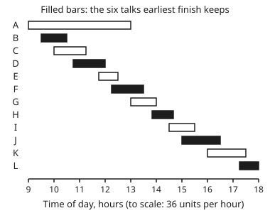

# Greedy: take the best next step, and the argument that it is safe

[Syllabus](../../../SYLLABUS.md) → [Applied and computational](../README.md) → [Algorithms and Growth](../README.md#s01) → Greedy

---

## General Overview

A one-day conference has one lecture room, open from 9:00 to 18:00. Twelve talks are proposed, A to L, each with a fixed start and finish. Some overlap. The organiser wants as many talks as possible in the room, with no two running at once. The data are synthetic: made up for this card.

There are 4096 ways to pick a subset of twelve talks. Checking all of them is possible here and hopeless for a big event. A **greedy** method does something much cheaper: it makes one choice at a time, takes whatever looks best right now, and never goes back. The rule that works is: **keep the talk that finishes earliest, then the next one that starts after it ends, and so on.** It keeps six talks, B, D, F, H, J and L, in 12 comparisons after a sort. Brute force over all 4096 subsets agrees: 6 is the most, and that schedule is the only one with 6.

Greed is not always safe. Three other natural rules, "start earliest", "shortest first" and "fewest clashes", keep 4, 5 and 5 talks. And if each talk carries an expected audience and the goal is the biggest total audience, "biggest audience first" falls 10 people short. So every greedy method needs an argument, and this card gives the two standard ones: **staying ahead** and **exchange**. It also names the structure, a **matroid**, under which heaviest-first greed is right for every set of weights.

**A greedy method is right only when an argument shows its first choice can sit inside some best answer, and that the same holds at every later step; earliest finish has such an argument for counting talks, while for weighted choices the argument works for every weighting exactly when the allowed sets form a matroid.**

**What kind of fact this is:** two theorems, both proved on this card in Why it works: earliest finish keeps the most talks, and heaviest-first greed is right for every weighting exactly on matroids.

### The picture: twelve talks, one room

<p align="center"></p>

Each bar is one talk, drawn to scale. The filled bars are the six the earliest-finish rule keeps. The long bar A, 9:00 to 13:00, is a workshop: it alone blocks five other talks.

---

## The formula

Notation first, in words. Talk $i$ starts at time $s_i$ and finishes at $f_i$. Two talks **clash** when they overlap: $s_i < f_j$ and $s_j < f_i$. A talk that starts the minute another ends does not clash with it. A **schedule** is a set of talks with no clashes.

**The earliest-finish rule.** Sort the talks so that finishing times rise. Walk down the list. Keep a talk if it starts no earlier than the last kept talk ends; otherwise skip it.

Call the kept talks $g_1, g_2, \dots, g_k$, in the order kept: $g$ for greedy, $k$ for how many. Take any other schedule and list its talks in time order, $o_1, o_2, \dots, o_m$: $o$ for other, $m$ for how many. The proof rests on one inequality:

$$f_{g_j} \le f_{o_j} \quad \text{for every } j \text{ up to the smaller of } k \text{ and } m, \qquad \text{so} \qquad k \ge m.$$

**Read it aloud:** greedy's first talk ends no later than the other schedule's first talk, its second no later than the other's second, and so on; so greedy runs out of room no sooner, and keeps at least as many talks.

For weighted choices the card needs one more idea. A family of **allowed sets** is a list of the sets one may pick: here, the schedules. It is **hereditary** when every part of an allowed set is allowed too: drop a talk from a schedule and it is still a schedule. Each item $x$ has a **weight** $w(x)$ that is zero or more, here an audience $a_x$. **Heaviest-first greed** walks the items from heaviest to lightest and keeps each one that still leaves an allowed set. The family has the **exchange property** when:

$$I, J \text{ allowed and } |J| > |I| \;\Longrightarrow\; \text{some } x \text{ in } J \text{ but not in } I \text{ makes } I \cup \{x\} \text{ allowed.}$$

**Read it aloud:** whenever one allowed set is bigger than another, the smaller one can borrow an item from the bigger and stay allowed.

A hereditary family with the exchange property is a **matroid**. The theorem of Rado (1957) and Edmonds (1971): on a hereditary family, heaviest-first greed finds a heaviest allowed set for every choice of weights if and only if the family is a matroid.

| Symbol | Plain meaning | In our example | Push it up and the answer… |
| --- | --- | --- | --- |
| $n$ | how many talks are proposed | 12 | brute force doubles per talk; greedy adds one comparison |
| $s_i$, $f_i$ | start and finish of talk $i$ | B: 9:30 and 10:30 | a later finish pushes the talk down greedy's list |
| $g_j$ | the $j$-th talk greedy keeps; $j$ counts steps | $g_1$ is B | — |
| $o_j$ | the $j$-th talk of any other schedule | earliest start's $o_1$ is A | — |
| $k$, $m$ | how many talks greedy and the other schedule keep | 6 and 4 | $m$ can never pass $k$ |
| $I$, $J$ | two allowed sets | $I$ is A alone, $J$ is B and D | — |
| $\lvert J \rvert$ | how many items $J$ holds | 2 | — |
| $x$ | one item: a talk, or one run of fibre trench (Step 6) | D | — |
| $x_j$, $y_j$ | the $j$-th item greedy keeps, and of any other allowed set, heaviest first | $x_1$ is A, $y_1$ is K | — |
| $p$ | the smaller set's size, in the converse proof | 1 | the weights used rise with it |
| $w(x)$, $a_x$ | an item's weight; a talk's audience | $a_A$ is 120 | heavier items come earlier in the walk |

### When it holds

- **One room, fixed times.** With two rooms the walk needs a second rule, which room to use: putting each talk in the free room that emptied most recently keeps the most, while taking any free room can keep fewer. With talks that can slide, the problem changes.
- **Every talk counts the same.** Once talks carry audiences, earliest finish ignores them: here it gets 300 people against a best of 375.
- **Ties are harmless.** Two talks ending at the same minute can go in either order; the proof below never uses the order of ties.
- **The matroid theorem needs heredity and weights of zero or more.** With negative weights, "keep everything that fits" can keep an item that only lowers the total.

---

## Why it works

### Step 0: a greedy choice is safe if some best answer contains it

Greed never undoes a choice. So it is right only if each choice it makes can be extended to a best answer. There are two standard ways to show that.

- **Exchange:** take any best answer, swap one of its pieces for greedy's choice, and show the result is no worse.
- **Staying ahead:** compare greedy with any other answer step by step, and show greedy is never behind at any step.

The model exchange argument is the cut property in [The cheapest skeleton](../../04-Combinatorics%20and%20graphs/10-Trees%20and%20Cheapest%20Routes/04-minimum-spanning-trees.md): add the cheapest run across a split to a cheapest network, drop the other run the new loop crosses, and the price does not rise. This card runs both arguments on talks, then shows why they hold for every weighting on a matroid.

### Step 1: earliest finish stays ahead

Let greedy keep $g_1, \dots, g_k$ and let any other schedule hold $o_1, \dots, o_m$, both in time order.

- **First talk.** Greedy's first talk, B, finishes at 10:30, earliest of all twelve. So $f_{g_1} \le f_{o_1}$ for any schedule at all.
- **Each later talk.** Suppose $f_{g_{j-1}} \le f_{o_{j-1}}$. The talk $o_j$ starts after $o_{j-1}$ ends, so it starts after $g_{j-1}$ ends. So $o_j$ was still free when greedy chose its $j$-th talk. Greedy took the free talk that ends earliest, so $f_{g_j} \le f_{o_j}$.

Check it against the earliest-start schedule A, G, I, K, which ends its talks at 13:00, 14:00, 15:30 and 17:30. Greedy's first four end at 10:30, 12:00, 13:30 and 14:40: earlier every time. The check script tests the inequality on all 254 schedules the room allows, and it never fails.

### Step 2: staying ahead means keeping the most

Suppose some schedule had more talks than greedy: $m > k$. Its talk $o_{k+1}$ starts after $o_k$ ends, which is no earlier than $g_k$ ends, by Step 1. So $o_{k+1}$ was free when greedy finished its walk, and greedy would have kept it. That contradicts greedy stopping at $k$. So $k \ge m$ for every schedule, and earliest finish keeps the most talks: 6.

### Step 3: the same result by exchange

Take any best schedule. Swap its first talk for B. B ends at 10:30, no later than the talk it replaces, so it clashes with nothing after it. The count is unchanged. Now drop B and every talk that starts before 10:30. What is left is the same problem on fewer talks, and greedy's next choice, D, is its earliest finish. Repeat. Each swap keeps a best schedule that agrees with greedy one talk further. When nothing is left, the best schedule is greedy's.

### Step 4: with audiences, the swap breaks

Now each talk has an expected audience: A 120, B 60, C 50, D 70, E 55, F 40, G 80, H 30, I 75, J 65, K 90, L 35. Biggest-first greed keeps A, the 120-person workshop, first. That blocks B, D and every other morning talk. It ends with A, G, I, K: 365 people. The best schedule is B, D, G, I, K: 375.

The exchange property fails exactly here. Take $I$ as A alone and $J$ as B and D. $J$ is bigger, yet neither B nor D can join A, because A clashes with both. Greed grabbed one heavy item that shut out two medium ones worth more together: 60 + 70 = 130 against 120.

Counting talks is safe anyway, by Steps 1 and 2. That argument used the shape of time, not the exchange property, so it does not carry over to weights. Weighted talks need a table, the method of [Dynamic programming](07-dynamic-programming.md): walk the talks in finishing order, and for each, keep the better of "skip it" or "take it, plus the best answer among talks that end before it starts".

### Step 5: on a matroid, heaviest-first greed is always right

Say the allowed sets are hereditary and have the exchange property. Greedy keeps $x_1, x_2, \dots$, heaviest first. Take any allowed set and list its items heaviest first, $y_1, y_2, \dots$. The claim is staying ahead again, now in weight: $w(x_j) \ge w(y_j)$ for every $j$. Summing over $j$ then gives greedy the heaviest total.

Suppose it fails first at step $j$: $w(y_j) > w(x_j)$, or greedy has fewer than $j$ items. Compare $y_1, \dots, y_j$, which has $j$ items, with $x_1, \dots, x_{j-1}$, which has $j - 1$. The exchange property gives some $y_i$ with $i \le j$, not among greedy's first $j - 1$, that can join them. Its weight is at least $w(y_j)$, so the walk reached it before $x_j$. At that moment the kept set was part of $x_1, \dots, x_{j-1}$, so by heredity $y_i$ fitted, and greedy would have kept it. But $y_i$ is not among greedy's first $j - 1$ items, and it came before $x_j$: a contradiction. The case where greedy has fewer than $j$ items goes the same way, with $y_i$ joining all of greedy's set.

<details>
<summary>Detailed proof: the converse, and why every maximal set has one size</summary>

**Same size.** On a matroid, take two allowed sets that nothing can join, $I$ and $J$. If $J$ were bigger, the exchange property would let an item of $J$ join $I$, so they have the same size. On the campus runs every such loop-free set has 6 runs; on the talks, the schedules nothing can join have 3, 4, 5 or 6 talks.

**The converse.** Suppose a hereditary family fails the exchange property: $I$ and $J$ are allowed, $I$ has $p$ items, $J$ has more, and no item of $J$ outside $I$ can join $I$. By heredity, drop items of $J$ until it has exactly $p + 1$; it is still allowed, and the items left outside $I$ still cannot join $I$. Give each item of $I$ weight $p + 2$, each item of $J$ outside $I$ weight $p + 1$, and everything else weight 0. Heaviest-first greed takes all of $I$ first, since every part of $I$ is allowed. Then no item of $J$ outside $I$ fits. Its total is $p(p + 2) = p^2 + 2p$. But $J$ weighs at least $(p + 1)(p + 1) = p^2 + 2p + 1$, which is more. So some weighting defeats greed. On the talks, $p$ is 1, $I$ is A and $J$ is B and D.

</details>

### Step 6: the two families side by side

The check script tests the exchange property on every pair of allowed sets. On the talks, 2180 pairs fail it. On the eleven campus runs of [The cheapest skeleton](../../04-Combinatorics%20and%20graphs/10-Trees%20and%20Cheapest%20Routes/04-minimum-spanning-trees.md), where "allowed" means "no loop", there are 952 loop-free sets and no pair of them fails. That is one case of a general fact: on any network, the loop-free sets of edges form a matroid. It is the reason Kruskal's sorted walk is right, and cheapest-first greed there gives the 39 that card found. The theorem speaks of heaviest first, and Kruskal takes the cheapest first. They are the same walk. Give each run the weight "a fixed number above every price, minus its price", and cheapest first becomes heaviest first. Every loop-free set nothing can join has 6 runs, so among those sets the heaviest is the cheapest.

Then 200 random weightings, from a seeded generator, are given to each family. Heaviest-first greed misses the best answer 104 times on the talks and 0 times on the runs, as the theorem predicts.

---

## Worked numbers, by hand

The earliest-finish walk. The talks are sorted by finishing time; "last end" is when the last kept talk finishes.

| Step | Arithmetic | Value |
| --- | --- | --- |
| 1 | B 9:30–10:30: nothing kept yet | keep, last end 10:30 |
| 2 | C 10:00–11:15: 10:00 is before 10:30 | skip |
| 3 | D 10:45–12:00: 10:45 is after 10:30 | keep, last end 12:00 |
| 4 | E 11:45–12:30: 11:45 is before 12:00 | skip |
| 5 | A 9:00–13:00: 9:00 is before 12:00 | skip |
| 6 | F 12:15–13:30: 12:15 is after 12:00 | keep, last end 13:30 |
| 7 | G 13:00–14:00: 13:00 is before 13:30 | skip |
| 8 | H 13:50–14:40: 13:50 is after 13:30 | keep, last end 14:40 |
| 9 | I 14:30–15:30: 14:30 is before 14:40 | skip |
| 10 | J 15:00–16:30: 15:00 is after 14:40 | keep, last end 16:30 |
| 11 | K 16:00–17:30: 16:00 is before 16:30 | skip |
| 12 | L 17:15–18:00: 17:15 is after 16:30 | keep, last end 18:00 |
| total | B, D, F, H, J, L | **6 talks** |

So six talks fill the room, and no schedule of the 4096 subsets does better. Twelve comparisons replaced a search over every subset.

For audiences, the table from [Dynamic programming](07-dynamic-programming.md) runs over the same order, B to L. Each entry is the best audience using the first $j$ talks: 0, 60, 60, 130, 130, 130, 170, 210, 210, 285, 285, 375, 375. The step from 130 to 170 is F: its 40 people plus the 130 of B and D, which both end before F starts at 12:15. G then adds its 80 to the same 130, giving 210. The last entry, 375, matches brute force: B, D, G, I, K.

### What breaks if you drop a piece

| Mistake | Comes out at | What went wrong |
| --- | --- | --- |
| Earliest start first | 4 talks: A, G, I, K | The 9:00 workshop starts first and blocks five talks |
| Shortest first | 5 talks: B, E, H, J, L | E is short but straddles D and F, two talks the best schedule needs |
| Fewest clashes first | 5 talks: B, D, G, I, L | G and I clash with only two talks each, yet together they shut out F, H and J, three talks that fit together |
| Biggest audience first | 365 people, best is 375 | A blocks B and D, worth 130 together; the talks are not a matroid |
| Earliest finish, used for audiences | 300 people, best is 375 | It maximises the count of talks, not the people in them |

The check script prints every one of these.

---

## Code, from first principles, and it actually runs

The script builds the twelve talks and tries five greedy rules. It then takes several independent roads. First, the earliest-finish walk against brute force over all 4096 subsets. Second, the staying-ahead inequality, tested on every one of the 254 schedules. Third, a dynamic-programming table against brute force for audiences. Fourth, the exchange property tested on every pair of allowed sets, plus 200 seeded random weightings, on both the talks and the campus runs. A small random generator, SplitMix64, is written out so both languages print identical numbers. Python's `sorted` and Rust's `sort_by_key` only order the list; the walk, the table and the tests are written out.

### Python

```python
# Greedy: the check behind the card.  Standard library only, nothing imported.  Twelve talk
# proposals for one lecture room, 9:00 to 18:00 (synthetic).  Roads: the earliest-finish greedy
# against brute force over all 4,096 subsets; the staying-ahead claim tested on every schedule;
# a table (dynamic programming) against brute force when talks carry audiences; and the matroid
# exchange test with seeded random weights, on the talks and on wing 04's eleven campus runs.
TALKS = [("A", "9:00", "13:00", 120), ("B", "9:30", "10:30", 60), ("C", "10:00", "11:15", 50),
         ("D", "10:45", "12:00", 70), ("E", "11:45", "12:30", 55), ("F", "12:15", "13:30", 40),
         ("G", "13:00", "14:00", 80), ("H", "13:50", "14:40", 30), ("I", "14:30", "15:30", 75),
         ("J", "15:00", "16:30", 65), ("K", "16:00", "17:30", 90), ("L", "17:15", "18:00", 35)]
def mins(s): h, m = s.split(":"); return 60 * int(h) + int(m)
NAME = [t[0] for t in TALKS]; S = [mins(t[1]) for t in TALKS]; F = [mins(t[2]) for t in TALKS]
AUD = [t[3] for t in TALKS]; n = len(TALKS)
def clash(i, j): return i != j and S[i] < F[j] and S[j] < F[i]
def fits(mask): return all(not clash(i, j) for i in range(n) for j in range(i) if mask >> i & 1 and mask >> j & 1)
def names(mask): return " ".join(NAME[i] for i in range(n) if mask >> i & 1)
def aud(mask): return sum(AUD[i] for i in range(n) if mask >> i & 1)
def size(mask): return bin(mask).count("1")
def greedy(order, ok):              # walk the order, keep each item that still fits
    kept = 0
    for i in order:
        if ok(kept | 1 << i): kept |= 1 << i
    return kept
CLASHES = [sum(clash(i, j) for j in range(n)) for i in range(n)]
by_finish = sorted(range(n), key=lambda i: F[i])
rules = [("earliest finish", by_finish), ("earliest start", sorted(range(n), key=lambda i: S[i])),
         ("shortest first", sorted(range(n), key=lambda i: (F[i] - S[i], S[i]))),
         ("fewest clashes", sorted(range(n), key=lambda i: (CLASHES[i], S[i]))),
         ("biggest audience", sorted(range(n), key=lambda i: -AUD[i]))]
SETS = [m for m in range(1 << n) if fits(m)]          # every schedule the room allows
best = max(size(m) for m in SETS)
print(f"{n} talks, {1 << n} subsets, {len(SETS)} fit the room, most talks in one schedule {best}")
print("clashes per talk: " + " ".join(f"{NAME[i]} {CLASHES[i]}" for i in range(n)))
print("audience per talk: " + " ".join(f"{NAME[i]} {AUD[i]}" for i in range(n)))
res = {}
for label, order in rules:
    res[label] = g = greedy(order, fits)
    print(f"rule {label:<16}: keeps {names(g):<12} = {size(g)} talks, audience {aud(g)}")
g, last, looks, log = 0, 0, 0, []                     # the real walk: one comparison per talk
for i in by_finish:
    looks += 1
    if S[i] >= last: g, last = g | 1 << i, F[i]
    log.append(f"{NAME[i]} {TALKS[i][1]}-{TALKS[i][2]} {'keep' if g >> i & 1 else 'skip'}")
kept = [i for i in by_finish if g >> i & 1]
print("walk by finish: " + " | ".join(log))
ahead, checked = True, 0                              # staying ahead, on every schedule
for m in SETS:
    ends = sorted(F[i] for i in range(n) if m >> i & 1)
    checked += 1
    ahead = ahead and all(ends[k] >= F[kept[k]] for k in range(len(ends)) if k < len(kept))
print(f"staying ahead: in all {checked} schedules the k-th talk ends no sooner than greedy's: {'yes' if ahead else 'no'}")
print(f"schedules with {best} talks: {sum(size(m) == best for m in SETS)}; cost: {looks} comparisons after the sort, against {1 << n} subsets")
# audiences: biggest-first greed against a table and against brute force
order = by_finish
p = [max([k + 1 for k in range(j) if F[order[k]] <= S[order[j]]] or [0]) for j in range(n)]
table = [0] * (n + 1)
for j in range(n):
    table[j + 1] = max(table[j], AUD[order[j]] + table[p[j]])
bw = max(SETS, key=aud)
print("table, best audience using the first j talks by finish: " + " ".join(map(str, table)))
print(f"best audience by brute force {aud(bw)} with {names(bw)}; by the table {table[n]}")
gw = res["biggest audience"]
print(f"biggest audience first: {aud(gw)}, short by {aud(bw) - aud(gw)}; earliest finish: {aud(g)}")
# matroids: the exchange property, and greed under random weights
def exchange_failures(ind, items):
    bad = 0
    for I in ind:
        for J in ind:
            if size(J) > size(I) and not any(J >> x & 1 and not I >> x & 1 and (I | 1 << x) in ind for x in range(items)):
                bad += 1
    return bad
A, B, D = 1, 1 << 1, 1 << 3
print(f"exchange test on the talks: {{A}} against {{B, D}}: can B or D join A? {'yes' if fits(A | B) or fits(A | D) else 'no'}")
TS = set(SETS)
sizes = sorted({size(m) for m in SETS if all(m >> i & 1 or not fits(m | 1 << i) for i in range(n))})
print(f"talks: failing pairs {exchange_failures(TS, n)}; sizes of schedules nothing can join: {sizes}")
RUNS = [(0, 1, 7), (0, 3, 5), (1, 2, 8), (1, 3, 9), (1, 4, 7), (2, 4, 5), (3, 4, 15), (3, 5, 6),
        (4, 5, 8), (4, 6, 9), (5, 6, 11)]
def forest(mask):                                      # no loop among the chosen runs
    root = list(range(7))
    def r(x):
        while root[x] != x: x = root[x]
        return x
    for k in range(len(RUNS)):
        if mask >> k & 1:
            a, b = r(RUNS[k][0]), r(RUNS[k][1])
            if a == b: return False
            root[a] = b
    return True
FS = {m for m in range(1 << len(RUNS)) if forest(m)}
fsizes = sorted({size(m) for m in FS if all(m >> k & 1 or (m | 1 << k) not in FS for k in range(len(RUNS)))})
print(f"campus runs: {len(FS)} loop-free sets, failing pairs {exchange_failures(FS, len(RUNS))}; sizes of sets nothing can join: {fsizes}")
cheap = greedy(sorted(range(len(RUNS)), key=lambda k: RUNS[k][2]), lambda m: m in FS)
print(f"cheapest-first greed on the runs: {sum(RUNS[k][2] for k in range(len(RUNS)) if cheap >> k & 1)}")
SEED = state = 2026                                    # SplitMix64, seeded
def nxt():
    global state
    state = (state + 0x9E3779B97F4A7C15) % 2**64
    z = state
    z = ((z ^ (z >> 30)) * 0xBF58476D1CE4E5B9) % 2**64
    z = ((z ^ (z >> 27)) * 0x94D049BB133111EB) % 2**64
    return z ^ (z >> 31)
miss = {"talks": 0, "runs": 0}
for trial in range(200):
    for label, fam, items in (("talks", TS, n), ("runs", FS, len(RUNS))):
        w = [nxt() % 100 + 1 for _ in range(items)]
        val = lambda m: sum(w[i] for i in range(items) if m >> i & 1)
        gm = greedy(sorted(range(items), key=lambda i: -w[i]), lambda m: m in fam)
        miss[label] += val(gm) < max(val(m) for m in fam)
print(f"200 random weightings (SplitMix64, seed {SEED}), heaviest-first misses the best: talks {miss['talks']}, runs {miss['runs']}")
coins, amount = [4, 3, 1], 6                           # greed on coins {1, 3, 4}
left, used = amount, 0
for c in coins:
    used += left // c; left %= c
print(f"coins 1, 3, 4 for 6: greedy uses {used} coins (4 + 1 + 1), best is 2 (3 + 3)")
print("figure, x of start-end per talk: " + " ".join(f"{NAME[i]} {40 + (S[i] - 540) * 3 // 5}-{40 + (F[i] - 540) * 3 // 5}" for i in range(n)))
assert g == res["earliest finish"] and size(g) == best == 6 and sum(size(m) == best for m in SETS) == 1 and ahead
assert size(res["earliest start"]) == 4 and size(res["shortest first"]) == 5 and size(res["fewest clashes"]) == 5
assert table[n] == aud(bw) == 375 and aud(gw) == 365
assert exchange_failures(FS, len(RUNS)) == 0 and miss["runs"] == 0 and miss["talks"] > 0
assert sum(RUNS[k][2] for k in range(len(RUNS)) if cheap >> k & 1) == 39 and used == 3
print("ALL CHECKS PASS")
```

**Ran 2026-11-11 on macOS, Python 3.14.10, standard library only. All checks passed. Output, pasted from the run:**

```
12 talks, 4096 subsets, 254 fit the room, most talks in one schedule 6
clashes per talk: A 5 B 2 C 3 D 3 E 3 F 3 G 2 H 2 I 2 J 2 K 2 L 1
audience per talk: A 120 B 60 C 50 D 70 E 55 F 40 G 80 H 30 I 75 J 65 K 90 L 35
rule earliest finish : keeps B D F H J L  = 6 talks, audience 300
rule earliest start  : keeps A G I K      = 4 talks, audience 365
rule shortest first  : keeps B E H J L    = 5 talks, audience 245
rule fewest clashes  : keeps B D G I L    = 5 talks, audience 320
rule biggest audience: keeps A G I K      = 4 talks, audience 365
walk by finish: B 9:30-10:30 keep | C 10:00-11:15 skip | D 10:45-12:00 keep | E 11:45-12:30 skip | A 9:00-13:00 skip | F 12:15-13:30 keep | G 13:00-14:00 skip | H 13:50-14:40 keep | I 14:30-15:30 skip | J 15:00-16:30 keep | K 16:00-17:30 skip | L 17:15-18:00 keep
staying ahead: in all 254 schedules the k-th talk ends no sooner than greedy's: yes
schedules with 6 talks: 1; cost: 12 comparisons after the sort, against 4096 subsets
table, best audience using the first j talks by finish: 0 60 60 130 130 130 170 210 210 285 285 375 375
best audience by brute force 375 with B D G I K; by the table 375
biggest audience first: 365, short by 10; earliest finish: 300
exchange test on the talks: {A} against {B, D}: can B or D join A? no
talks: failing pairs 2180; sizes of schedules nothing can join: [3, 4, 5, 6]
campus runs: 952 loop-free sets, failing pairs 0; sizes of sets nothing can join: [6]
cheapest-first greed on the runs: 39
200 random weightings (SplitMix64, seed 2026), heaviest-first misses the best: talks 104, runs 0
coins 1, 3, 4 for 6: greedy uses 3 coins (4 + 1 + 1), best is 2 (3 + 3)
figure, x of start-end per talk: A 40-184 B 58-94 C 76-121 D 103-148 E 139-166 F 157-202 G 184-220 H 214-244 I 238-274 J 256-310 K 292-346 L 337-364
ALL CHECKS PASS
```

### Rust

The same checks, the same labels, built with `rustc --edition 2021 -O`.

```rust
// Greedy: the same check as the Python, in Rust.  No crates.  Twelve talk proposals for one
// lecture room, 9:00 to 18:00 (synthetic).  Roads: the earliest-finish greedy against brute
// force over all 4,096 subsets; the staying-ahead claim tested on every schedule; a table
// (dynamic programming) against brute force when talks carry audiences; and the matroid
// exchange test with seeded random weights, on the talks and on wing 04's eleven campus runs.
const TALKS: [(&str, &str, &str, u64); 12] = [("A", "9:00", "13:00", 120), ("B", "9:30", "10:30", 60),
    ("C", "10:00", "11:15", 50), ("D", "10:45", "12:00", 70), ("E", "11:45", "12:30", 55),
    ("F", "12:15", "13:30", 40), ("G", "13:00", "14:00", 80), ("H", "13:50", "14:40", 30),
    ("I", "14:30", "15:30", 75), ("J", "15:00", "16:30", 65), ("K", "16:00", "17:30", 90),
    ("L", "17:15", "18:00", 35)];
const RUNS: [(usize, usize, u64); 11] = [(0, 1, 7), (0, 3, 5), (1, 2, 8), (1, 3, 9), (1, 4, 7),
    (2, 4, 5), (3, 4, 15), (3, 5, 6), (4, 5, 8), (4, 6, 9), (5, 6, 11)];
const N: usize = 12;
fn mins(s: &str) -> u64 { let (h, m) = s.split_once(':').unwrap(); 60 * h.parse::<u64>().unwrap() + m.parse::<u64>().unwrap() }
fn st(i: usize) -> u64 { mins(TALKS[i].1) }
fn fi(i: usize) -> u64 { mins(TALKS[i].2) }
fn clash(i: usize, j: usize) -> bool { i != j && st(i) < fi(j) && st(j) < fi(i) }
fn fits(m: usize) -> bool { (0..N).all(|i| (0..i).all(|j| !(m >> i & 1 == 1 && m >> j & 1 == 1 && clash(i, j)))) }
fn names(m: usize) -> String { (0..N).filter(|i| m >> i & 1 == 1).map(|i| TALKS[i].0).collect::<Vec<_>>().join(" ") }
fn aud(m: usize) -> u64 { (0..N).filter(|i| m >> i & 1 == 1).map(|i| TALKS[i].3).sum() }
fn size(m: usize) -> usize { m.count_ones() as usize }
fn greedy(order: &[usize], ok: &dyn Fn(usize) -> bool) -> usize {   // keep each item that still fits
    let mut kept = 0;
    for &i in order { if ok(kept | 1 << i) { kept |= 1 << i } }
    kept
}
fn exchange_failures(ind: &[bool], items: usize) -> usize {
    let all: Vec<usize> = (0..ind.len()).filter(|&m| ind[m]).collect();
    let mut bad = 0;
    for &i in &all { for &j in &all {
        if size(j) > size(i) && !(0..items).any(|x| j >> x & 1 == 1 && i >> x & 1 == 0 && ind[i | 1 << x]) { bad += 1 }
    } }
    bad
}
fn forest(m: usize) -> bool {                       // no loop among the chosen runs
    let mut root: Vec<usize> = (0..7).collect();
    fn r(root: &[usize], mut x: usize) -> usize { while root[x] != x { x = root[x] } x }
    for k in 0..RUNS.len() {
        if m >> k & 1 == 1 {
            let (a, b) = (r(&root, RUNS[k].0), r(&root, RUNS[k].1));
            if a == b { return false }
            root[a] = b;
        }
    }
    true
}
fn nxt(state: &mut u64) -> u64 {                   // SplitMix64
    *state = state.wrapping_add(0x9E3779B97F4A7C15);
    let mut z = *state;
    z = (z ^ (z >> 30)).wrapping_mul(0xBF58476D1CE4E5B9);
    z = (z ^ (z >> 27)).wrapping_mul(0x94D049BB133111EB);
    z ^ (z >> 31)
}
fn main() {
    let clashes: Vec<usize> = (0..N).map(|i| (0..N).filter(|&j| clash(i, j)).count()).collect();
    let sorted_by = |key: &dyn Fn(usize) -> (i64, i64)| { let mut o: Vec<usize> = (0..N).collect(); o.sort_by_key(|&i| key(i)); o };
    let by_finish = sorted_by(&|i| (fi(i) as i64, 0));
    let rules = [("earliest finish", by_finish.clone()), ("earliest start", sorted_by(&|i| (st(i) as i64, 0))),
        ("shortest first", sorted_by(&|i| ((fi(i) - st(i)) as i64, st(i) as i64))),
        ("fewest clashes", sorted_by(&|i| (clashes[i] as i64, st(i) as i64))),
        ("biggest audience", sorted_by(&|i| (-(TALKS[i].3 as i64), 0)))];
    let ts: Vec<bool> = (0..1usize << N).map(fits).collect();
    let sets: Vec<usize> = (0..1usize << N).filter(|&m| ts[m]).collect();
    let best = sets.iter().map(|&m| size(m)).max().unwrap();
    println!("{} talks, {} subsets, {} fit the room, most talks in one schedule {}", N, 1 << N, sets.len(), best);
    println!("clashes per talk: {}", (0..N).map(|i| format!("{} {}", TALKS[i].0, clashes[i])).collect::<Vec<_>>().join(" "));
    println!("audience per talk: {}", (0..N).map(|i| format!("{} {}", TALKS[i].0, TALKS[i].3)).collect::<Vec<_>>().join(" "));
    let mut res = Vec::new();
    for (label, order) in &rules {
        let g = greedy(order, &fits);
        res.push(g);
        println!("rule {:<16}: keeps {:<12} = {} talks, audience {}", label, names(g), size(g), aud(g));
    }
    let (mut g, mut last, mut looks) = (0usize, 0u64, 0);   // the real walk: one comparison per talk
    let mut log = Vec::new();
    for &i in &by_finish {
        looks += 1;
        if st(i) >= last { g |= 1 << i; last = fi(i) }
        log.push(format!("{} {}-{} {}", TALKS[i].0, TALKS[i].1, TALKS[i].2, if g >> i & 1 == 1 { "keep" } else { "skip" }));
    }
    let kept: Vec<usize> = by_finish.iter().cloned().filter(|&i| g >> i & 1 == 1).collect();
    println!("walk by finish: {}", log.join(" | "));
    let mut ahead = true;                           // staying ahead, on every schedule
    for &m in &sets {
        let mut ends: Vec<u64> = (0..N).filter(|i| m >> i & 1 == 1).map(fi).collect();
        ends.sort();
        ahead = ahead && (0..ends.len()).all(|k| k >= kept.len() || ends[k] >= fi(kept[k]));
    }
    println!("staying ahead: in all {} schedules the k-th talk ends no sooner than greedy's: {}", sets.len(), if ahead { "yes" } else { "no" });
    let nbest = sets.iter().filter(|&&m| size(m) == best).count();
    println!("schedules with {} talks: {}; cost: {} comparisons after the sort, against {} subsets", best, nbest, looks, 1 << N);
    let o = &by_finish;                             // audiences: a table against brute force
    let p: Vec<usize> = (0..N).map(|j| (0..j).filter(|&k| fi(o[k]) <= st(o[j])).map(|k| k + 1).max().unwrap_or(0)).collect();
    let mut table = vec![0u64; N + 1];
    for j in 0..N { table[j + 1] = table[j].max(TALKS[o[j]].3 + table[p[j]]) }
    let bw = *sets.iter().max_by_key(|&&m| (aud(m), std::cmp::Reverse(m))).unwrap();
    println!("table, best audience using the first j talks by finish: {}", table.iter().map(|v| v.to_string()).collect::<Vec<_>>().join(" "));
    println!("best audience by brute force {} with {}; by the table {}", aud(bw), names(bw), table[N]);
    let gw = res[4];
    println!("biggest audience first: {}, short by {}; earliest finish: {}", aud(gw), aud(bw) - aud(gw), aud(g));
    let (a, b, d) = (1usize, 1usize << 1, 1usize << 3);
    println!("exchange test on the talks: {{A}} against {{B, D}}: can B or D join A? {}", if fits(a | b) || fits(a | d) { "yes" } else { "no" });
    let maximal = |ind: &[bool], items: usize| { let mut v: Vec<usize> = (0..ind.len()).filter(|&m| ind[m] && (0..items).all(|i| m >> i & 1 == 1 || !ind[m | 1 << i])).map(size).collect(); v.sort(); v.dedup(); v };
    println!("talks: failing pairs {}; sizes of schedules nothing can join: {:?}", exchange_failures(&ts, N), maximal(&ts, N));
    let fs: Vec<bool> = (0..1usize << RUNS.len()).map(forest).collect();
    let nf = fs.iter().filter(|&&x| x).count();
    println!("campus runs: {} loop-free sets, failing pairs {}; sizes of sets nothing can join: {:?}", nf, exchange_failures(&fs, RUNS.len()), maximal(&fs, RUNS.len()));
    let mut ro: Vec<usize> = (0..RUNS.len()).collect(); ro.sort_by_key(|&k| RUNS[k].2);
    let cheap = greedy(&ro, &|m| fs[m]);
    let cheap_total: u64 = (0..RUNS.len()).filter(|k| cheap >> k & 1 == 1).map(|k| RUNS[k].2).sum();
    println!("cheapest-first greed on the runs: {}", cheap_total);
    const SEED: u64 = 2026;                            // SplitMix64, seeded
    let (mut state, mut miss) = (SEED, [0usize; 2]);
    for _ in 0..200 {
        for (t, fam, items) in [(0usize, &ts, N), (1, &fs, RUNS.len())] {
            let w: Vec<u64> = (0..items).map(|_| nxt(&mut state) % 100 + 1).collect();
            let val = |m: usize| -> u64 { (0..items).filter(|i| m >> i & 1 == 1).map(|i| w[i]).sum() };
            let mut ord: Vec<usize> = (0..items).collect(); ord.sort_by_key(|&i| std::cmp::Reverse(w[i]));
            let gm = greedy(&ord, &|m| fam[m]);
            let top = (0..fam.len()).filter(|&m| fam[m]).map(val).max().unwrap();
            if val(gm) < top { miss[t] += 1 }
        }
    }
    println!("200 random weightings (SplitMix64, seed {}), heaviest-first misses the best: talks {}, runs {}", SEED, miss[0], miss[1]);
    let (mut left, mut used) = (6u64, 0u64);       // greed on coins {1, 3, 4}
    for c in [4u64, 3, 1] { used += left / c; left %= c }
    println!("coins 1, 3, 4 for 6: greedy uses {} coins (4 + 1 + 1), best is 2 (3 + 3)", used);
    println!("figure, x of start-end per talk: {}", (0..N).map(|i| format!("{} {}-{}", TALKS[i].0, 40 + (st(i) - 540) * 3 / 5, 40 + (fi(i) - 540) * 3 / 5)).collect::<Vec<_>>().join(" "));
    assert!(g == res[0] && size(g) == best && best == 6 && nbest == 1 && ahead);
    assert!(size(res[1]) == 4 && size(res[2]) == 5 && size(res[3]) == 5);
    assert!(table[N] == aud(bw) && aud(bw) == 375 && aud(gw) == 365);
    assert!(exchange_failures(&fs, RUNS.len()) == 0 && miss[1] == 0 && miss[0] > 0);
    assert!(cheap_total == 39 && used == 3);
    println!("ALL CHECKS PASS");
}
```

**Ran 2026-11-11 on macOS, rustc 1.98.1, no crates. All checks passed. Output, pasted from the run:**

```
12 talks, 4096 subsets, 254 fit the room, most talks in one schedule 6
clashes per talk: A 5 B 2 C 3 D 3 E 3 F 3 G 2 H 2 I 2 J 2 K 2 L 1
audience per talk: A 120 B 60 C 50 D 70 E 55 F 40 G 80 H 30 I 75 J 65 K 90 L 35
rule earliest finish : keeps B D F H J L  = 6 talks, audience 300
rule earliest start  : keeps A G I K      = 4 talks, audience 365
rule shortest first  : keeps B E H J L    = 5 talks, audience 245
rule fewest clashes  : keeps B D G I L    = 5 talks, audience 320
rule biggest audience: keeps A G I K      = 4 talks, audience 365
walk by finish: B 9:30-10:30 keep | C 10:00-11:15 skip | D 10:45-12:00 keep | E 11:45-12:30 skip | A 9:00-13:00 skip | F 12:15-13:30 keep | G 13:00-14:00 skip | H 13:50-14:40 keep | I 14:30-15:30 skip | J 15:00-16:30 keep | K 16:00-17:30 skip | L 17:15-18:00 keep
staying ahead: in all 254 schedules the k-th talk ends no sooner than greedy's: yes
schedules with 6 talks: 1; cost: 12 comparisons after the sort, against 4096 subsets
table, best audience using the first j talks by finish: 0 60 60 130 130 130 170 210 210 285 285 375 375
best audience by brute force 375 with B D G I K; by the table 375
biggest audience first: 365, short by 10; earliest finish: 300
exchange test on the talks: {A} against {B, D}: can B or D join A? no
talks: failing pairs 2180; sizes of schedules nothing can join: [3, 4, 5, 6]
campus runs: 952 loop-free sets, failing pairs 0; sizes of sets nothing can join: [6]
cheapest-first greed on the runs: 39
200 random weightings (SplitMix64, seed 2026), heaviest-first misses the best: talks 104, runs 0
coins 1, 3, 4 for 6: greedy uses 3 coins (4 + 1 + 1), best is 2 (3 + 3)
figure, x of start-end per talk: A 40-184 B 58-94 C 76-121 D 103-148 E 139-166 F 157-202 G 184-220 H 214-244 I 238-274 J 256-310 K 292-346 L 337-364
ALL CHECKS PASS
```

The two outputs match line for line.

> [!TIP]
> **Try changing**
> Guess first, then run it. The asserts are pinned to this room, so some changes stop the program on purpose.
> - **Make the workshop bigger.** Change A's audience from `120` to `140`. Does biggest-first still lose? No: A, G, I, K now total 385, which is the best, so the shortfall is 0 and an assert stops the run.
> - **Move one short talk.** Change E's start from `"11:45"` to `"12:00"`. E no longer clashes with D. Greedy keeps B, D, E, G, I, K, still 6, and shortest first and fewest clashes now also reach 6, so an assert stops it.
> - **Change the seed.** Set `SEED = state = 7`. The talks' miss count moves to 98 of 200; the runs stay at 0, because a matroid has no bad weighting to find.

---

## The usual mistake

> [!warning]
> **Trusting a greedy rule because it sounds sensible.** "Start earliest", "shortest first" and "fewest clashes" all sound reasonable, and they keep 4, 5 and 5 talks where 6 fit. Only an exchange or staying-ahead argument makes a greedy rule safe, and a small brute-force check catches a wrong one fast.
>
> - **Carrying a proof to a new goal.** Earliest finish is proved for counting talks. For audiences it gets 300 people against 375.
> - **Taking the heaviest item first on a family that is not a matroid.** On the talks, biggest audience first gets 365 against 375, and it misses on 104 of 200 random weightings.
> - **Assuming coin change is always greedy.** With coins of 1, 3 and 4, greedy makes 6 as 4 + 1 + 1, which is 3 coins; 3 + 3 is 2. Whether greedy is right depends on the coin values.

---

## Where you meet it in real life

- **Room and machine booking.** One room, one lathe, one runway slot: earliest finish is the standard way to fit in the most fixed-time jobs.
- **Network building.** Kruskal's and Prim's walks are greedy, and safe because loop-free sets of edges form a matroid ([The cheapest skeleton](../../04-Combinatorics%20and%20graphs/10-Trees%20and%20Cheapest%20Routes/04-minimum-spanning-trees.md)).
- **Shortest routes and file compression.** Dijkstra's method settles the nearest unsettled place first, and Huffman coding merges the two rarest symbols first; each needs its own proof that the greedy step is safe.
- **Quick answers to hard problems.** When no exact method is fast, greed often gives an answer with a proven bound on how far from best it is, the subject of [Approximation](../02-Randomised%20and%20Approximate%20Algorithms/06-approximation-algorithms.md).

> **Say it back**
> A greedy method takes the best-looking step and never goes back. For one room and fixed talks, keeping the talk that ends earliest fits the most: 6 of 12 here, proved because greedy's talks end no later than any other schedule's, step by step. Other sensible rules keep only 4 or 5, and biggest audience first loses 10 people, because one big talk shuts out two that are worth more. Heaviest-first greed is right for every set of weights exactly when the allowed sets have the exchange property, a matroid, as loop-free sets of edges do.

---

## What this builds on

- [Dynamic programming](07-dynamic-programming.md): the table that solves weighted talks when greed fails.
- [The cheapest skeleton](../../04-Combinatorics%20and%20graphs/10-Trees%20and%20Cheapest%20Routes/04-minimum-spanning-trees.md): the cut property, the model exchange argument, and the campus runs reused here.

## Where this goes next

- [Graph algorithms as code](09-graph-algorithms-in-practice.md): the next card, with the heaps and union-find structures that make greedy graph walks fast.
- [Approximation](../02-Randomised%20and%20Approximate%20Algorithms/06-approximation-algorithms.md): greedy answers with a proven ratio to the best, where no exact fast method is known.
- [Communities](../07-Network%20Science%20and%20Spectral%20Graphs/06-community-detection.md): greedy merging of groups in a network, with no guarantee.

When no argument makes greed safe and no table is small enough, how close can a fast method be promised to get to the best answer?

---

## Sources

Verified 2026-11-11: every link below resolves to the publisher's page.

- Kleinberg, Jon, and Éva Tardos. *Algorithm Design*. Pearson. [Publisher page](https://www.pearson.com/en-us/subject-catalog/p/algorithm-design/P200000003259/9780137546350). Interval scheduling by earliest finish, and the names "greedy stays ahead" and "exchange argument".
- Whitney, Hassler. "On the abstract properties of linear dependence." *American Journal of Mathematics* 57 (1935): 509–533. [doi:10.2307/2371182](https://doi.org/10.2307/2371182). Introduces matroids, with the exchange property for independent sets.
- Rado, R. "Note on independence functions." *Proceedings of the London Mathematical Society* s3-7 (1957): 300–320. [doi:10.1112/plms/s3-7.1.300](https://doi.org/10.1112/plms/s3-7.1.300). Shows that heaviest-first greed is right for every weighting on a matroid; the exchange property itself goes back to Whitney (1935).
- Edmonds, Jack. "Matroids and the greedy algorithm." *Mathematical Programming* 1 (1971): 127–136. [doi:10.1007/BF01584082](https://doi.org/10.1007/BF01584082). Greed is right for every weighting exactly on matroids.
