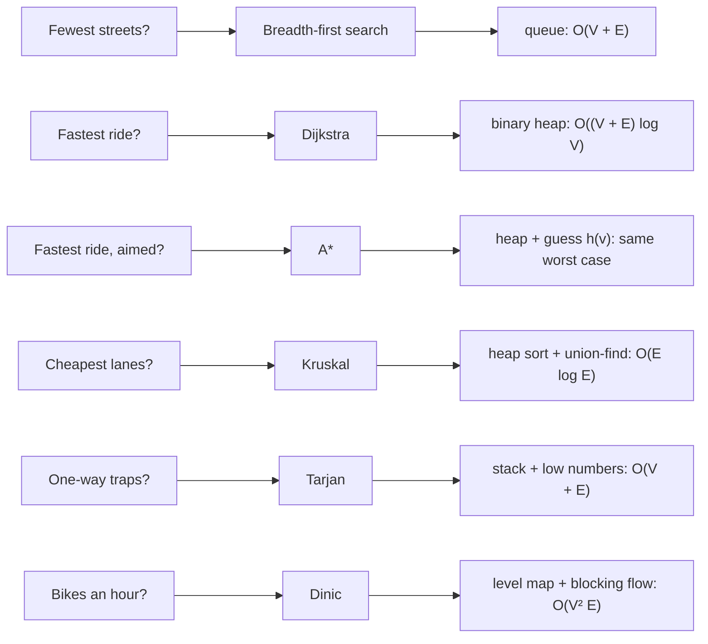
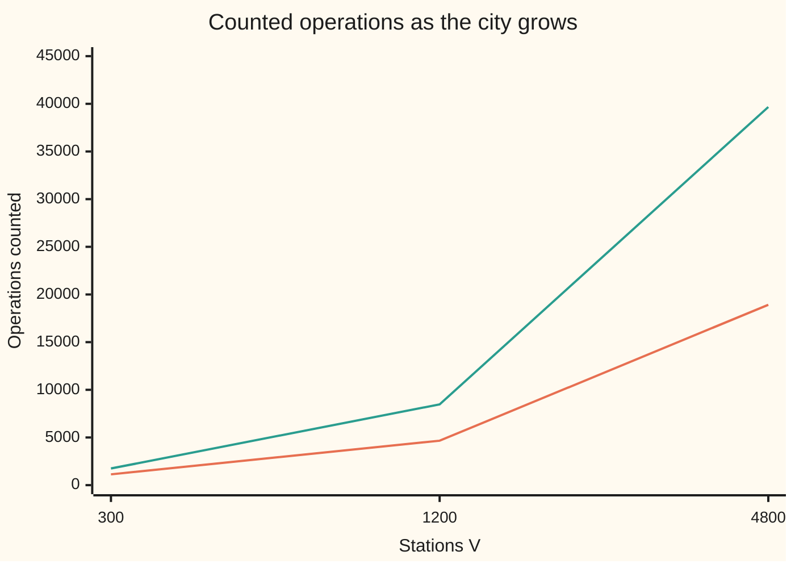

# Graph algorithms as code: the structures that make wing 04's theorems run fast

[Syllabus](../../../SYLLABUS.md) → [Applied and computational](../README.md) → [Algorithms and Growth](../README.md#s01) → Graph algorithms as code

---

## General Overview

A city's bike-share scheme has 1,200 stations. Here they sit on a 40 by 30 grid of blocks, joined by 2,330 streets, one between each pair of neighbouring stations. Each street takes 60 to 120 seconds to ride and can carry 100 to 600 bikes an hour. The city is synthetic: every number comes from a stated random-number rule with seed 2026, so anyone can rebuild it.

The operator asks six questions.

1. Which stations can a van reach in the fewest streets?
2. What is the fastest ride from the rail station at grid point (8, 20) to the university at (26, 10)?
3. Can a phone answer that without searching the whole city?
4. Which streets should get protected lanes, if every station must be joined for the least total length?
5. If 956 streets become one-way, can every rider still get home?
6. How many bikes an hour can cross from the homes on the west edge to the offices on the east edge?

Wing 04, [Combinatorics and graphs](../../04-Combinatorics%20and%20graphs/README.md), already proved which method answers four of these questions. This card proves the methods for the other two, A* and Tarjan's, and is mainly about making all six fast.

The fastest ride is 2,124 seconds, 35.4 minutes. Plain Dijkstra finishes 804 stations before it can be sure of that; A*, aimed at the university, finishes 254.

The lane plan keeps 1,199 streets with 92,026 seconds of riding: 460.1 km of lane at 5 m/s, the speed that turns riding time into length. Four tiny pockets of stations, five stations in all, would be cut off by the one-way plan. And 7,000 bikes an hour can cross the city, with a cut of streets worth exactly 7,000 to prove no plan does better.

**Each graph method repeats one question thousands of times, so its speed is set by the structure that answers that question: a queue, a heap, a parent-pointer forest, a stack, or a level map.**

**What kind of fact this is:** breadth-first search (BFS), Dijkstra, Kruskal and maximum flow are proved correct on the wing 04 cards linked below. A* and Tarjan's method are proved on this card in Why it works. Each cost on this card is a theorem, proved in outline in Why it works and counted by the code. A*'s saving on this city is a measurement, not a guarantee.

### The picture: six questions, six methods, the structure inside each



---

## The formula

Notation first, in words. $V$ counts the stations (vertices) and $E$ the streets (edges). $O(g)$ means "grows at most like $g$, up to a constant, for large inputs", from [Big-O](01-big-o-and-growth-rates.md); $\Theta(g)$ means exactly like $g$. Each cost below is a worst case unless it says otherwise ([Which case are you quoting? Worst, average and amortised cost](02-worst-case-average-case-and-amortised.md)).

$$\underbrace{\Theta(V+E)}_{\text{BFS, Tarjan}} \qquad \underbrace{O\big((V+E)\log V\big)}_{\text{Dijkstra, A* with a heap}} \qquad \underbrace{O(E\log E)}_{\text{Kruskal}} \qquad \underbrace{O(V^2E)}_{\text{Dinic}}$$

**Read it aloud:** looking at every street a fixed number of times costs stations plus streets; a heap adds a factor of log V; sorting the streets dominates the lane plan; and a flow needs at most V rounds of work that is at most V times E each.

A* adds one new quantity. Each station $v$ carries a **heuristic** $h(v)$: a guess, never too high, at the time still needed to reach the target. A* settles stations in order of

$$\text{key}(v) = d[v] + h(v).$$

**Read it aloud:** time already ridden to v, plus a safe guess at the time still to go.

Here $h(v)$ is 60 seconds times the blocks still to cross. It is not the heap height $h$ of [Data structures](06-data-structures-heaps-hashes-and-trees.md).

| Symbol | Plain meaning | In our example | Push it up and the answer… |
| --- | --- | --- | --- |
| $V$ | stations (vertices) | 1,200 | every cost grows |
| $E$ | streets (edges) | 2,330 | every cost grows; BFS looks at 2E street ends |
| $s$, $t$ | the start and target stations | rail station (8, 20), university (26, 10) | — |
| $w(u,v)$, $w'(u,v)$ | seconds to ride the street from u to v; A*'s shifted time $w - h(u) + h(v)$ | 60 to 120 | rides get slower |
| $d[v]$ | best riding time found so far from the start to v | 2,124 s at the university | — |
| $h(v)$, $\text{key}(v)$ | A*'s heuristic: a never-too-high guess at seconds still to ride; the heap's sort value $d[v] + h(v)$ | 60 × blocks to go | fewer stations settled, until it overshoots and the route goes wrong |
| $p(v)$, rank $r$ | union-find: v's parent pointer, and a root's height bound | top rank 5 | rank never passes $\log_2 V$ |
| $\text{num}[v]$, $\text{low}[v]$ | Tarjan: v's visit number, and the smallest number v's search can reach back to | — | — |
| $c(u,v)$ | bikes an hour a street can carry | 100 to 600 | more bikes can cross |
| $\ell(v)$, $k$ | Dinic's level: fewest streets with room left from the source to v; $k$ names one level | — | — |
| $F$ | bikes an hour from the west edge to the east edge | 7,000 | — |
| $\alpha(V)$ | inverse Ackermann: a slowly growing function, at most 4 for any input that fits in a computer; not the load factor of Data structures | — | — |

### When it holds

- **No street takes negative time.** Dijkstra and A* settle a station once and never revisit it. A negative street breaks that, as the [Dijkstra's algorithm](../../04-Combinatorics%20and%20graphs/10-Trees%20and%20Cheapest%20Routes/05-dijkstra.md) card shows.
- **The heuristic never drops by more than a street's time.** Formally, $h(u) \le w(u,v) + h(v)$ and $h(\text{target}) = 0$. This is called **consistent**. Triple it to 180 × blocks and A* returns a 2,379-second ride when 2,124 is possible.
- **The graph is stored as adjacency lists.** Each station keeps a list of its own streets. A V by V table of every pair would make BFS read 1,200 × 1,200 cells instead of 4,660 street ends.
- **Capacities are fixed and not negative.** Dinic's round count rests on the residual graph (the room left on each street, each way, after the pushes so far) changing only through its own pushes.
- **These are worst-case costs.** A*'s saving depends on the map and the guess. A maze can force it to settle everything.

---

## Why it works

### Step 0: one repeated question, one structure

Every method on wing 04 loops.

- BFS asks "which station is next in line?".
- Dijkstra asks "which unsettled station is cheapest?".
- Kruskal asks "are these two stations already joined?".
- Tarjan asks "has this search come back round?".
- Dinic asks "is there still a shortest route with room?".

Most proofs that the loops give right answers are on wing 04; this card adds A*'s in Step 3 and Tarjan's in Step 5. The running time is the number of questions times the cost of one answer. So the work is to find a structure that answers in constant time or in $\log V$, and to bound how often the question is asked.

### Step 1: breadth-first search, a queue

The flood of [Connected or not](../../04-Combinatorics%20and%20graphs/09-Graphs%20-%20Dots%20and%20Lines/04-connectivity-and-breadth-first-search.md) numbers stations ring by ring. As code, it is a queue: a list read from the front and added to at the back. A station is marked the moment it joins the queue, so it joins once. Each station leaves the queue once, and its street list is read once. Each street has two ends, so the reads come to $2E$.

Total: $V$ removals plus $2E$ street looks, 1,200 + 4,660 = 5,860. That is $\Theta(V+E)$. On the full grid, the fewest streets to any station equals its block count, and the code checks this for all 1,200.

### Step 2: Dijkstra, a binary heap with stale entries

[Dijkstra's algorithm](../../04-Combinatorics%20and%20graphs/10-Trees%20and%20Cheapest%20Routes/05-dijkstra.md) settles the cheapest unsettled station, then relaxes its streets: it lowers a neighbour's time if the street gives a quicker way. Finding the cheapest by scanning every unsettled station costs about $V$ per settlement, or $V^2$ in all.

A **binary heap** ([Data structures](06-data-structures-heaps-hashes-and-trees.md)) keeps the smallest key on top. Adding or removing an entry moves it at most one level per swap, so it costs at most $\log_2$ of the heap's size.

One shortcut keeps the heap simple. When a station's time drops, the code does not search the heap for its old entry. It pushes a new entry, and the old one becomes **stale**. A stale entry is skipped when it reaches the top, because its station is already settled.

Each street end is relaxed once, when its station settles, so it adds at most one entry. Pushes are at most $1 + 2E$, removals the same, each costing $O(\log V)$. The total is $O((V+E)\log V)$.

From the rail station to every station, the run made 1,441 pushes and 6,238 swaps. Its answers match Bellman-Ford, a slower method with no heap, at all 1,200 stations.

### Step 3: A*, Dijkstra on shifted street times

Give each street a new time, $w'(u,v) = w(u,v) - h(u) + h(v)$. Consistency says this is never negative. Add it along any route from start $s$ to target $t$ and the middle $h$ terms cancel:

$$\sum w' = \sum w - h(s) + h(t) = \sum w - h(s).$$

Every route is shifted by the same amount, so the fastest route is unchanged. Run Dijkstra on $w'$. The shifted time to $v$ is $d[v] - h(s) + h(v)$, so Dijkstra settles in order of $d[v] + h(v)$. That is exactly A*'s key. So A* is Dijkstra on non-negative times. It is correct for the same reason, and it costs the same in the worst case.

The saving comes from where it stops. Dijkstra settles every station closer than the target. A* settles only stations whose key is below the target's time, which is a band around the straight line.

Here $h$ is 60 seconds per block. Every street crosses one block and takes at least 60 seconds, so $h$ is consistent. The run settled 254 stations instead of 804, 3.2 times fewer, for the same 2,124 seconds.

### Step 4: Kruskal, a heap sort and union-find

[The cheapest skeleton](../../04-Combinatorics%20and%20graphs/10-Trees%20and%20Cheapest%20Routes/04-minimum-spanning-trees.md) proves Kruskal's walk right by the cut property, and [Greedy](08-greedy-algorithms-and-matroids.md) explains why greed is safe there. The walk takes streets cheapest first and keeps one when its two stations are in different pieces.

To get the streets in order, the code pushes all 2,330 into the heap and pops them back out. That is a heap sort, $O(E\log E)$.

"Different pieces?" is answered by **union-find**. Each station points to a parent. A **root** is a station that points to itself, and two stations are in one piece when they lead to the same root. Joining two pieces points one root at the other. Two rules keep the trees short:

- **Union by rank.** Hang the shorter tree under the taller. A root of rank $r$ has at least $2^r$ stations in its tree, by induction: the rank rises to $r + 1$ only when two trees of rank $r$ merge, giving at least $2^r + 2^r$ stations. So no path is longer than $\log_2 V$.
- **Path compression.** After a lookup, point every station on its path straight at the root.

Together, a long run of lookups costs $O(\alpha(V))$ each on average (amortised), which is constant in practice ([Tarjan, 1975](#sources)). The 2,330 streets needed 4,474 parent steps against 22,890 heap swaps, and no single lookup climbed more than 4 parents, within the top rank of 5. The sort dominates.

### Step 5: Tarjan, one depth-first pass

[Directed graphs](../../04-Combinatorics%20and%20graphs/09-Graphs%20-%20Dots%20and%20Lines/06-directed-graphs-and-topological-order.md) defines **strongly connected pieces**: groups of stations where each can reach every other along one-way arrows. A station outside the big piece is a trap. A rider can get there but not back, or the other way round.

Tarjan's method makes one **depth-first search**: follow an arrow to a new station whenever possible, and back up only when none is left. It numbers stations in the order it reaches them, $\text{num}[v]$, and pushes each onto a stack. $\text{low}[v]$ is the smallest number reachable from v's part of the search by search arrows plus one arrow to a station still on the stack.

When v's search finishes with $\text{low}[v] = \text{num}[v]$, nothing below v reaches anything older that is still open. So v was the first station reached in its piece, and the piece is everything above v on the stack. Each station is pushed and popped once, and each arrow is followed once. The cost is $\Theta(V+E)$: one pass over 3,704 arrows.

<details>
<summary>Why "low equals num" marks exactly one piece</summary>

Take the first station r of a strongly connected piece that the search reaches. Every station of the piece is reachable from r. None has been visited yet, so all are reached inside r's search and sit above r on the stack. None of them can reach a station older than r that is still on the stack. If it could, that older station would reach r and r would reach it, putting it in the piece, which contradicts r being first. So $\text{low}[r] = \text{num}[r]$.

Now take any other station v of the piece. It reaches r, and r is older and still on the stack. So $\text{low}[v] < \text{num}[v]$, and v never pops a piece early. Pieces found later, inside r's search, have already been popped. What is left above r is exactly r's piece.

</details>

The code checks Tarjan against a second road: a station's piece is everything it reaches forwards that also reaches it back.

### Step 6: Dinic, levels and blocking flows

[Flows](../../04-Combinatorics%20and%20graphs/13-Matchings%20and%20Flows/05-flow-networks-and-ford-fulkerson.md) pushes bikes along any route with room. Room includes cancelling earlier bikes, and the Edmonds-Karp rule takes the shortest such route each time. Dinic does a whole layer of shortest routes per round.

The code adds two extra stations. The **source** feeds every station on the west edge, and the **sink** drains every station on the east edge. Each street becomes two **arcs**, one each way, and each arc has room for the street's bikes an hour.

1. Search outward from the source and give each station its level $\ell(v)$: the fewest streets with room left from the source to v.
2. Keep only the arcs from level $k$ to level $k + 1$. Push bikes along source-to-sink routes in this level graph until every such route has a full arc. This is a **blocking flow**. A pointer per station skips arcs found dead, so each arc is given up at most once per round.
3. Repeat until the sink cannot be reached.

After a round, every new arc with room points from level $k + 1$ back to $k$: the undo of a push. Levels are fewest-street distances, so no old arc with room climbs more than one level, and an undo arc falls one. So every arc with room climbs at most one level.

A route as short as before would have to climb one level on every arc, so it would lie wholly in the old level graph, and the blocking flow filled one of its arcs. So any route that survives uses an arc that climbs no level (one outside the level graph, or a new undo arc), and it is longer. The source-to-sink distance rises every round. It cannot pass $V - 1$, so there are at most $V - 1$ rounds.

Each round finds at most $E$ routes. Each route is at most $V$ long and kills at least one arc, giving $O(VE)$ per round and $O(V^2E)$ in all. On a matching-shaped network, where every station has room for just one unit coming in or going out, the bound falls to $O(E\sqrt V)$. On a matching problem, that is the Hopcroft-Karp method.

Here Dinic took 26 rounds. Edmonds-Karp needed 70 single routes for the same 7,000 bikes an hour. The streets crossing the boundary of what the source can still reach carry exactly 7,000. No flow can beat a cut, so 7,000 is the maximum.

### Step 7: count at three sizes, never time

A cost claim is checked by counting at several sizes. The code builds the same kind of city at 300, 1,200 and 4,800 stations.

BFS looks are exactly $2E$ each time: 1,130, 4,660, 18,920. Heap work for a full Dijkstra run counts pushes, pops and swaps, then divides by $(V+E)\log_2 V$. The ratio barely moves: 0.245, 0.235, 0.227. That steady ratio is what $O((V+E)\log V)$ promises.



Lower line: BFS street looks. Upper line: Dijkstra's heap work. Each size is four times the last. The BFS count grows a little over four times each step, as E does. The heap work grows a little faster, which is the extra $\log V$.

---

## Worked numbers, by hand

| Step | Arithmetic | Value |
| --- | --- | --- |
| BFS work | 1,200 removals + 2 × 2,330 street looks | 5,860 |
| Dijkstra, rail station to university | settles 804, pushes 1,003 | 2,124 s = 35.4 min |
| A*, $h$ = 60 s × blocks | settles 254, pushes 418 | 2,124 s |
| A*'s saving | 804 ÷ 254 | 3.2 times fewer settled |
| Kruskal's lanes | 1,199 streets kept, at 5 m/s | 92,026 s of riding = 460.1 km |
| Union-find work | 4,474 parent steps against 22,890 heap swaps | the sort dominates |
| Tarjan, after the one-way plan | one pass over 3,704 arrows | 5 pieces; 1,195 in the largest |
| Dinic, west edge to east edge | 26 rounds; Edmonds-Karp takes 70 routes | **7,000 bikes an hour = cut of 7,000** |

A phone answers the rail-station ride after 254 stations, not 1,200. The one-way plan would trap five stations in four small pockets, of 2, 1, 1 and 1 stations. And 7,000 bikes an hour is the most the streets can carry across the city, because a cut of streets carrying exactly 7,000 proves it.

The heap work in Step 7 starts from station (0, 0), so it differs from the rail-station run above.

### What breaks if you drop a piece

| Mistake | Comes out at | What went wrong |
| --- | --- | --- |
| BFS used for the fastest ride | 28 streets, 2,435 s = 40.6 min | Fewest streets is not fewest seconds |
| A* with $h$ = 180 s × blocks | 2,379 s = 39.6 min, after settling only 29 | The guess overshoots, so the true best route is never opened |
| Union-find without rank or compression | same 92,026 s, but 112,139 parent steps, 25.1 times more | Trees grow into long chains |
| Flow without the undo arcs | 6,900 bikes an hour | Early pushes cannot be cancelled, so the method stalls short |

The code prints all four.

---

## Code, from first principles, and it actually runs

Nothing imported knows an answer. The heap, the union-find, the queue and the random-number generator are written out, with no `heapq`, `sorted`, `BinaryHeap` or sort. Each method meets an independent second road:

- BFS meets the block count.
- Dijkstra and A* meet Bellman-Ford, and Dijkstra settles exactly the stations Bellman-Ford puts ahead of the target.
- Kruskal meets Prim's walk with no heap.
- Tarjan meets reach-forwards-and-back.
- Dinic meets Edmonds-Karp and a cut of equal value.

Every method also counts its own operations, and the growth lines count at three sizes. The Python and Rust programs print the same lines.

### Python

```python
# Graph algorithms as code -- the check behind the card.  Standard library only: no heapq, no sorted.
# A synthetic city: 1,200 bike-share stations on a 40 x 30 grid, a street per neighbouring pair; SplitMix64
# (seed 2026) gives each street 60-120 s of riding, 100-600 bikes an hour of room, a 40% chance of one-way.
import sys, math
sys.setrecursionlimit(20000); M64, BIG = (1 << 64) - 1, 10 ** 9
def splitmix(s):
    while True:
        s = (s + 0x9E3779B97F4A7C15) & M64; z = ((s ^ (s >> 30)) * 0xBF58476D1CE4E5B9) & M64
        z = ((z ^ (z >> 27)) * 0x94D049BB133111EB) & M64; yield z ^ (z >> 31)
def city(W, H):                                            # street: (u, v, seconds, bikes an hour, one-way?)
    r, st, adj = splitmix(2026), [], [[] for _ in range(W * H)]
    for i in range(W * H):
        for j, ok in ((i + 1, i % W + 1 < W), (i + W, i // W + 1 < H)):
            if ok: st.append((i, j, 60 + next(r) % 61, 100 * (1 + next(r) % 6), next(r) % 100 < 40))
    for u, v, w, c, o in st: adj[u].append((v, w)); adj[v].append((u, w))
    return st, adj
def push(h, x, c):                                         # binary heap in a list: slot i's parent is (i-1)//2
    h.append(x); i = len(h) - 1
    while i and h[(i - 1) // 2] > h[i]: h[i], h[(i - 1) // 2] = h[(i - 1) // 2], h[i]; i = (i - 1) // 2; c[0] += 1
def pop(h, c):                                             # take the root, sift the last entry down
    top, last = h[0], h.pop(); i = 0
    if h: h[0] = last
    while True:
        m = min((k for k in (i, 2 * i + 1, 2 * i + 2) if k < len(h)), key=lambda k: h[k], default=i)
        if m == i: return top
        h[i], h[m] = h[m], h[i]; i = m; c[0] += 1
def bfs(adj, s):                                           # the queue is a list read from the front
    d, back, q, looks = [-1] * len(adj), [-1] * len(adj), [s], 0; d[s] = 0
    for u in q:
        for v, w in adj[u]:
            looks += 1
            if d[v] < 0: d[v], back[v] = d[u] + 1, u; q.append(v)
    return d, back, looks
def astar(adj, s, t, h):                                   # h = 0 everywhere is Dijkstra with a heap
    d, done, hp, c, n = [BIG] * len(adj), [False] * len(adj), [], [0], [1, 0]; d[s] = 0; push(hp, (h(s), s), c)
    while hp:
        k, u = pop(hp, c)
        if done[u]: continue                               # stale entry: u was pushed again, cheaper
        done[u] = True; n[1] += 1
        if u == t: break
        for v, w in adj[u]:
            if d[u] + w < d[v]: d[v] = d[u] + w; push(hp, (d[v] + h(v), v), c); n[0] += 1
    return d, n[1], n[0], c[0]                             # seconds, settled, pushes, heap swaps
def bellman(adj, s):                                       # second road: relax every street, V - 1 rounds
    d = [BIG] * len(adj); d[s] = 0
    for _ in range(len(adj) - 1):
        for u in range(len(adj)):
            for v, w in adj[u]: d[v] = min(d[v], d[u] + w)
    return d
def kruskal(V, st, smart):                                 # heap-sort the streets; union-find the pieces
    par, rank, steps, hp, c, total = list(range(V)), [0] * V, [0, 0], [], [0], 0
    def find(x, k=0):                                      # steps: total parent steps, longest single lookup
        r = x
        while par[r] != r: r = par[r]; steps[0] += 1; k += 1; steps[1] = max(steps[1], k)
        while smart and par[x] != r: par[x], x = r, par[x]  # path compression: point straight at the root
        return r
    for i, e in enumerate(st): push(hp, (e[2], i), c)
    while hp:
        w, i = pop(hp, c); a, b = find(st[i][0]), find(st[i][1])
        if a == b: continue                                # same piece already: this street closes a loop
        if smart and rank[a] < rank[b]: a, b = b, a        # union by rank: short tree hangs under tall
        par[b] = a; total += w; rank[a] += smart and rank[a] == rank[b]
    return total, steps[0], c[0], steps[1], max(rank), all(find(v) == par[v] for v in range(V))  # last: compression flattens
def prim(adj):                                             # second road: grow one piece, no heap, no sort
    best, inn, total = [BIG] * len(adj), [False] * len(adj), 0; best[0] = 0
    for _ in adj:
        u = min((best[v], v) for v in range(len(adj)) if not inn[v])[1]; inn[u] = True; total += best[u]
        for v, w in adj[u]:
            if not inn[v] and w < best[v]: best[v] = w
    return total
def tarjan(out):                                           # one depth-first pass with low-link numbers
    n = len(out); num, low, on, stack, comps, cnt = [-1] * n, [0] * n, [False] * n, [], [], [0]
    def dfs(v):
        num[v] = low[v] = cnt[0]; cnt[0] += 1; stack.append(v); on[v] = True
        for u, _ in out[v]:
            if num[u] < 0: dfs(u); low[v] = min(low[v], low[u])
            elif on[u]: low[v] = min(low[v], num[u])
        if low[v] == num[v]:                               # v was reached first in its piece: pop the piece
            comps.append([])
            while not comps[-1] or comps[-1][-1] != v: u = stack.pop(); on[u] = False; comps[-1].append(u)
    [dfs(v) for v in range(n) if num[v] < 0]
    return comps
def dinic(n, arcs, s, t, undo, one_path=False):           # level graph, then a blocking flow, then again
    to, cap, g = [], [], [[] for _ in range(n)]
    for u, v, c in arcs: g[u] += [len(to)]; g[v] += [len(to) + 1]; to += [v, u]; cap += [c, c]
    total, phases = 0, 0
    while True:
        lev, q = [-1] * n, [s]; lev[s] = 0
        for u in q:
            for a in g[u]:
                if cap[a] > 0 and lev[to[a]] < 0: lev[to[a]] = lev[u] + 1; q.append(to[a])
        if lev[t] < 0: return total, phases, [x >= 0 for x in lev]
        phases += 1; it = [0] * n
        def dfs(u, f):                                     # walk only level k -> k+1; it[u] skips dead arcs
            if u == t: return f
            while it[u] < len(g[u]):
                a = g[u][it[u]]
                if cap[a] > 0 and lev[to[a]] == lev[u] + 1:
                    got = dfs(to[a], min(f, cap[a]))
                    if got: cap[a] -= got; cap[a ^ 1] += got * undo; return got
                it[u] += 1
            return 0
        while (f := dfs(s, BIG)):
            total += f
            if one_path: break                             # one shortest path per round: Edmonds-Karp
W, H = 40, 30; V = W * H; st, adj = city(W, H); E = len(st); s, t = 20 * W + 8, 10 * W + 26
blocks = lambda a, b: abs(a % W - b % W) + abs(a // W - b // W)
print(f"city,{V} stations,{E} streets,{sum(e[4] for e in st)} one-way,trip ({s % W},{s // W}) to ({t % W},{t // W}),{blocks(s, t)} blocks")
d0, _, looks = bfs(adj, 0); db, back, _ = bfs(adj, s); x, sec = t, 0
while x != s: sec += min(w for v, w in adj[back[x]] if v == x); x = back[x]
print(f"bfs,arc looks {looks} = 2 x {E},pops {V},V + 2E {V + 2 * E},fewest streets equals blocks for all {V},{all(d0[v] == blocks(0, v) for v in range(V))}")
dk, sk, pk, ck = astar(adj, s, t, lambda v: 0); dall, _, pall, call = astar(adj, s, -1, lambda v: 0); bf = bellman(adj, s)
da, sa, pa, ca = astar(adj, s, t, lambda v: 60 * blocks(v, t)); dx, sx, _, _ = astar(adj, s, t, lambda v: 180 * blocks(v, t))
print(f"dijkstra,trip {dk[t]} s = {dk[t] / 60:.1f} min,settled {sk},pushes {pk},swaps {ck}\ndijkstra all {V},pushes {pall},swaps {call},equals bellman-ford on all {V},{dall == bf}")
print(f"astar h = 60 x blocks,trip {da[t]} s,settled {sa},pushes {pa},swaps {ca},settles {sk / sa:.1f} times fewer")
print(f"mistake,fewest streets,{db[t]} streets,{sec} s = {sec / 60:.1f} min\nmistake,astar h = 180 x blocks,trip {dx[t]} s = {dx[t] / 60:.1f} min,settled {sx}")
k1, f1, c1, deep, top, flat = kruskal(V, st, True); k0, f0 = kruskal(V, st, False)[:2]; pr = prim(adj)
print(f"kruskal,{V - 1} streets,{k1} riding s = {k1 * 5 / 1000:.1f} km at 5 m/s,heap swaps {c1},find steps {f1},longest find {deep},top rank {top},prim {pr}\nmistake,union-find plain links,{k0} riding s,find steps {f0},{f0 / f1:.1f} times more")
out, inn = [[] for _ in range(V)], [[] for _ in range(V)]
for u, v, w, c, o in st:
    out[u].append((v, 0)); inn[v].append((u, 0))
    if not o: out[v].append((u, 0)); inn[u].append((v, 0))
comps, lab = tarjan(out), [-1] * V; big = max(len(c) for c in comps)
for v in range(V):
    if lab[v] < 0:                                         # second road: reached forwards and backwards
        fw, bw = bfs(out, v)[0], bfs(inn, v)[0]; lab = [v if fw[u] >= 0 <= bw[u] else lab[u] for u in range(V)]
lab2 = {u: min(c) for c in comps for u in c}
print(f"tarjan,arcs {sum(len(a) for a in out)},pieces {len(comps)},largest {big},sizes outside it {[len(c) for c in comps if len(c) < big]}")
arcs = [(u, v, c) for u, v, w, c, o in st] + [a for y in range(H) for a in ((V, y * W, BIG), (y * W + W - 1, V + 1, BIG))]
F, ph, side = dinic(V + 2, arcs, V, V + 1, 1); Fek, aug, _ = dinic(V + 2, arcs, V, V + 1, 1, True)
Fno, _, _ = dinic(V + 2, arcs, V, V + 1, 0); cut = sum(c for u, v, c in arcs if side[u] != side[v])
print(f"dinic,west edge to east edge {F} bikes/h,phases {ph},edmonds-karp {Fek} in {aug} paths,cut {cut}\nmistake,no undo,{Fno} bikes/h")
for w2, h2 in ((20, 15), (40, 30), (80, 60)):
    st2, adj2 = city(w2, h2); V2, E2 = w2 * h2, len(st2); _, _, lk = bfs(adj2, 0); _, _, p2, c2 = astar(adj2, 0, -1, lambda v: 0)
    print(f"growth,V {V2},E {E2},bfs looks {lk},heap work {2 * p2 + c2},(V+E) log2 V {(V2 + E2) * math.log2(V2):.0f},per (V+E) log2 V {(2 * p2 + c2) / ((V2 + E2) * math.log2(V2)):.3f}")
assert all(d0[v] == blocks(0, v) for v in range(V)) and looks == 2 * E   # queue against the block count
assert sk == 1 + sum((bf[v], v) < (bf[t], t) for v in range(V)) and dall == bf and da[t] == bf[t] and sa < sk and dx[t] > bf[t] and sec > bf[t]   # heap against Bellman-Ford
assert k1 == pr and f0 > 10 * f1 and deep <= top <= math.log2(V) and flat and lab == [lab2[u] for u in range(V)]  # Kruskal against Prim; union-find's rules; Tarjan against two-way reach
assert F == Fek == cut and Fno < F                         # a flow equal to a cut is a maximum flow
print("ALL CHECKS PASS")
```

**Ran 2026-11-11 on macOS, Python 3.14.10, standard library only. All checks passed. Output, pasted from the run:**

```
city,1200 stations,2330 streets,956 one-way,trip (8,20) to (26,10),28 blocks
bfs,arc looks 4660 = 2 x 2330,pops 1200,V + 2E 5860,fewest streets equals blocks for all 1200,True
dijkstra,trip 2124 s = 35.4 min,settled 804,pushes 1003,swaps 4398
dijkstra all 1200,pushes 1441,swaps 6238,equals bellman-ford on all 1200,True
astar h = 60 x blocks,trip 2124 s,settled 254,pushes 418,swaps 1873,settles 3.2 times fewer
mistake,fewest streets,28 streets,2435 s = 40.6 min
mistake,astar h = 180 x blocks,trip 2379 s = 39.6 min,settled 29
kruskal,1199 streets,92026 riding s = 460.1 km at 5 m/s,heap swaps 22890,find steps 4474,longest find 4,top rank 5,prim 92026
mistake,union-find plain links,92026 riding s,find steps 112139,25.1 times more
tarjan,arcs 3704,pieces 5,largest 1195,sizes outside it [2, 1, 1, 1]
dinic,west edge to east edge 7000 bikes/h,phases 26,edmonds-karp 7000 in 70 paths,cut 7000
mistake,no undo,6900 bikes/h
growth,V 300,E 565,bfs looks 1130,heap work 1746,(V+E) log2 V 7118,per (V+E) log2 V 0.245
growth,V 1200,E 2330,bfs looks 4660,heap work 8471,(V+E) log2 V 36108,per (V+E) log2 V 0.235
growth,V 4800,E 9460,bfs looks 18920,heap work 39668,(V+E) log2 V 174383,per (V+E) log2 V 0.227
ALL CHECKS PASS
```

### Rust

```rust
// Graph algorithms as code -- the check behind the card.  std only: no BinaryHeap, no sort.
// A synthetic city: 1,200 bike-share stations on a 40 x 30 grid, a street per neighbouring pair; SplitMix64
// (seed 2026) gives each street 60-120 s of riding, 100-600 bikes an hour of room, a 40% chance of one-way.
const BIG: u64 = 1_000_000_000;
type Adj = Vec<Vec<(usize, u64)>>;
type Heap = Vec<(u64, usize)>;
struct St { u: usize, v: usize, w: u64, c: u64, one: bool } // street: ends, seconds, bikes an hour, one-way?
fn city(wd: usize, ht: usize) -> (Vec<St>, Adj) {
    let mut s: u64 = 2026;
    let mut r = || { s = s.wrapping_add(0x9E3779B97F4A7C15); let z = (s ^ (s >> 30)).wrapping_mul(0xBF58476D1CE4E5B9);
        let z = (z ^ (z >> 27)).wrapping_mul(0x94D049BB133111EB); z ^ (z >> 31) };
    let (mut st, mut adj) = (Vec::new(), vec![Vec::new(); wd * ht]);
    for i in 0..wd * ht { for (j, ok) in [(i + 1, i % wd + 1 < wd), (i + wd, i / wd + 1 < ht)] {
        if ok { let (w, c, o) = (60 + r() % 61, 100 * (1 + r() % 6), r() % 100 < 40); st.push(St { u: i, v: j, w, c, one: o }); }
    } }
    for e in &st { adj[e.u].push((e.v, e.w)); adj[e.v].push((e.u, e.w)); }
    (st, adj)
}
fn push(h: &mut Heap, x: (u64, usize), c: &mut u64) {     // binary heap in a Vec: slot i's parent is (i-1)/2
    h.push(x); let mut i = h.len() - 1;
    while i > 0 && h[(i - 1) / 2] > h[i] { h.swap(i, (i - 1) / 2); i = (i - 1) / 2; *c += 1; }
}
fn pop(h: &mut Heap, c: &mut u64) -> (u64, usize) {      // take the root, sift the last entry down
    let top = h.swap_remove(0); let mut i = 0;
    loop {
        let mut m = i; for k in [2 * i + 1, 2 * i + 2] { if k < h.len() && h[k] < h[m] { m = k; } }
        if m == i { return top; }
        h.swap(i, m); i = m; *c += 1;
    }
}
fn bfs(adj: &Adj, s: usize) -> (Vec<i64>, Vec<usize>, u64) { // the queue is a Vec read from the front
    let (mut d, mut back, mut q, mut looks) = (vec![-1i64; adj.len()], vec![0; adj.len()], vec![s], 0);
    d[s] = 0; let mut k = 0;
    while k < q.len() { let u = q[k]; k += 1;
        for &(v, _) in &adj[u] { looks += 1; if d[v] < 0 { d[v] = d[u] + 1; back[v] = u; q.push(v); } }
    }
    (d, back, looks)
}
fn astar(adj: &Adj, s: usize, t: usize, h: &dyn Fn(usize) -> u64) -> (Vec<u64>, u64, u64, u64) {
    let (mut d, mut done, mut hp, mut c, mut n) = (vec![BIG; adj.len()], vec![false; adj.len()], Vec::new(), 0, (1, 0));
    d[s] = 0; push(&mut hp, (h(s), s), &mut c);           // h = 0 everywhere is Dijkstra with a heap
    while !hp.is_empty() {
        let (_, u) = pop(&mut hp, &mut c); if done[u] { continue; } // stale entry: u was pushed again, cheaper
        done[u] = true; n.1 += 1;
        if u == t { break; }
        for &(v, w) in &adj[u] { if d[u] + w < d[v] { d[v] = d[u] + w; push(&mut hp, (d[v] + h(v), v), &mut c); n.0 += 1; } }
    }
    (d, n.1, n.0, c)                                      // seconds, settled, pushes, heap swaps
}
fn bellman(adj: &Adj, s: usize) -> Vec<u64> {             // second road: relax every street, V - 1 rounds
    let mut d = vec![BIG; adj.len()]; d[s] = 0;
    for _ in 1..adj.len() { for u in 0..adj.len() { for &(v, w) in &adj[u] { d[v] = d[v].min(d[u] + w); } } }
    d
}
fn find(par: &mut Vec<usize>, x0: usize, smart: bool, steps: &mut (u64, u64)) -> usize { // total parent steps, longest lookup
    let (mut r, mut x, mut k) = (x0, x0, 0);
    while par[r] != r { r = par[r]; steps.0 += 1; k += 1; steps.1 = steps.1.max(k); }
    while smart && par[x] != r { let nx = par[x]; par[x] = r; x = nx; } // path compression: point straight at the root
    r
}
fn kruskal(nv: usize, st: &[St], smart: bool) -> (u64, u64, u64, u64, u64, bool) { // heap-sort the streets; union-find the pieces
    let (mut par, mut rank, mut steps, mut hp, mut c, mut total): (Vec<usize>, Vec<u64>, (u64, u64), Heap, u64, u64) =
        ((0..nv).collect(), vec![0; nv], (0, 0), Vec::new(), 0, 0);
    for (i, e) in st.iter().enumerate() { push(&mut hp, (e.w, i), &mut c); }
    while !hp.is_empty() {
        let (w, i) = pop(&mut hp, &mut c);
        let (mut a, mut b) = (find(&mut par, st[i].u, smart, &mut steps), find(&mut par, st[i].v, smart, &mut steps));
        if a == b { continue; }                           // same piece already: this street closes a loop
        if smart && rank[a] < rank[b] { std::mem::swap(&mut a, &mut b); } // union by rank: short tree under tall
        par[b] = a; total += w; if smart && rank[a] == rank[b] { rank[a] += 1; }
    }
    let (n, top) = (steps, *rank.iter().max().unwrap());
    (total, n.0, c, n.1, top, (0..nv).all(|v| find(&mut par, v, smart, &mut steps) == par[v])) // last: compression flattens
}
fn prim(adj: &Adj) -> u64 {                               // second road: grow one piece, no heap, no sort
    let n = adj.len(); let (mut best, mut inn, mut total) = (vec![BIG; n], vec![false; n], 0); best[0] = 0;
    for _ in 0..n {
        let u = (0..n).filter(|&v| !inn[v]).min_by_key(|&v| (best[v], v)).unwrap(); inn[u] = true; total += best[u];
        for &(v, w) in &adj[u] { if !inn[v] && w < best[v] { best[v] = w; } }
    }
    total
}
struct Tj { num: Vec<i64>, low: Vec<i64>, on: Vec<bool>, stack: Vec<usize>, comps: Vec<Vec<usize>>, cnt: i64 }
fn dfs_t(g: &mut Tj, out: &Adj, v: usize) {               // one depth-first pass with low-link numbers
    g.num[v] = g.cnt; g.low[v] = g.cnt; g.cnt += 1; g.stack.push(v); g.on[v] = true;
    for &(u, _) in &out[v] {
        if g.num[u] < 0 { dfs_t(g, out, u); g.low[v] = g.low[v].min(g.low[u]); }
        else if g.on[u] { g.low[v] = g.low[v].min(g.num[u]); }
    }
    if g.low[v] == g.num[v] {                             // v was reached first in its piece: pop the piece
        let mut comp = Vec::new(); loop { let u = g.stack.pop().unwrap(); g.on[u] = false; comp.push(u); if u == v { break; } }
        g.comps.push(comp);
    }
}
fn tarjan(out: &Adj) -> Vec<Vec<usize>> {
    let n = out.len(); let mut g = Tj { num: vec![-1; n], low: vec![0; n], on: vec![false; n], stack: vec![], comps: vec![], cnt: 0 };
    for v in 0..n { if g.num[v] < 0 { dfs_t(&mut g, out, v); } }
    g.comps
}
struct Fl { to: Vec<usize>, cap: Vec<u64>, g: Vec<Vec<usize>>, lev: Vec<i64>, it: Vec<usize>, t: usize, undo: u64 }
fn dfs_f(f: &mut Fl, u: usize, lim: u64) -> u64 {         // walk only level k -> k+1; it[u] skips dead arcs
    if u == f.t { return lim; }
    while f.it[u] < f.g[u].len() {
        let a = f.g[u][f.it[u]];
        if f.cap[a] > 0 && f.lev[f.to[a]] == f.lev[u] + 1 {
            let got = dfs_f(f, f.to[a], lim.min(f.cap[a]));
            if got > 0 { f.cap[a] -= got; f.cap[a ^ 1] += got * f.undo; return got; }
        }
        f.it[u] += 1;
    }
    0
}
fn dinic(n: usize, arcs: &[(usize, usize, u64)], s: usize, t: usize, undo: u64, one_path: bool) -> (u64, u64, Vec<bool>) {
    let mut f = Fl { to: vec![], cap: vec![], g: vec![vec![]; n], lev: vec![], it: vec![], t, undo };
    for &(u, v, c) in arcs { f.g[u].push(f.to.len()); f.g[v].push(f.to.len() + 1); f.to.extend([v, u]); f.cap.extend([c, c]); }
    let (mut total, mut phases) = (0, 0);
    loop {                                                // level graph, then a blocking flow, then again
        f.lev = vec![-1; n]; f.lev[s] = 0; let (mut q, mut k) = (vec![s], 0);
        while k < q.len() {
            let u = q[k]; k += 1;
            for i in 0..f.g[u].len() { let a = f.g[u][i]; if f.cap[a] > 0 && f.lev[f.to[a]] < 0 { f.lev[f.to[a]] = f.lev[u] + 1; q.push(f.to[a]); } }
        }
        if f.lev[t] < 0 { return (total, phases, f.lev.iter().map(|&x| x >= 0).collect()); }
        phases += 1; f.it = vec![0; n];
        loop { let got = dfs_f(&mut f, s, BIG); if got == 0 { break; } total += got; if one_path { break; } } // Edmonds-Karp: one path a round
    }
}
fn tf(b: bool) -> &'static str { if b { "True" } else { "False" } }
fn main() {
    let (wd, ht) = (40usize, 30usize); let nv = wd * ht; let (st, adj) = city(wd, ht); let ne = st.len(); let (s, t) = (20 * wd + 8, 10 * wd + 26);
    let blocks = |a: usize, b: usize| (a % wd).abs_diff(b % wd) as u64 + (a / wd).abs_diff(b / wd) as u64;
    println!("city,{} stations,{} streets,{} one-way,trip ({},{}) to ({},{}),{} blocks", nv, ne, st.iter().filter(|e| e.one).count(), s % wd, s / wd, t % wd, t / wd, blocks(s, t));
    let (d0, _, looks) = bfs(&adj, 0); let (db, back, _) = bfs(&adj, s); let (mut x, mut sec) = (t, 0);
    while x != s { sec += adj[back[x]].iter().filter(|p| p.0 == x).map(|p| p.1).min().unwrap(); x = back[x]; }
    let bfs_ok = (0..nv).all(|v| d0[v] as u64 == blocks(0, v));
    println!("bfs,arc looks {} = 2 x {},pops {},V + 2E {},fewest streets equals blocks for all {},{}", looks, ne, nv, nv + 2 * ne, nv, tf(bfs_ok));
    let (dk, sk, pk, ck) = astar(&adj, s, t, &|_| 0); let (dall, _, pall, call) = astar(&adj, s, usize::MAX, &|_| 0); let bf = bellman(&adj, s);
    let (da, sa, pa, ca) = astar(&adj, s, t, &|v| 60 * blocks(v, t)); let (dx, sx, _, _) = astar(&adj, s, t, &|v| 180 * blocks(v, t));
    println!("dijkstra,trip {} s = {:.1} min,settled {},pushes {},swaps {}", dk[t], dk[t] as f64 / 60.0, sk, pk, ck);
    println!("dijkstra all {},pushes {},swaps {},equals bellman-ford on all {},{}", nv, pall, call, nv, tf(dall == bf));
    println!("astar h = 60 x blocks,trip {} s,settled {},pushes {},swaps {},settles {:.1} times fewer", da[t], sa, pa, ca, sk as f64 / sa as f64);
    println!("mistake,fewest streets,{} streets,{} s = {:.1} min", db[t], sec, sec as f64 / 60.0);
    println!("mistake,astar h = 180 x blocks,trip {} s = {:.1} min,settled {}", dx[t], dx[t] as f64 / 60.0, sx);
    let (k1, f1, c1, deep, top, flat) = kruskal(nv, &st, true); let (k0, f0, ..) = kruskal(nv, &st, false); let pr = prim(&adj);
    println!("kruskal,{} streets,{} riding s = {:.1} km at 5 m/s,heap swaps {},find steps {},longest find {},top rank {},prim {}", nv - 1, k1, k1 as f64 * 5.0 / 1000.0, c1, f1, deep, top, pr);
    println!("mistake,union-find plain links,{} riding s,find steps {},{:.1} times more", k0, f0, f0 as f64 / f1 as f64);
    let (mut out, mut inn): (Adj, Adj) = (vec![vec![]; nv], vec![vec![]; nv]);
    for e in &st { out[e.u].push((e.v, 0)); inn[e.v].push((e.u, 0)); if !e.one { out[e.v].push((e.u, 0)); inn[e.u].push((e.v, 0)); } }
    let comps = tarjan(&out); let big = comps.iter().map(|c| c.len()).max().unwrap(); let mut lab = vec![usize::MAX; nv];
    for v in 0..nv { if lab[v] == usize::MAX {               // second road: reached forwards and backwards
        let (fw, bw) = (bfs(&out, v).0, bfs(&inn, v).0); for u in 0..nv { if fw[u] >= 0 && bw[u] >= 0 { lab[u] = v; } }
    } }
    let mut lab2 = vec![0; nv]; for c in &comps { let m = *c.iter().min().unwrap(); for &u in c { lab2[u] = m; } }
    let outside: Vec<usize> = comps.iter().map(|c| c.len()).filter(|&l| l < big).collect();
    println!("tarjan,arcs {},pieces {},largest {},sizes outside it {:?}", out.iter().map(|a| a.len()).sum::<usize>(), comps.len(), big, outside);
    let mut arcs: Vec<(usize, usize, u64)> = st.iter().map(|e| (e.u, e.v, e.c)).collect();
    for y in 0..ht { arcs.push((nv, y * wd, BIG)); arcs.push((y * wd + wd - 1, nv + 1, BIG)); } // west in, east out
    let (ff, ph, side) = dinic(nv + 2, &arcs, nv, nv + 1, 1, false); let (fek, aug, _) = dinic(nv + 2, &arcs, nv, nv + 1, 1, true);
    let (fno, _, _) = dinic(nv + 2, &arcs, nv, nv + 1, 0, false); let cut: u64 = arcs.iter().filter(|a| side[a.0] != side[a.1]).map(|a| a.2).sum();
    println!("dinic,west edge to east edge {} bikes/h,phases {},edmonds-karp {} in {} paths,cut {}\nmistake,no undo,{} bikes/h", ff, ph, fek, aug, cut, fno);
    for (w2, h2) in [(20usize, 15usize), (40, 30), (80, 60)] {
        let (st2, adj2) = city(w2, h2); let (v2, e2) = (w2 * h2, st2.len()); let (_, _, lk) = bfs(&adj2, 0); let (_, _, p2, c2) = astar(&adj2, 0, usize::MAX, &|_| 0);
        println!("growth,V {},E {},bfs looks {},heap work {},(V+E) log2 V {:.0},per (V+E) log2 V {:.3}", v2, e2, lk, 2 * p2 + c2, (v2 + e2) as f64 * (v2 as f64).log2(), (2 * p2 + c2) as f64 / ((v2 + e2) as f64 * (v2 as f64).log2()));
    }
    assert!(bfs_ok && looks == 2 * ne as u64);            // queue against the block count
    assert!(sk == 1 + (0..nv).filter(|&v| (bf[v], v) < (bf[t], t)).count() as u64 && dall == bf && da[t] == bf[t] && sa < sk && dx[t] > bf[t] && sec > bf[t]); // heap against Bellman-Ford
    assert!(k1 == pr && f0 > 10 * f1 && deep <= top && top as f64 <= (nv as f64).log2() && flat && lab == lab2); // Kruskal against Prim; union-find's rules; Tarjan against two-way reach
    assert!(ff == fek && fek == cut && fno < ff);         // a flow equal to a cut is a maximum flow
    println!("ALL CHECKS PASS");
}
```

**Ran 2026-11-11 on macOS, rustc 1.98.1, no crates. All checks passed. Output, pasted from the run:**

```
city,1200 stations,2330 streets,956 one-way,trip (8,20) to (26,10),28 blocks
bfs,arc looks 4660 = 2 x 2330,pops 1200,V + 2E 5860,fewest streets equals blocks for all 1200,True
dijkstra,trip 2124 s = 35.4 min,settled 804,pushes 1003,swaps 4398
dijkstra all 1200,pushes 1441,swaps 6238,equals bellman-ford on all 1200,True
astar h = 60 x blocks,trip 2124 s,settled 254,pushes 418,swaps 1873,settles 3.2 times fewer
mistake,fewest streets,28 streets,2435 s = 40.6 min
mistake,astar h = 180 x blocks,trip 2379 s = 39.6 min,settled 29
kruskal,1199 streets,92026 riding s = 460.1 km at 5 m/s,heap swaps 22890,find steps 4474,longest find 4,top rank 5,prim 92026
mistake,union-find plain links,92026 riding s,find steps 112139,25.1 times more
tarjan,arcs 3704,pieces 5,largest 1195,sizes outside it [2, 1, 1, 1]
dinic,west edge to east edge 7000 bikes/h,phases 26,edmonds-karp 7000 in 70 paths,cut 7000
mistake,no undo,6900 bikes/h
growth,V 300,E 565,bfs looks 1130,heap work 1746,(V+E) log2 V 7118,per (V+E) log2 V 0.245
growth,V 1200,E 2330,bfs looks 4660,heap work 8471,(V+E) log2 V 36108,per (V+E) log2 V 0.235
growth,V 4800,E 9460,bfs looks 18920,heap work 39668,(V+E) log2 V 174383,per (V+E) log2 V 0.227
ALL CHECKS PASS
```

### Lean

Lean proves the A* facts of Step 3 and the BFS count of Step 1, for any map, and checks the worked numbers.

- Suppose the heuristic is consistent. Then no shifted time $w'(u,v)$ is negative.
- Take any route from $s$ to a station $v$. Then its shifted time is its true time minus $h(s)$ plus $h(v)$. So Dijkstra on $w'$ settles in A*'s key order.
- Suppose the heuristic is consistent. Then every route from $s$ to the target is shifted down by the same $h(s)$. So the fastest route is unchanged.
- Suppose the heuristic is consistent. Then $h(v)$ is at most the riding time of any route from $v$ to the target: it is never too high.
- Take any graph stored as adjacency lists. Then one removal per station plus one look per street end comes to $V + 2E$.
- The grid has 1,200 stations and 2,330 streets, so BFS does 5,860 steps. Street looks are exactly $2E$ at all three sizes.
- The start guess is 1,680 s at 60 s a block, and 5,040 s at 180 s a block. The true ride is 2,124 s.
- The lane plan keeps 1,199 streets, 460,130 m of lane. Top rank 5 means at least 32 stations, within $\log_2 V$, between 10 and 11.
- The one-way plan leaves 3,704 arrows, and its pieces of 1,195, 2, 1, 1 and 1 stations add to 1,200.

Lean does not run the methods, so every counted run is left to the Python and Rust checks.

```lean
-- Graph algorithms as code: with a consistent heuristic, A*'s shifted street times are never negative and shift every route by the same amount, so the heuristic never overshoots and A* is Dijkstra on non-negative times; and breadth-first search does exactly stations plus twice the streets in work.
import Mathlib.Combinatorics.SimpleGraph.Walk.Basic
import Mathlib.Combinatorics.SimpleGraph.DegreeSum
import Mathlib.Data.Real.Basic
import Mathlib.Tactic.NormNum
import Mathlib.Tactic.Linarith
import Mathlib.Tactic.Ring

open SimpleGraph

/-- A* is Dijkstra on shifted street times. Let the heuristic h be consistent:
h(u) ≤ w(u, v) + h(v) on every street, and h(target) = 0. Give each street the shifted time
w'(u, v) = w(u, v) - h(u) + h(v). Then (1) no shifted time is negative; (2) along any route from
s to any station v the middle h terms cancel, so the shifted length is the true length
- h(s) + h(v), which is why Dijkstra on w' settles in order of d[v] + h(v); (3) every route from
s to the target is shifted by the same amount, its length - h(s); and (4) so the fastest route
is unchanged: one route beats another on shifted times exactly when it beats it on true times. -/
theorem astar_is_dijkstra_on_shifted_times {V : Type*} (G : SimpleGraph V)
    (w : V → V → ℝ) (h : V → ℝ) (t : V)
    (hcons : ∀ u v, G.Adj u v → h u ≤ w u v + h v) (ht : h t = 0) :
    (∀ u v, G.Adj u v → 0 ≤ w u v - h u + h v) ∧
    (∀ (s v : V) (p : G.Walk s v),
      (p.darts.map fun d => w d.fst d.snd - h d.fst + h d.snd).sum
        = (p.darts.map fun d => w d.fst d.snd).sum - h s + h v) ∧
    (∀ (s : V) (p : G.Walk s t),
      (p.darts.map fun d => w d.fst d.snd - h d.fst + h d.snd).sum
        = (p.darts.map fun d => w d.fst d.snd).sum - h s) ∧
    (∀ (s : V) (p q : G.Walk s t),
      (p.darts.map fun d => w d.fst d.snd - h d.fst + h d.snd).sum
          ≤ (q.darts.map fun d => w d.fst d.snd - h d.fst + h d.snd).sum
        ↔ (p.darts.map fun d => w d.fst d.snd).sum ≤ (q.darts.map fun d => w d.fst d.snd).sum) := by
  have h2 : ∀ (s v : V) (p : G.Walk s v),
      (p.darts.map fun d => w d.fst d.snd - h d.fst + h d.snd).sum
        = (p.darts.map fun d => w d.fst d.snd).sum - h s + h v := by
    intro s v p
    induction p with
    | nil => simp
    | cons hadj p ih =>
      simp only [Walk.darts_cons, List.map_cons, List.sum_cons]
      rw [ih]
      ring
  refine ⟨fun u v huv => by linarith [hcons u v huv], h2, ?_, ?_⟩
  · intro s p
    rw [h2, ht]
    ring
  · intro s p q
    rw [h2, h2]
    constructor <;> intro hle <;> linarith

/-- A consistent heuristic is "a guess, never too high": if h(u) ≤ w(u, v) + h(v) on every street
and h(target) = 0, then from every station v, h(v) is at most the riding time of any route from
v to the target. -/
theorem consistent_heuristic_never_too_high {V : Type*} (G : SimpleGraph V)
    (w : V → V → ℝ) (h : V → ℝ) (t : V)
    (hcons : ∀ u v, G.Adj u v → h u ≤ w u v + h v) (ht : h t = 0) :
    ∀ (v : V) (p : G.Walk v t), h v ≤ (p.darts.map fun d => w d.fst d.snd).sum := by
  intro v p
  induction p with
  | nil => simp [ht]
  | cons hadj p ih =>
    simp only [Walk.darts_cons, List.map_cons, List.sum_cons]
    linarith [hcons _ _ hadj, ih ht]

/-- Breadth-first search on adjacency lists: each station leaves the queue once and its street
list is read once, and each street has two ends, so the work is V removals plus 2E street looks,
V + 2E in all. -/
theorem bfs_work_is_stations_plus_twice_streets {V : Type*} [Fintype V] (G : SimpleGraph V)
    [DecidableRel G.Adj] :
    ∑ v, (1 + G.degree v) = Fintype.card V + 2 * G.edgeFinset.card := by
  rw [Finset.sum_add_distrib, sum_degrees_eq_twice_card_edges]
  simp

-- The city: a 40 by 30 grid has 1,200 stations and 39 x 30 + 40 x 29 = 2,330 streets.
example : 40 * 30 = 1200 ∧ 39 * 30 + 40 * 29 = 2330 := by decide
-- BFS work: 1,200 removals + 2 x 2,330 street looks = 5,860.
example : 2 * 2330 = 4660 ∧ 1200 + 2 * 2330 = 5860 := by decide
-- Growth table: BFS looks are exactly 2E at all three sizes (20 x 15, 40 x 30, 80 x 60 grids).
example : 19 * 15 + 20 * 14 = 565 ∧ 2 * 565 = 1130 := by decide
example : 79 * 60 + 80 * 59 = 9460 ∧ 2 * 9460 = 18920 ∧ 80 * 60 = 4800 := by decide
-- The trip is 28 blocks; h = 60 s per block guesses 1,680 s at the start, below the true 2,124 s.
example : (26 - 8) + (20 - 10) = 28 ∧ 60 * 28 = 1680 ∧ 1680 ≤ 2124 := by decide
-- Tripled to 180 s per block, the guess at the start is 5,040 s, far above the true 2,124 s.
example : 180 * 28 = 5040 ∧ 2124 < 5040 := by decide
-- A spanning tree of 1,200 stations keeps 1,199 streets; 92,026 s at 5 m/s is 460,130 m.
example : 1200 - 1 = 1199 ∧ 92026 * 5 = 460130 := by decide
-- Union by rank: top rank 5 means at least 2^5 = 32 stations, and 2^10 ≤ 1,200 < 2^11.
example : 2 ^ 5 = 32 ∧ 2 ^ 10 ≤ 1200 ∧ 1200 < 2 ^ 11 ∧ 4 ≤ 5 := by decide
-- After the one-way plan: 2 x 2,330 - 956 = 3,704 arrows, and the pieces 1,195 + 2 + 1 + 1 + 1 = 1,200.
example : 2 * 2330 - 956 = 3704 ∧ 1195 + 2 + 1 + 1 + 1 = 1200 := by decide

#print axioms astar_is_dijkstra_on_shifted_times
#print axioms consistent_heuristic_never_too_high
#print axioms bfs_work_is_stations_plus_twice_streets
```

**Checked 2026-11-14 on macOS, Lean 4.36.0-rc2, Mathlib v4.36.0-rc2. Every proof is complete and uses only Lean's standard axioms. Output, pasted from the run:**

```
'astar_is_dijkstra_on_shifted_times' depends on axioms: [propext, Classical.choice, Quot.sound]
'consistent_heuristic_never_too_high' depends on axioms: [propext, Classical.choice, Quot.sound]
'bfs_work_is_stations_plus_twice_streets' depends on axioms: [propext, Classical.choice, Quot.sound]
```

> [!TIP]
> **Try changing**
> - Guess first: does A* still settle fewer stations with $h$ = 0? Set the A* line's `60 * blocks(v, t)` to `0`. It becomes Dijkstra: 804 settled, and the assert `sa < sk` fails.
> - Guess first: is a bit more than 60 × blocks still safe? Try `90 * blocks(v, t)`. The guess now overshoots 60-second streets: A* settles only 35 stations and returns 2,340 s, so the assert on the ride fails.
> - Guess first: with every street two-way, how many pieces does Tarjan find? Change `< 40` to `< 0` in `city`. One piece of 1,200, over 4,660 arrows.
> - Guess first: does Dinic's round count grow with the flow? Change `100 * (1 + ...)` to `1000 * (1 + ...)` in `city`. The flow becomes 70,000 bikes an hour, still in 26 rounds: scaling every capacity scales every push, so the run is the same, and the bound of $V - 1$ rounds never mentions capacities.

---

## The usual mistake

> [!warning]
> **A heuristic that overshoots.** A* is only right when $h$ never claims more time than the remaining ride needs. Triple the guess to 180 seconds a block and A* finishes after 29 stations with a 2,379-second ride, while 2,124 is possible. It looks faster and is wrong, with no error message. A safe guess comes from a fact that holds on every street: here, no street crossing one block takes under 60 seconds.
>
> - **Fewest streets for the fastest ride.** BFS gives 28 streets and 2,435 seconds. Seconds need Dijkstra.
> - **Union-find without its two rules.** The answer stays right, so nothing looks broken, but the work is 112,139 parent steps instead of 4,474. On a long chain of stations, it grows like $V^2$.
> - **Flow without undo.** 6,900 bikes an hour instead of 7,000. The method cannot take back an early push that blocks a better plan.
> - **Recursion on a large map.** Tarjan and Dinic search depth-first. A search 1,200 stations deep passes Python's default recursion limit, so the script raises it. Production code often uses an explicit stack instead.

---

## Where you meet it in real life

- **Phone navigation.** Route planners run Dijkstra-style searches with a heap. Aimed variants of A* keep each search from flooding the whole country.
- **Bike-share and delivery operations.** Van routes come from cheapest-path searches. Moving bikes across the city at rush hour is a flow problem.
- **Internet routing.** Routers on a link-state protocol rebuild cheapest paths with a heap every time a link changes.
- **Build tools and package managers.** Packages that depend on each other in a loop sit in one strongly connected piece. One Tarjan pass finds every such group before a build starts.
- **Clustering.** Stop Kruskal early and the union-find pieces are clusters, a method called single-linkage clustering.

> **Say it back**
> Wing 04 proved most of the methods right, and this card proves A* and Tarjan's method; mostly it makes them fast by giving each one's repeated question to a structure. A queue makes breadth-first search cost stations plus streets. A heap makes Dijkstra cost an extra log V, and a safe heuristic makes A* a Dijkstra on shifted times that settled 254 stations instead of 804. Union-find with rank and path compression makes Kruskal's piece checks almost free, so sorting dominates. Tarjan finds one-way traps in one pass, and Dinic's levels move 7,000 bikes an hour, proved by a cut of 7,000.

---

## What this builds on

- [Data structures](06-data-structures-heaps-hashes-and-trees.md): the binary heap, and why its operations cost $\log_2$ of its size.
- [Greedy](08-greedy-algorithms-and-matroids.md): why taking the cheapest safe street is right for Kruskal.
- [Dijkstra's algorithm](../../04-Combinatorics%20and%20graphs/10-Trees%20and%20Cheapest%20Routes/05-dijkstra.md): the settle-the-cheapest rule and its proof. This card gives it a heap.
- [The cheapest skeleton](../../04-Combinatorics%20and%20graphs/10-Trees%20and%20Cheapest%20Routes/04-minimum-spanning-trees.md): Kruskal's walk and the cut property. This card adds union-find.
- [Flows](../../04-Combinatorics%20and%20graphs/13-Matchings%20and%20Flows/05-flow-networks-and-ford-fulkerson.md): residual routes, undo, and Edmonds-Karp. This card adds levels and blocking flows.
- [Connected or not](../../04-Combinatorics%20and%20graphs/09-Graphs%20-%20Dots%20and%20Lines/04-connectivity-and-breadth-first-search.md): the ring-by-ring flood. This card writes it as a queue.
- [Directed graphs](../../04-Combinatorics%20and%20graphs/09-Graphs%20-%20Dots%20and%20Lines/06-directed-graphs-and-topological-order.md): strongly connected pieces. This card finds them in one pass.

## Where this goes next

- [The assignment problem](../05-Operations%20Research/05-assignment-and-the-hungarian-algorithm.md): matching workers to jobs at least total cost, which builds on the flows and shortest paths here.

Every cost on this card is a worst case, or counted on one synthetic city. Whether a heuristic like A*'s can be built with a guaranteed saving on real road maps is a question this card leaves open.

---

## Sources

Verified 2026-11-11: every link below resolves to the publisher's page.

- Hart, Peter E., Nils J. Nilsson, and Bertram Raphael. "A Formal Basis for the Heuristic Determination of Minimum Cost Paths." *IEEE Transactions on Systems Science and Cybernetics* 4, no. 2 (1968): 100–107. [doi:10.1109/TSSC.1968.300136](https://doi.org/10.1109/TSSC.1968.300136). A*, and the proof that a never-too-high heuristic keeps it exact.
- Tarjan, Robert. "Depth-First Search and Linear Graph Algorithms." *SIAM Journal on Computing* 1, no. 2 (1972): 146–160. [doi:10.1137/0201010](https://doi.org/10.1137/0201010). The one-pass strongly connected pieces method and its linear cost.
- Tarjan, Robert Endre. "Efficiency of a Good But Not Linear Set Union Algorithm." *Journal of the ACM* 22, no. 2 (1975): 215–225. [doi:10.1145/321879.321884](https://doi.org/10.1145/321879.321884). The near-linear bound for union-find with both rules.
- Even, Shimon, and Robert Endre Tarjan. "Network Flow and Testing Graph Connectivity." *SIAM Journal on Computing* 4, no. 4 (1975): 507–518. [doi:10.1137/0204043](https://doi.org/10.1137/0204043). Dinic's method analysed, including the faster bound for unit capacities.
- Skiena, Steven S. *The Algorithm Design Manual*, 3rd ed. Springer, 2020. [doi:10.1007/978-3-030-54256-6](https://doi.org/10.1007/978-3-030-54256-6). Practical implementation of graph methods with heaps and union-find.
