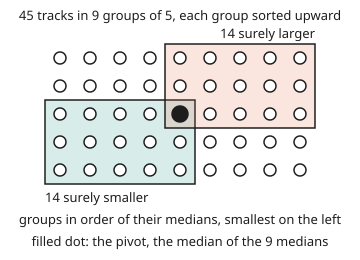
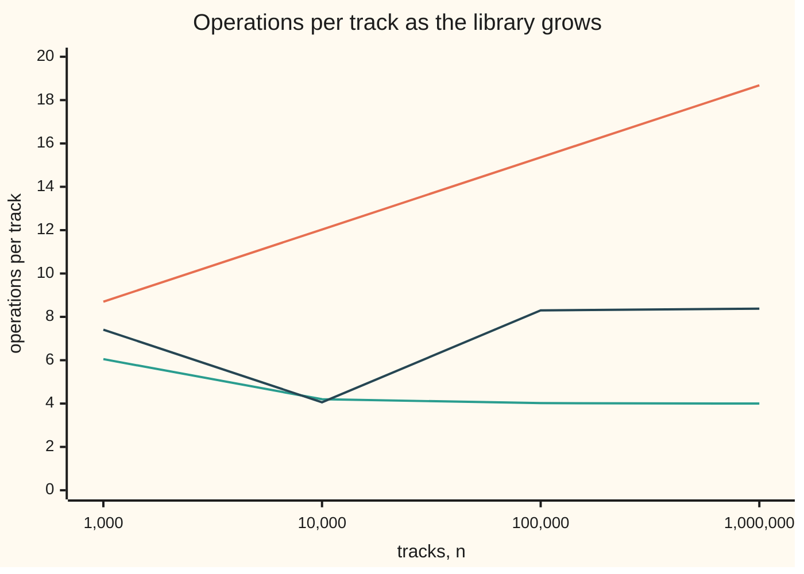

# Beating n log n, and finding the median in linear time

[Syllabus](../../../SYLLABUS.md) → [Applied and computational](../README.md) → [Algorithms and Growth](../README.md#s01) → Beating n log n, and finding the median in linear time

---

## General Overview

A music service shows 1,000,000 tracks on a phone, each with its play count: how many times all listeners together have played it. The app wants two things from those counts. It wants the tracks in order of plays, for a chart. And it wants the **median** play count (the middle value: half the tracks have fewer plays, half have more), so it can mark a track as "more played than most".

[Sorting and searching](05-sorting-and-searching.md) proved that a sort which only asks "is this track before that one?" needs at least about n log2 n such questions for n tracks. On the synthetic library below, merge sort asks 18,675,021 of them. The proof says nothing about a sort that reads the play count as a number. **Radix sort** does that. It drops each track into one of 1,024 numbered buckets by the last ten binary digits of its count, then does the same again with the first ten digits. Two passes and 4,002,048 simple steps put the whole library in order, with no comparisons at all.

The median needs even less. Sorting a million tracks to read one value off the middle is wasted work. **Quickselect** picks a random track, splits the rest into fewer plays and more plays, and keeps only the side that holds the middle. It found the median, 195,631 plays, with 3,815,828 comparisons. Its average cost over its own coin flips is 3,386,189.2, a fixed multiple of n with no log n. **Median of medians** removes the luck. It chooses the splitting track so carefully that every split throws away at least 3 tracks in 10. Its cost then obeys T(n) ≤ T(n/5) + T(7n/10) + cn, which forces T(n) ≤ 10cn on every input. On the library it used 8,377,196 comparisons, under its guaranteed ceiling of 30,000,000.

**Reading a whole-number key as an address sorts in about d(2n + b) steps, where d is the number of digit passes and b the number of buckets, below the n log2 n comparison floor; and the k-th smallest of n items is found in linear cost, on average with a random pivot (quickselect) and in the worst case when the pivot is a median of medians.**

**What kind of fact this is:** three theorems with proofs on this card, in Why it works. They are the correctness of radix sort, the expected cost of quickselect and the worst-case bound for median of medians. All three are checked by counting operations on a synthetic library and on every order of eight tracks. For median of medians, the checks also confirm that every split on the library cuts off at least the share the proof guarantees.

### The picture: why the median of medians is a safe split

<p align="center"></p>

Schematic. Take the first 45 tracks and cut them into 9 groups of 5. Sort each group, so each column runs from fewest plays at the bottom to most at the top. Line the columns up by their middle track, and take the middle of those middles as the **pivot** (the track the list is split around), the filled dot. Every dot in the lower-left block is at most the pivot: each sits below its own column's middle, which is at most the pivot's. So at least 14 tracks are surely smaller, and by the same argument at least 14 are surely larger. On the real 45 tracks the pivot has 279,333 plays, with 24 tracks below it and 20 above. The guarantee is a floor; the data can do better.

---

## The formula

Notation first, in words. n is the number of tracks. A **key** is the number a track is sorted by, here its play count. The keys have w binary digits (bits), so every key is below 2^w. The sort uses base b, so a "digit" is one of b values. d is the number of digit passes. k is the rank wanted: k = 1 is the smallest, and the median of 1,000,000 is taken as k = 500,000. One **step** in radix sort is one tally, one running-sum addition or one placement. One **comparison** is one question "is this key less than that one?".

```math
\text{radix sort: } d\,(2n + b) \text{ steps}, \qquad d = \left\lceil \frac{w}{\log_2 b} \right\rceil
```

```math
\text{quickselect: } \mathbb{E}[C] = \sum_{i<j} \frac{2}{\max(j,k) - \min(i,k) + 1} \;\approx\; 2n(1 + \ln 2) \text{ at the median}
```

```math
\text{median of medians: } T(n) \le T(n/5) + T(7n/10) + cn \;\Longrightarrow\; T(n) \le 10cn
```

**Read it aloud:** radix sort costs two steps per track per pass, plus one per bucket per pass. Quickselect's expected comparisons are a sum over every pair of ranks, each pair counting the chance it is ever compared. That sum is about 3.39 comparisons per track when the target is the median. Median of medians makes two smaller calls whose sizes add to at most nine tenths of the problem, so the whole job costs at most ten times the first round's work.

The symbol E[C] means the expected value of C: its long-run average, here over the method's own coin flips ([Expectation](../../09-Probability%20and%20statistics/02-Random%20Variables/02-expectation.md)).

| Symbol | Plain meaning | In our example | Push it up and the answer… |
| --- | --- | --- | --- |
| $`n`$ | how many tracks | 1,000,000; eight by hand | every cost grows in proportion |
| $`w`$ | bits in each key: keys lie below $`2^w`$ | 20, so counts below 1,048,576 | more passes |
| $`b`$ | number of buckets, the base of the digits | 1,024; 10 by hand | fewer passes, but each pass pays b more steps and b counters |
| $`d`$, $`\lceil x\rceil`$ | digit passes, $`\lceil w/\log_2 b\rceil`$; ⌈x⌉ is x rounded up to a whole number | $`\lceil 20/10\rceil = 2`$ | cost rises by 2n + b per pass |
| $`k`$ | rank wanted, 1 being the smallest | 500,000, the median | expected cost peaks at the median |
| $`i`$, $`j`$ | two ranks in the final order, i below j | any pair among 1 to n | — |
| $`C`$, $`\mathbb{E}[C]`$ | quickselect's comparisons on one run; their average over its coin flips | 3,815,828; 3,386,189.2 | — |
| $`\ln x`$ | the natural log: the power of e ≈ 2.718 that gives x | ln 2 = 0.6931 | — |
| $`T(n)`$ | most comparisons median of medians can make on n tracks | at most 29,865,902 at n = 1,000,000 | — |
| $`c`$ | work per track in one round, outside the two smaller calls | 3: 2 to sort the groups, 1 to split | the bound 10cn rises |
| $`H_n`$ | the harmonic number 1 + 1/2 + … + 1/n | appears in quickselect's closed form | — |
| $`\Theta(g)`$ | grows exactly like g, up to a constant, for large n | all three methods are $`\Theta(n)`$ | — |

Θ is the shorthand of [Big-O](01-big-o-and-growth-rates.md). All three methods are Θ(n) for a fixed key width, but in different cases: quickselect on average over its coins, median of medians on every input ([Which case are you quoting? Worst, average and amortised cost](02-worst-case-average-case-and-amortised.md)).

### When it holds

- **Radix sort needs whole-number keys of known width.** Play counts below 2^20 take 2 passes of base 1,024; 64-bit keys would take 7. Titles of any length have no fixed width, so comparison sorts stay in use.
- **Each pass must be stable.** A **stable** sort keeps tracks with equal keys in the order they arrived. Fill each bucket backwards instead, and the two passes leave 510,949 neighbouring pairs out of order.
- **The base must suit n.** One pass of base 2^20 costs 3,048,576 steps but needs 1,048,576 counters. Base 2 needs 20 passes and 40,000,040 steps, more than merge sort's 18,675,021 comparisons.
- **Quickselect's linear cost is an average over its own coins.** Take the first track as pivot instead, and an already sorted playlist of 1,000 costs 374,750 comparisons to find its median. On the sorted library that would be 374,999,750,000.
- **Median of medians needs groups of 5 or more.** Groups of 3 guarantee too little: n/3 + 2n/3 = n, so no work is saved per round. The guaranteed ceiling then grows from 31.24 to 52.92 comparisons per track between 1,000 and 1,000,000 tracks.

---

## Why it works

### Step 0: a key that is a number can be used as an address

The floor on [Sorting and searching](05-sorting-and-searching.md) counts yes-or-no questions: each one at best halves the orders still possible. Counting sort asks no questions. It reads a track's play count and sends the track straight to the slot for that count. One read places a track among b possibilities, not 2, so the halving argument does not apply.

### Step 1: counting sort, the one-pass version

Counting sort with b buckets does three things.

1. **Tally.** Read every key once and add 1 to its bucket's counter: n steps.
2. **Running sums.** Go along the buckets, giving each the position where it starts: the total of all the buckets before it. That is b steps.
3. **Place.** Read the tracks again in arrival order. Write each one at its bucket's next free position and move that position on by one: n steps.

The total is 2n + b. Step 3 makes the sort stable: two tracks in the same bucket are written in the order they were read.

### Step 2: radix sort, digit by digit from the last

Write each key in base b, here base 1,024, so each key has two "digits" of 10 bits each. Sort the whole list by the last digit with a stable counting sort, then by the first digit.

Why the result is in order: after each pass, the list is in order by the digits sorted so far. That holds after the first pass. Take two keys after the next pass. If their new digits differ, the new pass put the smaller one first. If their new digits are equal, the pass kept their old order, which was already correct for the digits below. Either way they are in order. That is the only place stability is used, and without it the argument fails.

Each pass costs 2n + b, so d passes cost d(2n + b). A bigger base means fewer passes but a longer bucket list:

```
base       2  ######################################## 40,000,040  (20 passes)
base      16  ##########                               10,000,080  (5 passes)
base     256  ######                                    6,000,768  (3 passes)
base   1,024  ####                                      4,002,048  (2 passes)
base 2^20     ###                                       3,048,576  (1 pass, 1,048,576 counters)
```

Base 1,024 with 2 passes gives almost the cheapest count while using only 1,024 counters. The rule of thumb is a base near n, or a little below it when memory is tight.

### Step 3: selection keeps only one side

Quickselect splits the list as quicksort does ([Sorting and searching](05-sorting-and-searching.md)): compare every other track with the pivot once, fewer plays to the left, more to the right. The pivot's rank is now known. If that rank is k, it is the answer. Otherwise the answer lies on one side, and the other side is dropped. Quicksort recurses on both sides. Quickselect keeps one, so the sizes shrink instead of multiplying.

With a random pivot the expected cost comes from counting pairs, using linearity of expectation (the average of a sum is the sum of the averages, with no independence needed). Number the tracks by rank, 1 for the fewest plays. Two ranks i < j are compared only if one of them is the pivot while both are still in play. Look at the run of ranks from min(i, k) to max(j, k). That run includes i, j and the target k. While no pivot from that run has been chosen, all of it stays together. The first pivot chosen inside it decides the pair:

- If it is i or j, those two are compared.
- If it lies between i and j, they go to different sides and never meet.
- If it lies between the pair and k, the pair's side is dropped, and again they never meet.

Each rank in the run is equally likely to be chosen first. So i and j are compared with chance 2 over the length of the run. The expected count is the sum of those chances, the formula above.

<details>
<summary>Detailed proof: the pair sum, and its size at the median</summary>

Split the pairs by where k sits. If both ranks are at most k, the run is i to k. For a given i there are k − i choices of j, each compared with chance 2/(k − i + 1). If both are at least k, the run is k to j, with j − k choices of i. If i < k < j, the run is i to j; group these pairs by the gap j − i. All three groups are sums of n terms or fewer, which is how the checks add them up for n = 1,000,000.

For large n each group turns into an integral. At k = n/2 the first two give about n each, and the third gives about 2n ln 2. The total is about 2n(1 + ln 2), which is 3.386n. For any other k the third group is smaller, so the median is the most expensive rank. Summed exactly, the pairs give 3,386,189.2 for the library, against 3,386,294.4 from the large-n estimate. The checks also confirm a known closed form,

$`\displaystyle \mathbb{E}[C] = 2\big((n+1)H_n - (n+3-k)H_{n+1-k} - (k+2)H_k + n + 3\big),`$

which agrees with the pair sum to every printed digit.

</details>

The checks run quickselect on all 40,320 orders of eight tracks, with the first track as pivot. When every order is equally likely, the first track is a random pivot. The average is 13.9548, the pair sum to four decimals. On the library one seeded run used 3,815,828 comparisons. That is 0.42 standard deviations above the mean, using the spread measured over 400 runs on 1,001 tracks, scaled up in proportion to n.

### Step 4: a pivot that is never far from the middle

Quickselect can be unlucky. Median of medians chooses its pivot so that it is never close to either end:

1. Cut the n tracks into groups of 5 and sort each group. At most 10 comparisons per group, so 2 per track.
2. Take each group's middle track. Find the middle of those n/5 middles by calling the same method on them. That is the T(n/5).
3. Split all n tracks around that pivot, with n − 1 comparisons, and keep the side that holds rank k.

The picture shows why the kept side is small. Half the groups have a middle at most the pivot. In each of those groups, the middle and the two tracks below it are at most the pivot. That is 3 tracks from each of n/10 groups, so 3n/10 tracks are surely not on the "more" side. The same holds the other way. Each side therefore holds at most 7n/10 tracks, which is the T(7n/10).

### Step 5: the work shrinks by a tenth each level, so it adds to ten times the first

The two smaller calls together handle n/5 + 7n/10 = 9n/10 tracks. Draw the calls as a tree. The top does cn work, the next level at most 0.9cn, the next 0.81cn, and so on. That is a geometric series (each term a fixed fraction of the one before), which adds to cn/(1 − 0.9) = 10cn.

The same bound by induction: suppose the bound T ≤ 10c × size already holds for every smaller size. Then

```math
T(n) \le 10c\,\frac{n}{5} + 10c\,\frac{7n}{10} + cn = 2cn + 7cn + cn = 10cn.
```

Groups of 3 break this. The guarantee falls to 2 tracks from each of n/6 groups, so the kept side can hold 2n/3 tracks. Then n/3 + 2n/3 = n: every level costs the full cn, and the [Recurrences](04-recurrences-and-the-master-theorem.md) tree gives about n log n.

<details>
<summary>Detailed check: whole numbers, and the code's own constant</summary>

Real group counts are whole numbers. With ⌈n/5⌉ groups, the method may lose the last, partial group and the pivot's own group from the count. So the guarantee is 3(⌈⌈n/5⌉/2⌉ − 2) tracks cut off, not exactly 3n/10. The checks evaluate the worst case of their own code exactly. For each n up to 1,000,000 they add the worst cost of sorting the groups by insertion sort, n − 1 for the split, the worst case at ⌈n/5⌉ and the worst case at the largest side that can survive. The result never exceeds 30n, which is 10cn with c = 3. The ratio comes closest at n = 20, where it equals exactly 30. At n = 1,000,000 the ceiling is 29,865,902.

The ceiling holds only if every split really cuts off that guaranteed share, so the checks test each of the 19 rounds of the library run. The first round split 1,000,000 tracks into 499,945 below the pivot and 500,054 above, against a guaranteed 299,994 on each side.

</details>

---

## Worked numbers, by hand

Eight tracks with small play counts, labelled by arrival: 47, 12, 85, 43, 19, 82, 15, 40. Radix sort in base 10, two passes:

| Step | Arithmetic | Value |
| --- | --- | --- |
| pass 1: tally ones digits | 0: 40; 2: 12, 82; 3: 43; 5: 85, 15; 7: 47; 9: 19, in arrival order | 8 tallies |
| pass 1: running sums, place | buckets 0 to 9 laid end to end | 40, 12, 82, 43, 85, 15, 47, 19 |
| pass 1 cost | 8 tallies + 10 sums + 8 placements | 26 steps |
| pass 2: by tens digit | 1: 12, 15, 19; 4: 40, 43, 47; 8: 82, 85, each bucket in pass-1 order | 12, 15, 19, 40, 43, 47, 82, 85 |
| **radix sort** | 2 × (2 × 8 + 10) | **52 steps, in order** |

The tens bucket 1 receives 12, 15, 19 in that order only because pass 1 left them in that order. That is stability doing the work.

Now find the median of the eight, taken as the 4th smallest:

| Step | Arithmetic | Value |
| --- | --- | --- |
| quickselect, pivot 47 | 7 compared: 12, 43, 19, 15, 40 fewer; 85, 82 more. 47 is 6th; keep the left | 7 |
| pivot 12 | 4 compared: none fewer. 12 is 1st; keep the right, now want its 3rd | 4 |
| pivot 43 | 3 compared: 19, 15, 40 fewer. 43 is 4th of these; keep the left | 3 |
| pivot 19 | 2 compared: 15 fewer, 40 more. 19 is 2nd; the 3rd is 40 | 2 |
| **quickselect** | 7 + 4 + 3 + 2 | **40, after 16 comparisons** |
| median of medians: groups | 47, 12, 85, 43, 19 sorted by insertion: 9 comparisons, middle 43; 82, 15, 40: 3 comparisons, middle 40 | 12 |
| middle of the middles | 40 against 43: 1 comparison; the lower middle is 40 | 1 |
| split around 40 | 7 compared: 3 fewer, 4 more, so 40 is 4th | 7 |
| **median of medians** | 9 + 3 + 1 + 7 | **40, after 20 comparisons** |

Both give 40. At eight tracks nothing is saved: the gain is in how the cost grows. Over all 40,320 orders quickselect averages 13.9548 comparisons. Median of medians' worst is 47, under the ceiling of 65 that its recurrence gives.

### The library, counted at four sizes

Every method below was run on the first n tracks of the synthetic library. Each number is operations per track: comparisons for merge sort, quickselect and median of medians; steps for radix sort.

| n | merge sort | radix, base 1,024 | quickselect | median of medians | its ceiling |
| ---: | ---: | ---: | ---: | ---: | ---: |
| 1,000 | 8.70 | 6.05 | 2.72 | 7.41 | 29.60 |
| 10,000 | 12.03 | 4.20 | 3.92 | 4.06 | 29.69 |
| 100,000 | 15.36 | 4.02 | 2.99 | 8.30 | 29.79 |
| 1,000,000 | 18.68 | 4.00 | 3.82 | 8.38 | 29.87 |



Orange: merge sort, rising by about 3.3 per tenfold growth, which is log2 10. Green: radix sort, settling at 4 per track once the 2,048 bucket steps are spread thin. Dark: median of medians, between 4.06 and 8.38 per track depending on where its pivots land, with no upward trend, and far under its ceiling of 30.

### What breaks if you drop a piece

| Mistake | Comes out at | What went wrong |
| --- | --- | --- |
| an unstable pass: each bucket filled backwards | the eight come out 19, 15, 12, 47, 43, 40, 85, 82; on the library, 510,949 neighbouring pairs out of order | pass 2 reversed ties on the first digit and threw away pass 1's work |
| quickselect with the first track as pivot, on a sorted playlist | 374,750 comparisons for the median of 1,000; 374,999,750,000 for the library | each pivot is the smallest left, so each round drops one track |
| median of medians with groups of 3 | ceiling 31.24 per track at 1,000, 52.92 at 1,000,000, still rising | n/3 + 2n/3 = n: no shrinking, so log n levels of full work |
| radix sort in base 2 | 40,000,040 steps | 20 passes of 2n each; a base far below n wastes passes |

Every number in these tables is printed by the code below.

---

## Code, from first principles, and it actually runs

Nothing imported sorts, selects or draws random numbers: no `sorted`, no `heapq`, no `random`, no Rust `sort`. Every method is written out and counts its own operations. The play counts are synthetic. Each comes from one SplitMix64 draw with seed 2026: two 20-bit numbers a and b are taken from it, and the count is a × b ÷ 2^20, rounded down. That gives many lightly played tracks and a few heavy ones. For selection, ties are broken by track number, so all keys differ. The answers are reached by these independent roads:

- radix sort and one-pass counting sort against merge sort: all three give the same list, ties in track order
- quickselect's expected cost three ways: the pair sum, the closed form, and every one of the 40,320 orders of eight tracks
- seeded runs: 400 runs on 1,001 tracks within 4 standard errors of the formula, and the library run within 4 standard deviations
- median of medians against its worst-case recurrence, evaluated exactly at every size up to 1,000,000 and checked against 30n, with every round of the library run checked against the share it must cut off
- every median against the middle of the sorted library

### Python

```python
# Linear-time sorting and selection -- the check behind the card.  Standard library only:
# no sorted(), heapq or random; every sort and select is written out and counts its own steps.
# Roads: radix against merge sort; quickselect's pair count against its closed form, all 40,320
# orders of eight tracks and seeded runs; median of medians against its worst-case recurrence.
from math import log, log2; from functools import reduce; from itertools import permutations
def splitmix(s):                     # SplitMix64: the seeded coin for data and pivots
    while True:
        s = (s + 0x9E3779B97F4A7C15) & (2**64 - 1)
        z = ((s ^ (s >> 30)) * 0xBF58476D1CE4E5B9) & (2**64 - 1)
        z = ((z ^ (z >> 27)) * 0x94D049BB133111EB) & (2**64 - 1)
        yield z ^ (z >> 31)
def radix(items, base, passes, t, stable=True):  # items are (plays, id); sort by plays
    for p in range(passes):
        tally = [0] * base
        for it in items:
            tally[it[0] // base**p % base] += 1; t[0] += 1   # one tally per track
        start, s = [0] * base, 0
        for v in range(base):
            start[v] = s; s += tally[v]; t[0] += 1           # one running sum per bucket
        out = [None] * len(items)
        for it in items:
            d = it[0] // base**p % base; t[0] += 1           # one placement per track
            if stable: out[start[d]] = it; start[d] += 1
            else: out[start[d] + tally[d] - 1] = it; tally[d] -= 1   # fills each bucket backwards
        items = out
    return items
def merge_sort(a, t):                # compares plays only; ties go left, so it is stable
    if len(a) <= 1: return a
    L, R = merge_sort(a[:len(a) // 2], t), merge_sort(a[len(a) // 2:], t)
    out, i, j = [], 0, 0
    while i < len(L) and j < len(R):
        t[0] += 1
        if L[i][0] <= R[j][0]: out.append(L[i]); i += 1
        else: out.append(R[j]); j += 1
    return out + L[i:] + R[j:]
def quickselect(a, k, t, coin=None):  # k-th smallest; pivot first, or chosen by the coin
    while True:
        if len(a) == 1: return a[0]
        pi = 0 if coin is None else next(coin) % len(a)
        p, less, more = a[pi], [], []
        for x in a[:pi] + a[pi + 1:]:
            t[0] += 1; (less if x < p else more).append(x)
        if k <= len(less): a = less
        elif k == len(less) + 1: return p
        else: k, a = k - len(less) - 1, more
def isort(a, t):                     # insertion sort, counting comparisons
    a = list(a)
    for i in range(1, len(a)):
        x, j = a[i], i - 1
        while j >= 0:
            t[0] += 1
            if a[j] <= x: break
            a[j + 1] = a[j]; j -= 1
        a[j + 1] = x
    return a
def mom(a, k, t, g=5, rounds=None):  # median of medians: worst-case linear selection
    while True:
        if len(a) <= g: return isort(a, t)[k - 1]
        meds = [s[(len(s) - 1) // 2] for s in (isort(a[i:i + g], t) for i in range(0, len(a), g))]
        p = mom(meds, (len(meds) + 1) // 2, t, g)
        less = [x for x in a if x < p]; more = [x for x in a if x > p]; t[0] += len(a) - 1   # counts a one-pass split
        if rounds is not None: rounds.append((len(a), len(meds), p, len(less), len(more)))
        if k <= len(less): a = less
        elif k == len(less) + 1: return p
        else: k, a = k - len(less) - 1, more
def worst(N, g):                     # mom's worst case at every size up to N, made non-decreasing
    W = [0] * (N + 1)
    for n in range(1, N + 1):
        if n <= g: c = n * (n - 1) // 2
        else:
            q, r, m = n // g, n % g, -(-n // g)
            side = n - 1 - max(0, (g + 1) // 2 * (-(-m // 2) - 2))   # guaranteed cut off
            c = q * g * (g - 1) // 2 + r * (r - 1) // 2 + W[m] + (n - 1) + W[side]
        W[n] = max(W[n - 1], c)
    return W
def add(xs): return reduce(lambda s, x: s + x, xs, 0.0)   # left to right, as in Rust
def H(n): return add(1 / i for i in range(1, n + 1))
def knuth(n, k): return 2 * ((n + 1) * H(n) - (n + 3 - k) * H(n + 1 - k) - (k + 2) * H(k) + n + 3)
def pairs(n, k):                     # sum over pairs i<j of 2/(span+1), grouped by span
    s = add(2 * (k - i) / (k - i + 1) for i in range(1, k)) + add(2 * (j - k) / (j - k + 1) for j in range(k + 1, n + 1))
    for d in range(2, n):
        c = min(k - 1, n - d) - max(1, k + 1 - d) + 1
        if c > 0: s += 2 * c / (d + 1)
    return s

eight = [(x, i) for i, x in enumerate([47, 12, 85, 43, 19, 82, 15, 40])]
t = [0]; print("eight, pass 1 by ones digit:", [x for x, _ in radix(eight, 10, 1, t)], "steps", t[0])
t = [0]; print("eight, both passes:", [x for x, _ in radix(eight, 10, 2, t)], "steps", t[0])
print("eight, unstable passes:", [x for x, _ in radix(eight, 10, 2, [0], stable=False)])
e8 = [x for x, _ in eight]; t = [0]; print("eight, quickselect k=4, first pivot:", quickselect(e8, 4, t), "comparisons", t[0])
rd = []; t = [0]; print("eight, median of medians:", mom(e8, 4, t, rounds=rd), "comparisons", t[0], "round", rd)
tot, mw = 0, 0
for p in permutations(e8):
    t = [0]; assert quickselect(list(p), 4, t) == 40; tot += t[0]
    t = [0]; assert mom(list(p), 4, t) == 40; mw = max(mw, t[0])
N, coin, lib = 1_000_000, splitmix(2026), []; W5 = worst(N, 5)
print(f"all 40320 orders: quickselect average {tot / 40320:.4f}, pair sum {pairs(8, 4):.4f}, closed form {knuth(8, 4):.4f}")
print("all 40320 orders: median of medians worst", mw, "recurrence bound", W5[8])
assert abs(tot / 40320 - pairs(8, 4)) < 1e-9 and abs(pairs(8, 4) - knuth(8, 4)) < 1e-9 and mw <= W5[8]
for i in range(N):
    r = next(coin); lib.append(((r >> 44) * ((r >> 24) & 0xFFFFF) >> 20, i))
print("library: 1000000 synthetic play counts, SplitMix64 seed 2026, plays = a*b >> 20, max", max(x for x, _ in lib))
tm, tr, tc, tu = [0], [0], [0], [0]
ms, rs, cs, us = merge_sort(lib, tm), radix(lib, 1024, 2, tr), radix(lib, 2**20, 1, tc), radix(lib, 1024, 2, tu, False)
print(f"merge sort {tm[0]} comparisons; floor log2 n! = {add(log2(i) for i in range(1, N + 1)):.1f} for different keys")
print("radix base 1024, 2 passes:", tr[0], "steps; counting sort base 2^20:", tc[0], "steps, 1048576 counters")
print("radix and counting sort equal merge sort, ties in track order:", rs == ms and cs == ms)
assert rs == ms and cs == ms and tr[0] == 2 * (2 * N + 1024) and tc[0] == 2 * N + 2**20
print("unstable passes: adjacent pairs out of order", sum(us[i][0] > us[i + 1][0] for i in range(N - 1)))
for b in (2, 16, 256, 1024, 2**20):
    d = -(-20 // round(log2(b))); print(f"bars, base {b}: {d} passes, {d * (2 * N + b)} steps")
keys = [x * 2**20 + i for x, i in lib]; K = N // 2; truth = ms[K - 1]
tq, tm5, r5 = [0], [0], []; qv = quickselect(keys, K, tq, splitmix(7)); mv = mom(keys, K, tm5, rounds=r5)
print("median play count", truth[0], "(track", truth[1], "); quickselect", qv >> 20, "; median of medians", mv >> 20)
assert qv == mv == truth[0] * 2**20 + truth[1]
E = pairs(N, K)
print(f"quickselect {tq[0]} comparisons; expected {E:.1f} = closed form {knuth(N, K):.1f}; 2n(1+ln2) = {2 * N * (1 + log(2)):.1f}")
runs = []
for s in range(400):
    t = [0]; quickselect(keys[:1001], 501, t, splitmix(100 + s)); runs.append(t[0])
mean = sum(runs) / 400; sd = (add((x - mean) ** 2 for x in runs) / 399) ** 0.5
print(f"400 runs on 1001 tracks: mean {mean:.1f}, expected {pairs(1001, 501):.1f}, sd {sd:.1f}, off by {(mean - pairs(1001, 501)) / (sd / 20):.2f} se")
print(f"library run off by {(tq[0] - E) / (sd / 1001 * N):.2f} sd, sd scaled up from 1001 tracks")
assert abs(mean - pairs(1001, 501)) < 4 * sd / 20 and abs(tq[0] - E) < 4 * sd / 1001 * N
worst_n = max(range(1, N + 1), key=lambda n: W5[n] / n)
print(f"median of medians {tm5[0]} comparisons; worst-case recurrence {W5[N]}; 30n = {30 * N}; largest W(n)/n {W5[worst_n] / worst_n:.2f} at n={worst_n}")
print(f"median of medians on the library: {len(r5)} rounds; round 1 split {r5[0][0]} tracks into {r5[0][3]} below and {r5[0][4]} above, at least {3 * (-(-r5[0][1] // 2) - 2)} each guaranteed")
assert tm5[0] <= W5[N] and all(W5[n] <= 30 * n for n in range(1, N + 1)) and all(min(lo, hi) >= 3 * (-(-m // 2) - 2) for _, m, _, lo, hi in r5)
W3 = worst(N, 3)
for n in (1000, 10000, 100000, N):
    a, b, c, d = [0], [0], [0], [0]
    merge_sort(lib[:n], a); radix(lib[:n], 1024, 2, b); quickselect(keys[:n], n // 2, c, splitmix(7)); mom(keys[:n], n // 2, d)
    print(f"per track at n={n}: merge {a[0] / n:.2f}, radix {b[0] / n:.2f}, quickselect {c[0] / n:.2f}, mom {d[0] / n:.2f}, mom bound {W5[n] / n:.2f}, groups of 3 bound {W3[n] / n:.2f}")
t = [0]; quickselect(list(range(1000)), 500, t); print(f"sorted playlist of 1000, first-pivot quickselect: {t[0]}; library formula {K * N - K * (K + 1) // 2}")
assert t[0] == 500 * 1000 - 500 * 501 // 2 and W3[N] > W3[1000] * N // 1000 + 15 * N
rd = []; mom(keys[:45], 23, [0], rounds=rd); n45, g45, p45, lo, hi = rd[0]; m = (g45 + 1) // 2
print("figure,", n45, "tracks,", g45, "groups; grid guarantees", 3 * (m - 1) + 2, "below,", 3 * (g45 - m) + 2, "above; pivot plays", p45 >> 20, "; actual", lo, "below,", hi, "above")
print(f"try: base 256 needs 3 passes, {3 * (2 * N + 256)} steps; quickselect at k=1 expects {pairs(N, 1):.1f}")
print(f"try: groups of 7 bound {worst(N, 7)[N] / N:.2f} per track; 2000000 tracks, quickselect expects {knuth(2 * N, N):.1f}")
print("ALL CHECKS PASS")
```

**Ran 2026-11-23 on macOS, Python 3.14.10, standard library only. All checks passed. Output, pasted from the run:**

```
eight, pass 1 by ones digit: [40, 12, 82, 43, 85, 15, 47, 19] steps 26
eight, both passes: [12, 15, 19, 40, 43, 47, 82, 85] steps 52
eight, unstable passes: [19, 15, 12, 47, 43, 40, 85, 82]
eight, quickselect k=4, first pivot: 40 comparisons 16
eight, median of medians: 40 comparisons 20 round [(8, 2, 40, 3, 4)]
all 40320 orders: quickselect average 13.9548, pair sum 13.9548, closed form 13.9548
all 40320 orders: median of medians worst 47 recurrence bound 65
library: 1000000 synthetic play counts, SplitMix64 seed 2026, plays = a*b >> 20, max 1045154
merge sort 18675021 comparisons; floor log2 n! = 18488884.8 for different keys
radix base 1024, 2 passes: 4002048 steps; counting sort base 2^20: 3048576 steps, 1048576 counters
radix and counting sort equal merge sort, ties in track order: True
unstable passes: adjacent pairs out of order 510949
bars, base 2: 20 passes, 40000040 steps
bars, base 16: 5 passes, 10000080 steps
bars, base 256: 3 passes, 6000768 steps
bars, base 1024: 2 passes, 4002048 steps
bars, base 1048576: 1 passes, 3048576 steps
median play count 195631 (track 698925 ); quickselect 195631 ; median of medians 195631
quickselect 3815828 comparisons; expected 3386189.2 = closed form 3386189.2; 2n(1+ln2) = 3386294.4
400 runs on 1001 tracks: mean 3335.8, expected 3339.7, sd 1016.7, off by -0.08 se
library run off by 0.42 sd, sd scaled up from 1001 tracks
median of medians 8377196 comparisons; worst-case recurrence 29865902; 30n = 30000000; largest W(n)/n 30.00 at n=20
median of medians on the library: 19 rounds; round 1 split 1000000 tracks into 499945 below and 500054 above, at least 299994 each guaranteed
per track at n=1000: merge 8.70, radix 6.05, quickselect 2.72, mom 7.41, mom bound 29.60, groups of 3 bound 31.24
per track at n=10000: merge 12.03, radix 4.20, quickselect 3.92, mom 4.06, mom bound 29.69, groups of 3 bound 38.42
per track at n=100000: merge 15.36, radix 4.02, quickselect 2.99, mom 8.30, mom bound 29.79, groups of 3 bound 45.62
per track at n=1000000: merge 18.68, radix 4.00, quickselect 3.82, mom 8.38, mom bound 29.87, groups of 3 bound 52.92
sorted playlist of 1000, first-pivot quickselect: 374750; library formula 374999750000
figure, 45 tracks, 9 groups; grid guarantees 14 below, 14 above; pivot plays 279333 ; actual 24 below, 20 above
try: base 256 needs 3 passes, 6000768 steps; quickselect at k=1 expects 1999971.2
try: groups of 7 bound 29.42 per track; 2000000 tracks, quickselect expects 6772478.0
ALL CHECKS PASS
```

### Rust

Same numbers, same labels, built with `rustc --edition 2021 -O`.

```rust
// Linear-time sorting and selection -- the check behind the card.  std only: no
// sort, no BinaryHeap; every sort and select is written out and counts its own steps.
// Roads: radix against merge sort; quickselect's pair count against its closed form, all
// 40,320 orders of eight tracks and seeded runs; median of medians against its recurrence.
type T = (u64, usize); // (plays, track id)
struct Mix(u64); // SplitMix64: the seeded coin for data and pivots
impl Mix { fn next(&mut self) -> u64 {
    self.0 = self.0.wrapping_add(0x9E3779B97F4A7C15);
    let z = (self.0 ^ (self.0 >> 30)).wrapping_mul(0xBF58476D1CE4E5B9);
    let z = (z ^ (z >> 27)).wrapping_mul(0x94D049BB133111EB); z ^ (z >> 31) } }
fn radix(items: &[T], base: u64, passes: u32, t: &mut u64, stable: bool) -> Vec<T> {
    let mut items = items.to_vec();
    for p in 0..passes {
        let dig = |it: &T| (it.0 / base.pow(p) % base) as usize;
        let mut tally = vec![0usize; base as usize];
        for it in &items { tally[dig(it)] += 1; *t += 1; } // one tally per track
        let (mut start, mut s) = (vec![0usize; base as usize], 0);
        for v in 0..base as usize { start[v] = s; s += tally[v]; *t += 1; } // one sum per bucket
        let mut out = vec![(0u64, 0usize); items.len()];
        for it in &items {
            let d = dig(it); *t += 1; // one placement per track
            if stable { out[start[d]] = *it; start[d] += 1; }
            else { out[start[d] + tally[d] - 1] = *it; tally[d] -= 1; } // fills each bucket backwards
        }
        items = out;
    }
    items
}
fn merge_sort(a: &[T], t: &mut u64) -> Vec<T> { // compares plays only; ties go left: stable
    if a.len() <= 1 { return a.to_vec(); }
    let (l, r) = (merge_sort(&a[..a.len() / 2], t), merge_sort(&a[a.len() / 2..], t));
    let (mut out, mut i, mut j) = (Vec::with_capacity(a.len()), 0, 0);
    while i < l.len() && j < r.len() {
        *t += 1; if l[i].0 <= r[j].0 { out.push(l[i]); i += 1; } else { out.push(r[j]); j += 1; }
    }
    out.extend_from_slice(&l[i..]); out.extend_from_slice(&r[j..]); out
}
fn quickselect(a: &[u64], mut k: usize, t: &mut u64, mut coin: Option<&mut Mix>) -> u64 {
    let mut a = a.to_vec(); // k-th smallest; pivot first, or chosen by the coin
    loop {
        if a.len() == 1 { return a[0]; }
        let pi = match coin.as_mut() { None => 0, Some(c) => (c.next() % a.len() as u64) as usize };
        let (p, mut less, mut more) = (a[pi], vec![], vec![]); for (i, &x) in a.iter().enumerate() {
            if i == pi { continue; }
            *t += 1; if x < p { less.push(x) } else { more.push(x) }
        }
        if k <= less.len() { a = less; }
        else if k == less.len() + 1 { return p; }
        else { k -= less.len() + 1; a = more; }
    }
}
fn isort(a: &[u64], t: &mut u64) -> Vec<u64> { // insertion sort, counting comparisons
    let mut a = a.to_vec();
    for i in 1..a.len() {
        let (x, mut j) = (a[i], i as i64 - 1);
        while j >= 0 {
            *t += 1; if a[j as usize] <= x { break; }
            a[j as usize + 1] = a[j as usize]; j -= 1;
        }
        a[(j + 1) as usize] = x;
    }
    a
}
fn mom(a: &[u64], mut k: usize, t: &mut u64, g: usize, rounds: &mut Vec<(usize, usize, u64, usize, usize)>) -> u64 {
    let mut a = a.to_vec(); // median of medians: worst-case linear selection
    loop {
        if a.len() <= g { return isort(&a, t)[k - 1]; }
        let meds: Vec<u64> = a.chunks(g).map(|c| { let s = isort(c, t); s[(s.len() - 1) / 2] }).collect();
        let p = mom(&meds, (meds.len() + 1) / 2, t, g, &mut vec![]);
        let less: Vec<u64> = a.iter().copied().filter(|&x| x < p).collect();
        let more: Vec<u64> = a.iter().copied().filter(|&x| x > p).collect(); // counts a one-pass split
        *t += a.len() as u64 - 1; rounds.push((a.len(), meds.len(), p, less.len(), more.len()));
        if k <= less.len() { a = less; }
        else if k == less.len() + 1 { return p; }
        else { k -= less.len() + 1; a = more; }
    }
}
fn worst(n_max: usize, g: usize) -> Vec<u64> { // mom's worst case at every size, non-decreasing
    let mut w = vec![0u64; n_max + 1];
    for n in 1..=n_max {
        let c = if n <= g { (n * (n - 1) / 2) as u64 } else {
            let (q, r, m) = (n / g, n % g, (n + g - 1) / g);
            let cut = ((g + 1) / 2) as i64 * (((m + 1) / 2) as i64 - 2);
            let side = n - 1 - cut.max(0) as usize; // guaranteed cut off
            (q * g * (g - 1) / 2 + r * (r.max(1) - 1) / 2 + n - 1) as u64 + w[m] + w[side]
        };
        w[n] = w[n - 1].max(c);
    }
    w
}
fn h(n: usize) -> f64 { let mut s = 0.0; for i in 1..=n { s += 1.0 / i as f64; } s }
fn knuth(n: usize, k: usize) -> f64 {
    let (n, kf) = (n as f64, k as f64);
    2.0 * ((n + 1.0) * h(n as usize) - (n + 3.0 - kf) * h(n as usize + 1 - k) - (kf + 2.0) * h(k) + n + 3.0)
}
fn pairs(n: usize, k: usize) -> f64 { // sum over pairs i<j of 2/(span+1), grouped by span
    let (mut a, mut b) = (0.0, 0.0); for i in 1..k { a += 2.0 * (k - i) as f64 / (k - i + 1) as f64; }
    for j in k + 1..=n { b += 2.0 * (j - k) as f64 / (j - k + 1) as f64; }
    let mut s = a + b;
    for d in 2..n {
        let c = (k as i64 - 1).min((n - d) as i64) - 1i64.max(k as i64 + 1 - d as i64) + 1;
        if c > 0 { s += 2.0 * c as f64 / (d + 1) as f64; }
    }
    s
}
fn plays(v: &[T]) -> Vec<u64> { v.iter().map(|x| x.0).collect() }
fn main() {
    let e8: Vec<u64> = vec![47, 12, 85, 43, 19, 82, 15, 40];
    let eight: Vec<T> = e8.iter().enumerate().map(|(i, &x)| (x, i)).collect();
    let mut t = 0; println!("eight, pass 1 by ones digit: {:?} steps {}", plays(&radix(&eight, 10, 1, &mut t, true)), t);
    t = 0; println!("eight, both passes: {:?} steps {}", plays(&radix(&eight, 10, 2, &mut t, true)), t);
    println!("eight, unstable passes: {:?}", plays(&radix(&eight, 10, 2, &mut 0, false)));
    t = 0; let q8 = quickselect(&e8, 4, &mut t, None); println!("eight, quickselect k=4, first pivot: {} comparisons {}", q8, t);
    let mut rd = vec![]; t = 0; let m8 = mom(&e8, 4, &mut t, 5, &mut rd); println!("eight, median of medians: {} comparisons {} round {:?}", m8, t, rd);
    let (mut tot, mut mw, mut idx, mut cnt) = (0u64, 0u64, [0usize, 1, 2, 3, 4, 5, 6, 7], 0);
    loop { // every order of the eight, by next-permutation on positions
        let p: Vec<u64> = idx.iter().map(|&i| e8[i]).collect();
        t = 0; assert!(quickselect(&p, 4, &mut t, None) == 40); tot += t;
        t = 0; assert!(mom(&p, 4, &mut t, 5, &mut vec![]) == 40); mw = mw.max(t); cnt += 1;
        let mut i = 7; while i > 0 && idx[i - 1] >= idx[i] { i -= 1; } if i == 0 { break; }
        let mut j = 7; while idx[j] <= idx[i - 1] { j -= 1; }
        idx.swap(i - 1, j); idx[i..].reverse();
    }
    let n = 1_000_000usize; let w5 = worst(n, 5); let avg = tot as f64 / cnt as f64;
    println!("all {} orders: quickselect average {:.4}, pair sum {:.4}, closed form {:.4}", cnt, avg, pairs(8, 4), knuth(8, 4));
    println!("all 40320 orders: median of medians worst {} recurrence bound {}", mw, w5[8]);
    assert!((avg - pairs(8, 4)).abs() < 1e-9 && (pairs(8, 4) - knuth(8, 4)).abs() < 1e-9 && mw <= w5[8]);
    let mut coin = Mix(2026); let lib: Vec<T> = (0..n).map(|i| { let r = coin.next(); ((r >> 44) * ((r >> 24) & 0xFFFFF) >> 20, i) }).collect();
    println!("library: 1000000 synthetic play counts, SplitMix64 seed 2026, plays = a*b >> 20, max {}", lib.iter().map(|x| x.0).max().unwrap());
    let (mut tm, mut tr, mut tc, mut tu) = (0, 0, 0, 0); let (ms, rs, cs, us) = (merge_sort(&lib, &mut tm), radix(&lib, 1024, 2, &mut tr, true), radix(&lib, 1 << 20, 1, &mut tc, true), radix(&lib, 1024, 2, &mut tu, false));
    let mut fl = 0.0; for i in 1..=n { fl += (i as f64).log2(); } println!("merge sort {} comparisons; floor log2 n! = {:.1} for different keys", tm, fl);
    println!("radix base 1024, 2 passes: {} steps; counting sort base 2^20: {} steps, 1048576 counters", tr, tc);
    println!("radix and counting sort equal merge sort, ties in track order: {}", if rs == ms && cs == ms { "True" } else { "False" });
    assert!(rs == ms && cs == ms && tr == 2 * (2 * n as u64 + 1024) && tc == 2 * n as u64 + (1 << 20));
    println!("unstable passes: adjacent pairs out of order {}", (0..n - 1).filter(|&i| us[i].0 > us[i + 1].0).count());
    for b in [2u64, 16, 256, 1024, 1 << 20] {
        let d = (20 + b.trailing_zeros() as u64 - 1) / b.trailing_zeros() as u64;
        println!("bars, base {}: {} passes, {} steps", b, d, d * (2 * n as u64 + b));
    }
    let keys: Vec<u64> = lib.iter().map(|&(x, i)| (x << 20) + i as u64).collect();
    let kk = n / 2; let truth = ms[kk - 1];
    let (mut tq, mut tm5, mut r5) = (0, 0, vec![]); let qv = quickselect(&keys, kk, &mut tq, Some(&mut Mix(7))); let mv = mom(&keys, kk, &mut tm5, 5, &mut r5);
    println!("median play count {} (track {} ); quickselect {} ; median of medians {}", truth.0, truth.1, qv >> 20, mv >> 20);
    assert!(qv == mv && qv == (truth.0 << 20) + truth.1 as u64);
    let e = pairs(n, kk); println!("quickselect {} comparisons; expected {:.1} = closed form {:.1}; 2n(1+ln2) = {:.1}", tq, e, knuth(n, kk), 2.0 * n as f64 * (1.0 + 2f64.ln()));
    let runs: Vec<u64> = (0..400).map(|s| { let mut t = 0; quickselect(&keys[..1001], 501, &mut t, Some(&mut Mix(100 + s))); t }).collect();
    let (mean, mut ss) = (runs.iter().sum::<u64>() as f64 / 400.0, 0.0); for &x in &runs { ss += (x as f64 - mean).powi(2); } // left to right
    let (sd, e1) = ((ss / 399.0).sqrt(), pairs(1001, 501));
    println!("400 runs on 1001 tracks: mean {:.1}, expected {:.1}, sd {:.1}, off by {:.2} se", mean, e1, sd, (mean - e1) / (sd / 20.0));
    println!("library run off by {:.2} sd, sd scaled up from 1001 tracks", (tq as f64 - e) / (sd / 1001.0 * n as f64));
    assert!((mean - e1).abs() < 4.0 * sd / 20.0 && (tq as f64 - e).abs() < 4.0 * sd / 1001.0 * n as f64);
    let mut wn = 1; for m in 1..=n { if w5[m] as f64 / m as f64 > w5[wn] as f64 / wn as f64 { wn = m; } }
    println!("median of medians {} comparisons; worst-case recurrence {}; 30n = {}; largest W(n)/n {:.2} at n={}", tm5, w5[n], 30 * n, w5[wn] as f64 / wn as f64, wn);
    println!("median of medians on the library: {} rounds; round 1 split {} tracks into {} below and {} above, at least {} each guaranteed", r5.len(), r5[0].0, r5[0].3, r5[0].4, 3 * ((r5[0].1 + 1) / 2 - 2));
    assert!(tm5 <= w5[n] && (1..=n).all(|m| w5[m] <= 30 * m as u64) && r5.iter().all(|&(_, m, _, lo, hi)| lo.min(hi) as i64 >= 3 * (((m + 1) / 2) as i64 - 2)));
    let w3 = worst(n, 3); for m in [1000usize, 10000, 100000, n] {
        let (mut a, mut b, mut c, mut d) = (0, 0, 0, 0); merge_sort(&lib[..m], &mut a); radix(&lib[..m], 1024, 2, &mut b, true);
        quickselect(&keys[..m], m / 2, &mut c, Some(&mut Mix(7))); mom(&keys[..m], m / 2, &mut d, 5, &mut vec![]);
        let f = |x: u64| x as f64 / m as f64;
        println!("per track at n={}: merge {:.2}, radix {:.2}, quickselect {:.2}, mom {:.2}, mom bound {:.2}, groups of 3 bound {:.2}", m, f(a), f(b), f(c), f(d), f(w5[m]), f(w3[m]));
    }
    let sorted: Vec<u64> = (0..1000).collect(); t = 0; quickselect(&sorted, 500, &mut t, None);
    println!("sorted playlist of 1000, first-pivot quickselect: {}; library formula {}", t, kk * n - kk * (kk + 1) / 2);
    assert!(t == 500 * 1000 - 500 * 501 / 2 && w3[n] as usize > w3[1000] as usize * n / 1000 + 15 * n);
    let mut rd = vec![]; mom(&keys[..45], 23, &mut 0, 5, &mut rd); let (n45, g45, p45, lo, hi) = rd[0]; let m = (g45 + 1) / 2;
    println!("figure, {} tracks, {} groups; grid guarantees {} below, {} above; pivot plays {} ; actual {} below, {} above", n45, g45, 3 * (m - 1) + 2, 3 * (g45 - m) + 2, p45 >> 20, lo, hi);
    println!("try: base 256 needs 3 passes, {} steps; quickselect at k=1 expects {:.1}", 3 * (2 * n + 256), pairs(n, 1));
    println!("try: groups of 7 bound {:.2} per track; 2000000 tracks, quickselect expects {:.1}", worst(n, 7)[n] as f64 / n as f64, knuth(2 * n, n));
    println!("ALL CHECKS PASS");
}
```

**Ran 2026-11-23 on macOS, rustc 1.98.1, no crates. All checks passed. Output, pasted from the run:**

```
eight, pass 1 by ones digit: [40, 12, 82, 43, 85, 15, 47, 19] steps 26
eight, both passes: [12, 15, 19, 40, 43, 47, 82, 85] steps 52
eight, unstable passes: [19, 15, 12, 47, 43, 40, 85, 82]
eight, quickselect k=4, first pivot: 40 comparisons 16
eight, median of medians: 40 comparisons 20 round [(8, 2, 40, 3, 4)]
all 40320 orders: quickselect average 13.9548, pair sum 13.9548, closed form 13.9548
all 40320 orders: median of medians worst 47 recurrence bound 65
library: 1000000 synthetic play counts, SplitMix64 seed 2026, plays = a*b >> 20, max 1045154
merge sort 18675021 comparisons; floor log2 n! = 18488884.8 for different keys
radix base 1024, 2 passes: 4002048 steps; counting sort base 2^20: 3048576 steps, 1048576 counters
radix and counting sort equal merge sort, ties in track order: True
unstable passes: adjacent pairs out of order 510949
bars, base 2: 20 passes, 40000040 steps
bars, base 16: 5 passes, 10000080 steps
bars, base 256: 3 passes, 6000768 steps
bars, base 1024: 2 passes, 4002048 steps
bars, base 1048576: 1 passes, 3048576 steps
median play count 195631 (track 698925 ); quickselect 195631 ; median of medians 195631
quickselect 3815828 comparisons; expected 3386189.2 = closed form 3386189.2; 2n(1+ln2) = 3386294.4
400 runs on 1001 tracks: mean 3335.8, expected 3339.7, sd 1016.7, off by -0.08 se
library run off by 0.42 sd, sd scaled up from 1001 tracks
median of medians 8377196 comparisons; worst-case recurrence 29865902; 30n = 30000000; largest W(n)/n 30.00 at n=20
median of medians on the library: 19 rounds; round 1 split 1000000 tracks into 499945 below and 500054 above, at least 299994 each guaranteed
per track at n=1000: merge 8.70, radix 6.05, quickselect 2.72, mom 7.41, mom bound 29.60, groups of 3 bound 31.24
per track at n=10000: merge 12.03, radix 4.20, quickselect 3.92, mom 4.06, mom bound 29.69, groups of 3 bound 38.42
per track at n=100000: merge 15.36, radix 4.02, quickselect 2.99, mom 8.30, mom bound 29.79, groups of 3 bound 45.62
per track at n=1000000: merge 18.68, radix 4.00, quickselect 3.82, mom 8.38, mom bound 29.87, groups of 3 bound 52.92
sorted playlist of 1000, first-pivot quickselect: 374750; library formula 374999750000
figure, 45 tracks, 9 groups; grid guarantees 14 below, 14 above; pivot plays 279333 ; actual 24 below, 20 above
try: base 256 needs 3 passes, 6000768 steps; quickselect at k=1 expects 1999971.2
try: groups of 7 bound 29.42 per track; 2000000 tracks, quickselect expects 6772478.0
ALL CHECKS PASS
```

### Lean

Lean proves the three theorems of Why it works for every n, every rank k and every base b.

- Suppose $`T(0) = 0`$ and $`T(n) \le T(n/5) + T(7n/10) + cn`$ for every $`n \ge 1`$, sizes rounded down. Then $`T(n) \le 10cn`$ for every n.
- Suppose every key is a whole number below $`b^d`$. Then d stable passes, last digit first, put the tracks in order of key. No track is lost or added, and tracks with equal keys keep their arrival order.
- Suppose quickselect's expected cost on n different keys is n − 1 comparisons plus the average cost of the side kept, with a random pivot. Then for every rank k from 1 to n, $`\mathbb{E}[C]`$ equals the closed form with $`H_n`$ in Step 3's detailed proof.
- The eight tracks' two passes, the step counts by base, the 374,750 and the 299,994 come out as the card states. The average 13.9548 is exactly 5861/420.

Python and Rust cover the rest: the pair sum, the 3-in-10 split guarantee, the counted steps and comparisons, and the library runs.

```lean
-- Beating n log n, and finding the median in linear time: the median-of-medians recurrence T(n) ≤ T(n/5) + T(7n/10) + cn forces T(n) ≤ 10cn, radix sort built from stable counting passes sorts any keys below b^d and keeps ties in arrival order, and random-pivot quickselect's expected comparisons have Knuth's closed form.
import Mathlib.NumberTheory.Harmonic.Defs
import Mathlib.Algebra.Order.Field.Basic
import Mathlib.Order.Interval.Finset.Nat
import Mathlib.Tactic.NormNum
import Mathlib.Tactic.Linarith
import Mathlib.Algebra.BigOperators.Intervals
import Mathlib.Tactic.FieldSimp
import Mathlib.Tactic.Ring

open Finset

/-- Digit number `p` (counting from 0, the last digit) of `x` written in base `b`. -/
def digit (b p x : ℕ) : ℕ := x / b ^ p % b

/-- One counting-sort pass on digit `p` of the key `f a`: bucket `v` receives, in arrival order,
the items whose digit is `v`, and the buckets 0, 1, …, b − 1 are laid end to end. -/
def countingPass {α : Type*} (b p : ℕ) (f : α → ℕ) (l : List α) : List α :=
  (List.range b).flatMap (fun v => l.filter (fun a => digit b p (f a) = v))

/-- Radix sort: `d` counting passes in base `b`, from the last digit (p = 0) to the first. -/
def radixSort {α : Type*} (b d : ℕ) (f : α → ℕ) (l : List α) : List α :=
  (List.range d).foldl (fun acc p => countingPass b p f acc) l

lemma filter_filter_of_imp {α : Type*} (P Q : α → Bool) (hPQ : ∀ x, P x = true → Q x = true)
    (L : List α) : (L.filter Q).filter P = L.filter P := by
  rw [List.filter_filter]
  apply List.filter_congr
  intro x _
  cases hp : P x
  · simp
  · simp [hPQ x hp]

lemma perm_of_filter_eq {α : Type*} (k : α → ℕ) (A B : List α)
    (h : ∀ u, A.filter (fun a => k a = u) = B.filter (fun a => k a = u)) : A.Perm B := by
  classical
  rw [List.perm_iff_count]
  intro x
  have := congrArg (List.count x) (h (k x))
  rwa [List.count_filter (by simp), List.count_filter (by simp)] at this

lemma countingPass_filter {α : Type*} (b p : ℕ) (f : α → ℕ) (P : α → Bool) (c : ℕ) (hc : c < b)
    (hP : ∀ a, P a = true → digit b p (f a) = c) (L : List α) :
    (countingPass b p f L).filter P = L.filter P := by
  unfold countingPass
  rw [List.filter_flatMap]
  have key : ∀ v, (L.filter (fun a => decide (digit b p (f a) = v))).filter P =
      if v = c then L.filter P else [] := by
    intro v
    split_ifs with hv
    · subst hv
      exact filter_filter_of_imp _ _ (fun x hx => by simp [hP x hx]) L
    · rw [List.filter_filter, List.filter_eq_nil_iff]
      intro x _ hx
      simp only [Bool.and_eq_true, decide_eq_true_eq] at hx
      exact hv (hx.2 ▸ hP x hx.1)
  simp only [key]
  have gen : ∀ n, ((List.range n).flatMap fun v => if v = c then L.filter P else []) =
      if c < n then L.filter P else [] := by
    intro n
    induction n with
    | zero => simp
    | succ n ih =>
      rw [List.range_succ, List.flatMap_append, ih]
      simp only [List.flatMap_cons, List.flatMap_nil, List.append_nil]
      by_cases h1 : c < n
      · simp [h1, show n ≠ c by omega, show c < n + 1 by omega]
      · by_cases h2 : c = n
        · subst h2; simp
        · simp [h1, Ne.symm h2, show ¬ c < n + 1 by omega]
  rw [gen]; simp [hc]

lemma countingPass_pairwise {α : Type*} (b p : ℕ) (hb : 0 < b) (f : α → ℕ) (L : List α)
    (h : L.Pairwise (fun x y => f x % b ^ p ≤ f y % b ^ p)) :
    (countingPass b p f L).Pairwise (fun x y => f x % b ^ (p + 1) ≤ f y % b ^ (p + 1)) := by
  unfold countingPass
  rw [List.pairwise_flatMap]
  constructor
  · intro v _
    rw [List.pairwise_filter]
    refine h.imp ?_
    intro x y hxy hx hy
    have hx' := of_decide_eq_true hx
    have hy' := of_decide_eq_true hy
    simp only [digit] at hx' hy'
    rw [Nat.mod_pow_succ, Nat.mod_pow_succ, hx', hy']
    omega
  · refine List.pairwise_lt_range.imp ?_
    intro v w hvw x hx y hy
    have hx' := of_decide_eq_true (List.mem_filter.1 hx).2
    have hy' := of_decide_eq_true (List.mem_filter.1 hy).2
    simp only [digit] at hx' hy'
    rw [Nat.mod_pow_succ, Nat.mod_pow_succ, hx', hy']
    have hlt := Nat.mod_lt (f x) ((Nat.pow_pos (n := p) hb))
    have hm : b ^ p * (v + 1) ≤ b ^ p * w := Nat.mul_le_mul_left _ hvw
    rw [Nat.mul_add, Nat.mul_one] at hm
    linarith [Nat.zero_le (f y % b ^ p)]

lemma radixSort_invariant {α : Type*} (b : ℕ) (hb : 0 < b) (f : α → ℕ) (l : List α) (p : ℕ) :
    ((List.range p).foldl (fun acc q => countingPass b q f acc) l).Pairwise
        (fun x y => f x % b ^ p ≤ f y % b ^ p) ∧
      ∀ u, ((List.range p).foldl (fun acc q => countingPass b q f acc) l).filter
          (fun a => f a % b ^ p = u) = l.filter (fun a => f a % b ^ p = u) := by
  induction p with
  | zero =>
    simp only [List.range_zero, List.foldl_nil, pow_zero, Nat.mod_one]
    exact ⟨List.pairwise_of_forall (fun _ _ => by simp), fun _ => by simp⟩
  | succ p ih =>
    obtain ⟨ihp, ihf⟩ := ih
    rw [List.range_succ, List.foldl_append]
    simp only [List.foldl_cons, List.foldl_nil]
    refine ⟨countingPass_pairwise b p hb f _ ihp, fun u => ?_⟩
    have hbp : 0 < b ^ p := (Nat.pow_pos (n := p) hb)
    rw [countingPass_filter b p f _ (u / b ^ p % b) (Nat.mod_lt _ hb)]
    · rw [← filter_filter_of_imp (fun a => decide (f a % b ^ (p + 1) = u))
          (fun a => decide (f a % b ^ p = u % b ^ p)), ihf, filter_filter_of_imp]
      all_goals
        intro x hx
        simp only [decide_eq_true_eq] at hx ⊢
        rw [← hx, Nat.mod_mod_of_dvd _ (pow_dvd_pow b (Nat.le_succ p))]
    · intro a ha
      simp only [decide_eq_true_eq] at ha
      rw [← ha, Nat.mod_pow_succ, Nat.add_mul_div_left _ _ hbp, Nat.div_eq_of_lt (Nat.mod_lt _ hbp),
        Nat.zero_add, Nat.mod_mod]
      rfl

lemma qs_sum (a b : ℕ) :
    ∑ i ∈ range b, 2 * (((a : ℚ) + i + 2) * harmonic (a + i + 1) - ((i : ℚ) + 3) * harmonic (i + 1)
      - ((a : ℚ) + 3) * harmonic (a + 1) + a + i + 4) =
    2 * ((((a : ℚ) + b + 1) * ((a : ℚ) + b + 2) / 2 * harmonic (a + b + 1)
          - ((a : ℚ) + b + 1) * ((a : ℚ) + b + 4) / 4)
      - (((a : ℚ) + 1) * ((a : ℚ) + 2) / 2 * harmonic (a + 1) - ((a : ℚ) + 1) * ((a : ℚ) + 4) / 4)
      - (((b : ℚ) + 1) * ((b : ℚ) + 2) / 2 * harmonic (b + 1) - ((b : ℚ) + 1) * ((b : ℚ) + 4) / 4)
      - ((b : ℚ) + 1) * harmonic (b + 1) + ((b : ℚ) + 1)
      - (b : ℚ) * ((a : ℚ) + 3) * harmonic (a + 1) + (b : ℚ) * ((a : ℚ) + 3)
      + ((b : ℚ) + 1) * b / 2) := by
  induction b with
  | zero => simp [harmonic]
  | succ b ih =>
    rw [sum_range_succ, ih, show a + (b + 1) + 1 = (a + b + 1) + 1 by ring,
      harmonic_succ (a + b + 1), harmonic_succ (b + 1)]
    have h1 : ((a : ℚ) + b + 2) ≠ 0 := by positivity
    have h2 : ((b : ℚ) + 2) ≠ 0 := by positivity
    push_cast
    field_simp
    ring


lemma qs_Ioc_reindex (g : ℕ → ℚ) (a b : ℕ) :
    ∑ r ∈ Ioc (a + 1) (a + b + 1), g r = ∑ i ∈ range b, g (a + 2 + i) := by
  induction b with
  | zero => simp
  | succ b ih =>
    rw [show a + (b + 1) + 1 = (a + b + 1) + 1 by ring, sum_Ioc_succ_top (by omega), ih,
      sum_range_succ, show a + b + 1 + 1 = a + 2 + b by ring]

/-- Median of medians runs in worst-case linear time. If the most comparisons T(n) the method
can make on n tracks obeys T(n) ≤ T(n/5) + T(7n/10) + cn for every n ≥ 1 (sizes rounded down),
with no work on zero tracks, then T(n) ≤ 10cn for every n. -/
theorem median_of_medians_linear (T : ℕ → ℕ) (c : ℕ) (h0 : T 0 = 0)
    (hrec : ∀ n, 1 ≤ n → T n ≤ T (n / 5) + T (7 * n / 10) + c * n) :
    ∀ n, T n ≤ 10 * c * n := by
  intro n
  induction n using Nat.strong_induction_on with
  | _ n ih =>
  rcases Nat.eq_zero_or_pos n with rfl | hn
  · simp [h0]
  have h1 := hrec n hn
  have ha := ih (n / 5) (by omega)
  have hb := ih (7 * n / 10) (by omega)
  have e1 : c * (5 * (n / 5)) ≤ c * n := Nat.mul_le_mul_left c (Nat.mul_div_le n 5)
  have e2 : c * (10 * (7 * n / 10)) ≤ c * (7 * n) := Nat.mul_le_mul_left c (Nat.mul_div_le (7 * n) 10)
  nlinarith

/-- Radix sort is correct. If every key is a whole number below b^d (keys of known width),
then d stable counting passes, last digit first, put the items in order of key, lose and add
nothing, and keep items with equal keys in the order they arrived. -/
theorem radix_sort_sorts_stably {α : Type*} (b d : ℕ) (f : α → ℕ) (l : List α)
    (hw : ∀ a ∈ l, f a < b ^ d) :
    (radixSort b d f l).Pairwise (fun x y => f x ≤ f y) ∧
      (radixSort b d f l).Perm l ∧
      ∀ v, (radixSort b d f l).filter (fun a => f a = v) = l.filter (fun a => f a = v) := by
  rcases Nat.eq_zero_or_pos b with rfl | hb
  · cases d with
    | zero =>
      simp only [radixSort, List.range_zero, List.foldl_nil]
      refine ⟨?_, List.Perm.refl _, by simp⟩
      refine List.Pairwise.imp_of_mem ?_ (List.pairwise_of_forall (R := fun _ _ => True) (fun _ _ => trivial))
      intro x y hx hy _
      have := hw x hx
      have := hw y hy
      simp at *
      omega
    | succ d =>
      cases l with
      | nil => simp [radixSort, List.range_succ, List.foldl_append, countingPass]
      | cons a l => exact absurd (hw a List.mem_cons_self) (by simp)
  · obtain ⟨hpw, hfil⟩ := radixSort_invariant b hb f l d
    have hperm : (radixSort b d f l).Perm l := perm_of_filter_eq _ _ _ hfil
    have hmod : ∀ a ∈ radixSort b d f l, f a % b ^ d = f a :=
      fun a ha => Nat.mod_eq_of_lt (hw a (hperm.subset ha))
    refine ⟨?_, hperm, fun v => ?_⟩
    · refine List.Pairwise.imp_of_mem ?_ hpw
      intro x y hx hy hxy
      rwa [hmod x hx, hmod y hy] at hxy
    · calc (radixSort b d f l).filter (fun a => f a = v)
          = (radixSort b d f l).filter (fun a => f a % b ^ d = v) :=
            List.filter_congr (fun x hx => by rw [hmod x hx])
        _ = l.filter (fun a => f a % b ^ d = v) := hfil v
        _ = l.filter (fun a => f a = v) :=
            List.filter_congr (fun x hx => by rw [Nat.mod_eq_of_lt (hw x hx)])

/-- Quickselect's expected cost, in closed form. Let E(n, k) be the expected comparisons
quickselect makes to find the k-th smallest of n different keys when its pivot is equally likely
to be any of them: n − 1 comparisons for the split, then, if the pivot has rank r, the search
continues among the r − 1 below it when r > k, among the n − r above it (for rank k − r) when
r < k, and stops when r = k. Then for 1 ≤ k ≤ n,
E(n, k) = 2((n + 1)H_n − (n + 3 − k)H_{n+1−k} − (k + 2)H_k + n + 3). -/
theorem quickselect_expected_comparisons (E : ℕ → ℕ → ℚ)
    (hE : ∀ n k, 1 ≤ k → k ≤ n →
      E n k = ((n : ℚ) - 1) + (1 / (n : ℚ)) *
        ((∑ r ∈ Ioc k n, E (r - 1) k) + ∑ r ∈ Ico 1 k, E (n - r) (k - r)))
    (n k : ℕ) (hk : 1 ≤ k) (hkn : k ≤ n) :
    E n k = 2 * (((n : ℚ) + 1) * harmonic n - ((n : ℚ) + 3 - k) * harmonic (n + 1 - k)
      - ((k : ℚ) + 2) * harmonic k + n + 3) := by
  induction n using Nat.strong_induction_on generalizing k with
  | _ n IH =>
  obtain ⟨a, rfl⟩ : ∃ a, k = a + 1 := ⟨k - 1, by omega⟩
  obtain ⟨b, rfl⟩ : ∃ b, n = a + b + 1 := ⟨n - a - 1, by omega⟩
  rw [hE _ _ hk hkn]
  have s1 : ∑ r ∈ Ioc (a + 1) (a + b + 1), E (r - 1) (a + 1) =
      ∑ i ∈ range b, 2 * (((a : ℚ) + i + 2) * harmonic (a + i + 1) - ((i : ℚ) + 3) * harmonic (i + 1)
        - ((a : ℚ) + 3) * harmonic (a + 1) + a + i + 4) := by
    rw [qs_Ioc_reindex]
    refine sum_congr rfl (fun i hi => ?_)
    rw [mem_range] at hi
    rw [show a + 2 + i - 1 = a + i + 1 by omega, IH (a + i + 1) (by omega) (a + 1) (by omega) (by omega),
      show a + i + 1 + 1 - (a + 1) = i + 1 by omega]
    push_cast; ring
  have s2 : ∑ r ∈ Ico 1 (a + 1), E (a + b + 1 - r) (a + 1 - r) =
      ∑ i ∈ range a, 2 * (((b : ℚ) + i + 2) * harmonic (b + i + 1) - ((i : ℚ) + 3) * harmonic (i + 1)
        - ((b : ℚ) + 3) * harmonic (b + 1) + b + i + 4) := by
    rw [sum_Ico_eq_sum_range, show a + 1 - 1 = a by omega,
      ← sum_range_reflect (fun i => 2 * (((b : ℚ) + i + 2) * harmonic (b + i + 1)
        - ((i : ℚ) + 3) * harmonic (i + 1) - ((b : ℚ) + 3) * harmonic (b + 1) + b + i + 4)) a]
    refine sum_congr rfl (fun i hi => ?_)
    rw [mem_range] at hi
    obtain ⟨j, rfl⟩ : ∃ j, a = i + 1 + j := ⟨a - i - 1, by omega⟩
    rw [show i + 1 + j + b + 1 - (1 + i) = j + b + 1 by omega, show i + 1 + j + 1 - (1 + i) = j + 1 by omega,
      IH (j + b + 1) (by omega) (j + 1) (by omega) (by omega),
      show j + b + 1 + 1 - (j + 1) = b + 1 by omega, show i + 1 + j - 1 - i = j by omega,
      show b + j + 1 = j + b + 1 by ring]
    push_cast; ring
  rw [s1, s2, qs_sum, qs_sum, show b + a + 1 = a + b + 1 by ring,
    show a + b + 1 + 1 - (a + 1) = b + 1 by omega]
  have hn : ((a : ℚ) + b + 1) ≠ 0 := by positivity
  push_cast
  field_simp
  ring

-- The eight tracks by hand, radix sort in base 10: pass 1 by the ones digit, then both passes.
example : radixSort 10 1 id [47, 12, 85, 43, 19, 82, 15, 40] = [40, 12, 82, 43, 85, 15, 47, 19] := by
  decide
example : radixSort 10 2 id [47, 12, 85, 43, 19, 82, 15, 40] = [12, 15, 19, 40, 43, 47, 82, 85] := by
  decide
-- Cost d(2n + b): 52 steps for the eight; 4,002,048 for the library in base 1,024; 40,000,040 in
-- base 2 with 20 passes; 3,048,576 in one pass of base 2^20.
example : 2 * (2 * 8 + 10) = 52 := by norm_num
example : 2 * (2 * 1000000 + 1024) = 4002048 := by norm_num
example : 20 * (2 * 1000000 + 2) = 40000040 := by norm_num
example : 1 * (2 * 1000000 + 2 ^ 20) = 3048576 := by norm_num
-- Quickselect's expected cost at the median of the eight: 5861/420, about 13.9548.
example : 2 * (((8 : ℚ) + 1) * harmonic 8 - ((8 : ℚ) + 3 - 4) * harmonic (8 + 1 - 4)
    - ((4 : ℚ) + 2) * harmonic 4 + 8 + 3) = 5861 / 420 := by
  simp [harmonic, Finset.sum_range_succ]
  norm_num
-- First-track pivot on a sorted playlist: k·n − k(k+1)/2 comparisons for the median.
example : 500 * 1000 - 500 * 501 / 2 = 374750 := by norm_num
example : 500000 * 1000000 - 500000 * 500001 / 2 = 374999750000 := by norm_num
-- Median of medians at n = 1,000,000: guaranteed cut 3(⌈⌈n/5⌉/2⌉ − 2) = 299,994; ceiling 10cn with c = 3.
example : 3 * ((1000000 / 5 + 1) / 2 - 2) = 299994 := by norm_num
example : 10 * 3 * 1000000 = 30000000 := by norm_num

#print axioms filter_filter_of_imp
#print axioms perm_of_filter_eq
#print axioms countingPass_filter
#print axioms countingPass_pairwise
#print axioms radixSort_invariant
#print axioms qs_sum
#print axioms qs_Ioc_reindex
#print axioms median_of_medians_linear
#print axioms radix_sort_sorts_stably
#print axioms quickselect_expected_comparisons
```

**Checked 2026-11-23 on macOS, Lean 4.36.0-rc2, Mathlib v4.36.0-rc2. Every proof is complete and uses only Lean's standard axioms. Output, pasted from the run:**

```
'filter_filter_of_imp' depends on axioms: [propext]
'perm_of_filter_eq' depends on axioms: [propext, Classical.choice, Quot.sound]
'countingPass_filter' depends on axioms: [propext, Classical.choice, Quot.sound]
'countingPass_pairwise' depends on axioms: [propext, Classical.choice, Quot.sound]
'radixSort_invariant' depends on axioms: [propext, Classical.choice, Quot.sound]
'qs_sum' depends on axioms: [propext, Classical.choice, Quot.sound]
'qs_Ioc_reindex' depends on axioms: [propext, Classical.choice, Quot.sound]
'median_of_medians_linear' depends on axioms: [propext, Classical.choice, Quot.sound]
'radix_sort_sorts_stably' depends on axioms: [propext, Classical.choice, Quot.sound]
'quickselect_expected_comparisons' depends on axioms: [propext, Classical.choice, Quot.sound]
```

> [!TIP]
> **Try changing**
> Guess first, then make the change and run it. Each answer is also printed on a line starting `try:`, so it can be read without editing; some edits trip an assert written for the default settings.
> - **Radix sort in base 256.** In the library's `radix(lib, 1024, 2, ...)` call, use `256` and `3` passes. Guess the steps. 6,000,768: one more pass costs more than the smaller buckets save.
> - **Look for the least played track, k = 1.** Guess quickselect's expected cost before you change `K`. It is 1,999,971.2, about 2n: every run of ranks now starts at rank 1, so no pair's run straddles the target.
> - **Groups of 7.** Call `worst(N, 7)`. Guess whether the ceiling per track rises or falls from 29.87. It falls to 29.42: n/7 + 5n/7 = 6n/7 shrinks faster, though sorting each group costs more.
> - **Double the library to 2,000,000.** Guess quickselect's expected cost at the median. 6,772,478.0, twice the 3,386,189.2 up to a small correction: linear growth.

---

## The usual mistake

> [!warning]
> **"Radix sort beats the n log n floor, so it is always faster."** The floor counts comparisons, and radix sort pays in other ways: d(2n + b) steps, b counters, and a fixed key width. Base 2 costs 40,000,040 steps, more than merge sort's 18,675,021 comparisons. Titles and other keys without a fixed width cannot be radix-sorted in a fixed number of passes. Pick the base near n and check the key width before choosing it.
>
> - **Forgetting stability.** One pass that fills buckets backwards leaves the eight as 19, 15, 12, 47, 43, 40, 85, 82, and 510,949 neighbouring pairs out of order in the library.
> - **Quoting quickselect's linear cost as a worst case.** It is an average over the method's coins. First-track pivots on a sorted playlist cost 374,750 comparisons for 1,000 tracks.
> - **Sorting to find one value.** Merge sort makes 18.68 comparisons per track; quickselect needs about 3.8 to find the median.
> - **Reading median of medians as fast in practice.** Its guarantee is 30 comparisons per track for this code. It used 8.38, against quickselect's 3.82. Rust's standard library runs quickselect and keeps median of medians only as the fallback.

---

## Where you meet it in real life

- **Sorting by date or number.** Graphics processors and some database engines sort fixed-width integer keys, such as timestamps or 32-bit ids, by radix sort, a few bits per pass.
- **Building text indexes.** [Suffix arrays](12-suffix-arrays-and-text-indexing.md) sort pairs of whole-number ranks again and again, and radix sort makes each round linear.
- **Response-time dashboards.** A service reports its median and 99th-percentile response time each minute. That is a selection problem, k = n/2 or k = 0.99n, not a sort.
- **Standard libraries.** Rust's `select_nth_unstable` finds the k-th smallest by quickselect with a median-of-medians fallback, so its linear cost does not rest on luck alone. C++'s `nth_element` promises linear cost only on average.
- **Punched-card sorters.** Mechanical card sorters dealt cards into ten pockets by one column, then were run again on the next column. That is radix sort, one digit per pass.

> **Say it back**
> A comparison sort needs about n log2 n questions, but a whole-number key can be used as an address instead. Counting sort tallies the keys, turns the tallies into start positions and places each track in arrival order, so it is stable. Radix sort repeats that digit by digit from the last, and stability keeps earlier digits in order: two passes of base 1,024 sort a million play counts in 4,002,048 steps. Quickselect splits around a random pivot and keeps one side, about 2n(1 + ln 2) comparisons on average at the median. Median of medians picks a pivot that cuts off 3 tracks in 10 on each side, and T(n) ≤ T(n/5) + T(7n/10) + cn then gives at most 10cn on every input.

---

## What this builds on

- [Sorting and searching](05-sorting-and-searching.md): the n log2 n comparison floor that radix sort steps around, and the quicksort split that quickselect reuses.
- [Recurrences](04-recurrences-and-the-master-theorem.md): adding a call tree level by level, which turns T(n/5) + T(7n/10) + cn into 10cn.
- [Which case are you quoting? Worst, average and amortised cost](02-worst-case-average-case-and-amortised.md): why "expected linear" and "worst-case linear" are different promises.
- [Expectation](../../09-Probability%20and%20statistics/02-Random%20Variables/02-expectation.md): linearity, which turns quickselect's cost into a sum over pairs.

## Where this goes next

- [Suffix arrays](12-suffix-arrays-and-text-indexing.md): radix sort on pairs of ranks builds an index of every suffix of a text.
- [Randomised algorithms](../02-Randomised%20and%20Approximate%20Algorithms/01-randomised-algorithms-and-expectation.md): methods that flip coins for speed, and expected cost over a method's own coins, worked there for randomised quicksort: the frame quickselect fits.
- [Tail bounds](../02-Randomised%20and%20Approximate%20Algorithms/02-tail-bounds-and-repeated-trials.md): how unlikely a run far above the expected cost is.

This card leaves open how few comparisons selection can get away with: median of medians guarantees a linear count, but the best possible constant for finding the median is still not known exactly.

---

## Sources

Verified 2026-11-23: every link below resolves to the publisher's page.

- Hoare, C. A. R. "Algorithm 65: Find." *Communications of the ACM* 4(7), 1961, 321–322. [doi:10.1145/366622.366647](https://doi.org/10.1145/366622.366647). The original quickselect: split around a pivot and keep the side that holds the k-th item.
- Blum, Manuel, Robert W. Floyd, Vaughan Pratt, Ronald L. Rivest and Robert E. Tarjan. "Time bounds for selection." *Journal of Computer and System Sciences* 7(4), 1973, 448–461. [doi:10.1016/S0022-0000(73)80033-9](https://doi.org/10.1016/S0022-0000(73)80033-9). Median of medians and the first worst-case linear bound for selection.
- Floyd, Robert W., and Ronald L. Rivest. "Expected time bounds for selection." *Communications of the ACM* 18(3), 1975, 165–172. [doi:10.1145/360680.360691](https://doi.org/10.1145/360680.360691). Selection by sampling, with an expected count of comparisons well below quickselect's.
- Knuth, Donald E. *The Art of Computer Programming, Volume 3: Sorting and Searching*, 2nd ed. Addison-Wesley, 1998. [Publisher page](https://www.informit.com/store/art-of-computer-programming-volume-3-sorting-and-searching-9780201896855). Radix sorting and the digit-by-digit correctness argument, and the analysis of selection.
