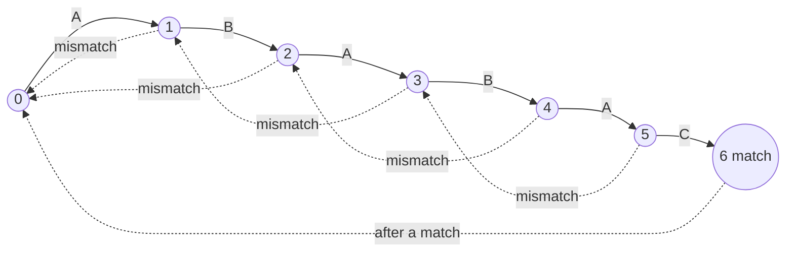
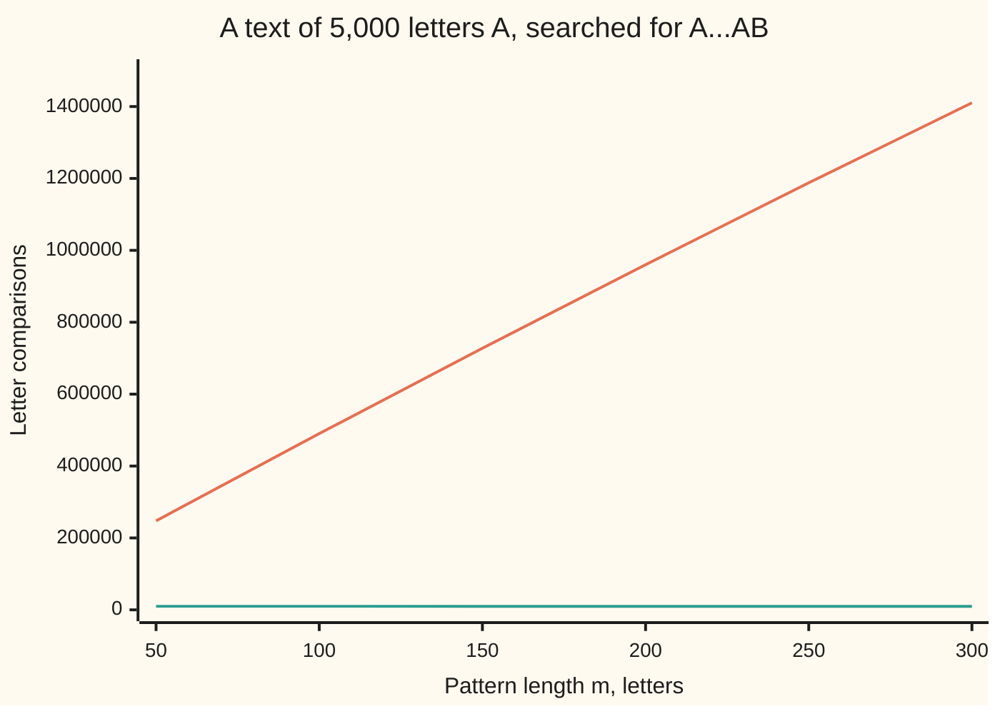

# Finding a pattern in text: never re-read a character, or compare fingerprints

[Syllabus](../../../SYLLABUS.md) → [Applied and computational](../README.md) → [Algorithms and Growth](../README.md#s01) → Finding a pattern in text

---

## General Overview

A phone holds a music library of 1,000,000 tracks, and it keeps a play log: one line per play, in order. In the synthetic log on this card each play is written as one letter, the playlist it came from: A, B or C. The log is 1,000,000 letters long.

The question: where did the listener alternate between playlists A and B for five plays, then move to C? That is every place the six letters `ABABAC` appear in the log. This is **string matching**: find every position where a short word (the **pattern**) occurs inside a long one (the **text**). The search box on a phone, the Find command in an editor and a DNA search all do this job.

The plain way lines the pattern up under the text, compares letter by letter, and at the first mismatch slides one place right and starts again from the pattern's first letter. It reads some text letters again and again. On a log that alternates `ABABAB…` it makes 3,499,985 comparisons, three and a half per play.

Two better ways each read the log in one pass:

- **KMP** (Knuth, Morris and Pratt's method) remembers what the letters already matched say about the text. After a mismatch it never moves back in the text. On the same alternating log it makes 1,499,998 comparisons. On any log it makes at most two per letter, averaged over the whole log, though a single letter can take four.
- **Rabin–Karp** turns each six-letter window of the log (six plays in a row) into a number, its **fingerprint**, and compares numbers instead of words. Sliding the window one place updates the fingerprint in a few arithmetic steps. Two different words share a fingerprint only rarely: with a prime near $`10^9`$, the chance is at most 5 in 1,000,000,007 per position.

**KMP never moves backward in the text, because a precomputed table says how much of the pattern is still matched after a mismatch; Rabin–Karp compares cheap rolling fingerprints and checks letters only when two fingerprints agree, which a random base makes rare.**

**What kind of fact this is:** two methods with theorems about them, proved on this card in Why it works: KMP finds every match with at most $`2n`$ comparisons; Rabin–Karp's false-match chance per position is at most $`(m-1)/p`$ over its random base. Both are checked on a synthetic log.

### The picture: KMP's states for ABABAC



Schematic. A state is how many pattern letters are matched so far. A solid arrow reads the next log letter and moves one state right. A dotted arrow is the failure table: after a mismatch in state 5, the method drops to state 3 and tries the same log letter again. It never steps back in the log.

---

## The formula

Three results carry the card. Positions count from 0, as the code does. $`O(g)`$, from [Big-O](01-big-o-and-growth-rates.md), reads "grows at most like $`g`$, up to a constant, for large $`n`$".

The **failure table** of a pattern $`P`$ of length $`m`$ holds one number for each prefix (a starting piece) of $`P`$. Here $`P[0..q]`$ means letters $`0`$ to $`q`$ of $`P`$, both ends included:

```math
\pi[q] = \text{the length of the longest proper border of } P[0..q]
```

A **border** of a word is a piece that is both a prefix and a suffix (an ending piece) of it. **Proper** means shorter than the word itself. For `ABABAC` the table is 0, 0, 1, 2, 3, 0: the prefix `ABABA` has border `ABA`, three letters.

KMP's cost, worst case, on a text of length $`n`$:

```math
\text{comparisons to search} \le 2n, \qquad \text{comparisons to build } \pi \le 2m
```

Rabin–Karp's fingerprint of a window $`w`$ of $`m`$ letters, with letters coded $`A = 1`$, $`B = 2`$, $`C = 3`$, a base $`b`$ and a prime $`p`$:

```math
H(w) = \left(w_0\, b^{m-1} + w_1\, b^{m-2} + \dots + w_{m-1}\right) \bmod p, \qquad H_{s+1} = \left((H_s - T_s\, b^{m-1})\, b + T_{s+m}\right) \bmod p
```

And its false-match chance, for any word $`w \ne P`$ and a base $`b`$ drawn at random from $`0`$ to $`p - 1`$:

```math
\Pr\big[H(w) = H(P)\big] \le \frac{m-1}{p} = \frac{5}{1{,}000{,}000{,}007}
```

**Read it aloud:** after a mismatch, KMP keeps the longest border of what was matched and carries on from the same text letter; it makes at most $`2n`$ comparisons in all, two per text letter on average, though one letter can take more. Rabin–Karp reads each window as a number in base $`b`$, remainder mod $`p`$; two different windows share that remainder for at most $`m - 1`$ of the $`p`$ possible bases.

The often-quoted bound $`m/p`$, here $`6/p`$, is also true; the root count below gives the slightly sharper $`5/p`$. Here $`\bmod p`$ means the remainder after dividing by $`p`$, as on [Adding and multiplying on the clock](../../02-Number%20theory/03-Clock%20Arithmetic/02-modular-addition-and-multiplication.md).

| Symbol | Plain meaning | In our example | Push it up and the answer… |
| --- | --- | --- | --- |
| $`T`$, $`T_i`$, $`i`$ | the text; its letter at position $`i`$; the position being read | the play log; $`i`$ from 0 to 999,999 | — |
| $`n`$ | length of the text | 1,000,000 plays | KMP's cost grows in step: at most $`2n`$ |
| $`P`$ | the pattern (capital $`P`$; small $`p`$ is the prime) | `ABABAC` | — |
| $`m`$ | length of the pattern | 6 | the plain way's worst case grows like $`mn`$; KMP's stays $`2n`$ |
| $`q`$ | the state: pattern letters matched so far | 0 to 6 | — |
| $`k`$ | while building the table, the border length found so far | 0 to 3 | — |
| $`\pi[q]`$ | longest proper border of $`P[0..q]`$ | 0, 0, 1, 2, 3, 0 | bigger borders mean shorter fallbacks |
| $`s`$ | the start of a window, the place a match would begin | matches at 2,119 … 999,845 | — |
| $`b`$ | the fingerprint's base, drawn at random | 627,243,159 | — |
| $`p`$ | the prime the fingerprint is reduced by | 1,000,000,007 | false matches get rarer, like $`1/p`$ |
| $`H(w)`$, $`H_s`$ | fingerprint of word $`w`$; of the window starting at $`s`$ | — | — |
| $`w_j`$ | the code of letter $`j`$ of word $`w`$ | `ABABAC` is 1, 2, 1, 2, 1, 3 | — |

### When it holds

- **KMP: the table belongs to this pattern.** It is built from $`P`$ alone. With no table (fall back to 0 every time), the method finds only 1,232 of the log's 1,369 matches.
- **Rabin–Karp: the base is random and secret, chosen after the text is fixed.** The $`5/p`$ is a chance over the base. Fix the base at 1 and the fingerprint is just the letter sum: every window with the same letter sum collides, such as any reordering of `ABABAC` or `ABBBBA`, 122,249 false hits on the log.
- **Rabin–Karp: $`p`$ is prime and larger than every letter code.** The root count needs a prime clock: on a clock that is not prime, a polynomial can have more roots than its degree ([Lagrange's root bound](../../02-Number%20theory/04-Powers%20on%20the%20Clock/07-lagrange-root-bound.md) shows one on the 8-clock), and the $`5/p`$ is lost. A clock larger than the letter codes keeps two different words' difference from vanishing.
- **Rabin–Karp: a fingerprint hit is checked letter by letter.** Skip the check with $`p = 101`$ and the method reports 8,114 matches, of which only 1,369 are real.
- **Costs count letter comparisons, not seconds.** Rabin–Karp's few multiplications per window are not counted as comparisons.

---

## Why it works

### Step 0: a mismatch still tells you something

Say the first five letters `ABABA` matched and the sixth does not. The plain way slides one place and reads four of those five letters again. But they are already known: the last five log letters are `ABABA`.

So the only question is where the pattern could start next. A new match that starts inside those five letters must begin with a prefix of `ABABAC` that is also an ending of `ABABA`. That is a border. The longest is `ABA`, three letters, so the method can continue as if three letters are matched, without moving back in the log. The failure table stores that answer for every prefix, once, before the search.

### Step 1: falling back to the longest border skips no match

KMP keeps one promise as it reads: after letter $`i`$, $`q`$ is the length of the longest prefix of $`P`$ that ends exactly at letter $`i`$.

When letter $`i + 1`$ arrives, any prefix ending at $`i + 1`$ is a shorter prefix ending at $`i`$, plus that letter. The prefixes ending at $`i`$ are $`P[0..q-1]`$ and its borders, and no others. The borders are $`\pi[q-1]`$, then the border of that border, and so on down to 0. KMP tries them in that order, longest first, and stops at the first that extends. So the promise holds after every letter, and a match is reported exactly when $`q`$ reaches $`m`$.

<details>
<summary>Why the borders of the matched part are all the candidates</summary>

Let $`u = P[0..q-1]`$ be the longest prefix of $`P`$ ending at letter $`i`$. Any other prefix $`v`$ of $`P`$ ending at letter $`i`$ is shorter than $`u`$, by the choice of $`u`$.

Both end at the same letter, so $`v`$ is an ending of $`u`$. It is also a prefix of $`P`$, and so a prefix of $`u`$. So $`v`$ is a proper border of $`u`$.

The longest proper border of $`u`$ is $`\pi[q-1]`$ letters long. Every shorter border of $`u`$ is also a border of that border, because it is a prefix and an ending of the shorter piece too. So repeating $`q \leftarrow \pi[q-1]`$ visits every border of $`u`$, longest first.

</details>

### Step 2: the table is built by running KMP on the pattern itself

To find $`\pi[q]`$, the method searches $`P`$ against itself. It keeps $`k`$, the current border length, and for each new letter $`P[q]`$ tries to extend the border by one letter. If it cannot, it falls back $`k \leftarrow \pi[k-1]`$ using the part of the table already built. This is Step 1's argument with the pattern as its own text.

For `ABABAC`, the build makes 7 comparisons and gives 0, 0, 1, 2, 3, 0. The check confirms that table against brute force: try every border length, longest first. It does the same for all 729 six-letter words over A, B and C, because `ABABAC`'s table alone would still come out right if every fallback jumped straight to 0.

### Step 3: at most 2n comparisons in all

Each comparison is one of two kinds:

1. **It finishes letter $`i`$:** a match, which moves to the next letter, or a mismatch with $`q = 0`$, which also moves on. One per text letter, so at most $`n`$ in all.
2. **It is a fallback:** a mismatch with $`q > 0`$. Each one lowers $`q`$ by at least 1.

$`q`$ goes up only on a match, by 1, so at most $`n`$ times over the whole search. It never goes below 0. So the fallbacks add up to at most $`n`$ as well, and the total is at most $`2n`$. The same count gives at most $`2m`$ for building the table.

This bounds the total, not each letter. One letter can set off a chain of fallbacks. In the text `ABABAA`, the last `A` is compared with `C`, `B`, `B` and then `A`: 4 comparisons for one letter. For the pattern `AAAAAB`, a `C` after `AAAAA` takes 6, one per pattern letter, and $`m`$ is the most one letter can take. Each fallback was paid for by an earlier match, so the average stays at most two.

The plain way has no such limit. On a text of $`n`$ letters `A`, searched for $`m - 1`$ letters `A` then a `B`, each of the $`n - m + 1`$ starts reads $`m`$ letters: $`m(n - m + 1)`$ comparisons in all. KMP makes exactly $`2n - m + 1`$ on the same text.



The rising line is the plain way, $`m(n - m + 1)`$. The flat line along the bottom is KMP, $`2n - m + 1`$, just under 10,000 at every length. Both are counted by the code.

### Step 4: a fingerprint is the window read as a number

Read the six letter codes as the digits of a number in base $`b`$: with $`b = 10`$, `ABABAC` is 121213. Keep only the remainder mod $`p`$.

Sliding one place drops the first digit and adds a new last one. Subtract the first letter times $`b^{m-1}`$, multiply by $`b`$, add the new letter. That is the roll in The formula: a few operations per window, whatever $`m`$ is. Remainders can be taken at every step and the result agrees, because reducing before or after adding and multiplying lands on the same remainder ([Adding and multiplying on the clock](../../02-Number%20theory/03-Clock%20Arithmetic/02-modular-addition-and-multiplication.md)).

Equal words give equal fingerprints, so a window whose fingerprint differs from the pattern's is skipped without reading a letter.

### Step 5: different words rarely share a fingerprint

Take a word $`w \ne P`$. The difference of their fingerprints, as a function of the base $`b`$, is

```math
(w_0 - P_0)\, b^{m-1} + \dots + (w_{m-1} - P_{m-1}) \bmod p
```

That is a polynomial in $`b`$ of degree at most $`m - 1`$. It is not zero, because some letters differ and each difference lies between $`-2`$ and $`2`$, too small to be a whole multiple of $`p`$. A false match is exactly a root of this polynomial.

On a prime clock, a nonzero polynomial of degree at most $`m - 1`$ has at most $`m - 1`$ roots ([Lagrange's root bound](../../02-Number%20theory/04-Powers%20on%20the%20Clock/07-lagrange-root-bound.md)). So at most 5 of the $`p`$ bases are bad for $`w`$, and a random base hits one with chance at most $`5/p`$.

The check counts this exhaustively with the small prime $`p = 101`$. It tries every 6-letter word over A, B and C against `ABABAC` and every base from 0 to 100. A worst word, `BAACCA`, has exactly 5 bad bases: the bound is reached, not just respected.

### Step 6: checking the letters makes the answer always right

A fingerprint hit is checked letter by letter, so Rabin–Karp never reports a false match. Only its cost is random. It is a **Las Vegas** method: always right, with a cost that depends on its coin flips. ([Randomised algorithms](../02-Randomised%20and%20Approximate%20Algorithms/01-randomised-algorithms-and-expectation.md) introduces the term.)

Adding up the chances over the log's 999,995 windows, the expected number of false hits is at most $`999{,}995 \times 5/p \approx 0.0050`$. So at most about one search in 200 makes even one wasted check. The expected cost is $`n`$ rolls plus $`m`$ letters per real match. The worst case, every window a false hit, is $`mn`$, with chance too small to matter for a random base.

---

## Worked numbers, by hand

A short stretch of log, 14 plays: `ABABABACABABAC`. The pattern starts at positions 2 and 8.

**The failure table:**

| Step | Arithmetic | Value |
| --- | --- | --- |
| prefix `A` | no proper border | 0 |
| prefix `AB` | `A` ≠ `B` | 0 |
| prefix `ABA` | `A` = `A` | 1 |
| prefix `ABAB` | `AB` = `AB` | 2 |
| prefix `ABABA` | `ABA` = `ABA` | 3 |
| prefix `ABABAC` | no border ends in `C` | **0** |

**KMP on the 14 plays.** The state after each letter is 1, 2, 3, 4, 5, 4, 5, 6, 1, 2, 3, 4, 5, 6.

| Step | Arithmetic | Value |
| --- | --- | --- |
| letters 0 to 4, `ABABA` | five matches | state 5, 5 comparisons |
| letter 5, `B` | `B` ≠ `C`, fall back to $`\pi[4] = 3`$, then `B` = `B` | state 4, 2 comparisons |
| letters 6 and 7, `AC` | two matches | state 6: match at $`7 - 5 = 2`$ |
| after the match | fall back to $`\pi[5] = 0`$, no comparison | state 0 |
| letters 8 to 13, `ABABAC` | six matches | match at 8, 6 comparisons |
| total | $`5 + 2 + 2 + 6`$ | **15 comparisons** |
| the plain way, starts 0 to 8 | $`6 + 1 + 6 + 1 + 4 + 1 + 2 + 1 + 6`$ | **28 comparisons** |

KMP read each letter once, and letter 5 twice.

**Rabin–Karp by hand**, with base $`b = 10`$ and the prime $`p = 101`$, so the digits stay visible. A fixed base like this is for hand work only; the real run draws $`b`$ at random.

| Step | Arithmetic | Value |
| --- | --- | --- |
| pattern fingerprint | $`121213 \bmod 101`$ | 13 |
| window 0, `ABABAB` | $`121212 \bmod 101`$ | 12 |
| roll to window 1, `BABABA` | $`(121212 - 1 \times 100000) \times 10 + 1 = 212121`$, mod 101 | 21 |
| all 9 windows | rolled the same way | 12 21 13 31 11 11 13 31 13 |
| hits: windows 2, 6, 8 | check each letter by letter | 6 + 2 + 6 = 14 comparisons |
| window 6, `ACABAB` | $`131212 \bmod 101 = 13`$, but `C` ≠ `B` | **1 false hit, caught** |
| matches | windows 2 and 8 | **2 and 8** |

Window 6 shows Step 5 in a real case: a different word with the pattern's fingerprint. The letter check costs 2 comparisons and discards it. With $`p`$ near $`10^9`$ and a random base, such a hit becomes very rare.

**The full log.** On the 1,000,000-play synthetic log, all three methods find the same 1,369 matches, the first at play 2,119 and the last at play 999,845. (A random log has about $`999{,}995/729`$ of them, since $`3^6 = 729`$ words are equally likely.)

| Method | Letter comparisons | Per play |
| --- | ---: | ---: |
| plain way, random log | 1,497,502 | 1.4975 |
| KMP, random log | 1,328,982 | 1.3290 |
| Rabin–Karp, $`p`$ = 1,000,000,007, base 627,243,159 | 8,214 (letter checks only) | — |
| plain way, alternating log `ABAB…` | 3,499,985 | — |
| KMP, alternating log `ABAB…` | 1,499,998 | — |

Rabin–Karp's 8,214 checks are $`1{,}369 \times 6`$: no false hit at all, against an expected count of at most 0.0050.

On a random log the plain way does almost as well as KMP, because most starts fail on the first letter. KMP's value is the worst case: on a repetitive log the plain way more than doubles its work, and KMP stays under $`2n`$.

### What breaks if you drop a piece

| Mistake | Comes out at | What went wrong |
| --- | --- | --- |
| No failure table: restart the pattern, keep the text position | finds match 8 only on the 14 plays; 1,232 of 1,369 on the log | the match at 2 began inside letters already passed, and nothing remembered them |
| Fingerprint with base 1 | 122,249 false hits | the fingerprint is the letter sum, so every window with the same letter sum collides, such as any reordering of `ABABAC` or `ABBBBA`; 1 is a root for all of them |
| Report fingerprint hits without checking letters, $`p = 101`$ | 8,114 matches reported, 1,369 real | 6,745 false hits slip through as "matches" |
| The plain way on a repetitive log | 3,499,985 comparisons, KMP 1,499,998 | each start re-reads up to five letters already seen |

The code prints all four.

---

## Code, from first principles, and it actually runs

Each script builds the synthetic log from SplitMix64 (a small random-number generator written out in full, seed 2026) and searches it for `ABABAC` three ways, each counting its own letter comparisons.

Independent roads:

1. **Three methods, one answer.** The plain way, KMP and Rabin–Karp must return the same match positions, on the 14 hand plays and on the 1,000,000-play log.
2. **The failure table two ways.** The linear build against brute force: try every border length, for `ABABAC` and for all 729 six-letter words over A, B and C.
3. **Exact cost formulas against counts.** On a run of `A`s searched for `A…AB`, the plain way's count must equal $`m(n - m + 1)`$ and KMP's must equal $`2n - m + 1`$, at six pattern lengths. KMP's count on every log must stay under $`2n`$.
4. **The fingerprint bound, exhaustively.** Every 6-letter word against every base mod 101: at most 5 bad bases each.
5. **Rolling against direct fingerprints.** With $`p = 101`$, the number of false hits found by rolling along the log must equal the number found another way: count each 6-letter word type in the log, then fingerprint each type directly. The same counts give the letter-sum collisions for base 1.

### Python

```python
# Finding a pattern in text -- the check behind the card.  Nothing is imported.
# A synthetic play log: 1,000,000 plays, each written as one letter for the playlist it came
# from (A, B or C, coded 1, 2, 3), drawn by SplitMix64 with seed 2026.  Search it for ABABAC
# three ways.  Every cost counts letter comparisons, never time.
M64 = (1 << 64) - 1
def splitmix(s):
    s = (s + 0x9E3779B97F4A7C15) & M64
    z = ((s ^ (s >> 30)) * 0xBF58476D1CE4E5B9) & M64
    z = ((z ^ (z >> 27)) * 0x94D049BB133111EB) & M64
    return s, z ^ (z >> 31)
def code(w): return [" ABC".index(ch) for ch in w]
def failure(p):                         # pi[q]: longest proper border of p[0..q]
    pi, k, cost = [0] * len(p), 0, 0
    for q in range(1, len(p)):
        while True:
            cost += 1
            if p[k] == p[q]: k += 1; break
            if k == 0: break
            k = pi[k - 1]
        pi[q] = k
    return pi, cost
def borders_brute(p):                   # road 2: try every length, longest first
    return [max(L for L in range(q + 1) if p[:L] == p[q + 1 - L:q + 1]) for q in range(len(p))]
def kmp(t, p, pi, trace=None):          # the text index i only ever goes up
    hits, q, cost = [], 0, 0
    for i in range(len(t)):
        while True:
            cost += 1
            if p[q] == t[i]: q += 1; break
            if q == 0: break
            q = pi[q - 1]
        if trace is not None: trace.append(q)
        if q == len(p): hits.append(i - len(p) + 1); q = pi[q - 1]
    return hits, cost
def naive(t, p):                        # slide one place, re-read from the pattern's start
    hits, cost = [], 0
    for s in range(len(t) - len(p) + 1):
        j = 0
        while j < len(p):
            cost += 1
            if t[s + j] != p[j]: break
            j += 1
        if j == len(p): hits.append(s)
    return hits, cost
def H(w, b, mod):                       # fingerprint: w read as a number in base b, mod p
    h = 0
    for c in w: h = (h * b + c) % mod
    return h
def rabin_karp(t, p, b, mod, verify=True):
    m, top = len(p), 1
    for _ in range(m - 1): top = top * b % mod
    hp, ht = H(p, b, mod), H(t[:m], b, mod)
    hits, false, cost = [], 0, 0
    for s in range(len(t) - m + 1):
        if s: ht = ((ht - t[s - 1] * top) * b + t[s + m - 1]) % mod   # the roll
        if ht != hp: continue
        if not verify: hits.append(s); continue
        j = 0
        while j < m:
            cost += 1
            if t[s + j] != p[j]: break
            j += 1
        if j == m: hits.append(s)
        else: false += 1
    return hits, false, cost
P, m = code("ABABAC"), 6
pi, build = failure(P)
print("pattern ABABAC; failure table", *pi, f"({build} comparisons to build)")
assert pi == borders_brute(P) == [0, 0, 1, 2, 3, 0]
hand = code("ABABABACABABAC")
tr = []; hk, ck = kmp(hand, P, pi, tr); hn, cn = naive(hand, P)
print("hand log ABABABACABABAC, state after each letter:", *tr)
print(f"hand log matches start at {hk}: KMP {ck} comparisons, naive {cn}")
hr, fr, cr = rabin_karp(hand, P, 10, 101)
print("hand fingerprints, base 10 mod 101: pattern", H(P, 10, 101), "windows",
      *[H(hand[s:s + m], 10, 101) for s in range(len(hand) - m + 1)])
roll = (H(hand[:m], 10, 10**9) - hand[0] * 10**5) * 10 + hand[m]    # no mod: digits show
print(f"hand roll, window 0 to 1: ({H(hand[:m], 10, 10**9)} - {hand[0]} x 100000) x 10 + {hand[m]} = {roll}")
nt, _ = kmp(hand, P, [0] * m)
print(f"hand Rabin-Karp: matches {hr}, false hits {fr}, check comparisons {cr}")
print("hand log, no table (restart the pattern, keep the text):", nt)
_, c1 = kmp(code("ABABAA"), P, pi); _, c2 = kmp(code("AAAAAC"), code("AAAAAB"), failure(code("AAAAAB"))[0])
print(f"one letter can cost more: ABABAA takes {c1}, {c1 - 5} on its last A; AAAAAC searched for AAAAAB takes {c2}, {c2 - 5} = m on the C")
assert roll == H(hand[1:m + 1], 10, 10**9) == 212121 and hk == hn == hr == [2, 8] and fr == 1 and nt == [8] and c1 == 9 and c2 == 11
s, log = 2026, []
for _ in range(1_000_000):
    s, z = splitmix(s); log.append(z % 3 + 1)
n = len(log)
s, z = splitmix(s); b0 = z % 101; s, z = splitmix(s); b1 = z % 1_000_000_007
hits_k, cost_k = kmp(log, P, pi); hits_n, cost_n = naive(log, P)
hits_r, false_r, ver_r = rabin_karp(log, P, b1, 1_000_000_007)
print(f"log of {n:,} plays: {len(hits_k):,} matches; first at {hits_k[0]:,}, last at {hits_k[-1]:,}")
print(f"comparisons: KMP {cost_k:,} ({cost_k / n:.4f} per play), naive {cost_n:,} ({cost_n / n:.4f})")
print(f"Rabin-Karp, p = 1,000,000,007, base {b1:,}: false hits {false_r}, check comparisons {ver_r:,}")
print(f"bound on expected false hits, (n - m + 1) x 5 / p = {(n - m + 1) * 5 / 1_000_000_007:.4f}")
assert hits_k == hits_n == hits_r and cost_k <= 2 * n and false_r == 0
alt = [1, 2] * 500_000                  # ABAB...: the log that punishes re-reading
ak, ca = kmp(alt, P, pi); an, cna = naive(alt, P)
print(f"alternating log ABAB...: matches {len(ak)}, KMP {ca:,}, naive {cna:,}")
assert ak == an == [] and ca <= 2 * n and cna == 6 * 499_998 + 499_997
count, idx = [0] * 729, 0               # road 2 for the fingerprints: window types, exact
for i, c in enumerate(log):
    idx = (idx * 3 + c - 1) % 729
    if i >= m - 1: count[idx] += 1
allw = []
for v in range(729):
    w, x = [], v
    for _ in range(m): w.append(x % 3 + 1); x //= 3
    allw.append(w[::-1])
tab = sum(failure(w)[0] == borders_brute(w) for w in allw)   # road 2 for the table: every word
print(f"failure tables: linear build equals brute force for {tab} of {len(allw)} six-letter words")
hpP = [H(P, b, 101) for b in range(101)]
bad = [sum(H(w, b, 101) == hpP[b] for b in range(101)) if w != P else 0 for w in allw]
worst = max(bad)
print(f"every 6-letter word against ABABAC, mod 101: at most {worst} bad bases of 101 (bound 5)")
print("a word with the most:", "".join(" ABC"[c] for c in allw[bad.index(worst)]), "; words with none:", bad.count(0) - 1)
_, f0, _ = rabin_karp(log, P, b0, 101)
f0_types = sum(count[v] for v in range(729) if allw[v] != P and H(allw[v], b0, 101) == hpP[b0])
nonmatch = n - m + 1 - len(hits_k)
mean_f = sum(count[v] * bad[v] for v in range(729)) / 101
print(f"mod 101, base {b0}: false hits by rolling {f0:,}, by counting window types {f0_types:,}")
print(f"mod 101, averaged over all 101 bases: {mean_f:,.1f} false hits; bound 5/101 x {nonmatch:,} = {5 * nonmatch / 101:,.1f}")
assert worst <= m - 1 and f0 == f0_types and mean_f <= 5 * nonmatch / 101 and tab == len(allw)
r1, f1, _ = rabin_karp(log, P, 1, 1_000_000_007); r2, _, _ = rabin_karp(log, P, b0, 101, verify=False)
print(f"base 1 (fingerprint = letter sum): false hits {f1:,}")
print(f"mod 101 with no check: reports {len(r2):,} matches, true {len(hits_k):,}")
nl, _ = kmp(log, P, [0] * m)
print(f"no failure table on the log: finds {len(nl):,} of {len(hits_k):,}")
f1_sum = sum(count[v] for v in range(729) if sum(allw[v]) == sum(P) and allw[v] != P)
assert f1 == f1_sum and len(r2) == len(hits_k) + f0 and len(nl) < len(hits_k)
rows = []
for mm in (50, 100, 150, 200, 250, 300):  # worst case: AAA...A searched for AA...AB
    tt, pp = [1] * 5000, [1] * (mm - 1) + [2]
    _, ck2 = kmp(tt, pp, failure(pp)[0]); _, cn2 = naive(tt, pp)
    assert cn2 == mm * (5000 - mm + 1) and ck2 == 2 * 5000 - mm + 1
    rows.append((mm, cn2, ck2))
print("growth, text A x 5,000, pattern A..AB of length m:", *[f"m={a}" for a, _, _ in rows])
print("  naive, m(n - m + 1):", *[f"{c:,}" for _, c, _ in rows])
print("  KMP, 2n - m + 1:", *[f"{c:,}" for _, _, c in rows])
print("ALL CHECKS PASS")
```

**Ran 2026-11-23 on macOS, Python 3.14.10, standard library only. All checks passed. Output, pasted from the run:**

```
pattern ABABAC; failure table 0 0 1 2 3 0 (7 comparisons to build)
hand log ABABABACABABAC, state after each letter: 1 2 3 4 5 4 5 6 1 2 3 4 5 6
hand log matches start at [2, 8]: KMP 15 comparisons, naive 28
hand fingerprints, base 10 mod 101: pattern 13 windows 12 21 13 31 11 11 13 31 13
hand roll, window 0 to 1: (121212 - 1 x 100000) x 10 + 1 = 212121
hand Rabin-Karp: matches [2, 8], false hits 1, check comparisons 14
hand log, no table (restart the pattern, keep the text): [8]
one letter can cost more: ABABAA takes 9, 4 on its last A; AAAAAC searched for AAAAAB takes 11, 6 = m on the C
log of 1,000,000 plays: 1,369 matches; first at 2,119, last at 999,845
comparisons: KMP 1,328,982 (1.3290 per play), naive 1,497,502 (1.4975)
Rabin-Karp, p = 1,000,000,007, base 627,243,159: false hits 0, check comparisons 8,214
bound on expected false hits, (n - m + 1) x 5 / p = 0.0050
alternating log ABAB...: matches 0, KMP 1,499,998, naive 3,499,985
failure tables: linear build equals brute force for 729 of 729 six-letter words
every 6-letter word against ABABAC, mod 101: at most 5 bad bases of 101 (bound 5)
a word with the most: BAACCA ; words with none: 156
mod 101, base 50: false hits by rolling 6,745, by counting window types 6,745
mod 101, averaged over all 101 bases: 13,999.2 false hits; bound 5/101 x 998,626 = 49,436.9
base 1 (fingerprint = letter sum): false hits 122,249
mod 101 with no check: reports 8,114 matches, true 1,369
no failure table on the log: finds 1,232 of 1,369
growth, text A x 5,000, pattern A..AB of length m: m=50 m=100 m=150 m=200 m=250 m=300
  naive, m(n - m + 1): 247,550 490,100 727,650 960,200 1,187,750 1,410,300
  KMP, 2n - m + 1: 9,951 9,901 9,851 9,801 9,751 9,701
ALL CHECKS PASS
```

### Rust

Same numbers, same labels, built with `rustc --edition 2021 -O`. Rust has no big integers, so each product mod $`p`$ is taken in `u128`.

```rust
// Finding a pattern in text -- the same check as the Python, in Rust.  No crates.
// A synthetic play log: 1,000,000 plays, each written as one letter for the playlist it came
// from (A, B or C, coded 1, 2, 3), drawn by SplitMix64 with seed 2026.  Search it for ABABAC
// three ways.  Every cost counts letter comparisons, never time.
fn splitmix(s: u64) -> (u64, u64) {
    let s = s.wrapping_add(0x9E3779B97F4A7C15);
    let z = (s ^ (s >> 30)).wrapping_mul(0xBF58476D1CE4E5B9);
    let z = (z ^ (z >> 27)).wrapping_mul(0x94D049BB133111EB);
    (s, z ^ (z >> 31))
}
fn code(w: &str) -> Vec<u64> { w.chars().map(|c| " ABC".find(c).unwrap() as u64).collect() }
fn commas(x: u64) -> String {
    let d = x.to_string(); let mut out = String::new();
    for (i, ch) in d.chars().enumerate() { if i > 0 && (d.len() - i) % 3 == 0 { out.push(','); } out.push(ch); }
    out
}
fn commas1(x: f64) -> String { let t = (x * 10.0).round() as u64; format!("{}.{}", commas(t / 10), t % 10) }
fn join(v: &[u64]) -> String { v.iter().map(|x| x.to_string()).collect::<Vec<_>>().join(" ") }
fn failure(p: &[u64]) -> (Vec<usize>, u64) {   // pi[q]: longest proper border of p[0..q]
    let (mut pi, mut k, mut cost) = (vec![0usize; p.len()], 0usize, 0u64);
    for q in 1..p.len() {
        loop {
            cost += 1;
            if p[k] == p[q] { k += 1; break; }
            if k == 0 { break; }
            k = pi[k - 1];
        }
        pi[q] = k;
    }
    (pi, cost)
}
fn borders_brute(p: &[u64]) -> Vec<usize> {    // road 2: try every length, longest first
    (0..p.len()).map(|q| (0..=q).filter(|&l| p[..l] == p[q + 1 - l..q + 1]).max().unwrap()).collect()
}
fn kmp(t: &[u64], p: &[u64], pi: &[usize], mut trace: Option<&mut Vec<u64>>) -> (Vec<usize>, u64) {
    let (mut hits, mut q, mut cost) = (Vec::new(), 0usize, 0u64);
    for i in 0..t.len() {                        // the text index i only ever goes up
        loop {
            cost += 1;
            if p[q] == t[i] { q += 1; break; }
            if q == 0 { break; }
            q = pi[q - 1];
        }
        if let Some(tr) = trace.as_deref_mut() { tr.push(q as u64); }
        if q == p.len() { hits.push(i + 1 - p.len()); q = pi[q - 1]; }
    }
    (hits, cost)
}
fn naive(t: &[u64], p: &[u64]) -> (Vec<usize>, u64) {   // slide one place, re-read
    let (mut hits, mut cost) = (Vec::new(), 0u64);
    for s in 0..=t.len() - p.len() {
        let mut j = 0;
        while j < p.len() { cost += 1; if t[s + j] != p[j] { break; } j += 1; }
        if j == p.len() { hits.push(s); }
    }
    (hits, cost)
}
fn h(w: &[u64], b: u64, md: u64) -> u64 {        // fingerprint: w in base b, mod p
    w.iter().fold(0u64, |acc, &c| ((acc as u128 * b as u128 + c as u128) % md as u128) as u64)
}
fn rabin_karp(t: &[u64], p: &[u64], b: u64, md: u64, verify: bool) -> (Vec<usize>, u64, u64) {
    let m = p.len(); let mut top = 1u64;
    for _ in 0..m - 1 { top = ((top as u128 * b as u128) % md as u128) as u64; }
    let (hp, mut ht) = (h(p, b, md), h(&t[..m], b, md));
    let (mut hits, mut fals, mut cost) = (Vec::new(), 0u64, 0u64);
    for s in 0..=t.len() - m {
        if s > 0 {                                // the roll
            let drop = ((t[s - 1] as u128 * top as u128) % md as u128) as u64;
            ht = (((ht + md - drop) as u128 * b as u128 + t[s + m - 1] as u128) % md as u128) as u64;
        }
        if ht != hp { continue; }
        if !verify { hits.push(s); continue; }
        let mut j = 0;
        while j < m { cost += 1; if t[s + j] != p[j] { break; } j += 1; }
        if j == m { hits.push(s); } else { fals += 1; }
    }
    (hits, fals, cost)
}
fn main() {
    let (p, m) = (code("ABABAC"), 6usize);
    let (pi, build) = failure(&p);
    let piu: Vec<u64> = pi.iter().map(|&x| x as u64).collect();
    println!("pattern ABABAC; failure table {} ({} comparisons to build)", join(&piu), build);
    assert!(pi == borders_brute(&p) && pi == vec![0, 0, 1, 2, 3, 0]);
    let hand = code("ABABABACABABAC");
    let mut tr = Vec::new(); let (hk, ck) = kmp(&hand, &p, &pi, Some(&mut tr)); let (hn, cn) = naive(&hand, &p);
    println!("hand log ABABABACABABAC, state after each letter: {}", join(&tr));
    println!("hand log matches start at {:?}: KMP {} comparisons, naive {}", hk, ck, cn);
    let (hr, fr, cr) = rabin_karp(&hand, &p, 10, 101, true);
    let wins: Vec<u64> = (0..=hand.len() - m).map(|s| h(&hand[s..s + m], 10, 101)).collect();
    println!("hand fingerprints, base 10 mod 101: pattern {} windows {}", h(&p, 10, 101), join(&wins));
    let roll = (h(&hand[..m], 10, 1_000_000_000) - hand[0] * 100_000) * 10 + hand[m];   // no mod: digits show
    println!("hand roll, window 0 to 1: ({} - {} x 100000) x 10 + {} = {}", h(&hand[..m], 10, 1_000_000_000), hand[0], hand[m], roll);
    let (nt, _) = kmp(&hand, &p, &[0; 6], None);
    println!("hand Rabin-Karp: matches {:?}, false hits {}, check comparisons {}", hr, fr, cr);
    println!("hand log, no table (restart the pattern, keep the text): {:?}", nt);
    let (_, c1) = kmp(&code("ABABAA"), &p, &pi, None); let ap = code("AAAAAB"); let (_, c2) = kmp(&code("AAAAAC"), &ap, &failure(&ap).0, None);
    println!("one letter can cost more: ABABAA takes {}, {} on its last A; AAAAAC searched for AAAAAB takes {}, {} = m on the C", c1, c1 - 5, c2, c2 - 5);
    assert!(roll == h(&hand[1..m + 1], 10, 1_000_000_000) && roll == 212121);
    assert!(hk == vec![2, 8] && hn == hk && hr == hk && fr == 1 && nt == vec![8] && c1 == 9 && c2 == 11);
    let (mut s, mut log) = (2026u64, Vec::with_capacity(1_000_000));
    for _ in 0..1_000_000 { let (s2, z) = splitmix(s); s = s2; log.push(z % 3 + 1); }
    let n = log.len();
    let (s2, z) = splitmix(s); s = s2; let b0 = z % 101;
    let (_, z) = splitmix(s); let b1 = z % 1_000_000_007;
    let (hits_k, cost_k) = kmp(&log, &p, &pi, None); let (hits_n, cost_n) = naive(&log, &p);
    let (hits_r, false_r, ver_r) = rabin_karp(&log, &p, b1, 1_000_000_007, true);
    let nk = hits_k.len() as u64;
    println!("log of {} plays: {} matches; first at {}, last at {}", commas(n as u64), commas(nk), commas(hits_k[0] as u64), commas(hits_k[hits_k.len() - 1] as u64));
    println!("comparisons: KMP {} ({:.4} per play), naive {} ({:.4})", commas(cost_k), cost_k as f64 / n as f64, commas(cost_n), cost_n as f64 / n as f64);
    println!("Rabin-Karp, p = 1,000,000,007, base {}: false hits {}, check comparisons {}", commas(b1), false_r, commas(ver_r));
    println!("bound on expected false hits, (n - m + 1) x 5 / p = {:.4}", (n - m + 1) as f64 * 5.0 / 1_000_000_007.0);
    assert!(hits_k == hits_n && hits_k == hits_r && cost_k <= 2 * n as u64 && false_r == 0);
    let alt: Vec<u64> = (0..1_000_000).map(|i| (i % 2 + 1) as u64).collect();   // ABAB...
    let (ak, ca) = kmp(&alt, &p, &pi, None); let (an, cna) = naive(&alt, &p);
    println!("alternating log ABAB...: matches {}, KMP {}, naive {}", ak.len(), commas(ca), commas(cna));
    assert!(ak.is_empty() && an.is_empty() && ca <= 2 * n as u64 && cna == 6 * 499_998 + 499_997);
    let (mut count, mut idx) = (vec![0u64; 729], 0usize); // road 2 for the fingerprints: window types, exact
    for (i, &c) in log.iter().enumerate() {
        idx = (idx * 3 + c as usize - 1) % 729;
        if i >= m - 1 { count[idx] += 1; }
    }
    let allw: Vec<Vec<u64>> = (0..729).map(|v: usize| {
        let mut w = Vec::new(); let mut x = v;
        for _ in 0..m { w.push((x % 3 + 1) as u64); x /= 3; }
        w.reverse(); w
    }).collect();
    let tab = allw.iter().filter(|w| failure(w).0 == borders_brute(w)).count(); // road 2 for the table: every word
    println!("failure tables: linear build equals brute force for {} of {} six-letter words", tab, allw.len());
    let hpp: Vec<u64> = (0..101).map(|b| h(&p, b, 101)).collect();
    let bad: Vec<u64> = allw.iter().map(|w| if *w == p { 0 } else {
        (0..101).filter(|&b| h(w, b, 101) == hpp[b as usize]).count() as u64 }).collect();
    let worst = *bad.iter().max().unwrap();
    let wi = bad.iter().position(|&x| x == worst).unwrap();
    let name: String = allw[wi].iter().map(|&c| " ABC".as_bytes()[c as usize] as char).collect();
    println!("every 6-letter word against ABABAC, mod 101: at most {} bad bases of 101 (bound 5)", worst);
    println!("a word with the most: {} ; words with none: {}", name, bad.iter().filter(|&&x| x == 0).count() - 1);
    let (_, f0, _) = rabin_karp(&log, &p, b0, 101, true);
    let f0_types: u64 = (0..729).filter(|&v| allw[v] != p && h(&allw[v], b0, 101) == hpp[b0 as usize]).map(|v| count[v]).sum();
    let nonmatch = (n - m + 1) as u64 - nk;
    let mean_f = (0..729).map(|v| count[v] * bad[v]).sum::<u64>() as f64 / 101.0;
    println!("mod 101, base {}: false hits by rolling {}, by counting window types {}", b0, commas(f0), commas(f0_types));
    println!("mod 101, averaged over all 101 bases: {} false hits; bound 5/101 x {} = {}", commas1(mean_f), commas(nonmatch), commas1(5.0 * nonmatch as f64 / 101.0));
    assert!(worst <= (m - 1) as u64 && f0 == f0_types && mean_f <= 5.0 * nonmatch as f64 / 101.0 && tab == allw.len());
    let (_, f1, _) = rabin_karp(&log, &p, 1, 1_000_000_007, true); let (r2, _, _) = rabin_karp(&log, &p, b0, 101, false);
    println!("base 1 (fingerprint = letter sum): false hits {}", commas(f1));
    println!("mod 101 with no check: reports {} matches, true {}", commas(r2.len() as u64), commas(nk));
    let (nl, _) = kmp(&log, &p, &[0; 6], None);
    println!("no failure table on the log: finds {} of {}", commas(nl.len() as u64), commas(nk));
    let psum: u64 = p.iter().sum();
    let f1_sum: u64 = (0..729).filter(|&v| allw[v].iter().sum::<u64>() == psum && allw[v] != p).map(|v| count[v]).sum();
    assert!(f1 == f1_sum && r2.len() as u64 == nk + f0 && (nl.len() as u64) < nk);
    let mut rows = Vec::new();
    for mm in [50u64, 100, 150, 200, 250, 300] {   // worst case: AAA...A searched for AA...AB
        let tt = vec![1u64; 5000];
        let mut pp = vec![1u64; mm as usize - 1]; pp.push(2);
        let (_, ck2) = kmp(&tt, &pp, &failure(&pp).0, None); let (_, cn2) = naive(&tt, &pp);
        assert!(cn2 == mm * (5000 - mm + 1) && ck2 == 2 * 5000 - mm + 1);
        rows.push((mm, cn2, ck2));
    }
    let ms: Vec<String> = rows.iter().map(|r| format!("m={}", r.0)).collect();
    let ns: Vec<String> = rows.iter().map(|r| commas(r.1)).collect();
    let ks: Vec<String> = rows.iter().map(|r| commas(r.2)).collect();
    println!("growth, text A x 5,000, pattern A..AB of length m: {}", ms.join(" "));
    println!("  naive, m(n - m + 1): {}", ns.join(" "));
    println!("  KMP, 2n - m + 1: {}", ks.join(" "));
    println!("ALL CHECKS PASS");
}
```

**Ran 2026-11-23 on macOS, rustc 1.98.1, no crates. All checks passed. Output, pasted from the run:**

```
pattern ABABAC; failure table 0 0 1 2 3 0 (7 comparisons to build)
hand log ABABABACABABAC, state after each letter: 1 2 3 4 5 4 5 6 1 2 3 4 5 6
hand log matches start at [2, 8]: KMP 15 comparisons, naive 28
hand fingerprints, base 10 mod 101: pattern 13 windows 12 21 13 31 11 11 13 31 13
hand roll, window 0 to 1: (121212 - 1 x 100000) x 10 + 1 = 212121
hand Rabin-Karp: matches [2, 8], false hits 1, check comparisons 14
hand log, no table (restart the pattern, keep the text): [8]
one letter can cost more: ABABAA takes 9, 4 on its last A; AAAAAC searched for AAAAAB takes 11, 6 = m on the C
log of 1,000,000 plays: 1,369 matches; first at 2,119, last at 999,845
comparisons: KMP 1,328,982 (1.3290 per play), naive 1,497,502 (1.4975)
Rabin-Karp, p = 1,000,000,007, base 627,243,159: false hits 0, check comparisons 8,214
bound on expected false hits, (n - m + 1) x 5 / p = 0.0050
alternating log ABAB...: matches 0, KMP 1,499,998, naive 3,499,985
failure tables: linear build equals brute force for 729 of 729 six-letter words
every 6-letter word against ABABAC, mod 101: at most 5 bad bases of 101 (bound 5)
a word with the most: BAACCA ; words with none: 156
mod 101, base 50: false hits by rolling 6,745, by counting window types 6,745
mod 101, averaged over all 101 bases: 13,999.2 false hits; bound 5/101 x 998,626 = 49,436.9
base 1 (fingerprint = letter sum): false hits 122,249
mod 101 with no check: reports 8,114 matches, true 1,369
no failure table on the log: finds 1,232 of 1,369
growth, text A x 5,000, pattern A..AB of length m: m=50 m=100 m=150 m=200 m=250 m=300
  naive, m(n - m + 1): 247,550 490,100 727,650 960,200 1,187,750 1,410,300
  KMP, 2n - m + 1: 9,951 9,901 9,851 9,801 9,751 9,701
ALL CHECKS PASS
```

The two outputs match line for line.

### Lean

Lean proves Rabin–Karp's false-match bound, the roll, and the border fact behind KMP's fallback, and checks the worked numbers.

- Suppose $`p`$ is a prime above every letter code, and $`w \ne P`$ are words of $`m`$ letters. Then a random base gives them the same fingerprint with chance at most $`(m-1)/p`$.
- Suppose the pattern has at least one letter. Then the roll in The formula gives $`H_{s+1}`$ from $`H_s`$ exactly, for every base, on any clock.
- Suppose $`v`$ and $`x`$ are both borders of a word $`u`$, and $`v`$ is no longer than $`x`$. Then $`v`$ is a border of $`x`$.
- The failure table of `ABABAC`, found by trying every border length, is 0, 0, 1, 2, 3, 0.
- With base 10 mod 101, `ABABAC` has fingerprint 13. The 9 hand windows have 12, 21, 13, 31, 11, 11, 13, 31, 13.
- The roll from window 0 to window 1, without the mod, gives 212121.
- Window 6, `ACABAB`, is a different word with the same fingerprint 13: the false hit.
- `BAACCA` shares the pattern's fingerprint for exactly 5 of the 101 bases, so the bound is reached.

KMP's correctness, its $`2n`$ comparison bound and the runs on the 1,000,000-play log are left to the Python and Rust checks.

```lean
-- Finding a pattern in text: for a prime clock p larger than every letter code, two different words of m letters share a Rabin–Karp fingerprint for at most m − 1 of the p bases, the fingerprint rolls one place in a few steps, and every shorter border of a word is a border of its longest border.
import Mathlib.Data.ZMod.Basic
import Mathlib.Algebra.BigOperators.Fin
import Mathlib.Data.Nat.Find
import Mathlib.Data.Rat.Defs
import Mathlib.Algebra.Order.Field.Rat
import Mathlib.Algebra.Polynomial.Roots
import Mathlib.Algebra.Field.ZMod

open Finset

/-- Rabin–Karp's fingerprint of a word `w` of `m` letter codes, with base `b` on the clock
of size `p`: `w₀ b^(m-1) + w₁ b^(m-2) + … + w_(m-1)`, reduced mod `p`. -/
def fingerprint {p m : ℕ} (w : Fin m → ℕ) (b : ZMod p) : ZMod p :=
  ∑ j : Fin m, (w j : ZMod p) * b ^ (m - 1 - (j : ℕ))

/-- The window of `m` letters of the text `T` that starts at position `s`. -/
def window (m : ℕ) (T : ℕ → ℕ) (s : ℕ) : Fin m → ℕ := fun j => T (s + j)

/-- Rabin–Karp's false-match bound. Let `p` be a prime larger than every letter code, and let
`w ≠ P` be two different words of `m` letters. Over a base `b` drawn uniformly at random from
`0` to `p - 1`, the chance that `w` and `P` get the same fingerprint is at most `(m - 1)/p`. -/
theorem rabin_karp_false_match_chance_le (p : ℕ) [Fact p.Prime] (m : ℕ) (w P : Fin m → ℕ)
    (hw : ∀ j, w j < p) (hP : ∀ j, P j < p) (hne : w ≠ P) :
    ((univ.filter (fun b : ZMod p => fingerprint w b = fingerprint P b)).card : ℚ) / p
      ≤ ((m - 1 : ℕ) : ℚ) / p := by
  classical
  have hp : (0 : ℚ) < p := by exact_mod_cast (Fact.out : p.Prime).pos
  apply div_le_div_of_nonneg_right _ hp.le
  norm_cast
  obtain ⟨j0, hj0⟩ : ∃ j0, w j0 ≠ P j0 := by
    by_contra h
    push Not at h
    exact hne (funext h)
  have hcast : ∀ j, ((w j : ZMod p) - (P j : ZMod p) = 0) → w j = P j := by
    intro j h
    have h' : (w j : ZMod p) = (P j : ZMod p) := sub_eq_zero.mp h
    have := congrArg ZMod.val h'
    rwa [ZMod.val_cast_of_lt (hw j), ZMod.val_cast_of_lt (hP j)] at this
  set q : Polynomial (ZMod p) := ∑ j : Fin m,
    Polynomial.C ((w j : ZMod p) - (P j : ZMod p)) * Polynomial.X ^ (m - 1 - (j : ℕ)) with hq
  have heval : ∀ b : ZMod p, q.eval b = fingerprint w b - fingerprint P b := by
    intro b
    simp only [hq, Polynomial.eval_finsetSum, Polynomial.eval_mul, Polynomial.eval_C,
      Polynomial.eval_pow, Polynomial.eval_X, fingerprint, ← Finset.sum_sub_distrib, sub_mul]
  have hcoeff : q.coeff (m - 1 - (j0 : ℕ)) = (w j0 : ZMod p) - (P j0 : ZMod p) := by
    simp only [hq, Polynomial.finsetSum_coeff, Polynomial.coeff_C_mul_X_pow]
    rw [Finset.sum_eq_single j0]
    · simp
    · intro j _ hj
      have h1 := j.isLt
      have h2 := j0.isLt
      have : m - 1 - (j0 : ℕ) ≠ m - 1 - (j : ℕ) := by
        intro h
        apply hj
        ext
        omega
      simp [this]
    · simp
  have hq0 : q ≠ 0 := by
    intro h
    have : q.coeff (m - 1 - (j0 : ℕ)) = 0 := by rw [h]; simp
    rw [hcoeff] at this
    exact hj0 (hcast j0 this)
  have hdeg : q.natDegree ≤ m - 1 := by
    apply Polynomial.natDegree_sum_le_of_forall_le
    intro j _
    exact (Polynomial.natDegree_C_mul_X_pow_le _ _).trans (Nat.sub_le _ _)
  calc (univ.filter (fun b : ZMod p => fingerprint w b = fingerprint P b)).card
      ≤ q.roots.toFinset.card := by
        apply Finset.card_le_card
        intro b hb
        simp only [Finset.mem_filter] at hb
        rw [Multiset.mem_toFinset, Polynomial.mem_roots hq0, Polynomial.IsRoot, heval, hb.2,
          sub_self]
    _ ≤ Multiset.card q.roots := Multiset.toFinset_card_le _
    _ ≤ q.natDegree := Polynomial.card_roots' q
    _ ≤ m - 1 := hdeg

/-- The rolling update. Sliding the window one place drops the first letter and adds the next:
`H_(s+1) = ((H_s - T_s b^(m-1)) b + T_(s+m)) mod p`, for a pattern of at least one letter. -/
theorem fingerprint_roll (p m : ℕ) (hm : 0 < m) (T : ℕ → ℕ) (s : ℕ) (b : ZMod p) :
    fingerprint (window m T (s + 1)) b
      = (fingerprint (window m T s) b - (T s : ZMod p) * b ^ (m - 1)) * b + (T (s + m) : ZMod p) := by
  obtain ⟨n, rfl⟩ : ∃ n, m = n + 1 := ⟨m - 1, by omega⟩
  simp only [fingerprint, window, Fin.sum_univ_eq_sum_range (fun j =>
      ((T (s + 1 + j) : ℕ) : ZMod p) * b ^ (n + 1 - 1 - j)),
    Fin.sum_univ_eq_sum_range (fun j => ((T (s + j) : ℕ) : ZMod p) * b ^ (n + 1 - 1 - j))]
  rw [Finset.sum_range_succ, Finset.sum_range_succ']
  simp only [Nat.add_sub_cancel, add_zero, Nat.sub_zero, Nat.sub_self, pow_zero, mul_one,
    add_sub_cancel_right, Finset.sum_mul]
  have : s + 1 + n = s + (n + 1) := by omega
  rw [this]
  congr 1
  apply Finset.sum_congr rfl
  intro j hj
  rw [Finset.mem_range] at hj
  have e1 : s + 1 + j = s + (j + 1) := by omega
  have e2 : n - j = (n - (j + 1)) + 1 := by omega
  rw [e1, e2, pow_succ, mul_assoc]

/-- Why KMP's fallback skips no match: if `v` and `x` are both borders of `u` (each is a prefix
and an ending of `u`) and `v` is no longer than `x`, then `v` is a border of `x`. So following
longest borders down visits every border of `u`. -/
theorem border_of_shorter_border {α : Type*} (u v x : List α)
    (hv : v <+: u ∧ v <:+ u) (hx : x <+: u ∧ x <:+ u) (hlen : v.length ≤ x.length) :
    v <+: x ∧ v <:+ x := by
  exact ⟨List.prefix_of_prefix_length_le hv.1 hx.1 hlen,
    List.suffix_of_suffix_length_le hv.2 hx.2 hlen⟩

/-- The length of the longest proper border of `u`, found by brute force:
the largest `k < u.length` whose first `k` letters are also an ending of `u`. -/
def longestProperBorder (u : List ℕ) : ℕ :=
  Nat.findGreatest (fun k => k < u.length ∧ u.take k <:+ u) u.length

/-- The failure table `π[q]` for `q = 0, …, m - 1`: the longest proper border of `P[0..q]`. -/
def failureTable (P : List ℕ) : List ℕ :=
  (List.range P.length).map (fun q => longestProperBorder (P.take (q + 1)))

-- The failure table of ABABAC (A = 1, B = 2, C = 3) is 0, 0, 1, 2, 3, 0.
example : failureTable [1, 2, 1, 2, 1, 3] = [0, 0, 1, 2, 3, 0] := by decide

-- By hand, base 10 mod 101: the pattern ABABAC has fingerprint 121213 mod 101 = 13.
example : fingerprint (p := 101) ![1, 2, 1, 2, 1, 3] 10 = 13 := by decide

-- The 9 windows of the hand log ABABABACABABAC have fingerprints 12 21 13 31 11 11 13 31 13.
example : (List.range 9).map (fun s => fingerprint (p := 101)
    (window 6 (fun i => [1, 2, 1, 2, 1, 2, 1, 3, 1, 2, 1, 2, 1, 3].getD i 0) s) 10)
      = [12, 21, 13, 31, 11, 11, 13, 31, 13] := by decide

-- The roll from window 0 to window 1: (121212 - 1 × 100000) × 10 + 1 = 212121.
example : (121212 - 1 * 100000) * 10 + 1 = 212121 := by decide

-- Window 6, ACABAB, is a false hit: a different word with the pattern's fingerprint 13.
example : fingerprint (p := 101) ![1, 3, 1, 2, 1, 2] 10 = 13 := by decide

-- The bound is reached: BAACCA shares ABABAC's fingerprint for exactly 5 of the 101 bases.
example : (univ.filter (fun b : ZMod 101 =>
    fingerprint ![2, 1, 1, 3, 3, 1] b = fingerprint ![1, 2, 1, 2, 1, 3] b)).card = 5 := by decide

#print axioms rabin_karp_false_match_chance_le
#print axioms fingerprint_roll
#print axioms border_of_shorter_border
```

**Checked 2026-11-23 on macOS, Lean 4.36.0-rc2, Mathlib v4.36.0-rc2. Every proof is complete and uses only Lean's standard axioms. Output, pasted from the run:**

```
'rabin_karp_false_match_chance_le' depends on axioms: [propext, Classical.choice, Quot.sound]
'fingerprint_roll' depends on axioms: [propext, Classical.choice, Quot.sound]
'border_of_shorter_border' depends on axioms: [propext]
```

> [!TIP]
> **Try changing**
> Guess first, then run it. An assert is a line that stops the program if a number comes out wrong.
> - **A longer text for the worst case.** Change the three `5000`s in the growth loop to `10000`. Guess first: what happens to each line? The plain way roughly doubles, to 2,910,300 at $`m = 300`$. KMP becomes 19,701, still $`2n - m + 1`$. The asserts pass, because they test the formulas.
> - **A different log.** Change the seed `2026` to `2027`. Guess first: does Rabin–Karp with the big prime find a false hit now? No: 1,338 matches, 0 false hits. The letter-sum fingerprint still gives 122,219, and all asserts pass.
> - **Forget the border after a match.** In `kmp`, after a full match, set `q = 0` instead of `q = pi[q - 1]`. Guess first: how many matches go missing? None, for this pattern. `ABABAC` has no border ($`\pi[5] = 0`$), so two matches can never overlap. For `ABAB` in `ABABAB` it would miss the match at 2.

---

## The usual mistake

> [!warning]
> **Treating equal fingerprints as a match.** A fingerprint is a remainder, and many different words share each remainder. On the 14 hand plays, `ACABAB` has the pattern's fingerprint 13 mod 101. On the full log with $`p = 101`$, skipping the letter check reports 8,114 matches when 1,369 are real. Always check the letters, or accept and state a chance of error.
>
> - **A fixed or public base.** The $`5/p`$ bound is a chance over a random base. Fix the base at 1 and the fingerprint becomes a letter sum: 122,249 false hits. A known base lets anyone build colliding text.
> - **A negative remainder in the roll.** Subtracting $`T_s\, b^{m-1}`$ can go below zero. Python's `%` returns a non-negative remainder; in Rust or C, add $`p`$ before subtracting, or the unsigned number wraps around.
> - **The off-by-one in the table.** After matching $`q`$ letters, the fallback is $`\pi[q-1]`$, the border of the matched part, not $`\pi[q]`$. Using the wrong entry misses matches.
> - **"The plain way is always slow."** On a random log it makes 1,497,502 comparisons, close to KMP's 1,328,982. Its weakness is repetitive text, where it reaches $`m(n - m + 1)`$.

---

## Where you meet it in real life

- **Find boxes and search commands.** Finding a word in a document or a log file is this job. Many tools use Boyer–Moore, a related method that compares from the pattern's last letter and can skip ahead. KMP is the one with the clean worst-case guarantee.
- **DNA search.** A genome is a text over four letters, A, C, G and T, much like the three-letter log here. Small alphabets make near-misses common, which is where re-reading hurts.
- **Backups and file sync.** Some sync tools use a rolling checksum, the same rolling idea, to find blocks a file shares with an older copy, so only the changes are sent.
- **Network filters.** A filter scanning traffic for known byte patterns cannot afford to move back in a stream. The Aho–Corasick method extends KMP's failure links to many patterns at once.

> **Say it back**
> String matching finds every place a short pattern occurs in a long text. KMP builds a failure table from the pattern, 0, 0, 1, 2, 3, 0 for `ABABAC`, which says how much of the pattern is still matched after a mismatch, so it never moves back in the text and compares at most $`2n`$ times. Rabin–Karp reads each window as a number in a random base, mod a prime, and rolls it along in a few operations per window. Two different words share a fingerprint for at most $`m - 1`$ of the $`p`$ bases, so a false hit has chance at most $`5/p`$ per window. Every fingerprint hit is checked letter by letter, so the answer is always right and only the cost is random.

---

## What this builds on

- [Big-O](01-big-o-and-growth-rates.md): counting a named operation, and reading $`2n`$ against $`m(n - m + 1)`$ as linear against roughly $`mn`$ growth.
- [Data structures](06-data-structures-heaps-hashes-and-trees.md): a hash turns a key into a number so that comparing numbers replaces comparing keys; Rabin–Karp's fingerprint is a hash that can be updated as the window slides.
- [Adding and multiplying on the clock](../../02-Number%20theory/03-Clock%20Arithmetic/02-modular-addition-and-multiplication.md): reducing mod $`p`$ at every step gives the same remainder as reducing at the end, which makes the roll correct.
- [Lagrange's root bound](../../02-Number%20theory/04-Powers%20on%20the%20Clock/07-lagrange-root-bound.md): on a prime clock, a nonzero polynomial has no more roots than its degree, the fact behind the $`5/p`$ bound.

## Where this goes next

- [Suffix arrays](12-suffix-arrays-and-text-indexing.md): when the same log is searched for many patterns, sort its suffixes once and answer each search by halving, instead of reading the whole log each time.
- [Edit distance](13-edit-distance-and-sequence-alignment.md): when the pattern may appear with a few letters changed, missing or added, a table of costs replaces exact matching.
- [Randomised algorithms](../02-Randomised%20and%20Approximate%20Algorithms/01-randomised-algorithms-and-expectation.md): Las Vegas against Monte Carlo methods, and expected cost over a method's own coin flips, the frame Rabin–Karp fits.
- [Hashing for size](../02-Randomised%20and%20Approximate%20Algorithms/04-hashing-bloom-filters-and-sketches.md): fingerprints pushed further, trading a small chance of error for far less memory.
- [Hashes and MACs](../04-Cryptography/03-hash-functions-and-macs.md): fingerprints that stay safe even when an attacker chooses the text, which Rabin–Karp's fingerprint does not.

Left open: if the pattern may contain wildcards or a few errors, can the search still read the text once?

---

## Sources

Verified 2026-11-23: every link below resolves to the publisher's page.

- Knuth, Donald E., James H. Morris and Vaughan R. Pratt. "Fast Pattern Matching in Strings." *SIAM Journal on Computing* 6, no. 2 (1977): 323–350. [doi:10.1137/0206024](https://doi.org/10.1137/0206024). The failure table, the linear-time search and the bound on comparisons.
- Karp, Richard M., and Michael O. Rabin. "Efficient Randomized Pattern-Matching Algorithms." *IBM Journal of Research and Development* 31, no. 2 (1987): 249–260. [doi:10.1147/rd.312.0249](https://doi.org/10.1147/rd.312.0249). Fingerprints that can be updated as a window slides, with a bound on the false-match chance. Their paper draws the prime at random; this card uses the random-base variant, bounded by counting roots.
- Gusfield, Dan. *Algorithms on Strings, Trees and Sequences.* Cambridge University Press, 1997. [doi:10.1017/CBO9780511574931](https://doi.org/10.1017/CBO9780511574931). A textbook treatment of exact matching, KMP, Boyer–Moore and Aho–Corasick, with the DNA applications.
