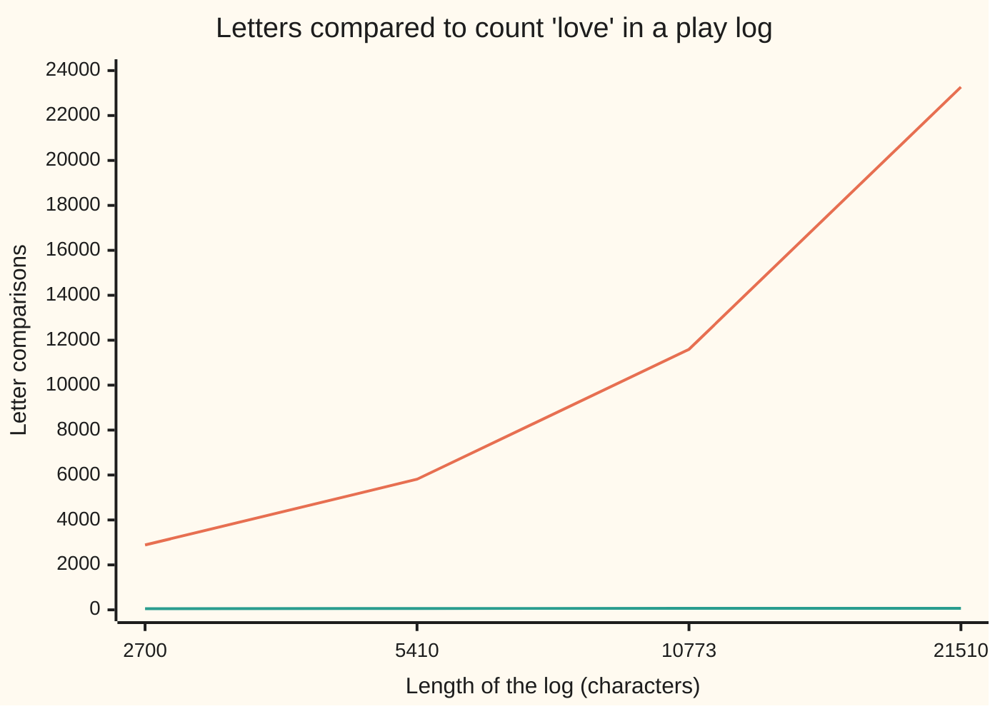

# Suffix arrays: sort every ending of the text once, then search it by halving

[Syllabus](../../../SYLLABUS.md) → [Applied and computational](../README.md) → [Algorithms and Growth](../README.md#s01) → Suffix arrays

---

## General Overview

A phone keeps a play log: every track played, one title after another. Type "love" and the phone should say at once how many plays had "love" in the title. A plain scan reads the whole log for every query. On a log of 2,000 plays, 21,510 characters long, the scan compares 23,270 letters to answer one query.

A **suffix array** does the reading once, in advance. A **suffix** is an ending of the text: the text read from some position to the end. The suffix array lists the starting positions of all the suffixes, sorted in dictionary order.

Every place where "love" occurs is the start of a suffix that begins with "love". In dictionary order all those suffixes sit side by side, so two binary searches find the first and the last of them. On the same log that takes 29 looks and 66 letter comparisons, and finds the same 286 plays.

Take the word "banana", with positions numbered from 0. Its six suffixes, sorted, are a, ana, anana, banana, na, nana. They start at positions 5, 3, 1, 0, 4, 2: that list is the suffix array.

Beside it sits the **LCP array** (longest common prefix): how many first letters each suffix shares with the one above it in the sorted list. For banana it is 0, 1, 3, 0, 0, 2. From those six numbers the count of different substrings follows without listing them: 21 − 6 = 15.

**Sort every suffix of the text once; then all occurrences of any pattern form one block of neighbours in that order, found by halving, and the overlaps between neighbours count every different substring.**

**What kind of fact this is:** theorems, proved on this card in Why it works: the block property, the substring count, the cost of a search, and the correctness of the constructions. The play log is synthetic, generated from a stated rule and seed, and its counts are measurements on it.

### The picture: the scan grows with the log, the search barely moves

Letter comparisons needed to count the plays with "love" in four play logs of growing size. Both methods return the same counts: 28, 59, 125 and 286 plays.



Orange: a full scan of the log, 2,887 rising to 23,270 comparisons, doubling with the log. Green: two binary searches on the suffix array, 52 to 67 comparisons. The scan's cost grows like n, the length of the text; the search's grows like log2 n, the number of times n can be halved.

The suffix array costs work up front: it is built once, then reused for every query. This card builds it two ways, computes its LCP array, searches it, counts substrings with it, and ends with the Burrows–Wheeler transform, a compressor built from the same sorted order.

---

## The formula

Notation first, in words. T is the text and n its length, with positions 0 to n − 1. T[i..] is the suffix that starts at position i. A **rank** r is a place in the sorted list of suffixes, 0 for the first.

- SA[r] is the start of the suffix with rank r: the suffix array.
- LCP[r] is the number of first letters that the suffix of rank r shares with the suffix of rank r − 1. LCP[0] is 0.
- P is a pattern of m letters.
- D is the number of different substrings of T. A **substring** is any run of one or more consecutive letters.

```math
D = \frac{n(n+1)}{2} - \sum_{r=1}^{n-1} \mathrm{LCP}[r]
```

**Read it aloud:** the number of different substrings is the number of ways to pick a start and an end, n times n plus one over two, minus the letters each sorted suffix shares with the one before it.

For banana: 6 × 7 / 2 = 21 runs of letters, minus 0 + 1 + 3 + 0 + 0 + 2 = 6 repeats, gives 15.

The search promise sits beside it. Each binary search looks at most ⌊log2 n⌋ + 1 times, where ⌊x⌋ is x rounded down. Each look compares at most m letters. Two searches find the whole block:

```math
\text{letters compared to find every occurrence of } P \;\le\; 2m\,(\lfloor \log_2 n \rfloor + 1)
```

**Read it aloud:** finding every occurrence costs at most twice the pattern length times the number of halvings the text allows.

For "love" in the 21,510-character log the promise is at most 120 letters, and the run used 66. For "ana" in banana the promise is 18, and the run used 12.

| Symbol | Plain meaning | In our example | Push it up and the answer… |
| --- | --- | --- | --- |
| $`T`$ | the text being indexed | banana; then the play log | — |
| $`n`$ | number of letters in the text | 6; then 21,510 | search cost rises like log2 n |
| $`i`$, $`j`$ | starting positions, counted from 0 | the suffix ana starts at 3 | — |
| $`T[i..]`$ | the suffix: the text from position i to the end | T[3..] = ana | — |
| $`r`$ | a rank: place in the sorted list, 0 first | ana has rank 1 | — |
| $`\mathrm{SA}[r]`$ | where the suffix of rank r starts | 5, 3, 1, 0, 4, 2 | — |
| $`\mathrm{LCP}[r]`$ | first letters shared by the suffixes of rank r − 1 and r | 0, 1, 3, 0, 0, 2 | D falls |
| $`D`$ | number of different substrings | 15 | — |
| $`P`$, $`m`$ | the pattern, and its length in letters | ana, 3; then love, 4 | each look costs more letters |
| $`k`$ | prefix length already sorted in a doubling round | 1, then 2 | doubles each round |
| $`h`$ | letters shared with the neighbour above, carried between steps of Kasai's method | 3 for anana against ana | — |
| $`\mathrm{BWT}[r]`$ | the letter just before the suffix of rank r | `annb$aa` for `banana$` | — |

### When it holds

- **The text is fixed.** The suffix array describes one text. Add a play to the log and the array must be rebuilt. It suits a text that is read often and changed rarely.
- **The array is in sorted order.** Binary search assumes it. Run the same search over banana's starts in text order, 0 to 5, and it reports 0 occurrences of "na" instead of 2.
- **A count needs two boundaries.** One binary search finds one occurrence. The count is the gap between the first rank whose suffix does not come before P and the first rank whose suffix comes after P.
- **The substring count needs every neighbour's overlap.** Leave the LCP out and n(n + 1)/2 says banana has 21 different substrings, not 15. It counts 6 surplus copies: two extra a's and one extra each of an, ana, n and na.
- **The Burrows–Wheeler transform needs an end marker, or the row number of the original text.** The original method and bzip2 store that row number instead of a marker. With neither, "banana" and "nanaba" give the same transform, nnbaaa, so it cannot be undone.

---

## Why it works

### Step 0: a substring is the start of a suffix

Every substring of T is the first few letters of some suffix: "nan" is the start of T[2..] = nana. So questions about substrings become questions about the starts of suffixes.

Sorting the suffixes puts suffixes with the same start next to each other. A dictionary does the same: every word beginning "ban" sits in one stretch.

### Step 1: all occurrences of a pattern form one block

Cut every suffix down to its first m letters. Down the sorted list these cut-down strings never move backwards in dictionary order. So the suffixes whose first m letters equal P form one unbroken block of ranks. Everything above the block comes before P; everything below comes after it.

Two binary searches find the block:

1. The first finds the first rank whose suffix does not come before P.
2. The second finds the first rank whose first m letters come after P.
3. The count is the difference, and SA gives the positions inside the block.

For "ana" in banana the block is ranks 1 to 2, the suffixes ana and anana. They start at positions 3 and 1, so "ana" occurs at 1 and 3.

### Step 2: the cost of a search

Each binary search halves the live range of ranks, as on [Sorting and searching](05-sorting-and-searching.md), so it looks at most ⌊log2 n⌋ + 1 times. Each look compares P with the start of one suffix, letter by letter, and stops at the first mismatch or after m letters. Two searches give at most 2m(⌊log2 n⌋ + 1) letters. The text length enters only through log2 n.

The scan, and the faster scans on [Finding a pattern in text](11-string-matching-kmp-and-rabin-karp.md), must read the whole text for each query: about n letters. The suffix array replaces n by about m log2 n, at the price of building the array once.

### Step 3: build it by doubling

The direct way sorts the suffixes with merge sort and compares two suffixes letter by letter. That is slow when the text repeats itself: two suffixes of "aaaa…" share hundreds of letters before they differ.

**Prefix doubling** (Manber and Myers, 1993) avoids this. It sorts the suffixes by their first 2 letters, then by their first 4, then 8, and so on. The trick: the first 2k letters of T[i..] are the first k letters of T[i..] followed by the first k letters of T[i + k..]. So once every suffix has a rank for its first k letters, its rank for 2k letters is fixed by the pair (rank of position i, rank of position i + k). A suffix too short to reach position i + k gets −1 there, so it comes first.

Pairs of small whole numbers sort in linear time with two bucket passes, the counting idea of [Beating n log n, and finding the median in linear time](10-linear-time-sorting-and-selection.md). For banana, the first ranks come from the letters, a before b before n. Then:

| Round | Sorted by the first | Ranks of positions 0 to 5 | All different? |
| --- | --- | --- | --- |
| 1 | 2 letters | 2 1 3 1 3 0 | no: "an" twice, "na" twice |
| 2 | 4 letters | 3 2 5 1 4 0 | yes |

The second row puts position 5 first, then 3, 1, 0, 4, 2: the suffix array.

Why it stops: all suffixes have different lengths, so no two are equal. Once k passes the longest repeated stretch, every rank is different. That takes at most ⌈log2 n⌉ rounds, where ⌈x⌉ is x rounded up, and each round costs a fixed multiple of n. In the notation of [Big-O](01-big-o-and-growth-rates.md) the total is O(n log n): it grows at most like n log n, up to a constant, for large n.

The play log needed 6 doubling rounds. A run of 1,000 copies of the letter a needs 10.

Constructions in linear time exist too. The method of Kärkkäinen, Sanders and Burkhardt (2006) sorts two thirds of the suffixes by recursion, then merges in the rest.

### Step 4: the LCP array in linear time (Kasai's method)

Comparing each pair of neighbours from scratch can cost up to n letters per pair. Kasai and his co-authors (2001) visit the suffixes in text order instead: T[0..], then T[1..], then T[2..], and so on.

The key fact: if T[i..] shares h letters with its neighbour above in the sorted list, then T[i + 1..] shares at least h − 1 letters with its own neighbour above.

The reason: drop the first letter of both suffixes in the pair. The shortened pair still starts with h − 1 equal letters and still comes in the same order. Every suffix sorted between them starts with those h − 1 letters too, so the nearest one above does.

So each step starts comparing at letter h − 1, not at letter 0. The sum i + h never exceeds n, and it never falls from one step to the next except once, at the suffix of rank 0. So the matching letters total at most 2n, plus at most one mismatch per suffix: at most 3n in all, linear in n. On the play log the method compared 42,985 letters, under even 2n = 43,020; the check asserts that tighter 2n figure on every text it indexes.

<details>
<summary>Detailed proof: why the overlap with the neighbour above is enough to count substrings</summary>

Take the suffix of rank r. It has n − SA[r] prefixes, one for each length from 1 to its own length. Adding these over all suffixes counts every (start, length) pair once:

$`\displaystyle \sum_{r=0}^{n-1} \bigl(n - \mathrm{SA}[r]\bigr) = n + (n-1) + \dots + 1 = \frac{n(n+1)}{2}.`$

A prefix of the rank-r suffix is new unless an earlier suffix in the sorted list starts with it. Suppose some earlier suffix shares its first few letters with the rank-r suffix. Every suffix sorted between the two must then start with the same letters, because the sorted order cannot leave that stretch and return to it. So the suffix of rank r − 1, the nearest one above, shares at least as many letters.

So the longest prefix that the rank-r suffix shares with any earlier suffix has length LCP[r]. Exactly LCP[r] of its prefixes are repeats; the rest are new. Subtract them:

$`\displaystyle D = \frac{n(n+1)}{2} - \sum_{r=1}^{n-1}\mathrm{LCP}[r].`$

</details>

### Step 5: count different substrings

The fold above gives the proof. In words: each suffix brings one new substring for each of its prefixes, except the ones it shares with the suffix just above it in the sorted list.

For banana: anana shares "ana" with ana, the suffix above it, so of its prefixes only anan and anana are new. The check confirms 15 by putting every substring of banana into a set, and confirms the formula on the first 300 characters of the play log: 43,801 both ways.

### Step 6: the Burrows–Wheeler transform, in outline

Add an end marker `$`, which sorts before every letter, so banana becomes `banana$`. Write down, for each suffix in sorted order, the letter just before it; the suffix starting at position 0 takes the end marker. That column is the **Burrows–Wheeler transform** (BWT). For `banana$` it is `annb$aa`.

Two facts make it useful:

- **It groups letters.** Letters that come before the same context end up side by side, so a long text's transform has long runs of one letter. Runs compress well, which is why bzip2 uses it.
- **It can be undone.** The i-th "a" in the transform and the i-th suffix starting with "a" are the same letter of the text. Following that match backwards from the `$` row rebuilds banana, one letter at a time.

The same match counts a pattern with no access to the text: read P from right to left and narrow a range of ranks, one letter per step. This **backward search** is the core of the **FM-index** (Ferragina and Manzini, 2000). It finds 2 copies of "ana" in banana and 286 plays with "love", agreeing with the binary search.

---

## Worked numbers, by hand

The word banana, positions 0 to 5:

| Step | Arithmetic | Value |
| --- | --- | --- |
| sort the six suffixes | a, ana, anana, banana, na, nana | SA = 5, 3, 1, 0, 4, 2 |
| ana against a | shares "a" | LCP 1 |
| anana against ana | shares "ana" | LCP 3 |
| banana against anana | b against a: no match | LCP 0 |
| na against banana | n against b: no match | LCP 0 |
| nana against na | shares "na" | LCP 2 |
| total overlap | 0 + 1 + 3 + 0 + 0 + 2 | 6 |
| every start and end | 6 × 7 / 2 | 21 |
| **different substrings** | 21 − 6 | **15** |
| search "ana", first boundary | rank 3 (banana) comes after; rank 1 (ana) equals, go left; rank 0 (a) comes before | block starts at rank 1 |
| search "ana", second boundary | rank 3 comes after; ranks 1 and 2 equal "ana", go right | block ends at rank 2 |
| **occurrences** | ranks 1 to 2 hold starts 3 and 1 | **2, at positions 1 and 3** |

The two searches took 6 looks and 12 letter comparisons, inside the promise of 18. The 15 means banana has 15 different snippets a search box could be asked for, out of 21 ways to pick a start and an end.

The play log, generated from 50 synthetic titles and 2,000 plays (seed 2026), gives:

| Quantity | Value |
| --- | --- |
| length | 21,510 characters |
| doubling rounds | 6 |
| longest repeated stretch | 45 letters |
| different substrings | 231,350,805 − 317,105 = 231,033,700 |
| plays with "love" (no title holds it twice, so occurrences equal plays) | 286 |
| search cost | 29 looks, 66 letters, promise 120 |
| scan cost | 23,270 letters |

Scaled to the whole library, as an estimate: the synthetic log spends 21,510 characters on 2,000 plays, about 11 per title with the separator. So 1,000,000 titles make a text of 11,000,000 characters. Each boundary search then needs at most 24 looks, so "love" costs at most 192 letters against about 11,000,000 for a scan. The price is memory: at 4 bytes per entry the array takes 44,000,000 bytes.

### What breaks if you drop a piece

| Mistake | Comes out at | What went wrong |
| --- | --- | --- |
| binary search over banana's starts in text order, 0 to 5, for "na" | 0 occurrences, true 2 | halving assumes the suffixes are sorted |
| counting substrings as n(n + 1)/2 | 21 for banana, true 15 | repeats counted twice: the LCP subtraction was dropped |
| Burrows–Wheeler transform with neither an end marker nor the original row number | banana and nanaba both give nnbaaa | nanaba is a rotation of banana, so both have the same rotations and the same last column |
| sorting suffixes directly, letter by letter, on 1,000 copies of a | 2,275,452 letters compared, against 1,555,704 for the whole 21,510-character play log | every comparison runs through a long shared prefix; doubling needs only 10 rounds |

The last row is the hypothesis that fails: direct comparison is fast only when neighbouring suffixes share few letters. On the play log it averaged 5.03 letters per n log2 n; on a repetitive text the shared prefixes run into the hundreds.

---

## Code, from first principles, and it actually runs

Nothing imported sorts or searches: no `sorted`, no `bisect`, no Rust `sort` or `binary_search`. Every method is written out and counts its own letter comparisons. The answers are reached by independent roads:

- the suffix array by merge sort with direct comparisons, against prefix doubling with bucket sorts
- the LCP array by comparing neighbours directly, against Kasai's method, which must stay under 2n letters
- different substrings by the formula, against a brute-force set of every substring (banana, and the log's first 300 characters)
- pattern counts by binary search, against a full scan, against backward search on the Burrows–Wheeler transform
- the transform undone, against the original word

The play log comes from SplitMix64, a small random-number generator written out in both languages, with seed 2026. It builds 50 titles of two words from a list of 16, then draws 2,000 plays from them, joined by `|`.

### Python

```python
# Suffix arrays -- the check behind the card.  Standard library only: no sorted(), no
# bisect.  Roads: suffixes sorted by a written-out merge sort against prefix doubling;
# neighbour LCPs compared directly against Kasai's method; distinct substrings by formula
# against a brute-force set; pattern counts by binary search, full scan and the BWT.
from math import log2

def splitmix(s):                      # SplitMix64: returns (new state, output)
    s = (s + 0x9E3779B97F4A7C15) & (2**64 - 1)
    z = ((s ^ (s >> 30)) * 0xBF58476D1CE4E5B9) & (2**64 - 1)
    z = ((z ^ (z >> 27)) * 0x94D049BB133111EB) & (2**64 - 1)
    return s, z ^ (z >> 31)

def msort(a, less):                   # merge sort with a "comes before" test
    if len(a) <= 1: return a
    l, r, out, i, j = msort(a[:len(a) // 2], less), msort(a[len(a) // 2:], less), [], 0, 0
    while i < len(l) and j < len(r):
        if less(r[j], l[i]): out.append(r[j]); j += 1
        else: out.append(l[i]); i += 1
    return out + l[i:] + r[j:]

def lcp_direct(t, a, b):              # letters shared by suffixes a and b, one by one
    return next(h for h in range(len(t) + 1) if max(a, b) + h >= len(t) or t[a + h] != t[b + h])

def naive_sa(t, cnt):                 # compare whole suffixes letter by letter
    def less(i, j):                   # the suffix that runs out first comes first
        h = lcp_direct(t, i, j); cnt[0] += min(h + 1, len(t) - max(i, j))
        return i + h == len(t) or (j + h < len(t) and t[i + h] < t[j + h])
    return msort(list(range(len(t))), less)

def bucket(idx, key, size):           # stable sort by a small whole-number key
    b = [[] for _ in range(size)]
    for i in idx: b[key(i)].append(i)
    return [i for x in b for i in x]

def doubling(t):                      # rank by first 2 letters, then 4, 8, ...
    n, rank, k, log = len(t), [ord(c) for c in t], 1, []
    while True:
        r = rank
        key = lambda i: (r[i], r[i + k] if i + k < n else -1)
        sa = bucket(range(n), lambda i: key(i)[1] + 1, max(r) + 2)
        sa, rank = bucket(sa, lambda i: r[i], max(r) + 1), [0] * n
        for a in range(1, n): rank[sa[a]] = rank[sa[a - 1]] + (key(sa[a]) != key(sa[a - 1]))
        log.append((2 * k, rank))
        if rank[sa[-1]] == n - 1: return sa, log
        k *= 2

def kasai(t, sa, cnt):                # LCP array, counting letters compared
    n, h, rank, lcp = len(t), 0, {i: a for a, i in enumerate(sa)}, [0] * len(t)
    for i in range(n):
        if rank[i] == 0: h = 0; continue
        j, h0 = sa[rank[i] - 1], h
        while max(i, j) + h < n and t[i + h] == t[j + h]: h += 1
        cnt[0] += h - h0 + (max(i, j) + h < n)
        lcp[rank[i]], h = h, max(h - 1, 0)   # the next suffix keeps all but one letter
    return lcp

def bound(t, sa, p, upper, cnt):      # first rank whose suffix starts > p (or >= p)
    lo, hi, looks = 0, len(sa), 0
    while lo < hi:
        mid = (lo + hi) // 2; looks += 1; s = t[sa[mid]:sa[mid] + len(p)]
        q = next((q for q in range(len(s)) if s[q] != p[q]), len(s))
        cnt[0] += min(q + 1, len(s))
        c = 0 if q == len(p) else (-1 if q == len(s) or s[q] < p[q] else 1)
        if c < 0 or (upper and c == 0): lo = mid + 1
        else: hi = mid
    return lo, looks

def scan(t, p, cnt):                  # try every start, stop at the first mismatch
    hits = 0
    for i in range(len(t) - len(p) + 1):
        q = next((q for q in range(len(p)) if t[i + q] != p[q]), len(p))
        cnt[0] += min(q + 1, len(p)); hits += q == len(p)
    return hits

def bwt(t):                           # last column of the sorted rotations of t + "$"
    return "".join((t + "$")[i - 1] for i in doubling(t + "$")[0])

def backward_count(L, p):             # FM-index style: read the pattern right to left
    lo, hi = 0, len(L)
    for c in reversed(p):
        C = sum(x < c for x in L)     # letters in the text smaller than c
        lo, hi = C + L.count(c, 0, lo), C + L.count(c, 0, hi)
        if lo >= hi: return 0
    return hi - lo

def inverse_bwt(L):                   # walk last-to-first from the "$" row
    row, out = 0, []
    for _ in range(len(L) - 1):
        c = L[row]; out.append(c); row = sum(x < c for x in L) + L.count(c, 0, row)
    return "".join(reversed(out))

def index_report(t, p):
    c1, c2, c3, c4 = [0], [0], [0], [0]; sa, log = doubling(t)
    assert naive_sa(t, c1) == sa, "doubling and merge sort disagree"
    lcp = kasai(t, sa, c2); assert c2[0] <= 2 * len(t), "Kasai compared over 2n letters"
    assert lcp[1:] == [lcp_direct(t, sa[a - 1], sa[a]) for a in range(1, len(t))], "Kasai"
    (lo, l1), (hi, l2) = bound(t, sa, p, False, c3), bound(t, sa, p, True, c3)
    assert hi - lo == scan(t, p, c4) == backward_count(bwt(t), p), "pattern counts disagree"
    return sa, lcp, len(log), c1[0], c2[0], lo, hi, l1 + l2, c3[0], c4[0]

w = "banana"; n = len(w); sa, lcp, rounds, nv, ks, lo, hi, looks, sc, scn = index_report(w, "ana")
print("banana suffix array:", *sa, "| suffixes:", *[w[i:] for i in sa])
print("banana LCP:", *lcp, "| sum", sum(lcp))
for k, r in doubling(w)[1]: print(f"doubling: ranks by first {k} letters:", *r)
print(f"rounds {rounds}; merge sort letters compared {nv}; Kasai letters compared {ks}")
assert sa == [5, 3, 1, 0, 4, 2] and lcp == [0, 1, 3, 0, 0, 2]
brute = len({w[i:j] for i in range(n) for j in range(i + 1, n + 1)})
print(f"distinct substrings: {n * (n + 1) // 2} - {sum(lcp)} = {n * (n + 1) // 2 - sum(lcp)}; brute force {brute}")
assert n * (n + 1) // 2 - sum(lcp) == brute == 15
print(f"search 'ana': ranks {lo} to {hi - 1}, count {hi - lo}, starts", *msort(sa[lo:hi], lambda a, b: a < b), f"| looks {looks}, letters {sc} (promise {2 * 3 * (int(log2(n)) + 1)}); scan letters {scn}")
print("BWT of banana$:", bwt(w), "| inverse:", inverse_bwt(bwt(w)), "| backward count 'ana':", backward_count(bwt(w), "ana"))
assert bwt(w) == "annb$aa" and inverse_bwt(bwt(w)) == w

words = "love night blue river fire home dream summer road heart rain gold city moon light song".split()
s, cat, plays = 2026, [], []
for _ in range(50):
    s, a = splitmix(s); s, b = splitmix(s); cat.append(words[a % 16] + " " + words[b % 16])
for _ in range(2000): s, z = splitmix(s); plays.append(cat[z % 50])
t = "|".join(plays); N = len(t); sa, lcp, rounds, nv, ks, lo, hi, looks, sc, scn = index_report(t, "love")
print(f"play log: 2000 plays of 50 titles, seed 2026, {N} characters, {rounds} doubling rounds")
print(f"merge sort letters compared {nv} ({nv / (N * log2(N)):.2f} per n log2 n); Kasai {ks} (2n = {2 * N}); longest repeat {max(lcp)}")
print(f"distinct substrings: {N * (N + 1) // 2} - {sum(lcp)} = {N * (N + 1) // 2 - sum(lcp)}")
p3 = t[:300]; l3 = kasai(p3, doubling(p3)[0], [0]); f3 = 300 * 301 // 2 - sum(l3)
b3 = len({p3[i:j] for i in range(300) for j in range(i + 1, 301)})
print(f"first 300 characters: formula {f3}, brute force {b3}"); assert f3 == b3
pr = 2 * 4 * (int(log2(N)) + 1); assert sc <= pr, "search broke its promise"
print(f"search 'love': count {hi - lo}, looks {looks}, letters {sc} (promise {pr}); scan letters {scn}")
for m in (250, 500, 1000, 2000):
    u = "|".join(plays[:m]); r = index_report(u, "love")
    print(f"chart, {m} plays, {len(u)} characters, count {r[6] - r[5]}, suffix array letters {r[8]}, scan letters {r[9]}")
L = 1_000_000 * round(N / 2000); lk = int(log2(L)) + 1     # titles as long as the log's own plays
print(f"library: 1000000 titles x {L // 1_000_000} characters ({N} / 2000 plays, rounded) = {L}; looks per boundary {lk}; letters at most {2 * lk * 4}; array bytes {4 * L}")
print(f"breaks: n(n+1)/2 without LCP = {n * (n + 1) // 2}, true 15")
u0, u1 = bound(w, list(range(n)), "na", False, [0])[0], bound(w, list(range(n)), "na", True, [0])[0]
print(f"breaks: binary search on unsorted starts 0..5 for 'na': count {u1 - u0}, true {scan(w, 'na', [0])}")
rot = lambda x: "".join(r[-1] for r in msort([x[i:] + x[:i] for i in range(len(x))], lambda a, b: a < b))
print(f"breaks: rotations without $: banana -> {rot('banana')}, nanaba -> {rot('nanaba')}")
for m in (250, 500, 1000):
    c = [0]; naive_sa("a" * m, c); print(f"breaks: merge sort on {m} a's: letters compared {c[0]}, doubling rounds {len(doubling('a' * m)[1])}")
print("ALL CHECKS PASS")
```

**Ran 2026-11-23 on macOS, Python 3.14.10, standard library only. All checks passed. Output, pasted from the run:**

```
banana suffix array: 5 3 1 0 4 2 | suffixes: a ana anana banana na nana
banana LCP: 0 1 3 0 0 2 | sum 6
doubling: ranks by first 2 letters: 2 1 3 1 3 0
doubling: ranks by first 4 letters: 3 2 5 1 4 0
rounds 2; merge sort letters compared 14; Kasai letters compared 5
distinct substrings: 21 - 6 = 15; brute force 15
search 'ana': ranks 1 to 2, count 2, starts 1 3 | looks 6, letters 12 (promise 18); scan letters 8
BWT of banana$: annb$aa | inverse: banana | backward count 'ana': 2
play log: 2000 plays of 50 titles, seed 2026, 21510 characters, 6 doubling rounds
merge sort letters compared 1555704 (5.03 per n log2 n); Kasai 42985 (2n = 43020); longest repeat 45
distinct substrings: 231350805 - 317105 = 231033700
first 300 characters: formula 43801, brute force 43801
search 'love': count 286, looks 29, letters 66 (promise 120); scan letters 23270
chart, 250 plays, 2700 characters, count 28, suffix array letters 52, scan letters 2887
chart, 500 plays, 5410 characters, count 59, suffix array letters 61, scan letters 5812
chart, 1000 plays, 10773 characters, count 125, suffix array letters 67, scan letters 11594
chart, 2000 plays, 21510 characters, count 286, suffix array letters 66, scan letters 23270
library: 1000000 titles x 11 characters (21510 / 2000 plays, rounded) = 11000000; looks per boundary 24; letters at most 192; array bytes 44000000
breaks: n(n+1)/2 without LCP = 21, true 15
breaks: binary search on unsorted starts 0..5 for 'na': count 0, true 2
breaks: rotations without $: banana -> nnbaaa, nanaba -> nnbaaa
breaks: merge sort on 250 a's: letters compared 111488, doubling rounds 8
breaks: merge sort on 500 a's: letters compared 507101, doubling rounds 9
breaks: merge sort on 1000 a's: letters compared 2275452, doubling rounds 10
ALL CHECKS PASS
```

### Rust

```rust
// Suffix arrays -- the check behind the card.  std only: no sort, no binary_search.
// Roads: suffixes sorted by a written-out merge sort against prefix doubling;
// neighbour LCPs compared directly against Kasai's method; distinct substrings by
// formula against a brute-force set; pattern counts by binary search, full scan and BWT.
use std::collections::HashSet;

fn splitmix(s: &mut u64) -> u64 {
    *s = s.wrapping_add(0x9E3779B97F4A7C15);
    let z = (*s ^ (*s >> 30)).wrapping_mul(0xBF58476D1CE4E5B9); let z = (z ^ (z >> 27)).wrapping_mul(0x94D049BB133111EB);
    z ^ (z >> 31)
}

fn msort<T: Clone>(a: &[T], less: &mut dyn FnMut(&T, &T) -> bool) -> Vec<T> {
    if a.len() <= 1 { return a.to_vec(); }
    let (l, r) = (msort(&a[..a.len() / 2], less), msort(&a[a.len() / 2..], less));
    let (mut out, mut i, mut j) = (Vec::new(), 0, 0);
    while i < l.len() && j < r.len() {
        if less(&r[j], &l[i]) { out.push(r[j].clone()); j += 1; } else { out.push(l[i].clone()); i += 1; }
    }
    out.extend_from_slice(&l[i..]); out.extend_from_slice(&r[j..]); out
}

fn lcp_direct(t: &[u8], a: usize, b: usize) -> usize { // letters shared, one by one
    let mut h = 0; while a.max(b) + h < t.len() && t[a + h] == t[b + h] { h += 1; } h }

fn naive_sa(t: &[u8], cnt: &mut usize) -> Vec<usize> {
    let n = t.len(); let idx: Vec<usize> = (0..n).collect();
    msort(&idx, &mut |&i: &usize, &j: &usize| {
        let h = lcp_direct(t, i, j); *cnt += (h + 1).min(n - i.max(j));
        i + h == n || (j + h < n && t[i + h] < t[j + h])
    })
}

fn bucket(idx: &[usize], key: &dyn Fn(usize) -> usize, size: usize) -> Vec<usize> {
    let mut b: Vec<Vec<usize>> = vec![Vec::new(); size]; for &i in idx { b[key(i)].push(i); }
    b.concat()
}

fn doubling(t: &[u8]) -> (Vec<usize>, Vec<(usize, Vec<usize>)>) {
    let (n, mut k, mut log, mut rank) = (t.len(), 1, Vec::new(), t.iter().map(|&c| c as usize).collect::<Vec<_>>());
    loop {
        let r = rank.clone(); let mx = *r.iter().max().unwrap();
        let key = |i: usize| (r[i] as i64, if i + k < n { r[i + k] as i64 } else { -1 });
        let sa = bucket(&(0..n).collect::<Vec<_>>(), &|i| (key(i).1 + 1) as usize, mx + 2);
        let sa = bucket(&sa, &|i| r[i], mx + 1); rank = vec![0; n];
        for a in 1..n { rank[sa[a]] = rank[sa[a - 1]] + (key(sa[a]) != key(sa[a - 1])) as usize; }
        log.push((2 * k, rank.clone()));
        if rank[sa[n - 1]] == n - 1 { return (sa, log); } k *= 2;
    }
}

fn kasai(t: &[u8], sa: &[usize], cnt: &mut usize) -> Vec<usize> {
    let (n, mut h, mut rank, mut lcp) = (t.len(), 0, vec![0; t.len()], vec![0; t.len()]);
    for (a, &i) in sa.iter().enumerate() { rank[i] = a; }
    for i in 0..n {
        if rank[i] == 0 { h = 0; continue; }
        let (j, h0) = (sa[rank[i] - 1], h);
        while i.max(j) + h < n && t[i + h] == t[j + h] { h += 1; }
        *cnt += h - h0 + (i.max(j) + h < n) as usize;
        lcp[rank[i]] = h; h = h.saturating_sub(1); // the next suffix keeps all but one letter
    }
    lcp
}

fn bound(t: &[u8], sa: &[usize], p: &[u8], upper: bool, cnt: &mut usize) -> (usize, usize) {
    let (mut lo, mut hi, mut looks) = (0, sa.len(), 0);
    while lo < hi {
        let mid = (lo + hi) / 2; looks += 1;
        let s = &t[sa[mid]..(sa[mid] + p.len()).min(t.len())];
        let q = (0..s.len()).find(|&q| s[q] != p[q]).unwrap_or(s.len());
        *cnt += (q + 1).min(s.len());
        let c = if q == p.len() { 0 } else if q == s.len() || s[q] < p[q] { -1 } else { 1 };
        if c < 0 || (upper && c == 0) { lo = mid + 1; } else { hi = mid; }
    }
    (lo, looks)
}

fn scan(t: &[u8], p: &[u8], cnt: &mut usize) -> usize {
    let mut hits = 0;
    for i in 0..=t.len() - p.len() {
        let q = (0..p.len()).find(|&q| t[i + q] != p[q]).unwrap_or(p.len());
        *cnt += (q + 1).min(p.len()); hits += (q == p.len()) as usize;
    }
    hits
}

fn bwt(t: &[u8]) -> Vec<u8> {
    let s = [t, b"$"].concat(); let n = s.len();
    doubling(&s).0.iter().map(|&i| s[(i + n - 1) % n]).collect()
}

fn smaller(l: &[u8], c: u8) -> usize { l.iter().filter(|&&x| x < c).count() }
fn occ(l: &[u8], c: u8, upto: usize) -> usize { l[..upto].iter().filter(|&&x| x == c).count() }
fn backward_count(l: &[u8], p: &[u8]) -> usize { // FM-index style: pattern right to left
    let (mut lo, mut hi) = (0, l.len());
    for &c in p.iter().rev() {
        let cc = smaller(l, c); lo = cc + occ(l, c, lo); hi = cc + occ(l, c, hi);
        if lo >= hi { return 0; }
    }
    hi - lo
}

fn inverse_bwt(l: &[u8]) -> String { // walk last-to-first from the "$" row
    let (mut row, mut out) = (0, Vec::new());
    for _ in 0..l.len() - 1 { let c = l[row]; out.push(c); row = smaller(l, c) + occ(l, c, row); }
    out.reverse(); String::from_utf8(out).unwrap()
}

fn index_report(t: &[u8], p: &[u8]) -> (Vec<usize>, Vec<usize>, usize, [usize; 4], usize, usize, usize) {
    let mut c = [0usize; 4]; let (sa, log) = doubling(t);
    assert!(naive_sa(t, &mut c[0]) == sa, "doubling and merge sort disagree");
    let lcp = kasai(t, &sa, &mut c[1]); assert!(c[1] <= 2 * t.len(), "Kasai compared over 2n letters");
    for a in 1..t.len() { assert!(lcp[a] == lcp_direct(t, sa[a - 1], sa[a]), "Kasai"); }
    let (lo, l1) = bound(t, &sa, p, false, &mut c[2]); let (hi, l2) = bound(t, &sa, p, true, &mut c[2]);
    let h = scan(t, p, &mut c[3]); assert!(hi - lo == h && h == backward_count(&bwt(t), p), "pattern counts disagree");
    (sa, lcp, log.len(), c, lo, hi, l1 + l2)
}

fn join(v: &[usize]) -> String { v.iter().map(|x| x.to_string()).collect::<Vec<_>>().join(" ") }
fn s(v: &[u8]) -> String { String::from_utf8(v.to_vec()).unwrap() }
fn distinct(t: &[u8]) -> usize { // brute force: every substring into a set, then count
    let mut set = HashSet::new(); for i in 0..t.len() { for j in i + 1..=t.len() { set.insert(&t[i..j]); } } set.len()
}

fn main() {
    let w = b"banana"; let n = w.len();
    let (sa, lcp, rounds, c, lo, hi, looks) = index_report(w, b"ana");
    let (sufs, sum): (Vec<String>, usize) = (sa.iter().map(|&i| s(&w[i..])).collect(), lcp.iter().sum());
    println!("banana suffix array: {} | suffixes: {}", join(&sa), sufs.join(" "));
    println!("banana LCP: {} | sum {}", join(&lcp), sum);
    for (k, r) in doubling(w).1 { println!("doubling: ranks by first {} letters: {}", k, join(&r)); }
    println!("rounds {}; merge sort letters compared {}; Kasai letters compared {}", rounds, c[0], c[1]);
    assert!(sa == vec![5, 3, 1, 0, 4, 2] && lcp == vec![0, 1, 3, 0, 0, 2]);
    let brute = distinct(w); println!("distinct substrings: {} - {} = {}; brute force {}", n * (n + 1) / 2, sum, n * (n + 1) / 2 - sum, brute);
    assert!(n * (n + 1) / 2 - sum == brute && brute == 15);
    let starts = msort(&sa[lo..hi], &mut |a: &usize, b: &usize| a < b);
    println!("search 'ana': ranks {} to {}, count {}, starts {} | looks {}, letters {} (promise {}); scan letters {}", lo, hi - 1, hi - lo, join(&starts), looks, c[2], 2 * 3 * ((n as f64).log2() as usize + 1), c[3]);
    let b = bwt(w); println!("BWT of banana$: {} | inverse: {} | backward count 'ana': {}", s(&b), inverse_bwt(&b), backward_count(&b, b"ana"));
    assert!(s(&b) == "annb$aa" && inverse_bwt(&b) == "banana");
    let words: Vec<&str> = "love night blue river fire home dream summer road heart rain gold city moon light song".split(' ').collect();
    let (mut st, mut cat, mut plays) = (2026u64, Vec::new(), Vec::new());
    for _ in 0..50 { let a = splitmix(&mut st); let b = splitmix(&mut st); cat.push(format!("{} {}", words[(a % 16) as usize], words[(b % 16) as usize])); }
    for _ in 0..2000 { let z = splitmix(&mut st); plays.push(cat[(z % 50) as usize].clone()); }
    let t = plays.join("|").into_bytes(); let nn = t.len();
    let (_, lcp, rounds, c, lo, hi, looks) = index_report(&t, b"love"); let sum: usize = lcp.iter().sum();
    println!("play log: 2000 plays of 50 titles, seed 2026, {} characters, {} doubling rounds", nn, rounds);
    println!("merge sort letters compared {} ({:.2} per n log2 n); Kasai {} (2n = {}); longest repeat {}", c[0], c[0] as f64 / (nn as f64 * (nn as f64).log2()), c[1], 2 * nn, lcp.iter().max().unwrap());
    println!("distinct substrings: {} - {} = {}", nn * (nn + 1) / 2, sum, nn * (nn + 1) / 2 - sum);
    let p3 = &t[..300]; let l3 = kasai(p3, &doubling(p3).0, &mut 0); let f3 = 300 * 301 / 2 - l3.iter().sum::<usize>(); let b3 = distinct(p3);
    println!("first 300 characters: formula {}, brute force {}", f3, b3); assert!(f3 == b3);
    let pr = 2 * 4 * ((nn as f64).log2() as usize + 1); assert!(c[2] <= pr, "search broke its promise");
    println!("search 'love': count {}, looks {}, letters {} (promise {}); scan letters {}", hi - lo, looks, c[2], pr, c[3]);
    for m in [250, 500, 1000, 2000] {
        let u = plays[..m].join("|").into_bytes(); let r = index_report(&u, b"love");
        println!("chart, {} plays, {} characters, count {}, suffix array letters {}, scan letters {}", m, u.len(), r.5 - r.4, r.3[2], r.3[3]);
    }
    let big = 1_000_000 * (nn as f64 / 2000.0).round() as usize; let lk = (big as f64).log2() as usize + 1; // titles as long as the log's own plays
    println!("library: 1000000 titles x {} characters ({} / 2000 plays, rounded) = {}; looks per boundary {}; letters at most {}; array bytes {}", big / 1_000_000, nn, big, lk, 2 * lk * 4, 4 * big);
    println!("breaks: n(n+1)/2 without LCP = {}, true 15", n * (n + 1) / 2);
    let id: Vec<usize> = (0..n).collect(); let u0 = bound(w, &id, b"na", false, &mut 0).0; let u1 = bound(w, &id, b"na", true, &mut 0).0;
    println!("breaks: binary search on unsorted starts 0..5 for 'na': count {}, true {}", u1 - u0, scan(w, b"na", &mut 0));
    let rot = |x: &str| -> String {
        let r: Vec<String> = (0..x.len()).map(|i| format!("{}{}", &x[i..], &x[..i])).collect(); msort(&r, &mut |a: &String, b: &String| a < b).iter().map(|r| r.chars().last().unwrap()).collect()
    };
    println!("breaks: rotations without $: banana -> {}, nanaba -> {}", rot("banana"), rot("nanaba"));
    for m in [250, 500, 1000] {
        let (a, mut c) = (vec![b'a'; m], 0); naive_sa(&a, &mut c); println!("breaks: merge sort on {} a's: letters compared {}, doubling rounds {}", m, c, doubling(&a).1.len());
    }
    println!("ALL CHECKS PASS");
}
```

**Ran 2026-11-23 on macOS, rustc 1.98.1, no crates. All checks passed. Output, pasted from the run:**

```
banana suffix array: 5 3 1 0 4 2 | suffixes: a ana anana banana na nana
banana LCP: 0 1 3 0 0 2 | sum 6
doubling: ranks by first 2 letters: 2 1 3 1 3 0
doubling: ranks by first 4 letters: 3 2 5 1 4 0
rounds 2; merge sort letters compared 14; Kasai letters compared 5
distinct substrings: 21 - 6 = 15; brute force 15
search 'ana': ranks 1 to 2, count 2, starts 1 3 | looks 6, letters 12 (promise 18); scan letters 8
BWT of banana$: annb$aa | inverse: banana | backward count 'ana': 2
play log: 2000 plays of 50 titles, seed 2026, 21510 characters, 6 doubling rounds
merge sort letters compared 1555704 (5.03 per n log2 n); Kasai 42985 (2n = 43020); longest repeat 45
distinct substrings: 231350805 - 317105 = 231033700
first 300 characters: formula 43801, brute force 43801
search 'love': count 286, looks 29, letters 66 (promise 120); scan letters 23270
chart, 250 plays, 2700 characters, count 28, suffix array letters 52, scan letters 2887
chart, 500 plays, 5410 characters, count 59, suffix array letters 61, scan letters 5812
chart, 1000 plays, 10773 characters, count 125, suffix array letters 67, scan letters 11594
chart, 2000 plays, 21510 characters, count 286, suffix array letters 66, scan letters 23270
library: 1000000 titles x 11 characters (21510 / 2000 plays, rounded) = 11000000; looks per boundary 24; letters at most 192; array bytes 44000000
breaks: n(n+1)/2 without LCP = 21, true 15
breaks: binary search on unsorted starts 0..5 for 'na': count 0, true 2
breaks: rotations without $: banana -> nnbaaa, nanaba -> nnbaaa
breaks: merge sort on 250 a's: letters compared 111488, doubling rounds 8
breaks: merge sort on 500 a's: letters compared 507101, doubling rounds 9
breaks: merge sort on 1000 a's: letters compared 2275452, doubling rounds 10
ALL CHECKS PASS
```

### Lean

Lean proves the substring formula, the one block of occurrences and Kasai's key fact for every text, and checks banana's numbers.

- Take a text T and a suffix array SA listing every start once, with the suffixes in strictly increasing dictionary order. Then D equals n(n + 1)/2 minus the sum of the LCP array.
- Take the same T and SA, and any pattern P. Then the ranks whose suffix starts with P form one unbroken block, and its size is the number of positions where P occurs.
- Take the same T and SA, and a position i with i + 1 < n. Suppose T[i..] shares h letters with its neighbour above. Then T[i + 1..] shares at least h − 1 letters with its own neighbour above.
- For banana, SA is 5, 3, 1, 0, 4, 2 and the LCP array is 0, 1, 3, 0, 0, 2.
- A brute-force list of every substring of banana finds 15, matching 21 − 6.
- "ana" occurs at positions 1 and 3, the starts held by ranks 1 and 2.
- The search promise gives 18 for "ana", 120 for "love" and 192 for the whole library.
- The play log's count, 231,350,805 − 317,105 = 231,033,700, is checked as arithmetic.
- The Burrows–Wheeler transform of `banana$` is `annb$aa`.

Binary search and its cost, prefix doubling, Kasai's linear total, undoing the transform and the play-log runs are left to Python and Rust.

```lean
-- Suffix arrays: once every suffix of a text is sorted, the neighbours' overlaps count the different substrings, the occurrences of any pattern form one block of ranks, and Kasai's overlap step holds.
import Mathlib.Data.List.Lex
import Mathlib.Data.Set.Card
import Mathlib.Data.Nat.Log
import Mathlib.Data.Char
import Mathlib.Tactic.NormNum
import Mathlib.Data.List.GetD
import Mathlib.Algebra.BigOperators.Group.Finset.Sigma
import Mathlib.Algebra.BigOperators.Intervals
import Mathlib.Order.Interval.Finset.Nat
import Mathlib.Tactic.Ring

namespace SuffixArray

variable {α : Type*} [LinearOrder α]

/-- `lcp s t` is the number of first letters the lists `s` and `t` share. -/
def lcp : List α → List α → ℕ
  | a :: s, b :: t => if a = b then lcp s t + 1 else 0
  | _, _ => 0

/-- The LCP array of a text `T` with suffix array `sa`: entry `r` is the number of first letters
the suffix of rank `r` shares with the suffix of rank `r - 1`, and entry 0 is 0. -/
def lcpArray (T : List α) (sa : List ℕ) : List ℕ :=
  0 :: List.zipWith lcp (sa.map T.drop) (sa.map T.drop).tail

theorem lcp_le_length_right : ∀ (a b : List α), lcp a b ≤ b.length
  | [], _ => by simp [lcp]
  | _ :: _, [] => by simp [lcp]
  | x :: a, y :: b => by
    simp only [lcp, List.length_cons]
    split_ifs
    · have := lcp_le_length_right a b; omega
    · omega

theorem lcp_le_length_left : ∀ (a b : List α), lcp a b ≤ a.length
  | [], _ => by simp [lcp]
  | _ :: _, [] => by simp [lcp]
  | x :: a, y :: b => by
    simp only [lcp, List.length_cons]
    split_ifs
    · have := lcp_le_length_left a b; omega
    · omega

theorem length_le_lcp_of_prefix : ∀ (u a b : List α), u <+: a → u <+: b → u.length ≤ lcp a b
  | [], _, _, _, _ => by simp
  | x :: u, a, b, ha, hb => by
    obtain ⟨t, rfl⟩ := ha
    obtain ⟨t', rfl⟩ := hb
    have := length_le_lcp_of_prefix u (u ++ t) (u ++ t') (List.prefix_append _ _)
      (List.prefix_append _ _)
    simp [lcp]
    omega

theorem take_lcp_prefix : ∀ (a b : List α), a.take (lcp a b) <+: b
  | [], _ => by simp [lcp]
  | _ :: _, [] => by simp [lcp]
  | x :: a, y :: b => by
    simp only [lcp]
    split_ifs with h
    · subst h
      simpa using take_lcp_prefix a b
    · simp

theorem take_prefix_of_le_lcp (a b : List α) (k : ℕ) (hk : k ≤ lcp a b) : a.take k <+: b :=
  (List.take_prefix_take_left hk).trans (take_lcp_prefix a b)

theorem cons_lt_or_eq {x y : α} {a b : List α} (h : x :: a < y :: b ∨ x :: a = y :: b) :
    x < y ∨ (x = y ∧ (a < b ∨ a = b)) := by
  rcases h with h | h
  · rw [List.cons_lt_cons_iff] at h
    rcases h with h | ⟨h1, h2⟩
    · exact Or.inl h
    · exact Or.inr ⟨h1, Or.inl h2⟩
  · simp only [List.cons.injEq] at h
    exact Or.inr ⟨h.1, Or.inr h.2⟩

theorem prefix_of_between : ∀ (u a b c : List α), (a < b ∨ a = b) → (b < c ∨ b = c) →
    u <+: a → u <+: c → u <+: b
  | [], _, _, _, _, _, _, _ => List.nil_prefix
  | x :: u, a, b, c, hab, hbc, ha, hc => by
    obtain ⟨t, rfl⟩ := ha
    obtain ⟨t', rfl⟩ := hc
    match b, hab, hbc with
    | [], hab, _ =>
      rcases hab with h | h
      · exact absurd h (List.not_lt_nil _)
      · simp at h
    | y :: b, hab, hbc =>
      simp only [List.cons_append] at hab hbc
      rcases cons_lt_or_eq hab with h1 | ⟨rfl, h1⟩
      · rcases cons_lt_or_eq hbc with h2 | ⟨rfl, _⟩
        · exact absurd (h1.trans h2) (lt_irrefl _)
        · exact absurd h1 (lt_irrefl _)
      · rcases cons_lt_or_eq hbc with h2 | ⟨_, h2⟩
        · exact absurd h2 (lt_irrefl _)
        · exact (List.cons_prefix_cons).2 ⟨rfl, prefix_of_between u (u ++ t) b (u ++ t') h1 h2
            (List.prefix_append _ _) (List.prefix_append _ _)⟩

theorem lcp_comm : ∀ (a b : List α), lcp a b = lcp b a
  | [], [] => rfl
  | [], _ :: _ => rfl
  | _ :: _, [] => rfl
  | x :: a, y :: b => by
    simp only [lcp]
    by_cases h : x = y
    · subst h; simp [lcp_comm a b]
    · simp [h, Ne.symm h]

theorem sa_length {T : List α} {sa : List ℕ} (hperm : sa.Perm (List.range T.length)) :
    sa.length = T.length := by
  simpa using hperm.length_eq

theorem sa_getD_lt {T : List α} {sa : List ℕ} (hperm : sa.Perm (List.range T.length)) {r : ℕ}
    (hr : r < T.length) : sa.getD r 0 < T.length := by
  have hl := sa_length hperm
  have : sa.getD r 0 ∈ sa := by
    rw [List.getD_eq_getElem _ _ (by omega)]; exact List.getElem_mem _
  simpa using hperm.subset this

theorem sa_surj {T : List α} {sa : List ℕ} (hperm : sa.Perm (List.range T.length)) {i : ℕ}
    (hi : i < T.length) : ∃ r < T.length, sa.getD r 0 = i := by
  have hl := sa_length hperm
  have : i ∈ sa := hperm.symm.subset (by simpa using hi)
  obtain ⟨r, hr, rfl⟩ := List.getElem_of_mem this
  exact ⟨r, by omega, List.getD_eq_getElem _ _ hr⟩

theorem sorted_lt {T : List α} {sa : List ℕ} (hperm : sa.Perm (List.range T.length))
    (hsorted : (sa.map T.drop).Pairwise (· < ·)) {r r' : ℕ} (h : r < r') (h' : r' < T.length) :
    T.drop (sa.getD r 0) < T.drop (sa.getD r' 0) := by
  have hl := sa_length hperm
  have := List.pairwise_iff_getElem.mp hsorted r r' (by simp; omega) (by simp; omega) h
  rw [List.getD_eq_getElem _ _ (show r < sa.length by omega),
    List.getD_eq_getElem _ _ (show r' < sa.length by omega)]
  simpa using this

theorem sorted_le {T : List α} {sa : List ℕ} (hperm : sa.Perm (List.range T.length))
    (hsorted : (sa.map T.drop).Pairwise (· < ·)) {r r' : ℕ} (h : r ≤ r') (h' : r' < T.length) :
    T.drop (sa.getD r 0) < T.drop (sa.getD r' 0) ∨ T.drop (sa.getD r 0) = T.drop (sa.getD r' 0) := by
  rcases h.lt_or_eq with h | rfl
  · exact Or.inl (sorted_lt hperm hsorted h h')
  · exact Or.inr rfl

theorem lcpArray_getD_zero (T : List α) (sa : List ℕ) : (lcpArray T sa).getD 0 0 = 0 := by
  simp [lcpArray]

theorem lcpArray_getD_succ {T : List α} {sa : List ℕ} (hl : sa.length = T.length) {r : ℕ}
    (hr : r + 1 < T.length) :
    (lcpArray T sa).getD (r + 1) 0 = lcp (T.drop (sa.getD r 0)) (T.drop (sa.getD (r + 1) 0)) := by
  simp only [lcpArray, List.getD_cons_succ]
  rw [List.getD_eq_getElem?_getD, List.getElem?_zipWith]
  simp [List.getElem?_eq_getElem (show r < sa.length by omega),
    List.getElem?_eq_getElem (show r + 1 < sa.length by omega)]

theorem lcpArray_length {T : List α} {sa : List ℕ} (hl : sa.length = T.length)
    (hn : 0 < T.length) : (lcpArray T sa).length = T.length := by
  simp [lcpArray]; omega

theorem map_sum_eq_range (l : List ℕ) (f : ℕ → ℕ) :
    (l.map f).sum = ∑ i ∈ Finset.range l.length, f (l.getD i 0) := by
  induction l with
  | nil => simp
  | cons a l ih =>
    rw [List.map_cons, List.sum_cons, ih, List.length_cons, Finset.sum_range_succ']
    simp [add_comm]

theorem countP_eq_card (l : List ℕ) (p : ℕ → Bool) :
    l.countP p = ((Finset.range l.length).filter (fun i => p (l.getD i 0) = true)).card := by
  rw [Finset.card_filter]
  induction l with
  | nil => simp
  | cons a l ih =>
    rw [List.countP_cons, ih, List.length_cons, Finset.sum_range_succ']
    simp [add_comm]

theorem sum_range_sub (n : ℕ) : (∑ i ∈ Finset.range n, (n - i)) * 2 = n * (n + 1) := by
  induction n with
  | zero => simp
  | succ n ih =>
    rw [Finset.sum_range_succ']
    simp only [Nat.add_sub_add_right, Nat.sub_zero]
    rw [add_mul, ih]; ring

#print axioms lcp_le_length_right
#print axioms lcp_le_length_left
#print axioms length_le_lcp_of_prefix
#print axioms take_lcp_prefix
#print axioms take_prefix_of_le_lcp
#print axioms cons_lt_or_eq
#print axioms prefix_of_between
#print axioms lcp_comm
#print axioms sa_length
#print axioms sa_getD_lt
#print axioms sa_surj
#print axioms sorted_lt
#print axioms sorted_le
#print axioms lcpArray_getD_zero
#print axioms lcpArray_getD_succ
#print axioms lcpArray_length
#print axioms map_sum_eq_range
#print axioms countP_eq_card
#print axioms sum_range_sub

/-- The substring count. Let `sa` be a suffix array of the text `T`: it lists every starting
position 0, ..., n - 1 once, and the suffixes `T[sa[0]..], T[sa[1]..], ...` are in strictly
increasing dictionary order. Then the number D of different nonempty substrings of `T`, plus
the sum of the LCP array, is n(n + 1)/2; that is, D = n(n + 1)/2 - (sum of the LCP array). -/
theorem distinct_substrings_eq_triangle_sub_lcp_sum (T : List α) (sa : List ℕ)
    (hperm : sa.Perm (List.range T.length))
    (hsorted : (sa.map T.drop).Pairwise (· < ·)) :
    {u : List α | u ≠ [] ∧ u <:+: T}.ncard + (lcpArray T sa).sum
      = T.length * (T.length + 1) / 2 := by
  classical
  have hl := sa_length hperm
  set n := T.length with hn
  set s : ℕ → List α := fun r => T.drop (sa.getD r 0) with hs
  set g : ℕ → ℕ := fun r => (lcpArray T sa).getD r 0 with hgdef
  set L : ℕ → ℕ := fun r => n - sa.getD r 0 with hL
  have hsL : ∀ r, (s r).length = L r := by intro r; simp [s, L, n]
  have hg0 : g 0 = 0 := lcpArray_getD_zero T sa
  have hgs : ∀ r, r + 1 < n → g (r + 1) = lcp (s r) (s (r + 1)) :=
    fun r hr => lcpArray_getD_succ hl hr
  have hgL : ∀ r, r < n → g r ≤ L r := by
    intro r hr
    rcases r with _ | r
    · rw [hg0]; exact Nat.zero_le _
    · rw [hgs r hr, ← hsL]; exact lcp_le_length_right _ _
  let S : Finset (Σ _ : ℕ, ℕ) := (Finset.range n).sigma (fun r => Finset.Ioc (g r) (L r))
  let f : (Σ _ : ℕ, ℕ) → List α := fun p => (s p.1).take p.2
  have hmemS : ∀ p, p ∈ S ↔ p.1 < n ∧ g p.1 < p.2 ∧ p.2 ≤ L p.1 := by
    intro p; simp [S, Finset.mem_sigma, Finset.mem_Ioc]
  have key : ∀ r r' k, r < r' → r' < n → g r' < k → k ≤ L r → ¬ ((s r).take k <+: s r') := by
    intro r r' k hrr hr' hk hkL hpre
    obtain ⟨q, rfl⟩ : ∃ q, r' = q + 1 := ⟨r' - 1, by omega⟩
    rw [hgs q hr'] at hk
    have hb := prefix_of_between ((s r).take k) (s r) (s q) (s (q + 1))
      (sorted_le hperm hsorted (show r ≤ q by omega) (by omega))
      (sorted_le hperm hsorted (show q ≤ q + 1 by omega) hr') (List.take_prefix _ _) hpre
    have h1 := length_le_lcp_of_prefix _ _ _ hb hpre
    have hlen : ((s r).take k).length = k := by
      rw [List.length_take, hsL]; omega
    omega
  have hinj : Set.InjOn f S := by
    rintro ⟨r, k⟩ hp ⟨r', k'⟩ hp' heq
    rw [Finset.mem_coe, hmemS] at hp hp'
    simp only [f] at heq hp hp'
    have hkk : k = k' := by
      have := congrArg List.length heq
      rw [List.length_take, List.length_take, hsL, hsL] at this
      omega
    subst hkk
    rcases lt_trichotomy r r' with h | h | h
    · have : (s r).take k <+: s r' := heq ▸ List.take_prefix k (s r')
      exact absurd this (key r r' k h hp'.1 hp'.2.1 hp.2.2)
    · subst h; rfl
    · have : (s r').take k <+: s r := heq.symm ▸ List.take_prefix k (s r)
      exact absurd this (key r' r k h hp.1 hp.2.1 hp'.2.2)
  have himg : {u : List α | u ≠ [] ∧ u <:+: T} = f '' (S : Set _) := by
    ext u
    simp only [Set.mem_ofPred_eq, Set.mem_image, Finset.mem_coe]
    constructor
    · rintro ⟨hne, hinf⟩
      obtain ⟨t, hpt, hst⟩ := List.infix_iff_prefix_suffix.mp hinf
      rw [List.suffix_iff_eq_drop] at hst
      have hi : T.length - t.length < n := by
        by_contra hc
        have : t = [] := by rw [hst]; exact List.drop_eq_nil_of_le (by omega)
        subst this
        exact hne (List.prefix_nil.mp hpt)
      obtain ⟨r0, hr0, hr0i⟩ := sa_surj hperm hi
      have hex : ∃ r, r < n ∧ u <+: s r := ⟨r0, hr0, by simp only [s]; rw [hr0i, ← hst]; exact hpt⟩
      obtain ⟨r, ⟨hrn, hru⟩, hmin⟩ : ∃ r, (r < n ∧ u <+: s r) ∧ ∀ m < r, ¬ (m < n ∧ u <+: s m) :=
        ⟨Nat.find hex, Nat.find_spec hex, fun m hm => Nat.find_min hex hm⟩
      refine ⟨⟨r, u.length⟩, (hmemS _).2 ⟨hrn, ?_, ?_⟩, ?_⟩
      · by_contra hc
        push Not at hc
        simp only at hc
        rcases Nat.eq_zero_or_pos r with h0 | hpos
        · rw [h0, hg0] at hc
          exact hne (List.length_eq_zero_iff.mp (by omega))
        · obtain ⟨q, rfl⟩ : ∃ q, r = q + 1 := ⟨r - 1, by omega⟩
          rw [hgs q hrn] at hc
          have h1 := take_prefix_of_le_lcp (s (q + 1)) (s q) u.length (by rw [lcp_comm]; exact hc)
          rw [← List.prefix_iff_eq_take.mp hru] at h1
          exact hmin q (by omega) ⟨by omega, h1⟩
      · rw [← hsL]; exact hru.length_le
      · simp only [f]; exact (List.prefix_iff_eq_take.mp hru).symm
    · rintro ⟨⟨r, k⟩, hp, rfl⟩
      rw [hmemS] at hp
      simp only at hp
      refine ⟨?_, ?_⟩
      · simp only [f]
        intro h
        have := congrArg List.length h
        rw [List.length_take, hsL] at this
        simp at this
        omega
      · exact (List.take_prefix _ _).isInfix.trans (List.drop_suffix _ _).isInfix
  have hcard : {u : List α | u ≠ [] ∧ u <:+: T}.ncard = ∑ r ∈ Finset.range n, (L r - g r) := by
    rw [himg, hinj.ncard_image, Set.ncard_coe_finset, Finset.card_sigma]
    simp [Nat.card_Ioc]
  have hsumg : (lcpArray T sa).sum = ∑ r ∈ Finset.range n, g r := by
    rcases Nat.eq_zero_or_pos n with h0 | hpos
    · have : sa = [] := List.eq_nil_of_length_eq_zero (by omega)
      rw [h0]; simp [lcpArray, this]
    · have := map_sum_eq_range (lcpArray T sa) id
      rw [List.map_id, lcpArray_length hl hpos] at this
      exact this
  have hsumL : ∑ r ∈ Finset.range n, L r = n * (n + 1) / 2 := by
    have h1 : ∑ r ∈ Finset.range n, L r = (sa.map (fun i => n - i)).sum := by
      rw [map_sum_eq_range, hl]
    have h2 : (sa.map (fun i => n - i)).sum = ((List.range n).map (fun i => n - i)).sum :=
      (hperm.map _).sum_eq
    have h3 : ((List.range n).map (fun i => n - i)).sum = ∑ i ∈ Finset.range n, (n - i) := by
      rw [map_sum_eq_range, List.length_range]
      apply Finset.sum_congr rfl
      intro i hi
      rw [List.getD_eq_getElem _ _ (by simpa using hi), List.getElem_range]
    have h4 := sum_range_sub n
    rw [h1, h2, h3]
    omega
  rw [hcard, hsumg, ← hsumL, ← Finset.sum_add_distrib]
  apply Finset.sum_congr rfl
  intro r hr
  have := hgL r (Finset.mem_range.mp hr)
  omega

/-- The block property. In a suffix array, the ranks whose suffix starts with a pattern `P`
form one unbroken block `lo ≤ r < hi`, and the size of the block, `hi - lo`, is the number of
positions in `T` where `P` occurs. -/
theorem occurrences_form_one_block (T : List α) (sa : List ℕ)
    (hperm : sa.Perm (List.range T.length))
    (hsorted : (sa.map T.drop).Pairwise (· < ·)) (P : List α) :
    ∃ lo hi, lo ≤ hi ∧ hi ≤ T.length ∧
      (∀ r (hr : r < sa.length), P <+: T.drop sa[r] ↔ lo ≤ r ∧ r < hi) ∧
      hi - lo = (List.range T.length).countP (fun i => decide (P <+: T.drop i)) := by
  classical
  have hl := sa_length hperm
  set n := T.length with hn
  let Q : ℕ → Prop := fun r => r < n ∧ P <+: T.drop (sa.getD r 0)
  have key : ∀ r (hr : r < sa.length), (P <+: T.drop sa[r]) ↔ Q r := by
    intro r hr
    simp only [Q, List.getD_eq_getElem _ _ hr]
    exact ⟨fun h => ⟨by omega, h⟩, fun h => h.2⟩
  have hcount : (List.range n).countP (fun i => decide (P <+: T.drop i))
      = ((Finset.range n).filter Q).card := by
    rw [← hperm.countP_eq, countP_eq_card, hl]
    congr 1
    apply Finset.filter_congr
    intro r hr
    simp [Q, Finset.mem_range.mp hr]
  by_cases hex : ∃ r, Q r
  · have hlo : Q (Nat.find hex) := Nat.find_spec hex
    have hg : Q (Nat.findGreatest Q n) := Nat.findGreatest_spec (P := Q) (le_of_lt hlo.1) hlo
    have hiff : ∀ r, Q r ↔ Nat.find hex ≤ r ∧ r < Nat.findGreatest Q n + 1 := by
      intro r
      constructor
      · intro hr
        exact ⟨Nat.find_min' hex hr, Nat.lt_succ_of_le (Nat.le_findGreatest (le_of_lt hr.1) hr)⟩
      · rintro ⟨h1, h2⟩
        have hrn : r < n := by have := hg.1; omega
        exact ⟨hrn, prefix_of_between P _ _ _ (sorted_le hperm hsorted h1 hrn)
          (sorted_le hperm hsorted (show r ≤ Nat.findGreatest Q n by omega) hg.1) hlo.2 hg.2⟩
    refine ⟨Nat.find hex, Nat.findGreatest Q n + 1, ?_, ?_, ?_, ?_⟩
    · have := (hiff _).1 hlo; omega
    · have := hg.1; omega
    · intro r hr; rw [key r hr]; exact hiff r
    · rw [hcount]
      have : (Finset.range n).filter Q = Finset.Ico (Nat.find hex) (Nat.findGreatest Q n + 1) := by
        ext r
        rw [Finset.mem_filter, Finset.mem_Ico, Finset.mem_range, ← hiff]
        exact ⟨fun h => h.2, fun h => ⟨h.1, h⟩⟩
      rw [this, Nat.card_Ico]
  · refine ⟨0, 0, le_rfl, Nat.zero_le _, ?_, ?_⟩
    · intro r hr
      rw [key r hr]
      exact ⟨fun h => absurd ⟨r, h⟩ hex, fun h => absurd h.2 (Nat.not_lt_zero _)⟩
    · rw [hcount]
      symm
      rw [Finset.card_eq_zero, Finset.filter_eq_empty_iff]
      exact fun r _ h => hex ⟨r, h⟩

/-- Kasai's step. If the suffix `T[i..]` shares h letters with its neighbour above in the sorted
order, then the next suffix `T[i + 1..]` shares at least h - 1 letters with its own neighbour
above. (The rank of position i is its place `sa.idxOf i` in the suffix array.) -/
theorem kasai_overlap_drops_by_at_most_one (T : List α) (sa : List ℕ)
    (hperm : sa.Perm (List.range T.length))
    (hsorted : (sa.map T.drop).Pairwise (· < ·)) (i : ℕ) (hi : i + 1 < T.length) :
    (lcpArray T sa).getD (sa.idxOf i) 0 - 1 ≤ (lcpArray T sa).getD (sa.idxOf (i + 1)) 0 := by
  have hl := sa_length hperm
  have hidx : ∀ k < T.length, sa.idxOf k < T.length ∧ sa.getD (sa.idxOf k) 0 = k := by
    intro k hk
    have hm : k ∈ sa := hperm.symm.subset (by simpa using hk)
    have h1 := List.idxOf_lt_length_iff.mpr hm
    exact ⟨by omega, by rw [List.getD_eq_getElem _ _ h1, List.getElem_idxOf]⟩
  obtain ⟨hr, hri⟩ := hidx i (by omega)
  rcases Nat.eq_zero_or_pos (sa.idxOf i) with h0 | hpos
  · rw [h0, lcpArray_getD_zero]; exact Nat.zero_le _
  obtain ⟨q, hq⟩ : ∃ q, sa.idxOf i = q + 1 := ⟨sa.idxOf i - 1, by omega⟩
  rw [hq] at hri hr
  rw [hq, lcpArray_getD_succ hl hr, hri]
  have hj : sa.getD q 0 < T.length := sa_getD_lt hperm (by omega)
  have hlt := sorted_lt hperm hsorted (show q < q + 1 by omega) hr
  rw [hri] at hlt
  generalize sa.getD q 0 = j at hj hlt
  rw [List.drop_eq_getElem_cons hj, List.drop_eq_getElem_cons (show i < T.length by omega)] at hlt ⊢
  simp only [lcp]
  split_ifs with hx
  · rw [Nat.add_sub_cancel]
    rcases Nat.eq_zero_or_pos (lcp (T.drop (j + 1)) (T.drop (i + 1))) with hz | hpos'
    · rw [hz]; exact Nat.zero_le _
    have hj1 : j + 1 < T.length := by
      by_contra hc
      have h1 : T.drop (j + 1) = [] := List.drop_eq_nil_of_le (by omega)
      have h2 := lcp_le_length_left (T.drop (j + 1)) (T.drop (i + 1))
      rw [h1] at h2 hpos'
      simp at h2
      omega
    have hlt' : T.drop (j + 1) < T.drop (i + 1) := by
      rw [List.cons_lt_cons_iff] at hlt
      rcases hlt with h' | ⟨_, h'⟩
      · rw [hx] at h'; exact absurd h' (lt_irrefl _)
      · exact h'
    obtain ⟨r1lt, hr1⟩ := hidx (i + 1) hi
    obtain ⟨r2lt, hr2⟩ := hidx (j + 1) hj1
    have h21 : sa.idxOf (j + 1) < sa.idxOf (i + 1) := by
      by_contra hc
      push Not at hc
      have := sorted_le hperm hsorted hc r2lt
      rw [hr1, hr2] at this
      rcases this with h' | h'
      · exact lt_asymm h' hlt'
      · rw [h'] at hlt'; exact lt_irrefl _ hlt'
    obtain ⟨p, hp⟩ : ∃ p, sa.idxOf (i + 1) = p + 1 := ⟨sa.idxOf (i + 1) - 1, by omega⟩
    rw [hp] at hr1 r1lt h21
    rw [hp, lcpArray_getD_succ hl r1lt, hr1]
    set h := lcp (T.drop (j + 1)) (T.drop (i + 1)) with hh
    have hu1 : (T.drop (j + 1)).take h <+: T.drop (j + 1) := List.take_prefix _ _
    have hu2 : (T.drop (j + 1)).take h <+: T.drop (i + 1) := take_prefix_of_le_lcp _ _ _ le_rfl
    have hulen : ((T.drop (j + 1)).take h).length = h := by
      rw [List.length_take]
      exact min_eq_left (lcp_le_length_left _ _)
    have hb1 := sorted_le hperm hsorted (show sa.idxOf (j + 1) ≤ p by omega) (by omega)
    rw [hr2] at hb1
    have hb2 := sorted_le hperm hsorted (show p ≤ p + 1 by omega) r1lt
    rw [hr1] at hb2
    have hb := prefix_of_between _ _ _ _ hb1 hb2 hu1 hu2
    have := length_le_lcp_of_prefix _ _ _ hb hu2
    omega
  · exact Nat.zero_le _

/-- The word banana, positions 0 to 5. -/
abbrev banana : List Char := ['b', 'a', 'n', 'a', 'n', 'a']

-- Its suffix array is 5, 3, 1, 0, 4, 2: every start once, suffixes in increasing order.
example : [5, 3, 1, 0, 4, 2].Perm (List.range banana.length) := by decide
example : ([5, 3, 1, 0, 4, 2].map banana.drop).Pairwise (· < ·) := by decide
example : [5, 3, 1, 0, 4, 2].map banana.drop =
    [['a'], ['a', 'n', 'a'], ['a', 'n', 'a', 'n', 'a'], banana, ['n', 'a'], ['n', 'a', 'n', 'a']] := by
  decide

-- Its LCP array is 0, 1, 3, 0, 0, 2, summing to 6.
example : lcpArray banana [5, 3, 1, 0, 4, 2] = [0, 1, 3, 0, 0, 2] := by decide
example : (lcpArray banana [5, 3, 1, 0, 4, 2]).sum = 6 := by decide

-- 21 - 6 = 15 different substrings, and a brute-force list of every substring agrees.
example : 6 * 7 / 2 - 6 = 15 := by norm_num
example : ((banana.tails.flatMap List.inits).filter (· ≠ [])).dedup.length = 15 := by decide

-- "ana" occurs twice, at positions 1 and 3, the starts held by ranks 1 and 2.
example : (List.range banana.length).filter (fun i => decide (['a', 'n', 'a'] <+: banana.drop i))
    = [1, 3] := by decide
example : ([5, 3, 1, 0, 4, 2].map (fun i => decide (['a', 'n', 'a'] <+: banana.drop i)))
    = [false, true, true, false, false, false] := by decide

-- The search promise 2m(⌊log2 n⌋ + 1): 18 for "ana" in banana, 120 for "love" in the
-- 21,510-character log, and 2 · 4 · 24 = 192 for 11,000,000 characters.
example : 2 * 3 * (Nat.log 2 6 + 1) = 18 := by decide
example : 2 * 4 * (Nat.log 2 21510 + 1) = 120 := by decide
example : 2 * 4 * (Nat.log 2 11000000 + 1) = 192 := by decide

-- The play log's substring count: 231,350,805 - 317,105 = 231,033,700.
example : 21510 * 21511 / 2 = 231350805 ∧ 231350805 - 317105 = 231033700 := by norm_num

-- The Burrows–Wheeler transform of banana$ is annb$aa: the letter before each sorted suffix.
example : ([6, 5, 3, 1, 0, 4, 2].map (['b', 'a', 'n', 'a', 'n', 'a', '$'].drop)).Pairwise (· < ·) := by
  decide
example : [6, 5, 3, 1, 0, 4, 2].map
    (fun i => (['b', 'a', 'n', 'a', 'n', 'a', '$'].getD ((i + 6) % 7) ' '))
    = ['a', 'n', 'n', 'b', '$', 'a', 'a'] := by decide

#print axioms distinct_substrings_eq_triangle_sub_lcp_sum
#print axioms occurrences_form_one_block
#print axioms kasai_overlap_drops_by_at_most_one

end SuffixArray
```

**Checked 2026-11-23 on macOS, Lean 4.36.0-rc2, Mathlib v4.36.0-rc2. Every proof is complete and uses only Lean's standard axioms. Output, pasted from the run:**

```
'SuffixArray.lcp_le_length_right' depends on axioms: [propext, Quot.sound]
'SuffixArray.lcp_le_length_left' depends on axioms: [propext, Classical.choice, Quot.sound]
'SuffixArray.length_le_lcp_of_prefix' depends on axioms: [propext, Classical.choice, Quot.sound]
'SuffixArray.take_lcp_prefix' depends on axioms: [propext, Quot.sound]
'SuffixArray.take_prefix_of_le_lcp' depends on axioms: [propext, Classical.choice, Quot.sound]
'SuffixArray.cons_lt_or_eq' depends on axioms: [propext]
'SuffixArray.prefix_of_between' depends on axioms: [propext, Quot.sound]
'SuffixArray.lcp_comm' depends on axioms: [propext]
'SuffixArray.sa_length' depends on axioms: [propext]
'SuffixArray.sa_getD_lt' depends on axioms: [propext, Classical.choice, Quot.sound]
'SuffixArray.sa_surj' depends on axioms: [propext, Classical.choice, Quot.sound]
'SuffixArray.sorted_lt' depends on axioms: [propext, Classical.choice, Quot.sound]
'SuffixArray.sorted_le' depends on axioms: [propext, Classical.choice, Quot.sound]
'SuffixArray.lcpArray_getD_zero' depends on axioms: [propext, Classical.choice, Quot.sound]
'SuffixArray.lcpArray_getD_succ' depends on axioms: [propext, Quot.sound]
'SuffixArray.lcpArray_length' depends on axioms: [propext, Classical.choice, Quot.sound]
'SuffixArray.map_sum_eq_range' depends on axioms: [propext, Classical.choice, Quot.sound]
'SuffixArray.countP_eq_card' depends on axioms: [propext, Classical.choice, Quot.sound]
'SuffixArray.sum_range_sub' depends on axioms: [propext, Classical.choice, Quot.sound]
'SuffixArray.distinct_substrings_eq_triangle_sub_lcp_sum' depends on axioms: [propext, Classical.choice, Quot.sound]
'SuffixArray.occurrences_form_one_block' depends on axioms: [propext, Classical.choice, Quot.sound]
'SuffixArray.kasai_overlap_drops_by_at_most_one' depends on axioms: [propext, Classical.choice, Quot.sound]
```

> [!TIP]
> **Try changing**
> Guess first, then make the change and run it.
> - **Search for "rain" instead of "love".** Change `"love"` to `"rain"` in the play-log line that calls `index_report` (the same line in Rust). Guess the count first. It is 230 plays, found with 30 looks and 70 letters, against 23,757 for the scan. The printed label still says 'love'.
> - **Index "mississippi".** Set `w` to `"mississippi"` and its pattern to `"issi"`. Guess the number of doubling rounds. It is 3, the LCP array sums to 13, and the first banana assert then stops the run, as it should.
> - **Quadruple the log.** Change `range(2000)` to `range(8000)` (`0..2000` in Rust). Guess the extra looks. The log grows to 86,123 characters, "love" appears in 1,101 plays, and the search takes 33 looks and 88 letters, against 92,997 for the scan. The printed label still says 2000 plays.

---

## The usual mistake

> [!warning]
> **"One binary search answers the query."** A plain binary search stops at the first suffix that starts with the pattern, so it proves only that the pattern occurs. The count, and every position, needs both ends of the block: two searches. For "love" that is 286 plays, from 29 looks in all.
>
> - **Searching an unsorted list of starts.** Over banana's starts in text order the search finds 0 copies of "na"; the truth is 2.
> - **Counting substrings without the overlaps.** n(n + 1)/2 gives 21 for banana; the true count is 15.
> - **Forgetting the end marker in the Burrows–Wheeler transform, with no row number stored in its place.** banana and nanaba both give nnbaaa, so the transform cannot be undone.
> - **Trusting direct suffix sorting on repetitive text.** 1,000 copies of a cost 2,275,452 letter comparisons; prefix doubling settles it in 10 rounds.

---

## Where you meet it in real life

- **Search in a phone or a document.** An index built once answers each search in about log2 n looks: at most 24 per boundary for an 11,000,000-character library.
- **Genome reading.** Programs that line up millions of short DNA reads against a reference genome use the FM-index, the Burrows–Wheeler transform plus backward search, because it fits a human genome in a few gigabytes of memory.
- **Compression.** bzip2 sorts each block of a file this way and stores the Burrows–Wheeler transform, whose runs of equal letters compress well.
- **Finding repeats.** The largest LCP value is the longest stretch that appears twice: 45 letters in the play log, a run of titles played twice in the same order. Plagiarism and duplicate-code finders use the same scan of the LCP array.

> **Say it back**
> A suffix array lists the starts of every ending of a text, sorted in dictionary order. All occurrences of a pattern then form one block, so two binary searches count them in about 2m log2 n letter comparisons, not one pass over the whole text. Prefix doubling builds the array in about log2 n rounds, and Kasai's method gives the overlaps between neighbours in linear time. The overlaps count the different substrings: n(n + 1)/2 minus their sum, 15 for banana. The letters just before the sorted suffixes form the Burrows–Wheeler transform, which compresses well and can itself be searched.

---

## What this builds on

- [Finding a pattern in text](11-string-matching-kmp-and-rabin-karp.md): scans the text once per query; this card pays once up front so each later query costs only about log2 n looks.
- [Sorting and searching](05-sorting-and-searching.md): gives merge sort, the direct construction here, and binary search with its ⌊log2 n⌋ + 1 bound.
- [Beating n log n, and finding the median in linear time](10-linear-time-sorting-and-selection.md): gives the bucket and counting sorts that make each doubling round linear.

## Where this goes next

- [Edit distance](13-edit-distance-and-sequence-alignment.md): the next card; it compares two texts that do not match exactly, the step after finding exact matches.
- [Arithmetic and Lempel-Ziv coding](../03-Information%20Theory/06-arithmetic-and-lempel-ziv-coding.md): another way to compress by repetition, a dictionary of phrases built while reading, where the Burrows–Wheeler transform sorts first.

The suffix array finds exact copies of a pattern, so the question left open is how to search when the copy may differ by a few letters.

---

## Sources

Verified 2026-11-23: every link below resolves to the publisher's page.

- Manber, Udi, and Gene Myers. "Suffix arrays: a new method for on-line string searches." *SIAM Journal on Computing* 22(5), 1993, 935–948. [doi:10.1137/0222058](https://doi.org/10.1137/0222058). The suffix array, prefix doubling, and the search by two binary searches.
- Kasai, Toru, Gunho Lee, Hiroki Arimura, Setsuo Arikawa, and Kunsoo Park. "Linear-time longest-common-prefix computation in suffix arrays and its applications." *Combinatorial Pattern Matching*, Lecture Notes in Computer Science, Springer, 2001, 181–192. [doi:10.1007/3-540-48194-X_17](https://doi.org/10.1007/3-540-48194-X_17). The LCP array in linear time, Step 4.
- Kärkkäinen, Juha, Peter Sanders, and Stefan Burkhardt. "Linear work suffix array construction." *Journal of the ACM* 53(6), 2006, 918–936. [doi:10.1145/1217856.1217858](https://doi.org/10.1145/1217856.1217858). A construction in linear time, named in Step 3.
- Ferragina, Paolo, and Giovanni Manzini. "Opportunistic data structures with applications." *Proceedings of the 41st Annual Symposium on Foundations of Computer Science*, IEEE, 2000, 390–398. [doi:10.1109/SFCS.2000.892127](https://doi.org/10.1109/SFCS.2000.892127). Backward search on the Burrows–Wheeler transform: the FM-index.
- Gusfield, Dan. *Algorithms on Strings, Trees and Sequences.* Cambridge University Press, 1997. [doi:10.1017/CBO9780511574931](https://doi.org/10.1017/CBO9780511574931). Suffix trees and suffix arrays, and their uses for finding repeats in strings.
