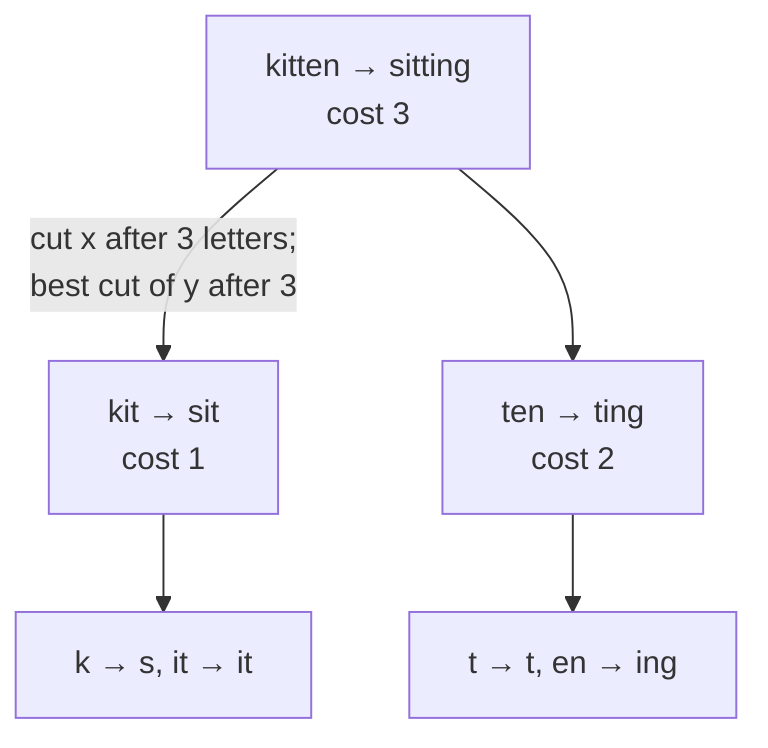
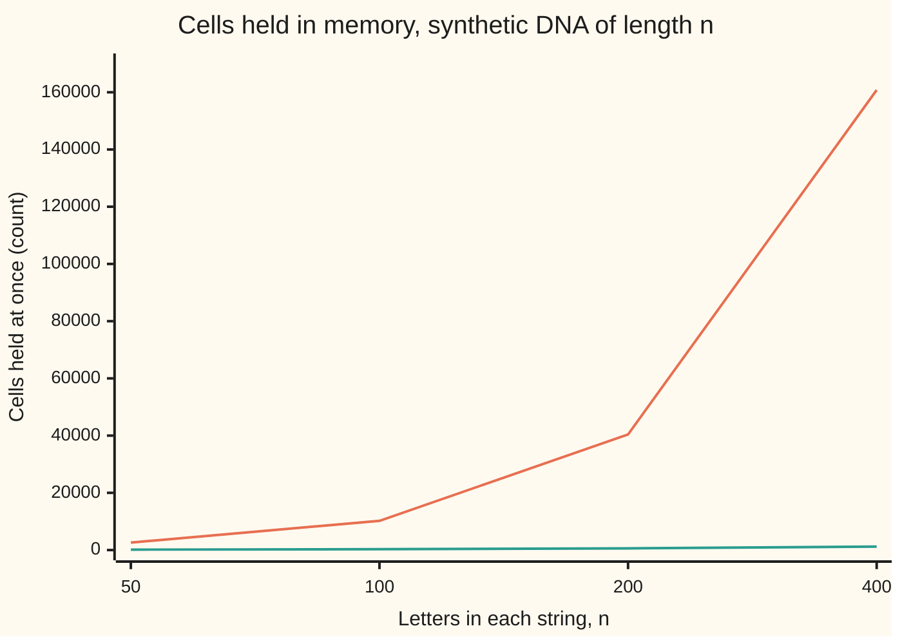

# Edit distance: the fewest typos between two words, by a table and a traceback

[Syllabus](../../../SYLLABUS.md) → [Applied and computational](../README.md) → [Algorithms and Growth](../README.md#s01) → Edit distance

---

## General Overview

A phone holds a music library of 1,000,000 tracks. Someone types *kitten* into the search box, but the title they want is *sitting*. A search that forgives typos needs a number for how far apart the two words are.

The **edit distance** gives that number. It is the fewest single-letter edits that turn one word into the other. An edit is one of three moves: **insert** a letter, **delete** a letter, or **change** one letter into another.

From *kitten* to *sitting* takes 3 edits: change k to s, change e to i, and insert g at the end. Proving that no route with 2 edits exists, by trying every way to line up the letters, means checking 19,825 line-ups.

Instead, a table answers smaller questions: "how many edits turn the first $`i`$ letters of *kitten* into the first $`j`$ letters of *sitting*?" There are 7 × 8 = 56 such questions. Each is answered from three neighbours already filled in. The bottom-right corner holds 3. A walk back from the corner reads off the three edits.

The same table lines up DNA: GATTACA becomes GCATGCA in 3 edits. With a score for each match, mismatch and gap, it gives the best **alignment** of two genes: the letters in two rows, with dashes for gaps, so that matching letters share a column.

Long strings make the table huge. Two play logs of 100,000 plays each need a table of about 10 billion cells: 40 GB at 4 bytes a cell. **Hirschberg's split** finds an alignment just as cheap, here the very same one, while holding at most three rows: 1.2 MB.

**Edit distance fills a table in which each cell is the cheapest way to turn one prefix into another, computed from the cells above, to the left and diagonally above; the bottom-right corner is the distance, and a walk back from it gives the edits.**

**What kind of fact this is:** an algorithm with theorems behind it. That the table gives the fewest edits, and that Hirschberg's split matches it in linear memory, are proved on this card in Why it works. The code checks the table against all 19,825 alignments.

### The picture: the table for kitten to sitting, and its traceback

Row $`i`$ uses the first $`i`$ letters of *kitten*; column $`j`$ uses the first $`j`$ letters of *sitting*. "(empty)" means no letters yet. The arrows mark the traceback path: ↖ is a diagonal step, a match or a change; ← is a step left, an insert.

|  | (empty) | s | i | t | t | i | n | g |
| --- | ---: | ---: | ---: | ---: | ---: | ---: | ---: | ---: |
| (empty) | 0 | 1 | 2 | 3 | 4 | 5 | 6 | 7 |
| k | 1 | ↖1 | 2 | 3 | 4 | 5 | 6 | 7 |
| i | 2 | 2 | ↖1 | 2 | 3 | 4 | 5 | 6 |
| t | 3 | 3 | 2 | ↖1 | 2 | 3 | 4 | 5 |
| t | 4 | 4 | 3 | 2 | ↖1 | 2 | 3 | 4 |
| e | 5 | 5 | 4 | 3 | 2 | ↖2 | 3 | 4 |
| n | 6 | 6 | 5 | 4 | 3 | 3 | ↖2 | ←3 |

The path's value rises only where something costs an edit: k to s (0 to 1), e to i (1 to 2), and the inserted g (2 to 3). Written as an alignment:

```
k i t t e n -
s i t t i n g
```

---

## The formula

Notation first, in words. The two strings are $`x`$, of $`n`$ letters, and $`y`$, of $`m`$ letters. $`x_i`$ is the $`i`$-th letter of $`x`$ and $`y_j`$ the $`j`$-th letter of $`y`$. $`D(i, j)`$ is the cheapest way to turn the first $`i`$ letters of $`x`$ into the first $`j`$ letters of $`y`$. A change of letter $`a`$ into letter $`b`$ costs $`c(a, b)`$, and each insert or delete (a **gap**) costs $`g`$.

```math
D(i, j) = \min\Big( D(i-1,\, j-1) + c(x_i, y_j),\;\; D(i-1,\, j) + g,\;\; D(i,\, j-1) + g \Big), \qquad D(i, 0) = i g, \quad D(0, j) = j g
```

The answer is the corner, $`D(n, m)`$.

**Read it aloud:** the cheapest way to turn $`i`$ letters into $`j`$ letters is the cheapest of three last moves: pair the two last letters, delete the last letter of $`x`$, or insert the last letter of $`y`$; turning letters into nothing costs one gap per letter.

For the **edit distance** (also called the Levenshtein distance), $`c(a, b)`$ is 0 when the letters are equal and 1 otherwise, and $`g = 1`$. For DNA, biologists use a **score** to maximise instead of a cost to minimise. This card's score gives +1 for a match, −1 for a mismatch and $`-g`$ for a gap. That is the same rule with costs $`c = -1`$ for a match and $`+1`$ for a mismatch: the best score is minus the least cost.

Hirschberg's split uses one more fact. Cut $`x`$ at its middle, after $`h = \lfloor n/2 \rfloor`$ letters (half of $`n`$, rounded down). Then:

```math
D(n, m) = \min_{0 \le j \le m} \Big( \mathrm{cost}\big(x_1 \ldots x_h \to y_1 \ldots y_j\big) + \mathrm{cost}\big(x_{h+1} \ldots x_n \to y_{j+1} \ldots y_m\big) \Big)
```

**Read it aloud:** the best alignment sends the top half of $`x`$ to some first part of $`y`$ and the bottom half to the rest; try every place $`j`$ to cut $`y`$, and keep the cheapest.

| Symbol | Plain meaning | In our example | Push it up and the answer… |
| --- | --- | --- | --- |
| $`x`$, $`y`$ | the two strings | *kitten*, *sitting* | — |
| $`n`$, $`m`$ | their lengths, in letters | 6, 7 | the table gains a row or a column |
| $`i`$, $`j`$ | how many letters of $`x`$ and of $`y`$ are in play | 0 to 6, 0 to 7 | — |
| $`x_i`$, $`y_j`$ | the $`i`$-th letter of $`x`$, the $`j`$-th of $`y`$ | $`x_5`$ = e, $`y_5`$ = i | — |
| $`c(a, b)`$ | cost of putting letter $`a`$ against letter $`b`$ | 0 if equal, 1 if not | the distance rises or stays |
| $`g`$ | cost of one gap: an insert or a delete | 1 | the distance rises or stays; for DNA, fewer gaps are used |
| $`D(i, j)`$ | cheapest way from the first $`i`$ letters of $`x`$ to the first $`j`$ of $`y`$ | $`D(5, 5)`$ = 2, $`D(6, 7)`$ = 3 | — |
| $`h`$ | where Hirschberg cuts $`x`$: half its length, rounded down | 3: *kit* and *ten* | — |
| $`j^*`$ | the best place to cut $`y`$, found by the split | 3: *sit* and *ting* | — |
| $`k`$ | how many diagonal steps (letter pairs) an alignment path takes | 0 to 6 | the path needs fewer down and right steps |
| $`\varepsilon`$ | a small fixed amount shaved off the power 2, in the fine-grained bound | any number above 0 | — |
| $`\Theta(\cdot)`$ | "grows exactly like, up to a constant", from [Big-O](01-big-o-and-growth-rates.md) | $`\Theta(nm)`$ cells | — |

Filling the table costs one small minimum per cell: $`nm`$ cells, 6 × 7 = 42 here. So the time is $`\Theta(nm)`$, and so is the memory if the whole table is kept.

### When it holds

- **Each edit has a fixed cost, and costs add up.** One gap of 10 letters then costs as much as 10 separate gaps. In genes a long gap is often one event, so biologists charge an opening cost plus a smaller cost per letter (an **affine gap**). That needs three tables, not one.
- **Only three moves.** A swap of two neighbouring letters is two edits: *teh* to *the* costs 2, not 1. Spell checkers that count a swap as one typo add a fourth move.
- **Both strings are used whole** (a **global** alignment). Finding a short query inside a long title needs free gaps at the ends of the long string, which changes the border.
- **A match costs 0, every change and gap costs more than 0, costs are the same both ways, and the letter costs obey the triangle rule themselves.** That last rule means changing a into c costs no more than changing a into b and then b into c; unit costs obey all four. Then the edit distance is a true distance: zero only for equal strings, symmetric, and never more than a detour through a third string. A free change of e into i would make *kitten* and *kittin* 0 apart, and letter costs that break the triangle rule break it for whole strings too. A DNA score with a bonus for matches still aligns correctly, but it is not a distance.
- **The table fits in the time available.** Two bacterial genomes of about 4,600,000 letters each need 21,160,000,000,000 cells, about 2 × 10¹³. Hirschberg's split fixes the memory, not the time.

---

## Why it works

### Step 0: an alignment is a path through the table

Write any alignment as two rows of letters and dashes. Read it column by column. Each column moves one step through the table: a pair of letters moves diagonally, a letter over a dash (a delete) moves down, a dash over a letter (an insert) moves right. So every alignment is a path from the top-left corner to the bottom-right corner, and its cost is the sum of its steps.

The paths are many. A path with $`k`$ diagonal steps also has $`6-k`$ steps down and $`7-k`$ steps right, in any order; counting those orders for $`k`$ = 0 to 6 gives 19,825 paths for 6 and 7 letters. But each ends with one of only three last steps, and that is the whole trick.

### Step 1: the cheapest path ends with a cheapest path

Take a cheapest alignment of the first $`i`$ letters of $`x`$ with the first $`j`$ letters of $`y`$. Look at its last column. There are three cases.

- **A pair of letters, $`x_i`$ over $`y_j`$.** The columns before it align the first $`i-1`$ letters with the first $`j-1`$. If a cheaper way existed for those, paste it in front of the last column: the whole would be cheaper. So the total is $`D(i-1, j-1) + c(x_i, y_j)`$.
- **$`x_i`$ over a dash.** The rest aligns $`i-1`$ letters with $`j`$, so the total is $`D(i-1, j) + g`$.
- **A dash over $`y_j`$.** The rest aligns $`i`$ letters with $`j-1`$, so the total is $`D(i, j-1) + g`$.

Every alignment falls in one case, so the cheapest is the least of the three. This is the cut-and-paste argument from [Dynamic programming](07-dynamic-programming.md), with three choices instead of two.

<details>
<summary>Detailed proof, by induction on i + j</summary>

Claim: for every $`i`$ from 0 to $`n`$ and $`j`$ from 0 to $`m`$, the number $`D(i, j)`$ computed by the rule equals the least cost over all alignments of $`x_1 \ldots x_i`$ with $`y_1 \ldots y_j`$.

Base: if $`j = 0`$, the only alignment puts each of the $`i`$ letters over a dash, costing $`ig`$. If $`i = 0`$, likewise $`jg`$. The rule's border gives exactly these.

Step: let $`i, j \ge 1`$ and assume the claim for every pair with a smaller sum. Split the alignments by their last column. Those ending in $`x_i`$ over $`y_j`$ are exactly an alignment of $`x_1 \ldots x_{i-1}`$ with $`y_1 \ldots y_{j-1}`$ followed by that column. Their least cost is

$`\displaystyle D(i-1, j-1) + c(x_i, y_j)`$

by the assumption. In the same way, the least cost of those ending in $`x_i`$ over a dash is $`D(i-1, j) + g`$, and of those ending in a dash over $`y_j`$ is $`D(i, j-1) + g`$. The least over all alignments is the least of the three group minimums, which is the rule. The claim holds at $`(n, m)`$.

</details>

### Step 2: few questions, asked many times

A cell is fixed by two whole numbers, $`i`$ and $`j`$, so there are only $`(n+1)(m+1)`$ different questions: 56 for *kitten* and *sitting*.

Written as a function that calls itself, the rule is correct but slow. On *kitten* and *sitting* it makes 29,737 calls to answer those 56 questions. Filling the table row by row, left to right, answers each once: 42 cells beyond the border.

### Step 3: the traceback

The table holds costs, not edits. To recover the edits, start at the corner and ask which of the three neighbours produced its value. Step to that neighbour and repeat until the top-left corner.

Where two neighbours tie, either step gives a cheapest alignment; the code prefers the diagonal. The worked numbers below trace the *kitten* table.

For *kitten* and *sitting* the cheapest alignment is unique: 1 of the 19,825 costs 3. For GATTACA and GCATGCA, 4 alignments tie at 3, and the traceback returns one of them: three changes, no gaps.

### Step 4: gap costs choose the alignment

For DNA the scoring decides which alignment is best. Score GATTACA against GCATGCA with +1 for a match and −1 for a mismatch.

| Gap score | A best alignment | Matches, mismatches, gaps | Score |
| --- | --- | --- | ---: |
| −1 | `G-ATTACA` over `GCA-TGCA`, one of 3 that tie | 5, 1, 2 | 5 − 1 − 2 = **2** |
| −2 | `GATTACA` over `GCATGCA`, the only one | 4, 3, 0 | 4 − 3 = **1** |

With cheap gaps, each of the three best alignments opens two gaps to line up five letters. With dear gaps, the one best alignment keeps the strings straight and accepts three mismatches. The scoring is a model of how often each kind of mutation happens, and the table finds the best answer only for the model it is given.

### Step 5: Hirschberg's split, in linear memory

Each row needs only the row above, so two rows are enough to find the *cost*. The traceback is the problem: it walks the whole table. Hirschberg's idea is to find one point of the best path, then solve two halves.

1. **Forward pass.** Cut $`x`$ after $`h`$ letters. Fill the table for the top half against all of $`y`$, keeping two rows. Its last row gives, for every $`j`$, the cost of turning the top half into $`y_1 \ldots y_j`$.
2. **Backward pass.** Reverse the bottom half of $`x`$ and all of $`y`$, and do the same. Read backwards, its last row gives, for every $`j`$, the cost of turning the bottom half into $`y_{j+1} \ldots y_m`$.
3. **Split.** Add the two rows and pick the $`j`$ with the least sum. The best path crosses the middle row at column $`j`$. This is the split formula.
4. **Recurse.** Align the top half with $`y_1 \ldots y_j`$ and the bottom half with the rest, in the same way. Join the two answers.

For *kitten*, $`h = 3`$. The forward row for *kit* is 3, 3, 2, 1, 2, 3, 4, 5. The backward row for *ten* is 5, 4, 3, 2, 3, 3, 3, 3. Their sums are 8, 7, 5, 3, 5, 6, 7, 8. The least, 3, is at $`j = 3`$: *kit* goes to *sit* (cost 1) and *ten* goes to *ting* (cost 2).



Schematic: the first split of Hirschberg's method on the card's words, then the next level of halves. The pieces join into `kitten-` over `sitting`, the same alignment as the traceback.

**Why the split is right.** In any alignment, the letters of the top half of $`x`$ sit in the first columns, opposite some first part of $`y`$. So every alignment splits at some $`j`$ into an alignment of the top half with $`y_1 \ldots y_j`$ and one of the bottom half with the rest. The cheapest whole is the cheapest such pair, over all $`j`$. Reversing both strings reverses every alignment without changing its cost, which is why the backward pass gives the second terms.

**Why the work is at most double.** The first level fills $`h m + (n-h) m = nm`$ cells. The two halves then have $`h`$ and $`n - h`$ rows against $`j`$ and $`m - j`$ columns. Their own passes fill about $`\tfrac{n}{2} j + \tfrac{n}{2}(m-j) = \tfrac{nm}{2}`$ cells. Each level is half the one before, so the total stays under $`nm(1 + \tfrac12 + \tfrac14 + \cdots) = 2nm`$.

**Why the memory is linear.** Each pass works in two rows. The forward pass's last row waits while the backward pass runs, so at most three rows of $`m + 1`$ cells exist at once. Add the two strings and the alignment being built, all of length at most $`n + m`$. The checks count the table cells held at once during each run: the peak for *kitten* and *sitting* is 24, three rows of 8.



Both lines are counted during the run: the most table cells held at once. The orange line is the full table, $`(n+1)^2`$ cells: 2,601, 10,201, 40,401, 160,801. The green line is Hirschberg, exactly three rows, $`3(n+1)`$ cells: 153, 303, 603, 1,203; it hugs the axis. The strings are synthetic: random letters A, C, G, T from a seeded generator. Both methods find the same distance at every size, and Hirschberg fills just under twice the cells: 319,768 against 160,000 at $`n = 400`$.

---

## Worked numbers, by hand

The table is in the General Overview. Here are the cells along the traceback path, then the split. Row $`i`$ is the first $`i`$ letters of *kitten*, column $`j`$ the first $`j`$ letters of *sitting*.

| Step | Arithmetic | Value |
| --- | --- | --- |
| k against s | min($`D(0,0)`$ + 1, $`D(0,1)`$ + 1, $`D(1,0)`$ + 1) = min(1, 2, 2) | $`D(1, 1)`$ = 1 |
| i against i, a match | min($`D(1,1)`$ + 0, $`D(1,2)`$ + 1, $`D(2,1)`$ + 1) = min(1, 3, 3) | $`D(2, 2)`$ = 1 |
| e against i | min($`D(4,4)`$ + 1, $`D(4,5)`$ + 1, $`D(5,4)`$ + 1) = min(2, 3, 3) | $`D(5, 5)`$ = 2 |
| n against n, a match | min($`D(5,5)`$ + 0, $`D(5,6)`$ + 1, $`D(6,5)`$ + 1) = min(2, 4, 4) | $`D(6, 6)`$ = 2 |
| the corner: n against g | min($`D(5,6)`$ + 1, $`D(5,7)`$ + 1, $`D(6,6)`$ + 1) = min(4, 5, 3) | $`D(6, 7)`$ = 3 |
| traceback at the corner | 3 came from $`D(6,6)`$ + 1, the left neighbour | insert g |
| traceback on the diagonal | 2 → 2 → 1 → 1 → 1 → 1 → 0, rising at e/i and k/s | change e to i, change k to s |
| Hirschberg's split, $`h = 3`$ | forward + backward at $`j`$ = 0 to 7: 8, 7, 5, 3, 5, 6, 7, 8 | cut $`y`$ after $`j^*`$ = 3 |
| the two halves | *kit* → *sit* costs 1, *ten* → *ting* costs 2 | 1 + 2 = **3 edits** |

*Kitten* is 3 typos from *sitting*: two changed letters and one added letter. No alignment of the 19,825 costs less, and Hirschberg's split reaches the same alignment while holding three rows of 8 cells, filling 80 cells in all against the table's 42.

### What breaks if you drop a piece

| Mistake | Comes out at | What went wrong |
| --- | --- | --- |
| Compare letter by letter, *Beatles* against *The Beatles* | 10 differences, against the true 4 | Four missing letters at the front shift every later letter out of line; inserting "The " costs only 4 |
| Allow only insert and delete, no change | *kitten* → *sitting*: 5, against 3 | Each change becomes a delete plus an insert, costing 2 |
| Border row and column filled with zeros | *Beatles* → *The Beatles*: 0, against 4 | The four inserted letters at the front are charged nothing |
| Hirschberg cutting $`y`$ at its middle, not at the best $`j`$ | *Beatles* → *The Beatles*: 9, against 4 | The middle of *Beatles* is not opposite the middle of *The Beatles*; the forced cut breaks up the matches |

The code prints all four.

---

## Code, from first principles, and it actually runs

Nothing is imported. Three roads reach each answer: the full table with its traceback, brute force over every alignment (19,825 for *kitten* and *sitting*, 48,639 for the DNA pair), and Hirschberg's split. The count of alignments is checked against the path-counting formula of Step 0. The scored DNA alignments are also checked against brute force for both gap scores. A plain recursion counts its calls. A random-number generator written out in both languages, SplitMix64 with seed 2026, builds synthetic DNA strings of 50 to 400 letters, where the table and Hirschberg must agree, the cells computed must stay under twice the table's, and the cells held at once must stay within three rows.

### Python

```python
# Edit distance and sequence alignment -- the check behind the card.  Nothing is imported.
# D(i, j) = the cheapest way to turn the first i letters of x into the first j letters of y.
unit = lambda a, b: 0 if a == b else 1    # Levenshtein: a change costs 1, a match costs 0
dna = lambda a, b: -1 if a == b else 1    # DNA score +1 match, -1 mismatch, kept as a cost = -score
CELLS, KEPT = [0], [0, 0]                 # cells computed; table cells held now, and the most held at once
def keep(k): KEPT[0] += k; KEPT[1] = max(KEPT[1], KEPT[0])

def last_row(x, y, sub, g):               # two rows only: returns the bottom row of the table
    prev = [j * g for j in range(len(y) + 1)]; keep(len(y) + 1)
    for i in range(1, len(x) + 1):
        cur = [i * g] + [0] * len(y); keep(len(y) + 1)
        for j in range(1, len(y) + 1):
            cur[j] = min(prev[j - 1] + sub(x[i - 1], y[j - 1]), prev[j] + g, cur[j - 1] + g)
            CELLS[0] += 1
        prev = cur; keep(-len(y) - 1)       # the old row is dropped
    return prev

def table(x, y, sub=unit, g=1, border=True):    # road one: the whole table, kept for the traceback
    D = [[(j * g if border else 0) for j in range(len(y) + 1)]]; keep(len(y) + 1)
    for i in range(1, len(x) + 1):
        D.append([i * g if border else 0] + [0] * len(y)); keep(len(y) + 1)
        for j in range(1, len(y) + 1):
            D[i][j] = min(D[i - 1][j - 1] + sub(x[i - 1], y[j - 1]), D[i - 1][j] + g, D[i][j - 1] + g)
            CELLS[0] += 1
    return D

def trace(D, x, y, sub=unit, g=1):        # walk back from the corner: diagonal, then up, then left
    i, j, top, bot = len(x), len(y), "", ""
    while i or j:
        if i and j and D[i][j] == D[i - 1][j - 1] + sub(x[i - 1], y[j - 1]):
            top, bot, i, j = x[i - 1] + top, y[j - 1] + bot, i - 1, j - 1
        elif i and D[i][j] == D[i - 1][j] + g:
            top, bot, i = x[i - 1] + top, "-" + bot, i - 1
        else:
            top, bot, j = "-" + top, y[j - 1] + bot, j - 1
    return top, bot

def score(top, bot, sub=unit, g=1):       # the cost of a written alignment, column by column
    return sum(g if "-" in (a, b) else sub(a, b) for a, b in zip(top, bot))

def brute(x, y, sub=unit, g=1):           # road two: every alignment, one by one
    best, ways, count = [None], [0], [0]
    def go(i, j, c):
        if i == len(x) and j == len(y):
            count[0] += 1
            if best[0] is None or c < best[0]: best[0], ways[0] = c, 1
            elif c == best[0]: ways[0] += 1
            return
        if i < len(x) and j < len(y): go(i + 1, j + 1, c + sub(x[i], y[j]))
        if i < len(x): go(i + 1, j, c + g)
        if j < len(y): go(i, j + 1, c + g)
    go(0, 0, 0)
    return best[0], ways[0], count[0]

def plain(x, y, calls):                   # the recursion without a table, counting its calls
    calls[0] += 1
    if not x or not y: return len(x) + len(y)
    return min(plain(x[:-1], y[:-1], calls) + unit(x[-1], y[-1]), plain(x[:-1], y, calls) + 1, plain(x, y[:-1], calls) + 1)

def hirsch(x, y, sub=unit, g=1, split_best=True):   # road three: Hirschberg, two rows at a time
    if len(x) <= 1 or len(y) == 0:
        al = trace(table(x, y, sub, g), x, y, sub, g); keep(-(len(x) + 1) * (len(y) + 1)); return al
    mid = len(x) // 2
    left = last_row(x[:mid], y, sub, g)
    right = last_row(x[mid:][::-1], y[::-1], sub, g)[::-1]
    js = range(len(y) + 1)
    j = min(js, key=lambda k: (left[k] + right[k], k)) if split_best else len(y) // 2; del left, right; keep(-2 * len(y) - 2)
    a1, b1 = hirsch(x[:mid], y[:j], sub, g, split_best)
    a2, b2 = hirsch(x[mid:], y[j:], sub, g, split_best)
    return a1 + a2, b1 + b2

x, y = "kitten", "sitting"
CELLS[0] = 0; D = table(x, y)
print(f"table for {x} -> {y}: rows i = 0..6, columns j = 0..7, {CELLS[0]} cells filled")
for i, row in enumerate(D):
    print(f"  {' ' + x[i - 1] if i else '  '}" + "".join(f"{v:3d}" for v in row))
top, bot = trace(D, x, y)
print(f"traceback: {top} / {bot}, cost {score(top, bot)}")
print("edits: " + ", ".join(f"{a}->{b}" if "-" not in (a, b) else (f"insert {b}" if a == "-" else f"delete {a}")
                            for a, b in zip(top, bot) if a != b))
bk = brute(x, y); calls = [0]; plain(x, y, calls)
print(f"brute force: {bk[2]} alignments, best {bk[0]}, {bk[1]} of them optimal")
print(f"plain recursion: {calls[0]} calls for {(len(x) + 1) * (len(y) + 1)} different questions")
g1, g2 = "GATTACA", "GCATGCA"
Dg, bg = table(g1, g2), brute(g1, g2)
print(f"{g1} -> {g2}: distance {Dg[7][7]}, traceback {' / '.join(trace(Dg, g1, g2))}; "
      f"brute force {bg[2]} alignments, best {bg[0]}, {bg[1]} optimal")
for gap in (1, 2):
    Ds = table(g1, g2, dna, gap)
    t, b = trace(Ds, g1, g2, dna, gap)
    bs = brute(g1, g2, dna, gap)
    print(f"DNA score, match +1, mismatch -1, gap -{gap}: best {-Ds[7][7]}, {t} / {b}; brute force best {-bs[0]}, {bs[1]} optimal")
    assert -Ds[7][7] == -bs[0] == -score(t, b, dna, gap), "scored table against every alignment"
for a, b in ((x, y), (g1, g2)):
    CELLS[0] = 0; KEPT[:] = [0, 0]
    ht, hb = hirsch(a, b)
    print(f"Hirschberg {a} -> {b}: {ht} / {hb}, cost {score(ht, hb)}, {CELLS[0]} cells computed, peak {KEPT[1]} cells held, 3 rows of {len(b) + 1}")
    assert KEPT[1] <= 3 * (len(b) + 1) and score(ht, hb) == table(a, b)[-1][-1], "Hirschberg against the full table, in 3 rows"
    assert ht.replace("-", "") == a and hb.replace("-", "") == b, "the alignment spells both strings"
L, R = last_row(x[:3], y, unit, 1), last_row(x[3:][::-1], y[::-1], unit, 1)[::-1]
print(f"first split, kit | ten: forward {L}, backward {R}, sums {[a + b for a, b in zip(L, R)]}")
q, t2 = "Beatles", "The Beatles"
ham = sum(1 for k in range(len(t2)) if k >= len(q) or q[k] != t2[k])
print(f"wrong: letter by letter, {q} against {t2}: {ham} differences, true distance {table(q, t2)[-1][-1]}")
print(f"wrong: no changes, only insert and delete, {x} -> {y}: {table(x, y, lambda a, b: 0 if a == b else 2)[-1][-1]}")
print(f"wrong: border filled with zeros, {q} -> {t2}: {table(q, t2, border=False)[-1][-1]}")
print(f"limit: a swap, teh -> the: {table('teh', 'the')[-1][-1]} edits, not 1")
wt, wb = hirsch(q, t2, split_best=False)
print(f"wrong: Hirschberg splitting y at its middle, {q} -> {t2}: {wt} / {wb}, cost {score(wt, wb)}")

def splitmix(s):                          # SplitMix64, written out, for the synthetic DNA
    s = (s + 0x9E3779B97F4A7C15) & (2 ** 64 - 1)
    z = ((s ^ (s >> 30)) * 0xBF58476D1CE4E5B9) & (2 ** 64 - 1)
    z = ((z ^ (z >> 27)) * 0x94D049BB133111EB) & (2 ** 64 - 1)
    return s, z ^ (z >> 31)
print("synthetic DNA, seed 2026, both strings of length n, unit costs")
chart, s = [], 2026
for n in (50, 100, 200, 400):
    u, v = "", ""
    for _ in range(n):
        s, r1 = splitmix(s); s, r2 = splitmix(s)
        u += "ACGT"[r1 % 4]; v += "ACGT"[r2 % 4]
    CELLS[0] = 0; KEPT[:] = [0, 0]; full = table(u, v)[n][n]; c_full, k_full = CELLS[0], KEPT[1]
    CELLS[0] = 0; KEPT[:] = [0, 0]; ht, hb = hirsch(u, v); c_h, k_h = CELLS[0], KEPT[1]
    assert score(ht, hb) == full and c_h <= 2 * c_full and k_h <= 3 * (n + 1), "same cost, twice the work, 3 rows"
    chart.append((k_full, k_h))
    print(f"  n={n:3d}: distance {full:3d}, Hirschberg {score(ht, hb):3d}; cells computed {c_full:6d} vs {c_h:6d}; "
          f"cells kept {k_full:6d} vs {k_h}")
print("chart, n 50 100 200 400")
print("chart, cells kept by the full table " + " ".join(str(c[0]) for c in chart))
print("chart, cells kept by Hirschberg, 3 rows " + " ".join(str(c[1]) for c in chart))
print(f"two play logs of 100,000 plays, 4 bytes a cell: full table {100001 ** 2} cells, {4 * 100001 ** 2} bytes; "
      f"3 rows {3 * 100001} cells, {12 * 100001} bytes; two genomes of 4,600,000: {4600000 ** 2} cells")
assert D[6][7] == bk[0] == 3 and Dg[7][7] == bg[0] == 3, "table against every alignment"
assert score(top, bot) == 3 and hirsch(x, y) == (top, bot), "traceback cost, and Hirschberg finds the same alignment"
assert calls[0] > bk[2] > 56, "plain recursion repeats questions"
fact = lambda k: 1 if k < 2 else k * fact(k - 1)   # a path with k diagonal steps has n - k down, m - k right
assert [bk[2], bg[2]] == [sum(fact(a + b - k) // (fact(k) * fact(a - k) * fact(b - k)) for k in range(a + 1))
                          for a, b in ((6, 7), (7, 7))], "alignment count against the path-counting formula"
print("ALL CHECKS PASS")
```

**Ran 2026-11-23 on macOS, Python 3.14.10, standard library only. All checks passed. Output, pasted from the run:**

```
table for kitten -> sitting: rows i = 0..6, columns j = 0..7, 42 cells filled
      0  1  2  3  4  5  6  7
   k  1  1  2  3  4  5  6  7
   i  2  2  1  2  3  4  5  6
   t  3  3  2  1  2  3  4  5
   t  4  4  3  2  1  2  3  4
   e  5  5  4  3  2  2  3  4
   n  6  6  5  4  3  3  2  3
traceback: kitten- / sitting, cost 3
edits: k->s, e->i, insert g
brute force: 19825 alignments, best 3, 1 of them optimal
plain recursion: 29737 calls for 56 different questions
GATTACA -> GCATGCA: distance 3, traceback GATTACA / GCATGCA; brute force 48639 alignments, best 3, 4 optimal
DNA score, match +1, mismatch -1, gap -1: best 2, G-ATTACA / GCA-TGCA; brute force best 2, 3 optimal
DNA score, match +1, mismatch -1, gap -2: best 1, GATTACA / GCATGCA; brute force best 1, 1 optimal
Hirschberg kitten -> sitting: kitten- / sitting, cost 3, 80 cells computed, peak 24 cells held, 3 rows of 8
Hirschberg GATTACA -> GCATGCA: GATTACA / GCATGCA, cost 3, 93 cells computed, peak 24 cells held, 3 rows of 8
first split, kit | ten: forward [3, 3, 2, 1, 2, 3, 4, 5], backward [5, 4, 3, 2, 3, 3, 3, 3], sums [8, 7, 5, 3, 5, 6, 7, 8]
wrong: letter by letter, Beatles against The Beatles: 10 differences, true distance 4
wrong: no changes, only insert and delete, kitten -> sitting: 5
wrong: border filled with zeros, Beatles -> The Beatles: 0
limit: a swap, teh -> the: 2 edits, not 1
wrong: Hirschberg splitting y at its middle, Beatles -> The Beatles: -Be-at-le-s / The Beatles, cost 9
synthetic DNA, seed 2026, both strings of length n, unit costs
  n= 50: distance  28, Hirschberg  28; cells computed   2500 vs   4975; cells kept   2601 vs 153
  n=100: distance  55, Hirschberg  55; cells computed  10000 vs  19933; cells kept  10201 vs 303
  n=200: distance 108, Hirschberg 108; cells computed  40000 vs  79854; cells kept  40401 vs 603
  n=400: distance 214, Hirschberg 214; cells computed 160000 vs 319768; cells kept 160801 vs 1203
chart, n 50 100 200 400
chart, cells kept by the full table 2601 10201 40401 160801
chart, cells kept by Hirschberg, 3 rows 153 303 603 1203
two play logs of 100,000 plays, 4 bytes a cell: full table 10000200001 cells, 40000800004 bytes; 3 rows 300003 cells, 1200012 bytes; two genomes of 4,600,000: 21160000000000 cells
ALL CHECKS PASS
```

### Rust

Same numbers, same labels, built with `rustc --edition 2021 -O`.

```rust
// Edit distance and sequence alignment -- the same check as the Python, in Rust.  No crates.
// D(i, j) = the cheapest way to turn the first i letters of x into the first j letters of y.
use std::sync::atomic::{AtomicUsize, Ordering::Relaxed};
type Sub = fn(u8, u8) -> i64;
fn unit(a: u8, b: u8) -> i64 { if a == b { 0 } else { 1 } }   // Levenshtein: a change costs 1
fn dna(a: u8, b: u8) -> i64 { if a == b { -1 } else { 1 } }   // DNA score +1 / -1, kept as a cost = -score
fn indel(a: u8, b: u8) -> i64 { if a == b { 0 } else { 2 } }  // wrong: a change only as delete + insert
static CELLS: AtomicUsize = AtomicUsize::new(0);
static KEPT: [AtomicUsize; 2] = [AtomicUsize::new(0), AtomicUsize::new(0)]; // table cells held now, and the most at once
fn keep(k: isize) { let now = (KEPT[0].load(Relaxed) as isize + k) as usize; KEPT[0].store(now, Relaxed); KEPT[1].fetch_max(now, Relaxed); }
fn s(v: &[u8]) -> String { String::from_utf8(v.to_vec()).unwrap() } fn rev<T: Clone>(v: &[T]) -> Vec<T> { v.iter().rev().cloned().collect() }

fn last_row(x: &[u8], y: &[u8], sub: Sub, g: i64) -> Vec<i64> { // two rows only: the bottom row
    let mut prev: Vec<i64> = (0..=y.len() as i64).map(|j| j * g).collect(); keep(y.len() as isize + 1);
    for i in 1..=x.len() {
        let mut cur = vec![i as i64 * g; y.len() + 1]; keep(y.len() as isize + 1);
        for j in 1..=y.len() {
            cur[j] = (prev[j - 1] + sub(x[i - 1], y[j - 1])).min(prev[j] + g).min(cur[j - 1] + g);
            CELLS.fetch_add(1, Relaxed);
        }
        prev = cur; keep(-(y.len() as isize) - 1); // the old row is dropped
    }
    prev
}

fn table(x: &[u8], y: &[u8], sub: Sub, g: i64, border: bool) -> Vec<Vec<i64>> { // road one: whole table
    let b = if border { 1 } else { 0 };
    let mut d = vec![vec![0i64; y.len() + 1]; x.len() + 1]; keep(((x.len() + 1) * (y.len() + 1)) as isize);
    for j in 0..=y.len() { d[0][j] = b * j as i64 * g; }
    for i in 1..=x.len() {
        d[i][0] = b * i as i64 * g;
        for j in 1..=y.len() {
            d[i][j] = (d[i - 1][j - 1] + sub(x[i - 1], y[j - 1])).min(d[i - 1][j] + g).min(d[i][j - 1] + g);
            CELLS.fetch_add(1, Relaxed);
        }
    }
    d
}
fn dist(x: &[u8], y: &[u8], sub: Sub, g: i64, border: bool) -> i64 { table(x, y, sub, g, border)[x.len()][y.len()] }

fn trace(d: &[Vec<i64>], x: &[u8], y: &[u8], sub: Sub, g: i64) -> (Vec<u8>, Vec<u8>) { // walk back
    let (mut i, mut j, mut top, mut bot) = (x.len(), y.len(), Vec::new(), Vec::new());
    while i > 0 || j > 0 {
        if i > 0 && j > 0 && d[i][j] == d[i - 1][j - 1] + sub(x[i - 1], y[j - 1]) { top.push(x[i - 1]); bot.push(y[j - 1]); i -= 1; j -= 1; }
        else if i > 0 && d[i][j] == d[i - 1][j] + g { top.push(x[i - 1]); bot.push(b'-'); i -= 1; }
        else { top.push(b'-'); bot.push(y[j - 1]); j -= 1; }
    }
    (rev(&top), rev(&bot))
}

fn score(top: &[u8], bot: &[u8], sub: Sub, g: i64) -> i64 { // the cost of a written alignment
    top.iter().zip(bot).map(|(&a, &b)| if a == b'-' || b == b'-' { g } else { sub(a, b) }).sum()
}

fn go(x: &[u8], y: &[u8], i: usize, j: usize, c: i64, sub: Sub, g: i64, st: &mut (Option<i64>, u64, u64)) {
    if i == x.len() && j == y.len() {
        st.2 += 1;
        match st.0 { Some(b) if c > b => {}, Some(b) if c == b => st.1 += 1, _ => { st.0 = Some(c); st.1 = 1; } }
        return;
    }
    if i < x.len() && j < y.len() { go(x, y, i + 1, j + 1, c + sub(x[i], y[j]), sub, g, st); }
    if i < x.len() { go(x, y, i + 1, j, c + g, sub, g, st); }
    if j < y.len() { go(x, y, i, j + 1, c + g, sub, g, st); }
}
fn brute(x: &[u8], y: &[u8], sub: Sub, g: i64) -> (i64, u64, u64) { // road two: every alignment
    let mut st = (None, 0, 0); go(x, y, 0, 0, 0, sub, g, &mut st);
    (st.0.unwrap(), st.1, st.2)
}

fn plain(x: &[u8], y: &[u8], calls: &mut u64) -> i64 { // the recursion without a table
    *calls += 1;
    if x.is_empty() || y.is_empty() { return (x.len() + y.len()) as i64; }
    let (n, m) = (x.len() - 1, y.len() - 1);
    (plain(&x[..n], &y[..m], calls) + unit(x[n], y[m])).min(plain(&x[..n], y, calls) + 1).min(plain(x, &y[..m], calls) + 1)
}

fn hirsch(x: &[u8], y: &[u8], sub: Sub, g: i64, split_best: bool) -> (Vec<u8>, Vec<u8>) { // road three
    if x.len() <= 1 || y.is_empty() { let al = trace(&table(x, y, sub, g, true), x, y, sub, g); keep(-(((x.len() + 1) * (y.len() + 1)) as isize)); return al; }
    let mid = x.len() / 2;
    let left = last_row(&x[..mid], y, sub, g);
    let right = rev(&last_row(&rev(&x[mid..]), &rev(y), sub, g));
    let j = if split_best { (0..=y.len()).min_by_key(|&k| (left[k] + right[k], k)).unwrap() } else { y.len() / 2 }; drop((left, right)); keep(-2 * (y.len() as isize + 1));
    let (mut a1, mut b1) = hirsch(&x[..mid], &y[..j], sub, g, split_best);
    let (a2, b2) = hirsch(&x[mid..], &y[j..], sub, g, split_best);
    a1.extend(a2); b1.extend(b2); (a1, b1)
}
fn fact(k: u64) -> u64 { if k < 2 { 1 } else { k * fact(k - 1) } }
fn splitmix(s: u64) -> (u64, u64) { // SplitMix64, written out, for the synthetic DNA
    let s = s.wrapping_add(0x9E3779B97F4A7C15);
    let z = (s ^ (s >> 30)).wrapping_mul(0xBF58476D1CE4E5B9);
    let z = (z ^ (z >> 27)).wrapping_mul(0x94D049BB133111EB);
    (s, z ^ (z >> 31))
}

fn main() {
    let (x, y) = (b"kitten".as_slice(), b"sitting".as_slice());
    CELLS.store(0, Relaxed); let d = table(x, y, unit, 1, true);
    println!("table for {} -> {}: rows i = 0..6, columns j = 0..7, {} cells filled", s(x), s(y), CELLS.load(Relaxed));
    for (i, row) in d.iter().enumerate() {
        let lab = if i > 0 { format!(" {}", x[i - 1] as char) } else { "  ".to_string() };
        println!("  {}{}", lab, row.iter().map(|v| format!("{:3}", v)).collect::<String>());
    }
    let (top, bot) = trace(&d, x, y, unit, 1);
    println!("traceback: {} / {}, cost {}", s(&top), s(&bot), score(&top, &bot, unit, 1));
    let edits: Vec<String> = top.iter().zip(&bot).filter(|(a, b)| a != b).map(|(&a, &b)|
        if a == b'-' { format!("insert {}", b as char) } else if b == b'-' { format!("delete {}", a as char) }
        else { format!("{}->{}", a as char, b as char) }).collect();
    println!("edits: {}", edits.join(", "));
    let bk = brute(x, y, unit, 1); let mut calls = 0u64; plain(x, y, &mut calls);
    println!("brute force: {} alignments, best {}, {} of them optimal", bk.2, bk.0, bk.1);
    println!("plain recursion: {} calls for {} different questions", calls, (x.len() + 1) * (y.len() + 1));
    let (g1, g2) = (b"GATTACA".as_slice(), b"GCATGCA".as_slice());
    let (dg, bg) = (table(g1, g2, unit, 1, true), brute(g1, g2, unit, 1));
    let (tg, bgt) = trace(&dg, g1, g2, unit, 1);
    println!("{} -> {}: distance {}, traceback {} / {}; brute force {} alignments, best {}, {} optimal",
             s(g1), s(g2), dg[7][7], s(&tg), s(&bgt), bg.2, bg.0, bg.1);
    for gap in [1i64, 2] {
        let ds = table(g1, g2, dna, gap, true);
        let (t, b) = trace(&ds, g1, g2, dna, gap);
        let bs = brute(g1, g2, dna, gap);
        println!("DNA score, match +1, mismatch -1, gap -{}: best {}, {} / {}; brute force best {}, {} optimal", gap, -ds[7][7], s(&t), s(&b), -bs.0, bs.1);
        assert!(ds[7][7] == bs.0 && bs.0 == score(&t, &b, dna, gap), "scored table against every alignment");
    }
    for (a, b) in [(x, y), (g1, g2)] {
        CELLS.store(0, Relaxed); KEPT[0].store(0, Relaxed); KEPT[1].store(0, Relaxed);
        let (ht, hb) = hirsch(a, b, unit, 1, true);
        println!("Hirschberg {} -> {}: {} / {}, cost {}, {} cells computed, peak {} cells held, 3 rows of {}",
                 s(a), s(b), s(&ht), s(&hb), score(&ht, &hb, unit, 1), CELLS.load(Relaxed), KEPT[1].load(Relaxed), b.len() + 1);
        assert!(KEPT[1].load(Relaxed) <= 3 * (b.len() + 1) && score(&ht, &hb, unit, 1) == dist(a, b, unit, 1, true), "Hirschberg against the full table, in 3 rows");
        let strip = |v: &[u8]| v.iter().filter(|&&c| c != b'-').cloned().collect::<Vec<u8>>();
        assert!(strip(&ht) == a && strip(&hb) == b, "the alignment spells both strings");
    }
    let (l, r) = (last_row(&x[..3], y, unit, 1), rev(&last_row(&rev(&x[3..]), &rev(y), unit, 1)));
    let sums: Vec<i64> = l.iter().zip(&r).map(|(a, b)| a + b).collect();
    println!("first split, kit | ten: forward {:?}, backward {:?}, sums {:?}", l, r, sums);
    let (q, t2) = (b"Beatles".as_slice(), b"The Beatles".as_slice());
    let ham = (0..t2.len()).filter(|&k| k >= q.len() || q[k] != t2[k]).count();
    println!("wrong: letter by letter, {} against {}: {} differences, true distance {}", s(q), s(t2), ham, dist(q, t2, unit, 1, true));
    println!("wrong: no changes, only insert and delete, {} -> {}: {}", s(x), s(y), dist(x, y, indel, 1, true));
    println!("wrong: border filled with zeros, {} -> {}: {}", s(q), s(t2), dist(q, t2, unit, 1, false));
    println!("limit: a swap, teh -> the: {} edits, not 1", dist(b"teh", b"the", unit, 1, true));
    let (wt, wb) = hirsch(q, t2, unit, 1, false);
    println!("wrong: Hirschberg splitting y at its middle, {} -> {}: {} / {}, cost {}", s(q), s(t2), s(&wt), s(&wb), score(&wt, &wb, unit, 1));
    println!("synthetic DNA, seed 2026, both strings of length n, unit costs");
    let (mut chart, mut st) = (Vec::new(), 2026u64);
    for n in [50usize, 100, 200, 400] {
        let (mut u, mut v) = (Vec::new(), Vec::new());
        for _ in 0..n {
            let (s1, r1) = splitmix(st); let (s2, r2) = splitmix(s1); st = s2;
            u.push(b"ACGT"[(r1 % 4) as usize]); v.push(b"ACGT"[(r2 % 4) as usize]);
        }
        CELLS.store(0, Relaxed); KEPT[0].store(0, Relaxed); KEPT[1].store(0, Relaxed); let full = dist(&u, &v, unit, 1, true); let (c_full, k_full) = (CELLS.load(Relaxed), KEPT[1].load(Relaxed));
        CELLS.store(0, Relaxed); KEPT[0].store(0, Relaxed); KEPT[1].store(0, Relaxed); let (ht, hb) = hirsch(&u, &v, unit, 1, true); let (c_h, k_h) = (CELLS.load(Relaxed), KEPT[1].load(Relaxed)); let hs = score(&ht, &hb, unit, 1);
        assert!(hs == full && c_h <= 2 * c_full && k_h <= 3 * (n + 1), "same cost, twice the work, 3 rows");
        chart.push((k_full, k_h));
        println!("  n={:3}: distance {:3}, Hirschberg {:3}; cells computed {:6} vs {:6}; cells kept {:6} vs {}",
                 n, full, hs, c_full, c_h, k_full, k_h);
    }
    println!("chart, n 50 100 200 400");
    println!("chart, cells kept by the full table {}", chart.iter().map(|c| c.0.to_string()).collect::<Vec<_>>().join(" "));
    println!("chart, cells kept by Hirschberg, 3 rows {}", chart.iter().map(|c| c.1.to_string()).collect::<Vec<_>>().join(" "));
    let k = 100001u64;
    println!("two play logs of 100,000 plays, 4 bytes a cell: full table {} cells, {} bytes; 3 rows {} cells, {} bytes; two genomes of 4,600,000: {} cells", k * k, 4 * k * k, 3 * k, 12 * k, 4600000u64 * 4600000);
    assert!(d[6][7] == bk.0 && bk.0 == 3 && dg[7][7] == bg.0 && bg.0 == 3, "table against every alignment");
    assert!(score(&top, &bot, unit, 1) == 3 && hirsch(x, y, unit, 1, true) == (top.clone(), bot.clone()), "traceback cost, and Hirschberg finds the same alignment");
    assert!(calls > bk.2 && bk.2 > 56, "plain recursion repeats questions");
    let paths = |a: u64, b: u64| (0..=a).map(|k| fact(a + b - k) / (fact(k) * fact(a - k) * fact(b - k))).sum::<u64>(); // k diagonal steps
    assert!(bk.2 == paths(6, 7) && bg.2 == paths(7, 7), "alignment count against the path-counting formula");
    println!("ALL CHECKS PASS");
}
```

**Ran 2026-11-23 on macOS, rustc 1.98.1, no crates. All checks passed. Output, pasted from the run:**

```
table for kitten -> sitting: rows i = 0..6, columns j = 0..7, 42 cells filled
      0  1  2  3  4  5  6  7
   k  1  1  2  3  4  5  6  7
   i  2  2  1  2  3  4  5  6
   t  3  3  2  1  2  3  4  5
   t  4  4  3  2  1  2  3  4
   e  5  5  4  3  2  2  3  4
   n  6  6  5  4  3  3  2  3
traceback: kitten- / sitting, cost 3
edits: k->s, e->i, insert g
brute force: 19825 alignments, best 3, 1 of them optimal
plain recursion: 29737 calls for 56 different questions
GATTACA -> GCATGCA: distance 3, traceback GATTACA / GCATGCA; brute force 48639 alignments, best 3, 4 optimal
DNA score, match +1, mismatch -1, gap -1: best 2, G-ATTACA / GCA-TGCA; brute force best 2, 3 optimal
DNA score, match +1, mismatch -1, gap -2: best 1, GATTACA / GCATGCA; brute force best 1, 1 optimal
Hirschberg kitten -> sitting: kitten- / sitting, cost 3, 80 cells computed, peak 24 cells held, 3 rows of 8
Hirschberg GATTACA -> GCATGCA: GATTACA / GCATGCA, cost 3, 93 cells computed, peak 24 cells held, 3 rows of 8
first split, kit | ten: forward [3, 3, 2, 1, 2, 3, 4, 5], backward [5, 4, 3, 2, 3, 3, 3, 3], sums [8, 7, 5, 3, 5, 6, 7, 8]
wrong: letter by letter, Beatles against The Beatles: 10 differences, true distance 4
wrong: no changes, only insert and delete, kitten -> sitting: 5
wrong: border filled with zeros, Beatles -> The Beatles: 0
limit: a swap, teh -> the: 2 edits, not 1
wrong: Hirschberg splitting y at its middle, Beatles -> The Beatles: -Be-at-le-s / The Beatles, cost 9
synthetic DNA, seed 2026, both strings of length n, unit costs
  n= 50: distance  28, Hirschberg  28; cells computed   2500 vs   4975; cells kept   2601 vs 153
  n=100: distance  55, Hirschberg  55; cells computed  10000 vs  19933; cells kept  10201 vs 303
  n=200: distance 108, Hirschberg 108; cells computed  40000 vs  79854; cells kept  40401 vs 603
  n=400: distance 214, Hirschberg 214; cells computed 160000 vs 319768; cells kept 160801 vs 1203
chart, n 50 100 200 400
chart, cells kept by the full table 2601 10201 40401 160801
chart, cells kept by Hirschberg, 3 rows 153 303 603 1203
two play logs of 100,000 plays, 4 bytes a cell: full table 10000200001 cells, 40000800004 bytes; 3 rows 300003 cells, 1200012 bytes; two genomes of 4,600,000: 21160000000000 cells
ALL CHECKS PASS
```

The two outputs match line for line.

### Lean

Lean proves the table rule and Hirschberg's split for any whole-number costs, proves the distance facts, and checks the worked numbers.

- Take any letter costs and any gap cost, in whole numbers. Then some alignment of $`x`$ with $`y`$ costs exactly $`D(n, m)`$, and none costs less.
- Take any cut of $`x`$, after $`h`$ letters, not only at the middle. Then $`D(n, m)`$ is the least, over every cut $`j`$ from 0 to $`m`$, of the two halves' costs added.
- Suppose a match costs 0, changes and gaps cost more than 0, and letter costs are the same both ways and obey the triangle rule. Then $`D(n, m)`$ is a true distance: zero only for equal strings, symmetric, and never more than a detour through a third string.
- *Kitten* to *sitting* costs 3. The table's last row is 6, 6, 5, 4, 3, 3, 2, 3, and `kitten-` over `sitting` is an alignment costing 3.
- GATTACA to GCATGCA costs 3. With the DNA score, the best score is 2 at gap score −1, and 1 at gap score −2.
- For the first split of *kitten*, the forward row for *kit* is 3, 3, 2, 1, 2, 3, 4, 5. The backward row for *ten* is 5, 4, 3, 2, 3, 3, 3, 3. *Kit* to *sit* costs 1, and *ten* to *ting* costs 2.
- *Beatles* to *The Beatles* costs 4, and *teh* to *the* costs 2. With only insert and delete, *kitten* to *sitting* costs 5.
- Counting paths gives 19,825 alignments for 6 and 7 letters, and 48,639 for 7 and 7.

The traceback walk, Hirschberg's memory and work counts, the brute-force search and the synthetic DNA runs are left to the Python and Rust checks.

```lean
-- Edit distance: the table's corner equals the least cost over all alignments, Hirschberg's split at any cut of x gives the same value, and with fair costs the distance is a true distance.
import Mathlib.Data.List.Basic
import Mathlib.Algebra.BigOperators.Group.List.Basic
import Mathlib.Algebra.Order.Group.Int
import Mathlib.Algebra.BigOperators.Group.Finset.Basic
import Mathlib.Data.Nat.Factorial.Basic
import Mathlib.Tactic.NormNum
import Mathlib.Tactic.Linarith
import Mathlib.Tactic.Ring

/-! Strings are lists of letters. A change of letter `a` into letter `b` costs `c a b`, and
each gap (an insert or a delete) costs `g`. Costs are whole numbers and may be negative, so the
DNA score (a match is a cost of -1) is covered too. -/

namespace EditDistance

variable {α : Type*} [DecidableEq α]

/-- The table, built from the card's rule. The arguments are the two strings read from the
last letter back, so each step peels the last letters `x_i` and `y_j`:
`D(i, 0) = i g`, `D(0, j) = j g`, and
`D(i, j) = min(D(i-1, j-1) + c(x_i, y_j), D(i-1, j) + g, D(i, j-1) + g)`. -/
def tableRev (c : α → α → ℤ) (g : ℤ) : List α → List α → ℤ
  | [], v => (v.length : ℤ) * g
  | a :: u, v => go a u (tableRev c g u) v
where
  /-- Row `i` of the table, for last letter `a = x_i`; `r` is row `i - 1`. -/
  go (a : α) (u : List α) (r : List α → ℤ) : List α → ℤ
    | [] => ((u.length : ℤ) + 1) * g
    | b :: v => min (min (r v + c a b) (r (b :: v) + g)) (go a u r v + g)

/-- The table's corner `D(n, m)` for the whole strings `x` (n letters) and `y` (m letters). -/
def editTable (c : α → α → ℤ) (g : ℤ) (x y : List α) : ℤ :=
  tableRev c g x.reverse y.reverse

/-- Levenshtein costs: a match costs 0, a change costs 1 (with gap cost `g = 1`). -/
def unitCost (a b : α) : ℤ := if a = b then 0 else 1

/-- The card's DNA score, +1 for a match and -1 for a mismatch, kept as a cost (minus the score). -/
def dnaCost (a b : α) : ℤ := if a = b then -1 else 1

/-- One column of an alignment: two letters paired, a letter of `x` over a dash (a delete),
or a dash over a letter of `y` (an insert). -/
inductive Column (α : Type*)
  | pair (a b : α)
  | del (a : α)
  | ins (b : α)

namespace Column

/-- The top row of a column with its dash removed. -/
def top {α : Type*} : Column α → List α
  | pair a _ => [a]
  | del a => [a]
  | ins _ => []

/-- The bottom row of a column with its dash removed. -/
def bot {α : Type*} : Column α → List α
  | pair _ b => [b]
  | del _ => []
  | ins b => [b]

/-- The cost of one column: `c a b` for a pair, `g` for a gap. -/
def cost {α : Type*} (c : α → α → ℤ) (g : ℤ) : Column α → ℤ
  | pair a b => c a b
  | del _ => g
  | ins _ => g

end Column

/-- A list of columns is an alignment of `x` with `y` when its top row, dashes removed,
spells `x` and its bottom row spells `y`. -/
def IsAlignment (A : List (Column α)) (x y : List α) : Prop :=
  A.flatMap Column.top = x ∧ A.flatMap Column.bot = y

instance (A : List (Column α)) (x y : List α) : Decidable (IsAlignment A x y) :=
  inferInstanceAs (Decidable (_ ∧ _))

/-- The cost of an alignment: the sum of its columns' costs. -/
def alignCost (c : α → α → ℤ) (g : ℤ) (A : List (Column α)) : ℤ :=
  (A.map (Column.cost c g)).sum

/-! Helper facts used by the proofs below. -/

lemma tableRev_nil_left (c : α → α → ℤ) (g : ℤ) (v : List α) :
    tableRev c g [] v = (v.length : ℤ) * g := by
  rw [tableRev]

lemma tableRev_nil_right (c : α → α → ℤ) (g : ℤ) (u : List α) :
    tableRev c g u [] = (u.length : ℤ) * g := by
  cases u with
  | nil => simp [tableRev]
  | cons a u => simp [tableRev, tableRev.go]

lemma tableRev_cons_cons (c : α → α → ℤ) (g : ℤ) (a b : α) (u v : List α) :
    tableRev c g (a :: u) (b :: v) =
      min (min (tableRev c g u v + c a b) (tableRev c g u (b :: v) + g))
        (tableRev c g (a :: u) v + g) := by
  simp only [tableRev, tableRev.go]

lemma alignCost_nil (c : α → α → ℤ) (g : ℤ) : alignCost c g ([] : List (Column α)) = 0 := by
  simp [alignCost]

lemma alignCost_cons (c : α → α → ℤ) (g : ℤ) (col : Column α) (A : List (Column α)) :
    alignCost c g (col :: A) = Column.cost c g col + alignCost c g A := by
  simp [alignCost]

lemma alignCost_append (c : α → α → ℤ) (g : ℤ) (A B : List (Column α)) :
    alignCost c g (A ++ B) = alignCost c g A + alignCost c g B := by
  simp [alignCost]

lemma alignCost_reverse (c : α → α → ℤ) (g : ℤ) (A : List (Column α)) :
    alignCost c g A.reverse = alignCost c g A := by
  simp [alignCost, List.sum_reverse]

lemma flatMap_top_reverse (A : List (Column α)) :
    A.reverse.flatMap Column.top = (A.flatMap Column.top).reverse := by
  induction A with
  | nil => rfl
  | cons col A ih => cases col <;> simp [ih, Column.top]

lemma flatMap_bot_reverse (A : List (Column α)) :
    A.reverse.flatMap Column.bot = (A.flatMap Column.bot).reverse := by
  induction A with
  | nil => rfl
  | cons col A ih => cases col <;> simp [ih, Column.bot]

lemma tableRev_le (c : α → α → ℤ) (g : ℤ) :
    ∀ (A : List (Column α)) (u v : List α), IsAlignment A u v → tableRev c g u v ≤ alignCost c g A
  | [], u, v, h => by
      obtain ⟨h1, h2⟩ := h
      subst h1; subst h2
      simp [tableRev, alignCost]
  | .pair a b :: A, u, v, h => by
      obtain ⟨h1, h2⟩ := h
      subst h1; subst h2
      have ih := tableRev_le c g A _ _ ⟨rfl, rfl⟩
      simp only [List.flatMap_cons, Column.top, Column.bot, List.singleton_append]
      rw [tableRev_cons_cons, alignCost_cons]
      simp only [Column.cost]
      have := min_le_left (min (tableRev c g (A.flatMap Column.top) (A.flatMap Column.bot) + c a b)
        (tableRev c g (A.flatMap Column.top) (b :: A.flatMap Column.bot) + g))
        (tableRev c g (a :: A.flatMap Column.top) (A.flatMap Column.bot) + g)
      have := min_le_left (tableRev c g (A.flatMap Column.top) (A.flatMap Column.bot) + c a b)
        (tableRev c g (A.flatMap Column.top) (b :: A.flatMap Column.bot) + g)
      linarith
  | .del a :: A, u, v, h => by
      obtain ⟨h1, h2⟩ := h
      subst h1; subst h2
      have ih := tableRev_le c g A _ _ ⟨rfl, rfl⟩
      simp only [List.flatMap_cons, Column.top, Column.bot, List.singleton_append, List.nil_append]
      rw [alignCost_cons]
      simp only [Column.cost]
      cases hv : A.flatMap Column.bot with
      | nil =>
          rw [hv] at ih
          simp only [tableRev_nil_right] at *
          simp only [List.length_cons, Nat.cast_add, Nat.cast_one] at *
          linarith
      | cons b v =>
          rw [hv] at ih
          rw [tableRev_cons_cons]
          have := min_le_left (min (tableRev c g (A.flatMap Column.top) v + c a b)
            (tableRev c g (A.flatMap Column.top) (b :: v) + g))
            (tableRev c g (a :: A.flatMap Column.top) v + g)
          have := min_le_right (tableRev c g (A.flatMap Column.top) v + c a b)
            (tableRev c g (A.flatMap Column.top) (b :: v) + g)
          linarith
  | .ins b :: A, u, v, h => by
      obtain ⟨h1, h2⟩ := h
      subst h1; subst h2
      have ih := tableRev_le c g A _ _ ⟨rfl, rfl⟩
      simp only [List.flatMap_cons, Column.top, Column.bot, List.singleton_append, List.nil_append]
      rw [alignCost_cons]
      simp only [Column.cost]
      cases hu : A.flatMap Column.top with
      | nil =>
          rw [hu] at ih
          simp only [tableRev_nil_left] at *
          simp only [List.length_cons, Nat.cast_add, Nat.cast_one] at *
          linarith
      | cons a u =>
          rw [hu] at ih
          rw [tableRev_cons_cons]
          have := min_le_right (min (tableRev c g u (A.flatMap Column.bot) + c a b)
            (tableRev c g u (b :: A.flatMap Column.bot) + g))
            (tableRev c g (a :: u) (A.flatMap Column.bot) + g)
          linarith

lemma tableRev_exists (c : α → α → ℤ) (g : ℤ) :
    ∀ (u v : List α), ∃ A : List (Column α), IsAlignment A u v ∧ alignCost c g A = tableRev c g u v
  | [], v => by
      induction v with
      | nil => exact ⟨[], ⟨rfl, rfl⟩, by simp [alignCost, tableRev]⟩
      | cons b v ih =>
          obtain ⟨A, ⟨h1, h2⟩, h3⟩ := ih
          refine ⟨.ins b :: A, ⟨by simp [Column.top, h1], by simp [Column.bot, h2]⟩, ?_⟩
          rw [alignCost_cons, h3, tableRev_nil_left, tableRev_nil_left]
          simp [Column.cost]; ring
  | a :: u, v => by
      have ihu := tableRev_exists c g u
      induction v with
      | nil =>
          obtain ⟨A, ⟨h1, h2⟩, h3⟩ := ihu []
          refine ⟨.del a :: A, ⟨by simp [Column.top, h1], by simp [Column.bot, h2]⟩, ?_⟩
          rw [alignCost_cons, h3, tableRev_nil_right, tableRev_nil_right]
          simp [Column.cost]; ring
      | cons b v ihv =>
          rw [tableRev_cons_cons]
          rcases min_choice (min (tableRev c g u v + c a b) (tableRev c g u (b :: v) + g))
              (tableRev c g (a :: u) v + g) with h | h <;> rw [h]
          · rcases min_choice (tableRev c g u v + c a b) (tableRev c g u (b :: v) + g)
              with h' | h' <;> rw [h']
            · obtain ⟨A, ⟨h1, h2⟩, h3⟩ := ihu v
              refine ⟨.pair a b :: A, ⟨by simp [Column.top, h1], by simp [Column.bot, h2]⟩, ?_⟩
              rw [alignCost_cons, h3]; simp [Column.cost]; ring
            · obtain ⟨A, ⟨h1, h2⟩, h3⟩ := ihu (b :: v)
              refine ⟨.del a :: A, ⟨by simp [Column.top, h1], by simp [Column.bot, h2]⟩, ?_⟩
              rw [alignCost_cons, h3]; simp [Column.cost]; ring
          · obtain ⟨A, ⟨h1, h2⟩, h3⟩ := ihv
            refine ⟨.ins b :: A, ⟨by simp [Column.top, h1], by simp [Column.bot, h2]⟩, ?_⟩
            rw [alignCost_cons, h3]; simp [Column.cost]; ring

/-- The table's corner is reached by some alignment and is below every alignment. -/
lemma editTable_spec (c : α → α → ℤ) (g : ℤ) (x y : List α) :
    (∃ A, IsAlignment A x y ∧ alignCost c g A = editTable c g x y) ∧
      ∀ A, IsAlignment A x y → editTable c g x y ≤ alignCost c g A := by
  constructor
  · obtain ⟨A, ⟨h1, h2⟩, h3⟩ := tableRev_exists c g x.reverse y.reverse
    refine ⟨A.reverse, ⟨?_, ?_⟩, ?_⟩
    · rw [flatMap_top_reverse, h1, List.reverse_reverse]
    · rw [flatMap_bot_reverse, h2, List.reverse_reverse]
    · rw [alignCost_reverse, h3]; rfl
  · intro A ⟨h1, h2⟩
    have := tableRev_le c g A.reverse x.reverse y.reverse
      ⟨by rw [flatMap_top_reverse, h1], by rw [flatMap_bot_reverse, h2]⟩
    rw [alignCost_reverse] at this
    exact this

lemma split_alignment :
    ∀ (A : List (Column α)) (h : ℕ), ∃ A1 A2 : List (Column α),
      A = A1 ++ A2 ∧ A1.flatMap Column.top = (A.flatMap Column.top).take h
  | [], h => ⟨[], [], rfl, by simp⟩
  | col :: A, 0 => ⟨[], col :: A, rfl, by simp⟩
  | .pair a b :: A, k + 1 => by
      obtain ⟨A1, A2, h1, h2⟩ := split_alignment A k
      exact ⟨.pair a b :: A1, A2, by simp [h1], by simp [Column.top, h2]⟩
  | .del a :: A, k + 1 => by
      obtain ⟨A1, A2, h1, h2⟩ := split_alignment A k
      exact ⟨.del a :: A1, A2, by simp [h1], by simp [Column.top, h2]⟩
  | .ins b :: A, k + 1 => by
      obtain ⟨A1, A2, h1, h2⟩ := split_alignment A (k + 1)
      exact ⟨.ins b :: A1, A2, by simp [h1], by simp [Column.top, h2]⟩

lemma merge_alignment (c : α → α → ℤ) (g : ℤ) (hc0 : ∀ a b, 0 ≤ c a b) (hg : 0 ≤ g)
    (htri : ∀ a b d, c a d ≤ c a b + c b d) :
    ∀ (A B : List (Column α)), A.flatMap Column.bot = B.flatMap Column.top →
      ∃ C : List (Column α), C.flatMap Column.top = A.flatMap Column.top ∧
        C.flatMap Column.bot = B.flatMap Column.bot ∧
        alignCost c g C ≤ alignCost c g A + alignCost c g B
  | [], [], _ => ⟨[], rfl, rfl, by simp [alignCost]⟩
  | .del a :: A, B, h => by
      obtain ⟨C, h1, h2, h3⟩ := merge_alignment c g hc0 hg htri A B (by simpa [Column.bot] using h)
      refine ⟨.del a :: C, by simp [Column.top, h1], by simpa [Column.bot] using h2, ?_⟩
      simp only [alignCost_cons, Column.cost]; linarith
  | A, .ins d :: B, h => by
      obtain ⟨C, h1, h2, h3⟩ := merge_alignment c g hc0 hg htri A B (by simpa [Column.top] using h)
      refine ⟨.ins d :: C, by simpa [Column.top] using h1, by simp [Column.bot, h2], ?_⟩
      simp only [alignCost_cons, Column.cost]; linarith
  | .ins b :: A, .pair b' d :: B, h => by
      simp only [List.flatMap_cons, Column.bot, Column.top, List.singleton_append,
        List.cons.injEq] at h
      obtain ⟨C, h1, h2, h3⟩ := merge_alignment c g hc0 hg htri A B h.2
      refine ⟨.ins d :: C, by simpa [Column.top] using h1, by simp [Column.bot, h2], ?_⟩
      simp only [alignCost_cons, Column.cost]; linarith [hc0 b' d]
  | .ins b :: A, .del b' :: B, h => by
      simp only [List.flatMap_cons, Column.bot, Column.top, List.singleton_append,
        List.cons.injEq] at h
      obtain ⟨C, h1, h2, h3⟩ := merge_alignment c g hc0 hg htri A B h.2
      refine ⟨C, by simpa [Column.top] using h1, by simpa [Column.bot] using h2, ?_⟩
      simp only [alignCost_cons, Column.cost]; linarith
  | .pair a b :: A, .pair b' d :: B, h => by
      simp only [List.flatMap_cons, Column.bot, Column.top, List.singleton_append,
        List.cons.injEq] at h
      obtain ⟨hb, h'⟩ := h
      subst hb
      obtain ⟨C, h1, h2, h3⟩ := merge_alignment c g hc0 hg htri A B h'
      refine ⟨.pair a d :: C, by simp [Column.top, h1], by simp [Column.bot, h2], ?_⟩
      simp only [alignCost_cons, Column.cost]; linarith [htri a b d]
  | .pair a b :: A, .del b' :: B, h => by
      simp only [List.flatMap_cons, Column.bot, Column.top, List.singleton_append,
        List.cons.injEq] at h
      obtain ⟨C, h1, h2, h3⟩ := merge_alignment c g hc0 hg htri A B h.2
      refine ⟨.del a :: C, by simp [Column.top, h1], by simpa [Column.bot] using h2, ?_⟩
      simp only [alignCost_cons, Column.cost]; linarith [hc0 a b]
  | [], .pair b d :: B, h => by simp [Column.top] at h
  | [], .del b :: B, h => by simp [Column.top] at h
  | .ins b :: A, [], h => by simp [Column.bot] at h
  | .pair a b :: A, [], h => by simp [Column.bot] at h
termination_by A B => A.length + B.length

/-- Swap the two rows of a column. -/
def Column.swap : Column α → Column α
  | .pair a b => .pair b a
  | .del a => .ins a
  | .ins b => .del b

lemma flatMap_top_swap (A : List (Column α)) :
    (A.map Column.swap).flatMap Column.top = A.flatMap Column.bot := by
  induction A with
  | nil => rfl
  | cons col A ih => cases col <;> simp_all [Column.swap, Column.top, Column.bot]

lemma flatMap_bot_swap (A : List (Column α)) :
    (A.map Column.swap).flatMap Column.bot = A.flatMap Column.top := by
  induction A with
  | nil => rfl
  | cons col A ih => cases col <;> simp_all [Column.swap, Column.top, Column.bot]

lemma alignCost_swap (c : α → α → ℤ) (g : ℤ) (hsymm : ∀ a b, c a b = c b a)
    (A : List (Column α)) : alignCost c g (A.map Column.swap) = alignCost c g A := by
  induction A with
  | nil => rfl
  | cons col A ih =>
      cases col <;> simp only [List.map_cons, alignCost_cons, ih, Column.swap, Column.cost, hsymm]

lemma alignCost_nonneg (c : α → α → ℤ) (g : ℤ) (hc0 : ∀ a b, 0 ≤ c a b) (hg : 0 ≤ g)
    (A : List (Column α)) : 0 ≤ alignCost c g A := by
  induction A with
  | nil => simp [alignCost]
  | cons col A ih =>
      rw [alignCost_cons]
      cases col with
      | pair a b => simp only [Column.cost]; linarith [hc0 a b]
      | del a => simp only [Column.cost]; linarith
      | ins b => simp only [Column.cost]; linarith

lemma alignCost_zero (c : α → α → ℤ) (g : ℤ) (hc0 : ∀ a b, 0 ≤ c a b)
    (hchange : ∀ a b, a ≠ b → 0 < c a b) (hg : 0 < g) (A : List (Column α))
    (h : alignCost c g A = 0) : A.flatMap Column.top = A.flatMap Column.bot := by
  induction A with
  | nil => rfl
  | cons col A ih =>
      rw [alignCost_cons] at h
      have hA := alignCost_nonneg c g hc0 hg.le A
      cases col with
      | pair a b =>
          simp only [Column.cost] at h
          have hab : c a b = 0 := by linarith [hc0 a b]
          have hab' : a = b := by
            by_contra hne; have := hchange a b hne; omega
          subst hab'
          simp [Column.top, Column.bot, ih (by linarith [hc0 a a])]
      | del a => simp only [Column.cost] at h; linarith
      | ins b => simp only [Column.cost] at h; linarith

lemma diag_alignment (c : α → α → ℤ) (g : ℤ) (hmatch : ∀ a, c a a = 0) (x : List α) :
    IsAlignment (x.map fun a => Column.pair a a) x x ∧
      alignCost c g (x.map fun a => Column.pair a a) = 0 := by
  induction x with
  | nil => exact ⟨⟨rfl, rfl⟩, rfl⟩
  | cons a x ih =>
      obtain ⟨⟨h1, h2⟩, h3⟩ := ih
      refine ⟨⟨by simp [Column.top, h1], by simp [Column.bot, h2]⟩, ?_⟩
      rw [List.map_cons, alignCost_cons, h3]
      simp [Column.cost, hmatch]

/-- The table gives the cheapest alignment: for any letter costs `c` and gap cost `g`, the
table's corner `D(n, m)` is the cost of some alignment of `x` with `y`, and no alignment of
`x` with `y` costs less. -/
theorem editTable_eq_min_alignment_cost (c : α → α → ℤ) (g : ℤ) (x y : List α) :
    (∃ A, IsAlignment A x y ∧ alignCost c g A = editTable c g x y) ∧
      ∀ A, IsAlignment A x y → editTable c g x y ≤ alignCost c g A := by
  exact editTable_spec c g x y

/-- Hirschberg's split: cut `x` after `h` letters (the card cuts at `h = ⌊n/2⌋`; any cut
works). Then `D(n, m)` is the least, over the places `j` from 0 to `m` where `y` is cut, of
the cost of the top part of `x` against `y_1 … y_j` plus the cost of the rest of `x`
against `y_{j+1} … y_m`. -/
theorem editTable_split (c : α → α → ℤ) (g : ℤ) (x y : List α) (h : ℕ) :
    (∃ j ≤ y.length, editTable c g x y =
        editTable c g (x.take h) (y.take j) + editTable c g (x.drop h) (y.drop j)) ∧
      ∀ j ≤ y.length, editTable c g x y ≤
        editTable c g (x.take h) (y.take j) + editTable c g (x.drop h) (y.drop j) := by
  obtain ⟨⟨A, hA, hAc⟩, hle⟩ := editTable_spec c g x y
  have upper : ∀ j, editTable c g x y ≤
      editTable c g (x.take h) (y.take j) + editTable c g (x.drop h) (y.drop j) := by
    intro j
    obtain ⟨⟨A1, ⟨a1, b1⟩, c1⟩, -⟩ := editTable_spec c g (x.take h) (y.take j)
    obtain ⟨⟨A2, ⟨a2, b2⟩, c2⟩, -⟩ := editTable_spec c g (x.drop h) (y.drop j)
    have := hle (A1 ++ A2)
      ⟨by rw [List.flatMap_append, a1, a2, List.take_append_drop],
        by rw [List.flatMap_append, b1, b2, List.take_append_drop]⟩
    rw [alignCost_append, c1, c2] at this
    exact this
  refine ⟨?_, fun j _ => upper j⟩
  obtain ⟨A1, A2, hsplit, htop⟩ := split_alignment A h
  obtain ⟨ht, hb⟩ := hA
  subst hsplit
  rw [List.flatMap_append] at ht hb htop
  rw [ht] at htop
  have hy1 : y.take (A1.flatMap Column.bot).length = A1.flatMap Column.bot := by
    rw [← hb]; exact List.take_left
  have hy2 : y.drop (A1.flatMap Column.bot).length = A2.flatMap Column.bot := by
    rw [← hb]; exact List.drop_left
  have hx2 : x.drop h = A2.flatMap Column.top := by
    have e : A1.flatMap Column.top ++ x.drop h = A1.flatMap Column.top ++ A2.flatMap Column.top := by
      rw [htop, List.take_append_drop, ← htop]
      exact ht.symm
    exact List.append_cancel_left e
  refine ⟨(A1.flatMap Column.bot).length, by rw [← hb]; simp, le_antisymm (upper _) ?_⟩
  have l1 := (editTable_spec c g (x.take h) (y.take (A1.flatMap Column.bot).length)).2 A1
    ⟨htop.symm ▸ rfl, hy1.symm⟩
  have l2 := (editTable_spec c g (x.drop h) (y.drop (A1.flatMap Column.bot).length)).2 A2
    ⟨hx2.symm, hy2.symm⟩
  rw [← hAc, alignCost_append]
  linarith

/-- A true distance: if a match costs 0, every change and every gap costs more than 0, letter
costs are the same both ways and obey the triangle rule, then the table's corner is zero only
for equal strings, is symmetric, and is never more than a detour through a third string. -/
theorem editTable_is_distance (c : α → α → ℤ) (g : ℤ)
    (hmatch : ∀ a, c a a = 0) (hchange : ∀ a b, a ≠ b → 0 < c a b) (hgap : 0 < g)
    (hsymm : ∀ a b, c a b = c b a) (htri : ∀ a b d, c a d ≤ c a b + c b d) :
    (∀ x y : List α, editTable c g x y = 0 ↔ x = y) ∧
      (∀ x y : List α, editTable c g x y = editTable c g y x) ∧
      (∀ x y z : List α, editTable c g x z ≤ editTable c g x y + editTable c g y z) := by
  have hc0 : ∀ a b, 0 ≤ c a b := by
    intro a b
    by_cases hab : a = b
    · subst hab; rw [hmatch]
    · exact (hchange a b hab).le
  refine ⟨?_, ?_, ?_⟩
  · intro x y
    constructor
    · intro h0
      obtain ⟨⟨A, ⟨h1, h2⟩, h3⟩, -⟩ := editTable_spec c g x y
      rw [h0] at h3
      rw [← h1, ← h2]
      exact alignCost_zero c g hc0 hchange hgap A h3
    · rintro rfl
      obtain ⟨⟨A, -, h3⟩, hle⟩ := editTable_spec c g x x
      have hA := alignCost_nonneg c g hc0 hgap.le A
      obtain ⟨hD, hD0⟩ := diag_alignment c g hmatch x
      have := hle _ hD
      rw [hD0] at this
      linarith
  · have hsw : ∀ x y : List α, editTable c g y x ≤ editTable c g x y := by
      intro x y
      obtain ⟨⟨A, ⟨h1, h2⟩, h3⟩, -⟩ := editTable_spec c g x y
      have := (editTable_spec c g y x).2 (A.map Column.swap)
        ⟨by rw [flatMap_top_swap, h2], by rw [flatMap_bot_swap, h1]⟩
      rw [alignCost_swap c g hsymm, h3] at this
      exact this
    exact fun x y => le_antisymm (hsw y x) (hsw x y)
  · intro x y z
    obtain ⟨⟨A, ⟨a1, a2⟩, a3⟩, -⟩ := editTable_spec c g x y
    obtain ⟨⟨B, ⟨b1, b2⟩, b3⟩, -⟩ := editTable_spec c g y z
    obtain ⟨C, c1, c2, c3⟩ := merge_alignment c g hc0 hgap.le htri A B (by rw [a2, b1])
    have := (editTable_spec c g x z).2 C ⟨by rw [c1, a1], by rw [c2, b2]⟩
    linarith

/-! The card's whole-number examples. -/

-- kitten to sitting costs 3 edits.
example : editTable unitCost 1 "kitten".toList "sitting".toList = 3 := by decide
-- Cells on the traceback path: D(5, 5) = 2 and D(6, 6) = 2.
example : editTable unitCost 1 "kitte".toList "sitti".toList = 2 := by decide
example : editTable unitCost 1 "kitten".toList "sittin".toList = 2 := by decide
-- The table's border and last row for kitten: row 6 is 6 6 5 4 3 3 2 3.
example : (List.range 8).map (fun j => editTable unitCost 1 "kitten".toList ("sitting".toList.take j)) =
    [6, 6, 5, 4, 3, 3, 2, 3] := by decide
-- The traceback alignment kitten- over sitting costs 3.
example : IsAlignment [.pair 'k' 's', .pair 'i' 'i', .pair 't' 't', .pair 't' 't', .pair 'e' 'i',
    .pair 'n' 'n', .ins 'g'] "kitten".toList "sitting".toList ∧
    alignCost unitCost 1 [.pair 'k' 's', .pair 'i' 'i', .pair 't' 't', .pair 't' 't', .pair 'e' 'i',
    .pair 'n' 'n', .ins 'g'] = 3 := by decide
-- GATTACA to GCATGCA costs 3.
example : editTable unitCost 1 "GATTACA".toList "GCATGCA".toList = 3 := by decide
-- DNA score, match +1, mismatch -1: best score 2 with gap -1, best score 1 with gap -2.
example : editTable dnaCost 1 "GATTACA".toList "GCATGCA".toList = -2 := by decide
example : editTable dnaCost 2 "GATTACA".toList "GCATGCA".toList = -1 := by decide
-- Hirschberg's first split of kitten (h = 3): forward row for kit, backward row for ten.
example : (List.range 8).map (fun j => editTable unitCost 1 "kit".toList ("sitting".toList.take j)) =
    [3, 3, 2, 1, 2, 3, 4, 5] := by decide
example : (List.range 8).map (fun j => editTable unitCost 1 "ten".toList ("sitting".toList.drop j)) =
    [5, 4, 3, 2, 3, 3, 3, 3] := by decide
-- The best cut is j = 3: kit to sit costs 1, ten to ting costs 2, total 3.
example : editTable unitCost 1 "kit".toList "sit".toList = 1 ∧
    editTable unitCost 1 "ten".toList "ting".toList = 2 := by decide
-- What breaks: the true distance from Beatles to The Beatles is 4.
example : editTable unitCost 1 "Beatles".toList "The Beatles".toList = 4 := by decide +kernel
-- Only insert and delete (a change costs 2): kitten to sitting is 5.
example : editTable (fun a b : Char => if a = b then 0 else 2) 1 "kitten".toList "sitting".toList = 5 := by
  decide
-- A swap is two edits: teh to the is 2.
example : editTable unitCost 1 "teh".toList "the".toList = 2 := by decide
-- Alignment counts: 19,825 for 6 and 7 letters, 48,639 for 7 and 7.
example : ((List.range 7).map fun k =>
    Nat.factorial (13 - k) / (Nat.factorial k * Nat.factorial (6 - k) * Nat.factorial (7 - k))).sum
    = 19825 := by norm_num [List.range_succ, Nat.factorial]
example : ((List.range 8).map fun k =>
    Nat.factorial (14 - k) / (Nat.factorial k * Nat.factorial (7 - k) * Nat.factorial (7 - k))).sum
    = 48639 := by norm_num [List.range_succ, Nat.factorial]
-- Table sizes: 7 × 8 = 56 questions, 6 × 7 = 42 cells filled; 100,001² cells at 4 bytes;
-- three rows of 100,001 cells at 4 bytes; two genomes of 4,600,000 letters.
example : 7 * 8 = 56 ∧ 6 * 7 = 42 := by norm_num
example : 100001 ^ 2 = 10000200001 ∧ 4 * 100001 ^ 2 = 40000800004 := by norm_num
example : 3 * 100001 = 300003 ∧ 12 * 100001 = 1200012 := by norm_num
example : 4600000 ^ 2 = 21160000000000 := by norm_num

#print axioms tableRev_nil_left
#print axioms tableRev_nil_right
#print axioms tableRev_cons_cons
#print axioms alignCost_nil
#print axioms alignCost_cons
#print axioms alignCost_append
#print axioms alignCost_reverse
#print axioms flatMap_top_reverse
#print axioms flatMap_bot_reverse
#print axioms tableRev_le
#print axioms tableRev_exists
#print axioms editTable_spec
#print axioms split_alignment
#print axioms merge_alignment
#print axioms flatMap_top_swap
#print axioms flatMap_bot_swap
#print axioms alignCost_swap
#print axioms alignCost_nonneg
#print axioms alignCost_zero
#print axioms diag_alignment
#print axioms editTable_eq_min_alignment_cost
#print axioms editTable_split
#print axioms editTable_is_distance

end EditDistance
```

**Checked 2026-11-23 on macOS, Lean 4.36.0-rc2, Mathlib v4.36.0-rc2. Every proof is complete and uses only Lean's standard axioms. Output, pasted from the run:**

```
'EditDistance.tableRev_nil_left' does not depend on any axioms
'EditDistance.tableRev_nil_right' depends on axioms: [propext]
'EditDistance.tableRev_cons_cons' depends on axioms: [propext]
'EditDistance.alignCost_nil' depends on axioms: [propext]
'EditDistance.alignCost_cons' depends on axioms: [propext]
'EditDistance.alignCost_append' depends on axioms: [propext]
'EditDistance.alignCost_reverse' depends on axioms: [propext]
'EditDistance.flatMap_top_reverse' depends on axioms: [propext]
'EditDistance.flatMap_bot_reverse' depends on axioms: [propext]
'EditDistance.tableRev_le' depends on axioms: [propext, Classical.choice, Quot.sound]
'EditDistance.tableRev_exists' depends on axioms: [propext]
'EditDistance.editTable_spec' depends on axioms: [propext, Classical.choice, Quot.sound]
'EditDistance.split_alignment' depends on axioms: [propext]
'EditDistance.merge_alignment' depends on axioms: [propext, Classical.choice, Quot.sound]
'EditDistance.flatMap_top_swap' depends on axioms: [propext]
'EditDistance.flatMap_bot_swap' depends on axioms: [propext]
'EditDistance.alignCost_swap' depends on axioms: [propext]
'EditDistance.alignCost_nonneg' depends on axioms: [propext, Classical.choice, Quot.sound]
'EditDistance.alignCost_zero' depends on axioms: [propext, Classical.choice, Quot.sound]
'EditDistance.diag_alignment' depends on axioms: [propext]
'EditDistance.editTable_eq_min_alignment_cost' depends on axioms: [propext, Classical.choice, Quot.sound]
'EditDistance.editTable_split' depends on axioms: [propext, Classical.choice, Quot.sound]
'EditDistance.editTable_is_distance' depends on axioms: [propext, Classical.choice, Quot.sound]
```

> [!TIP]
> **Try changing**
> Guess first, then run the Python.
> - **Dearer gaps for DNA.** Change `for gap in (1, 2):` to `for gap in (1, 2, 3):`. Guess whether a gap score of −3 brings back any gaps. It does not: the best is again `GATTACA` over `GCATGCA`, score 1.
> - **Make a change cost 2.** In `unit`, change `else 1` to `else 2`. Guess the new cost for *kitten* to *sitting*. It is 5, the same as the insert-and-delete-only mistake, because a change now costs as much as a delete plus an insert. The first of the final asserts stops the run, because it pins 3.
> - **A different seed.** Change `2026` in `chart, s = [], 2026` to `7`. Guess whether random DNA strings stay about half their length apart. They do: 28, 59, 106 and 209 for 50, 100, 200 and 400 letters, and Hirschberg agrees every time.

---

## The usual mistake

> [!warning]
> **Comparing two strings letter by letter.** It works only when nothing was inserted or deleted. One missing letter at the front shifts every later letter out of line: *Beatles* against *The Beatles* shows 10 differences, when 4 inserted letters explain everything. The table exists to try every way of lining the strings up, not just the straight one.
>
> - **Dropping the change move.** Each changed letter then costs 2: 5 for *kitten* to *sitting*, not 3. File comparison tools use this measure on purpose, but it is not the edit distance.
> - **A border of zeros.** The border must count the gaps needed to reach nothing: 0, 1, 2 and so on. Zeros make leading inserts free: *Beatles* to *The Beatles* comes out at 0.
> - **Treating one alignment as the truth.** Move the gap score for GATTACA and GCATGCA from −1 to −2 and the best alignment goes from two gaps to none. At −1, three alignments tie for best.
> - **Cutting both strings at the middle.** Hirschberg must search for the best cut of $`y`$. Forcing the middle of *The Beatles* gives 9, not 4.

---

## Where you meet it in real life

- **Music search and spell checkers.** A phone searching 1,000,000 track titles for a mistyped query ranks titles by edit distance, after an index has narrowed the list.
- **DNA and protein alignment.** Lining up two genes to find shared ancestry is this table with a scoring rule fitted to real mutations. The 1970 method of Needleman and Wunsch is the ancestor of the scored table on this card.
- **File comparison.** Tools that show the lines changed between two versions of a file align the lines with inserts and deletes only, and use splits like Hirschberg's to keep memory small.
- **Speech recognition.** The standard error rate counts the word edits between what a system heard and what was said, divided by the number of words said.
- **Syncing play logs.** A phone and a server each hold a log of 100,000 plays. Lining them up shows which plays one side is missing. The full table would need about 40 GB; Hirschberg's three rows need about 1.2 MB.

> **Say it back**
> The edit distance is the fewest inserts, deletes and changes that turn one string into another: 3 for *kitten* to *sitting*. Each cell of a table is the cheapest way to turn one prefix into another, taken as the least of three last moves from the cells above, to the left and diagonally above. The corner gives the distance, and a walk back from it gives the edits. With a score for matches, mismatches and gaps, the same table aligns DNA, and the gap score decides how many gaps the best alignment uses. Hirschberg's split finds an alignment of the same least cost while holding three rows instead of the whole table, for at most twice the work.

---

## What this builds on

- [Dynamic programming](07-dynamic-programming.md): the method itself. A best answer built from best answers to smaller copies, each solved once in a table, and read back by walking the table.
- [Big-O](01-big-o-and-growth-rates.md): the language for the cost. The table takes $`\Theta(nm)`$ time, and Hirschberg cuts the memory from $`\Theta(nm)`$ to $`\Theta(n + m)`$.
- [Finding a pattern in text](11-string-matching-kmp-and-rabin-karp.md): exact matching of a word inside a text. This card measures how far from a match two strings are.

## Where this goes next

- [Fine-grained complexity](../../24-Computability%20and%20complexity/06-Data%2C%20Learning%20and%20Fine-Grained%20Complexity/06-fine-grained-complexity-and-seth.md): explains why no one expects a method much faster than this table. A method for edit distance in $`n^{2-\varepsilon}`$ steps, for some fixed $`\varepsilon > 0`$, would break a widely believed hypothesis about satisfiability.
- [Metric space](../../17-Topology/01-Metric%20Spaces/01-metric-spaces.md): the three rules a distance must obey. The edit distance obeys them, and a spell checker uses the triangle rule to skip most of a dictionary.

The question left open: two genomes of 4,600,000 letters still need about 2 × 10¹³ cells of work, even in linear memory, so how much faster can edit distance ever be computed?

---

## Sources

Verified 2026-11-23: every link below resolves to the publisher's page.

- Wagner, Robert A., and Michael J. Fischer. "The string-to-string correction problem." *Journal of the ACM* 21(1), 1974, 168–173. [doi:10.1145/321796.321811](https://doi.org/10.1145/321796.321811). The edit-distance table, its cost and its traceback.
- Needleman, Saul B., and Christian D. Wunsch. "A general method applicable to the search for similarities in the amino acid sequence of two proteins." *Journal of Molecular Biology* 48(3), 1970, 443–453. [doi:10.1016/0022-2836(70)90057-4](https://doi.org/10.1016/0022-2836(70)90057-4). The scored global alignment of two biological sequences.
- Hirschberg, D. S. "A linear space algorithm for computing maximal common subsequences." *Communications of the ACM* 18(6), 1975, 341–343. [doi:10.1145/360825.360861](https://doi.org/10.1145/360825.360861). The forward-and-backward split, for longest common subsequences; the same split works for any alignment costs.
- Gotoh, Osamu. "An improved algorithm for matching biological sequences." *Journal of Molecular Biology* 162(3), 1982, 705–708. [doi:10.1016/0022-2836(82)90398-9](https://doi.org/10.1016/0022-2836(82)90398-9). Affine gap costs with three tables, still in $`\Theta(nm)`$ time.
- Kleinberg, Jon, and Éva Tardos. *Algorithm Design*, 1st edition. Pearson, 2005. [Publisher page](https://www.pearson.com/en-us/subject-catalog/p/algorithm-design/P200000003259/9780137546350). Sequence alignment and its linear-space version, sections 6.6 and 6.7, with the proof that the split keeps the time proportional to $`nm`$.
