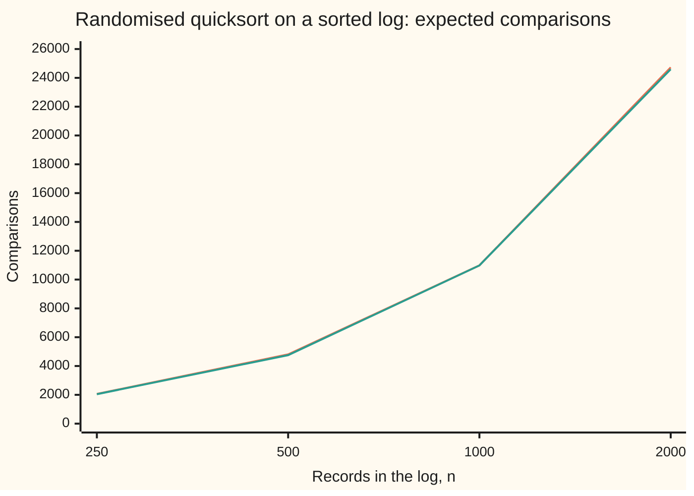

# Randomised algorithms: coin flips inside the method, and the expected cost

[Syllabus](../../../SYLLABUS.md) → [Applied and computational](../README.md) → [Randomised and Approximate Algorithms](../README.md#s02) → Randomised algorithms

---

## General Overview

A web service handles 10 million requests a day and writes each one to a log, in the order it arrives. So the log is already in time order. Every night a job sorts it by time anyway, as a safety step, using quicksort ([Sorting and searching](../01-Algorithms%20and%20Growth/05-sorting-and-searching.md)).

The sort key is the time stamp with the request's own number attached, so no two keys are equal. Quicksort picks one record, the **pivot**, puts the smaller records on its left and the larger ones on its right, and then sorts each side the same way.

The textbook version takes the first record as the pivot. On a sorted log that is the worst possible choice. The first record is the oldest, so every other record lands on one side, and the job only shrinks by one record per round. For 10 million records that costs about 50 trillion comparisons (one comparison: two records checked against each other).

The fix is one line: **pick the pivot at random.** The same log then needs about 294 million comparisons on average, about 170,000 times fewer.

The randomness is not in the data. It is inside the method: coin flips the program makes for itself.

That changes what a cost promise means. The promise "about 294 million comparisons" is an average over the program's own coins, and it holds for every input, sorted or not. Nothing the data does can trigger the bad case on purpose.

This card works out that average by adding up one small chance per pair of records. It also separates the two kinds of random method: one that is always right but takes a random amount of time, and one that takes a fixed time but is sometimes wrong.

**A randomised algorithm makes its own coin flips, so its expected cost is an average over those coins that holds for every input, and linearity of expectation finds it by adding up, pair by pair, the chance that each pair of records is ever compared.**

**What kind of fact this is:** a theorem, proved on this card in Why it works: randomised quicksort makes exactly 2(n + 1)H_n − 4n comparisons on average for n records, where H_n = 1 + 1/2 + … + 1/n. "Las Vegas" and "Monte Carlo" are definitions.

### The picture: sorting 1,000 records that are already in order

```
comparisons to sort a sorted log of 1,000 records
first record as pivot      ████████████████████████████████████████  499,500
random pivot, on average   █                                        10,985.9
```

Same records, same sort, one changed line. The bottom bar barely shows. Both numbers come from the checks below: the top one counted, the bottom one from the formula and confirmed by 400 seeded runs (runs whose coin flips come from a generator started at a stated number, so anyone can repeat them).

---

## The formula

Notation first, in words. The log has n records. Call them by **rank**: the record with rank 1 is the oldest, rank n the newest, whatever order they sit in. C is the number of comparisons one run of randomised quicksort makes; it is a random number, because the pivots are. E[C] is its **expectation**, the long-run average ([Expectation](../../09-Probability%20and%20statistics/02-Random%20Variables/02-expectation.md)). H_n is the **harmonic number** 1 + 1/2 + 1/3 + … + 1/n.

$$E[C] = \sum_{1 \le i < j \le n} \frac{2}{j - i + 1} = 2(n+1)H_n - 4n \approx 2n \ln n$$

**Read it aloud:** the expected number of comparisons is the sum, over every pair of ranks, of two divided by the number of ranks from the first to the second; that sum comes to two times n plus one times the harmonic number, minus four n, which grows like 2n times the natural log of n.

The pair term 2/(j − i + 1) is the heart of it. Two records next to each other in rank, such as ranks 4 and 5, are always compared. Two records far apart, such as the oldest and the newest, are compared only rarely: with chance 2/n.

| Symbol | Plain meaning | In our example | Push it up and the answer… |
| --- | --- | --- | --- |
| $n$ | records to sort | 1,000 (and 10,000,000 for the full day) | rises a bit faster than n: 10 times the records, 11.57 times the comparisons |
| $C$ | comparisons in one run; random, because the pivots are | between 9,689 and 13,582 in 400 runs | — |
| $E[C]$ | the expected comparisons: the average over the method's own coins | 10,985.9 | — |
| $i$, $j$ | two ranks, with i smaller than j | ranks 3 and 5 | a wider gap j − i makes a meeting less likely |
| $X_{ij}$ | the **indicator** of a pair: 1 if ranks i and j are ever compared, 0 if not | 1 for ranks 4 and 5, in every run | — |
| $d$, $m$ | the gap j − i between two ranks, and m = d + 1, the size of their block | gap 2, block 3, for ranks 3 and 5 | a bigger block makes a meeting less likely |
| $H_n$ | the harmonic number 1 + 1/2 + … + 1/n, which grows like ln n | 7.4855 for n = 1,000 | — |
| $k$ | spot checks a Monte Carlo test makes (below) | 60 | the test misses less often |
| $f$ | the share of neighbouring record pairs that are out of order | 50 of 999 | the test misses less often |

### When it holds

- **The pivot is uniform over the current stretch of records (every record in it equally likely), and the coins are fresh.** If the program always uses the same seed, or a generator someone can predict, then an attacker can build the one input that loses ([Random numbers from a computer](../../09-Probability%20and%20statistics/11-Simulation/01-pseudo-random-numbers.md)).
- **The records are all different.** With equal keys this partition (the step that splits records around the pivot) sends all the equal records to one side. A log of 1,000 records stamped in the same second costs 499,500 comparisons, coins or no coins. At 10 million requests a day many requests share a second, which is why this card's key carries the request number; a sort that must handle equal keys splits them off as a third group.
- **Each pair is counted once.** The proof uses the fact that a comparison always involves the pivot, and a pivot is never compared again after its round. A partition that compares records twice would need its own count.
- **E[C] is an average, not a ceiling.** In 400 runs, 182 cost more than 10,985.9. Inequalities that cap how often a random count lands far above its average are the subject of [Tail bounds](02-tail-bounds-and-repeated-trials.md).

---

## Why it works

### Step 0: count pairs, not rounds

Following quicksort round by round is messy: the sizes of the pieces are random, and each depends on the last. Counting pairs is easy instead. Every comparison involves exactly one pair of records, and no pair is compared twice. So the total C is the sum, over all pairs, of the indicator X_ij: 1 if that pair is ever compared, 0 if not.

The expectation of a sum is the sum of the expectations, even when the pieces depend on each other. And the expectation of an indicator is the chance of its event. Both facts are proved on [Expectation](../../09-Probability%20and%20statistics/02-Random%20Variables/02-expectation.md). Here the indicators are badly tangled: if one pivot splits ranks 3 and 5, it also splits ranks 2 and 5. Linearity does not care. So, writing P(…) for the chance of the event in brackets,

$$E[C] = \sum_{i<j} E[X_{ij}] = \sum_{i<j} P(\text{ranks } i \text{ and } j \text{ are compared}).$$

All that is left is one chance per pair.

### Step 1: the chance that ranks i and j meet

Look at the block of ranks from i to j: for ranks 3 and 5 that is ranks 3, 4 and 5, three records. As long as no pivot lands inside this block, the whole block travels together into the same piece. Pivots outside it send all three the same way.

Sooner or later a pivot lands inside the block, and that first pivot decides everything.

- **If it is rank i or rank j,** that record is the pivot, so it is compared with every record in its piece, including the other one. They meet.
- **If it is a rank strictly between,** such as rank 4, it sends rank 3 left and rank 5 right. They are now in different pieces and never meet.

Which record of the block is hit first? Each pivot is uniform over its piece, and the whole block sits in that piece. So, given that the pivot lands in the block, each of the j − i + 1 records is equally likely. Two of them make the pair meet:

$$P(\text{ranks } i \text{ and } j \text{ are compared}) = \frac{2}{j - i + 1}.$$

For ranks 3 and 5, the chance is 2/3. For neighbours, 2/2 = 1: they must meet, since nothing sits between them to split them. For the oldest and the newest of 1,000, the chance is 2/1,000.

Look at what the argument never used: the order of the records in the log. It talks only about ranks. That is why a sorted log, a reversed log and a shuffled log all cost the same on average.

### Step 2: add the chances

Group the pairs by their gap d = j − i. There are n − d pairs with gap d, and each has chance 2/(d + 1). Then write m = d + 1, which runs from 2 to n:

$$E[C] = \sum_{m=2}^{n} \frac{2(n + 1 - m)}{m} = 2(n+1)\big(H_n - 1\big) - 2(n - 1) = 2(n+1)H_n - 4n.$$

<details>
<summary>The middle step, line by line</summary>

Split the top: 2(n + 1 − m)/m = 2(n + 1)/m − 2. Summing 2(n + 1)/m for m from 2 to n gives 2(n + 1)(H_n − 1), because H_n − 1 is 1/2 + … + 1/n. Summing the −2 over the n − 1 values of m gives −2(n − 1). Then 2(n + 1)(H_n − 1) − 2(n − 1) = 2(n + 1)H_n − 2n − 2 − 2n + 2 = 2(n + 1)H_n − 4n.

</details>

### Step 3: how fast it grows

H_n grows like ln n, the natural log, plus a constant. So E[C] grows like 2n ln n, minus a correction proportional to n. The correction matters at small sizes: for n = 1,000, 2n ln n gives 13,815.5 against the exact 10,985.9. In the language of [Big-O](../01-Algorithms%20and%20Growth/01-big-o-and-growth-rates.md) (how a cost grows as n grows), the expected cost grows like n log n, against n² for the first-record pivot on sorted data.

The chart counts this at four sizes. The exact formula and the average of 100 seeded runs sit almost on top of each other.



First line: the formula 2(n + 1)H_n − 4n. Second line: the mean of 100 seeded runs at each size, each within two standard errors of the formula (a standard error: how far an average of that many runs typically lands from the true mean). Doubling n slightly more than doubles the cost. The first-record pivot is off this chart: 1,999,000 comparisons at n = 2,000.

### Step 4: a second road, through every possible order

There is another way to see the same number. Picking a uniform pivot from a fixed list behaves exactly like taking the first record of a uniformly shuffled list. And the pieces of a shuffled list are still shuffled. So randomised quicksort on the sorted log costs, on average, the same as first-record quicksort averaged over every order of the log.

For 8 records there are 40,320 orders, few enough to try them all. The checks run first-record quicksort on every one. The total is 682,272 comparisons, and 8! (8 factorial, the 40,320 orders) times the formula is also 682,272, to the last comparison.

That is an average of 16.921429. The ranks 1 and 8 meet in 10,080 orders, a quarter of them, as 2/8 says. The ranks 3 and 5 meet in 26,880, two thirds of them. The neighbours 4 and 5 meet in all 40,320.

The same count shows what randomness buys. One of those 40,320 orders is the sorted one, and first-record quicksort spends 28 comparisons on it, the maximum. An average over inputs hides that order. An average over coins does not have a bad order to hide.

### Step 5: Las Vegas and Monte Carlo

Randomised quicksort is a **Las Vegas** algorithm: the answer is always right, and only the cost is random. Every one of the checks' runs ends with a sorted log. The runs cost between 9,689 and 13,582 comparisons.

A **Monte Carlo** algorithm turns that around: the cost is fixed, and the answer is sometimes wrong, with a chance that can be stated in advance.

Here is one for the same log. Before trusting last night's sort, a quick test asks: is the log in order? It picks k neighbouring pairs at random and checks each one. If any pair is out of order, it says "out of order", and that answer is certain, since it has found the proof. If all k look fine, it says "looks sorted", and that answer may be wrong.

Suppose a glitch left 50 of the 999 neighbouring pairs swapped, so f = 50/999. Each check finds a bad pair with chance f, and the checks are independent. So all k miss with chance

$$P(\text{wrong "looks sorted"}) = (1 - f)^k.$$

With k = 60 checks, that is 0.0459. The checks ran the test 20,000 times and it missed 0.0480 of the time, within two standard errors of 0.0459. On a truly sorted log it never says "out of order": 0 of 1,000. The test costs 60 comparisons; a full sort costs 10,985.9 on average.

This product of chances uses independence, unlike linearity. And the error bound depends on the input: the 0.0459 assumes at least 50 bad pairs.

The two kinds convert into each other. A Las Vegas method stopped at a fixed budget becomes Monte Carlo: it ends with no answer whenever its cost would have overrun the budget, and the inequalities on [Tail bounds](02-tail-bounds-and-repeated-trials.md) cap how often a random cost runs that far above its average. A Monte Carlo method whose answer can be checked becomes Las Vegas: run it again until the check passes.

---

## Worked numbers, by hand

The day's log, n = 10,000,000 records, already in time order.

| Step | Arithmetic | Value |
| --- | --- | --- |
| first-record pivot | every pair compared: n(n − 1)/2 | 49,999,995,000,000 |
| harmonic number | 1 + 1/2 + … + 1/10,000,000 | 16.6953 |
| random pivot, expected | 2(n + 1)H_n − 4n | **293,906,261** |
| how many times fewer | 49,999,995,000,000 / 293,906,261 | about 170,122 |
| a test log of 1,000, expected | 2 × 1,001 × 7.4855 − 4,000 | 10,985.9 |
| the same, 400 seeded runs | mean, give or take one standard error | 10,992.3 ± 32.1 |

The nightly job makes about 294 million comparisons on average, instead of 50 trillion, whatever order the log arrives in.

### What breaks if you drop a piece

Same test log of 1,000 records, correct answer 10,985.9:

| Mistake | Comes out at | What went wrong |
| --- | --- | --- |
| First record as pivot, on the sorted log | 499,500 | Every round peels off one record: every pair is compared |
| All records stamped in the same second | 499,500 | Equal keys all go to one side; the random pivot cannot split them |
| Chance 1/(j − i + 1) per pair | 5,493.0 | Forgot that either end of the block, i or j, can be the pivot |
| 2n log₂ n for the cost | 19,931.6 | The formula's log is natural; a base-2 log is bigger |

---

## Code, from first principles, and it actually runs

Both programs write out their own generator (SplitMix64, seed 20261111) and their own quicksort, which counts its comparisons and checks its output is sorted. They take four roads to the expected cost: the closed form; the pair-by-pair sum of 2/(j − i + 1); the recurrence (a rule that builds each size's cost from the smaller sizes') C(m) = m − 1 + (2/m)(C(0) + … + C(m − 1)), from averaging over the first pivot; and exhaustion, every one of the 40,320 orders of 8 records, matched in whole numbers. A seeded simulation then checks the average at five sizes, and a second simulation checks the Monte Carlo spot test against its formula. Every dataset is synthetic: the ranks 1 to n, in order.

### Python

```python
# Randomised quicksort on an already-sorted log: the check behind the card.
# Standard library only.  No random, no sorted: the generator (SplitMix64) and
# the sort are written out, and the sort counts its own comparisons.
from math import log, log2, sqrt
M64 = (1 << 64) - 1

class SplitMix64:                               # a counter, then a scrambler
    def __init__(self, seed): self.s = seed
    def below(self, m):                         # a whole number from 0 to m - 1
        self.s = (self.s + 0x9E3779B97F4A7C15) & M64
        z = ((self.s ^ (self.s >> 30)) * 0xBF58476D1CE4E5B9) & M64
        z = ((z ^ (z >> 27)) * 0x94D049BB133111EB) & M64
        return (z ^ (z >> 31)) % m

def quicksort(a, rng=None, seen=None):          # rng None: first element is the pivot
    comps, stack = 0, [(0, len(a) - 1)]
    while stack:
        lo, hi = stack.pop()
        if lo >= hi: continue
        if rng is not None:                     # the coin flip: a pivot position, uniform
            p = lo + rng.below(hi - lo + 1)
            a[lo], a[p] = a[p], a[lo]
        piv, s = a[lo], lo
        for j in range(lo + 1, hi + 1):
            comps += 1                          # one comparison: a[j] against the pivot
            if seen is not None: seen[min(piv, a[j]), max(piv, a[j])] += 1
            if a[j] < piv:
                s += 1
                a[s], a[j] = a[j], a[s]
        a[lo], a[s] = a[s], a[lo]
        stack += [(lo, s - 1), (s + 1, hi)]
    return comps

def is_sorted(a): return all(a[i] <= a[i + 1] for i in range(len(a) - 1))
def H(n): return sum(1.0 / k for k in range(1, n + 1))          # 1 + 1/2 + ... + 1/n
def formula(n): return 2 * (n + 1) * H(n) - 4 * n
def pair_sum(n, top=2):                         # road 2: one indicator per pair of ranks i < j
    return sum(top / (j - i + 1) for i in range(1, n + 1) for j in range(i + 1, n + 1))
def recurrence(n):                              # road 3: C(m) = m - 1 + (2/m)(C(0) + ... + C(m-1))
    c, run = [0.0], 0.0
    for m in range(1, n + 1):
        run += c[-1]
        c.append(m - 1 + 2.0 * run / m)
    return c[n]
def perms(xs):
    if not xs: yield []
    for i in range(len(xs)):
        for rest in perms(xs[:i] + xs[i + 1:]): yield [xs[i]] + rest
def sim(n, runs, rng):                          # road 4: seeded runs on the sorted log, counted
    counts = []
    for _ in range(runs):
        a = list(range(1, n + 1))
        counts.append(quicksort(a, rng))
        assert is_sorted(a), "Las Vegas: every run must come out sorted"
    mean = sum(counts) / runs
    se = sqrt(sum((c - mean) * (c - mean) for c in counts) / (runs - 1) / runs)
    return counts, mean, se
def spot_check(log_, k, rng):                   # Monte Carlo: k random adjacent pairs, fixed cost
    for _ in range(k):
        i = rng.below(len(log_) - 1)
        if log_[i] > log_[i + 1]: return "out of order"
    return "looks sorted"

# ---- road 1 against exhaustion: n = 8, all 40320 orders, first-element pivot ----
seen, total, orders = {(i, j): 0 for i in range(1, 9) for j in range(i + 1, 9)}, 0, 0
for p in perms(list(range(1, 9))):
    total += quicksort(p, None, seen); orders += 1
fact = 40320
exact = 2 * 9 * sum(fact // k for k in range(1, 9)) - 4 * 8 * fact   # 8! (2(n+1)H_n - 4n), in whole numbers
print(f"n=8 orders {orders}, comparisons over all orders {total}, formula times 8! {exact}")
print(f"n=8 expected {total / orders:.6f}, formula {formula(8):.6f}, sorted order first pivot {quicksort(list(range(1, 9)))}")
print(f"n=8 orders comparing ranks 1&8 {seen[1, 8]}, 3&5 {seen[3, 5]}, 4&5 {seen[4, 5]}")

# ---- the sorted log, n = 1000 ----
n, rng = 1000, SplitMix64(20261111)
E, first = formula(n), quicksort(list(range(1, n + 1)))
counts, mean, se = sim(n, 400, rng)
above = sum(c > E for c in counts)
print(f"n=1000 H_n {H(n):.4f}, formula {E:.4f}, pair sum {pair_sum(n):.4f}, recurrence {recurrence(n):.4f}")
print(f"n=1000 first pivot counted {first}, n(n-1)/2 {n * (n - 1) // 2}")
print(f"n=1000 random pivot 400 runs: mean {mean:.1f}, se {se:.1f}, min {min(counts)}, max {max(counts)}, above E {above}")
eq = [7] * n
print(f"wrong: 1/(gap+1) {pair_sum(n, 1):.1f}; 2n log2 n {2 * n * log2(n):.1f}; 2n ln n {2 * n * log(n):.1f}; "
      f"all-equal keys counted {quicksort(eq, rng)}")
for m in (250, 500, 1000, 2000):                # growth, counted at several sizes
    _, mm, ms = sim(m, 100, rng)
    print(f"growth n={m} formula {formula(m):.1f} simulated {mm:.1f} se {ms:.1f} first pivot {m * (m - 1) // 2}")

# ---- the house example: a day of 10,000,000 requests ----
N = 10_000_000
EN = formula(N)
print(f"n=10^7 H_n {H(N):.4f}, random pivot expected {EN:.0f}, first pivot {N * (N - 1) // 2}, ratio {N * (N - 1) / 2 / EN:.0f}")
print(f"try: n=10^8 expected {formula(10 * N):.0f}, growth {formula(10 * N) / EN:.2f} times")

# ---- Monte Carlo: spot-check a log for order, k = 60 checks ----
glitch = list(range(1, n + 1))
for p in range(10, 1000, 20): glitch[p], glitch[p + 1] = glitch[p + 1], glitch[p]
bad = sum(glitch[i] > glitch[i + 1] for i in range(n - 1))
trials, k = 20000, 60
miss_f = (1 - bad / (n - 1)) ** k
miss = sum(spot_check(glitch, k, rng) == "looks sorted" for _ in range(trials)) / trials
miss_se = sqrt(miss_f * (1 - miss_f) / trials)
wrong_on_sorted = sum(spot_check(list(range(1, n + 1)), k, rng) == "out of order" for _ in range(1000))
print(f"spot check: bad pairs {bad} of {n - 1}, k {k}, miss formula {miss_f:.4f}, simulated {miss:.4f}, se {miss_se:.4f}")
print(f"spot check: one bad pair miss {(1 - 1 / (n - 1)) ** k:.4f}; sorted log called out of order {wrong_on_sorted} of 1000")
print(f"try: k=120 miss {(1 - bad / (n - 1)) ** 120:.4f}")

assert total == exact, "exhaustive count over all 8! orders must equal the closed form"
assert seen[1, 8] == fact * 2 // 8 and seen[3, 5] == fact * 2 // 3, "pair chance 2/(j-i+1)"
assert abs(pair_sum(n) - E) < 1e-6, "pair-by-pair indicator sum equals the closed form"
assert abs(recurrence(n) - E) < 1e-6, "recurrence equals the closed form"
assert first == n * (n - 1) // 2, "first pivot on sorted input: every pair compared"
assert abs(mean - E) < 4 * se, "simulated mean within 4 standard errors of the formula"
assert abs(miss - miss_f) < 4 * miss_se, "Monte Carlo miss rate within 4 standard errors"
assert wrong_on_sorted == 0, "one-sided: a sorted log is never called out of order"
print("ALL CHECKS PASS")
```

**Ran 2026-11-11 on macOS, Python 3.14.10, standard library only. All checks passed. Output, pasted from the run:**

```
n=8 orders 40320, comparisons over all orders 682272, formula times 8! 682272
n=8 expected 16.921429, formula 16.921429, sorted order first pivot 28
n=8 orders comparing ranks 1&8 10080, 3&5 26880, 4&5 40320
n=1000 H_n 7.4855, formula 10985.9127, pair sum 10985.9127, recurrence 10985.9127
n=1000 first pivot counted 499500, n(n-1)/2 499500
n=1000 random pivot 400 runs: mean 10992.3, se 32.1, min 9689, max 13582, above E 182
wrong: 1/(gap+1) 5493.0; 2n log2 n 19931.6; 2n ln n 13815.5; all-equal keys counted 499500
growth n=250 formula 2062.5 simulated 2044.4 se 14.4 first pivot 31125
growth n=500 formula 4806.4 simulated 4753.9 se 32.8 first pivot 124750
growth n=1000 formula 10985.9 simulated 10978.7 se 59.4 first pivot 499500
growth n=2000 formula 24729.8 simulated 24600.3 se 126.0 first pivot 1999000
n=10^7 H_n 16.6953, random pivot expected 293906261, first pivot 49999995000000, ratio 170122
try: n=10^8 expected 3399579321, growth 11.57 times
spot check: bad pairs 50 of 999, k 60, miss formula 0.0459, simulated 0.0480, se 0.0015
spot check: one bad pair miss 0.9417; sorted log called out of order 0 of 1000
try: k=120 miss 0.0021
ALL CHECKS PASS
```

### Rust

```rust
// Randomised quicksort on an already-sorted log: the same check as the Python, in Rust.
// Standard library only, no crates.  No sort, no rand: SplitMix64 and the
// quicksort are written out, and the sort counts its own comparisons.
struct SplitMix64 { s: u64 }
impl SplitMix64 {
    fn below(&mut self, m: u64) -> u64 {                 // a whole number from 0 to m - 1
        self.s = self.s.wrapping_add(0x9E3779B97F4A7C15);
        let mut z = (self.s ^ (self.s >> 30)).wrapping_mul(0xBF58476D1CE4E5B9);
        z = (z ^ (z >> 27)).wrapping_mul(0x94D049BB133111EB);
        (z ^ (z >> 31)) % m
    }
}

// rng None: the first element is the pivot.  seen counts which pairs of values meet.
fn quicksort(a: &mut Vec<u64>, mut rng: Option<&mut SplitMix64>, mut seen: Option<&mut [[u64; 9]; 9]>) -> u64 {
    let (mut comps, mut stack) = (0u64, vec![(0i64, a.len() as i64 - 1)]);
    while let Some((lo, hi)) = stack.pop() {
        if lo >= hi { continue; }
        let (lo_u, hi_u) = (lo as usize, hi as usize);
        if let Some(r) = rng.as_deref_mut() {            // the coin flip: a pivot position, uniform
            let p = lo_u + r.below((hi - lo + 1) as u64) as usize;
            a.swap(lo_u, p);
        }
        let (piv, mut s) = (a[lo_u], lo_u);
        for j in lo_u + 1..=hi_u {
            comps += 1;                                  // one comparison: a[j] against the pivot
            if let Some(t) = seen.as_deref_mut() {
                t[piv.min(a[j]) as usize][piv.max(a[j]) as usize] += 1;
            }
            if a[j] < piv { s += 1; a.swap(s, j); }
        }
        a.swap(lo_u, s);
        stack.push((lo, s as i64 - 1));
        stack.push((s as i64 + 1, hi));
    }
    comps
}

fn is_sorted(a: &[u64]) -> bool { a.windows(2).all(|w| w[0] <= w[1]) }
fn h(n: u64) -> f64 { let mut s = 0.0; for k in 1..=n { s += 1.0 / k as f64; } s }   // 1 + 1/2 + ... + 1/n
fn formula(n: u64) -> f64 { (2 * (n + 1)) as f64 * h(n) - (4 * n) as f64 }
fn pair_sum(n: u64, top: f64) -> f64 {                   // road 2: one indicator per pair of ranks i < j
    let mut s = 0.0;
    for i in 1..=n { for j in i + 1..=n { s += top / (j - i + 1) as f64; } }
    s
}
fn recurrence(n: usize) -> f64 {                         // road 3: C(m) = m - 1 + (2/m)(C(0) + ... + C(m-1))
    let (mut c, mut run) = (vec![0.0f64], 0.0f64);
    for m in 1..=n {
        run += c[m - 1];
        c.push((m - 1) as f64 + 2.0 * run / m as f64);
    }
    c[n]
}
fn perms(xs: &[u64]) -> Vec<Vec<u64>> {
    if xs.is_empty() { return vec![vec![]]; }
    let mut out = Vec::new();
    for i in 0..xs.len() {
        let mut rest = xs.to_vec();
        let x = rest.remove(i);
        for mut p in perms(&rest) { p.insert(0, x); out.push(p); }
    }
    out
}
fn sim(n: u64, runs: usize, rng: &mut SplitMix64) -> (Vec<u64>, f64, f64) {   // road 4: seeded runs, counted
    let mut counts = Vec::new();
    for _ in 0..runs {
        let mut a: Vec<u64> = (1..=n).collect();
        counts.push(quicksort(&mut a, Some(&mut *rng), None));
        assert!(is_sorted(&a), "Las Vegas: every run must come out sorted");
    }
    let mean = counts.iter().sum::<u64>() as f64 / runs as f64;
    let mut ss = 0.0;
    for &c in &counts { ss += (c as f64 - mean) * (c as f64 - mean); }
    let se = (ss / (runs - 1) as f64 / runs as f64).sqrt();
    (counts, mean, se)
}
fn spot_check(log: &[u64], k: usize, rng: &mut SplitMix64) -> &'static str {   // Monte Carlo, fixed cost
    for _ in 0..k {
        let i = rng.below(log.len() as u64 - 1) as usize;
        if log[i] > log[i + 1] { return "out of order"; }
    }
    "looks sorted"
}

fn main() {
    // ---- road 1 against exhaustion: n = 8, all 40320 orders, first-element pivot ----
    let mut seen = [[0u64; 9]; 9];
    let (mut total, mut orders) = (0u64, 0u64);
    for mut p in perms(&[1, 2, 3, 4, 5, 6, 7, 8]) { total += quicksort(&mut p, None, Some(&mut seen)); orders += 1; }
    let fact = 40320u64;
    let exact = 2 * 9 * (1..=8).map(|k| fact / k).sum::<u64>() - 4 * 8 * fact;
    println!("n=8 orders {}, comparisons over all orders {}, formula times 8! {}", orders, total, exact);
    println!("n=8 expected {:.6}, formula {:.6}, sorted order first pivot {}", total as f64 / orders as f64,
             formula(8), quicksort(&mut (1..=8).collect(), None, None));
    println!("n=8 orders comparing ranks 1&8 {}, 3&5 {}, 4&5 {}", seen[1][8], seen[3][5], seen[4][5]);

    // ---- the sorted log, n = 1000 ----
    let n = 1000u64;
    let mut rng = SplitMix64 { s: 20261111 };
    let e = formula(n);
    let first = quicksort(&mut (1..=n).collect(), None, None);
    let (counts, mean, se) = sim(n, 400, &mut rng);
    let above = counts.iter().filter(|&&c| c as f64 > e).count();
    println!("n=1000 H_n {:.4}, formula {:.4}, pair sum {:.4}, recurrence {:.4}", h(n), e, pair_sum(n, 2.0), recurrence(n as usize));
    println!("n=1000 first pivot counted {}, n(n-1)/2 {}", first, n * (n - 1) / 2);
    println!("n=1000 random pivot 400 runs: mean {:.1}, se {:.1}, min {}, max {}, above E {}",
             mean, se, counts.iter().min().unwrap(), counts.iter().max().unwrap(), above);
    let mut eq = vec![7u64; n as usize];
    let wrong_half = pair_sum(n, 1.0);
    println!("wrong: 1/(gap+1) {:.1}; 2n log2 n {:.1}; 2n ln n {:.1}; all-equal keys counted {}", wrong_half,
             2.0 * n as f64 * (n as f64).log2(), 2.0 * n as f64 * (n as f64).ln(), quicksort(&mut eq, Some(&mut rng), None));
    for m in [250u64, 500, 1000, 2000] {                 // growth, counted at several sizes
        let (_, mm, ms) = sim(m, 100, &mut rng);
        println!("growth n={} formula {:.1} simulated {:.1} se {:.1} first pivot {}", m, formula(m), mm, ms, m * (m - 1) / 2);
    }

    // ---- the house example: a day of 10,000,000 requests ----
    let big = 10_000_000u64;
    let en = formula(big);
    let worst = big * (big - 1) / 2;
    println!("n=10^7 H_n {:.4}, random pivot expected {:.0}, first pivot {}, ratio {:.0}", h(big), en, worst, worst as f64 / en);
    let e8 = formula(10 * big);
    println!("try: n=10^8 expected {:.0}, growth {:.2} times", e8, e8 / en);

    // ---- Monte Carlo: spot-check a log for order, k = 60 checks ----
    let mut glitch: Vec<u64> = (1..=n).collect();
    for p in (10..1000).step_by(20) { glitch.swap(p, p + 1); }
    let bad = glitch.windows(2).filter(|w| w[0] > w[1]).count() as u64;
    let (trials, k) = (20000usize, 60usize);
    let miss_f = (1.0 - bad as f64 / (n - 1) as f64).powf(k as f64);
    let mut hits = 0usize;
    for _ in 0..trials { if spot_check(&glitch, k, &mut rng) == "looks sorted" { hits += 1; } }
    let miss = hits as f64 / trials as f64;
    let miss_se = (miss_f * (1.0 - miss_f) / trials as f64).sqrt();
    let sorted_log: Vec<u64> = (1..=n).collect();
    let mut wrong_on_sorted = 0;
    for _ in 0..1000 { if spot_check(&sorted_log, k, &mut rng) == "out of order" { wrong_on_sorted += 1; } }
    println!("spot check: bad pairs {} of {}, k {}, miss formula {:.4}, simulated {:.4}, se {:.4}", bad, n - 1, k, miss_f, miss, miss_se);
    println!("spot check: one bad pair miss {:.4}; sorted log called out of order {} of 1000",
             (1.0 - 1.0 / (n - 1) as f64).powf(k as f64), wrong_on_sorted);
    println!("try: k=120 miss {:.4}", (1.0 - bad as f64 / (n - 1) as f64).powf(120.0));

    assert_eq!(total, exact, "exhaustive count over all 8! orders must equal the closed form");
    assert!(seen[1][8] == fact * 2 / 8 && seen[3][5] == fact * 2 / 3, "pair chance 2/(j-i+1)");
    assert!((pair_sum(n, 2.0) - e).abs() < 1e-6, "pair-by-pair indicator sum equals the closed form");
    assert!((recurrence(n as usize) - e).abs() < 1e-6, "recurrence equals the closed form");
    assert_eq!(first, n * (n - 1) / 2, "first pivot on sorted input: every pair compared");
    assert!((mean - e).abs() < 4.0 * se, "simulated mean within 4 standard errors of the formula");
    assert!((miss - miss_f).abs() < 4.0 * miss_se, "Monte Carlo miss rate within 4 standard errors");
    assert_eq!(wrong_on_sorted, 0, "one-sided: a sorted log is never called out of order");
    println!("ALL CHECKS PASS");
}
```

**Ran 2026-11-11 on macOS, rustc 1.98.1, no crates. All checks passed. Output, pasted from the run:**

```
n=8 orders 40320, comparisons over all orders 682272, formula times 8! 682272
n=8 expected 16.921429, formula 16.921429, sorted order first pivot 28
n=8 orders comparing ranks 1&8 10080, 3&5 26880, 4&5 40320
n=1000 H_n 7.4855, formula 10985.9127, pair sum 10985.9127, recurrence 10985.9127
n=1000 first pivot counted 499500, n(n-1)/2 499500
n=1000 random pivot 400 runs: mean 10992.3, se 32.1, min 9689, max 13582, above E 182
wrong: 1/(gap+1) 5493.0; 2n log2 n 19931.6; 2n ln n 13815.5; all-equal keys counted 499500
growth n=250 formula 2062.5 simulated 2044.4 se 14.4 first pivot 31125
growth n=500 formula 4806.4 simulated 4753.9 se 32.8 first pivot 124750
growth n=1000 formula 10985.9 simulated 10978.7 se 59.4 first pivot 499500
growth n=2000 formula 24729.8 simulated 24600.3 se 126.0 first pivot 1999000
n=10^7 H_n 16.6953, random pivot expected 293906261, first pivot 49999995000000, ratio 170122
try: n=10^8 expected 3399579321, growth 11.57 times
spot check: bad pairs 50 of 999, k 60, miss formula 0.0459, simulated 0.0480, se 0.0015
spot check: one bad pair miss 0.9417; sorted log called out of order 0 of 1000
try: k=120 miss 0.0021
ALL CHECKS PASS
```

The outputs agree line for line. The exact roads agree to four decimals, and the 8-record count matches in whole numbers. Every simulated number sits within four standard errors of its formula, most within one or two.

### Lean

Lean proves the exact average for every list of different records, of any length and in any order, and checks the worked numbers.

- Suppose the n records are all different, and each pivot is uniform over the current stretch. Then randomised quicksort makes 2(n + 1)H_n − 4n comparisons on average.
- On the same records, that average equals the first-record pivot's cost averaged over every order of the records.
- Take every pair of ranks i < j, with chance 2/(j − i + 1) each. Then these chances add up to 2(n + 1)H_n − 4n.
- On the sorted 8 records, the first-record pivot makes 28 comparisons.
- Take n(n − 1)/2, the first-record cost on a sorted log. Then it is 499,500 for 1,000 records and 49,999,995,000,000 for 10,000,000.
- Take 8 records and their 40,320 orders. Then 8! times the formula is 682,272, and 2/(j − i + 1) gives pair counts 10,080, 26,880 and 40,320.

The Python and Rust checks cover the rest: the pair chance 2/(j − i + 1), the seeded runs and the spot check.

```lean
-- Randomised algorithms: quicksort with a uniformly random pivot makes exactly 2(n + 1)H_n − 4n comparisons on average on every list of n different records.
import Mathlib.NumberTheory.Harmonic.Defs
import Mathlib.Data.List.Permutation
import Mathlib.Algebra.BigOperators.Intervals
import Mathlib.Tactic.NormNum
import Mathlib.Data.Finset.Max
import Mathlib.Tactic

open Finset

variable {α : Type*} [LinearOrder α]

/-- Comparisons made by quicksort that always takes the first record as the pivot. The pivot is
compared once with every other record; the smaller ones go left, the rest go right, in order. -/
def firstPivotComparisons : List α → ℕ
  | [] => 0
  | x :: xs =>
      xs.length + firstPivotComparisons (xs.filter (· < x))
        + firstPivotComparisons (xs.filter (fun y => ¬ y < x))
termination_by l => l.length
decreasing_by
  all_goals
    simp only [List.length_cons, List.length_unattach]
    exact Nat.lt_succ_of_le ((List.length_filter_le _ _).trans_eq List.length_attach)

/-- Expected comparisons of randomised quicksort, averaged over its own coins: the pivot is a
uniformly random position of the current stretch (fresh coins every round). That pivot is compared
once with each of the other records, the smaller ones go left and the rest go right, and each side
is sorted the same way with new coins. -/
def expectedComparisons (l : List α) : ℚ :=
  if l = [] then 0 else
    (l.attach.map fun x =>
        (((l.length - 1 : ℕ) : ℚ) + expectedComparisons ((l.erase x.1).filter (· < x.1))
          + expectedComparisons ((l.erase x.1).filter (fun y => ¬ y < x.1)))).sum / l.length
termination_by l.length
decreasing_by
  all_goals
    have hx := x.2
    refine lt_of_le_of_lt (List.length_filter_le _ _) ?_
    rw [List.length_erase_of_mem hx]
    exact Nat.sub_lt (List.length_pos_of_mem hx) Nat.one_pos

/-- The closed form. -/
def qsF (n : ℕ) : ℚ := 2 * ((n : ℚ) + 1) * harmonic n - 4 * n

theorem qsF_rec (n : ℕ) :
    (n : ℚ) * qsF n = n * ((n : ℚ) - 1) + 2 * ∑ k ∈ range n, qsF k := by
  induction n with
  | zero => simp [qsF]
  | succ n ih =>
    rw [sum_range_succ]
    have h1 : ((n : ℚ) + 1) * qsF (n + 1) = ((n:ℚ) + 2) * qsF n + 2 * n := by
      simp only [qsF, harmonic_succ]
      push_cast
      field_simp
      ring
    push_cast
    linear_combination h1 + ih

theorem sum_shift_aux (n : ℕ) :
    ∑ i ∈ Icc 1 n, (2 : ℚ) / (((n + 1 : ℕ) : ℚ) - ((i : ℕ) : ℚ) + 1) = 2 * (harmonic (n + 1) - 1) := by
  have : ∀ n : ℕ, ∑ i ∈ range n, (2 : ℚ) / ((i : ℚ) + 2) = 2 * (harmonic (n + 1) - 1) := by
    intro n
    induction n with
    | zero => simp
    | succ n ih =>
      rw [sum_range_succ, ih, harmonic_succ (n + 1)]
      push_cast
      field_simp
      ring
  rw [← this n, ← sum_range_reflect]
  rw [show Icc 1 n = (range n).map ⟨(· + 1), add_left_injective 1⟩ by
    ext i; simp only [mem_Icc, mem_map, mem_range, Function.Embedding.coeFn_mk]
    constructor
    · intro h; exact ⟨i - 1, by omega, by omega⟩
    · rintro ⟨a, ha, rfl⟩; omega, sum_map]
  refine sum_congr rfl fun i hi => ?_
  simp only [mem_range] at hi
  simp only [Function.Embedding.coeFn_mk]
  congr 1
  have h1 : 1 ≤ n := by omega
  have h2 : i ≤ n - 1 := by omega
  push_cast [h1, h2]
  ring


theorem perms_perm_flatMap (L : List α) (hL : L.Nodup) (hne : L ≠ []) :
    L.permutations.Perm (L.flatMap fun x => (L.erase x).permutations.map (x :: ·)) := by
  rw [List.perm_ext_iff_of_nodup (List.nodup_permutations _ hL)]
  · intro p
    simp only [List.mem_permutations, List.mem_flatMap, List.mem_map]
    constructor
    · intro hp
      cases p with
      | nil => exact absurd (List.Perm.eq_nil hp.symm) hne
      | cons x q =>
        have hx : x ∈ L := hp.subset (List.mem_cons_self ..)
        exact ⟨x, hx, q, ((List.cons_perm_iff_perm_erase).1 hp).2, rfl⟩
    · rintro ⟨x, hx, q, hq, rfl⟩
      exact (List.cons_perm_iff_perm_erase).2 ⟨hx, hq⟩
  · rw [List.nodup_flatMap]
    refine ⟨fun x _ => (List.nodup_permutations _ (hL.erase x)).map (List.cons_injective), ?_⟩
    refine hL.pairwise_of_forall_ne fun a _ b _ hab => ?_
    simp only [Function.onFun]
    rw [List.disjoint_left]
    intro p hpa hpb
    simp only [List.mem_map] at hpa hpb
    obtain ⟨q, _, rfl⟩ := hpa
    obtain ⟨r, _, h⟩ := hpb
    exact hab (List.cons_eq_cons.1 h).1.symm

omit [LinearOrder α] in
theorem sum_map_flatMap_q {β : Type*} (L : List β) (f : β → List (List α)) (g : List α → ℚ) :
    ((L.flatMap f).map g).sum = (L.map fun x => ((f x).map g).sum).sum := by
  induction L with
  | nil => simp
  | cons a t ih => simp [List.flatMap_cons, ih]

theorem sum_map_div_q {β : Type*} (L : List β) (f : β → ℚ) (c : ℚ) :
    (L.map fun x => f x / c).sum = (L.map f).sum / c := by
  induction L with
  | nil => simp
  | cons a t ih => simp [ih, add_div]

/-- Average of `g` over all orders of `L`. -/
noncomputable def avgP (L : List α) (g : List α → ℚ) : ℚ :=
  (L.permutations.map g).sum / (L.length.factorial : ℚ)

theorem avgP_head (L : List α) (hL : L.Nodup) (g : List α → ℚ) :
    (L.length : ℚ) * avgP L g = (L.map fun x => avgP (L.erase x) (fun q => g (x :: q))).sum := by
  rcases L with _ | ⟨a, t⟩
  · simp
  have hperm := perms_perm_flatMap (a :: t) hL (List.cons_ne_nil a t)
  unfold avgP
  rw [(hperm.map g).sum_eq, sum_map_flatMap_q]
  have hlen : ∀ x ∈ a :: t, ((a :: t).erase x).length = t.length := fun x hx => by
    rw [List.length_erase_of_mem hx]; simp
  have hR : ((a :: t).map fun x =>
      (((a :: t).erase x).permutations.map fun q => g (x :: q)).sum
        / ((((a :: t).erase x).length.factorial : ℕ) : ℚ)).sum
      = ((a :: t).map fun x =>
      (((a :: t).erase x).permutations.map fun q => g (x :: q)).sum).sum
        / ((t.length.factorial : ℕ) : ℚ) := by
    rw [← sum_map_div_q]
    congr 1
    apply List.map_congr_left
    intro x hx
    rw [hlen x hx]
  rw [hR]
  simp only [List.map_map, Function.comp_def, List.length_cons, Nat.factorial_succ]
  push_cast
  have : (t.length.factorial : ℚ) ≠ 0 := by positivity
  field_simp

omit [LinearOrder α] in
theorem sum_map_ite_q (p : α → Bool) (L : List α) (A : α → ℚ) (B : ℚ) :
    (L.map fun x => if p x then A x else B).sum
      = ((L.filter p).map A).sum + ((L.filter (!p ·)).length : ℚ) * B := by
  induction L with
  | nil => simp
  | cons a t ih =>
    by_cases ha : p a
    · simp [ha, ih]; ring
    · simp [ha, ih]; ring

theorem avgP_filter (p : α → Bool) (n : ℕ) :
    ∀ L : List α, L.length = n → L.Nodup → ∀ h : List α → ℚ,
      avgP L (fun q => h (q.filter p)) = avgP (L.filter p) h := by
  induction n using Nat.strong_induction_on with
  | _ n ih =>
  intro L hLn hL h
  rcases L with _ | ⟨a, t⟩
  · simp [avgP]
  generalize hLdef : a :: t = L at *
  have hpos : (L.length : ℚ) ≠ 0 := by rw [← hLdef]; simp; positivity
  apply mul_left_cancel₀ hpos
  rw [avgP_head _ hL]
  have hterm : ∀ x ∈ L, avgP (L.erase x) (fun q => h ((x :: q).filter p))
      = if p x then avgP ((L.filter p).erase x) (fun q => h (x :: q))
        else avgP (L.filter p) h := by
    intro x hx
    have hlt : (L.erase x).length < n := by
      rw [List.length_erase_of_mem hx, ← hLn]; rw [← hLdef]; simp
    have hnd : (L.erase x).Nodup := hL.erase x
    by_cases hpx : p x
    · simp only [List.filter_cons_of_pos hpx, hpx, ite_true]
      rw [ih _ hlt _ rfl hnd (fun r => h (x :: r)), List.erase_filter]
    · simp only [List.filter_cons_of_neg hpx, hpx, Bool.false_eq_true, ite_false]
      rw [ih _ hlt _ rfl hnd h, ← List.erase_filter, List.erase_of_not_mem]
      simp [hpx]
  rw [List.map_congr_left hterm, sum_map_ite_q, ← avgP_head _ (hL.filter p)]
  rw [List.length_eq_length_filter_add p (l := L)]
  push_cast
  ring

theorem fpc_cons (x : α) (xs : List α) :
    firstPivotComparisons (x :: xs) = xs.length + firstPivotComparisons (xs.filter (· < x))
        + firstPivotComparisons (xs.filter (fun y => ¬ y < x)) := by
  rw [firstPivotComparisons]

omit [LinearOrder α] in
theorem avgP_add (L : List α) (f g : List α → ℚ) :
    avgP L (fun q => f q + g q) = avgP L f + avgP L g := by
  unfold avgP
  rw [List.sum_map_add, add_div]

omit [LinearOrder α] in
theorem avgP_length (L : List α) : avgP L (fun q => (q.length : ℚ)) = L.length := by
  unfold avgP
  rw [List.map_congr_left (g := fun _ => (L.length : ℚ))
    (fun q hq => by rw [(List.mem_permutations.1 hq).length_eq])]
  rw [List.map_const', List.sum_replicate, List.length_permutations, nsmul_eq_mul]
  have : (L.length.factorial : ℚ) ≠ 0 := by positivity
  field_simp

omit [LinearOrder α] in
theorem attach_sum_q (l : List α) (F : α → ℚ) :
    (l.attach.map fun x => F x.1).sum = (l.map F).sum := by
  rw [List.attach_map_val]

theorem expected_eq_avgP (n : ℕ) :
    ∀ l : List α, l.length = n → l.Nodup →
      expectedComparisons l = avgP l (fun q => (firstPivotComparisons q : ℚ)) := by
  induction n using Nat.strong_induction_on with
  | _ n ih =>
  intro l hln hl
  by_cases hne : l = []
  · subst hne
    rw [expectedComparisons]
    simp [avgP, firstPivotComparisons]
  have hpos : (l.length : ℚ) ≠ 0 := by
    have := List.length_pos_of_ne_nil hne
    positivity
  rw [expectedComparisons]
  simp only [hne, ↓reduceIte]
  rw [attach_sum_q l (fun x => ((l.length - 1 : ℕ) : ℚ) + expectedComparisons ((l.erase x).filter (· < x))
          + expectedComparisons ((l.erase x).filter (fun y => ¬ y < x)))]
  rw [eq_comm, ← mul_div_cancel_left₀ (avgP l _) hpos, avgP_head _ hl]
  congr 2
  apply List.map_congr_left
  intro x hx
  have hlt : (l.erase x).length < n := by
    rw [List.length_erase_of_mem hx, ← hln]
    exact Nat.sub_lt (List.length_pos_of_mem hx) Nat.one_pos
  have hnd : (l.erase x).Nodup := hl.erase x
  simp only [fpc_cons, Nat.cast_add]
  rw [avgP_add, avgP_add, avgP_length, List.length_erase_of_mem hx,
    avgP_filter (fun y => decide (y < x)) _ _ rfl hnd (fun r => (firstPivotComparisons r : ℚ)),
    avgP_filter (fun y => decide ¬ (y < x)) _ _ rfl hnd (fun r => (firstPivotComparisons r : ℚ)),
    ← ih _ (lt_of_le_of_lt (List.length_filter_le _ _) hlt) _ rfl (hnd.filter _),
    ← ih _ (lt_of_le_of_lt (List.length_filter_le _ _) hlt) _ rfl (hnd.filter _)]

theorem finset_rank_sum (s : Finset α) (g : ℕ → ℚ) :
    ∑ x ∈ s, g (s.filter (· < x)).card = ∑ k ∈ range s.card, g k := by
  induction s using Finset.induction_on_max with
  | empty => simp
  | insert a s hlt ih =>
    have ha : a ∉ s := fun h => lt_irrefl a (hlt a h)
    rw [sum_insert ha, card_insert_of_notMem ha, sum_range_succ]
    have h1 : (insert a s).filter (· < a) = s := by
      ext y; simp only [mem_filter, mem_insert]
      constructor
      · rintro ⟨rfl | hy, h⟩
        · exact absurd h (lt_irrefl _)
        · exact hy
      · intro hy; exact ⟨Or.inr hy, hlt y hy⟩
    have h2 : ∀ x ∈ s, (insert a s).filter (· < x) = s.filter (· < x) := by
      intro x hx
      ext y; simp only [mem_filter, mem_insert]
      constructor
      · rintro ⟨rfl | hy, h⟩
        · exact absurd (lt_trans h (hlt x hx)) (lt_irrefl _)
        · exact ⟨hy, h⟩
      · rintro ⟨hy, h⟩; exact ⟨Or.inr hy, h⟩
    rw [h1, sum_congr rfl (fun x hx => by rw [h2 x hx]), ih]
    ring

theorem list_rank_sum (l : List α) (hl : l.Nodup) (g : ℕ → ℚ) :
    (l.map fun x => g (l.filter (· < x)).length).sum = ∑ k ∈ range l.length, g k := by
  rw [← List.sum_toFinset _ hl, ← List.toFinset_card_of_nodup hl, ← finset_rank_sum]
  refine sum_congr rfl fun x _ => ?_
  rw [← List.toFinset_card_of_nodup (hl.filter _), List.toFinset_filter]
  simp

theorem expected_eq_formula (n : ℕ) :
    ∀ l : List α, l.length = n → l.Nodup → expectedComparisons l = qsF n := by
  induction n using Nat.strong_induction_on with
  | _ n ih =>
  intro l hln hl
  by_cases hne : l = []
  · subst hne
    subst hln
    rw [expectedComparisons]
    simp [qsF]
  have hn : 0 < n := hln ▸ List.length_pos_of_ne_nil hne
  rw [expectedComparisons]
  simp only [hne, ↓reduceIte]
  rw [attach_sum_q l (fun x => ((l.length - 1 : ℕ) : ℚ) + expectedComparisons ((l.erase x).filter (· < x))
          + expectedComparisons ((l.erase x).filter (fun y => ¬ y < x)))]
  have hterm : ∀ x ∈ l,
      ((l.length - 1 : ℕ) : ℚ) + expectedComparisons ((l.erase x).filter (· < x))
        + expectedComparisons ((l.erase x).filter (fun y => ¬ y < x))
      = ((n : ℚ) - 1) + qsF (l.filter (· < x)).length
          + qsF (n - 1 - (l.filter (· < x)).length) := by
    intro x hx
    have hnd : (l.erase x).Nodup := hl.erase x
    have hlen : (l.erase x).length = n - 1 := by rw [List.length_erase_of_mem hx, hln]
    have hL : (l.erase x).filter (· < x) = l.filter (· < x) := by
      rw [← List.erase_filter, List.erase_of_not_mem]
      simp
    have hsplit : ((l.erase x).filter (· < x)).length
        + ((l.erase x).filter (fun y => ¬ y < x)).length = n - 1 := by
      rw [← hlen, List.length_eq_length_filter_add (fun y => decide (y < x)) (l := l.erase x)]
      simp only [decide_not]
    rw [ih _ (by omega) _ rfl (hnd.filter _), ih _ (by omega) _ rfl (hnd.filter _), hL]
    rw [hL] at hsplit
    rw [show ((l.erase x).filter (fun y => ¬ y < x)).length = n - 1 - (l.filter (· < x)).length
      by omega, hln]
    push_cast [Nat.one_le_iff_ne_zero.2 hn.ne']
    ring
  rw [List.map_congr_left hterm, List.sum_map_add, List.sum_map_add, List.map_const',
    List.sum_replicate, list_rank_sum _ hl,
    list_rank_sum _ hl (fun k => qsF (n - 1 - k)), hln, sum_range_reflect (fun k => qsF k) n,
    nsmul_eq_mul]
  have hq := qsF_rec n
  have hn' : (n : ℚ) ≠ 0 := by positivity
  field_simp
  linear_combination -hq

#print axioms qsF
#print axioms qsF_rec
#print axioms sum_shift_aux
#print axioms perms_perm_flatMap
#print axioms sum_map_flatMap_q
#print axioms sum_map_div_q
#print axioms avgP
#print axioms avgP_head
#print axioms sum_map_ite_q
#print axioms avgP_filter
#print axioms fpc_cons
#print axioms avgP_add
#print axioms avgP_length
#print axioms attach_sum_q
#print axioms expected_eq_avgP
#print axioms finset_rank_sum
#print axioms list_rank_sum
#print axioms expected_eq_formula

/-- The card's main claim: for every input of n different records, in any order, randomised
quicksort makes on average exactly 2(n + 1)H_n − 4n comparisons, where H_n = 1 + 1/2 + … + 1/n. -/
theorem randomised_quicksort_expected_comparisons (l : List α) (hl : l.Nodup) :
    expectedComparisons l = 2 * ((l.length : ℚ) + 1) * harmonic l.length - 4 * l.length := by
  exact expected_eq_formula _ l rfl hl

/-- Step 4: on n different records, randomised quicksort costs on average the same as
first-record quicksort averaged over all n! orders of those records. -/
theorem expected_comparisons_eq_average_over_orders (l : List α) (hl : l.Nodup) :
    expectedComparisons l
      = ((l.permutations.map firstPivotComparisons).sum : ℚ) / l.permutations.length := by
  rw [expected_eq_avgP _ l rfl hl, avgP, List.length_permutations, Nat.cast_list_sum,
    List.map_map]
  rfl

/-- Steps 1 and 2: adding the chance 2/(j − i + 1) over every pair of ranks i < j gives
2(n + 1)H_n − 4n. -/
theorem pair_chances_sum (n : ℕ) :
    ∑ i ∈ Icc 1 n, ∑ j ∈ Ioc i n, (2 : ℚ) / (((j : ℕ) : ℚ) - ((i : ℕ) : ℚ) + 1)
      = 2 * ((n : ℚ) + 1) * harmonic n - 4 * n := by
  induction n with
  | zero => simp
  | succ n ih =>
    rw [sum_Icc_succ_top (by omega)]
    simp only [Ioc_self, sum_empty, add_zero]
    have : ∀ i ∈ Icc 1 n, ∑ j ∈ Ioc i (n + 1), (2 : ℚ) / (((j : ℕ) : ℚ) - ((i : ℕ) : ℚ) + 1)
        = ∑ j ∈ Ioc i n, (2 : ℚ) / (((j : ℕ) : ℚ) - ((i : ℕ) : ℚ) + 1)
          + (2 : ℚ) / (((n + 1 : ℕ) : ℚ) - ((i : ℕ) : ℚ) + 1) := by
      intro i hi
      rw [sum_Ioc_succ_top (by simp at hi; omega)]
    rw [sum_congr rfl this, sum_add_distrib, ih, sum_shift_aux, harmonic_succ]
    push_cast
    field_simp
    ring

-- First record as pivot on a sorted log: every pair is compared, n(n − 1)/2 comparisons.
example : firstPivotComparisons [1, 2, 3, 4, 5, 6, 7, 8] = 28 := by
  simp [firstPivotComparisons]
example : 1000 * 999 / 2 = 499500 := by norm_num
example : 10000000 * 9999999 / 2 = 49999995000000 := by norm_num

-- n = 8: 8! times the formula is 682,272 comparisons over all 40,320 orders.
example : (Nat.factorial 8 : ℚ) * (2 * (8 + 1) * harmonic 8 - 4 * 8) = 682272 := by
  norm_num [harmonic, Finset.sum_range_succ, Nat.factorial]

-- n = 8: ranks 1 and 8 meet in a quarter of the orders, ranks 3 and 5 in two thirds, ranks 4 and 5 in all.
example : (40320 : ℚ) * (2 / (8 - 1 + 1)) = 10080 := by norm_num
example : (40320 : ℚ) * (2 / (5 - 3 + 1)) = 26880 := by norm_num
example : (40320 : ℚ) * (2 / (5 - 4 + 1)) = 40320 := by norm_num

#print axioms randomised_quicksort_expected_comparisons
#print axioms expected_comparisons_eq_average_over_orders
#print axioms pair_chances_sum
```

**Checked 2026-11-14 on macOS, Lean 4.36.0-rc2, Mathlib v4.36.0-rc2. Every proof is complete and uses only Lean's standard axioms. Output, pasted from the run:**

```
'qsF' depends on axioms: [propext, Classical.choice, Quot.sound]
'qsF_rec' depends on axioms: [propext, Classical.choice, Quot.sound]
'sum_shift_aux' depends on axioms: [propext, Classical.choice, Quot.sound]
'perms_perm_flatMap' depends on axioms: [propext, Classical.choice, Quot.sound]
'sum_map_flatMap_q' depends on axioms: [propext, Classical.choice, Quot.sound]
'sum_map_div_q' depends on axioms: [propext, Classical.choice, Quot.sound]
'avgP' depends on axioms: [propext, Classical.choice, Quot.sound]
'avgP_head' depends on axioms: [propext, Classical.choice, Quot.sound]
'sum_map_ite_q' depends on axioms: [propext, Classical.choice, Quot.sound]
'avgP_filter' depends on axioms: [propext, Classical.choice, Quot.sound]
'fpc_cons' depends on axioms: [propext, Quot.sound]
'avgP_add' depends on axioms: [propext, Classical.choice, Quot.sound]
'avgP_length' depends on axioms: [propext, Classical.choice, Quot.sound]
'attach_sum_q' depends on axioms: [propext, Classical.choice, Quot.sound]
'expected_eq_avgP' depends on axioms: [propext, Classical.choice, Quot.sound]
'finset_rank_sum' depends on axioms: [propext, Classical.choice, Quot.sound]
'list_rank_sum' depends on axioms: [propext, Classical.choice, Quot.sound]
'expected_eq_formula' depends on axioms: [propext, Classical.choice, Quot.sound]
'randomised_quicksort_expected_comparisons' depends on axioms: [propext, Classical.choice, Quot.sound]
'expected_comparisons_eq_average_over_orders' depends on axioms: [propext, Classical.choice, Quot.sound]
'pair_chances_sum' depends on axioms: [propext, Classical.choice, Quot.sound]
```

> [!TIP]
> **Try changing**
> - Guess first: a day of 100 million requests, ten times as many. The `try: n=10^8` line computes `formula(10 * N)`: 3,399,579,321 comparisons, 11.57 times as many, not 10 times and nowhere near 100. The extra is the log in n log n.
> - Guess first: double the spot checks to `k = 120` (the `try: k=120` line). The miss chance falls from 0.0459 to 0.0021. Doubling the work squares the miss chance.
> - Guess first: a glitch that swaps only one pair. The `one bad pair` line puts f = 1/999: the 60-check test now misses with chance 0.9417. A Monte Carlo bound always assumes something about the input.
> - Guess first: change the pivot line to `p = lo` (no coin). Every run on the sorted log now costs 499,500, and the simulation's assert fails.

---

## The usual mistake

> [!warning]
> **Confusing "average over inputs" with "average over coins".** First-record quicksort is fast on average if every order of the log is equally likely: 16.921429 comparisons for 8 records. But real logs are not shuffled. They arrive sorted, and on the sorted 8 it spends 28, the most of any order. Randomised quicksort makes the same average a promise about every input, because the averaging happens inside the method.
>
> Smaller traps:
> - **Reading the expected cost as a ceiling.** In 400 runs on 1,000 records, 182 went above 10,985.9, and the largest took 13,582.
> - **Forgetting the factor 2.** A pair meets if the first pivot in its block is either end. Count only one end and you get 5,493.0, half the truth.
> - **Using a base-2 log in 2n ln n.** That gives 19,931.6 for 1,000 records, not 13,815.5. And even 2n ln n runs high at this size; the exact answer is 10,985.9.
> - **Trusting a Monte Carlo "yes" as certain.** "Looks sorted" after 60 checks was wrong 0.0480 of the time on the glitched log. Only "out of order" is certain.

---

## Where you meet it in real life

- **Library sorts.** Some standard sorts guard against sorted or nearly sorted data by choosing pivots at random, or by a mix of random and median choices, for exactly this card's reason: real data is often already in order.
- **Hash tables under attack.** A server that hashes request fields with a fixed, public function can be flooded with keys that all collide. Picking the hash function at random when the server starts is the same move as the random pivot: no single input is bad every time.
- **Spot checks and audits.** Checking a random sample of records, transactions or packets is a Monte Carlo test. "Found a problem" is certain; "found nothing" carries a stated miss chance, like the 0.0459 above.
- **Network and graph problems.** Some graph algorithms, such as Karger's minimum cut (the fewest links whose removal splits a network in two), contract random links and succeed only with some chance, so they are Monte Carlo, and they are run many times to push the error down.
- **Verifying big computations.** Checking a claimed product of two large matrices by multiplying both sides by a random vector costs far less than redoing the product, and is wrong only with a small, stated chance.

> **Say it back**
> Randomised quicksort chooses its pivot by a coin flip, so its cost is an average over its own coins, and that average holds for every input, sorted logs included. To find the average, count pairs: ranks i and j are compared exactly when the first pivot in their block is one of them, which has chance 2/(j − i + 1). Linearity of expectation adds those chances without caring how tangled they are, giving 2(n + 1)H_n − 4n, about 294 million comparisons for 10 million records instead of 50 trillion. Randomised quicksort is Las Vegas: always right, random cost. A spot check is Monte Carlo: fixed cost, sometimes wrong, with a chance stated in advance.

---

## What this builds on

- [Sorting and searching](../01-Algorithms%20and%20Growth/05-sorting-and-searching.md): quicksort itself, its partition step, and why the first-record pivot fails on sorted data.
- [Expectation](../../09-Probability%20and%20statistics/02-Random%20Variables/02-expectation.md): linearity with no independence needed, and the expectation of an indicator as a chance. Step 0 runs on both.
- [Random numbers from a computer](../../09-Probability%20and%20statistics/11-Simulation/01-pseudo-random-numbers.md): where the coin flips come from, and SplitMix64, the generator both checks write out.

## Where this goes next

- [Tail bounds](02-tail-bounds-and-repeated-trials.md): inequalities that cap how often a random count lands far above its average, and how repeating a Monte Carlo test drives its error down.
- [Fair choices from a list you cannot hold](03-shuffling-and-reservoir-sampling.md): the uniform shuffle that Step 4 assumed, built from coin flips.
- [Monte Carlo integration](05-monte-carlo-integration-in-many-dimensions.md): Monte Carlo as estimation, where the answer is a number with a standard error.
- [Seeds](../08-Scientific%20Computing%20Practice/03-reproducible-simulation-and-seeds.md): how fixed seeds make random programs repeatable, and when they make them predictable.
- BPP (planned): the class of problems a Monte Carlo method solves quickly with a small error.

This card leaves open how far one run can stray from 293,906,261: an average says nothing about the worst night.

---

## Sources

Verified 2026-11-11: every link below resolves to the publisher's page.

- Hoare, C. A. R. "Quicksort." *The Computer Journal* 5, no. 1 (1962): 10–16. [doi:10.1093/comjnl/5.1.10](https://doi.org/10.1093/comjnl/5.1.10). The original quicksort, including the advice to choose the pivot at random.
- Sedgewick, Robert. "The Analysis of Quicksort Programs." *Acta Informatica* 7 (1977): 327–355. [doi:10.1007/BF00289467](https://doi.org/10.1007/BF00289467). Exact average counts for quicksort programs, including the expected comparisons used here.
- Motwani, Rajeev, and Prabhakar Raghavan. *Randomized Algorithms*. Cambridge University Press, 1995. [doi:10.1017/CBO9780511814075](https://doi.org/10.1017/CBO9780511814075). The pair-by-pair proof of randomised quicksort, and the Las Vegas and Monte Carlo definitions.
