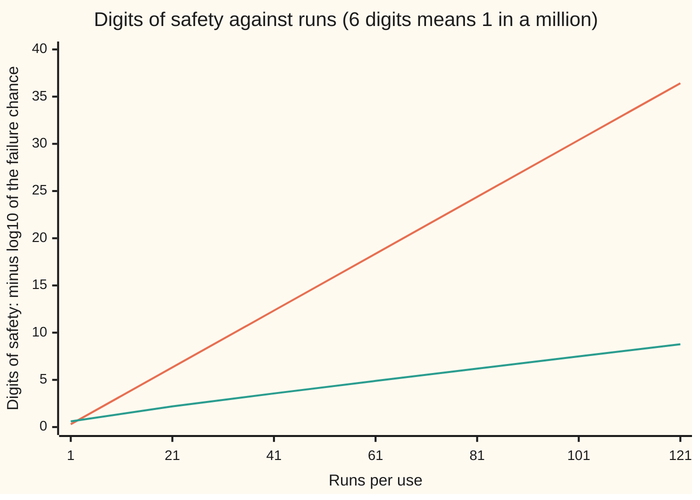
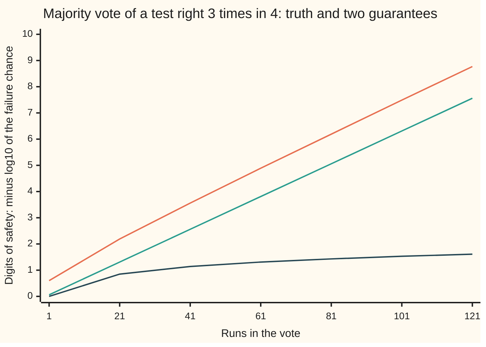

# Tail bounds: why a random method almost never embarrasses you

[Syllabus](../../../SYLLABUS.md) → [Applied and computational](../README.md) → [Randomised and Approximate Algorithms](../README.md#s02) → Tail bounds

---

## General Overview

A web service answers 10 million requests a day. Each answer is the product of two tables of numbers, 1,000 rows by 1,000 columns, worked out on a separate worker machine. A worker with a faulty memory chip can send back a wrong product. Checking by redoing the product costs 1,000,000,000 multiplications per request, as much as the work itself.

A cheaper check exists. Pick a random list of 1,000 zeros and ones. Push the list through the two tables, and separately through the claimed product, and compare the two results. That costs 3,000,000 multiplications. A right product always passes. A wrong product fails the check at least half the time, so each run is a coin flip that can only ever go against a wrong answer.

So run it 20 times, with a fresh random list each time. A wrong product survives only if all 20 coins land its way: a chance of 1 in 1,048,576, just under 1 in a million. The 20 runs cost 6% of redoing the work. That is the trade this card is about: spend a few repeats, and a method that is unreliable on one run becomes one that almost never embarrasses you.

Two warnings come with it. The guarantee must hold even on a day when a broken worker spoils every product, and then ten million requests, each with a 1-in-a-million miss, let through 9.54 wrong products on average; making even one bad day a 1-in-a-million event takes 44 runs per request. And a test that can be wrong in both directions, right 3 times in 4 on each run, needs a majority vote and more runs: 79 at the least, 97 by the guarantee used here.

**Independent repeats shrink a method's failure chance exponentially, so the number of runs needed grows only with the logarithm of how rare a failure must be and of how many times the method is used.**

**What kind of fact this is:** theorems. The check's one-in-two catch rate and the repeat rules are proved on this card in Why it works; the Chernoff bound and the union bound are quoted from the cards that prove them.

### The picture: digits of safety bought by each run



Orange, steep: the one-sided check, each run adding 0.30 digits. Green, shallow: a majority vote of a two-sided test that is right 3 times in 4, its exact failure chance. The orange line is exactly straight, because each run halves the failure chance. The green line climbs faster over the first runs and is nearly straight after that; only the vote's Chernoff guarantee, in the next chart, falls by an exactly fixed factor per run.

---

## The formula

Two letters are introduced here and used across this wing. $\delta$ (delta) is a **failure probability**: the chance allowed for the whole guarantee to fail, here 1 in a million. $\varepsilon$ (epsilon) is an **error allowance**: how far off an answer may be, or how much margin a test has over a guess. A randomised method that has a fixed cost but may be wrong is a **Monte Carlo** method ([Randomised algorithms](01-randomised-algorithms-and-expectation.md)); the check above is one.

The number of runs to buy, for a method used $N$ times with total failure chance at most $\delta$:

$$k = \left\lceil \frac{\ln(N/\delta)}{r} \right\rceil$$

**Read it aloud:** the runs needed are the natural log of the number of uses divided by the allowed failure, divided by the rate each run buys, rounded up.

The rate $r$ depends on the kind of test:

$$\text{one-sided:}\ \ P(\text{all } k \text{ runs miss}) = m^k,\quad r = \ln\frac{1}{m}$$

$$\text{two-sided, majority vote:}\ \ P(\text{vote wrong}) \le e^{-k\,D(\frac12\,\|\,1-p)} \le e^{-2k\varepsilon^2},\quad \varepsilon = p - \tfrac12$$

$$\text{many uses, the union bound:}\ \ P(\text{some use fails}) \le N \times (\text{failure chance of one use})$$

**Read it aloud:** a one-sided test misses only when every run misses; a majority vote is wrong with a chance that falls exponentially at Chernoff's rate $D$; and the chance that any of $N$ uses fails is at most $N$ times the chance for one.

Here $D(a\,\|\,b) = a\ln\frac{a}{b} + (1-a)\ln\frac{1-a}{1-b}$ is Chernoff's rate, the gap between a coin with chance $a$ and one with chance $b$ ([Concentration](../../09-Probability%20and%20statistics/06-Limit%20Theorems%20in%20Practice/06-concentration-inequalities-hoeffding-and-chernoff.md)). For a vote, $a = \frac12$ is the line a majority must cross and $b = 1 - p$ is a run's chance of being wrong.

| Symbol | Plain meaning | In our example | Push it up and the answer… |
| --- | --- | --- | --- |
| $k$ | runs per use | 20 for one request; 44 for a safe day; 97 for the two-sided vote | the failure chance falls exponentially |
| $m$ | chance one run of a one-sided check misses a wrong answer | 1/2 | more runs needed; at 1/4 only 10 |
| $p$ | chance one run of a two-sided test is right | 3/4 | fewer runs; at 2/3 the guarantee needs 235 |
| $\varepsilon$ | error allowance: the margin $p - \frac12$, or how far an estimate may be off | 1/4 for the vote; 0.01 for an estimate | runs or samples fall like $1/\varepsilon^2$ |
| $\delta$ | failure probability allowed for the whole job | 1 in a million | runs fall, but only like $\ln(1/\delta)$ |
| $N$ | uses the guarantee must cover | 1 request, or 10,000,000 a day | runs rise, but only like $\ln N$ |
| $r$ | rate: how much one run cuts the log of the failure chance | $\ln 2 = 0.6931$ one-sided; $D = 0.1438$ vote | fewer runs |
| $D(a\,\|\,b)$ | Chernoff's rate, the gap between two coins | $D(\frac12\,\|\,\frac14) = 0.1438$ | the vote's bound falls faster |
| $W$ | count of wrong runs among $k$ | the vote fails when $W \ge (k+1)/2$ | — |
| $n$ | random samples drawn for an estimate | 72,544 | the estimate tightens like $1/\sqrt n$ |
| $A$, $B$, $C$ | the two tables and the claimed product | 1,000 by 1,000 | — |
| $x$ | the random list of zeros and ones | 1,000 entries | — |

### When it holds

- **Fresh randomness on every run.** The product $m^k$ needs independent runs. Reuse one random list and a wrong product that slips past once slips past every time: the miss chance stays at 1/2, simulated 0.5007.
- **The any-alarm rule only for a one-sided test.** "Reject if any run objects" is safe only when a right answer never draws an objection. On a test with false alarms 1 time in 4, 20 runs reject a right answer with chance 0.9968.
- **A real margin for a vote.** Each run must be right more often than not, on every input. At $p = \frac12$ a majority of 101 runs is still wrong half the time.
- **A worst-case rate per run.** $m$ and $p$ must hold for every input, not on average over inputs, or the bad input escapes the bound.
- **A union bound below 1.** It needs no independence between uses, but once $N$ times the per-use chance passes 1, as 9.54 does, it says nothing.

---

## Why it works

### Step 0: failures that need many coincidences are rare

A one-sided method fails only if every run fails, and independent failures multiply, so each run cuts the failure chance by a fixed factor. A two-sided method decided by majority fails only if more than half its runs fail: a tail of a binomial count, which Chernoff's bound shows also falls exponentially, under a guarantee that shrinks by a fixed factor per run. Either way the runs needed grow with the logarithm of the target. The union bound then spreads one budget $\delta$ across many uses at the same logarithmic price.

### Step 1: one run of the check catches a wrong product at least half the time

The check compares $A(Bx)$ with $Cx$. Together the two sides take three passes of a table over a list, two for $A(Bx)$ and one for $Cx$: about $3 \times 1{,}000^2 = 3{,}000{,}000$ multiplications, against $1{,}000^3$ to redo $AB$.

If $C = AB$ the two sides are equal for every list, so a right product is never rejected. If $C$ is wrong, the error table $AB - C$ has some entry that is not zero, in row $i$ and column $j$. Entry $i$ of $(AB - C)x$ is that entry times $x_j$, plus terms that do not involve $x_j$. Fix every other entry of the list. Of the two values $x_j$ can take, 0 and 1, at most one makes the total zero, because they differ by the nonzero entry. So at least half of all lists expose the error. The code checks this on a 3 by 3 product with one entry off by one: exactly 4 of the 8 possible lists catch it, and 0 of 8 flag the right product.

### Step 2: one-sided repeats multiply the doubt

Each run draws its own list, so the runs are independent, and the chance that all $k$ miss is the product of the per-run misses: at most $m^k$. With $m = \frac12$, ask for $(\frac12)^k \le \delta$. Taking logs, $k \ge \ln(1/\delta)/\ln 2 = 13.82/0.6931 = 19.93$, so 20 runs. This is the formula with $N = 1$ and $r = \ln 2$.

The test that finds primes for encryption keys is the same shape with $m = \frac14$: each fresh base leaves at most a quarter of the doubt ([The Miller-Rabin test](../../02-Number%20theory/06-Codes%20and%20Secrets/05-miller-rabin.md)), so 10 bases reach 1 in a million.

### Step 3: two-sided tests need a vote, and the vote needs Chernoff

Now take a yes-or-no test that is right with chance $p = \frac34$ whichever answer is true. One objection proves nothing, so run it an odd number $k$ of times and take the majority. The vote is wrong only when the count of wrong runs $W$ reaches $(k+1)/2$. $W$ counts successes in $k$ independent trials with chance $\frac14$ each, so it is binomial with mean $k/4$.

Three bounds on that tail, from weakest to strongest:

- **Markov** ([Markov and Chebyshev](../../09-Probability%20and%20statistics/02-Random%20Variables/08-markov-and-chebyshev-inequalities.md)) uses the mean alone: $P(W \ge k/2) \le (k/4)/(k/2) = \frac12$. That is 0.50 at every $k$: more runs never improve it.
- **Chebyshev** uses the variance $k \cdot \frac14 \cdot \frac34 = 3k/16$ and the distance $k/4$ from the mean: the bound is $3/k$. It falls, but only like one over the runs: 1 in a million needs 3,000,000 runs.
- **Chernoff** ([Concentration](../../09-Probability%20and%20statistics/06-Limit%20Theorems%20in%20Practice/06-concentration-inequalities-hoeffding-and-chernoff.md)) uses the whole binomial law: $P(W \ge k/2) \le e^{-k\,D(\frac12\,\|\,\frac14)}$, with $D = \frac12\ln 2 + \frac12\ln\frac23 = 0.1438$. Hoeffding's simpler form gives $e^{-2k\varepsilon^2} = e^{-k/8}$, rate 0.1250.

Setting each below 1 in a million: Hoeffding needs 111 runs, Chernoff $13.82/0.1438 = 96.05$, so 97. The exact binomial sum, counted term by term in the code, first drops below 1 in a million at 79 runs: at 77 it is $1.17 \times 10^{-6}$, at 79 it is $8.65 \times 10^{-7}$. Chernoff's guarantee costs 18 extra runs over the truth. Chebyshev's costs millions.



Orange, top: the exact failure chance of the vote. Green, middle: Chernoff's guarantee, a straight line just under the truth with nearly the same slope. Dark, bottom: Chebyshev's guarantee, which bends over and stalls. Markov's would sit flat at 0.30 digits, a chance of one half.

### Step 4: many uses, one budget

The service does not run the check once; it runs it 10,000,000 times a day. The **union bound** ([Stopping the sieve early](../../04-Combinatorics%20and%20graphs/04-Inclusion-Exclusion%20and%20Pigeonhole/04-union-bound-and-bonferroni.md)) says the chance that at least one of many events happens is at most the sum of their chances. It needs no independence, which suits requests that share machines.

With 20 runs per request, the sum is $10^7 \times 9.54 \times 10^{-7} = 9.54$. A bound above 1 says nothing, and the worst case is grim: if a broken worker spoiled every product and the checks ran independently, the chance of at least one wrong product reaching a customer would be 0.99993. To make the whole day fail with chance at most 1 in a million, give each request $\delta/N = 10^{-13}$. Then $k \ge \ln(10^{13})/\ln 2 = 29.93/0.6931 = 43.19$, so 44 runs, and the union bound reads $5.68 \times 10^{-7}$. Ten million times as many uses cost 24 more runs, because $\log_2(10^7)$ is about 23.3. The two-sided vote needs $29.93/0.1438 = 208.10$, so 209 runs by Chernoff, and 189 by the exact sum.

### Step 5: the same recipe for an estimate

The service also wants the share of slow requests, without timing all ten million. Draw $n$ requests at random, independently, and report the share that were slow. Hoeffding's two-sided bound says the sample share misses the true share by $\varepsilon$ or more with chance at most $2e^{-2n\varepsilon^2}$. Set that to $\delta$: $n = \lceil \ln(2/\delta)/(2\varepsilon^2) \rceil$. For $\varepsilon = 0.01$ and $\delta$ 1 in a million that is 72,544 samples, under 1% of the day. This pair, "within $\varepsilon$, except with chance $\delta$", is the shape of the guarantees later on this shelf. $\delta$ sits inside a logarithm and $\varepsilon$ is squared underneath: $\varepsilon = 0.001$ costs 7,254,329 samples, a hundred times more.

---

## Worked numbers, by hand

The service's check, one-sided with $m = \frac12$, and the two-sided vote with $p = \frac34$.

| Step | Arithmetic | Value |
| --- | --- | --- |
| allowed failure, one request | $\delta$ | 1 in a million |
| log of the target | $\ln(10^6)$ | 13.82 |
| one-sided runs | 13.82 / 0.6931 = 19.93, round up | 20 |
| miss chance at 20 runs | $(\frac12)^{20}$ = 1 / 1,048,576 | $9.54 \times 10^{-7}$ |
| cost of 20 checks | 20 × 3,000,000 / 1,000,000,000 | 6.0% of a redo |
| the day at 20 runs, every product wrong | 10,000,000 × $9.54 \times 10^{-7}$ | 9.54 expected misses |
| per-request target for a safe day | $10^{-6} / 10^{7}$, log $\ln(10^{13})$ | 29.93 |
| one-sided runs for the day | 29.93 / 0.6931 = 43.19, round up | **44** |
| union bound at 44 runs | 10,000,000 × $2^{-44}$ | $5.68 \times 10^{-7}$ |
| two-sided rate | $\frac12\ln 2 + \frac12\ln\frac23$ | 0.1438 |
| two-sided runs, one request | 13.82 / 0.1438 = 96.05, round up | **97** |
| two-sided runs, the day | 29.93 / 0.1438 = 208.10, round up | **209** |

Forty-four runs of a three-million-multiplication check, 13.2% of the cost of redoing the work, make a day of ten million answers come out wrong somewhere with chance under 1 in a million.

### What breaks if you drop a piece

| Mistake | Comes out at | What went wrong |
| --- | --- | --- |
| One random list reused for all 4 runs of the check | misses a wrong product 0.5007 of the time (simulated); fresh lists give 0.0612, exact 0.0625 | the runs are not independent, so the doubts do not multiply |
| Any-alarm rule on a two-sided test right 3 times in 4, 20 runs | rejects a right answer with chance 0.9968 | the rule assumes a right answer never draws an objection |
| Majority of 101 runs of a test right only half the time | wrong with chance 0.5000 | no margin: $\varepsilon = 0$, so Chernoff's rate is 0 |
| 20 runs per request across 10,000,000 requests | union bound 9.54; if every product is wrong, at least one miss with chance 0.99993 | one request's budget was spent on every request |

---

## Code, from first principles, and it actually runs

The script runs Freivalds' check (the random-list check above) on a 3 by 3 product and takes **three independent roads**. Closed forms: $m^k$, the Chernoff and Hoeffding exponentials, the union sum and the run-count formula. Exact counts: all 8 random lists, a run-by-run loop, and the binomial tail summed term by term and again built up one run at a time. A seeded simulation: SplitMix64, a small random-number generator written out in both languages, drives 100,000 trials of the real check, with fresh and with reused lists, and 100,000 votes of 9 runs. Asserts tie the roads together, simulations within four standard errors.

### Python

```python
# Tail bounds and repeated trials: the check behind the card. Standard library only.
# Roads to each answer: a closed-form bound; an exact count (all 8 random lists, or
# a binomial sum term by term); a seeded SplitMix64 simulation of the real runs.
from math import log, exp, expm1, ceil, floor, log10, log1p

MISS = 0.5          # one-sided check: chance one run misses a wrong product
P_RIGHT = 0.75      # two-sided test: chance one run gives the right answer
DELTA = 1e-6        # failure chance allowed
USES = 10_000_000   # requests a day at the web service
EPS = 0.01          # error allowance on an estimated share
SEED, TRIALS, M64 = 2026, 100_000, (1 << 64) - 1

def splitmix(s):
    s = (s + 0x9E3779B97F4A7C15) & M64
    z = ((s ^ (s >> 30)) * 0xBF58476D1CE4E5B9) & M64
    z = ((z ^ (z >> 27)) * 0x94D049BB133111EB) & M64
    return s, z ^ (z >> 31)

def sci(x):
    e = floor(log10(x)); m = x / 10.0 ** e
    if m >= 9.995: m, e = m / 10, e + 1
    return f"{m:.2f}e{e}"

def mul(X, Y): return [[sum(X[i][t] * Y[t][j] for t in range(3)) for j in range(3)] for i in range(3)]
def mv(X, v): return [sum(X[i][t] * v[t] for t in range(3)) for i in range(3)]
def bits(z): return [(z >> j) & 1 for j in range(3)]

A, B = [[2, 1, 0], [1, 3, 1], [0, 1, 2]], [[1, 2, 1], [0, 1, 3], [2, 0, 1]]
GOOD = mul(A, B)
BAD = [row[:] for row in GOOD]; BAD[1][2] += 1           # one entry off by one
def catches(C, x): return mv(A, mv(B, x)) != mv(C, x)   # Freivalds' check, one run

def tail(k, q):  # exact chance that a majority of k runs (k odd) are wrong, each wrong with chance q
    pmf = 1.0
    for _ in range(k): pmf *= 1 - q
    total = 0.0
    for w in range(k + 1):
        if 2 * w > k: total += pmf
        pmf *= (k - w) / (w + 1) * q / (1 - q)
    return total

def tail_dp(k, q):  # second road: the law of the wrong count, built up one run at a time
    dist = [1.0]
    for _ in range(k): dist = [a * (1 - q) + b * q for a, b in zip(dist + [0.0], [0.0] + dist)]
    return sum(dist[(k + 1) // 2:])
def kl(a, b): return a * log(a / b) + (1 - a) * log((1 - a) / (1 - b))
def runs_formula(n_uses, delta, rate): return ceil(log(n_uses / delta) / rate)
def runs_exact(q, target):
    k = 1
    while tail(k, q) > target: k += 2
    return k
def runs_one_sided(miss, target):          # brute force: double the doubt down run by run
    k, left = 0, 1.0
    while left > target: k, left = k + 1, left * miss
    return k

# ---- one-sided: the check itself, every random list, and the cost ----
caught = sum(catches(BAD, bits(v)) for v in range(8))
false_alarm = sum(catches(GOOD, bits(v)) for v in range(8))
print(f"wrong product caught by {caught} of 8 lists; right product flagged by {false_alarm} of 8")
size = 1000
rate1 = log(1 / MISS)
for k in (1, 2, 10, 20, 44):
    print(f"one-sided, {k:2d} runs: miss chance {sci(MISS ** k)}, about 1 in {round(MISS ** -k):,}")
k1, kday = runs_formula(1, DELTA, rate1), runs_formula(USES, DELTA, rate1)
print(f"one-sided runs for 1 in a million: per request {log(1 / DELTA):.2f} / {rate1:.4f} = {log(1 / DELTA) / rate1:.2f} -> {k1}, "
      f"whole day {log(USES / DELTA):.2f} / {rate1:.4f} = {log(USES / DELTA) / rate1:.2f} -> {kday}, {kday - k1} more")
print(f"cost on {size}x{size}: one check {3*size*size:,}, redo {size**3:,}; {k1} checks {100 * 3 * k1 / size:.1f}% of a redo, {kday} checks {100 * 3 * kday / size:.1f}%")
print(f"one-sided runs at miss chance 0.25 per run: {runs_formula(1, DELTA, log(4))}")

# ---- seeded simulation of the real check: fresh list each run, then one list reused ----
s, fresh, reused = SEED, 0, 0
for _ in range(TRIALS):
    hit = False
    for _ in range(4):
        s, z = splitmix(s); hit = hit or catches(BAD, bits(z))
    fresh += not hit
    s, z = splitmix(s); reused += not catches(BAD, bits(z))   # same list, 4 times: one answer
print(f"simulated, 4 runs, fresh lists: miss {fresh / TRIALS:.4f} (exact {MISS ** 4:.4f})")
print(f"simulated, 4 runs, one list reused: miss {reused / TRIALS:.4f}")

# ---- two-sided: majority vote, exact against every bound ----
q, gap = 1 - P_RIGHT, P_RIGHT - 0.5
D = kl(0.5, q)
cheb = lambda k: min(1.0, P_RIGHT * q / (k * gap * gap))   # Chebyshev: variance k p q over distance (k eps)^2
print(f"two-sided, right {P_RIGHT} per run: Chernoff rate D = {D:.4f}, Hoeffding rate 2 eps^2 = {2*gap*gap:.4f}")
print(f"Markov on the count of wrong votes: {q / 0.5:.2f} at every number of runs")
print(" runs   exact      Chernoff   Hoeffding  Chebyshev")
for k in (1, 9, 21, 41, 81, 121):
    ex, ch, ho, cb = tail(k, q), exp(-k * D), exp(-2 * k * gap * gap), cheb(k)
    print(f"{k:5d}   {sci(ex):9}  {sci(ch):9}  {sci(ho):9}  {sci(cb)}")
    assert ex <= ch <= ho and ex <= cb and abs(tail_dp(k, q) / ex - 1) < 1e-9   # every bound bounds; two roads agree
kc, kh, ke, kcheb = runs_formula(1, DELTA, D), runs_formula(1, DELTA, 2 * gap * gap), runs_exact(q, DELTA), ceil(P_RIGHT * q / (gap * gap * DELTA))
print(f"runs for 1 in a million: Chebyshev {kcheb:,}, Hoeffding {kh}, Chernoff {kc}, exact {ke}")
print(f"exact at {ke - 2} runs {sci(tail(ke - 2, q))}, at {ke} runs {sci(tail(ke, q))}, at {kc} runs {sci(tail(kc, q))}")
print(f"Chernoff quotients {log(1 / DELTA) / D:.2f} and {log(USES / DELTA) / D:.2f}; whole day: Chernoff {runs_formula(USES, DELTA, D)}, exact {runs_exact(q, DELTA / USES)}")
D3 = kl(0.5, 1 / 3)
print(f"at right 2/3 per run: Chernoff {runs_formula(1, DELTA, D3)}, exact {runs_exact(1 / 3, DELTA)}")

s, wrong = SEED, 0
for _ in range(TRIALS):
    bad_votes = 0
    for _ in range(9):
        s, z = splitmix(s); bad_votes += (z >> 62) == 0          # wrong with chance 1/4
    wrong += bad_votes >= 5
print(f"simulated majority of 9: wrong {wrong / TRIALS:.4f} (exact {tail(9, q):.4f})")

# ---- many uses: the union bound ----
d20 = MISS ** 20
p_any = -expm1(USES * log1p(-d20))             # 1 - (1 - d20)^USES, exactly
print(f"20 runs, {USES:,} requests: union bound {USES * d20:.2f}, chance of at least one miss {p_any:.5f}")
print(f"{kday} runs, {USES:,} requests: union bound {sci(USES * MISS ** kday)}")

# ---- the same recipe for an estimate ----
n_est = ceil(log(2 / DELTA) / (2 * EPS * EPS))
print(f"samples to know a share within {EPS} except 1 in a million: {n_est:,}; at eps 0.001: {ceil(log(2 / DELTA) / 2e-6):,}")

# ---- what breaks ----
print(f"what breaks: any-alarm rule on the two-sided test, 20 runs: false alarm {1 - P_RIGHT ** 20:.4f}")
print(f"what breaks: no margin, right 0.5 per run, majority of 101: wrong {tail(101, 0.5):.4f}")

# ---- chart: digits of safety, -log10 of the failure chance ----
ks = [1, 21, 41, 61, 81, 101, 121]
print("figure,runs," + ",".join(str(k) for k in ks))
print("figure,one-sided," + ",".join(f"{k * log10(1 / MISS):.2f}" for k in ks))
print("figure,majority exact," + ",".join(f"{-log10(tail(k, q)):.2f}" for k in ks))
print("figure,majority Chernoff," + ",".join(f"{k * D / log(10):.2f}" for k in ks))
print("figure,majority Chebyshev," + ",".join(f"{log10(1 / cheb(k)):.2f}" for k in ks))

assert caught == 4 and false_alarm == 0 and 1 - caught / 8 == MISS    # exhaustive count = stated rate
assert k1 == runs_one_sided(MISS, DELTA) and kday == runs_one_sided(MISS, DELTA / USES)
assert abs(fresh / TRIALS - MISS ** 4) < 4 * (MISS ** 4 * (1 - MISS ** 4) / TRIALS) ** 0.5
assert abs(reused / TRIALS - MISS) < 4 * (0.25 / TRIALS) ** 0.5
assert abs(wrong / TRIALS - tail(9, q)) < 4 * (tail(9, q) * (1 - tail(9, q)) / TRIALS) ** 0.5
assert tail(kc, q) <= DELTA and tail_dp(ke, q) <= DELTA < tail_dp(ke - 2, q) and ke < kc < kh
assert kcheb == round(3 / DELTA) and all(abs(cheb(k) - 3 / k) < 1e-12 for k in ks[1:])   # Chebyshev is 3/k
assert abs(p_any - (1 - exp(-USES * d20))) < 1e-9 and USES * MISS ** kday <= DELTA      # against the Poisson form
assert 2 * exp(-2 * n_est * EPS * EPS) <= DELTA < 2 * exp(-2 * (n_est - 1) * EPS * EPS)
assert abs(tail(101, 0.5) - 0.5) < 1e-12                                 # symmetry: a fair vote
print("ALL CHECKS PASS")
```

**Ran 2026-11-11 on macOS, Python 3.14.10, standard library only. All checks passed. Output, pasted from the run:**

```
wrong product caught by 4 of 8 lists; right product flagged by 0 of 8
one-sided,  1 runs: miss chance 5.00e-1, about 1 in 2
one-sided,  2 runs: miss chance 2.50e-1, about 1 in 4
one-sided, 10 runs: miss chance 9.77e-4, about 1 in 1,024
one-sided, 20 runs: miss chance 9.54e-7, about 1 in 1,048,576
one-sided, 44 runs: miss chance 5.68e-14, about 1 in 17,592,186,044,416
one-sided runs for 1 in a million: per request 13.82 / 0.6931 = 19.93 -> 20, whole day 29.93 / 0.6931 = 43.19 -> 44, 24 more
cost on 1000x1000: one check 3,000,000, redo 1,000,000,000; 20 checks 6.0% of a redo, 44 checks 13.2%
one-sided runs at miss chance 0.25 per run: 10
simulated, 4 runs, fresh lists: miss 0.0612 (exact 0.0625)
simulated, 4 runs, one list reused: miss 0.5007
two-sided, right 0.75 per run: Chernoff rate D = 0.1438, Hoeffding rate 2 eps^2 = 0.1250
Markov on the count of wrong votes: 0.50 at every number of runs
 runs   exact      Chernoff   Hoeffding  Chebyshev
    1   2.50e-1    8.66e-1    8.82e-1    1.00e0
    9   4.89e-2    2.74e-1    3.25e-1    3.33e-1
   21   6.42e-3    4.88e-2    7.24e-2    1.43e-1
   41   2.74e-4    2.75e-3    5.95e-3    7.32e-2
   81   6.41e-7    8.71e-6    4.01e-5    3.70e-2
  121   1.69e-9    2.76e-8    2.70e-7    2.48e-2
runs for 1 in a million: Chebyshev 3,000,000, Hoeffding 111, Chernoff 97, exact 79
exact at 77 runs 1.17e-6, at 79 runs 8.65e-7, at 97 runs 5.90e-8
Chernoff quotients 96.05 and 208.10; whole day: Chernoff 209, exact 189
at right 2/3 per run: Chernoff 235, exact 193
simulated majority of 9: wrong 0.0486 (exact 0.0489)
20 runs, 10,000,000 requests: union bound 9.54, chance of at least one miss 0.99993
44 runs, 10,000,000 requests: union bound 5.68e-7
samples to know a share within 0.01 except 1 in a million: 72,544; at eps 0.001: 7,254,329
what breaks: any-alarm rule on the two-sided test, 20 runs: false alarm 0.9968
what breaks: no margin, right 0.5 per run, majority of 101: wrong 0.5000
figure,runs,1,21,41,61,81,101,121
figure,one-sided,0.30,6.32,12.34,18.36,24.38,30.40,36.42
figure,majority exact,0.60,2.19,3.56,4.89,6.19,7.49,8.77
figure,majority Chernoff,0.06,1.31,2.56,3.81,5.06,6.31,7.56
figure,majority Chebyshev,0.00,0.85,1.14,1.31,1.43,1.53,1.61
ALL CHECKS PASS
```

### Rust

```rust
// Tail bounds and repeated trials: the check behind the card. std only, no crates.
// Roads to each answer: a closed-form bound; an exact count (all 8 random lists, or
// a binomial sum term by term); a seeded SplitMix64 simulation of the real runs.
const MISS: f64 = 0.5; // one-sided check: chance one run misses a wrong product
const P_RIGHT: f64 = 0.75; // two-sided test: chance one run gives the right answer
const DELTA: f64 = 1e-6; // failure chance allowed
const USES: f64 = 10_000_000.0; // requests a day at the web service
const EPS: f64 = 0.01; // error allowance on an estimated share
const SEED: u64 = 2026;
const TRIALS: usize = 100_000;
type M3 = [[i64; 3]; 3];
const A: M3 = [[2, 1, 0], [1, 3, 1], [0, 1, 2]];
const B: M3 = [[1, 2, 1], [0, 1, 3], [2, 0, 1]];

fn splitmix(s: &mut u64) -> u64 {
    *s = s.wrapping_add(0x9E3779B97F4A7C15);
    let mut z = (*s ^ (*s >> 30)).wrapping_mul(0xBF58476D1CE4E5B9);
    z = (z ^ (z >> 27)).wrapping_mul(0x94D049BB133111EB);
    z ^ (z >> 31)
}
fn sci(x: f64) -> String {
    let mut e = x.log10().floor();
    let mut m = x / 10f64.powf(e);
    if m >= 9.995 { m /= 10.0; e += 1.0; }
    format!("{:.2}e{}", m, e as i64)
}
fn grp(n: u64) -> String { // thousands separators, like Python's {:,}
    let s = n.to_string();
    s.chars().enumerate().map(|(i, c)| if i > 0 && (s.len() - i) % 3 == 0 { format!(",{}", c) } else { c.to_string() }).collect()
}
fn mul(x: &M3, y: &M3) -> M3 {
    let mut r = [[0; 3]; 3];
    for i in 0..3 { for j in 0..3 { for t in 0..3 { r[i][j] += x[i][t] * y[t][j]; } } }
    r
}
fn mv(x: &M3, v: &[i64; 3]) -> [i64; 3] {
    let mut r = [0; 3];
    for i in 0..3 { for t in 0..3 { r[i] += x[i][t] * v[t]; } }
    r
}
fn bits(z: u64) -> [i64; 3] { [(z & 1) as i64, ((z >> 1) & 1) as i64, ((z >> 2) & 1) as i64] }
fn catches(c: &M3, x: &[i64; 3]) -> bool { mv(&A, &mv(&B, x)) != mv(c, x) } // Freivalds' check, one run

fn tail(k: usize, q: f64) -> f64 { // exact chance that a majority of k runs (k odd) are wrong
    let mut pmf = 1.0;
    for _ in 0..k { pmf *= 1.0 - q; }
    let mut total = 0.0;
    for w in 0..=k {
        if 2 * w > k { total += pmf; }
        pmf *= (k - w) as f64 / (w + 1) as f64 * q / (1.0 - q);
    }
    total
}
fn tail_dp(k: usize, q: f64) -> f64 { // second road: the law of the wrong count, built up one run at a time
    let mut d = vec![1.0];
    for _ in 0..k { d = (0..=d.len()).map(|w| (if w < d.len() { d[w] * (1.0 - q) } else { 0.0 }) + (if w > 0 { d[w - 1] * q } else { 0.0 })).collect(); }
    d[(k + 1) / 2..].iter().sum()
}
fn kl(a: f64, b: f64) -> f64 { a * (a / b).ln() + (1.0 - a) * ((1.0 - a) / (1.0 - b)).ln() }
fn runs_formula(n_uses: f64, delta: f64, rate: f64) -> usize { ((n_uses / delta).ln() / rate).ceil() as usize }
fn runs_exact(q: f64, target: f64) -> usize {
    let mut k = 1;
    while tail(k, q) > target { k += 2; }
    k
}
fn runs_one_sided(miss: f64, target: f64) -> usize { // brute force: run by run
    let (mut k, mut left) = (0, 1.0);
    while left > target { k += 1; left *= miss; }
    k
}

fn main() {
    // ---- one-sided: the check itself, every random list, and the cost ----
    let good = mul(&A, &B);
    let mut bad = good;
    bad[1][2] += 1; // one entry off by one
    let caught = (0..8u64).filter(|&v| catches(&bad, &bits(v))).count();
    let false_alarm = (0..8u64).filter(|&v| catches(&good, &bits(v))).count();
    println!("wrong product caught by {} of 8 lists; right product flagged by {} of 8", caught, false_alarm);
    let size: u64 = 1000;
    let rate1 = (1.0 / MISS).ln();
    for k in [1, 2, 10, 20, 44] {
        println!("one-sided, {:2} runs: miss chance {}, about 1 in {}", k, sci(MISS.powi(k)), grp(MISS.powi(-k).round() as u64));
    }
    let (k1, kday) = (runs_formula(1.0, DELTA, rate1), runs_formula(USES, DELTA, rate1));
    let (l1, ln_day) = ((1.0 / DELTA).ln(), (USES / DELTA).ln());
    println!("one-sided runs for 1 in a million: per request {:.2} / {:.4} = {:.2} -> {}, whole day {:.2} / {:.4} = {:.2} -> {}, {} more", l1, rate1, l1 / rate1, k1, ln_day, rate1, ln_day / rate1, kday, kday - k1);
    println!("cost on {}x{}: one check {}, redo {}; {} checks {:.1}% of a redo, {} checks {:.1}%", size, size, grp(3 * size * size), grp(size * size * size), k1, 100.0 * 3.0 * k1 as f64 / size as f64, kday, 100.0 * 3.0 * kday as f64 / size as f64);
    println!("one-sided runs at miss chance 0.25 per run: {}", runs_formula(1.0, DELTA, 4f64.ln()));

    // ---- seeded simulation of the real check: fresh list each run, then one list reused ----
    let (mut s, mut fresh, mut reused) = (SEED, 0usize, 0usize);
    for _ in 0..TRIALS {
        let mut hit = false;
        for _ in 0..4 { let z = splitmix(&mut s); hit = hit || catches(&bad, &bits(z)); }
        if !hit { fresh += 1; }
        let z = splitmix(&mut s);
        if !catches(&bad, &bits(z)) { reused += 1; } // same list, 4 times: one answer
    }
    let tr = TRIALS as f64;
    println!("simulated, 4 runs, fresh lists: miss {:.4} (exact {:.4})", fresh as f64 / tr, MISS.powi(4));
    println!("simulated, 4 runs, one list reused: miss {:.4}", reused as f64 / tr);

    // ---- two-sided: majority vote, exact against every bound ----
    let (q, gap) = (1.0 - P_RIGHT, P_RIGHT - 0.5);
    let d = kl(0.5, q);
    let cheb = |k: f64| f64::min(1.0, P_RIGHT * q / (k * gap * gap)); // Chebyshev: variance k p q over distance (k eps)^2
    println!("two-sided, right {} per run: Chernoff rate D = {:.4}, Hoeffding rate 2 eps^2 = {:.4}", P_RIGHT, d, 2.0 * gap * gap);
    println!("Markov on the count of wrong votes: {:.2} at every number of runs", q / 0.5);
    println!(" runs   exact      Chernoff   Hoeffding  Chebyshev");
    for k in [1usize, 9, 21, 41, 81, 121] {
        let kf = k as f64;
        let (ex, ch, ho) = (tail(k, q), (-kf * d).exp(), (-2.0 * kf * gap * gap).exp());
        let cb = cheb(kf);
        println!("{:5}   {:9}  {:9}  {:9}  {}", k, sci(ex), sci(ch), sci(ho), sci(cb));
        assert!(ex <= ch && ch <= ho && ex <= cb && (tail_dp(k, q) / ex - 1.0).abs() < 1e-9); // every bound bounds; two roads agree
    }
    let (kc, kh, ke) = (runs_formula(1.0, DELTA, d), runs_formula(1.0, DELTA, 2.0 * gap * gap), runs_exact(q, DELTA));
    let kcheb = (P_RIGHT * q / (gap * gap * DELTA)).ceil() as u64;
    println!("runs for 1 in a million: Chebyshev {}, Hoeffding {}, Chernoff {}, exact {}", grp(kcheb), kh, kc, ke);
    println!("exact at {} runs {}, at {} runs {}, at {} runs {}", ke - 2, sci(tail(ke - 2, q)), ke, sci(tail(ke, q)), kc, sci(tail(kc, q)));
    println!("Chernoff quotients {:.2} and {:.2}; whole day: Chernoff {}, exact {}", l1 / d, ln_day / d, runs_formula(USES, DELTA, d), runs_exact(q, DELTA / USES));
    let d3 = kl(0.5, 1.0 / 3.0);
    println!("at right 2/3 per run: Chernoff {}, exact {}", runs_formula(1.0, DELTA, d3), runs_exact(1.0 / 3.0, DELTA));

    let (mut s, mut wrong) = (SEED, 0usize);
    for _ in 0..TRIALS {
        let mut bad_votes = 0;
        for _ in 0..9 { if splitmix(&mut s) >> 62 == 0 { bad_votes += 1; } } // wrong with chance 1/4
        if bad_votes >= 5 { wrong += 1; }
    }
    println!("simulated majority of 9: wrong {:.4} (exact {:.4})", wrong as f64 / tr, tail(9, q));

    // ---- many uses: the union bound ----
    let d20 = MISS.powi(20);
    let p_any = -(USES * (-d20).ln_1p()).exp_m1(); // 1 - (1 - d20)^USES, exactly
    println!("20 runs, {} requests: union bound {:.2}, chance of at least one miss {:.5}", grp(USES as u64), USES * d20, p_any);
    println!("{} runs, {} requests: union bound {}", kday, grp(USES as u64), sci(USES * MISS.powi(kday as i32)));

    // ---- the same recipe for an estimate ----
    let n_est = ((2.0 / DELTA).ln() / (2.0 * EPS * EPS)).ceil();
    println!("samples to know a share within {} except 1 in a million: {}; at eps 0.001: {}", EPS, grp(n_est as u64), grp(((2.0 / DELTA).ln() / 2e-6).ceil() as u64));

    // ---- what breaks ----
    println!("what breaks: any-alarm rule on the two-sided test, 20 runs: false alarm {:.4}", 1.0 - P_RIGHT.powi(20));
    println!("what breaks: no margin, right 0.5 per run, majority of 101: wrong {:.4}", tail(101, 0.5));

    // ---- chart: digits of safety, -log10 of the failure chance ----
    let ks = [1usize, 21, 41, 61, 81, 101, 121];
    let row = |f: &dyn Fn(f64) -> f64| ks.iter().map(|&k| format!("{:.2}", f(k as f64))).collect::<Vec<_>>().join(",");
    println!("figure,runs,{}", ks.iter().map(|k| k.to_string()).collect::<Vec<_>>().join(","));
    println!("figure,one-sided,{}", row(&|k| k * (1.0 / MISS).log10()));
    println!("figure,majority exact,{}", row(&|k| -tail(k as usize, q).log10()));
    println!("figure,majority Chernoff,{}", row(&|k| k * d / 10f64.ln()));
    println!("figure,majority Chebyshev,{}", row(&|k| (1.0 / cheb(k)).log10()));

    assert!(caught == 4 && false_alarm == 0 && 1.0 - caught as f64 / 8.0 == MISS); // exhaustive = stated rate
    assert!(k1 == runs_one_sided(MISS, DELTA) && kday == runs_one_sided(MISS, DELTA / USES));
    let m4 = MISS.powi(4);
    assert!((fresh as f64 / tr - m4).abs() < 4.0 * (m4 * (1.0 - m4) / tr).sqrt());
    assert!((reused as f64 / tr - MISS).abs() < 4.0 * (0.25 / tr).sqrt());
    let t9 = tail(9, q);
    assert!((wrong as f64 / tr - t9).abs() < 4.0 * (t9 * (1.0 - t9) / tr).sqrt());
    assert!(tail(kc, q) <= DELTA && tail_dp(ke, q) <= DELTA && DELTA < tail_dp(ke - 2, q) && ke < kc && kc < kh);
    assert!(kcheb == (3.0 / DELTA).round() as u64 && ks[1..].iter().all(|&k| (cheb(k as f64) - 3.0 / k as f64).abs() < 1e-12)); // Chebyshev is 3/k
    assert!((p_any - (1.0 - (-USES * d20).exp())).abs() < 1e-9 && USES * MISS.powi(kday as i32) <= DELTA); // against the Poisson form
    assert!(2.0 * (-2.0 * n_est * EPS * EPS).exp() <= DELTA && DELTA < 2.0 * (-2.0 * (n_est - 1.0) * EPS * EPS).exp());
    assert!((tail(101, 0.5) - 0.5).abs() < 1e-12); // symmetry: a fair vote
    println!("ALL CHECKS PASS");
}
```

**Ran 2026-11-11 on macOS, rustc 1.98.1, no crates. All checks passed. Output, pasted from the run:**

```
wrong product caught by 4 of 8 lists; right product flagged by 0 of 8
one-sided,  1 runs: miss chance 5.00e-1, about 1 in 2
one-sided,  2 runs: miss chance 2.50e-1, about 1 in 4
one-sided, 10 runs: miss chance 9.77e-4, about 1 in 1,024
one-sided, 20 runs: miss chance 9.54e-7, about 1 in 1,048,576
one-sided, 44 runs: miss chance 5.68e-14, about 1 in 17,592,186,044,416
one-sided runs for 1 in a million: per request 13.82 / 0.6931 = 19.93 -> 20, whole day 29.93 / 0.6931 = 43.19 -> 44, 24 more
cost on 1000x1000: one check 3,000,000, redo 1,000,000,000; 20 checks 6.0% of a redo, 44 checks 13.2%
one-sided runs at miss chance 0.25 per run: 10
simulated, 4 runs, fresh lists: miss 0.0612 (exact 0.0625)
simulated, 4 runs, one list reused: miss 0.5007
two-sided, right 0.75 per run: Chernoff rate D = 0.1438, Hoeffding rate 2 eps^2 = 0.1250
Markov on the count of wrong votes: 0.50 at every number of runs
 runs   exact      Chernoff   Hoeffding  Chebyshev
    1   2.50e-1    8.66e-1    8.82e-1    1.00e0
    9   4.89e-2    2.74e-1    3.25e-1    3.33e-1
   21   6.42e-3    4.88e-2    7.24e-2    1.43e-1
   41   2.74e-4    2.75e-3    5.95e-3    7.32e-2
   81   6.41e-7    8.71e-6    4.01e-5    3.70e-2
  121   1.69e-9    2.76e-8    2.70e-7    2.48e-2
runs for 1 in a million: Chebyshev 3,000,000, Hoeffding 111, Chernoff 97, exact 79
exact at 77 runs 1.17e-6, at 79 runs 8.65e-7, at 97 runs 5.90e-8
Chernoff quotients 96.05 and 208.10; whole day: Chernoff 209, exact 189
at right 2/3 per run: Chernoff 235, exact 193
simulated majority of 9: wrong 0.0486 (exact 0.0489)
20 runs, 10,000,000 requests: union bound 9.54, chance of at least one miss 0.99993
44 runs, 10,000,000 requests: union bound 5.68e-7
samples to know a share within 0.01 except 1 in a million: 72,544; at eps 0.001: 7,254,329
what breaks: any-alarm rule on the two-sided test, 20 runs: false alarm 0.9968
what breaks: no margin, right 0.5 per run, majority of 101: wrong 0.5000
figure,runs,1,21,41,61,81,101,121
figure,one-sided,0.30,6.32,12.34,18.36,24.38,30.40,36.42
figure,majority exact,0.60,2.19,3.56,4.89,6.19,7.49,8.77
figure,majority Chernoff,0.06,1.31,2.56,3.81,5.06,6.31,7.56
figure,majority Chebyshev,0.00,0.85,1.14,1.31,1.43,1.53,1.61
ALL CHECKS PASS
```

The two outputs match line for line.

> [!TIP]
> **Try changing**
> - Guess first: how many runs does a check that misses 1 time in 4 need for 1 in a million? Set `MISS = 0.25`. The line for miss chance 0.25 already answers it: 10. The first assert at the end then stops the script, because the 3 by 3 check really misses half the time.
> - Guess first: a two-sided test right 2 times in 3 instead of 3 in 4. Set `P_RIGHT = 2/3`. Chernoff now asks for 235 runs and the exact sum for 193. The simulation's assert stops the script, because its votes are still drawn wrong 1 time in 4.
> - Guess first: an estimate ten times tighter. Set `EPS = 0.001`. The samples go from 72,544 to 7,254,329: a hundred times more.
> - Guess first: a service with one request a day. Set `USES = 1`. The whole-day runs fall to 20, the same as one request.

---

## The usual mistake

> [!warning]
> **Quoting the failure chance of one use as the failure chance of the system.** "One in a million" per request sounds like never; at ten million requests a day, on a day when every product is wrong, it lets through 9.54 wrong answers on average. Divide the target by the number of uses: 44 runs, not 20.
>
> - **Reusing the random choices.** Runs on one random list are one run repeated: the miss chance stays at one half, simulated 0.5007.
> - **The any-alarm rule on a two-sided test.** With false alarms 1 time in 4, 20 runs reject a right answer with chance 0.9968.
> - **Sizing the vote with Chebyshev.** It is true but asks for 3,000,000 runs where Chernoff's guarantee asks for 97 and the truth is 79.
> - **Trying to amplify with Markov.** The mean alone caps the vote's failure at one half however many runs are added.

---

## Where you meet it in real life

- **Generating encryption keys.** Key-generation code tests candidate primes with many random Miller-Rabin bases, and the number of bases is set by the one-sided rule: each base cuts the doubt to a quarter.
- **Checking outsourced work.** A product computed on a remote machine is checked with a few random lists for a few percent of the cost, as here.
- **Comparing big files.** Two machines compare random fingerprints instead of sending the file; a mismatch proves the files differ, a match can be luck, so repeats multiply the doubt down.
- **Dashboards built on samples.** 72,544 random requests give a share within one percentage point except 1 time in a million, whatever the day's total.
- **Estimates that can miss either way.** Take the middle of several independent rough estimates: it is far off only if half of them are, so it behaves like a majority vote. [Hashing for size](04-hashing-bloom-filters-and-sketches.md) points to this for its sketches.

> **Say it back**
> A randomised method can be wrong on one run, but independent repeats shrink its failure chance exponentially. A one-sided test, which never objects to a right answer, is repeated until every run would have to miss: 20 coin-flip runs reach 1 in a million. A two-sided test needs a majority vote, and Chernoff's bound shows the vote's failure also falls exponentially: 97 runs at the guaranteed rate, 79 by exact count. The union bound adds the failure chances of many uses, so a guarantee for ten million requests costs only 24 more runs. Markov and Chebyshev are too weak to size the repeats.

---

## What this builds on

- [Randomised algorithms](01-randomised-algorithms-and-expectation.md): Monte Carlo and Las Vegas methods, and expected cost; this card bounds how often a Monte Carlo method is wrong.
- [Markov and Chebyshev](../../09-Probability%20and%20statistics/02-Random%20Variables/08-markov-and-chebyshev-inequalities.md): the bounds from a mean and a variance, shown here to be too weak for amplification.
- [Concentration](../../09-Probability%20and%20statistics/06-Limit%20Theorems%20in%20Practice/06-concentration-inequalities-hoeffding-and-chernoff.md): proves Hoeffding's inequality and the Chernoff bound that size the majority vote and the sample.
- [Stopping the sieve early](../../04-Combinatorics%20and%20graphs/04-Inclusion-Exclusion%20and%20Pigeonhole/04-union-bound-and-bonferroni.md): proves the union bound by counting.
- [The Miller-Rabin test](../../02-Number%20theory/06-Codes%20and%20Secrets/05-miller-rabin.md): the one-sided case in number theory, a quarter of the doubt per base.

## Where this goes next

- [Hashing for size](04-hashing-bloom-filters-and-sketches.md): a Bloom filter whose false-alarm rate is chosen in advance, and a distinct-count sketch with a stated typical error; taking the middle of several sketches, a majority vote as on this card, makes a large error rare.
- [MCMC as a tool](08-markov-chain-monte-carlo-for-computation.md): sampling when the samples are not independent, where these bounds need a correction for how slowly the chain forgets its start.

Left open: how to size the repeats when the runs depend on one another, or when a run's error rate is only estimated.

---

## Sources

Verified 2026-11-11: every link below resolves to the publisher's page.

- Chernoff, Herman. "A Measure of Asymptotic Efficiency for Tests of a Hypothesis Based on the Sum of Observations." *Annals of Mathematical Statistics* 23, no. 4 (1952): 493–507. [doi:10.1214/aoms/1177729330](https://doi.org/10.1214/aoms/1177729330). The exponential rate that sizes the majority vote.
- Hoeffding, Wassily. "Probability Inequalities for Sums of Bounded Random Variables." *Journal of the American Statistical Association* 58, no. 301 (1963): 13–30. [doi:10.1080/01621459.1963.10500830](https://doi.org/10.1080/01621459.1963.10500830). The range-only bound behind the sample size.
- Rabin, Michael O. "Probabilistic Algorithm for Testing Primality." *Journal of Number Theory* 12, no. 1 (1980): 128–138. [doi:10.1016/0022-314X(80)90084-0](https://doi.org/10.1016/0022-314X(80)90084-0). The classic one-sided test amplified by repeats.
- Motwani, Rajeev, and Prabhakar Raghavan. *Randomized Algorithms*. Cambridge University Press, 1995. [doi:10.1017/CBO9780511814075](https://doi.org/10.1017/CBO9780511814075). Amplification, one-sided and two-sided error, and the union bound in algorithm design.
- Mitzenmacher, Michael, and Eli Upfal. *Probability and Computing: Randomized Algorithms and Probabilistic Analysis*. Cambridge University Press, 2005. [doi:10.1017/CBO9780511813603](https://doi.org/10.1017/CBO9780511813603). Verifying a matrix product with random lists, and Chernoff bounds for algorithms.
