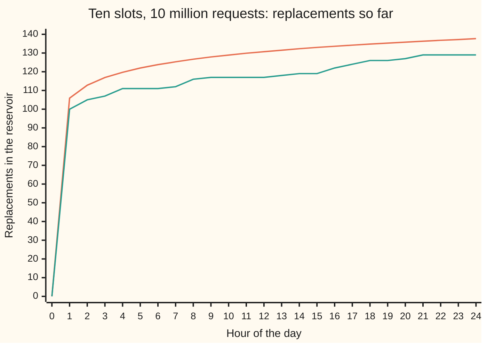

# Fair choices from a list you cannot hold: Fisher-Yates and reservoir sampling

[Syllabus](../../../SYLLABUS.md) → [Applied and computational](../README.md) → [Randomised and Approximate Algorithms](../README.md#s02) → Fair choices from a list you cannot hold

---

## General Overview

A web service handles 10 million requests a day, about 115.7 a second. At midnight an engineer wants ten of them, written out in full, to read over coffee. The ten must be a fair draw: every one of the 10 million requests should have had the same chance of being kept, 1 in a million. The full log is far too big to keep. Each request streams past once and is gone.

The obvious ways fail. Keeping the first ten gives ten requests from the first 0.086 seconds after midnight. Picking ten numbers between 1 and 10,000,000 in advance needs the day's total, which nobody knows until the day ends. Storing everything and picking at midnight needs room for 10 million requests to keep ten.

**Reservoir sampling** needs ten slots and nothing else. Fill them with the first ten requests. When request number 11 arrives, draw a random whole number from 0 to 10.

If it is a slot number, 0 to 9, the newcomer replaces whatever sits in that slot; if it is 10, the newcomer is dropped. Every later request gets the same treatment, with a draw from 0 up to one less than its own number.

Request 11 gets in with chance 10 in 11. The last request of the day gets in with chance 1 in a million. Early requests get in easily but then face millions of chances to be pushed out; late ones rarely get in but face few. The two effects cancel exactly, for every request.

The same single move, "give item t exactly t equally likely places to land", is the **Fisher-Yates shuffle**, which puts a list into a random order in place. The reservoir is that shuffle run forwards over the stream, keeping only its first ten slots.

**Give the t-th item exactly t equally likely places to land, and every order of a list, or every set of k items from a stream, comes out with the same chance, while only the k kept items are ever held.**

**What kind of fact this is:** a theorem, proved on this card in Why it works, assuming each draw is exactly uniform, with every value equally likely; the seeded run of a synthetic day below checks it, it does not prove it.

### The picture: writes to the reservoir through one day



The upper, smooth line is the expected count of replacements by each hour; the lower, stepped line is one seeded run. A seeded run starts its generator from a fixed number, the seed, so it gives the same draws every time. Requests are spread evenly over the day, a synthetic stream. About 106 of the day's 138 expected replacements happen before 1 a.m.; after that the reservoir changes a few times an hour, and each change is just as fair as the first.

---

## The formula

Three facts: one per method, one for the cost. The letter $n$ counts the items, $k$ the slots, and $t$ numbers the item now arriving, from 1. A random **draw** from 0 up to a top value means a whole number in that range, every value equally likely. $P$ is a probability, the chance of what is in its brackets. The capital pi, $\prod$, multiplies a run of factors, as $\sum$ adds a run of terms.

The shuffle. Walk the list from the back; at position $i$ (counting from 0) draw $j$ from 0 to $i$, and swap the items at $i$ and $j$:

$$P(\text{any one order}) = \frac{1}{n}\times\frac{1}{n-1}\times\cdots\times\frac{1}{2} = \frac{1}{n!}$$

The reservoir. Once the slots are full, request $t$ (so $t > k$) enters with chance $k/t$, and each later request $s$ then pushes it out with chance $1/s$. The first $k$ requests enter for certain and reach the same $k/n$ (Step 3):

$$P(\text{request } t \text{ is kept}) = \frac{k}{t}\times\prod_{s=t+1}^{n}\frac{s-1}{s} = \frac{k}{t}\times\frac{t}{n} = \frac{k}{n}$$

The cost. Let $W$ count the replacements, also called writes, after the slots are full:

$$E[W] = \sum_{t=k+1}^{n}\frac{k}{t} \approx k\ln\frac{n}{k}$$

**Read it aloud:** each order of the list has one chance in n factorial; each request survives the day with chance k over n, whenever it arrived; and the slots are rewritten only about k times the natural log of n over k, here about 138 times in 10 million.

| Symbol | Plain meaning | In our example | Push it up and the answer… |
| --- | --- | --- | --- |
| $n$ | items in the stream or list | 10,000,000 requests | each request's chance $k/n$ falls |
| $k$ | slots in the reservoir | 10 | each request's chance rises; writes rise about in step |
| $t$ | number of the item now arriving, from 1 | request 11; request 5,000,000 at noon | its chance of getting in, $k/t$, falls |
| $s$ | a later item, after $t$ | requests 12 to 10,000,000 | — |
| $i$ | the shuffle's position, counting down from $n - 1$ | 3, 2, 1 for four items | — |
| $j$ | the random draw: a slot or a position | from 0 to $t - 1$, or 0 to $i$ | — |
| $n!$ | $n \times (n - 1) \times \cdots \times 1$, the orders of $n$ things | 10! = 3,628,800 | — |
| $P$ | the chance of what is in the brackets | 1 in a million for each request | — |
| $\prod$, $\sum$ | multiply, or add, the terms over the range written under and over the sign | $11/12 \times 12/13 \times \cdots$; $10/11 + 10/12 + \cdots$ | — |
| $W$ | replacements after the first $k$ fills | 129 in the seeded run | — |
| $E[W]$ | the expected value of $W$ ([Randomised algorithms](01-randomised-algorithms-and-expectation.md)) | 137.7 | — |
| $\ln$ | natural logarithm | $10\ln(1{,}000{,}000) \approx 138.2$ | — |

### When it holds

- **Each draw is exactly uniform over exactly the stated range.** Draw from the wrong range and the shuffle is no longer fair: swapping with any of the $n$ positions favours some orders, and drawing below $i$ never lets an item stay put. Squeezing a 32-bit number, a whole number from 0 to $2^{32} - 1$, into 0 to 9,999,999 with a remainder gives the lowest 4,967,296 values 430 chances against 429. That is about 0.23% extra weight.
- **The draws are independent of the items.** The generator ([Random numbers from a computer](../../09-Probability%20and%20statistics/11-Simulation/01-pseudo-random-numbers.md)) must not be steered by what it is sampling. A sender who can predict the generator's next draws can time its requests to win slots far more often than 1 in a million.
- **The count $t$ is exact.** Lose count after a restart and the newcomers are judged against the wrong $t$: reset to 0 at noon and the afternoon's requests are treated as if the day had just begun, so they flood the slots.
- **The generator has enough starting points.** A 52-card deck has 52!, about $2^{225.6}$ orders. A generator started from a 64-bit seed can reach at most $2^{64}$ of them, so almost every order of a real deck can never be dealt. For ten requests, 64 bits covers the 3,628,800 orders of ten items, but not the about $2^{210.7}$ possible sets of ten from 10 million: most samples can never be drawn. That limits which samples can appear, not each request's chance of about 1 in a million.

---

## Why it works

### Step 0: a fair method gives every outcome the same number of equally likely paths

A randomised method is a tree of draws. When every path through the tree is equally likely, an outcome's chance is its share of the paths. So a method is exactly fair when every outcome is reached by the same number of paths. Every proof below counts paths; the checks count them again by listing every path for small cases.

### Step 1: Fisher-Yates has exactly n! paths, one per order

At position $n - 1$ there are $n$ choices for $j$; at $n - 2$, $n - 1$ choices; down to 2 choices at position 1. That is $n \times (n - 1) \times \cdots \times 2 = n!$ equally likely paths ([Arranging with repeats](../../04-Combinatorics%20and%20graphs/02-Repeats%2C%20Groups%20and%20Double%20Counting/01-multiset-permutations.md) counts the orders of $n$ distinct things the same way).

Different paths give different orders. After the first swap, position $n - 1$ is never touched again, so the item that ends there tells you the first draw. Peel it off, and the same reasoning reads the second draw from position $n - 2$. Each order therefore names exactly one path, and $n!$ paths cover $n!$ orders once each. Every order has chance $1/n!$.

By hand, four items 1234, with draws 1, 2, 0 at positions 3, 2, 1: swap positions 3 and 1 to get 1432; swap position 2 with itself, still 1432; swap positions 1 and 0 to get 4132. The last item, 2, sat in position 3 after the first draw, and nothing moved it again.

### Step 2: the tempting shortcuts cannot be fair, by counting alone

The common shortcut swaps each position with any of the $n$ positions. That is $n^n$ paths: $3^3 = 27$ for three items, spread over 3! = 6 orders. 27 is not a multiple of 6, so the orders cannot share the paths evenly; listing them gives counts 4, 5, 5, 5, 4, 4. For ten items, $10^{10}$ paths over 3,628,800 orders leave a remainder of 2,656,000, so the split is uneven again.

The other slip draws $j$ below $i$, never equal to it. Now the item at position $i$ must leave, so no item ever stays in its starting place. That is a different algorithm with a use of its own, Sattolo's, which makes one single cycle: a loop through all the items in which each one moves to the next one's place. It reaches only $(n - 1)!$ orders: 2 of the 6 for three items.

### Step 3: each request survives the day with chance k/n

Follow request $t$, with $t > k$. It enters when the draw lands on one of the $k$ slots: chance $k/t$. A later request $s$ evicts it only if that draw lands on one of the $k$ slots, chance $k/s$, and on this particular slot, chance $1/k$: together $1/s$. So it survives request $s$ with chance $(s - 1)/s$.

Multiply the survivals and almost everything cancels:

$$\frac{t}{t+1}\times\frac{t+1}{t+2}\times\cdots\times\frac{n-1}{n} = \frac{t}{n}$$

Each top cancels the bottom just before it, leaving the first top and the last bottom. Entering times surviving is $k/t \times t/n = k/n$, whatever $t$ is. The first $k$ requests enter for certain and survive with chance $k/n$ by the same product started at $s = k + 1$. Request 11 enters with chance 0.9091 and survives with chance 0.0000011; the noon request enters with chance 0.000002 and survives with chance 0.5. Both end at 1 in a million.

### Step 4: every set of ten is equally likely, not just every request

Equal chances for each request are not enough on their own. A method that kept requests 1 to 10 half the time and 11 to 20 the other half gives those twenty equal chances, and is useless.

Run Fisher-Yates forwards instead, "inside out": item $t$ arrives, draw $j$ from 0 to $t - 1$, move whatever sits in slot $j$ to the new end, and put item $t$ in slot $j$. At step $t$ there are $t$ choices, so $1 \times 2 \times \cdots \times n = n!$ paths, and as in Step 1 they give the $n!$ orders once each. So the first $k$ slots hold a uniformly random arrangement of $k$ of the items, and every set of $k$ is equally likely.

Now watch only the first $k$ slots. If $j$ is below $k$, item $t$ lands in slot $j$ and the old occupant moves out to position $t - 1$, beyond the first $k$. If $j$ is $k$ or more, the first $k$ slots are untouched. That is the reservoir rule, draw for draw. The reservoir is the inside-out shuffle with everything past slot $k - 1$ thrown away, and it never needs $n$ in advance. The check runs both on 1,000 requests from the same seed and gets the same ten slots.

<details>
<summary>Why the inside-out paths give each order once</summary>

Read the draws back from the finished order. Item $n$ was placed last, and nothing moved it after: its position is the last draw. The item it displaced, if any, sits at the end, position $n - 1$. Move that item back into item $n$'s place, delete the end, and you have the order after $n - 1$ steps. Repeat. Each order yields exactly one sequence of draws, so $n!$ paths and $n!$ orders match one to one, and each order has chance $1/n!$.

</details>

### Step 5: the cost is n draws, k slots and about k ln(n/k) writes

Every request costs one draw and one comparison: 10 million draws. Memory is the $k$ slots and the counter $t$. Request $t$ causes a write with chance $k/t$, so, since expected values add ([Randomised algorithms](01-randomised-algorithms-and-expectation.md)), the expected number of writes is $k$ times the sum of $1/t$ from $k + 1$ to $n$. That sum is close to the area under $1/t$, which is $\ln(n/k)$. With 10 slots and 10 million requests the exact sum gives 137.7 and $k\ln(n/k)$ gives 138.2. Most writes come early, because $k/t$ is large only while $t$ is small.

When one draw per request is too many, a variant draws how many requests to skip before the next write, cutting the draws to about the number of writes (the 1985 paper in Sources).

---

## Worked numbers, by hand

The day: 10,000,000 requests, 10 slots.

| Step | Arithmetic | Value |
| --- | --- | --- |
| request 11 gets in | 10 / 11 | 0.9091 |
| request 11 survives the rest of the day | 11/12 × 12/13 × … × 9,999,999/10,000,000 = 11 / 10,000,000 | 0.0000011 |
| request 11 is kept | 0.9091 × 0.0000011 | 0.000001 |
| the noon request, 5,000,000, gets in | 10 / 5,000,000 | 0.000002 |
| it survives the afternoon | 5,000,000 / 10,000,000 | 0.5 |
| it is kept | 0.000002 × 0.5 | 0.000001 |
| expected replacements | 10 × (1/11 + 1/12 + … + 1/10,000,000) | 137.7 |
| the same, by the log | 10 × ln(10,000,000 / 10) | 138.2 |
| any one request is kept | 10 / 10,000,000 | **1 in 1,000,000** |

Every request, at any hour, ends the day in the sample with the same chance, 1 in a million, and the ten slots were rewritten only about 138 times to get there.

### What breaks if you drop a piece

| Mistake | Comes out at | What went wrong |
| --- | --- | --- |
| Shuffle by swapping with any of the $n$ positions | for three items, order 132 has chance 5/27 = 0.185, not 1/6 = 0.167 | 27 paths cannot split evenly over 6 orders |
| Draw $j$ from 0 to $i - 1$, not 0 to $i$ | 2 of the 6 orders for three items; for ten, 362,880 of 3,628,800 | no item can ever stay in its place |
| Let a newcomer in with chance $1/t$, the one-slot rule, with 10 slots | 0.670 of the ten from after noon, not 5 | early requests are favoured: the afternoon is badly under-sampled |
| Keep the first ten | all ten from the first 0.086 seconds | not a sample of the day at all |

The checks print every number in this table. The third is computed two ways: an exact product over all 10 million requests, and the estimate $10\times(1 - 0.5^{1/10})$, which both give 0.670.

---

## Code, from first principles, and it actually runs

No random module is imported: SplitMix64 ([Random numbers from a computer](../../09-Probability%20and%20statistics/11-Simulation/01-pseudo-random-numbers.md)) is written out, with a rejection step so every draw is exactly uniform. Four independent roads:

- Every path of draws is listed for small cases: Fisher-Yates on 4 items, the two broken shuffles on 3, the reservoir keeping 2 of 6 (720 paths, 15 pairs, 48 each).
- The closed forms are set against a product of 10 million factors and a sum of 10 million terms.
- A seeded synthetic day counts its own replacements and must end with the same slots and count as the reservoir function on the same draws, and 20,000 runs on 100 items check that every item is kept equally often.
- Last, the reservoir and the inside-out shuffle, two different programs, run from one seed and must agree.

### Python

```python
# Fair choices from a list you cannot hold -- the check behind the card.
# Standard library only, no random module: SplitMix64 is written out here.
# Roads: every possible sequence of draws listed on small cases; the closed
# forms k/n, n! and k times a sum of 1/t; a seeded run over a synthetic day of
# 10,000,000 requests that counts its own writes; and the identity that a
# reservoir is the first k slots of an inside-out Fisher-Yates shuffle.
from itertools import product, permutations
import math
M64, N, K, SEED = 2**64 - 1, 10_000_000, 10, 20261111

class Gen:                                       # SplitMix64 from a stated seed
    def __init__(self, seed): self.s = seed
    def below(self, m):                          # a whole number 0..m-1, all equally likely
        top = 2**64 - 2**64 % m                  # reject the uneven top so no value is favoured
        while True:
            self.s = (self.s + 0x9E3779B97F4A7C15) & M64
            z = ((self.s ^ (self.s >> 30)) * 0xBF58476D1CE4E5B9) & M64
            z = ((z ^ (z >> 27)) * 0x94D049BB133111EB) & M64
            z ^= z >> 31
            if z < top: return z % m

def size(kind, n, i): return {'fy': i + 1, 'naive': n, 'sattolo': i}[kind]   # j is drawn from 0..size-1
def steps(kind, n): return range(n) if kind == 'naive' else range(n - 1, 0, -1)

def shuffle(n, draw, kind):                      # 'fy' Fisher-Yates, 'naive', 'sattolo' (j < i)
    a = list(range(1, n + 1))
    for i in steps(kind, n):
        j = draw(size(kind, n, i))
        a[i], a[j] = a[j], a[i]
    return ''.join(map(str, a))

def every_run(n, kind):                          # tally the orders over every sequence of draws
    tally = {}
    for seq in product(*[range(size(kind, n, i)) for i in steps(kind, n)]):
        it = iter(seq)
        o = shuffle(n, lambda m: next(it), kind)
        tally[o] = tally.get(o, 0) + 1
    every = map(''.join, permutations(''.join(map(str, range(1, n + 1)))))
    return {o: tally[o] for o in every if o in tally}   # orders listed in dictionary order

def reservoir(stream, k, draw):                  # Algorithm R: slots and the count of writes
    slots, writes = [], 0
    for t, item in enumerate(stream, 1):
        j = draw(t)                              # a slot from 0 to t-1
        if t <= k:                               # filling up: inside-out shuffle of the first k
            slots.append(item)
            slots[t - 1], slots[j] = slots[j], slots[t - 1]
        elif j < k:
            slots[j], writes = item, writes + 1
    return slots, writes

def inside_out(n, draw):                         # Fisher-Yates run forwards, item t goes to slot j
    a = []
    for t in range(1, n + 1):
        j = draw(t)
        a.append(a[j] if j < t - 1 else None)
        a[j] = t
    return a

fy, naive, satt = every_run(4, 'fy'), every_run(3, 'naive'), every_run(3, 'sattolo')
show = lambda d: ' '.join(f'{o}:{c}' for o, c in d.items())
print(f"fisher-yates, 4 items: {sum(fy.values())} draw sequences, {len(fy)} orders, each {set(fy.values())}")
print(f"4! = {math.factorial(4)}; 10! = {math.factorial(10)}")
print(f"naive (swap with anyone), 3 items: {sum(naive.values())} sequences over 6 orders: {show(naive)}")
print(f"  most likely order {max(naive.values())}/27 = {max(naive.values()) / 27:.3f}, fair 1/6 = {1 / 6:.3f}; 10 items: 10^10 mod 10! = {10**10 % math.factorial(10)}")
print(f"sattolo slip (j below i), 3 items: {sum(satt.values())} sequences reach {len(satt)} orders: {show(satt)}")
print(f"  10 items: it reaches 9! = {math.factorial(9)} of {math.factorial(10)} orders")
print(f"a 52-card deck: 52! is about 2^{sum(math.log2(x) for x in range(2, 53)):.1f}; a 64-bit seed picks 1 of 2^64 starts; {K} of {N} requests: about 2^{sum(math.log2((N - i) / (i + 1)) for i in range(K)):.1f} sets")
a, trace = list('1234'), ['1234']                # one run by hand, draws chosen in advance
for i, j in zip((3, 2, 1), (1, 2, 0)):
    a[i], a[j] = a[j], a[i]
    trace.append(''.join(a))
print(f"fisher-yates by hand, draws j = 1, 2, 0 at i = 3, 2, 1: {' -> '.join(trace)}")
pairs, per_item = {}, [0] * 6                    # every draw sequence for 6 items, keep 2
for seq in product(*[range(t) for t in range(1, 7)]):
    it = iter(seq)
    s, _ = reservoir(range(1, 7), 2, lambda m: next(it))
    key = tuple(x for x in range(1, 7) if x in s)
    pairs[key] = pairs.get(key, 0) + 1
    for x in s: per_item[x - 1] += 1
print(f"reservoir, 6 items keep 2: {sum(pairs.values())} sequences, {len(pairs)} pairs, each {set(pairs.values())} times")
print(f"  each item kept in {set(per_item)} sequences = 720 x 2/6 = {720 * 2 // 6}")
g, slots, writes, t_next, hours = Gen(SEED), [], 0, 1, [h * N // 24 for h in range(25)]
seen, exp_w, var_w, exp_h = [0], 0.0, 0.0, [0.0]  # writes so far, and expected, at each whole hour
for t in range(1, N + 1):                        # the day: request t arrives, t = 1 .. N
    j = g.below(t)
    if t <= K:
        slots.append(t)
        slots[t - 1], slots[j] = slots[j], slots[t - 1]
    else:
        p = K / t
        exp_w, var_w = exp_w + p, var_w + p * (1 - p)
        if j < K: slots[j], writes = t, writes + 1
    while t_next < 25 and hours[t_next] == t:
        seen.append(writes); exp_h.append(exp_w); t_next += 1
asym = K * math.log(N / K)
print(f"day: n = {N} requests ({N / 86400:.1f} a second), k = {K} slots, chance each is kept 1 in {N // K}")
print(f"  expected writes after the first {K}: sum of k/t {exp_w:.3f}; k ln(n/k) {asym:.3f}; sd {var_w ** 0.5:.1f}")
kept_at = []
for t in (11, N // 2):                           # enter, then survive every later request
    survive = 1.0
    for s_ in range(t + 1, N + 1): survive *= 1 - 1 / s_
    kept_at.append(K / t * survive)
    print(f"  request {t}: enters {K / t:.10f}, survives {survive:.10f}, kept {K / t * survive:.10f}")
print(f"  this run, seed {SEED}: {writes} writes; kept {slots}")
print(f"  kept from after noon: {sum(x > N // 2 for x in slots)} of {K}, expected {K / 2:g}, sd {(K * 0.25) ** 0.5:.1f}")
print(f"  expected writes by 1 a.m. {exp_h[1]:.1f}, by noon {exp_h[12]:.1f}, all day {exp_h[24]:.1f}")
print("hour       " + ' '.join(f'{h:>5}' for h in range(25)))
print("expected   " + ' '.join(f'{e:5.1f}' for e in exp_h))
print("this run   " + ' '.join(f'{w:5d}' for w in seen))
same = reservoir(range(1, 1001), K, Gen(SEED).below)[0] == inside_out(1000, Gen(SEED).below)[:K]
print(f"1000 requests, same seed: reservoir equals first {K} slots of inside-out shuffle: {'yes' if same else 'no'}")
runs, counts, g2 = 20000, [0] * 100, Gen(SEED + 1)
for _ in range(runs):
    for x in reservoir(range(100), K, g2.below)[0]: counts[x] += 1
mean, sd = runs * K / 100, (runs * K / 100 * (1 - K / 100)) ** 0.5
chi = sum((c - mean) ** 2 / mean for c in counts)
chi_m, chi_sd = 100 - K, (100 - K) / 99 * 198 ** 0.5    # 99 df, shrunk: each run keeps K different items
print(f"{runs} runs, 100 items, keep {K}: counts {min(counts)} to {max(counts)}, expected {mean:.0f} sd {sd:.1f}")
print(f"  chi-square {chi:.1f}; a fair method gives about {chi_m:.1f}, sd {chi_sd:.1f}")
late, keep = 0.0, 1.0                            # mistake: replace with chance 1/t, as if k were 1
for t in range(N, 0, -1):
    if t > N // 2: late += keep / t
    keep *= 1 - 1 / (t * K)
print(f"mistake, replace with chance 1/t: kept from after noon {late:.3f} (estimate {K * (1 - 0.5 ** (1 / K)):.3f}), right answer {K / 2:g}")
print(f"mistake, keep the first {K}: all from requests 1 to {K}, the first {K / (N / 86400):.3f} seconds after midnight")
r = 2**32 % N
print(f"32-bit draw mod {N}: 2^32 mod n = {r}; values below it come up {2**32 // N + 1} ways, the rest {2**32 // N}")
print(f"  extra weight {100 / (2**32 // N):.3f}%; rejection throws away {100 * r / 2**32:.3f}% of draws")
print(f"try k = 1: expected writes {sum(1 / t for t in range(2, N + 1)):.3f}; k = 100: {sum(100 / t for t in range(101, N + 1)):.1f}")
assert len(fy) == math.factorial(4) and set(fy.values()) == {1}        # exhaustive against 4!
assert naive == {'123': 4, '132': 5, '213': 5, '231': 5, '312': 4, '321': 4}
assert len(pairs) == math.comb(6, 2) and set(pairs.values()) == {720 // 15} and set(per_item) == {240}
assert abs(exp_w - asym) < 0.6 and abs(writes - exp_w) < 4 * var_w ** 0.5   # closed form, run
assert same and (slots, writes) == reservoir(range(1, N + 1), K, Gen(SEED).below)   # two algorithms, one answer
assert all(abs(c - mean) < 5 * sd for c in counts) and abs(chi - chi_m) < 5 * chi_sd
assert all(abs(p - K / N) < 1e-12 for p in kept_at)                  # product against k/n
assert abs(late - K * (1 - 0.5 ** (1 / K))) < 0.01
print("ALL CHECKS PASS")
```

**Ran 2026-11-11 on macOS, Python 3.14.10, standard library only. All checks passed. Output, pasted from the run:**

```
fisher-yates, 4 items: 24 draw sequences, 24 orders, each {1}
4! = 24; 10! = 3628800
naive (swap with anyone), 3 items: 27 sequences over 6 orders: 123:4 132:5 213:5 231:5 312:4 321:4
  most likely order 5/27 = 0.185, fair 1/6 = 0.167; 10 items: 10^10 mod 10! = 2656000
sattolo slip (j below i), 3 items: 2 sequences reach 2 orders: 231:1 312:1
  10 items: it reaches 9! = 362880 of 3628800 orders
a 52-card deck: 52! is about 2^225.6; a 64-bit seed picks 1 of 2^64 starts; 10 of 10000000 requests: about 2^210.7 sets
fisher-yates by hand, draws j = 1, 2, 0 at i = 3, 2, 1: 1234 -> 1432 -> 1432 -> 4132
reservoir, 6 items keep 2: 720 sequences, 15 pairs, each {48} times
  each item kept in {240} sequences = 720 x 2/6 = 240
day: n = 10000000 requests (115.7 a second), k = 10 slots, chance each is kept 1 in 1000000
  expected writes after the first 10: sum of k/t 137.663; k ln(n/k) 138.155; sd 11.3
  request 11: enters 0.9090909091, survives 0.0000011000, kept 0.0000010000
  request 5000000: enters 0.0000020000, survives 0.5000000000, kept 0.0000010000
  this run, seed 20261111: 129 writes; kept [8608855, 3082463, 1524514, 6335992, 6494705, 6403912, 8513545, 5658747, 8237028, 7365795]
  kept from after noon: 8 of 10, expected 5, sd 1.6
  expected writes by 1 a.m. 105.9, by noon 130.7, all day 137.7
hour           0     1     2     3     4     5     6     7     8     9    10    11    12    13    14    15    16    17    18    19    20    21    22    23    24
expected     0.0 105.9 112.8 116.9 119.7 122.0 123.8 125.3 126.7 127.9 128.9 129.9 130.7 131.5 132.3 133.0 133.6 134.2 134.8 135.3 135.8 136.3 136.8 137.2 137.7
this run       0   100   105   107   111   111   111   112   116   117   117   117   117   118   119   119   122   124   126   126   127   129   129   129   129
1000 requests, same seed: reservoir equals first 10 slots of inside-out shuffle: yes
20000 runs, 100 items, keep 10: counts 1893 to 2091, expected 2000 sd 42.4
  chi-square 78.9; a fair method gives about 90.0, sd 12.8
mistake, replace with chance 1/t: kept from after noon 0.670 (estimate 0.670), right answer 5
mistake, keep the first 10: all from requests 1 to 10, the first 0.086 seconds after midnight
32-bit draw mod 10000000: 2^32 mod n = 4967296; values below it come up 430 ways, the rest 429
  extra weight 0.233%; rejection throws away 0.116% of draws
try k = 1: expected writes 15.695; k = 100: 1150.8
ALL CHECKS PASS
```

### Rust

Same numbers, same labels, built with `rustc --edition 2021 -O`.

```rust
// Fair choices from a list you cannot hold -- the same check as the Python, in
// Rust.  No crates.  SplitMix64 is written out here.  Roads: every possible
// sequence of draws listed on small cases; the closed forms k/n, n! and k times
// a sum of 1/t; a seeded run over a synthetic day of 10,000,000 requests that
// counts its own writes; and the identity that a reservoir is the first k
// slots of an inside-out Fisher-Yates shuffle.
const N: u64 = 10_000_000;
const K: usize = 10;
const SEED: u64 = 20261111;

struct Gen { s: u64 }                            // SplitMix64 from a stated seed
impl Gen {
    fn below(&mut self, m: u64) -> u64 {         // a whole number 0..m-1, all equally likely
        let top = (1u128 << 64) - (1u128 << 64) % m as u128;   // reject the uneven top
        loop {
            self.s = self.s.wrapping_add(0x9E3779B97F4A7C15);
            let mut z = (self.s ^ (self.s >> 30)).wrapping_mul(0xBF58476D1CE4E5B9);
            z = (z ^ (z >> 27)).wrapping_mul(0x94D049BB133111EB);
            z ^= z >> 31;
            if (z as u128) < top { return z % m }
        }
    }
}

fn size(kind: &str, n: usize, i: usize) -> u64 { (match kind { "fy" => i + 1, "naive" => n, _ => i }) as u64 }   // j from 0..size-1
fn steps(kind: &str, n: usize) -> Vec<usize> { if kind == "naive" { (0..n).collect() } else { (1..n).rev().collect() } }

fn shuffle(n: usize, draw: &mut dyn FnMut(u64) -> u64, kind: &str) -> String {
    let mut a: Vec<usize> = (1..=n).collect();   // 'fy' Fisher-Yates, 'naive', 'sattolo' (j < i)
    for i in steps(kind, n) {
        let j = draw(size(kind, n, i)) as usize;
        a.swap(i, j);
    }
    a.iter().map(|x| x.to_string()).collect()
}

fn every_seq(sizes: &[u64]) -> Vec<Vec<u64>> {   // every sequence of draws, odometer style
    let mut out = vec![vec![]];
    for &m in sizes {
        out = out.iter().flat_map(|p| (0..m).map(move |d| { let mut q = p.clone(); q.push(d); q })).collect();
    }
    out
}

fn tally(items: Vec<String>) -> Vec<(String, u64)> {    // counts, orders in dictionary order
    let mut t: Vec<(String, u64)> = Vec::new();
    for o in items { match t.iter_mut().find(|e| e.0 == o) { Some(e) => e.1 += 1, None => t.push((o, 1)) } }
    t.sort();
    t
}

fn every_run(n: usize, kind: &str) -> Vec<(String, u64)> {
    let sizes: Vec<u64> = steps(kind, n).iter().map(|&i| size(kind, n, i)).collect();
    tally(every_seq(&sizes).iter().map(|s| { let mut it = s.iter(); shuffle(n, &mut |_| *it.next().unwrap(), kind) }).collect())
}

fn reservoir(n: u64, k: usize, draw: &mut dyn FnMut(u64) -> u64) -> (Vec<u64>, u64) {
    let (mut slots, mut writes) = (Vec::new(), 0);   // Algorithm R: slots and the count of writes
    for t in 1..=n {
        let j = draw(t) as usize;                    // a slot from 0 to t-1
        if t as usize <= k { slots.push(t); let l = slots.len() - 1; slots.swap(l, j); }
        else if j < k { slots[j] = t; writes += 1; }
    }
    (slots, writes)
}

fn inside_out(n: u64, draw: &mut dyn FnMut(u64) -> u64) -> Vec<u64> {   // Fisher-Yates run forwards
    let mut a: Vec<u64> = Vec::new();
    for t in 1..=n {
        let j = draw(t) as usize;
        a.push(if j + 1 < t as usize { a[j] } else { 0 });
        a[j] = t;
    }
    a
}

fn fact(n: u64) -> u64 { (1..=n).product() }
fn one(v: &[u64]) -> String { let mut d: Vec<u64> = Vec::new(); for &x in v { if !d.contains(&x) { d.push(x) } }
    format!("{{{}}}", d.iter().map(|x| x.to_string()).collect::<Vec<_>>().join(", ")) }
fn show(t: &[(String, u64)]) -> String { t.iter().map(|(o, c)| format!("{}:{}", o, c)).collect::<Vec<_>>().join(" ") }
fn yn(b: bool) -> &'static str { if b { "yes" } else { "no" } }

fn main() {
    let (fy, naive, satt) = (every_run(4, "fy"), every_run(3, "naive"), every_run(3, "sattolo"));
    let cnt = |t: &[(String, u64)]| t.iter().map(|e| e.1).collect::<Vec<u64>>();
    let nmax = *cnt(&naive).iter().max().unwrap();
    println!("fisher-yates, 4 items: {} draw sequences, {} orders, each {}", cnt(&fy).iter().sum::<u64>(), fy.len(), one(&cnt(&fy)));
    println!("4! = {}; 10! = {}", fact(4), fact(10));
    println!("naive (swap with anyone), 3 items: {} sequences over 6 orders: {}", cnt(&naive).iter().sum::<u64>(), show(&naive));
    println!("  most likely order {}/27 = {:.3}, fair 1/6 = {:.3}; 10 items: 10^10 mod 10! = {}", nmax, nmax as f64 / 27.0, 1.0 / 6.0, 10u64.pow(10) % fact(10));
    println!("sattolo slip (j below i), 3 items: {} sequences reach {} orders: {}", cnt(&satt).iter().sum::<u64>(), satt.len(), show(&satt));
    println!("  10 items: it reaches 9! = {} of {} orders", fact(9), fact(10));
    println!("a 52-card deck: 52! is about 2^{:.1}; a 64-bit seed picks 1 of 2^64 starts; {} of {} requests: about 2^{:.1} sets", (2..53).map(|x| (x as f64).log2()).sum::<f64>(),
             K, N, (0..K).map(|i| ((N - i as u64) as f64 / (i + 1) as f64).log2()).sum::<f64>());
    let (mut a, mut trace) = (vec!['1', '2', '3', '4'], vec!["1234".to_string()]);   // one run by hand
    for (i, j) in [(3, 1), (2, 2), (1, 0)] { a.swap(i, j); trace.push(a.iter().collect()); }
    println!("fisher-yates by hand, draws j = 1, 2, 0 at i = 3, 2, 1: {}", trace.join(" -> "));
    let (mut pairs, mut per_item): (Vec<String>, Vec<u64>) = (Vec::new(), vec![0; 6]);
    for seq in every_seq(&[1, 2, 3, 4, 5, 6]) {
        let mut it = seq.iter();
        let (s, _) = reservoir(6, 2, &mut |_| *it.next().unwrap());
        pairs.push((1..=6).filter(|x| s.contains(x)).map(|x| x.to_string()).collect());
        for x in s { per_item[x as usize - 1] += 1 }
    }
    let pairs = tally(pairs);
    println!("reservoir, 6 items keep 2: {} sequences, {} pairs, each {} times", cnt(&pairs).iter().sum::<u64>(), pairs.len(), one(&cnt(&pairs)));
    println!("  each item kept in {} sequences = 720 x 2/6 = {}", one(&per_item), 720 * 2 / 6);
    let (mut g, mut slots, mut writes, mut t_next) = (Gen { s: SEED }, Vec::new(), 0u64, 1usize);
    let hours: Vec<u64> = (0..25).map(|h| h * N / 24).collect();
    let (mut seen, mut exp_h, mut exp_w, mut var_w) = (vec![0u64], vec![0.0f64], 0.0f64, 0.0f64);
    for t in 1..=N {                                  // the day: request t arrives, t = 1 .. N
        let j = g.below(t) as usize;
        if t as usize <= K { slots.push(t); let l = slots.len() - 1; slots.swap(l, j); }
        else {
            let p = K as f64 / t as f64;
            exp_w += p; var_w += p * (1.0 - p);
            if j < K { slots[j] = t; writes += 1; }
        }
        while t_next < 25 && hours[t_next] == t { seen.push(writes); exp_h.push(exp_w); t_next += 1; }
    }
    let asym = K as f64 * (N as f64 / K as f64).ln();
    println!("day: n = {} requests ({:.1} a second), k = {} slots, chance each is kept 1 in {}", N, N as f64 / 86400.0, K, N / K as u64);
    println!("  expected writes after the first {}: sum of k/t {:.3}; k ln(n/k) {:.3}; sd {:.1}", K, exp_w, asym, var_w.sqrt());
    let mut kept_at: Vec<f64> = Vec::new();
    for t in [11, N / 2] {                            // enter, then survive every later request
        let mut survive = 1.0f64;
        for s in t + 1..=N { survive *= 1.0 - 1.0 / s as f64 }
        kept_at.push(K as f64 / t as f64 * survive);
        println!("  request {}: enters {:.10}, survives {:.10}, kept {:.10}", t, K as f64 / t as f64, survive, K as f64 / t as f64 * survive);
    }
    println!("  this run, seed {}: {} writes; kept {:?}", SEED, writes, slots);
    println!("  kept from after noon: {} of {}, expected {}, sd {:.1}", slots.iter().filter(|&&x| x > N / 2).count(), K, K as f64 / 2.0, (K as f64 * 0.25).sqrt());
    println!("  expected writes by 1 a.m. {:.1}, by noon {:.1}, all day {:.1}", exp_h[1], exp_h[12], exp_h[24]);
    println!("hour       {}", (0..25).map(|h| format!("{:>5}", h)).collect::<Vec<_>>().join(" "));
    println!("expected   {}", exp_h.iter().map(|e| format!("{:5.1}", e)).collect::<Vec<_>>().join(" "));
    println!("this run   {}", seen.iter().map(|w| format!("{:5}", w)).collect::<Vec<_>>().join(" "));
    let (mut g1, mut g1b) = (Gen { s: SEED }, Gen { s: SEED });
    let (small, io) = (reservoir(1000, K, &mut |m| g1.below(m)).0, inside_out(1000, &mut |m| g1b.below(m)));
    println!("1000 requests, same seed: reservoir equals first {} slots of inside-out shuffle: {}", K, yn(small == io[..K]));
    let (runs, mut counts, mut g2) = (20000u64, vec![0u64; 100], Gen { s: SEED + 1 });
    for _ in 0..runs { for x in reservoir(100, K, &mut |m| g2.below(m)).0 { counts[x as usize - 1] += 1 } }
    let (mean, sd) = (runs as f64 * K as f64 / 100.0, (runs as f64 * K as f64 / 100.0 * (1.0 - K as f64 / 100.0)).sqrt());
    let chi: f64 = counts.iter().map(|&c| (c as f64 - mean).powi(2) / mean).sum();
    let (chi_m, chi_sd) = ((100 - K) as f64, (100 - K) as f64 / 99.0 * 198f64.sqrt());   // 99 df, shrunk: each run keeps K different items
    println!("{} runs, 100 items, keep {}: counts {} to {}, expected {:.0} sd {:.1}", runs, K, counts.iter().min().unwrap(), counts.iter().max().unwrap(), mean, sd);
    println!("  chi-square {:.1}; a fair method gives about {:.1}, sd {:.1}", chi, chi_m, chi_sd);
    let (mut late, mut keep) = (0.0f64, 1.0f64);       // mistake: replace with chance 1/t, as if k were 1
    for t in (1..=N).rev() {
        if t > N / 2 { late += keep / t as f64 }
        keep *= 1.0 - 1.0 / (t as f64 * K as f64);
    }
    let est = K as f64 * (1.0 - 0.5f64.powf(1.0 / K as f64));
    println!("mistake, replace with chance 1/t: kept from after noon {:.3} (estimate {:.3}), right answer {}", late, est, K as f64 / 2.0);
    println!("mistake, keep the first {}: all from requests 1 to {}, the first {:.3} seconds after midnight", K, K, K as f64 / (N as f64 / 86400.0));
    let (two32, r) = (1u64 << 32, (1u64 << 32) % N);
    println!("32-bit draw mod {}: 2^32 mod n = {}; values below it come up {} ways, the rest {}", N, r, two32 / N + 1, two32 / N);
    println!("  extra weight {:.3}%; rejection throws away {:.3}% of draws", 100.0 / (two32 / N) as f64, 100.0 * r as f64 / two32 as f64);
    let k1: f64 = (2..=N).map(|t| 1.0 / t as f64).sum();
    let k100: f64 = (101..=N).map(|t| 100.0 / t as f64).sum();
    println!("try k = 1: expected writes {:.3}; k = 100: {:.1}", k1, k100);
    assert!(fy.len() as u64 == fact(4) && cnt(&fy).iter().all(|&c| c == 1));      // exhaustive against 4!
    assert!(show(&naive) == "123:4 132:5 213:5 231:5 312:4 321:4");
    assert!(pairs.len() == 15 && cnt(&pairs).iter().all(|&c| c == 720 / 15) && per_item.iter().all(|&c| c == 240));
    assert!((exp_w - asym).abs() < 0.6 && (writes as f64 - exp_w).abs() < 4.0 * var_w.sqrt());
    assert!(small == io[..K] && (slots.clone(), writes) == reservoir(N, K, &mut { let mut g3 = Gen { s: SEED }; move |m: u64| g3.below(m) })); // two algorithms, one answer
    assert!(counts.iter().all(|&c| (c as f64 - mean).abs() < 5.0 * sd) && (chi - chi_m).abs() < 5.0 * chi_sd);
    assert!(kept_at.iter().all(|p| (p - K as f64 / N as f64).abs() < 1e-12));   // product against k/n
    assert!((late - est).abs() < 0.01);
    println!("ALL CHECKS PASS");
}
```

**Ran 2026-11-11 on macOS, rustc 1.98.1, no crates. All checks passed. Output, pasted from the run:**

```
fisher-yates, 4 items: 24 draw sequences, 24 orders, each {1}
4! = 24; 10! = 3628800
naive (swap with anyone), 3 items: 27 sequences over 6 orders: 123:4 132:5 213:5 231:5 312:4 321:4
  most likely order 5/27 = 0.185, fair 1/6 = 0.167; 10 items: 10^10 mod 10! = 2656000
sattolo slip (j below i), 3 items: 2 sequences reach 2 orders: 231:1 312:1
  10 items: it reaches 9! = 362880 of 3628800 orders
a 52-card deck: 52! is about 2^225.6; a 64-bit seed picks 1 of 2^64 starts; 10 of 10000000 requests: about 2^210.7 sets
fisher-yates by hand, draws j = 1, 2, 0 at i = 3, 2, 1: 1234 -> 1432 -> 1432 -> 4132
reservoir, 6 items keep 2: 720 sequences, 15 pairs, each {48} times
  each item kept in {240} sequences = 720 x 2/6 = 240
day: n = 10000000 requests (115.7 a second), k = 10 slots, chance each is kept 1 in 1000000
  expected writes after the first 10: sum of k/t 137.663; k ln(n/k) 138.155; sd 11.3
  request 11: enters 0.9090909091, survives 0.0000011000, kept 0.0000010000
  request 5000000: enters 0.0000020000, survives 0.5000000000, kept 0.0000010000
  this run, seed 20261111: 129 writes; kept [8608855, 3082463, 1524514, 6335992, 6494705, 6403912, 8513545, 5658747, 8237028, 7365795]
  kept from after noon: 8 of 10, expected 5, sd 1.6
  expected writes by 1 a.m. 105.9, by noon 130.7, all day 137.7
hour           0     1     2     3     4     5     6     7     8     9    10    11    12    13    14    15    16    17    18    19    20    21    22    23    24
expected     0.0 105.9 112.8 116.9 119.7 122.0 123.8 125.3 126.7 127.9 128.9 129.9 130.7 131.5 132.3 133.0 133.6 134.2 134.8 135.3 135.8 136.3 136.8 137.2 137.7
this run       0   100   105   107   111   111   111   112   116   117   117   117   117   118   119   119   122   124   126   126   127   129   129   129   129
1000 requests, same seed: reservoir equals first 10 slots of inside-out shuffle: yes
20000 runs, 100 items, keep 10: counts 1893 to 2091, expected 2000 sd 42.4
  chi-square 78.9; a fair method gives about 90.0, sd 12.8
mistake, replace with chance 1/t: kept from after noon 0.670 (estimate 0.670), right answer 5
mistake, keep the first 10: all from requests 1 to 10, the first 0.086 seconds after midnight
32-bit draw mod 10000000: 2^32 mod n = 4967296; values below it come up 430 ways, the rest 429
  extra weight 0.233%; rejection throws away 0.116% of draws
try k = 1: expected writes 15.695; k = 100: 1150.8
ALL CHECKS PASS
```

The two outputs match line for line. The seeded day kept 8 of its ten from after noon, against 5 expected with a standard deviation of 1.6: within two, as one day's luck allows.

The 20,000 repeated runs show no favouritism. Their chi-square, the squared gap between each item's count and the expected 2,000, divided by 2,000 and added over the 100 items, is 78.9. A fair method gives about 90.0, give or take 12.8: below 100 because each run keeps ten different items, which steadies the counts.

### Lean

Lean proves both methods exactly fair, for any number of items and slots, when every draw is exactly uniform.

- Take $n$ items shuffled by Fisher-Yates with uniform draws. Then each of the $n!$ orders has chance $1/n!$.
- Take a stream of $n$ items and $k$ slots, with uniform draws. Then every set of $k$ items is kept with the same chance.
- Take $k$ slots and at least $k$ items. Then every item, whenever it arrived, is kept with chance $k/n$.
- Four items have 4! = 24 orders and 24 paths; ten items have 10! = 3,628,800 orders.
- Fisher-Yates by hand on 1234, with draws 1, 2, 0, gives 4132.
- Three items give 27 paths, which cannot split evenly over 6 orders.
- For ten items, $10^{10}$ paths over 10! orders leave 2,656,000 over; Sattolo's slip reaches 9! = 362,880 orders.
- Keeping 2 of 6 gives 15 pairs, 48 paths each, and each item kept in 240 paths.
- A 32-bit draw squeezed into 0 to 9,999,999 leaves 4,967,296 over: 430 chances against 429.

The expected number of writes, the seeded day and the repeated runs are left to the Python and Rust checks.

```lean
-- Fair choices from a list you cannot hold: with exactly uniform independent draws, the Fisher-Yates shuffle gives every order of n items chance 1/n!, and the k-slot reservoir keeps every set of k items with chance 1/(n choose k) and each single item with chance k/n.
import Mathlib.Probability.Distributions.Uniform
import Mathlib.GroupTheory.Perm.Basic
import Mathlib.Data.Nat.Choose.Basic
import Mathlib.Data.Fintype.Pi
import Mathlib.Data.Nat.Factorial.BigOperators

open scoped Nat
open MeasureTheory

/-- The Fisher-Yates shuffle of the positions `0, …, n-1`. The draws `d` give, for each
position `i`, a whole number `d i` from `0` to `i`. Walking from position `n - 1` down to
`0`, swap the items at positions `i` and `d i`. The result `σ` says which item ends at each
position: `σ p` is the item at position `p`. (Position `0` has only one choice, so its swap
does nothing, as on the card.) -/
def fisherYates (n : ℕ) (d : (i : Fin n) → Fin (i.val + 1)) : Equiv.Perm (Fin n) :=
  (List.finRange n).reverse.foldl
    (fun σ i => σ * Equiv.swap i ⟨(d i).val, by have := (d i).isLt; have := i.isLt; omega⟩) 1

/-- The reservoir with `k` slots over a stream of items `0, 1, …, n-1`. Slot `i` starts
holding item `i` (the first `k` items fill the slots). Item `k + t` then gets a draw
`d t` from `0` to `k + t` (that is, from 0 to one less than its 1-based number): if the
draw is a slot number below `k`, the item replaces that slot's occupant; otherwise it is
dropped. The result says which item each slot holds at the end. -/
def reservoir (n k : ℕ) (d : (t : Fin (n - k)) → Fin (k + t.val + 1)) : Fin k → ℕ :=
  (List.finRange (n - k)).foldl
    (fun r t => if h : (d t).val < k then Function.update r ⟨(d t).val, h⟩ (k + t.val) else r)
    (fun i => i.val)

/-- The set of items the reservoir holds at the end. -/
def reservoirSet (n k : ℕ) (d : (t : Fin (n - k)) → Fin (k + t.val + 1)) : Finset ℕ :=
  Finset.univ.image (reservoir n k d)

theorem fy_foldl_mul {α G : Type*} [Monoid G] (g : α → G) (l : List α) (a : G) :
    l.foldl (fun σ i => σ * g i) a = a * (l.map g).prod := by
  induction l generalizing a with
  | nil => simp
  | cons b l ih => simp [ih, mul_assoc]

/-- One swap of the shuffle. -/
def fySwap (n : ℕ) (d : (i : Fin n) → Fin (i.val + 1)) (i : Fin n) : Equiv.Perm (Fin n) :=
  Equiv.swap i ⟨(d i).val, by have := (d i).isLt; have := i.isLt; omega⟩

theorem fisherYates_eq_prod (n : ℕ) (d : (i : Fin n) → Fin (i.val + 1)) :
    fisherYates n d = ((List.finRange n).reverse.map (fySwap n d)).prod := by
  unfold fisherYates
  exact (fy_foldl_mul (fySwap n d) _ 1).trans (one_mul _)

theorem fy_prod_fix (n : ℕ) (d : (i : Fin n) → Fin (i.val + 1)) (p : Fin n) :
    ∀ l : List (Fin n), (∀ i ∈ l, i < p) → (l.map (fySwap n d)).prod p = p := by
  intro l
  induction l with
  | nil => simp
  | cons a l ih =>
    intro h
    simp only [List.map_cons, List.prod_cons, Equiv.Perm.mul_apply]
    rw [ih (fun i hi => h i (List.mem_cons_of_mem _ hi))]
    have ha := h a (List.mem_cons_self ..)
    have := (d a).isLt
    unfold fySwap
    apply Equiv.swap_apply_of_ne_of_ne
    · exact ne_of_gt ha
    · intro hp; rw [Fin.lt_def] at ha; rw [hp] at ha; simp at ha; omega

theorem fy_prod_inj (n : ℕ) (d d' : (i : Fin n) → Fin (i.val + 1)) :
    ∀ l : List (Fin n), l.Pairwise (· > ·) →
      (l.map (fySwap n d)).prod = (l.map (fySwap n d')).prod → ∀ i ∈ l, d i = d' i := by
  intro l
  induction l with
  | nil => simp
  | cons a l ih =>
    intro hl heq
    rw [List.pairwise_cons] at hl
    simp only [List.map_cons, List.prod_cons] at heq
    have hfix : ∀ e : (i : Fin n) → Fin (i.val + 1), (l.map (fySwap n e)).prod a = a :=
      fun e => fy_prod_fix n e a l (fun i hi => hl.1 i hi)
    have hval := congrArg (fun σ : Equiv.Perm (Fin n) => σ a) heq
    simp only [Equiv.Perm.mul_apply, hfix] at hval
    unfold fySwap at hval
    rw [Equiv.swap_apply_left, Equiv.swap_apply_left] at hval
    have hda : d a = d' a := Fin.ext (by simpa using congrArg Fin.val hval)
    have hs : fySwap n d a = fySwap n d' a := by simp only [fySwap, hda]
    rw [hs] at heq
    have := ih hl.2 (mul_left_cancel heq)
    intro i hi
    rcases List.mem_cons.1 hi with rfl | hi
    · exact hda
    · exact this i hi

theorem fisherYates_injective (n : ℕ) : Function.Injective (fisherYates n) := by
  intro d d' h
  rw [fisherYates_eq_prod, fisherYates_eq_prod] at h
  funext i
  refine fy_prod_inj n d d' _ ?_ h i (by simp)
  rw [List.pairwise_reverse]
  exact List.pairwise_lt_finRange n

theorem fy_card (n : ℕ) : Fintype.card ((i : Fin n) → Fin (i.val + 1)) = n ! := by
  rw [Fintype.card_pi]
  simp only [Fintype.card_fin]
  rw [Fin.prod_univ_eq_prod_range (fun i => i + 1) n, Finset.prod_range_add_one_eq_factorial]

theorem fisherYates_bijective (n : ℕ) : Function.Bijective (fisherYates n) := by
  rw [Fintype.bijective_iff_injective_and_card]
  refine ⟨fisherYates_injective n, ?_⟩
  rw [fy_card, Fintype.card_perm, Fintype.card_fin]

/-- Draw sequences for `m` stream steps after `k` slots. -/
abbrev ResDraws (k m : ℕ) := (t : Fin m) → Fin (k + t.val + 1)

/-- The reservoir after `m` steps. -/
def resM (k m : ℕ) (d : ResDraws k m) : Fin k → ℕ :=
  (List.finRange m).foldl
    (fun r t => if h : (d t).val < k then Function.update r ⟨(d t).val, h⟩ (k + t.val) else r)
    (fun i => i.val)

/-- One reservoir step for item `k + m` with draw `x`. -/
def resStep (k m : ℕ) (r : Fin k → ℕ) (x : Fin (k + m + 1)) : Fin k → ℕ :=
  if h : x.val < k then Function.update r ⟨x.val, h⟩ (k + m) else r

theorem resM_zero (k : ℕ) (d : ResDraws k 0) : resM k 0 d = fun i => i.val := by
  simp [resM]

theorem resM_snoc (k m : ℕ) (d : ResDraws k m) (x : Fin (k + m + 1)) :
    resM k (m + 1) (Fin.snoc (α := fun t : Fin (m + 1) => Fin (k + t.val + 1)) d x)
      = resStep k m (resM k m d) x := by
  unfold resM resStep
  rw [List.finRange_succ_last, List.foldl_append, List.foldl_map]
  simp

theorem resM_spec (k m : ℕ) (d : ResDraws k m) :
    Function.Injective (resM k m d) ∧ ∀ i, resM k m d i < k + m := by
  induction m with
  | zero =>
    rw [resM_zero]
    exact ⟨Fin.val_injective, fun i => by simp⟩
  | succ m ih =>
    have hd : d = Fin.snoc (α := fun t : Fin (m + 1) => Fin (k + t.val + 1))
        (Fin.init d) (d (Fin.last m)) := (Fin.snoc_init_self d).symm
    rw [hd, resM_snoc]
    obtain ⟨hinj, hlt⟩ := ih (Fin.init d)
    unfold resStep
    split_ifs with h
    · refine ⟨?_, ?_⟩
      · intro i j hij
        by_cases hi : i = ⟨_, h⟩ <;> by_cases hj : j = ⟨_, h⟩
        · rw [hi, hj]
        · rw [hi, Function.update_self, Function.update_of_ne hj] at hij
          have := hlt j; omega
        · rw [hj, Function.update_self, Function.update_of_ne hi] at hij
          have := hlt i; omega
        · rw [Function.update_of_ne hi, Function.update_of_ne hj] at hij
          exact hinj hij
      · intro i
        by_cases hi : i = ⟨_, h⟩
        · rw [hi, Function.update_self]; omega
        · rw [Function.update_of_ne hi]; have := hlt i; omega
    · exact ⟨hinj, fun i => by have := hlt i; omega⟩

theorem resM_mem (k m : ℕ) (d : ResDraws k m) :
    Finset.univ.image (resM k m d) ∈ (Finset.range (k + m)).powersetCard k := by
  obtain ⟨hinj, hlt⟩ := resM_spec k m d
  rw [Finset.mem_powersetCard]
  refine ⟨?_, ?_⟩
  · intro y hy
    simp only [Finset.mem_image, Finset.mem_univ, true_and] at hy
    obtain ⟨i, rfl⟩ := hy
    simpa using hlt i
  · rw [Finset.card_image_of_injective _ hinj, Finset.card_univ, Fintype.card_fin]

theorem sum_resDraws_succ (k m : ℕ) (f : ResDraws k (m + 1) → ℕ) :
    ∑ d, f d = ∑ x : Fin (k + m + 1), ∑ d : ResDraws k m,
      f (Fin.snoc (α := fun t : Fin (m + 1) => Fin (k + t.val + 1)) d x) := by
  rw [← (Fin.snocEquiv (fun t : Fin (m + 1) => Fin (k + t.val + 1))).sum_comp,
    Fintype.sum_prod_type]
  rfl

theorem image_update_of_injective (k : ℕ) (r : Fin k → ℕ) (hinj : Function.Injective r)
    (j : Fin k) (v : ℕ) :
    Finset.univ.image (Function.update r j v) = insert v ((Finset.univ.image r).erase (r j)) := by
  ext y
  simp only [Finset.mem_image, Finset.mem_univ, true_and, Finset.mem_insert, Finset.mem_erase]
  constructor
  · rintro ⟨i, rfl⟩
    by_cases hi : i = j
    · subst hi; left; simp
    · right; rw [Function.update_of_ne hi]
      exact ⟨fun h => hi (hinj h), i, rfl⟩
  · rintro (rfl | ⟨hne, i, rfl⟩)
    · exact ⟨j, by simp⟩
    · refine ⟨i, ?_⟩
      have hi : i ≠ j := fun h => hne (h ▸ rfl)
      rw [Function.update_of_ne hi]

theorem sum_resStep (k m : ℕ) (r : Fin k → ℕ) (hinj : Function.Injective r) (S : Finset ℕ) :
    ∑ x : Fin (k + m + 1), (if Finset.univ.image (resStep k m r x) = S then 1 else 0)
      = (m + 1) * (if Finset.univ.image r = S then 1 else 0)
        + ∑ i : Fin k,
          (if insert (k + m) ((Finset.univ.image r).erase (r i)) = S then 1 else 0) := by
  refine (Fin.sum_univ_add (a := k) (b := m + 1)
    (fun x => (if Finset.univ.image (resStep k m r x) = S then 1 else 0 : ℕ))).trans ?_
  rw [add_comm]
  congr 1
  · have : ∀ i : Fin (m + 1), resStep k m r (Fin.natAdd k i) = r := by
      intro i; unfold resStep; simp
    simp only [this, Finset.sum_const, Finset.card_univ, Fintype.card_fin, smul_eq_mul]
  · refine Finset.sum_congr rfl fun i _ => ?_
    have : resStep k m r (Fin.castAdd (m + 1) i) = Function.update r i (k + m) := by
      unfold resStep; simp
    rw [this, image_update_of_injective k r hinj]

theorem res_count (k m : ℕ) (S : Finset ℕ)
    (hS : S ∈ (Finset.range (k + m)).powersetCard k) :
    (∑ d : ResDraws k m, if Finset.univ.image (resM k m d) = S then 1 else 0) = m ! := by
  induction m generalizing S with
  | zero =>
    rw [Fintype.sum_unique, resM_zero]
    rw [Finset.mem_powersetCard] at hS
    have : Finset.univ.image (fun i : Fin k => i.val) = S := by
      have himg : Finset.univ.image (fun i : Fin k => i.val) = Finset.range k := by
        ext y; simp only [Finset.mem_image, Finset.mem_univ, true_and, Finset.mem_range]
        exact ⟨fun ⟨a, h⟩ => h ▸ a.isLt, fun h => ⟨⟨y, h⟩, rfl⟩⟩
      rw [himg]
      exact (Finset.eq_of_subset_of_card_le hS.1 (by simp [hS.2])).symm
    simp [this]
  | succ m ih =>
    rw [sum_resDraws_succ]
    simp only [resM_snoc]
    rw [Finset.sum_comm]
    rw [Finset.sum_congr rfl (fun d _ => sum_resStep k m (resM k m d) (resM_spec k m d).1 S)]
    rw [Finset.sum_add_distrib, ← Finset.mul_sum]
    rw [Finset.mem_powersetCard] at hS
    by_cases hkm : k + m ∈ S
    · have h1 : ∀ d : ResDraws k m, Finset.univ.image (resM k m d) ≠ S := by
        intro d h
        have := (Finset.mem_powersetCard.1 (resM_mem k m d)).1 (h ▸ hkm)
        simp at this
      simp only [h1, ite_false, Finset.sum_const_zero, mul_zero, zero_add]
      have h2 : ∀ d : ResDraws k m,
          (∑ i : Fin k, if insert (k + m) ((Finset.univ.image (resM k m d)).erase
              (resM k m d i)) = S then 1 else 0)
          = ∑ y ∈ Finset.range (k + m + 1) \ S,
              if Finset.univ.image (resM k m d) = insert y (S.erase (k + m)) then 1 else 0 := by
        intro d
        obtain ⟨hinj, hlt⟩ := resM_spec k m d
        have hTlt : ∀ z ∈ Finset.univ.image (resM k m d), z < k + m := by
          intro z hz; simp only [Finset.mem_image, Finset.mem_univ, true_and] at hz
          obtain ⟨i, rfl⟩ := hz; exact hlt i
        generalize hT : Finset.univ.image (resM k m d) = T at hTlt ⊢
        rw [← Finset.sum_image (f := fun y => if insert (k + m) (T.erase y) = S then 1 else 0)
          (fun i _ j _ h => hinj h), hT]
        rw [Finset.sum_boole, Finset.sum_boole]
        congr 2
        ext y
        simp only [Finset.mem_filter, Finset.mem_sdiff, Finset.mem_range]
        constructor
        · rintro ⟨hy, hP⟩
          have hyl := hTlt y hy
          have hyS : y ∉ S := by
            intro hyS; rw [← hP] at hyS
            simp at hyS
            omega
          refine ⟨⟨by omega, hyS⟩, ?_⟩
          have hnot : k + m ∉ T.erase y := fun h => by
            have := hTlt _ (Finset.mem_of_mem_erase h); omega
          rw [← hP, Finset.erase_insert hnot, Finset.insert_erase hy]
        · rintro ⟨⟨hy, hyS⟩, hTe⟩
          refine ⟨by rw [hTe]; exact Finset.mem_insert_self _ _, ?_⟩
          rw [hTe, Finset.erase_insert (fun h => hyS (Finset.mem_of_mem_erase h)),
            Finset.insert_erase hkm]
      rw [Finset.sum_congr rfl (fun d _ => h2 d), Finset.sum_comm]
      have h3 : ∀ y ∈ Finset.range (k + m + 1) \ S,
          (∑ d : ResDraws k m, if Finset.univ.image (resM k m d) = insert y (S.erase (k + m))
            then 1 else 0) = m ! := by
        intro y hy
        rw [Finset.mem_sdiff, Finset.mem_range] at hy
        apply ih
        rw [Finset.mem_powersetCard]
        have hk : 0 < k := by rw [← hS.2]; exact Finset.card_pos.2 ⟨_, hkm⟩
        refine ⟨?_, ?_⟩
        · intro z hz
          rw [Finset.mem_insert, Finset.mem_erase] at hz
          rw [Finset.mem_range]
          rcases hz with rfl | ⟨hne, hz⟩
          · have : z ≠ k + m := fun h => hy.2 (h ▸ hkm)
            omega
          · have := Finset.mem_range.1 (hS.1 hz); omega
        · rw [Finset.card_insert_of_notMem (fun h => hy.2 (Finset.mem_of_mem_erase h)),
            Finset.card_erase_of_mem hkm, hS.2]
          omega
      rw [Finset.sum_congr rfl h3, Finset.sum_const, smul_eq_mul,
        Finset.card_sdiff_of_subset (show S ⊆ Finset.range (k + m + 1) from hS.1), Finset.card_range, hS.2, Nat.factorial_succ]
      congr 1
      omega
    · have h2 : ∀ d : ResDraws k m, ∀ i : Fin k,
          insert (k + m) ((Finset.univ.image (resM k m d)).erase (resM k m d i)) ≠ S :=
        fun d i h => hkm (h ▸ Finset.mem_insert_self _ _)
      simp only [h2, ite_false, Finset.sum_const_zero, add_zero]
      rw [ih S ?_, Nat.factorial_succ]
      rw [Finset.mem_powersetCard]
      refine ⟨fun z hz => ?_, hS.2⟩
      have := Finset.mem_range.1 (hS.1 hz)
      have : z ≠ k + m := fun h => hkm (h ▸ hz)
      rw [Finset.mem_range]; omega

theorem res_count' (k m : ℕ) (S : Finset ℕ) (hS : S ∈ (Finset.range (k + m)).powersetCard k)
    (p : ResDraws k m → Prop) (inst : DecidablePred p)
    (hp : ∀ d, p d ↔ Finset.univ.image (resM k m d) = S) :
    (@Finset.filter _ p inst Finset.univ).card = m ! := by
  rw [Finset.card_filter, ← res_count k m S hS]
  refine Finset.sum_congr rfl fun d _ => ?_
  by_cases h : Finset.univ.image (resM k m d) = S <;> simp [hp, h]

theorem res_total (k m : ℕ) :
    Fintype.card (ResDraws k m) = (k + m).choose k * m ! := by
  classical
  rw [← Finset.card_univ,
    Finset.card_eq_sum_card_fiberwise (f := fun d : ResDraws k m => Finset.univ.image (resM k m d))
      (t := (Finset.range (k + m)).powersetCard k) (by intro d _; exact resM_mem k m d)]
  rw [Finset.sum_congr rfl (g := fun _ => m !)
    (fun S hS => res_count' k m S hS _ _ (fun d => Iff.rfl))]
  rw [Finset.sum_const, smul_eq_mul, Finset.card_powersetCard, Finset.card_range]

theorem card_filter_mem_powersetCard (N k a : ℕ) (ha : a < N) :
    (((Finset.range N).powersetCard k).filter (a ∈ ·)).card * N = k * N.choose k := by
  cases k with
  | zero => simp
  | succ k =>
    obtain ⟨N, rfl⟩ : ∃ N', N = N' + 1 := ⟨N - 1, by omega⟩
    have himg : ((Finset.range (N + 1)).powersetCard (k + 1)).filter (a ∈ ·)
        = (((Finset.range (N + 1)).erase a).powersetCard k).image (insert a) := by
      ext S
      simp only [Finset.mem_filter, Finset.mem_powersetCard, Finset.mem_image]
      constructor
      · rintro ⟨⟨hsub, hcard⟩, haS⟩
        refine ⟨S.erase a, ⟨Finset.erase_subset_erase a hsub, ?_⟩, Finset.insert_erase haS⟩
        rw [Finset.card_erase_of_mem haS, hcard]; rfl
      · rintro ⟨A, ⟨hsub, hcard⟩, rfl⟩
        have haA : a ∉ A := fun h => by simpa using hsub h
        refine ⟨⟨?_, by rw [Finset.card_insert_of_notMem haA, hcard]⟩, Finset.mem_insert_self _ _⟩
        intro z hz
        rw [Finset.mem_insert] at hz
        rcases hz with rfl | hz
        · simpa using ha
        · exact Finset.mem_of_mem_erase (hsub hz)
    rw [himg, Finset.card_image_of_injOn, Finset.card_powersetCard,
      Finset.card_erase_of_mem (by simpa using ha), Finset.card_range]
    · have := Nat.add_one_mul_choose_eq N k
      simp only [Nat.add_sub_cancel]
      linarith
    · intro A hA B hB h
      simp only [Finset.mem_coe,
        Finset.mem_powersetCard] at hA hB
      have haA : a ∉ A := fun h => by simpa using hA.1 h
      have haB : a ∉ B := fun h => by simpa using hB.1 h
      rw [← Finset.erase_insert haA, ← Finset.erase_insert haB]
      exact congrArg (fun s => Finset.erase s a) h

theorem res_item_count (k m a : ℕ) (p : ResDraws k m → Prop) (inst : DecidablePred p)
    (hp : ∀ d, p d ↔ a ∈ Finset.univ.image (resM k m d)) :
    (@Finset.filter _ p inst Finset.univ).card
      = (((Finset.range (k + m)).powersetCard k).filter (a ∈ ·)).card * m ! := by
  classical
  rw [Finset.card_eq_sum_card_fiberwise (f := fun d => Finset.univ.image (resM k m d))
    (t := ((Finset.range (k + m)).powersetCard k).filter (a ∈ ·)) ?_]
  · rw [Finset.card_eq_sum_ones (((Finset.range (k + m)).powersetCard k).filter (a ∈ ·)),
      Finset.sum_mul, Finset.sum_congr rfl (fun _ _ => one_mul _)]
    refine Finset.sum_congr rfl fun S hS => ?_
    rw [Finset.mem_filter] at hS
    rw [Finset.filter_filter]
    apply res_count' k m S hS.1 _ _
    intro d
    rw [hp]
    constructor
    · rintro ⟨_, h⟩; exact h
    · intro h; exact ⟨h ▸ hS.2, h⟩
  · intro d hd
    have hd' := (Finset.mem_filter.1 (Finset.mem_coe.1 hd)).2
    exact Finset.mem_coe.2 (Finset.mem_filter.2 ⟨resM_mem k m d, (hp d).1 hd'⟩)

theorem res_set_uniform_aux (k m : ℕ) (S : Finset ℕ)
    (hS : S ∈ (Finset.range (k + m)).powersetCard k) :
    Measure.uniformOfFinset (Finset.univ : Finset (ResDraws k m))
        {d | Finset.univ.image (resM k m d) = S}
      = 1 / ((k + m).choose k : ENNReal) := by
  rw [Measure.uniformOfFinset_apply, res_count' k m S hS
    (fun x => x ∈ {d : ResDraws k m | Finset.univ.image (resM k m d) = S}) _ (fun d => Iff.rfl),
    Finset.card_univ, res_total, Nat.cast_mul]
  have h1 : ((m ! : ℕ) : ENNReal) ≠ 0 := by exact_mod_cast (Nat.factorial_pos m).ne'
  have h2 : ((m ! : ℕ) : ENNReal) ≠ ⊤ := ENNReal.natCast_ne_top _
  rw [← ENNReal.mul_div_mul_right 1 _ h1 h2, one_mul]

theorem res_item_aux (k m a : ℕ) (ha : a < k + m) :
    Measure.uniformOfFinset (Finset.univ : Finset (ResDraws k m))
        {d | a ∈ Finset.univ.image (resM k m d)}
      = (k : ENNReal) / ((k + m : ℕ) : ENNReal) := by
  rw [Measure.uniformOfFinset_apply, res_item_count k m a
    (fun x => x ∈ {d : ResDraws k m | a ∈ Finset.univ.image (resM k m d)}) _ (fun d => Iff.rfl),
    Finset.card_univ, res_total, Nat.cast_mul, Nat.cast_mul]
  have h1 : ((m ! : ℕ) : ENNReal) ≠ 0 := by exact_mod_cast (Nat.factorial_pos m).ne'
  have h2 : ((m ! : ℕ) : ENNReal) ≠ ⊤ := ENNReal.natCast_ne_top _
  rw [ENNReal.mul_div_mul_right _ _ h1 h2]
  have hN0 : ((k + m : ℕ) : ENNReal) ≠ 0 := by exact_mod_cast (show k + m ≠ 0 by omega)
  have hC0 : (((k + m).choose k : ℕ) : ENNReal) ≠ 0 := by
    exact_mod_cast (Nat.choose_pos (by omega)).ne'
  rw [ENNReal.div_eq_div_iff hN0 (ENNReal.natCast_ne_top _) hC0 (ENNReal.natCast_ne_top _)]
  have := card_filter_mem_powersetCard (k + m) k a ha
  rw [← Nat.cast_mul, ← Nat.cast_mul]
  congr 1
  rw [mul_comm, this, mul_comm]

#print axioms fy_foldl_mul
#print axioms fySwap
#print axioms fisherYates_eq_prod
#print axioms fy_prod_fix
#print axioms fy_prod_inj
#print axioms fisherYates_injective
#print axioms fy_card
#print axioms fisherYates_bijective
#print axioms ResDraws
#print axioms resM
#print axioms resStep
#print axioms resM_zero
#print axioms resM_snoc
#print axioms resM_spec
#print axioms resM_mem
#print axioms sum_resDraws_succ
#print axioms image_update_of_injective
#print axioms sum_resStep
#print axioms res_count
#print axioms res_count'
#print axioms res_total
#print axioms card_filter_mem_powersetCard
#print axioms res_item_count
#print axioms res_set_uniform_aux
#print axioms res_item_aux

/-- Fisher-Yates is fair: when every draw is exactly uniform over its stated range and the
draws are independent (so every sequence of draws is equally likely: Mathlib's uniform
distribution on all draw sequences), every one of the
`n!` orders of `n` items comes out with the same chance, `1 / n!`. -/
theorem fisherYates_uniform (n : ℕ) (σ : Equiv.Perm (Fin n)) :
    Measure.uniformOfFinset (Finset.univ : Finset ((i : Fin n) → Fin (i.val + 1)))
        {d | fisherYates n d = σ}
      = 1 / (n ! : ENNReal) := by
  classical
  rw [Measure.uniformOfFinset_apply]
  obtain ⟨d0, hd0⟩ := (fisherYates_bijective n).2 σ
  rw [Finset.card_eq_one.2 ⟨d0, ?_⟩, Finset.card_univ, fy_card]
  · simp
  ext d
  simp only [Finset.mem_filter, Finset.mem_univ, true_and, Set.mem_ofPred_eq,
    Finset.mem_singleton]
  constructor
  · intro h; exact fisherYates_injective n (h.trans hd0.symm)
  · rintro rfl; exact hd0

/-- Reservoir sampling is fair for whole sets: with exactly uniform independent draws, every
set of `k` items from a stream of `n` comes out as the kept set with the same chance,
`1 / (n choose k)`. -/
theorem reservoir_set_uniform (n k : ℕ) (S : Finset ℕ)
    (hS : S ∈ (Finset.range n).powersetCard k) :
    Measure.uniformOfFinset (Finset.univ : Finset ((t : Fin (n - k)) → Fin (k + t.val + 1)))
        {d | reservoirSet n k d = S}
      = 1 / (n.choose k : ENNReal) := by
  have hkn : k ≤ n := by
    rw [Finset.mem_powersetCard] at hS
    have := Finset.card_le_card hS.1
    rw [hS.2, Finset.card_range] at this; exact this
  change Measure.uniformOfFinset (Finset.univ : Finset (ResDraws k (n - k)))
      {d | Finset.univ.image (resM k (n - k) d) = S} = 1 / (n.choose k : ENNReal)
  have hn : n = k + (n - k) := by omega
  rw [hn] at hS
  conv_rhs => rw [hn]
  generalize n - k = m at hS ⊢
  exact res_set_uniform_aux k m S hS

/-- Each request is kept with chance `k / n`, whenever it arrived: once the `k` slots are
full (`k ≤ n`), every item `a` of the stream ends in the reservoir with probability `k / n`. -/
theorem reservoir_item_kept (n k : ℕ) (hk : k ≤ n) (a : ℕ) (ha : a < n) :
    Measure.uniformOfFinset (Finset.univ : Finset ((t : Fin (n - k)) → Fin (k + t.val + 1)))
        {d | a ∈ reservoirSet n k d}
      = (k : ENNReal) / n := by
  change Measure.uniformOfFinset (Finset.univ : Finset (ResDraws k (n - k)))
      {d | a ∈ Finset.univ.image (resM k (n - k) d)} = (k : ENNReal) / ((n : ℕ) : ENNReal)
  have hn : n = k + (n - k) := by omega
  rw [hn] at ha
  conv_rhs => rw [hn]
  generalize n - k = m at ha ⊢
  exact res_item_aux k m a ha

/-! Worked numbers from the card, checked exactly. -/

-- 4! = 24 and 10! = 3,628,800 orders.
example : 4 ! = 24 := by decide
example : 10 ! = 3628800 := by decide
-- Fisher-Yates on 4 items has 4 × 3 × 2 × 1 = 24 draw sequences.
example : Fintype.card ((i : Fin 4) → Fin (i.val + 1)) = 24 := by simp [Fintype.card_pi, Fin.prod_univ_four]
-- By hand: items 1234 (here 0123), draws 1, 2, 0 at positions 3, 2, 1 give 4132 (here 3021).
example : List.ofFn (fisherYates 4 (fun i => ⟨[0, 0, 2, 1].getD i.val 0 % (i.val + 1),
    Nat.mod_lt _ (Nat.succ_pos _)⟩)) = [3, 0, 2, 1] := by decide
-- Swap with any of n positions: 3^3 = 27 paths cannot split evenly over 3! = 6 orders.
example : 3 ^ 3 = 27 ∧ 27 % 3 ! ≠ 0 := by decide
-- For ten items, 10^10 paths over 10! orders leave remainder 2,656,000.
example : 10 ^ 10 % 10 ! = 2656000 := by norm_num [Nat.factorial]
-- Sattolo's slip reaches only (n-1)! orders: 9! = 362,880 for ten items.
example : 9 ! = 362880 := by decide
-- Reservoir keeping 2 of 6: 720 inside-out paths, 15 pairs, 48 paths each; each item in 240.
example : Nat.choose 6 2 = 15 ∧ 6 ! = 15 * 48 ∧ 6 ! * 2 / 6 = 240 := by decide
-- Squeezing a 32-bit draw into 0..9,999,999: remainder 4,967,296; 430 ways against 429.
example : 2 ^ 32 % 10000000 = 4967296 ∧ 2 ^ 32 / 10000000 = 429 := by norm_num

#print axioms fisherYates_uniform
#print axioms reservoir_set_uniform
#print axioms reservoir_item_kept
```

**Checked 2026-11-14 on macOS, Lean 4.36.0-rc2, Mathlib v4.36.0-rc2. Every proof is complete and uses only Lean's standard axioms. Output, pasted from the run:**

```
'fy_foldl_mul' depends on axioms: [propext]
'fySwap' depends on axioms: [propext, Classical.choice, Quot.sound]
'fisherYates_eq_prod' depends on axioms: [propext, Classical.choice, Quot.sound]
'fy_prod_fix' depends on axioms: [propext, Classical.choice, Quot.sound]
'fy_prod_inj' depends on axioms: [propext, Classical.choice, Quot.sound]
'fisherYates_injective' depends on axioms: [propext, Classical.choice, Quot.sound]
'fy_card' depends on axioms: [propext, Classical.choice, Quot.sound]
'fisherYates_bijective' depends on axioms: [propext, Classical.choice, Quot.sound]
'ResDraws' does not depend on any axioms
'resM' does not depend on any axioms
'resStep' does not depend on any axioms
'resM_zero' depends on axioms: [propext]
'resM_snoc' depends on axioms: [propext, Quot.sound]
'resM_spec' depends on axioms: [propext, Quot.sound]
'resM_mem' depends on axioms: [propext, Classical.choice, Quot.sound]
'sum_resDraws_succ' depends on axioms: [propext, Classical.choice, Quot.sound]
'image_update_of_injective' depends on axioms: [propext, Classical.choice, Quot.sound]
'sum_resStep' depends on axioms: [propext, Classical.choice, Quot.sound]
'res_count' depends on axioms: [propext, Classical.choice, Quot.sound]
'res_count'' depends on axioms: [propext, Classical.choice, Quot.sound]
'res_total' depends on axioms: [propext, Classical.choice, Quot.sound]
'card_filter_mem_powersetCard' depends on axioms: [propext, Classical.choice, Quot.sound]
'res_item_count' depends on axioms: [propext, Classical.choice, Quot.sound]
'res_set_uniform_aux' depends on axioms: [propext, Classical.choice, Quot.sound]
'res_item_aux' depends on axioms: [propext, Classical.choice, Quot.sound]
'fisherYates_uniform' depends on axioms: [propext, Classical.choice, Quot.sound]
'reservoir_set_uniform' depends on axioms: [propext, Classical.choice, Quot.sound]
'reservoir_item_kept' depends on axioms: [propext, Classical.choice, Quot.sound]
```

> [!TIP]
> **Try changing**
> Guess first, then run it. An assert is a line that stops the program when a number comes out wrong.
> - **Guess first: one slot instead of ten.** Set `K` to `1`. Expected replacements fall to 15.695 for the day, and every assert still passes: the method is the same at any $k$.
> - **Guess first: as many slots as items.** Set `K` to `100`. Expected replacements for the day rise to 1150.8, but the 100-item test now keeps every item in every run, and the uniformity assert stops it.
> - **Guess first: break the shuffle's range.** In `size`, change `'fy': i + 1` to `'fy': i`. Fisher-Yates becomes Sattolo's cycle, which reaches only $(n - 1)!$ orders, and the first assert stops it.
> - **Guess first: a different day.** Change `SEED`. A different ten requests are kept, the replacements land near 137.7, and nothing stops.

---

## The usual mistake

> [!warning]
> **Swapping each position with any position.** It looks as random as Fisher-Yates, and it uses the same number of draws. But it has $n^n$ equally likely paths, and $n^n$ is not a multiple of $n!$ once $n$ is 3 or more, so some orders must come up more often. For three items, order 132 comes up 5 times in 27, 0.185, against the fair 0.167. The fix is one character: draw from 0 to $i$, not from 0 to $n - 1$.
>
> - **Drawing below $i$.** Sattolo's algorithm, not a shuffle: ten items reach 362,880 of their 3,628,800 orders, and nothing stays put.
> - **Using the one-slot rule with ten slots.** Letting a newcomer in with chance $1/t$ instead of $k/t$ leaves 0.670 of the ten from after noon, where 5 is right.
> - **A remainder in place of a uniform draw.** A 32-bit draw taken modulo 10,000,000 gives the first 4,967,296 values 430 chances against 429, 0.233% extra weight. Rejecting the uneven top removes it: draw again whenever a draw lands in the highest 4,967,296 values, which costs 0.116% of draws. With 64-bit draws the same bias is far smaller but still not zero.

---

## Where you meet it in real life

- **Request tracing in web services.** Keeping a fixed handful of full request traces per hour or per day, without storing the stream, is the reservoir of this card.
- **Databases.** Sampling rows from a table whose size is not known, or from the output of a query as it runs, uses reservoir sampling or its skipping variant.
- **Card games.** A program that deals cards for money needs Fisher-Yates driven by a generator with far more than 64 bits of state, because of the 52! problem in When it holds.
- **Machine learning.** Each pass over a training set visits the examples in a fresh Fisher-Yates order; a fixed-size buffer filled from an endless stream of experience can be kept as a reservoir.

> **Say it back**
> Fisher-Yates walks a list from the back and swaps each position with a random position at or before it, giving n! equally likely paths, one per order. Reservoir sampling keeps k slots and lets item t replace a random slot with chance k over t. An early item gets in easily but must survive many later draws; a late one rarely gets in but has few to survive; the product is k over n for everyone. The reservoir is the forward Fisher-Yates shuffle with all but the first k slots thrown away, so every set of k is equally likely. For ten requests out of 10 million that is 1 in a million each, with about 138 writes all day.

---

## What this builds on

- [Randomised algorithms](01-randomised-algorithms-and-expectation.md): coin flips inside a method and adding expected values, used here to count the writes; its quicksort assumed the uniform shuffle this card builds.
- [Random numbers from a computer](../../09-Probability%20and%20statistics/11-Simulation/01-pseudo-random-numbers.md): where the draws come from, SplitMix64, seeds, and why a generator's number of starting points limits what it can shuffle.
- [Arranging with repeats](../../04-Combinatorics%20and%20graphs/02-Repeats%2C%20Groups%20and%20Double%20Counting/01-multiset-permutations.md): counting orders with $n!$, the count every fair shuffle must split evenly.

## Where this goes next

- [Tail bounds](02-tail-bounds-and-repeated-trials.md): how far the 129 writes, or the 8 afternoon requests, may stray from their expected values, and how rarely.
- [Hashing for size](04-hashing-bloom-filters-and-sketches.md): the other way to summarise a stream too big to hold, by counting with hashes instead of keeping a sample.
- [Monte Carlo integration](05-monte-carlo-integration-in-many-dimensions.md): uniform samples used to estimate an answer, and how the error shrinks.
- [MCMC as a tool](08-markov-chain-monte-carlo-for-computation.md): sampling when no direct method like these exists.

This card samples each item with equal chance; drawing them with chances in proportion to a weight, such as bytes served, needs a weighted reservoir, which this card leaves open.

---

## Sources

Verified 2026-11-11: every link below resolves to the publisher's page.

- Durstenfeld, Richard. "Algorithm 235: Random permutation." *Communications of the ACM* 7, no. 7 (1964). [doi:10.1145/364520.364540](https://doi.org/10.1145/364520.364540). The in-place shuffle in the form used here, working from the back of the array.
- Vitter, Jeffrey S. "Random sampling with a reservoir." *ACM Transactions on Mathematical Software* 11, no. 1 (1985). [doi:10.1145/3147.3165](https://doi.org/10.1145/3147.3165). Algorithm R, its proof, and the skipping variant that cuts the draws to about the number of writes.
- Knuth, Donald E. *The Art of Computer Programming, Volume 2: Seminumerical Algorithms*, 3rd ed. Addison-Wesley, 1997. [Publisher page](https://www.informit.com/store/art-of-computer-programming-volume-2-seminumerical-9780201896848). Section 3.4.2 gives the shuffle and the reservoir together, with the counting arguments.
- Sattolo, Sandra. "An algorithm to generate a random cyclic permutation." *Information Processing Letters* 22, no. 6 (1986). [doi:10.1016/0020-0190(86)90073-6](https://doi.org/10.1016/0020-0190(86)90073-6). The one-character change that turns the shuffle into a single cycle.
- Lemire, Daniel. "Fast random integer generation in an interval." *ACM Transactions on Modeling and Computer Simulation* 29, no. 1 (2019). [doi:10.1145/3230636](https://doi.org/10.1145/3230636). Why a remainder is biased, and how to reject the uneven top cheaply.
