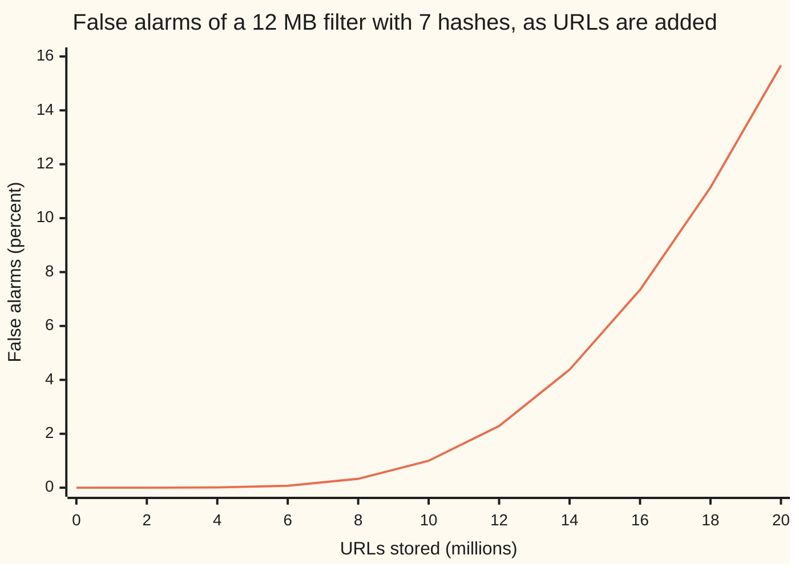
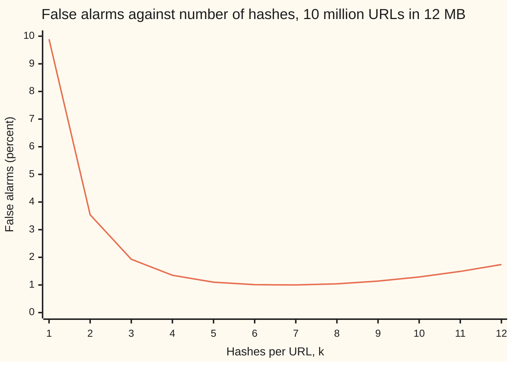

# Hashing for size: Bloom filters and sketches that trade certainty for memory

[Syllabus](../../../SYLLABUS.md) → [Applied and computational](../README.md) → [Randomised and Approximate Algorithms](../README.md#s02) → Hashing for size

---

## General Overview

A web crawler has already fetched 10 million pages. Before it fetches the next link, it must ask one question: have I seen this URL before? Keeping the URLs themselves takes hundreds of megabytes. Even an 8-byte fingerprint per URL takes 80 MB.

A **Bloom filter** answers the same question in 12 MB, about 1.2 bytes per URL. It is one long row of bits, all 0 at the start. To store a URL, scramble it 7 different ways into 7 positions in the row, and set those bits to 1. To ask about a URL, look at its 7 positions. If any one is 0, the URL was never stored: that "no" is certain. If all 7 are 1, the answer is "probably yes". Other URLs may have set those bits by chance.

That "probably" is the price. Sized as on this card, the filter wrongly says "seen it" to 0.009965 of new URLs, just under 1 in 100. For a crawler that is cheap: it skips one new page in a hundred and never fetches a page twice.

The same trick answers a second question about the shelf's web service, which handles 10 million requests a day: how many different visitors sent them? Scramble each visitor's address into a number between 0 and 1, and keep only the 1,024 smallest numbers seen. That is 8,192 bytes. The more different visitors there are, the more crowded the bottom of the range gets, so how small the 1,024th number is tells the count. On a synthetic stream of 1,000,000 requests from 389,921 visitors, the sketch says 384,480: 1.40% low, from 8,192 bytes instead of a 3,119,368-byte list.

**A hash scatters items like random darts, so a few bits or a few small values can stand in for the whole set: a Bloom filter answers "seen it?" with a false "yes" at a rate you choose, and a sketch of the smallest hash values estimates how many different items went past, with an error you choose.**

**What kind of fact this is:** theorems about an ideal hash, one that sends each item to positions chosen independently and uniformly at random, proved on this card in Why it works. That a real, written-out hash behaves like the ideal one is a model, and the code checks it against a run.

### The picture: the promise holds up to the design count, then fails fast



The one line is the false-alarm rate from the formula below. At the design count of 10 million URLs it is 1.00 percent. Double the URLs and it is 15.67 percent: the filter never forgets a URL, but it starts to "remember" many it never saw.

---

## The formula

Notation first, in words. A **hash** $h(x)$ is a fixed scrambling rule that turns an item $x$, here a URL, into a number that looks random ([Data structures](../01-Algorithms%20and%20Growth/06-data-structures-heaps-hashes-and-trees.md)). This card introduces a Bloom filter's $m$ bits and $k$ hashes: $m$ is the length of the bit row, and $k$ is how many positions each item sets.

For $n$ stored items, the chance $p$ that a new item gets a false "yes" is

$$p \approx \left(1 - e^{-kn/m}\right)^{k}$$

**Read it aloud:** after $n$ items, a fraction $e^{-kn/m}$ of the bits is still 0, so a new item's $k$ positions are all 1 with chance "one minus that fraction", multiplied by itself $k$ times.

The best number of hashes, and the memory a target $p$ needs:

$$k_{\text{best}} = \frac{m}{n}\ln 2, \qquad m = \frac{n \ln(1/p)}{(\ln 2)^2} \approx 1.4427\; n \log_2(1/p)$$

**Read it aloud:** choose $k$ so that half the bits end up set; then each halving of the false-alarm rate costs 1.4427 bits per item.

The distinct-count sketch. Hash each item to a number $U$ between 0 and 1. Keep the $t$ smallest different values. Let $U_{(t)}$ be the largest of those, the $t$-th smallest overall. The estimate of the number of different items $D$ is

$$\hat D = \frac{t-1}{U_{(t)}}, \qquad \text{relative spread of } \hat D \approx \frac{1}{\sqrt{t-2}}$$

**Read it aloud:** $D$ random points in the range 0 to 1 sit about $1/D$ apart, so the $t$-th one sits near $t/D$; turn that round, and correct $t$ to $t-1$ so the estimate is right on average.

| Symbol | Plain meaning | In our example | Push it up and the answer… |
| --- | --- | --- | --- |
| $h(x)$ | the hash: a fixed rule turning item $x$ into a random-looking number; $h_1$, $h_2$ are two such rules | FNV-1a, then a scrambler | — |
| $E[\,\cdot\,]$ | the average over the hash's randomness | $E[\hat D] = D$ | — |
| $n$ | items stored in the filter | 10,000,000 URLs | false alarms rise, fast past the design count |
| $m$ | bits in the filter | 96,000,000 (12 MB) | false alarms fall |
| $k$ | hashes per item: bits each item sets and each query checks | 7 | false alarms fall, then rise; best at $(m/n)\ln 2$ |
| $p$ | false-alarm rate: chance a new item reads "seen" | 0.009965 | — |
| $f$ | fraction of bits still 0 after $n$ items, $e^{-kn/m}$ | 0.482311 | false alarms fall |
| $D$ | different items in a stream (visitors) | 389,921 | $U_{(t)}$ falls |
| $t$ | smallest hash values the sketch keeps | 1,024 | spread falls like $1/\sqrt{t}$; memory grows like $t$ |
| $U_{(t)}$ | the $t$-th smallest hash value $U$, each $U$ scaled to lie between 0 and 1 | 0.00266074 | $\hat D$ falls |
| $\hat D$ | the sketch's estimate of $D$ | 384,480 | — |

### When it holds

- **The hash behaves like random darts.** The formulas assume each item's positions are independent and uniform. A weak hash on similar URLs (`/item/1`, `/item/2`, …) can pile them onto the same bits, and the false-alarm rate rises above $p$. A hash whose rule an attacker knows can be fed URLs crafted to collide; a secret salt mixed into the hash (a **keyed** hash) prevents that.
- **The count stays at or below the design $n$.** The filter does not grow. Past its design count it still never misses a stored URL, but false alarms climb: 15.67 percent at twice the count.
- **Items are only added, never removed.** Clearing a deleted item's bits also clears bits other items share, and those items then read "never seen": a false "no", the one error the filter promised not to make.
- **The sketch sees each item through the same hash.** Repeats of one visitor land on the same value and change nothing. Change the salt halfway through the day and every visitor seen in both halves counts twice.
- **$m$ is large.** The formula $p \approx (1 - e^{-kn/m})^k$ treats the $k$ bits a query checks as independent. They are slightly positively linked, so the true rate sits a little above the formula; at 96,000,000 bits the gap is invisible, at 8 bits it is not (Step 2 below).

---

## Why it works

### Step 0: one-sided error, and points that crowd

A stored URL set its own bits, and bits are never cleared, so a stored URL always reads "seen". The only error is a new URL whose bits were all set by others. Its chance depends only on what fraction of the row is 1. Everything below is working out that fraction and then choosing $k$ to make the chance small.

A filter like this is a Monte Carlo method in the sense of [Randomised algorithms](01-randomised-algorithms-and-expectation.md): it can be wrong, but only one way and with a known chance.

For the sketch, the idea is crowding. Hash $D$ different visitors and you get $D$ random points between 0 and 1; repeat visits land on points already there. With 389,921 points, the gaps are tiny, and the 1,024th smallest point sits very close to 0. With 1,000 points it would sit near the top. Its position is a ruler for $D$.

### Step 1: the chance a bit is still 0

One hash of one item hits a given bit with chance $1/m$ and misses it with chance $1 - 1/m$. Storing $n$ items makes $kn$ hash throws, so the bit survives all of them with chance

$$\left(1 - \frac1m\right)^{kn} \approx e^{-kn/m}.$$

The approximation is the same one behind the birthday problem in [Two classics](../../09-Probability%20and%20statistics/03-Discrete%20Distributions/07-birthday-and-coupon-collector.md): $1 - x$ is close to $e^{-x}$ when $x$ is small, and here $x = 1/m$ is one in 96 million. Averages add, so the expected fraction of zeros is this same number, $f = e^{-kn/m}$. For the crawler, $kn/m = 7 \times 10{,}000{,}000 / 96{,}000{,}000 = 0.729167$, and $f = 0.482311$: just under half the bits are still 0.

### Step 2: the chance of a false "yes"

A new URL's $k$ positions are fresh throws. Each lands on a 1 with chance about $1 - f$. All $k$ do with chance about

$$p \approx (1 - f)^{k} = \left(1 - e^{-kn/m}\right)^{k}.$$

The word "about" hides one thing. The fraction of 1s is itself random, and the chance of a false "yes" is the average of (fraction of 1s)$^k$, which is a little more than (average fraction)$^k$ whenever the fraction varies. With 96 million bits the fraction hardly varies. In a toy filter of 8 bits, 2 hashes and 3 items, listing all 262,144 ways the 6 throws can land gives an exact rate of 0.314240, against 0.303827 from $(1 - (1-1/m)^{kn})^k$ and 0.278397 from the $e$ form. The code does that full count.

### Step 3: the best number of hashes

More hashes mean more bits to check, which helps, but also a fuller row, which hurts. Write the false-alarm rate in terms of $f$. Since $f = e^{-kn/m}$, the number of hashes is $k = -(m/n)\ln f$, and

$$\ln p = k \ln(1 - f) = -\frac{m}{n}\,\ln f \cdot \ln(1-f).$$

The product $\ln f \cdot \ln(1-f)$ does not change when $f$ and $1-f$ swap, but that alone does not put its top at the middle, so check its slope. Multiplied by $f(1-f)$, which is positive, the slope is $(1-f)\ln(1-f) - f\ln f$. That is 0 as $f$ leaves 0 and 0 again at $f = 1/2$, and its own slope, $-\ln\big(f(1-f)\big) - 2$, is first positive and then negative in between, so it rises, falls back to 0, and stays above 0 the whole way. The product therefore climbs until $f = 1/2$ and, by the swap, falls after it: it is largest at the middle. So the false-alarm rate is smallest when **half the bits are set**. Then $k = (m/n)\ln 2$, every checked bit is a coin flip, and

$$p = \left(\tfrac12\right)^{k}.$$

For the crawler, $m/n = 9.6$ bits per URL, so the best $k$ is $9.6 \ln 2$, which rounds to 7. The curve is flat near the bottom: 6 hashes give 1.01 percent and 7 give 1.00 percent.



The one line is the formula at 9.6 bits per URL. One hash wastes the memory; twelve fill the row too full.

### Step 4: size the filter from the target

Put the best $k$ into $p = (1/2)^k$: $\ln p = -(m/n)(\ln 2)^2$, so

$$\frac{m}{n} = \frac{\ln(1/p)}{(\ln 2)^2}.$$

For $p$ = 1 in 100 this is 9.5851 bits per URL, so 10 million URLs need 95,850,584 bits, 11.98 MB. A 12 MB budget fits. Each extra bit of memory per URL buys a constant factor in $p$, so the cost grows with the logarithm of how rare false alarms must be, not with the URLs' length.

No structure of any kind can answer "seen it?" with a 1-in-100 false-alarm rate in much less than $\log_2(1/p)$ bits per item, here 6.6439, once the possible URLs far outnumber the stored ones. That floor comes from a counting argument not proved on this card; the survey of Bloom filters in Sources proves it, in its section on a lower bound. The Bloom filter uses 1/ln 2 = 1.4427 times that floor, the price of its simplicity.

### Step 5: the sketch is right on average

Take $D$ different items with ideal hash values: $D$ independent points spread uniformly between 0 and 1. The $t$-th smallest of them, $U_{(t)}$, has a known law: a point lands below $u$ with chance $u$, and $U_{(t)} \le u$ exactly when at least $t$ of the $D$ points do. Working out the average of $1/U_{(t)}$ from that law gives exactly

$$E\!\left[\frac{1}{U_{(t)}}\right] = \frac{D}{t-1}, \quad\text{so}\quad E\big[\hat D\big] = E\!\left[\frac{t-1}{U_{(t)}}\right] = D.$$

The same calculation one power higher gives the spread: the relative standard deviation of $\hat D$ is $\sqrt{(D-1)(t-1)/(D(t-2)) - 1}$, which is $1/\sqrt{t-2}$ to many decimals when $D$ is large. With $t = 1{,}024$ that is 3.13 percent. Four times the memory halves it.

<details>
<summary>The integral behind the average</summary>

The $t$-th smallest of $D$ uniform points has density $\dfrac{D!}{(t-1)!\,(D-t)!}\,u^{t-1}(1-u)^{D-t}$ on $0 < u < 1$: $t-1$ points below $u$, one at $u$, $D-t$ above, counted in every order. Multiply by $1/u$ and integrate. The power $u^{t-1}$ drops to $u^{t-2}$, and the integral of $u^{a}(1-u)^{b}$ over 0 to 1 is $a!\,b!/(a+b+1)!$. So

$$E\!\left[\frac1{U_{(t)}}\right] = \frac{D!}{(t-1)!\,(D-t)!}\cdot\frac{(t-2)!\,(D-t)!}{(D-1)!} = \frac{D}{t-1}.$$

Multiply by $1/u^2$ instead and the same steps give $E[1/U_{(t)}^2] = D(D-1)/((t-1)(t-2))$. The variance of $\hat D$ is $(t-1)^2$ times the difference $E[1/U_{(t)}^2] - E[1/U_{(t)}]^2$, which is where the spread formula comes from.

</details>

A spread of 3.13 percent is a typical error, not a guarantee. To make a large error rare, run several sketches with different salts and take the middle estimate; [Tail bounds](02-tail-bounds-and-repeated-trials.md) gives the number of copies for a chosen failure chance.

---

## Worked numbers, by hand

The crawler's filter: 10 million URLs, a 1-in-100 target, a 12 MB budget.

| Step | Arithmetic | Value |
| --- | --- | --- |
| 1. Bits per URL for 1 in 100 | ln(100) / (ln 2)² | 9.5851 |
| 2. Bits for 10 million URLs | 10,000,000 × 9.5851 | 95,850,584 bits = 11.98 MB |
| 3. Budget in bits | 12,000,000 bytes × 8 | 96,000,000, so 9.6 per URL |
| 4. Best number of hashes | 9.6 × ln 2, rounded | 7 |
| 5. Hash throws per bit | 7 × 10,000,000 / 96,000,000 | 0.729167 |
| 6. Fraction of bits still 0 | e^(−0.729167) | 0.482311 |
| 7. Chance all 7 bits are set | (1 − 0.482311)⁷ | **0.009965** |

Just under 1 new URL in 100 is wrongly skipped, and no URL is ever fetched twice, from 1.2 bytes per URL.

The visitor sketch, on 1,000,000 synthetic requests:

| Step | Arithmetic | Value |
| --- | --- | --- |
| 1. Keep the smallest values | t = 1,024 values of 8 bytes | 8,192 bytes |
| 2. The 1,024th smallest, scaled | read from the sketch | 0.00266074 |
| 3. Estimate | 1,023 / 0.00266074 | **384,480** |
| 4. True count, from a full list | 3,119,368 bytes of visitor ids | 389,921 |
| 5. Error against the promise | −1.40% against a spread of 3.13% | inside |

The 8,192-byte sketch lands inside one typical error of a count whose exact list takes 3,119,368 bytes.

### What breaks if you drop a piece

Same filter, correct answer 0.009965:

| Mistake | Comes out at | What went wrong |
| --- | --- | --- |
| Fill it with 20 million URLs, twice the design count | 0.156696 | the row is too full; the filter does not grow |
| Use one hash, $k = 1$ | 0.098925 | one bit per query is a weak test |
| Use twenty hashes | 0.069981 | each URL sets 20 bits, so the row fills up |
| Read 12 MB as 12 million bits, keep $k = 7$ | 0.979681 | bytes are 8 bits; the row is almost all 1s |
| Budget only the floor, 6.6439 bits per URL (66,438,562 bits), best $k$ = 5 | 0.041367 | the floor is for an ideal structure; a Bloom filter needs 1.4427 times it |
| Count requests, not visitors | 1,000,000 against 389,921 | repeat visits counted again |

The first row is also run, not only computed: at 1/1000 scale, 20,000 URLs in 96,000 bits gave false alarms on 0.156550 of tests, against 0.156696 from the formula.

---

## Code, from first principles, and it actually runs

Nothing that holds the answer is imported: the hashes (FNV-1a and the SplitMix64 scrambler) and the random numbers are written out, and the Rust program prints the same lines. Three roads reach the filter's false-alarm rate: the formula; a full count of every arrangement of a toy filter; and a real filter at 1/1000 scale (10,000 URLs in 96,000 bits, the same 9.6 bits per URL), tested on 100,000 URLs it never stored. Those URLs are synthetic: `https://shop.example/item/` followed by a number, from 0 up for the stored ones and from 10 million up for the tested ones. They differ only in their last digits, the case a weak hash piles onto the same bits, so the run also checks that the written-out hash scatters them like darts. Three roads reach the sketch: one sketch against the exact count on a synthetic stream of 1,000,000 requests; 100 sketches with different salts against the exact theory for the spread; and 400 more sketches of only $t = 4$ values, where dropping the $-1$ would show as a 33 percent bias, against the exact theory for the average. Each simulated number must land within four standard errors of the formula.

### Python

```python
# Bloom filters and a distinct-count sketch -- the check behind the card.
# Standard library only. Hashes and random numbers are written out below.
import math

M = (1 << 64) - 1
def mix64(z):                           # SplitMix64's scrambler: 64 bits in, 64 well-mixed bits out
    z = (z + 0x9E3779B97F4A7C15) & M
    z = ((z ^ (z >> 30)) * 0xBF58476D1CE4E5B9) & M
    z = ((z ^ (z >> 27)) * 0x94D049BB133111EB) & M
    return z ^ (z >> 31)

def url_hash(s):                        # FNV-1a over the bytes, then scrambled
    h = 0xCBF29CE484222325
    for b in s.encode():
        h = ((h ^ b) * 0x100000001B3) & M
    return mix64(h)

def positions(s, k, m):                 # k bit positions from two hashes (double hashing)
    h1 = url_hash(s); h2 = mix64(h1) | 1
    return [((h1 + i * h2) & M) % m for i in range(k)]

def fp_formula(n, m, k): return (1 - math.exp(-k * n / m)) ** k
def url(i): return f"https://shop.example/item/{i}"

print("== sizing: 10 million URLs, 1 in 100 false alarms ==")
n, p = 10_000_000, 0.01
bpi = math.log(1 / p) / math.log(2) ** 2
print(f"bits per URL ln(1/p)/(ln 2)^2 = {bpi:.4f}   m = {n * bpi:,.0f} bits = {n * bpi / 8e6:.2f} MB")
print(f"best k = (m/n) ln 2 = {bpi * math.log(2):.4f}   floor log2(1/p) = {math.log2(1 / p):.4f} bits per URL")
m, k = 96_000_000, 7
print(f"12 MB = {m:,} bits, {m / n:.1f} per URL; k = {k}: kn/m = {k * n / m:.6f}"
      f"   zeros e^-kn/m = {math.exp(-k * n / m):.6f}   false alarms = {fp_formula(n, m, k):.6f}")
print(f"one 8-byte fingerprint per URL = {8 * n / 1e6:.0f} MB   filter bytes per URL = {m / 8 / n:.1f}"
      f"   filter over floor = 1/ln 2 = {1 / math.log(2):.4f}")
print("chart1 (n = 0..20M)," + ",".join(f"{100 * fp_formula(2e6 * j, m, k):.2f}" for j in range(11)))
print("chart2 (k = 1..12)," + ",".join(f"{100 * fp_formula(n, m, j):.2f}" for j in range(1, 13)))
assert abs(fp_formula(n, m, k) - 0.01) < 0.0005, "12 MB with 7 hashes should give about 1 in 100"
assert min(range(1, 13), key=lambda j: fp_formula(n, m, j)) == round(m / n * math.log(2)), "best k is (m/n) ln 2"

print("== road 2: every arrangement of a tiny filter, m = 8, k = 2, n = 3 ==")
tm, tk, tn = 8, 2, 3
tot_fp = tot_set = 0
for c in range(tm ** (tk * tn)):        # every choice of 6 bit positions
    bits = 0
    for _ in range(tk * tn):
        bits |= 1 << (c % tm); c //= tm
    s = bin(bits).count("1"); tot_set += s; tot_fp += (s / tm) ** tk
ex_fp, ex_set = tot_fp / tm ** (tk * tn), tot_set / tm ** (tk * tn)
q0 = (1 - 1 / tm) ** (tk * tn)
print(f"exact false alarms {ex_fp:.6f}   (1-(1-1/m)^kn)^k {(1 - q0) ** tk:.6f}   (1-e^-kn/m)^k {fp_formula(tn, tm, tk):.6f}")
print(f"average bits set: counted {ex_set:.6f}   m(1-(1-1/m)^kn) {tm * (1 - q0):.6f}")
assert abs(ex_set - tm * (1 - q0)) < 1e-12, "each bit stays 0 with chance (1-1/m)^kn"
assert ex_fp > (1 - q0) ** tk, "the exact rate sits just above the textbook product"

print("== road 3: a real filter at 1/1000 scale: 10,000 URLs in 96,000 bits ==")
sn, sm, tests = 10_000, 96_000, 100_000
bits = bytearray(sm)
for i in range(sn):
    for q in positions(url(i), k, sm): bits[q] = 1
filled = sum(bits)
print(f"bits set {filled} of {sm} = {filled / sm:.6f}   predicted {1 - math.exp(-k * sn / sm):.6f}")
def false_alarms(bits, mm):
    return sum(all(bits[q] for q in positions(url(10**7 + j), k, mm)) for j in range(tests))
fa = false_alarms(bits, sm); rate = fa / tests
se = math.sqrt(fp_formula(sn, sm, k) * (1 - fp_formula(sn, sm, k)) / tests)
print(f"unseen URLs tested {tests}: false alarms {fa} = {rate:.6f}   formula {fp_formula(sn, sm, k):.6f}"
      f"   (set fraction)^{k} {(filled / sm) ** k:.6f}   standard error {se:.6f}")
assert abs(rate - fp_formula(sn, sm, k)) < 4 * se, "measured false alarms disagree with the formula"
assert all(all(bits[q] for q in positions(url(i), k, sm)) for i in range(sn)), "a stored URL was missed"
kept = bytearray(bits)
for q in positions(url(0), k, sm): kept[q] = 0
lost = sum(not all(kept[q] for q in positions(url(i), k, sm)) for i in range(1, sn))
print(f"delete URL 0 by clearing its {k} bits: other stored URLs now missed = {lost}")
for i in range(sn, 2 * sn):
    for q in positions(url(i), k, sm): bits[q] = 1
fa2 = false_alarms(bits, sm)
print(f"overfilled with 20,000 URLs: false alarms {fa2 / tests:.6f}   formula {fp_formula(2 * sn, sm, k):.6f}")
assert abs(fa2 / tests - fp_formula(2 * sn, sm, k)) < 0.005, "overfilled rate disagrees with the formula"

print("== what breaks (full size, formula) ==")
print(f"20 million URLs, same filter: {fp_formula(2 * n, m, k):.6f}")
print(f"one hash, k = 1: {fp_formula(n, m, 1):.6f}   twenty hashes: {fp_formula(n, m, 20):.6f}")
print(f"12 MB read as 12 million bits, k = 7: {fp_formula(n, 12_000_000, k):.6f}")
fm = round(n * math.log2(1 / p)); fk = round(fm / n * math.log(2))
print(f"only log2(1/p) bits per URL ({fm:,} bits), best k = {fk}: {fp_formula(n, fm, fk):.6f}")

print("== distinct visitors: keep the t smallest hash values ==")
def kmv(hashes, t):                     # the t smallest different values seen, smallest first
    low = []
    for h in hashes:
        if len(low) == t and h >= low[-1] or h in low: continue
        j = len(low)
        while j > 0 and low[j - 1] > h: j -= 1
        low.insert(j, h)
        if len(low) > t: low.pop()
    return low
def estimate(low, t): return (t - 1) / (low[t - 1] / 2.0 ** 64)
t, pool, reqs, salt = 1024, 500_000, 1_000_000, 0x5EED
seen = bytearray(pool); stream = []; rng = 2026
for _ in range(reqs):                   # synthetic: a few visitors return often, most rarely
    rng = (rng + 0x9E3779B97F4A7C15) & M
    x = (mix64(rng) >> 11) / 2.0 ** 53
    v = int(pool * x * x); seen[v] = 1; stream.append(mix64(v ^ salt))
true_d = sum(seen); low = kmv(stream, t); est = estimate(low, t)
print(f"requests {reqs:,}   true distinct visitors {true_d:,}   sketch {t} values = {8 * t:,} bytes")
print(f"exact list of visitors at 8 bytes each = {8 * true_d:,} bytes")
print(f"t-th smallest / 2^64 = {low[t - 1] / 2.0 ** 64:.8f}   estimate (t-1)/U = {est:,.0f}"
      f"   error {100 * (est / true_d - 1):+.2f}%   promised spread 1/sqrt(t-2) = {100 / math.sqrt(t - 2):.2f}%")
print(f"wrong: t/U = {t / (low[t - 1] / 2.0 ** 64):,.0f}   wrong: one smallest only, 1/U = {1 / (low[0] / 2.0 ** 64):,.0f}")
e256 = estimate(kmv(stream, 256), 256)
print(f"try: p = 0.001: {math.log(1000) / math.log(2) ** 2:.4f} bits per URL = {n * (math.log(1000) / math.log(2) ** 2) / 8e6:.2f} MB"
      f"   t = 256: estimate {e256:,.0f}, error {100 * (e256 / true_d - 1):+.2f}%, promised spread {100 / math.sqrt(254):.2f}%")
assert abs(est / true_d - 1) < 4 / math.sqrt(t - 2), "estimate outside four promised spreads"

print("== road 2 for the sketch: 100 independent hashes of 10,000 visitors, t = 64 ==")
d2, t2, runs = 10_000, 64, 100
ests = [estimate(kmv([mix64(v ^ (s * 0xA24BAED4963EE407 & M)) for v in range(d2)], t2), t2) for s in range(1, runs + 1)]
mean = sum(ests) / runs; rms = math.sqrt(sum((e / d2 - 1) ** 2 for e in ests) / runs)
theory = math.sqrt((d2 - 1) * (t2 - 1) / (d2 * (t2 - 2)) - 1)
print(f"mean estimate {mean:,.1f}   rms error {100 * rms:.2f}%   exact theory {100 * theory:.2f}%   1/sqrt(t-2) {100 / math.sqrt(t2 - 2):.2f}%")
assert abs(mean - d2) < 4 * d2 * theory / math.sqrt(runs), "estimator looks biased"
assert abs(rms / theory - 1) < 0.3, "spread disagrees with theory"

print("== road 3 for the sketch: the average, 400 more hashes of 10,000 visitors, t = 4 ==")
t4, runs4 = 4, 400                      # few marks: dropping the -1 would show as a 1/(t-1) = 33% bias
e4 = [estimate(kmv([mix64(v ^ (s * 0xA24BAED4963EE407 & M)) for v in range(d2)], t4), t4) for s in range(runs + 1, runs + runs4 + 1)]
m4, tol4 = sum(e4) / runs4, 4 * d2 * math.sqrt((d2 - 1) * (t4 - 1) / (d2 * (t4 - 2)) - 1) / math.sqrt(runs4)
print(f"mean (t-1)/U {m4:,.1f}   allowed {d2:,} +/- {tol4:,.1f}   wrong: mean t/U {m4 * t4 / (t4 - 1):,.1f}, {100 / (t4 - 1):.0f}% high")
assert abs(m4 - d2) < tol4 < abs(m4 * t4 / (t4 - 1) - d2), "estimator biased, or the test cannot see a bias of 1/(t-1)"
print("ALL CHECKS PASS")
```

**Ran 2026-11-11 on macOS, Python 3.14.10, standard library only. All checks passed. Output, pasted from the run:**

```
== sizing: 10 million URLs, 1 in 100 false alarms ==
bits per URL ln(1/p)/(ln 2)^2 = 9.5851   m = 95,850,584 bits = 11.98 MB
best k = (m/n) ln 2 = 6.6439   floor log2(1/p) = 6.6439 bits per URL
12 MB = 96,000,000 bits, 9.6 per URL; k = 7: kn/m = 0.729167   zeros e^-kn/m = 0.482311   false alarms = 0.009965
one 8-byte fingerprint per URL = 80 MB   filter bytes per URL = 1.2   filter over floor = 1/ln 2 = 1.4427
chart1 (n = 0..20M),0.00,0.00,0.01,0.07,0.33,1.00,2.29,4.38,7.34,11.14,15.67
chart2 (k = 1..12),9.89,3.54,1.93,1.35,1.10,1.01,1.00,1.04,1.14,1.29,1.49,1.74
== road 2: every arrangement of a tiny filter, m = 8, k = 2, n = 3 ==
exact false alarms 0.314240   (1-(1-1/m)^kn)^k 0.303827   (1-e^-kn/m)^k 0.278397
average bits set: counted 4.409637   m(1-(1-1/m)^kn) 4.409637
== road 3: a real filter at 1/1000 scale: 10,000 URLs in 96,000 bits ==
bits set 49754 of 96000 = 0.518271   predicted 0.517689
unseen URLs tested 100000: false alarms 963 = 0.009630   formula 0.009965   (set fraction)^7 0.010044   standard error 0.000314
delete URL 0 by clearing its 7 bits: other stored URLs now missed = 6
overfilled with 20,000 URLs: false alarms 0.156550   formula 0.156696
== what breaks (full size, formula) ==
20 million URLs, same filter: 0.156696
one hash, k = 1: 0.098925   twenty hashes: 0.069981
12 MB read as 12 million bits, k = 7: 0.979681
only log2(1/p) bits per URL (66,438,562 bits), best k = 5: 0.041367
== distinct visitors: keep the t smallest hash values ==
requests 1,000,000   true distinct visitors 389,921   sketch 1024 values = 8,192 bytes
exact list of visitors at 8 bytes each = 3,119,368 bytes
t-th smallest / 2^64 = 0.00266074   estimate (t-1)/U = 384,480   error -1.40%   promised spread 1/sqrt(t-2) = 3.13%
wrong: t/U = 384,856   wrong: one smallest only, 1/U = 832,454
try: p = 0.001: 14.3776 bits per URL = 17.97 MB   t = 256: estimate 378,791, error -2.85%, promised spread 6.27%
== road 2 for the sketch: 100 independent hashes of 10,000 visitors, t = 64 ==
mean estimate 10,011.8   rms error 13.33%   exact theory 12.66%   1/sqrt(t-2) 12.70%
== road 3 for the sketch: the average, 400 more hashes of 10,000 visitors, t = 4 ==
mean (t-1)/U 10,049.4   allowed 10,000 +/- 1,414.0   wrong: mean t/U 13,399.2, 33% high
ALL CHECKS PASS
```

### Rust

```rust
// Bloom filters and a distinct-count sketch -- the check behind the card.
// std only. Hashes and random numbers are written out below.
fn mix64(z: u64) -> u64 { // SplitMix64's scrambler: 64 bits in, 64 well-mixed bits out
    let mut z = z.wrapping_add(0x9E3779B97F4A7C15);
    z = (z ^ (z >> 30)).wrapping_mul(0xBF58476D1CE4E5B9);
    z = (z ^ (z >> 27)).wrapping_mul(0x94D049BB133111EB);
    z ^ (z >> 31)
}
fn url_hash(s: &str) -> u64 { // FNV-1a over the bytes, then scrambled
    let mut h: u64 = 0xCBF29CE484222325;
    for b in s.bytes() { h = (h ^ b as u64).wrapping_mul(0x100000001B3); }
    mix64(h)
}
fn positions(s: &str, k: u64, m: u64) -> Vec<usize> { // k bit positions from two hashes
    let h1 = url_hash(s); let h2 = mix64(h1) | 1;
    (0..k).map(|i| (h1.wrapping_add(i.wrapping_mul(h2)) % m) as usize).collect()
}
fn fp_formula(n: f64, m: f64, k: f64) -> f64 { (1.0 - (-k * n / m).exp()).powf(k) }
fn url(i: usize) -> String { format!("https://shop.example/item/{}", i) }
fn grp(x: f64, dec: usize) -> String { // thousands separators, like Python's {:,}
    let s = format!("{:.*}", dec, x);
    let (int, frac) = match s.find('.') { Some(p) => (&s[..p], &s[p..]), None => (&s[..], "") };
    let (sign, digits) = if int.starts_with('-') { ("-", &int[1..]) } else { ("", int) };
    let mut out = String::new();
    for (i, c) in digits.chars().enumerate() {
        if i > 0 && (digits.len() - i) % 3 == 0 { out.push(','); }
        out.push(c);
    }
    format!("{}{}{}", sign, out, frac)
}
fn hit(bits: &[u8], s: &str, k: u64) -> bool { positions(s, k, bits.len() as u64).iter().all(|&q| bits[q] == 1) }
fn false_alarms(bits: &[u8], k: u64, tests: usize) -> usize {
    (0..tests).filter(|&j| hit(bits, &url(10_000_000 + j), k)).count()
}
fn kmv(hashes: &[u64], t: usize) -> Vec<u64> { // the t smallest different values seen, smallest first
    let mut low: Vec<u64> = Vec::new();
    for &h in hashes {
        if (low.len() == t && h >= low[t - 1]) || low.contains(&h) { continue; }
        let mut j = low.len();
        while j > 0 && low[j - 1] > h { j -= 1; }
        low.insert(j, h);
        if low.len() > t { low.pop(); }
    }
    low
}
fn estimate(low: &[u64], t: usize) -> f64 { (t - 1) as f64 / (low[t - 1] as f64 / 2f64.powi(64)) }

fn main() {
    let ln2 = 2f64.ln();
    println!("== sizing: 10 million URLs, 1 in 100 false alarms ==");
    let (n, p) = (10_000_000f64, 0.01f64);
    let bpi = (1.0 / p).ln() / (ln2 * ln2);
    println!("bits per URL ln(1/p)/(ln 2)^2 = {:.4}   m = {} bits = {:.2} MB", bpi, grp(n * bpi, 0), n * bpi / 8e6);
    println!("best k = (m/n) ln 2 = {:.4}   floor log2(1/p) = {:.4} bits per URL", bpi * ln2, (1.0 / p).log2());
    let (m, k) = (96_000_000f64, 7u64);
    let kf = k as f64;
    println!("12 MB = {} bits, {:.1} per URL; k = {}: kn/m = {:.6}   zeros e^-kn/m = {:.6}   false alarms = {:.6}",
        grp(m, 0), m / n, k, kf * n / m, (-kf * n / m).exp(), fp_formula(n, m, kf));
    println!("one 8-byte fingerprint per URL = {:.0} MB   filter bytes per URL = {:.1}   filter over floor = 1/ln 2 = {:.4}",
        8.0 * n / 1e6, m / 8.0 / n, 1.0 / ln2);
    let c1: Vec<String> = (0..11).map(|j| format!("{:.2}", 100.0 * fp_formula(2e6 * j as f64, m, kf))).collect();
    println!("chart1 (n = 0..20M),{}", c1.join(","));
    let c2: Vec<String> = (1..13).map(|j| format!("{:.2}", 100.0 * fp_formula(n, m, j as f64))).collect();
    println!("chart2 (k = 1..12),{}", c2.join(","));
    assert!((fp_formula(n, m, kf) - 0.01).abs() < 0.0005, "12 MB with 7 hashes should give about 1 in 100");
    let mut best = 1;
    for j in 2..13 { if fp_formula(n, m, j as f64) < fp_formula(n, m, best as f64) { best = j; } }
    assert!(best as f64 == (m / n * ln2).round(), "best k is (m/n) ln 2");

    println!("== road 2: every arrangement of a tiny filter, m = 8, k = 2, n = 3 ==");
    let (tm, tk, tn) = (8u64, 2u32, 3u32);
    let total = tm.pow(tk * tn);
    let (mut tot_fp, mut tot_set) = (0f64, 0f64);
    for c0 in 0..total { // every choice of 6 bit positions
        let (mut c, mut bits) = (c0, 0u64);
        for _ in 0..tk * tn { bits |= 1 << (c % tm); c /= tm; }
        let s = bits.count_ones() as f64;
        tot_set += s; tot_fp += (s / tm as f64).powi(tk as i32);
    }
    let (ex_fp, ex_set) = (tot_fp / total as f64, tot_set / total as f64);
    let q0 = (1.0 - 1.0 / tm as f64).powi((tk * tn) as i32);
    println!("exact false alarms {:.6}   (1-(1-1/m)^kn)^k {:.6}   (1-e^-kn/m)^k {:.6}",
        ex_fp, (1.0 - q0).powi(tk as i32), fp_formula(tn as f64, tm as f64, tk as f64));
    println!("average bits set: counted {:.6}   m(1-(1-1/m)^kn) {:.6}", ex_set, tm as f64 * (1.0 - q0));
    assert!((ex_set - tm as f64 * (1.0 - q0)).abs() < 1e-12, "each bit stays 0 with chance (1-1/m)^kn");
    assert!(ex_fp > (1.0 - q0).powi(tk as i32), "the exact rate sits just above the textbook product");

    println!("== road 3: a real filter at 1/1000 scale: 10,000 URLs in 96,000 bits ==");
    let (sn, sm, tests) = (10_000usize, 96_000usize, 100_000usize);
    let mut bits = vec![0u8; sm];
    for i in 0..sn { for q in positions(&url(i), k, sm as u64) { bits[q] = 1; } }
    let filled: usize = bits.iter().map(|&b| b as usize).sum();
    let fr = filled as f64 / sm as f64;
    println!("bits set {} of {} = {:.6}   predicted {:.6}", filled, sm, fr, 1.0 - (-kf * sn as f64 / sm as f64).exp());
    let fa = false_alarms(&bits, k, tests);
    let rate = fa as f64 / tests as f64;
    let f1 = fp_formula(sn as f64, sm as f64, kf);
    let se = (f1 * (1.0 - f1) / tests as f64).sqrt();
    println!("unseen URLs tested {}: false alarms {} = {:.6}   formula {:.6}   (set fraction)^{} {:.6}   standard error {:.6}",
        tests, fa, rate, f1, k, fr.powi(k as i32), se);
    assert!((rate - f1).abs() < 4.0 * se, "measured false alarms disagree with the formula");
    assert!((0..sn).all(|i| hit(&bits, &url(i), k)), "a stored URL was missed");
    let mut kept = bits.clone();
    for q in positions(&url(0), k, sm as u64) { kept[q] = 0; }
    let lost = (1..sn).filter(|&i| !hit(&kept, &url(i), k)).count();
    println!("delete URL 0 by clearing its {} bits: other stored URLs now missed = {}", k, lost);
    for i in sn..2 * sn { for q in positions(&url(i), k, sm as u64) { bits[q] = 1; } }
    let fa2 = false_alarms(&bits, k, tests) as f64 / tests as f64;
    let f2 = fp_formula(2.0 * sn as f64, sm as f64, kf);
    println!("overfilled with 20,000 URLs: false alarms {:.6}   formula {:.6}", fa2, f2);
    assert!((fa2 - f2).abs() < 0.005, "overfilled rate disagrees with the formula");

    println!("== what breaks (full size, formula) ==");
    println!("20 million URLs, same filter: {:.6}", fp_formula(2.0 * n, m, kf));
    println!("one hash, k = 1: {:.6}   twenty hashes: {:.6}", fp_formula(n, m, 1.0), fp_formula(n, m, 20.0));
    println!("12 MB read as 12 million bits, k = 7: {:.6}", fp_formula(n, 12e6, kf));
    let fm = (n * (1.0 / p).log2()).round(); let fk = (fm / n * ln2).round();
    println!("only log2(1/p) bits per URL ({} bits), best k = {}: {:.6}", grp(fm, 0), fk, fp_formula(n, fm, fk));

    println!("== distinct visitors: keep the t smallest hash values ==");
    let (t, pool, reqs, salt) = (1024usize, 500_000usize, 1_000_000usize, 0x5EEDu64);
    let mut seen = vec![false; pool]; let mut stream = Vec::with_capacity(reqs); let mut rng: u64 = 2026;
    for _ in 0..reqs { // synthetic: a few visitors return often, most rarely
        rng = rng.wrapping_add(0x9E3779B97F4A7C15);
        let x = (mix64(rng) >> 11) as f64 / 2f64.powi(53);
        let v = (pool as f64 * x * x) as usize; seen[v] = true; stream.push(mix64(v as u64 ^ salt));
    }
    let true_d = seen.iter().filter(|&&b| b).count() as f64;
    let low = kmv(&stream, t); let est = estimate(&low, t);
    let u = low[t - 1] as f64 / 2f64.powi(64);
    println!("requests {}   true distinct visitors {}   sketch {} values = {} bytes", grp(reqs as f64, 0), grp(true_d, 0), t, grp(8.0 * t as f64, 0));
    println!("exact list of visitors at 8 bytes each = {} bytes", grp(8.0 * true_d, 0));
    println!("t-th smallest / 2^64 = {:.8}   estimate (t-1)/U = {}   error {:+.2}%   promised spread 1/sqrt(t-2) = {:.2}%",
        u, grp(est, 0), 100.0 * (est / true_d - 1.0), 100.0 / ((t - 2) as f64).sqrt());
    println!("wrong: t/U = {}   wrong: one smallest only, 1/U = {}", grp(t as f64 / u, 0), grp(1.0 / (low[0] as f64 / 2f64.powi(64)), 0));
    let (b3, e256) = (1000f64.ln() / (ln2 * ln2), estimate(&kmv(&stream, 256), 256));
    println!("try: p = 0.001: {:.4} bits per URL = {:.2} MB   t = 256: estimate {}, error {:+.2}%, promised spread {:.2}%",
        b3, n * b3 / 8e6, grp(e256, 0), 100.0 * (e256 / true_d - 1.0), 100.0 / 254f64.sqrt());
    assert!((est / true_d - 1.0).abs() < 4.0 / ((t - 2) as f64).sqrt(), "estimate outside four promised spreads");

    println!("== road 2 for the sketch: 100 independent hashes of 10,000 visitors, t = 64 ==");
    let (d2, t2, runs) = (10_000u64, 64usize, 100u64);
    let ests: Vec<f64> = (1..=runs).map(|s| {
        let hs: Vec<u64> = (0..d2).map(|v| mix64(v ^ s.wrapping_mul(0xA24BAED4963EE407))).collect();
        estimate(&kmv(&hs, t2), t2)
    }).collect();
    let d2f = d2 as f64;
    let mean = ests.iter().sum::<f64>() / runs as f64;
    let rms = (ests.iter().map(|e| (e / d2f - 1.0).powi(2)).sum::<f64>() / runs as f64).sqrt();
    let theory = ((d2f - 1.0) * (t2 - 1) as f64 / (d2f * (t2 - 2) as f64) - 1.0).sqrt();
    println!("mean estimate {}   rms error {:.2}%   exact theory {:.2}%   1/sqrt(t-2) {:.2}%",
        grp(mean, 1), 100.0 * rms, 100.0 * theory, 100.0 / ((t2 - 2) as f64).sqrt());
    assert!((mean - d2f).abs() < 4.0 * d2f * theory / (runs as f64).sqrt(), "estimator looks biased");
    assert!((rms / theory - 1.0).abs() < 0.3, "spread disagrees with theory");

    println!("== road 3 for the sketch: the average, 400 more hashes of 10,000 visitors, t = 4 ==");
    let (t4, runs4) = (4usize, 400u64); // few marks: dropping the -1 would show as a 1/(t-1) = 33% bias
    let m4 = (runs + 1..=runs + runs4).map(|s| {
        let hs: Vec<u64> = (0..d2).map(|v| mix64(v ^ s.wrapping_mul(0xA24BAED4963EE407))).collect();
        estimate(&kmv(&hs, t4), t4)
    }).sum::<f64>() / runs4 as f64;
    let tol4 = 4.0 * d2f * ((d2f - 1.0) * (t4 - 1) as f64 / (d2f * (t4 - 2) as f64) - 1.0).sqrt() / (runs4 as f64).sqrt();
    let wrong4 = m4 * t4 as f64 / (t4 - 1) as f64;
    println!("mean (t-1)/U {}   allowed {} +/- {}   wrong: mean t/U {}, {:.0}% high", grp(m4, 1), grp(d2f, 0), grp(tol4, 1), grp(wrong4, 1), 100.0 / (t4 - 1) as f64);
    assert!((m4 - d2f).abs() < tol4 && tol4 < (wrong4 - d2f).abs(), "estimator biased, or the test cannot see a bias of 1/(t-1)");
    println!("ALL CHECKS PASS");
}
```

**Ran 2026-11-11 on macOS, rustc 1.98.1, no crates. All checks passed. Output, pasted from the run:**

```
== sizing: 10 million URLs, 1 in 100 false alarms ==
bits per URL ln(1/p)/(ln 2)^2 = 9.5851   m = 95,850,584 bits = 11.98 MB
best k = (m/n) ln 2 = 6.6439   floor log2(1/p) = 6.6439 bits per URL
12 MB = 96,000,000 bits, 9.6 per URL; k = 7: kn/m = 0.729167   zeros e^-kn/m = 0.482311   false alarms = 0.009965
one 8-byte fingerprint per URL = 80 MB   filter bytes per URL = 1.2   filter over floor = 1/ln 2 = 1.4427
chart1 (n = 0..20M),0.00,0.00,0.01,0.07,0.33,1.00,2.29,4.38,7.34,11.14,15.67
chart2 (k = 1..12),9.89,3.54,1.93,1.35,1.10,1.01,1.00,1.04,1.14,1.29,1.49,1.74
== road 2: every arrangement of a tiny filter, m = 8, k = 2, n = 3 ==
exact false alarms 0.314240   (1-(1-1/m)^kn)^k 0.303827   (1-e^-kn/m)^k 0.278397
average bits set: counted 4.409637   m(1-(1-1/m)^kn) 4.409637
== road 3: a real filter at 1/1000 scale: 10,000 URLs in 96,000 bits ==
bits set 49754 of 96000 = 0.518271   predicted 0.517689
unseen URLs tested 100000: false alarms 963 = 0.009630   formula 0.009965   (set fraction)^7 0.010044   standard error 0.000314
delete URL 0 by clearing its 7 bits: other stored URLs now missed = 6
overfilled with 20,000 URLs: false alarms 0.156550   formula 0.156696
== what breaks (full size, formula) ==
20 million URLs, same filter: 0.156696
one hash, k = 1: 0.098925   twenty hashes: 0.069981
12 MB read as 12 million bits, k = 7: 0.979681
only log2(1/p) bits per URL (66,438,562 bits), best k = 5: 0.041367
== distinct visitors: keep the t smallest hash values ==
requests 1,000,000   true distinct visitors 389,921   sketch 1024 values = 8,192 bytes
exact list of visitors at 8 bytes each = 3,119,368 bytes
t-th smallest / 2^64 = 0.00266074   estimate (t-1)/U = 384,480   error -1.40%   promised spread 1/sqrt(t-2) = 3.13%
wrong: t/U = 384,856   wrong: one smallest only, 1/U = 832,454
try: p = 0.001: 14.3776 bits per URL = 17.97 MB   t = 256: estimate 378,791, error -2.85%, promised spread 6.27%
== road 2 for the sketch: 100 independent hashes of 10,000 visitors, t = 64 ==
mean estimate 10,011.8   rms error 13.33%   exact theory 12.66%   1/sqrt(t-2) 12.70%
== road 3 for the sketch: the average, 400 more hashes of 10,000 visitors, t = 4 ==
mean (t-1)/U 10,049.4   allowed 10,000 +/- 1,414.0   wrong: mean t/U 13,399.2, 33% high
ALL CHECKS PASS
```

The scaled filter set 49754 of 96000 bits, 0.518271 against a predicted 0.517689, and 963 of 100,000 unseen URLs read "seen": 0.009630 against the formula's 0.009965, about one standard error away. The 100 sketches averaged 10,011.8 for 10,000 visitors, with a typical error of 13.33 percent against 12.66 percent from the exact theory: a little worse than promised, within the scatter 100 sketches allow. The 400 sketches of 4 values averaged 10,049.4, inside the allowed 10,000 ± 1,414.0; without the $-1$ they would average 13,399.2, 33 percent high. The `one smallest only` line is a different estimate, a one-mark ruler: $1/U_{(1)}$ reads 832,454, more than twice the truth, and has no finite average. The card's own $(t-1)/U_{(t)}$ at $t = 1$ gives 0.

> [!TIP]
> **Try changing**
> - Guess first: does 6 hashes instead of 7 matter? Set `k = 6` in the line `m, k = 96_000_000, 7`. Answer: false alarms go from 1.00 to 1.01 percent, the values at 7 and 6 in the `chart2` line, and every assert still passes. The curve is flat near its bottom, so rounding $k$ costs almost nothing.
> - Guess first: ten times fewer false alarms. Set `p = 0.001` in the line `n, p = 10_000_000, 0.01`. Answer: 14.3776 bits per URL instead of 9.5851, so 17.97 MB instead of 11.98, as the `try:` line shows: half as much memory again buys ten times fewer false alarms.
> - Guess first: a sketch with a quarter of the memory. Set `t` to 256 in the line `t, pool, reqs, salt = 1024, …`. Answer: the promised spread doubles, from 3.13 to 6.27 percent, and the estimate becomes 378,791, 2.85% low, as the `try:` line shows.
> - Guess first: does the $-1$ matter? In `estimate`, change `(t - 1)` to `t`. Answer: the big sketch barely moves, from 384,480 to 384,856 (the `wrong: t/U` line), but the 400 sketches of 4 values now average 13,399.2, 33 percent high, and the last assert stops the script.

---

## The usual mistake

> [!warning]
> **Treating a Bloom filter as a set that can delete.** Clearing a URL's bits also clears bits that other URLs share. In the scaled run, deleting one URL this way made 6 other stored URLs read "never seen". The filter's one promise, no false "no", is gone. A filter that must delete keeps a small counter in each slot instead of a bit (a **counting Bloom filter**), at several times the memory.
>
> - **Filling past the design count.** The filter keeps working and gives no warning. At 20 million URLs the 12 MB filter wrongly says "seen" to 0.156696 of new URLs. Size for the largest count expected, or start a fresh filter when the count is reached.
> - **Mixing bits and bytes.** Read 12 MB as 12 million bits and the 7-hash filter says "seen" to 0.979681 of new URLs: almost everything.
> - **Dropping the $-1$ in the sketch.** $t/U_{(t)}$ gives 384,856 instead of 384,480. Small at $t = 1{,}024$, but it is a bias, so it never averages away.
> - **Thinking more hashes are always safer.** Twenty hashes in the same 12 MB give 0.069981, against 0.009965 for seven.

---

## Where you meet it in real life

- **Web crawlers.** A crawler checks every link against a filter of URLs already fetched, exactly as on this card, and accepts that a small share of new pages is skipped.
- **Databases on disk.** A database that stores data in many files keeps a small Bloom filter per file in memory. A lookup reads a file from disk only when that file's filter says "maybe", which saves most disk reads for keys that are absent.
- **Web browsers.** A list of known dangerous sites can be shipped as a Bloom filter. A "no" lets the page load at once; only a "maybe" triggers a slower check with the server.
- **Counting unique visitors.** Web analytics count daily unique visitors with sketches of a few kilobytes, and sketches from different days or servers merge by keeping the smallest values of the combined lists.
- **Networks and query planners.** Routers estimate how many different connections pass through, to spot floods, and databases estimate how many different values a column holds, to choose how to run a query.

> **Say it back**
> A hash turns each item into positions or values that behave like random darts. A Bloom filter sets $k$ bits per item in a row of $m$ bits; a "no" is certain and a "yes" is wrong with chance $(1 - e^{-kn/m})^k$. That chance is smallest when half the bits are set, and then each URL needs $\ln(1/p)/(\ln 2)^2$ bits: 9.5851 for 1 in 100, so 10 million URLs fit in 12 MB. A sketch keeps the $t$ smallest hash values, and $(t-1)/U_{(t)}$ estimates the number of different items, right on average with a spread of about $1/\sqrt{t-2}$. Both stay honest only up to their design: overfill the filter, delete from it, or change the hash, and the promise fails.

---

## What this builds on

- [Tail bounds](02-tail-bounds-and-repeated-trials.md): why a measured false-alarm rate sits close to its formula, and how many independent sketches make a large error rare.
- [Data structures](../01-Algorithms%20and%20Growth/06-data-structures-heaps-hashes-and-trees.md): hashes and hash tables, the exact set that a Bloom filter shrinks by giving up certainty.
- [Two classics](../../09-Probability%20and%20statistics/03-Discrete%20Distributions/07-birthday-and-coupon-collector.md): random labels colliding, and the approximation $1 - x \approx e^{-x}$ used in Step 1.

## Where this goes next

- Streaming: methods that see each item once in a stream too large to store, of which these sketches are the first examples, with frequency counts and heavy hitters added.

The question this card leaves open: how small can a sketch be and still count to within a chosen error, and which sketches can be merged, subtracted or intersected without losing that promise?

---

## Sources

Verified 2026-11-11: every link below resolves to the publisher's page.

- Bloom, Burton H. "Space/time trade-offs in hash coding with allowable errors." *Communications of the ACM* 13(7), 1970, 422–426. [doi:10.1145/362686.362692](https://doi.org/10.1145/362686.362692). The filter itself, and the trade of a small error rate for memory.
- Bose, Prosenjit, et al. "On the false-positive rate of Bloom filters." *Information Processing Letters* 108(4), 2008, 210–213. [doi:10.1016/j.ipl.2008.05.018](https://doi.org/10.1016/j.ipl.2008.05.018). Shows the textbook formula slightly understates the true rate, as the toy count on this card does.
- Kirsch, Adam, and Michael Mitzenmacher. "Less hashing, same performance: building a better Bloom filter." *Random Structures and Algorithms* 33(2), 2008, 187–218. [doi:10.1002/rsa.20208](https://doi.org/10.1002/rsa.20208). Two hashes combined as $h_1 + i\,h_2$ give, for large filters, the same false-alarm rate as $k$ independent ones; the code uses this.
- Beyer, Kevin, et al. "On synopses for distinct-value estimation under multiset operations." *Proceedings of the 2007 ACM SIGMOD International Conference on Management of Data*, 199–210. [doi:10.1145/1247480.1247504](https://doi.org/10.1145/1247480.1247504). The $t$-smallest-values sketch, the unbiased estimate $(t-1)/U_{(t)}$ and its spread.
- Broder, Andrei, and Michael Mitzenmacher. "Network applications of Bloom filters: a survey." *Internet Mathematics* 1(4), 2004, 485–509. [doi:10.1080/15427951.2004.10129096](https://doi.org/10.1080/15427951.2004.10129096). Proves by counting that any structure with false-alarm rate $p$ needs about $\log_2(1/p)$ bits per item, and that a Bloom filter sits within a factor $\log_2 e$ of that floor.
