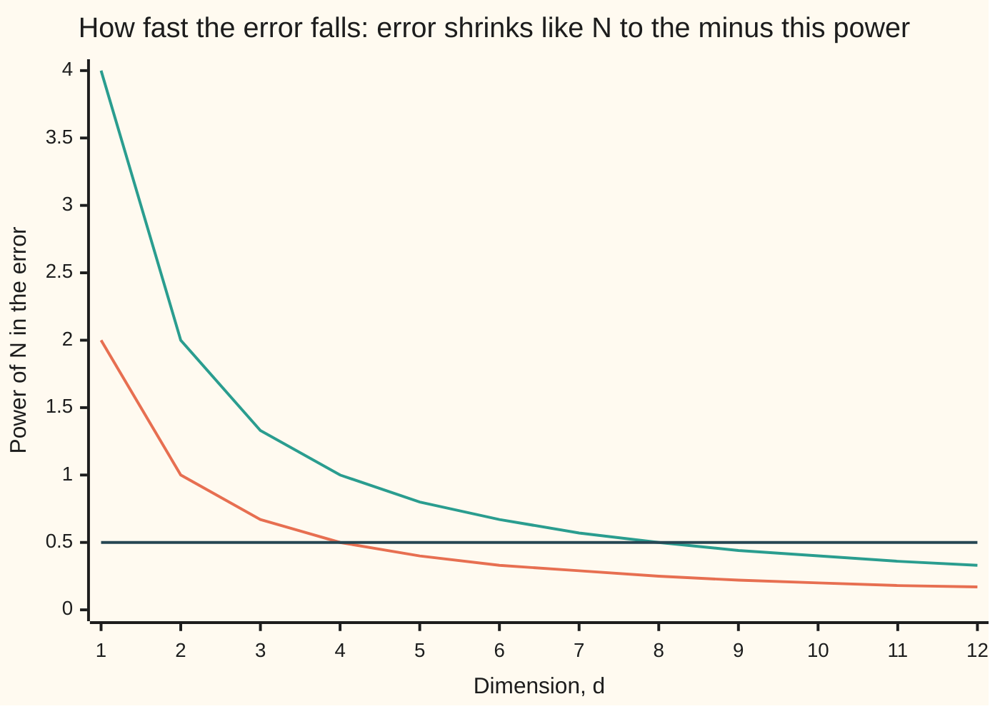

# Monte Carlo integration: random points beat a grid once the dimension climbs

[Syllabus](../../../SYLLABUS.md) → [Applied and computational](../README.md) → [Randomised and Approximate Algorithms](../README.md#s02) → Monte Carlo integration

---

## General Overview

A request to a web service handling 10 million requests a day may call 10 backend services, so the chance it finishes on time is a 10-dimensional integral, one dimension per delay. A ball in 10 dimensions is every point whose 10 coordinates, squared and added up, come to at most 1. That is Pythagoras with ten coordinates instead of two: the point lies within distance 1 of the centre. The ball's volume (its 10-dimensional size) is known exactly: π^5/120 = 2.550164. A known answer makes it a ruler for testing methods.

Put the ball inside the box that runs from −1 to 1 on every axis. The box has volume 2^10 = 1,024. Now throw 100,000 darts at the box, each one a list of 10 random numbers between −1 and 1. In the seeded run on this card, 268 land inside the ball. The ball's share of the box is about 268 out of 100,000, so its volume is about 1,024 × 268 / 100,000 = 2.7443, give or take 0.1674. The truth is 1.16 of those error bars away.

Now try the obvious alternative: a tidy grid of points, counted exactly. A grid of 1,048,576 points, 4 along each axis, says the volume is 1.0000. A grid of 60,466,176 points, 6 along each axis, says 3.2255. That is 605 times the darts' budget, and it misses by 3.48 times as much. The grid is not unlucky. In 10 dimensions, even 100,000 points give only 3.1623 per axis, so a grid cannot see any detail.

**A random sample's error shrinks like one over the square root of its number of points whatever the dimension, while a grid's spacing shrinks only like the d-th root of its number of points, so once the dimension passes about four (eight against Simpson's rule), random points win.**

**What kind of fact this is:** a method. Its error rate, σ/√N, is a theorem proved on [Monte Carlo](../../09-Probability%20and%20statistics/11-Simulation/04-monte-carlo-estimates-and-error.md); the grid's rates N^(−2/d) and N^(−4/d) are derived on this card in Why it works from the one-dimensional bounds on [Numerical integration](../../06-Calculus%20and%20analysis/04-Integrals/08-numerical-integration.md).

### The picture: seven answers for one volume

```
true volume                  ██████████████████████████          2.5502
100,000 darts                ███████████████████████████         2.7443
grid, 2 per axis: 1,024                                          0.0000
grid, 3 per axis: 59,049     ███████████████████████████████████ 3.4856
grid, 4 per axis: 1,048,576  ██████████                          1.0000
grid, 5 per axis: 9,765,625  ███████████████████████████████     3.0708
grid, 6 per axis: 60,466,176 ████████████████████████████████    3.2255
```

Each block is 0.1 of volume. The darts land next to the truth. The grids jump around it, and more points do not steadily help.

---

## The formula

The estimate from darts, and its error bar, carried over from [Monte Carlo](../../09-Probability%20and%20statistics/11-Simulation/04-monte-carlo-estimates-and-error.md):

$$\hat V = 2^d \times \frac{K}{N}, \qquad \mathrm{SE} = \frac{\sigma}{\sqrt N}, \qquad \sigma = 2^d\sqrt{p\,(1-p)}$$

**Read it aloud:** the volume is the box's volume times the fraction of darts that landed inside, and its typical miss is the spread of one dart's score divided by the square root of the number of darts.

The comparison this card is about. A grid of N points in d dimensions has $m = N^{1/d}$ points per axis, spaced $h = 2/m$ apart. The midpoint rule (score the centre of each small box and add up) misses by about $C h^2$, and Simpson's rule (a weighted version that fits curves through the points) by about $C h^4$, as [Numerical integration](../../06-Calculus%20and%20analysis/04-Integrals/08-numerical-integration.md) shows in one dimension. Written in N, those errors become:

$$\text{darts: } \frac{\sigma}{\sqrt N} = \sigma N^{-1/2}, \qquad \text{midpoint grid: } C\,N^{-2/d}, \qquad \text{Simpson grid: } C\,N^{-4/d}$$

**Read it aloud:** the darts' error falls with the square root of the points in every dimension; a grid's falls with the points raised to two over d, or four over d, a power that shrinks as the dimension grows.

| Symbol | Plain meaning | In our example | Push it up and the answer… |
| --- | --- | --- | --- |
| $d$, $2^d$ | the dimension: how many coordinates each point has; $2^d$ is the box's volume | 10; 1,024 | the ball's share of the box collapses; a grid gets coarser |
| $x_1, \dots, x_d$ | one point's coordinates, each between −1 and 1 | 10 random numbers per dart | — |
| $V_d$ | the ball's true volume | 2.550164 | — |
| $p$ | the ball's share of the box, $V_d / 2^d$ | 0.00249039, about 1 in 402 | smaller error relative to the answer |
| $N$ | number of darts, or of grid points | 100,000 | smaller error |
| $K$ | darts that landed inside the ball | 268 | — |
| $\hat V$ | the estimate (the hat marks an estimate) | 2.7443 | — |
| $\sigma$, $s$ | spread of one dart's score, which is 1,024 or 0; $s$ is the same spread measured from the run | 51.0379; 52.9403 | wider error bar |
| $\mathrm{SE}$ | standard error: the estimate's typical miss | 0.1614 true, 0.1674 from the run | — |
| $m$, $h$ | grid points per axis, and their spacing | 3.1623 per axis for 100,000 points | more points per axis: smaller grid error |
| $C$, $e$ | a constant set by how sharply the integrand bends, not by $N$; $e$ is Euler's number, the base of natural logarithms, used in the smooth test | — | larger grid error |

### When it holds

- **Independent darts, spread evenly over the box.** The estimate aims at whatever the darts actually sample. A generator that favours the centre would report a bigger ball, and more darts would not fix it.
- **σ finite, and not huge next to the answer.** The rate σ/√N has no $d$ in it, but σ does. In 20 dimensions the ball fills about 1 part in 40,631,628 of its box: 100,000 darts hit it 0 times and report a volume of 0.0000.
- **A smooth integrand, for the grid's rates.** The $h^2$ and $h^4$ errors need a bounded second or fourth derivative. The ball's edge is a jump from 1,024 to 0, so a grid does worse than $N^{-2/d}$ there, and erratically: 0.0000, 3.4856, 1.0000, 3.0708, 3.2255.
- **Cost counted in points.** Each dart costs 10 random numbers, so the work per dart grows with $d$, but only in proportion. The error formula counts darts, not numbers.

---

## Why it works

### Step 0: the darts' error counts darts; the grid splits its points between the axes

An average of independent draws gets more accurate with the number of draws. How many coordinates each draw has never enters: a dart in 10 dimensions is still one draw. A grid is different. To cover 10 axes it must put points along every one of them at once, so N points buy only the 10th root of N per axis. Everything below is that contrast, made exact.

### Step 1: the volume is an average score

Score each dart 1,024 if it lands inside the ball and 0 if not. The chance of landing inside is the ball's share of the box, $p$, so the long-run average score is $1{,}024 \times p = V_d$. The volume is an average, and [Monte Carlo](../../09-Probability%20and%20statistics/11-Simulation/04-monte-carlo-estimates-and-error.md) estimates averages: take the plain average of N scores, with standard error σ/√N. Here σ = 1,024 × √(p(1 − p)) = 51.0379, so 100,000 darts give a true standard error of 0.1614.

### Step 2: nothing in σ/√N counts dimensions

The proof of σ/√N has one working line. The scores are independent, so their variances add: N darts give total variance Nσ². Dividing the total by N to make an average divides the variance by N², which leaves σ²/N. The 10 coordinates were used up earlier, inside each dart, to decide whether that dart scored. They never appear again.

The code tests this. It runs 200 batches of 1,000 darts in 2, 5 and 10 dimensions and compares the typical miss with σ/√N. The ratios are 0.991, 1.027 and 0.993: the law holds the same way in every dimension.

### Step 3: a grid of N points has N^(1/d) per axis

A grid with $m$ points along each of $d$ axes has $N = m^d$ points, so $m = N^{1/d}$. In 10 dimensions, 59,049 points is only 3 per axis and 60,466,176 points is only 6. The spacing $h = 2/m$ therefore shrinks like $N^{-1/d}$: doubling the points per axis multiplies the points by 1,024.

### Step 4: the one-dimensional error bounds become N^(−2/d) and N^(−4/d)

[Numerical integration](../../06-Calculus%20and%20analysis/04-Integrals/08-numerical-integration.md) proves that the midpoint rule's error is at most a constant times $h^2$, and Simpson's at most a constant times $h^4$. Those bounds carry over to a grid of boxes in $d$ dimensions with the same powers of $h$ (the fold below says why). Substitute $h \propto N^{-1/d}$:

- midpoint error ∝ $h^2$ ∝ $N^{-2/d}$,
- Simpson error ∝ $h^4$ ∝ $N^{-4/d}$,
- darts error ∝ $N^{-1/2}$, in every dimension.

The code measures the midpoint rate on a smooth test, $e^{x_1 + \dots + x_{10}}/(e-1)^{10}$ over the box from 0 to 1, whose true integral is 1. Going from 3 to 6 points per axis multiplies the points by 1,024 and cuts the miss from 0.04520 to 0.01150: only 3.93 times. That is a measured rate of 0.197 against the predicted 0.200. The same 1,024 times as many darts would cut their error 32.00 times.

<details>
<summary>Why the midpoint error stays h² in d dimensions</summary>

Take one small box of the grid, side $h$, with centre $c$. Taylor's theorem in several variables writes the integrand near $c$ as its value at $c$, plus a slope term for each coordinate, plus terms in the squared distances from $c$ that are at most a constant times $h^2$ in size.

Integrate over the box. The value at $c$ gives the midpoint rule's term: value times box volume. Each slope term integrates to zero, because the box is symmetric about its centre: every point on one side has a mirror point on the other. What is left is at most a constant times $h^2$ times the box's volume.

Add up all the boxes. Their volumes add to the volume of the region, so the total error is at most a constant times $h^2$. Simpson's rule needs one more fact. Symmetry still removes the odd terms, and its weights, 1, 4 and 1 along each axis, also integrate the squared terms exactly, so the first term left is fourth order: $h^4$. The constants depend on the derivatives and on $d$, but the power of $h$ does not.

</details>

### Step 5: compare the powers

The grid wins when its power beats one half. For the midpoint rule, 2/d > 1/2 means d < 4. For Simpson, 4/d > 1/2 means d < 8. Past those dimensions the darts' error falls faster, so for large enough N they win whatever the constants.



First line (orange): the midpoint grid, 2/d. Second line (green): the Simpson grid, 4/d. Third line (dark): the darts, 1/2, flat. Higher is better. The darts' flat line crosses the midpoint line at d = 4 and the Simpson line at d = 8.

In costs: one more correct decimal place means a tenth of the error. In 10 dimensions that takes 100 times the darts, 316 times the Simpson points, and 100,000 times the midpoint points.

### Step 6: an edge makes the grid worse still

The ball's score jumps from 1,024 to 0 at its surface, so no derivative is bounded there and Step 4's rates do not apply. The grid's error now comes from the boxes the surface cuts through, and that error can shrink as slowly as $h$, which is $N^{-1/d}$: a power of 0.10 in 10 dimensions.

Worse, a grid in high dimensions sees the ball through a few thin shells. With 4 points per axis, every coordinate is ±1/4 or ±3/4. The 1,024 points with every coordinate at ±1/4 all sit at distance 0.7906 from the centre, inside. The next nearest points sit at 1.0607, outside. Nothing lies between, so the grid answers 1.0000 for every ball whose radius lies between 0.7906 and 1.0607. Darts land at every distance, so they have no such blind spots.

---

## Worked numbers, by hand

The seeded run: 100,000 darts, seed 2026, in the box from −1 to 1 on all 10 axes.

| Step | Arithmetic | Value |
| --- | --- | --- |
| box volume | 2^10 | 1,024 |
| ball's true share of the box | 2.550164 / 1,024 | 0.00249039 |
| darts expected inside | 100,000 × 0.00249039 | 249.0 |
| darts that landed inside | counted | 268 |
| estimate | 1,024 × 268 / 100,000 | 2.7443 |
| spread of one score, σ | 1,024 × √(p × (1 − p)), with p = 0.00249039 | 51.0379 |
| true standard error | 51.0379 / √100,000 | 0.1614 |
| standard error from the run | s / √100,000, with s = 52.9403 measured from the 268 hits | 0.1674 |
| 95 percent interval | 2.7443 ± 1.96 × 0.1674 | 2.4162 to 3.0724 |
| miss | 2.7443 − 2.550164 | +0.1942, which is 1.16 standard errors |
| **answer** | estimate ± standard error | **2.7443 ± 0.1674** |

A random point of the 10-dimensional box lands in the ball only about 1 time in 402, and 100,000 darts still pin its volume to a relative standard error of 0.0633.

### What breaks if you drop a piece

Right answer, from 100,000 darts: 2.5502 is the truth, the darts say 2.7443 ± 0.1674.

| Mistake | Comes out at | What went wrong |
| --- | --- | --- |
| Same 100,000 darts, but a 20-dimensional ball | 0 hits, volume 0.0000 (true 0.025807) | The ball fills about 1 part in 40,631,628 of its box, so one hit needs that many darts. σ/√N is free of d; σ is not. |
| A grid of 1,048,576 points, 4 per axis | 1.0000 | Its inside points all sit at distance 0.7906 and the next shell at 1.0607: the grid cannot see the edge |
| Forgetting the box's volume | 0.002680 | That is the fraction of darts inside, not the volume |
| Error bar s/N instead of s/√N | ± 0.000529 | Variances add; spreads do not. The bar is 316 times too narrow |

Every number in that table is printed by both programs below.

---

## Code, from first principles, and it actually runs

The volume of the 10-dimensional ball is reached four independent ways. The closed form builds $V_d$ by the step $V_d = V_{d-2} \times 2\pi/d$. Slicing builds it as a chain of one-dimensional integrals, each done by Simpson's rule. Darts use a SplitMix64 generator written out in each language, so Python and Rust draw the same numbers. Grids are counted exactly, twice: once by walking every grid point and dropping a branch as soon as it leaves the ball, and once by tallying the sums of squares coordinate by coordinate. Then the code measures the grid's rate on a smooth test, checks σ/√N in 2, 5 and 10 dimensions, and reproduces every what-breaks number. Nothing imported knows the answer.

### Python

```python
# Monte Carlo integration in many dimensions -- the check behind the card.
# Standard library only.  The volume of a 10-dimensional ball of radius 1,
# reached four ways: the closed form, slicing (a chain of 1-D integrals),
# a grid of cell centres counted exactly, and seeded darts.
from math import pi, exp, sqrt, log, cos
D, N, SEED = 10, 100000, 2026
MASK, state = (1 << 64) - 1, SEED

def u():                                      # one uniform number in [0, 1), SplitMix64
    global state
    state = (state + 0x9E3779B97F4A7C15) & MASK
    z = state
    z = ((z ^ (z >> 30)) * 0xBF58476D1CE4E5B9) & MASK
    z = ((z ^ (z >> 27)) * 0x94D049BB133111EB) & MASK
    return ((z ^ (z >> 31)) >> 11) / 9007199254740992.0

def darts(d, n):                              # how many of n darts in [-1, 1]^d land in the ball
    hits = 0
    for _ in range(n):
        r2 = 0.0
        for _ in range(d):
            x = 2.0 * u() - 1.0
            r2 += x * x
        hits += r2 <= 1.0
    return hits

def exact(d):                                 # V_d = pi^(d/2) / (d/2)!, by V_d = V_(d-2) 2 pi / d
    v, k = (1.0, 2) if d % 2 == 0 else (2.0, 3)
    while k <= d:
        v, k = v * 2 * pi / k, k + 2
    return v

def sliced(d, slices=2000):                   # V_k = V_(k-1) x integral of cos^k over (-pi/2, pi/2)
    v, h = 1.0, pi / slices
    for k in range(1, d + 1):
        w = sum((1 if i in (0, slices) else 4 if i % 2 else 2) * cos(-pi / 2 + i * h) ** k
                for i in range(slices + 1))
        v *= w * h / 3
    return v

def grid_walk(m, d, left, depth=0):           # road A: visit grid points, drop a branch once outside
    if depth == d:
        return 1
    return sum(grid_walk(m, d, left - c * c, depth + 1)
               for c in range(1 - m, m, 2) if c * c <= left)

def grid_sums(m, d):                          # road B: count by the sum of squares, coordinate by coordinate
    ways = {0: 1}
    for _ in range(d):
        nxt = {}
        for s, w in ways.items():
            for c in range(1 - m, m, 2):
                if s + c * c <= m * m:
                    nxt[s + c * c] = nxt.get(s + c * c, 0) + w
        ways = nxt
    return sum(ways.values())

def mid(m):                                   # 1-D midpoint rule for e^x / (e - 1) on [0, 1]; true value 1
    return sum(exp((j + 0.5) / m) for j in range(m)) / m / (exp(1) - 1)

V, cube = exact(D), 2.0 ** D
p = V / cube
sigma = cube * sqrt(p * (1 - p))
print(f"exact: V_10 = pi^5 / 120 = {V:.6f}; cube [-1, 1]^10 has volume {cube:.0f}; fraction inside p = {p:.8f}, about 1 in {1 / p:.0f}")
print(f"slicing road, Simpson on cos^k with 2000 slices per step: {sliced(D):.6f}")
print(f"one dart's score: {cube:.0f} inside, 0 outside; sigma = 1024 sqrt(p(1 - p)) = {sigma:.4f}")

K = darts(D, N)
est = cube * K / N
s = cube * sqrt(K / N * (1 - K / N) * N / (N - 1))
se = s / sqrt(N)
print(f"darts: {N} in [-1, 1]^10, seed {SEED}: {K} inside; expected {N * p:.1f}")
print(f"  estimate 1024 x {K} / {N} = {est:.4f}; standard error {se:.4f} (true {sigma / sqrt(N):.4f}); s {s:.4f}")
print(f"  95% interval {est - 1.96 * se:.4f} to {est + 1.96 * se:.4f}; miss {est - V:+.4f} = {(est - V) / se:+.2f} standard errors")
print(f"  relative standard error {sigma / sqrt(N) / V:.4f}")

print("grid of cell centres, m per axis: points, inside (walk), inside (by sums), estimate, miss")
grid = {}
for m in (2, 3, 4, 5, 6):
    walk = grid_walk(m, D, m * m) if m <= 5 else -1
    by_sum = grid_sums(m, D)
    grid[m] = cube * by_sum / m ** D
    if m <= 5:
        assert walk == by_sum                           # two counting roads agree
    print(f"  m = {m}: {m ** D:>9} {walk:>7} {by_sum:>7} {grid[m]:.4f} {grid[m] - V:+.4f}")
dart_se_3 = sigma / sqrt(3 ** D)
print(f"darts at the 3-per-axis budget of {3 ** D}: standard error {dart_se_3:.4f}")
print(f"6 per axis: {6 ** D / N:.0f} times the darts' points, {abs(grid[6] - V) / abs(est - V):.2f} times the darts' miss")

print("error rate exponents: error falls like N^-rate; d, midpoint 2/d, Simpson 4/d, Monte Carlo 1/2")
for d in range(1, 13):
    print(f"  {d:>2} {2 / d:.2f} {4 / d:.2f} 0.50")
print(f"crossover: midpoint loses past d = {2 / 0.5:.0f}, Simpson past d = {4 / 0.5:.0f}; a jump edge gives 1/d = {1 / D:.2f} in 10-D")
print(f"points per axis for {N} grid points in 10-D: {N ** (1 / D):.4f}")
print(f"cost of one more decimal place in 10-D: darts x{10 ** 2}, Simpson x{10 ** 2.5:.0f}, midpoint x{10 ** 5}")

e = [abs(mid(m) ** D - 1) for m in (3, 6, 12)]
rate = log(e[0] / e[1]) / log(2 ** D)
print(f"smooth test, e^(x1 + ... + x10) / (e - 1)^10 on [0, 1]^10, true integral 1, midpoint grid:")
print(f"  3 per axis ({3 ** D} points) miss {e[0]:.5f}; 6 per axis ({6 ** D}) miss {e[1]:.5f}; 12 per axis miss {e[2]:.6f}")
print(f"  1024 times the points cut the miss {e[0] / e[1]:.2f} times; measured rate {rate:.3f}, theory 0.200; darts: {sqrt(2 ** D):.2f} times")

print("same N = 1000 darts, 200 runs each: d, sigma / root N, observed root-mean-square miss")
rms = {}
for d in (2, 5, 10):
    vd, cd = exact(d), 2.0 ** d
    pd = vd / cd
    sq = sum((cd * darts(d, 1000) / 1000 - vd) ** 2 for _ in range(200))
    rms[d] = (sqrt(sq / 200), cd * sqrt(pd * (1 - pd) / 1000), vd)
    print(f"  {d:>2} {rms[d][1]:.4f} {rms[d][0]:.4f}  (ratio {rms[d][0] / rms[d][1]:.3f}; relative to the volume {rms[d][1] / vd:.3f})")

V20 = exact(20)
K20 = darts(20, N)
print(f"what breaks, the right answer is {V:.4f} +/- {se:.4f}")
print(f"  20-D ball: true {V20:.6f}, fraction of cube {V20 / 2 ** 20:.10f}; {N} darts hit {K20}, estimate {2 ** 20 * K20 / N:.4f}")
print(f"  darts for one expected hit in 20-D: {2 ** 20 / V20:.0f}")
print(f"  grid of 1,048,576 points (4 per axis): {grid[4]:.4f}, its 1024 inside points all sit at distance {sqrt(D) / 4:.4f},"
      f" the next shell at {sqrt((9 + D - 1) / 16):.4f} is all outside")
print(f"  forgetting the cube's volume: {K / N:.6f}")
print(f"  error bar s / N instead of s / root N: +/- {s / N:.6f}, {sqrt(N):.0f} times too narrow")
print(f"try: 400000 darts, standard error {sigma / sqrt(4 * N):.4f}; 10,000,000 darts {sigma / sqrt(100 * N):.4f}")

assert abs(sliced(D) - V) < 1e-9                       # slicing agrees with the closed form
assert abs(est - V) < 3 * sigma / sqrt(N)               # darts land within 3 standard errors
assert grid_walk(3, D, 9) == 1 + 20 + 180               # 0, 1 or 2 coordinates off-centre fit
assert all(abs(rms[d][0] / rms[d][1] - 1) < 0.2 for d in rms)   # sigma / root N in every dimension
assert abs(rate - 0.2) < 0.01                           # grid error falls like N^(-2/d)
assert abs(grid[3] - V) > 4 * dart_se_3                 # the grid misses by more than 4 dart errors
assert K20 == 0
print("ALL CHECKS PASS")
```

**Ran 2026-11-11 on macOS, Python 3.14.10, standard library only. All checks passed. Output, pasted from the run:**

```
exact: V_10 = pi^5 / 120 = 2.550164; cube [-1, 1]^10 has volume 1024; fraction inside p = 0.00249039, about 1 in 402
slicing road, Simpson on cos^k with 2000 slices per step: 2.550164
one dart's score: 1024 inside, 0 outside; sigma = 1024 sqrt(p(1 - p)) = 51.0379
darts: 100000 in [-1, 1]^10, seed 2026: 268 inside; expected 249.0
  estimate 1024 x 268 / 100000 = 2.7443; standard error 0.1674 (true 0.1614); s 52.9403
  95% interval 2.4162 to 3.0724; miss +0.1942 = +1.16 standard errors
  relative standard error 0.0633
grid of cell centres, m per axis: points, inside (walk), inside (by sums), estimate, miss
  m = 2:      1024       0       0 0.0000 -2.5502
  m = 3:     59049     201     201 3.4856 +0.9355
  m = 4:   1048576    1024    1024 1.0000 -1.5502
  m = 5:   9765625   29285   29285 3.0708 +0.5206
  m = 6:  60466176      -1  190464 3.2255 +0.6754
darts at the 3-per-axis budget of 59049: standard error 0.2100
6 per axis: 605 times the darts' points, 3.48 times the darts' miss
error rate exponents: error falls like N^-rate; d, midpoint 2/d, Simpson 4/d, Monte Carlo 1/2
   1 2.00 4.00 0.50
   2 1.00 2.00 0.50
   3 0.67 1.33 0.50
   4 0.50 1.00 0.50
   5 0.40 0.80 0.50
   6 0.33 0.67 0.50
   7 0.29 0.57 0.50
   8 0.25 0.50 0.50
   9 0.22 0.44 0.50
  10 0.20 0.40 0.50
  11 0.18 0.36 0.50
  12 0.17 0.33 0.50
crossover: midpoint loses past d = 4, Simpson past d = 8; a jump edge gives 1/d = 0.10 in 10-D
points per axis for 100000 grid points in 10-D: 3.1623
cost of one more decimal place in 10-D: darts x100, Simpson x316, midpoint x100000
smooth test, e^(x1 + ... + x10) / (e - 1)^10 on [0, 1]^10, true integral 1, midpoint grid:
  3 per axis (59049 points) miss 0.04520; 6 per axis (60466176) miss 0.01150; 12 per axis miss 0.002889
  1024 times the points cut the miss 3.93 times; measured rate 0.197, theory 0.200; darts: 32.00 times
same N = 1000 darts, 200 runs each: d, sigma / root N, observed root-mean-square miss
   2 0.0519 0.0515  (ratio 0.991; relative to the volume 0.017)
   5 0.3751 0.3853  (ratio 1.027; relative to the volume 0.071)
  10 1.6140 1.6031  (ratio 0.993; relative to the volume 0.633)
what breaks, the right answer is 2.5502 +/- 0.1674
  20-D ball: true 0.025807, fraction of cube 0.0000000246; 100000 darts hit 0, estimate 0.0000
  darts for one expected hit in 20-D: 40631628
  grid of 1,048,576 points (4 per axis): 1.0000, its 1024 inside points all sit at distance 0.7906, the next shell at 1.0607 is all outside
  forgetting the cube's volume: 0.002680
  error bar s / N instead of s / root N: +/- 0.000529, 316 times too narrow
try: 400000 darts, standard error 0.0807; 10,000,000 darts 0.0161
ALL CHECKS PASS
```

### Rust

```rust
// Monte Carlo integration in many dimensions -- the check behind the card.
// No crates.  The volume of a 10-dimensional ball of radius 1, reached four
// ways: the closed form, slicing (a chain of 1-D integrals), a grid of cell
// centres counted exactly, and seeded darts.  Output matches the Python check.
use std::collections::BTreeMap;
use std::f64::consts::PI;
const D: usize = 10; const N: u64 = 100000; const SEED: u64 = 2026;

struct Rng(u64);
impl Rng {
    fn u(&mut self) -> f64 {                  // one uniform number in [0, 1), SplitMix64
        self.0 = self.0.wrapping_add(0x9E3779B97F4A7C15);
        let mut z = self.0;
        z = (z ^ (z >> 30)).wrapping_mul(0xBF58476D1CE4E5B9);
        z = (z ^ (z >> 27)).wrapping_mul(0x94D049BB133111EB);
        ((z ^ (z >> 31)) >> 11) as f64 / 9007199254740992.0
    }
    fn darts(&mut self, d: usize, n: u64) -> u64 { // how many of n darts in [-1, 1]^d land in the ball
        let mut hits = 0;
        for _ in 0..n {
            let mut r2 = 0.0;
            for _ in 0..d {
                let x = 2.0 * self.u() - 1.0;
                r2 += x * x;
            }
            if r2 <= 1.0 { hits += 1; }
        }
        hits
    }
}

fn exact(d: usize) -> f64 {                   // V_d = pi^(d/2) / (d/2)!, by V_d = V_(d-2) 2 pi / d
    let (mut v, mut k) = if d % 2 == 0 { (1.0, 2) } else { (2.0, 3) };
    while k <= d {
        v *= 2.0 * PI / k as f64;
        k += 2;
    }
    v
}

fn sliced(d: usize, slices: usize) -> f64 {  // V_k = V_(k-1) x integral of cos^k over (-pi/2, pi/2)
    let (mut v, h) = (1.0, PI / slices as f64);
    for k in 1..=d {
        let mut w = 0.0;
        for i in 0..=slices {
            let wt = if i == 0 || i == slices { 1.0 } else if i % 2 == 1 { 4.0 } else { 2.0 };
            w += wt * (-PI / 2.0 + i as f64 * h).cos().powi(k as i32);
        }
        v *= w * h / 3.0;
    }
    v
}

fn grid_walk(m: i64, d: usize, left: i64, depth: usize) -> u64 { // road A: visit points, prune outside
    if depth == d { return 1; }
    let mut total = 0;
    let mut c = 1 - m;
    while c < m {
        if c * c <= left { total += grid_walk(m, d, left - c * c, depth + 1); }
        c += 2;
    }
    total
}

fn grid_sums(m: i64, d: usize) -> u64 {       // road B: count by the sum of squares, coordinate by coordinate
    let mut ways: BTreeMap<i64, u64> = BTreeMap::new();
    ways.insert(0, 1);
    for _ in 0..d {
        let mut nxt = BTreeMap::new();
        for (&s, &w) in &ways {
            let mut c = 1 - m;
            while c < m {
                if s + c * c <= m * m { *nxt.entry(s + c * c).or_insert(0) += w; }
                c += 2;
            }
        }
        ways = nxt;
    }
    ways.values().sum()
}

fn mid(m: usize) -> f64 {                     // 1-D midpoint rule for e^x / (e - 1) on [0, 1]; true value 1
    let s: f64 = (0..m).map(|j| ((j as f64 + 0.5) / m as f64).exp()).sum();
    s / m as f64 / (1f64.exp() - 1.0)
}

fn main() {
    let mut rng = Rng(SEED);
    let (v, cube) = (exact(D), 2f64.powi(D as i32));
    let p = v / cube;
    let sigma = cube * (p * (1.0 - p)).sqrt();
    let nf = N as f64;
    println!("exact: V_10 = pi^5 / 120 = {:.6}; cube [-1, 1]^10 has volume {:.0}; fraction inside p = {:.8}, about 1 in {:.0}", v, cube, p, 1.0 / p);
    println!("slicing road, Simpson on cos^k with 2000 slices per step: {:.6}", sliced(D, 2000));
    println!("one dart's score: {:.0} inside, 0 outside; sigma = 1024 sqrt(p(1 - p)) = {:.4}", cube, sigma);

    let k = rng.darts(D, N);
    let f = k as f64 / nf;
    let est = cube * f;
    let s = cube * (f * (1.0 - f) * nf / (nf - 1.0)).sqrt();
    let se = s / nf.sqrt();
    println!("darts: {} in [-1, 1]^10, seed {}: {} inside; expected {:.1}", N, SEED, k, nf * p);
    println!("  estimate 1024 x {} / {} = {:.4}; standard error {:.4} (true {:.4}); s {:.4}", k, N, est, se, sigma / nf.sqrt(), s);
    println!("  95% interval {:.4} to {:.4}; miss {:+.4} = {:+.2} standard errors", est - 1.96 * se, est + 1.96 * se, est - v, (est - v) / se);
    println!("  relative standard error {:.4}", sigma / nf.sqrt() / v);

    println!("grid of cell centres, m per axis: points, inside (walk), inside (by sums), estimate, miss");
    let mut grid = [0.0f64; 7];
    for m in 2..=6i64 {
        let walk: i64 = if m <= 5 { grid_walk(m, D, m * m, 0) as i64 } else { -1 };
        let by_sum = grid_sums(m, D);
        let pts = (m as u64).pow(D as u32);
        grid[m as usize] = cube * by_sum as f64 / pts as f64;
        if m <= 5 { assert_eq!(walk as u64, by_sum); } // two counting roads agree
        println!("  m = {}: {:>9} {:>7} {:>7} {:.4} {:+.4}", m, pts, walk, by_sum, grid[m as usize], grid[m as usize] - v);
    }
    let dart_se_3 = sigma / (3f64.powi(D as i32)).sqrt();
    println!("darts at the 3-per-axis budget of {}: standard error {:.4}", 3u64.pow(D as u32), dart_se_3);
    println!("6 per axis: {:.0} times the darts' points, {:.2} times the darts' miss", 6f64.powi(D as i32) / nf, (grid[6] - v).abs() / (est - v).abs());

    println!("error rate exponents: error falls like N^-rate; d, midpoint 2/d, Simpson 4/d, Monte Carlo 1/2");
    for d in 1..=12 {
        println!("  {:>2} {:.2} {:.2} 0.50", d, 2.0 / d as f64, 4.0 / d as f64);
    }
    println!("crossover: midpoint loses past d = {:.0}, Simpson past d = {:.0}; a jump edge gives 1/d = {:.2} in 10-D", 2.0 / 0.5, 4.0 / 0.5, 1.0 / D as f64);
    println!("points per axis for {} grid points in 10-D: {:.4}", N, nf.powf(1.0 / D as f64));
    println!("cost of one more decimal place in 10-D: darts x{}, Simpson x{:.0}, midpoint x{}", 10u64.pow(2), 10f64.powf(2.5), 10u64.pow(5));

    let e: Vec<f64> = [3, 6, 12].iter().map(|&m| (mid(m).powi(D as i32) - 1.0).abs()).collect();
    let rate = (e[0] / e[1]).ln() / 2f64.powi(D as i32).ln();
    println!("smooth test, e^(x1 + ... + x10) / (e - 1)^10 on [0, 1]^10, true integral 1, midpoint grid:");
    println!("  3 per axis ({} points) miss {:.5}; 6 per axis ({}) miss {:.5}; 12 per axis miss {:.6}", 3u64.pow(D as u32), e[0], 6u64.pow(D as u32), e[1], e[2]);
    println!("  1024 times the points cut the miss {:.2} times; measured rate {:.3}, theory 0.200; darts: {:.2} times", e[0] / e[1], rate, 2f64.powi(D as i32).sqrt());

    println!("same N = 1000 darts, 200 runs each: d, sigma / root N, observed root-mean-square miss");
    let mut ratios = Vec::new();
    for &d in &[2usize, 5, 10] {
        let (vd, cd) = (exact(d), 2f64.powi(d as i32));
        let pd = vd / cd;
        let mut sq = 0.0;
        for _ in 0..200 {
            let x = cd * rng.darts(d, 1000) as f64 / 1000.0 - vd;
            sq += x * x;
        }
        let (r, th) = ((sq / 200.0).sqrt(), cd * (pd * (1.0 - pd) / 1000.0).sqrt());
        ratios.push(r / th);
        println!("  {:>2} {:.4} {:.4}  (ratio {:.3}; relative to the volume {:.3})", d, th, r, r / th, th / vd);
    }

    let v20 = exact(20);
    let k20 = rng.darts(20, N);
    let c20 = 2f64.powi(20);
    println!("what breaks, the right answer is {:.4} +/- {:.4}", v, se);
    println!("  20-D ball: true {:.6}, fraction of cube {:.10}; {} darts hit {}, estimate {:.4}", v20, v20 / c20, N, k20, c20 * k20 as f64 / nf);
    println!("  darts for one expected hit in 20-D: {:.0}", c20 / v20);
    println!("  grid of 1,048,576 points (4 per axis): {:.4}, its 1024 inside points all sit at distance {:.4}, the next shell at {:.4} is all outside",
             grid[4], (D as f64).sqrt() / 4.0, ((9 + D - 1) as f64 / 16.0).sqrt());
    println!("  forgetting the cube's volume: {:.6}", f);
    println!("  error bar s / N instead of s / root N: +/- {:.6}, {:.0} times too narrow", s / nf, nf.sqrt());
    println!("try: 400000 darts, standard error {:.4}; 10,000,000 darts {:.4}", sigma / (4.0 * nf).sqrt(), sigma / (100.0 * nf).sqrt());

    assert!((sliced(D, 2000) - v).abs() < 1e-9);          // slicing agrees with the closed form
    assert!((est - v).abs() < 3.0 * sigma / nf.sqrt());    // darts land within 3 standard errors
    assert_eq!(grid_walk(3, D, 9, 0), 1 + 20 + 180);       // 0, 1 or 2 coordinates off-centre fit
    assert!(ratios.iter().all(|r| (r - 1.0).abs() < 0.2)); // sigma / root N in every dimension
    assert!((rate - 0.2).abs() < 0.01);                    // grid error falls like N^(-2/d)
    assert!((grid[3] - v).abs() > 4.0 * dart_se_3);        // the grid misses by more than 4 dart errors
    assert_eq!(k20, 0);
    println!("ALL CHECKS PASS");
}
```

**Ran 2026-11-11 on macOS, rustc 1.98.1, no crates. All checks passed. Output, pasted from the run:**

```
exact: V_10 = pi^5 / 120 = 2.550164; cube [-1, 1]^10 has volume 1024; fraction inside p = 0.00249039, about 1 in 402
slicing road, Simpson on cos^k with 2000 slices per step: 2.550164
one dart's score: 1024 inside, 0 outside; sigma = 1024 sqrt(p(1 - p)) = 51.0379
darts: 100000 in [-1, 1]^10, seed 2026: 268 inside; expected 249.0
  estimate 1024 x 268 / 100000 = 2.7443; standard error 0.1674 (true 0.1614); s 52.9403
  95% interval 2.4162 to 3.0724; miss +0.1942 = +1.16 standard errors
  relative standard error 0.0633
grid of cell centres, m per axis: points, inside (walk), inside (by sums), estimate, miss
  m = 2:      1024       0       0 0.0000 -2.5502
  m = 3:     59049     201     201 3.4856 +0.9355
  m = 4:   1048576    1024    1024 1.0000 -1.5502
  m = 5:   9765625   29285   29285 3.0708 +0.5206
  m = 6:  60466176      -1  190464 3.2255 +0.6754
darts at the 3-per-axis budget of 59049: standard error 0.2100
6 per axis: 605 times the darts' points, 3.48 times the darts' miss
error rate exponents: error falls like N^-rate; d, midpoint 2/d, Simpson 4/d, Monte Carlo 1/2
   1 2.00 4.00 0.50
   2 1.00 2.00 0.50
   3 0.67 1.33 0.50
   4 0.50 1.00 0.50
   5 0.40 0.80 0.50
   6 0.33 0.67 0.50
   7 0.29 0.57 0.50
   8 0.25 0.50 0.50
   9 0.22 0.44 0.50
  10 0.20 0.40 0.50
  11 0.18 0.36 0.50
  12 0.17 0.33 0.50
crossover: midpoint loses past d = 4, Simpson past d = 8; a jump edge gives 1/d = 0.10 in 10-D
points per axis for 100000 grid points in 10-D: 3.1623
cost of one more decimal place in 10-D: darts x100, Simpson x316, midpoint x100000
smooth test, e^(x1 + ... + x10) / (e - 1)^10 on [0, 1]^10, true integral 1, midpoint grid:
  3 per axis (59049 points) miss 0.04520; 6 per axis (60466176) miss 0.01150; 12 per axis miss 0.002889
  1024 times the points cut the miss 3.93 times; measured rate 0.197, theory 0.200; darts: 32.00 times
same N = 1000 darts, 200 runs each: d, sigma / root N, observed root-mean-square miss
   2 0.0519 0.0515  (ratio 0.991; relative to the volume 0.017)
   5 0.3751 0.3853  (ratio 1.027; relative to the volume 0.071)
  10 1.6140 1.6031  (ratio 0.993; relative to the volume 0.633)
what breaks, the right answer is 2.5502 +/- 0.1674
  20-D ball: true 0.025807, fraction of cube 0.0000000246; 100000 darts hit 0, estimate 0.0000
  darts for one expected hit in 20-D: 40631628
  grid of 1,048,576 points (4 per axis): 1.0000, its 1024 inside points all sit at distance 0.7906, the next shell at 1.0607 is all outside
  forgetting the cube's volume: 0.002680
  error bar s / N instead of s / root N: +/- 0.000529, 316 times too narrow
try: 400000 darts, standard error 0.0807; 10,000,000 darts 0.0161
ALL CHECKS PASS
```

The two outputs are identical line for line.

> [!TIP]
> **Try changing**
> - **400,000 darts instead of 100,000.** Guess first: four times the work. The standard error falls from 0.1614 to 0.0807, exactly half, in 10 dimensions just as in 2.
> - **10,000,000 darts.** Guess first: 100 times the work. The standard error is 0.0161: one more correct decimal place, no more.
> - **A grid with 6 points per axis.** Guess first: 60,466,176 points, 605 times the darts. It answers 3.2255, off by 0.6754: 3.48 times the darts' miss.
> - **Set the dimension to 20.** Guess first: same darts, same σ/√N law. Zero darts land inside, and the estimate is 0.0000. The law still holds; σ is now enormous next to the answer.

---

## The usual mistake

> [!warning]
> **Reading "the error rate does not depend on dimension" as "Monte Carlo is easy in any dimension".** The rate, one over root N, has no d in it. The constant σ does. For the ball, the error relative to the volume at 1,000 darts is 0.017 in 2 dimensions, 0.071 in 5 and 0.633 in 10. In 20 dimensions, 100,000 darts score nothing. Monte Carlo beats the grid; it does not beat a target that almost no dart can hit. Shrinking σ is the job of [Variance reduction](../../09-Probability%20and%20statistics/11-Simulation/05-variance-reduction.md). When no direct sampler can reach the region at all, [MCMC as a tool](08-markov-chain-monte-carlo-for-computation.md) draws from it instead, at the price of correlated draws, which are worth fewer than independent ones.
>
> - **Expecting a finer grid to settle down.** In 10 dimensions, 3, 4, 5 and 6 points per axis give 3.4856, 1.0000, 3.0708 and 3.2255. Sixty million points are still off by 0.6754.
> - **Quoting the grid's h² bound for a jumpy integrand.** The bound needs a bounded second derivative. At the ball's edge the score jumps, and the grid's power drops to 1/d, which is 0.10 in 10 dimensions.
> - **Forgetting the box's volume.** The fraction inside, 0.002680, is not the volume. Multiply by 1,024.
> - **Dividing by N instead of √N.** The error bar becomes ± 0.000529 and claims a precision the run does not have.

---

## Where you meet it in real life

- **A web service's time budget.** A request to a service handling 10 million requests a day may call 10 backend services, each adding a random delay. The chance a request finishes inside its budget is an integral over every combination of the 10 delays. Engineers estimate it by simulating synthetic requests rather than gridding the delays.
- **Option desks.** A basket of 20 shares, or a price watched on 250 trading days, makes the option's price an integral in 20 or 250 dimensions. Banks simulate it and quote a standard error: [Monte Carlo pricing](../../12-Financial%20mathematics/06-Numerical%20Methods%20for%20Pricing/01-monte-carlo-pricing.md).
- **Film rendering.** A pixel's brightness is an average over every path light could take to reach it, bouncing several times, each bounce adding dimensions. Renderers average random paths, and the speckle in a quick render is σ/√N on screen.
- **Physics of many particles.** The average energy of a gas of 100 molecules is an integral over 300 coordinates. Physicists sample it with a random walk instead of independent darts: [MCMC as a tool](08-markov-chain-monte-carlo-for-computation.md).
- **Pricing libraries.** For smooth integrands, carefully spread non-random point sets (quasi-Monte Carlo) can beat both the grid and the darts in moderate dimensions; they are widely used for pricing in finance.

> **Say it back**
> A volume or integral is an average, so random darts can estimate it, with a typical miss of σ divided by the square root of the number of darts. Nothing in that error counts dimensions: a dart in 10 dimensions is still one draw. A grid must spread its N points over every axis, so it gets only N to the power 1/d per axis, and its error falls like N^(−2/d) or N^(−4/d). Past four dimensions for the midpoint rule, and eight for Simpson, the darts win: 100,000 darts give the 10-dimensional ball as 2.74 ± 0.17, where 60 million grid points say 3.23. The rate is free of dimension but σ is not, which is why a 20-dimensional ball still defeats plain darts.

---

## What this builds on

- [Randomised algorithms](01-randomised-algorithms-and-expectation.md): Monte Carlo methods as a family, which return an answer that is probably close, at a fixed cost.
- [Monte Carlo](../../09-Probability%20and%20statistics/11-Simulation/04-monte-carlo-estimates-and-error.md): the estimate as an average, its standard error σ/√N, and the SplitMix64 darts this card reuses.
- [Variance reduction](../../09-Probability%20and%20statistics/11-Simulation/05-variance-reduction.md): the other lever on σ/√N, cutting σ rather than adding darts.
- [Monte Carlo pricing](../../12-Financial%20mathematics/06-Numerical%20Methods%20for%20Pricing/01-monte-carlo-pricing.md): the same estimator at work on a bank's desk, where the dimensions come from the trading days.
- [Numerical integration](../../06-Calculus%20and%20analysis/04-Integrals/08-numerical-integration.md): the midpoint and Simpson rules with their h² and h⁴ error bounds, which this card turns into N^(−2/d) and N^(−4/d).

## Where this goes next

- [MCMC as a tool](08-markov-chain-monte-carlo-for-computation.md): when no direct sampler can reach the region that matters, a random walk draws from it instead, at the price of correlated draws.
- Many dimensions: grids, random points and smarter point sets compared as rules for integrals.

Plain darts fail on the 20-dimensional ball because almost none of them land inside; how to send the darts where the answer lives, without biasing the average, is the question this card leaves open.

---

## Sources

Verified 2026-11-11: every link below resolves to the publisher's page.

- Metropolis, Nicholas, and S. Ulam. "The Monte Carlo Method." *Journal of the American Statistical Association* 44 (1949): 335–341. [doi:10.1080/01621459.1949.10483310](https://doi.org/10.1080/01621459.1949.10483310). The paper that named the method.
- Bellman, Richard. *Adaptive Control Processes: A Guided Tour*. Princeton University Press, 1961. [doi:10.1515/9781400874668](https://doi.org/10.1515/9781400874668). Bellman's account of "the curse of dimensionality": a grid's size grows as m^d.
- Caflisch, Russel E. "Monte Carlo and quasi-Monte Carlo methods." *Acta Numerica* 7 (1998): 1–49. [doi:10.1017/S0962492900002804](https://doi.org/10.1017/S0962492900002804). The survey behind Steps 2 to 5: the dimension-free σ/√N rate set against grid rules, and the quasi-Monte Carlo point sets that sit between them.
- Owen, Art B. *Monte Carlo Theory, Methods and Examples*. [Author's book page](https://artowen.su.domains/mc/). Free; simple Monte Carlo, its error, and why it suits integrals in many dimensions.
- Steele, Guy L., Doug Lea, and Christine H. Flood. "Fast Splittable Pseudorandom Number Generators." OOPSLA 2014: 453–472. [doi:10.1145/2660193.2660195](https://doi.org/10.1145/2660193.2660195). The SplitMix64 generator both programs use.
