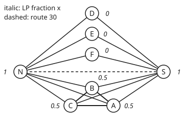

# Approximation: a guaranteed ratio when the exact answer is out of reach

[Syllabus](../../../SYLLABUS.md) → [Applied and computational](../README.md) → [Randomised and Approximate Algorithms](../README.md#s02) → Approximation

---

## General Overview

A city runs 30 bus routes, and every route must be checked by an inspector each day. An inspector posted at a station checks every route that calls there. Posts cost wages, so the city wants to know: how few posts check all 30 routes?

The city on this card is synthetic, built by a stated rule. It has 11 stations: two depots, N and S; six outer termini, A to F; and three interchanges in the middle, X, Y and Z. Routes 1 to 13 leave N, routes 14 to 26 leave S, routes 27 to 29 run a ring A–B–C, and route 30 is an express from N to S.

With 11 stations, trying every set of posts takes 2,048 tries. Each station added doubles that, so a network of hundreds of stations is out of reach ([Polynomial or exponential](../01-Algorithms%20and%20Growth/03-polynomial-versus-exponential-time.md)), and no fast exact method is known.

So this card trades exactness for a promise. Each method below is fast and carries a proof that its answer is never more than a stated multiple of the fewest: a constant such as 2, or one that grows slowly with the number of routes. That multiple is the **approximation ratio**.

The first two methods post inspectors only at the ends of routes, where the fewest is 4. Greedy may also use the interchanges, where the fewest drops to 3.

- **The matching rule** posts at both ends of any unchecked route: never more than 2 times the fewest. Here it uses 6 posts; the fewest is 4.
- **Rounding** solves a version that allows fractions of an inspector, then posts wherever the fraction is at least 0.5: also within 2 times. Here, 5 posts.
- **Greedy** posts wherever the most unchecked routes call: within about the natural log of the number of routes. Here, 5 posts where 3 would do.

**An approximation algorithm is fast and proves its answer is at most a stated multiple of the best, a constant or one that grows slowly with the input, by comparing that answer with a floor every plan must pay, never with the best itself, which stays unknown.**

**What kind of fact this is:** three theorems, all proved on this card in Why it works: the factor 2 for the matching rule, the factor 2 for rounding, and the log factor for greedy. The city is synthetic; the brute-force minimum is computed, not assumed.

### The picture: the routes between termini, and a fractional plan

<p align="center"></p>

Schematic, not to scale. Each line joins the two ends of its routes. A line from a depot stands for 2 routes, except N–D and S–E, which carry 3. The dashed line is the express, route 30. The italic number at each station is its fraction in the cheapest fractional plan, found in Step 2: 1 at the depots, 0.5 around the ring, 0 elsewhere.

---

## The formula

Two names come first. **OPT** is the fewest posts any plan can use: here 4 if inspectors may stand only at termini, 3 if any station is allowed. **ALG** is the number of posts a method uses. A method is a **ρ-approximation** ("rho") when, on every possible input,

$$\text{ALG} \le \rho \times \text{OPT}$$

**Read it aloud:** whatever network it is given, the method never uses more than ρ times the fewest possible posts.

The three methods on this card carry these ratios:

$$\rho_{\text{matching}} = 2, \qquad \rho_{\text{rounding}} = f, \qquad \rho_{\text{greedy}} = H(n) = 1 + \tfrac{1}{2} + \tfrac{1}{3} + \dots + \tfrac{1}{n} \;\le\; 1 + \ln n$$

**Read it aloud:** the matching rule is within 2; rounding is within f, the most stations a single route can be checked at; greedy is within the harmonic sum H(n), which grows like the natural log of the number of routes.

Rounding needs a **linear program**, LP for short: a linear goal under linear limits, with each yes-or-no choice relaxed to a fraction between 0 and 1. Here the choice "post at station v, yes or no" becomes a fraction $x_v$. The LP asks for the smallest total of the $x_v$ such that, for every route, the fractions at the stations where it can be checked add up to at least 1. Integer programs treats them in general; this card solves its small one by checking every point built from 0, 0.5 and 1, which includes every corner (Step 2).

| Symbol | Plain meaning | In our example | Push it up and the answer… |
| --- | --- | --- | --- |
| OPT | fewest posts any plan can use | 4 at termini; 3 at any station | every method's allowance grows with it |
| ALG | posts the method actually uses | 6 matching, 5 rounding, 5 greedy | the ratio ALG/OPT worsens |
| ρ | the promised ratio, on every input | 2, 2 and 3.995 | a weaker promise |
| n | the number of routes to check | 30 | H(n) grows, but only like ln n |
| H(n), ln n | the harmonic sum 1 + 1/2 + … + 1/n; ln is the natural log | H(30) = 3.995; 1 + ln 30 = 4.401 | — |
| j, t | a term's place in the harmonic sum, and a point on the curve 1/t that bounds it | — | — |
| M | the routes the matching rule picks; no two share a station | routes 1, 14, 27 | each forces a post in every plan |
| $x_v$, $x_u$ | the fraction of an inspector at station v; u and v are the two ends of a route | N 1, A 0.5, D 0 | more posts after rounding |
| LP | the least total of fractions that checks every route | 3.5 | the floor under OPT rises |
| $y_r$ | a weight on route r, with at most 1 in total at each station | 1 on routes 1 and 14; 0.5 on 27, 28, 29 | a higher floor, if loads stay at most 1 |
| k | routes still unchecked when greedy posts | 30, 14, 6, 3, 1 | the price allowed per route falls |
| f | the most stations at which one route can be checked | 2 at termini; 3 at any station | rounding's threshold 1/f falls and its ratio f rises |

### When it holds

- **Every input, worst case.** The ratio is a ceiling for every network, not an average. A run can land well inside it: greedy's 5 posts sit far under its allowance of 11.98.
- **Equal costs, for the matching rule.** If posts cost different wages, posting both ends can buy two dear stations where one cheap one would do. Rounding and greedy keep their ratios with costs, greedy by choosing the most new routes per pound.
- **At most f choices per route, for rounding.** At termini each route has 2 ends, so a threshold of 0.5 works. At any station a route can be checked at up to 3, so a fraction of 1/3 at each could leave every station under 0.5 and the route unchecked; the threshold must drop to 1/f, and the ratio rises to f.

---

## Why it works

### Step 0: compare with a floor, because the best is unknown

OPT is exactly what cannot be computed fast. So each proof finds a **floor**: a number every plan must reach, so at most OPT. It then shows the method's answer is at most ρ times the floor, hence at most ρ times OPT, without ever finding OPT. This card uses two floors: a set of routes with no station in common, and the cheapest fractional plan.

### Step 1: the matching rule is within 2

Inspectors may stand only at termini, so each route has exactly two ends and must have a post at one of them. A set of stations meeting every route is a **vertex cover**. That every cover needs at least as many posts as any set of routes sharing no station, a **matching**, is proved in [Konig's theorem](../../04-Combinatorics%20and%20graphs/13-Matchings%20and%20Flows/03-konigs-theorem-and-vertex-cover.md), which also notes that both ends of a matching make a cover at twice the cost. This step turns that note into a method.

**The rule:** go through the routes in order. When a route is still unchecked, post inspectors at both its ends.

Route 1 runs N–D: post N and D. That checks every route leaving N, the express, and the routes from S to D. Route 14 runs S–E, still unchecked: post S and E. That checks routes 14 to 26. Route 27 runs A–B: post A and B, which also checks 28 and 29. Six posts.

**Why it is within 2.** The routes the rule picked share no station: once a route is picked, both its ends hold posts, so any later route touching those ends is already checked and is never picked. So the picked routes M form a matching. Every plan needs a separate post for each of them, so OPT is at least 3 here. The rule used exactly 2 posts per picked route. So ALG = 2 × (routes in M) ≤ 2 × OPT. Every route ends up checked, because the rule skips only routes already checked.

Here 6 against a true fewest of 4: ratio 1.50. The matching need not be the largest possible, only one that cannot be extended. The factor 2 can be met exactly: a single route gets 2 posts where 1 would do.

### Step 2: the fractional plan, a floor that can be computed

Now relax each yes-or-no post to a fraction $x_v$ between 0 and 1, and ask that each route's two ends hold at least 1 between them: $x_u + x_v \ge 1$ for a route from u to v. Every real plan is one of these fractional plans, with 1 at posts and 0 elsewhere. So the cheapest fractional plan, LP, is a floor: LP ≤ OPT.

**Solving it by corners.** The allowed points form a region with flat sides, and a linear goal is smallest at a corner of it (the optimisation wing proves this). When every route has two ends, every corner uses only the values 0, 0.5 and 1; the fold below proves it. So it is enough to try every point built from those three values: 3 choices at each of 8 termini, 6,561 points. The best is 3.5: 1 at N and S, 0.5 at A, B and C, and 0 at D, E and F.

**A second road to the same 3.5, with no corners.** Put a weight $y_r$ on each route r so that the weights touching any one station, its **load**, add to at most 1. Call such weights a **packing**. Every fractional plan pays at least the packing's total:

$$\text{total of the } y_r \;\le\; \text{total of } y_r\,(x_u + x_v) \;=\; \text{total of } x_v \times \text{load at } v \;\le\; \text{total of the } x_v$$

Read it left to right. Each route's two ends hold at least 1 between them, so multiplying its weight by their sum cannot shrink it. Adding route by route and then regrouping station by station, each station's fraction is multiplied by its load. Each load is at most 1. Weight 1 on route 1 (N–D), 1 on route 14 (S–E), and 0.5 on each ring route: the heaviest station load is 1, and the total is 3.5. So no fractional plan costs less than 3.5, and one costs exactly 3.5. Two roads, one value.

Posts come whole, so a floor of 3.5 means at least 4. Brute force over all 256 sets of termini agrees: the fewest is 4, at N, S, A and B.

<details>
<summary>Detailed proof: every corner uses only 0, 0.5 and 1</summary>

Take an allowed point with at least one fraction other than 0, 0.5 and 1. Call a station low if its fraction lies strictly between 0 and 0.5, and high if strictly between 0.5 and 1. Make two new points: add a small amount to every low station and subtract the same amount from every high one; then the reverse. If the amount is small enough, every fraction stays between 0 and 1.

Check each route's limit $x_u + x_v \ge 1$. If it has room to spare, a small enough change keeps it. If it is exactly 1, its ends are 0.5 and 0.5 (untouched), or 0 and 1 (untouched), or one low and one high, and the two changes cancel. So both new points are allowed, and the first point is their midpoint. A point that is the midpoint of two allowed points is not a corner. So every corner uses only 0, 0.5 and 1.

</details>

The packing argument is the matching floor of Step 1 with fractional weights: a matching is a packing whose weights are all 1.

### Step 3: rounding keeps the floor's factor

**The rule:** post wherever $x_v$ is at least 0.5.

Every route is checked: its two ends hold at least 1 between them, so one of them holds at least 0.5. And each post had a fraction of at least 0.5, so the number of posts is at most 2 times the sum of the fractions: ALG ≤ 2 × LP ≤ 2 × OPT.

Here that is N, S, A, B and C: 5 posts, under 2 × 3.5 = 7. Ratio 5/4 = 1.25, better than the matching rule on this city, under the same promise.

The same argument works whenever every route can be checked at most at f stations. One of its f fractions is at least 1/f, so post where $x_v \ge 1/f$; the posts number at most f × LP. At any station in this city f is 3, which gives a ratio of 3.

When f is large, a coin can replace the fixed threshold: post at each station with chance equal to its fraction, and repeat for a small multiple of ln n rounds, where n is the number of routes. That is **randomised rounding**, the shelf's coins put to work ([Randomised algorithms](01-randomised-algorithms-and-expectation.md)). Each round costs the LP on average, so the expected cost is that many rounds times the LP: the rounds are where the log factor comes from.

### Step 4: greedy is within the harmonic sum

Lift the termini-only rule: inspectors may stand at any station, and each route calls at up to 3. Each station is now a set of routes, and the job is to choose the fewest sets that together hold all 30. That is **set cover**.

**The rule:** post where the most unchecked routes call; repeat until all are checked. Greedy choices in general, and where they are exactly right, are taught in [Greedy](../01-Algorithms%20and%20Growth/08-greedy-algorithms-and-matroids.md). Set cover is not one of those cases.

Greedy takes X first: 16 routes, more than the 14 at either depot. Then Y with 8, Z with 3, N with 2 and S with 1: 5 posts. Brute force over all 2,048 sets of stations finds 3: N, S and Z. X was a trap: its 16 routes are split between the two depots, so both depots still need a post.

**Why greedy is within H(n).** Give each post a cost of 1, and share it equally among the routes it newly checks. X's 16 routes each pay 1/16; S's single route pays 1. The prices add up to the number of posts.

Now look at a moment when k routes are still unchecked. The best plan's OPT posts check all of them, so at least one of those posts checks at least k/OPT of them. Greedy takes the post that checks the most, so it checks at least k/OPT, and each route it checks pays at most OPT/k.

Line the 30 routes up in the order they get checked. The j-th route from the end was checked while at least j routes were unchecked, so it pays at most OPT/j: the last at most OPT/1, the one before at most OPT/2, and so on back to the first at most OPT/30. Adding these, the total is at most OPT × (1 + 1/2 + … + 1/30) = H(30) × OPT = 3.995 × 3 = 11.98. Greedy's 5 is well inside.

The run checks each price against its allowance: 1/16 against 3/30, 1/8 against 3/14, 1/3 against 3/6, 1/2 against 3/3, and 1 against 3/1.

**Why H(n) is a log.** Each term 1/j, from j = 2 on, is less than the area under the curve 1/t between t = j − 1 and t = j, since the curve is higher than 1/j across that step. Those areas add to the area from 1 to n, which is ln n. So H(n) ≤ 1 + ln n: for 30 routes, 3.995 against 4.401.

How far these ratios can be pushed is a question for the complexity wing. For set cover, a fast method that beat ln n by any fixed fraction would prove P = NP: the claim, unproved and widely doubted, that every problem whose answers can be checked fast can also be solved fast. For vertex cover, nobody knows a fast method that beats 2 by any fixed amount. Both are stated here without proof; Approximation, a planned card in the complexity wing, takes them up.

---

## Worked numbers, by hand

| Step | Arithmetic | Value |
| --- | --- | --- |
| fewest at termini | all 256 sets of 8 termini tried | 4: N, S, A, B |
| the matching rule | routes 1, 14, 27, both ends each | 6 posts |
| floor from the matching | 3 routes sharing no station | at least 3 |
| cheapest fractional plan | 6,561 half-step points tried | 3.5 |
| floor from the packing | 1 + 1 + 0.5 + 0.5 + 0.5 | 3.5 |
| whole posts | 3.5, rounded up | at least 4 |
| rounding at 0.5 | N, S, A, B, C | 5, under 2 × 3.5 = 7 |
| fewest at any station | all 2,048 sets of 11 stations tried | 3: N, S, Z |
| greedy | X, Y, Z, N, S | 5, under 3.995 × 3 = 11.98 |
| ratios against the true fewest | 6/4, 5/4, 5/3 | **1.50, 1.25, 1.67** |

All three methods kept their promises, and none found the fewest.

Greedy's picks, as routes newly checked:

```
X  ################ 16
Y  ########          8
Z  ###               3
N  ##                2
S  #                 1
```

### What breaks if you drop a piece

| Mistake | Comes out at | What went wrong |
| --- | --- | --- |
| Fractions rounded down to whole numbers | posts N, S; routes 27, 28, 29 unchecked | Each ring route has 0.5 + 0.5; rounding both down breaks its limit |
| One end of each matched route | posts N, S, A; route 28 unchecked | The floor needs one post per matched route, but the cover needs both ends |
| LP value read as the fewest | ratio 5/3.5 = 1.43 claimed; true 1.25 | 3.5 inspectors cannot be posted; the LP is only a floor |
| Greedy's answer read as the fewest | 5 posts, 2 more than 3 | The promise bounds the excess; it does not remove it |

The code prints all four.

---

## Code, from first principles, and it actually runs

The scripts build the city from its stated rule and take three independent roads. Brute force over every set of posts gives the true fewest, which each method is measured against. The cheapest fractional plan is found by trying every half-step point and confirmed by a packing that proves nothing cheaper exists. Greedy is instrumented: each pick prints its price per route beside the allowance OPT/k from the proof. Python imports only `math`, for natural logs.

### Python

```python
# Approximation algorithms -- the check behind the card.  One import, math, for ln.
# A synthetic city: 30 bus routes.  Stations N and S are depots, A to F outer
# termini, X, Y, Z mid-route interchanges.  A route lists the stations it calls
# at: its two ends first, then any interchange.  An inspector posted at a station
# checks every route calling there.  Every promise below meets a brute-force optimum.
import math
NAMES = "N S A B C D E F X Y Z".split()
R = ([["N", t] for t in "DEFABCDEFABCD"] + [["S", t] for t in "EFABCDEFABCDE"]
     + [["A", "B"], ["B", "C"], ["C", "A"], ["N", "S"]])        # routes 1-30, ends only
for i in range(30):                                            # interchanges on the way
    if i < 8 or 13 <= i < 21: R[i].append("X")
    elif i < 12 or 21 <= i < 25: R[i].append("Y")
    elif 26 <= i < 29: R[i].append("Z")
T = 8                                                          # stations 0-7 are termini
ID = {s: k for k, s in enumerate(NAMES)}
END = [(ID[r[0]], ID[r[1]]) for r in R]
SEES = [{i for i, r in enumerate(R) if s in r} for s in NAMES]
names = lambda ks: " ".join(NAMES[k] for k in ks)
nums = lambda rs: " ".join(str(i + 1) for i in rs)
bits = lambda m, n: [k for k in range(n) if m >> k & 1]
unchecked = lambda posts: [i for i in range(30) if not any(ID[s] in posts for s in R[i][:2])]

# PART 1: termini only.  Every route has two ends, so this is vertex cover.
covers = [m for m in range(1 << T) if not unchecked(bits(m, T))]
opt1 = min(len(bits(m, T)) for m in covers)
best1 = next(m for m in covers if len(bits(m, T)) == opt1)
matched, posts = [], set()                                     # the matching rule
for i, (u, v) in enumerate(END):
    if u not in posts and v not in posts:
        matched.append(i); posts |= {u, v}
alg1 = len(posts)
lp = None                                                      # LP: every half-step point
for code in range(3 ** T):
    x = [code // 3 ** k % 3 for k in range(T)]                 # x[k] in half-units 0, 1, 2
    if all(x[u] + x[v] >= 2 for u, v in END) and (lp is None or sum(x) < sum(lp)):
        lp = x
lpval = sum(lp) / 2
y = [2 if i in (0, 13) else 1 if 26 <= i < 29 else 0 for i in range(30)]  # a packing
load = [sum(y[i] for i, e in enumerate(END) if k in e) for k in range(T)]
rounded = [k for k in range(T) if lp[k] >= 1]
floored = [k for k in range(T) if lp[k] == 2]
half = lambda h: f"{h // 2}" + (".5" if h % 2 else "")            # half-units as text
lines = {}                                                     # depot lines and their routes
for u, v in END[:26]:
    lines[(u, v)] = lines.get((u, v), 0) + 1
three = [f"{NAMES[u]}-{NAMES[v]}" for (u, v), c in lines.items() if c == 3]
print(f"{len(R)} routes; {T} termini ({names(range(T))}); 3 interchanges (X Y Z); {len(NAMES)} stations; synthetic")
print(f"routes 1-13 leave N, 14-26 leave S, 27-29 ring A-B-C, 30 is the N-S express; "
      f"{' and '.join(three)} carry 3 routes, the other {len(lines) - len(three)} depot lines 2")
print(f"termini only, all {1 << T} sets of posts tried: fewest {opt1} ({names(bits(best1, T))})")
print(f"matching rule picks routes {nums(matched)}, no two sharing a station: posts {names(sorted(posts))} = {alg1}")
print(f"so every cover needs at least {len(matched)}; ratio {alg1}/{opt1} = {alg1 / opt1:.2f}, promise <= 2")
print(f"LP, all {3 ** T} half-step points: {half(sum(lp))} at " + ", ".join(f"{NAMES[k]} {half(lp[k])}" for k in range(T)))
print(f"packing: routes 1, 14 weight 1, routes 27 28 29 weight 0.5; heaviest station load {half(max(load))}; total {half(sum(y))}")
print(f"posts come whole, so {half(sum(lp))} means at least {-(-sum(lp) // 2)}")
print(f"rounding, post where x >= 0.5: {names(rounded)} = {len(rounded)} <= 2 x {half(sum(lp))} = {half(2 * sum(lp))}; ratio {len(rounded)}/{opt1} = {len(rounded) / opt1:.2f}")

# PART 2: any station.  A route calls at up to 3 stations: set cover.
n2 = len(NAMES)
full = [m for m in range(1 << n2) if len(set().union(*[SEES[k] for k in bits(m, n2)])) == 30]
opt2 = min(len(bits(m, n2)) for m in full)
best2 = next(m for m in full if len(bits(m, n2)) == opt2)
print("routes seen per station: " + ", ".join(f"{NAMES[k]} {len(SEES[k])}" for k in range(n2)))
left, picks, prices = set(range(30)), [], []
while left:                                                    # greedy: most new routes
    k = max(range(n2), key=lambda j: (len(SEES[j] & left), -j))
    new = len(SEES[k] & left)
    print(f"greedy pick {len(picks) + 1}: {NAMES[k]}  {'#' * new:<16} {new:>2} new of {len(left):>2} left, "
          f"price 1/{new} each <= OPT/left = {opt2}/{len(left)}")
    picks.append(k); prices.append((new, len(left))); left -= SEES[k]
H = sum(1 / k for k in range(1, 31))
f = max(len(r) for r in R)                                     # most stations on one route
print(f"any station: a route calls at up to {f}; all {1 << n2} sets tried: fewest {opt2} ({names(bits(best2, n2))})")
print(f"greedy: {len(picks)} posts ({names(picks)}); ratio {len(picks)}/{opt2} = {len(picks) / opt2:.2f}")
print(f"promise: H(30) x OPT = {H:.3f} x {opt2} = {H * opt2:.2f}; 1 + ln 30 = {1 + math.log(30):.3f}")
print(f"mistake, LP rounded down: posts {names(floored)}, routes {nums(unchecked(floored))} unchecked")
ones = [END[i][0] for i in matched]
print(f"mistake, one end of each matched route: posts {names(ones)}, route {nums(unchecked(ones))} unchecked")
print(f"mistake, LP value read as the minimum: ratio {len(rounded)}/{half(sum(lp))} = {len(rounded) / lpval:.2f} claimed, true {len(rounded) / opt1:.2f}")
print(f"mistake, greedy read as the minimum: {len(picks)} posts, {len(picks) - opt2} more than {opt2}")
assert opt1 == 4 and alg1 <= 2 * opt1 and len(matched) <= opt1          # 2-approximation
assert all(not (set(END[i]) & set(END[j])) for i in matched for j in matched if i < j)
assert all(l <= 2 for l in load) and sum(y) == sum(lp) == 7             # LP = 3.5 two ways
assert lpval <= opt1 and not unchecked(rounded) and len(rounded) <= 2 * lpval
assert opt2 == 3 and f == 3 and len(picks) <= H * opt2 and len(picks) > opt2         # greedy misses here
assert all(opt2 * new >= l for new, l in prices)                         # price <= OPT/left
assert math.log(31) < H <= 1 + math.log(30)                              # integral bounds on H(30)
assert len(unchecked(floored)) == 3 and len(unchecked(ones)) == 1 and three == ["N-D", "S-E"]
FIG = {"N": (40, 140), "S": (320, 140), "D": (180, 26), "E": (180, 66),
       "F": (180, 106), "B": (180, 172), "A": (222, 206), "C": (138, 206)}
print("figure, " + " ".join(f"{k} ({x},{y})" for k, (x, y) in FIG.items()))
print("ALL CHECKS PASS")
```

**Ran 2026-11-11 on macOS, Python 3.14.10, standard library only. All checks passed. Output, pasted from the run:**

```
30 routes; 8 termini (N S A B C D E F); 3 interchanges (X Y Z); 11 stations; synthetic
routes 1-13 leave N, 14-26 leave S, 27-29 ring A-B-C, 30 is the N-S express; N-D and S-E carry 3 routes, the other 10 depot lines 2
termini only, all 256 sets of posts tried: fewest 4 (N S A B)
matching rule picks routes 1 14 27, no two sharing a station: posts N S A B D E = 6
so every cover needs at least 3; ratio 6/4 = 1.50, promise <= 2
LP, all 6561 half-step points: 3.5 at N 1, S 1, A 0.5, B 0.5, C 0.5, D 0, E 0, F 0
packing: routes 1, 14 weight 1, routes 27 28 29 weight 0.5; heaviest station load 1; total 3.5
posts come whole, so 3.5 means at least 4
rounding, post where x >= 0.5: N S A B C = 5 <= 2 x 3.5 = 7; ratio 5/4 = 1.25
routes seen per station: N 14, S 14, A 6, B 6, C 6, D 5, E 5, F 4, X 16, Y 8, Z 3
greedy pick 1: X  ################ 16 new of 30 left, price 1/16 each <= OPT/left = 3/30
greedy pick 2: Y  ########          8 new of 14 left, price 1/8 each <= OPT/left = 3/14
greedy pick 3: Z  ###               3 new of  6 left, price 1/3 each <= OPT/left = 3/6
greedy pick 4: N  ##                2 new of  3 left, price 1/2 each <= OPT/left = 3/3
greedy pick 5: S  #                 1 new of  1 left, price 1/1 each <= OPT/left = 3/1
any station: a route calls at up to 3; all 2048 sets tried: fewest 3 (N S Z)
greedy: 5 posts (X Y Z N S); ratio 5/3 = 1.67
promise: H(30) x OPT = 3.995 x 3 = 11.98; 1 + ln 30 = 4.401
mistake, LP rounded down: posts N S, routes 27 28 29 unchecked
mistake, one end of each matched route: posts N S A, route 28 unchecked
mistake, LP value read as the minimum: ratio 5/3.5 = 1.43 claimed, true 1.25
mistake, greedy read as the minimum: 5 posts, 2 more than 3
figure, N (40,140) S (320,140) D (180,26) E (180,66) F (180,106) B (180,172) A (222,206) C (138,206)
ALL CHECKS PASS
```

### Rust

Same numbers, same labels, built with `rustc --edition 2021 -O`.

```rust
// Approximation algorithms -- the same check as the Python, in Rust.  No crates.
// A synthetic city: 30 bus routes.  Stations N and S are depots, A to F outer
// termini, X, Y, Z mid-route interchanges.  A route lists the stations it calls
// at: its two ends first, then any interchange.  An inspector posted at a station
// checks every route calling there.  Every promise below meets a brute-force optimum.
const NAMES: [&str; 11] = ["N", "S", "A", "B", "C", "D", "E", "F", "X", "Y", "Z"];
const T: usize = 8;                                            // stations 0-7 are termini

fn id(c: char) -> usize { NAMES.iter().position(|s| s.starts_with(c)).unwrap() }
fn names(ks: &[usize]) -> String { ks.iter().map(|&k| NAMES[k]).collect::<Vec<_>>().join(" ") }
fn nums(rs: &[usize]) -> String { rs.iter().map(|i| (i + 1).to_string()).collect::<Vec<_>>().join(" ") }
fn bits(m: usize, n: usize) -> Vec<usize> { (0..n).filter(|k| m >> k & 1 == 1).collect() }
fn unchecked(r: &[Vec<usize>], posts: &[usize]) -> Vec<usize> {
    (0..30).filter(|&i| !r[i][..2].iter().any(|s| posts.contains(s))).collect()
}
fn half(h: usize) -> String { format!("{}{}", h / 2, if h % 2 == 1 { ".5" } else { "" }) } // half-units as text

fn main() {
    let mut r: Vec<Vec<usize>> = Vec::new();                   // routes 1-30, ends first
    for t in "DEFABCDEFABCD".chars() { r.push(vec![id('N'), id(t)]) }
    for t in "EFABCDEFABCDE".chars() { r.push(vec![id('S'), id(t)]) }
    for (a, b) in [('A', 'B'), ('B', 'C'), ('C', 'A'), ('N', 'S')] { r.push(vec![id(a), id(b)]) }
    for i in 0..30 {                                           // interchanges on the way
        if i < 8 || (13..21).contains(&i) { r[i].push(id('X')) }
        else if i < 12 || (21..25).contains(&i) { r[i].push(id('Y')) }
        else if (26..29).contains(&i) { r[i].push(id('Z')) }
    }
    let end: Vec<(usize, usize)> = r.iter().map(|x| (x[0], x[1])).collect();
    let sees: Vec<Vec<usize>> = (0..11).map(|s| (0..30).filter(|&i| r[i].contains(&s)).collect()).collect();

    // PART 1: termini only.  Every route has two ends, so this is vertex cover.
    let covers: Vec<usize> = (0..1usize << T).filter(|&m| unchecked(&r, &bits(m, T)).is_empty()).collect();
    let opt1 = covers.iter().map(|&m| bits(m, T).len()).min().unwrap();
    let best1 = *covers.iter().find(|&&m| bits(m, T).len() == opt1).unwrap();
    let (mut matched, mut posts) = (Vec::new(), Vec::new());   // the matching rule
    for (i, &(u, v)) in end.iter().enumerate() {
        if !posts.contains(&u) && !posts.contains(&v) { matched.push(i); posts.push(u); posts.push(v) }
    }
    posts.sort();
    let alg1 = posts.len();
    let mut lp: Vec<usize> = Vec::new();                       // LP: every half-step point
    for code in 0..3usize.pow(T as u32) {
        let x: Vec<usize> = (0..T).map(|k| code / 3usize.pow(k as u32) % 3).collect();
        if end.iter().all(|&(u, v)| x[u] + x[v] >= 2)
            && (lp.is_empty() || x.iter().sum::<usize>() < lp.iter().sum::<usize>()) { lp = x }
    }
    let lp2: usize = lp.iter().sum();
    let lpval = lp2 as f64 / 2.0;
    let y: Vec<usize> = (0..30).map(|i| if i == 0 || i == 13 { 2 } else if (26..29).contains(&i) { 1 } else { 0 }).collect();
    let load: Vec<usize> = (0..T).map(|k| (0..30).filter(|&i| end[i].0 == k || end[i].1 == k).map(|i| y[i]).sum()).collect();
    let rounded: Vec<usize> = (0..T).filter(|&k| lp[k] >= 1).collect();
    let floored: Vec<usize> = (0..T).filter(|&k| lp[k] == 2).collect();
    let ysum: usize = y.iter().sum();
    let maxload = *load.iter().max().unwrap();
    let mut lines: Vec<((usize, usize), usize)> = Vec::new();  // depot lines and their routes
    for &e in &end[..26] {
        match lines.iter_mut().find(|l| l.0 == e) { Some(l) => l.1 += 1, None => lines.push((e, 1)) }
    }
    let three: Vec<String> = lines.iter().filter(|l| l.1 == 3).map(|l| format!("{}-{}", NAMES[l.0 .0], NAMES[l.0 .1])).collect();
    println!("{} routes; {} termini ({}); 3 interchanges (X Y Z); {} stations; synthetic", r.len(), T, names(&(0..T).collect::<Vec<_>>()), NAMES.len());
    println!("routes 1-13 leave N, 14-26 leave S, 27-29 ring A-B-C, 30 is the N-S express; {} carry 3 routes, the other {} depot lines 2",
             three.join(" and "), lines.len() - three.len());
    println!("termini only, all {} sets of posts tried: fewest {} ({})", 1 << T, opt1, names(&bits(best1, T)));
    println!("matching rule picks routes {}, no two sharing a station: posts {} = {}", nums(&matched), names(&posts), alg1);
    println!("so every cover needs at least {}; ratio {}/{} = {:.2}, promise <= 2", matched.len(), alg1, opt1, alg1 as f64 / opt1 as f64);
    let lpw: Vec<String> = (0..T).map(|k| format!("{} {}", NAMES[k], half(lp[k]))).collect();
    println!("LP, all {} half-step points: {} at {}", 3usize.pow(T as u32), half(lp2), lpw.join(", "));
    println!("packing: routes 1, 14 weight 1, routes 27 28 29 weight 0.5; heaviest station load {}; total {}", half(maxload), half(ysum));
    println!("posts come whole, so {} means at least {}", half(lp2), (lp2 + 1) / 2);
    println!("rounding, post where x >= 0.5: {} = {} <= 2 x {} = {}; ratio {}/{} = {:.2}", names(&rounded), rounded.len(), half(lp2), half(2 * lp2), rounded.len(), opt1, rounded.len() as f64 / opt1 as f64);

    // PART 2: any station.  A route calls at up to 3 stations: set cover.
    let n2 = NAMES.len();
    let union = |m: usize| { let mut u = vec![false; 30]; for k in bits(m, n2) { for &i in &sees[k] { u[i] = true } } u.iter().all(|&b| b) };
    let full: Vec<usize> = (0..1usize << n2).filter(|&m| union(m)).collect();
    let opt2 = full.iter().map(|&m| bits(m, n2).len()).min().unwrap();
    let best2 = *full.iter().find(|&&m| bits(m, n2).len() == opt2).unwrap();
    println!("routes seen per station: {}", (0..n2).map(|k| format!("{} {}", NAMES[k], sees[k].len())).collect::<Vec<_>>().join(", "));
    let (mut left, mut picks, mut prices): (Vec<usize>, Vec<usize>, Vec<(usize, usize)>) = ((0..30).collect(), Vec::new(), Vec::new());
    while !left.is_empty() {                                   // greedy: most new routes
        let newc = |j: usize| sees[j].iter().filter(|i| left.contains(i)).count();
        let mut k = 0;
        for j in 1..n2 { if newc(j) > newc(k) { k = j } }
        let new = newc(k);
        println!("greedy pick {}: {}  {:<16} {:>2} new of {:>2} left, price 1/{} each <= OPT/left = {}/{}",
                 picks.len() + 1, NAMES[k], "#".repeat(new), new, left.len(), new, opt2, left.len());
        picks.push(k); prices.push((new, left.len()));
        left.retain(|i| !sees[k].contains(i));
    }
    let h: f64 = (1..=30).map(|k| 1.0 / k as f64).sum();
    let f = r.iter().map(|x| x.len()).max().unwrap();          // most stations on one route
    println!("any station: a route calls at up to {}; all {} sets tried: fewest {} ({})", f, 1 << n2, opt2, names(&bits(best2, n2)));
    println!("greedy: {} posts ({}); ratio {}/{} = {:.2}", picks.len(), names(&picks), picks.len(), opt2, picks.len() as f64 / opt2 as f64);
    println!("promise: H(30) x OPT = {:.3} x {} = {:.2}; 1 + ln 30 = {:.3}", h, opt2, h * opt2 as f64, 1.0 + 30f64.ln());
    println!("mistake, LP rounded down: posts {}, routes {} unchecked", names(&floored), nums(&unchecked(&r, &floored)));
    let ones: Vec<usize> = matched.iter().map(|&i| end[i].0).collect();
    println!("mistake, one end of each matched route: posts {}, route {} unchecked", names(&ones), nums(&unchecked(&r, &ones)));
    println!("mistake, LP value read as the minimum: ratio {}/{} = {:.2} claimed, true {:.2}", rounded.len(), half(lp2), rounded.len() as f64 / lpval, rounded.len() as f64 / opt1 as f64);
    println!("mistake, greedy read as the minimum: {} posts, {} more than {}", picks.len(), picks.len() - opt2, opt2);
    assert!(opt1 == 4 && alg1 <= 2 * opt1 && matched.len() <= opt1);         // 2-approximation
    assert!(matched.iter().all(|&i| matched.iter().all(|&j| i >= j || (end[i].0 != end[j].0 && end[i].0 != end[j].1 && end[i].1 != end[j].0 && end[i].1 != end[j].1))));
    assert!(maxload <= 2 && ysum == lp2 && lp2 == 7);                          // LP = 3.5 two ways
    assert!(lpval <= opt1 as f64 && unchecked(&r, &rounded).is_empty() && rounded.len() as f64 <= 2.0 * lpval);
    assert!(opt2 == 3 && f == 3 && picks.len() as f64 <= h * opt2 as f64 && picks.len() > opt2); // greedy misses here
    assert!(prices.iter().all(|&(new, l)| opt2 * new >= l));                   // price <= OPT/left
    assert!(31f64.ln() < h && h <= 1.0 + 30f64.ln());                          // integral bounds on H(30)
    assert!(unchecked(&r, &floored).len() == 3 && unchecked(&r, &ones).len() == 1 && three == ["N-D", "S-E"]);
    let fig = [("N", 40, 140), ("S", 320, 140), ("D", 180, 26), ("E", 180, 66),
               ("F", 180, 106), ("B", 180, 172), ("A", 222, 206), ("C", 138, 206)];
    println!("figure, {}", fig.iter().map(|(k, x, y)| format!("{} ({},{})", k, x, y)).collect::<Vec<_>>().join(" "));
    println!("ALL CHECKS PASS");
}
```

**Ran 2026-11-11 on macOS, rustc 1.98.1, no crates. All checks passed. Output, pasted from the run:**

```
30 routes; 8 termini (N S A B C D E F); 3 interchanges (X Y Z); 11 stations; synthetic
routes 1-13 leave N, 14-26 leave S, 27-29 ring A-B-C, 30 is the N-S express; N-D and S-E carry 3 routes, the other 10 depot lines 2
termini only, all 256 sets of posts tried: fewest 4 (N S A B)
matching rule picks routes 1 14 27, no two sharing a station: posts N S A B D E = 6
so every cover needs at least 3; ratio 6/4 = 1.50, promise <= 2
LP, all 6561 half-step points: 3.5 at N 1, S 1, A 0.5, B 0.5, C 0.5, D 0, E 0, F 0
packing: routes 1, 14 weight 1, routes 27 28 29 weight 0.5; heaviest station load 1; total 3.5
posts come whole, so 3.5 means at least 4
rounding, post where x >= 0.5: N S A B C = 5 <= 2 x 3.5 = 7; ratio 5/4 = 1.25
routes seen per station: N 14, S 14, A 6, B 6, C 6, D 5, E 5, F 4, X 16, Y 8, Z 3
greedy pick 1: X  ################ 16 new of 30 left, price 1/16 each <= OPT/left = 3/30
greedy pick 2: Y  ########          8 new of 14 left, price 1/8 each <= OPT/left = 3/14
greedy pick 3: Z  ###               3 new of  6 left, price 1/3 each <= OPT/left = 3/6
greedy pick 4: N  ##                2 new of  3 left, price 1/2 each <= OPT/left = 3/3
greedy pick 5: S  #                 1 new of  1 left, price 1/1 each <= OPT/left = 3/1
any station: a route calls at up to 3; all 2048 sets tried: fewest 3 (N S Z)
greedy: 5 posts (X Y Z N S); ratio 5/3 = 1.67
promise: H(30) x OPT = 3.995 x 3 = 11.98; 1 + ln 30 = 4.401
mistake, LP rounded down: posts N S, routes 27 28 29 unchecked
mistake, one end of each matched route: posts N S A, route 28 unchecked
mistake, LP value read as the minimum: ratio 5/3.5 = 1.43 claimed, true 1.25
mistake, greedy read as the minimum: 5 posts, 2 more than 3
figure, N (40,140) S (320,140) D (180,26) E (180,66) F (180,106) B (180,172) A (222,206) C (138,206)
ALL CHECKS PASS
```

The two outputs match line for line.

> [!TIP]
> **Try changing**
> Guess first, then run the Python. The asserts are pinned to this city, so expect one to stop the program.
> - **Walk the routes backwards.** Guess first: does order matter to the matching rule? Change `enumerate(END)` in the matching loop to `reversed(list(enumerate(END)))`. It picks routes 30 and 29 and posts N, S, A, C: 4, the true fewest. The last assert stops it, because the one-end mistake now posts N and C and leaves 12 routes unchecked, not 1.
> - **Overload the packing.** Guess first: can a floor beat 3.5? Change `(0, 13)` to `(0, 13, 26)`, putting weight 1 on route 27. The total reads 4, but station A now carries 1.5, so it is no packing, and the third assert stops it.
> - **Close interchange X.** Guess first: how does greedy do without its trap? Replace `R[i].append("X")` with `pass`. Greedy picks N with 14, S with 13 and Z with 3: 3 posts, the fewest. The assert that greedy misses here stops it.

---

## The usual mistake

> [!warning]
> **Reading the method's answer as the fewest, or as close to it.** Greedy posts 5 inspectors; 3 would do. The proof promises only that 5 is at most 11.98: it bounds the gap, and the gap can be real. Knowing how close a run came needs a floor computed on that network, such as the matching or the LP.
>
> - **Rounding fractions down.** Posts at N and S only, and routes 27, 28 and 29 go unchecked: the ring's 0.5 + 0.5 becomes 0 + 0.
> - **Posting one end of each matched route.** Posts N, S and A leave route 28 unchecked. One per matched route is the floor; the cover needs both ends.
> - **Treating the LP value as the fewest.** It claims a ratio of 1.43 for rounding; the truth is 1.25. Half an inspector cannot be posted.
> - **Rounding at 0.5 when a route has 3 choices.** At any station, a route's fractions can be 1/3 each; none reaches 0.5 and the route is dropped. The threshold is 1/f.

---

## Where you meet it in real life

- **Staffing and coverage.** Inspectors, ambulance bases, phone masts: the fewest sites that cover everything. The LP floor tells the planner the most a cleverer plan could save.
- **Software testing.** Choosing the fewest tests that between them run every line of a web service's code is set cover; tools pick tests greedily, the most new lines first.
- **Airline crews.** Covering every flight with the fewest paid crew trips is a set-cover problem; airlines solve it through its fractional version, the LP, inside a search for whole-number trips.
- **Delivery rounds.** For the travelling salesman on real road distances, doubling the cheapest connecting tree gives a round at most twice the shortest ([The travelling salesman](../../04-Combinatorics%20and%20graphs/11-Tours%20-%20Euler%20and%20Hamilton/04-travelling-salesman-in-outline.md)); Christofides's method adds a cheapest matching on the odd-degree towns and improves that ratio.

> **Say it back**
> When the fewest cannot be found fast, an approximation algorithm finds a plan fast and proves it is within a stated ratio of the fewest. The proof compares the plan with a floor every plan must pay: routes sharing no station, or the cheapest fractional plan. Posting both ends of each unchecked route, or rounding fractions of at least 0.5 up, gives at most twice the fewest when each route has two ends. Greedy covering is within the harmonic sum, about the natural log of the number of routes. On the 30-route city they use 6, 5 and 5 posts, against true minima of 4 and 3.

---

## What this builds on

- [Polynomial or exponential](../01-Algorithms%20and%20Growth/03-polynomial-versus-exponential-time.md): why trying every set of posts stops being an option as the network grows.
- [Greedy](../01-Algorithms%20and%20Growth/08-greedy-algorithms-and-matroids.md): the take-the-best-now rule, and the problems where it is exact.
- [The travelling salesman](../../04-Combinatorics%20and%20graphs/11-Tours%20-%20Euler%20and%20Hamilton/04-travelling-salesman-in-outline.md): a tour bracketed between the cheapest tree and twice it, an approximation ratio before the name.
- [Konig's theorem](../../04-Combinatorics%20and%20graphs/13-Matchings%20and%20Flows/03-konigs-theorem-and-vertex-cover.md): vertex cover, and the proof that every matching is no larger than every cover.

## Where this goes next

- [Local search](07-local-search-and-metaheuristics.md): the next card. Improve a plan by small changes, with honest reports and, in general, no guaranteed ratio.
- Approximation, in the complexity wing: why some ratios cannot be beaten unless P = NP.
- [Heuristics with a promise](../../15-Optimization/05-Integer%20and%20Combinatorial%20Optimisation/08-heuristics-and-approximation-guarantees.md): further methods that carry a proved ratio.
- [Integer programs](../05-Operations%20Research/03-integer-programming-and-branch-and-bound.md): the LP relaxation in general, and the integrality gap between a fractional floor and the whole-number best.

The question left open: for vertex cover, is 2 the best ratio any fast method can promise?

---

## Sources

Verified 2026-11-11: every link below resolves to the publisher's page.

- Johnson, David S. "Approximation algorithms for combinatorial problems." *Journal of Computer and System Sciences* 9(3), 1974, 256–278. [doi:10.1016/S0022-0000(74)80044-9](https://doi.org/10.1016/S0022-0000%2874%2980044-9). Greedy set cover and its log-factor bound, in one of the first papers on guaranteed ratios.
- Chvátal, V. "A greedy heuristic for the set-covering problem." *Mathematics of Operations Research* 4(3), 1979, 233–235. [doi:10.1287/moor.4.3.233](https://doi.org/10.1287/moor.4.3.233). The harmonic-sum bound with costs, by the pricing argument used in Step 4.
- Nemhauser, G. L., and L. E. Trotter. "Vertex packings: structural properties and algorithms." *Mathematical Programming* 8, 1975, 232–248. [doi:10.1007/BF01580444](https://doi.org/10.1007/BF01580444). The corners of the vertex-cover LP take only the values 0, 1/2 and 1.
- Hochbaum, Dorit S. "Approximation algorithms for the set covering and vertex cover problems." *SIAM Journal on Computing* 11(3), 1982, 555–556. [doi:10.1137/0211045](https://doi.org/10.1137/0211045). Rounding the LP at 1/f, and the ratio f.
- Williamson, David P., and David B. Shmoys. *The Design of Approximation Algorithms*. Cambridge University Press, 2011. [doi:10.1017/CBO9780511921735](https://doi.org/10.1017/CBO9780511921735). A textbook treatment of all three methods, with randomised rounding.
