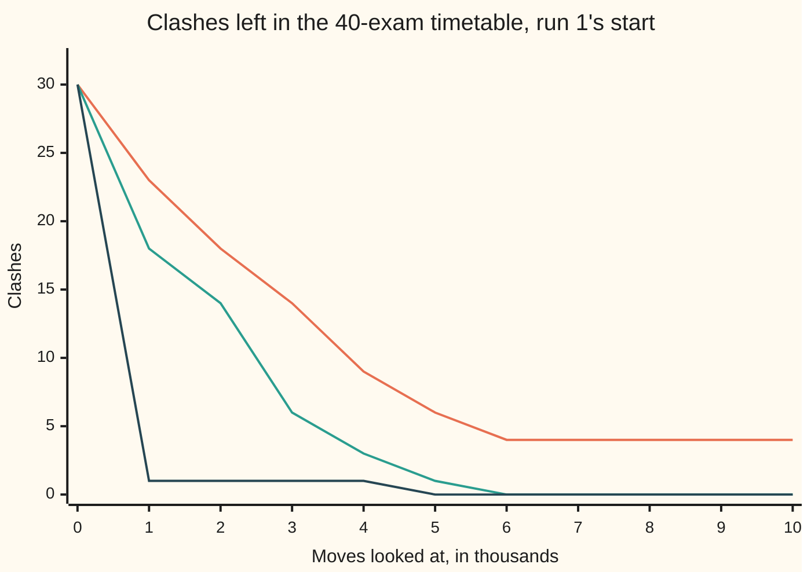

# Local search: hill climbing, restarts, annealing and genetic moves

[Syllabus](../../../SYLLABUS.md) → [Applied and computational](../README.md) → [Randomised and Approximate Algorithms](../README.md#s02) → Local search

---

## General Overview

A college has 40 exams to fit into 12 slots in exam week. Its 120 students sit 4 exams each. Two exams **clash** when one student sits both, and clashing exams cannot share a slot. The enrolments on this card are synthetic, made by a stated rule and seed: 40 first-years each sit 4 of 12 core exams, and 80 other students each sit 4 of all 40. Number the exams 0 to 39. A student's exams are drawn one at a time, and a draw is thrown back if its number leaves the same remainder, when divided by 12, as an exam already picked. So putting each exam in the slot given by that remainder causes no clash, and a clash-free 12-slot timetable is known to exist. The enrolments give 401 clashing pairs.

Draw each exam as a dot and each clash as a line, and a timetable with no clash is a colouring of that graph with 12 colours ([Colouring](../../04-Combinatorics%20and%20graphs/12-Planarity%20and%20Colouring/03-vertex-colouring-and-chromatic-number.md)). The 12 core exams all clash with each other, so 12 slots is the floor. Greedy colouring, taking the exams in listed order, uses 13 slots: one too many. Trying every timetable is out of the question, since there are 12^40, about 10^43.17 of them.

**Local search** is humbler. Start from any timetable. Move one exam to another slot, and keep the move if it lowers the clashes. Repeat. This plain rule, **hill climbing**, reaches a clash-free timetable in only 22 of 400 runs. The rest get **stuck**: no single move helps, yet clashes remain. There are two ways out. One is to start again from a fresh random timetable (a **restart**). The other is to sometimes accept a move that does not help. **Simulated annealing** does that with a chance that shrinks as the search goes on. It finishes all 50 of 50 runs clash-free, after 6,321.1 moves looked at on average.

Then the honest part. A walk that accepts moves that change nothing, but never one that makes things worse, also finishes 50 of 50 runs, and faster: 1,794.4 looks. Here the way out is level ground, not uphill. A small timetable below shows where only an uphill move gets out.

**Local search improves a timetable by one small move at a time, stops where no single move helps, escapes by restarting or by sometimes accepting a move that does not help, and is reported honestly only as what it found, at what cost, in how many of how many runs, against a known floor.**

**What kind of fact this is:** a method with no promise: nothing guarantees a clash-free timetable. Two facts inside it are proved on this card in Why it works: hill climbing always stops, and k independent runs succeed with chance 1 − (1 − p)^k. A third, that at a fixed temperature the walk visits timetables in proportion to e^(−clashes/T), follows from detailed balance, proved on [MCMC](../../11-Stochastic%20processes%20and%20calculus/03-Markov%20Chains/07-markov-chain-monte-carlo.md).

### The picture: three searches from the same bad timetable



Orange: hill climbing, stuck at 4 clashes after 6,160 looks. Green: annealing, which reaches 0. Dark blue: the walk that accepts ties, down to 1 clash within 1,000 looks and to 0 by 5,000. All three start from the same timetable, with 30 clashes.

---

## The formula

Notation first, in words. A **timetable** $x$ lists the slot of each exam. $C(x)$ is its number of clashes: pairs of clashing exams that sit in the same slot. A **move** sends one exam $e$ from its slot $s$ to another slot $s'$. The timetables one move away are the **neighbourhood** of $x$. Here every timetable has 40 × 11 = 440 neighbours. $n_e(s)$ counts the exams that clash with $e$ and sit in slot $s$. A **look** is one move checked: its change in clashes worked out. Looks are the cost this card counts, never seconds.

$$\Delta = n_e(s') - n_e(s)$$

**Read it aloud:** the change in clashes from a move is the number of clash partners waiting in the new slot minus the number left behind in the old one.

Hill climbing takes the move with the most negative $\Delta$ and stops when no $\Delta$ is negative. Annealing proposes a random move and accepts it with chance

$$P(\text{accept}) = \begin{cases} 1 & \text{if } \Delta \le 0 \\ e^{-\Delta/T} & \text{if } \Delta > 0 \end{cases}, \qquad T_t = T_0\,\alpha^{t}$$

**Read it aloud:** always take a move that does not hurt; take a move that hurts by $\Delta$ with chance e to the minus $\Delta$ over $T$; and shrink $T$ by the same factor after every look.

If one run succeeds with chance $p$, and runs use fresh random starts, then

$$P(\text{at least one of } k \text{ runs succeeds}) = 1 - (1 - p)^k$$

**Read it aloud:** all k runs fail with chance $(1 - p)^k$, so at least one wins with chance one minus that.

| Symbol | Plain meaning | In our example | Push it up and the answer… |
| --- | --- | --- | --- |
| $x$ | a timetable: one slot for each exam | 40 exams, slots 0 to 11 | — |
| $C(x)$ | clashes: clashing pairs sharing a slot | 30 at run 1's start | — |
| $e$, $s$, $s'$ | the exam moved; its old slot; its new slot | exam 2, slot 1 to slot 4 | — |
| $n_e(s)$ | exam $e$'s clash partners sitting in slot $s$ | 1 in slot 1, 1 in slot 4 | — |
| $\Delta$ | the move's change in clashes | 0: a tie | a move worth avoiding |
| $T$ | the **temperature**: how willing the walk is to go uphill | 2 at the start | more uphill moves accepted |
| $T_0$, $\alpha$, $t$ | starting temperature; cooling factor per look; looks so far | 2; 0.9995; up to 20,000 | slower cooling, more looks |
| $p$ | chance one hill climb ends clash-free | 0.0550 | fewer restarts needed |
| $k$ | number of independent runs | 53 for a 95% chance | success more likely |
| $\pi(x)$, $Z$ | the share of time a fixed-temperature walk spends at $x$; the total of $e^{-C/T}$ over all timetables, which turns weights into shares | 0.2642: the 12 clash-free 8-exam timetables together, at T = 0.5 | — |
| $c$ | in the fold: the constant in a slow, guaranteed cooling schedule | — | slower cooling |

$\alpha$ here is the cooling factor, not the load factor of the first shelf, nor the acceptance chance $\alpha$ of [MCMC](../../11-Stochastic%20processes%20and%20calculus/03-Markov%20Chains/07-markov-chain-monte-carlo.md).

### When it holds

- **The change of a move is local.** $\Delta$ needs only exam $e$'s partners, because clashes are a sum over pairs. A rule about the whole timetable, such as slots used, would need a fuller recount per move.
- **Proposals are symmetric.** Annealing picks the exam and the new slot uniformly, so a move and its reverse are proposed equally often. That is what makes the e^(−C/T) result true. A lopsided proposal shifts the walk's long-run weights, as [MCMC](../../11-Stochastic%20processes%20and%20calculus/03-Markov%20Chains/07-markov-chain-monte-carlo.md) shows.
- **A floor is known.** Here 0 clashes is the floor, so a run that reaches it is provably best. Without a floor, "the best we found" proves nothing. Ask for 11 slots and every run stops at 1 clash, which is the floor for 11 slots: 12 core exams that all clash cannot fit in 11.
- **Runs are independent.** The restart formula needs a fresh random start for each run. And $p$ is itself measured: 22 of 400 runs, not a known constant.
- **The temperature falls.** A walk held at T = 2 never settles: in 20 runs none reaches 0, and the best it sees averages 10.95 clashes.

---

## Why it works

### Step 0: turn a search into a walk

Nothing can visit 10^43.17 timetables. A neighbourhood links each one to 440 others, so the search becomes a walk. Each step needs only $\Delta$, and $\Delta$ is cheap: keep a table of $n_e(s)$ for every exam and slot, and a move's change is one subtraction. After a move, only the moved exam's partners need their entries updated.

The checks test this against brute force. At run 1's stuck timetable they recount all 401 pairs for each of the 440 moves. Every recount agrees with the subtraction.

### Step 1: hill climbing always stops

Clashes are a whole number, never below 0, and every move hill climbing makes lowers them by at least 1. So from 30 clashes it makes at most 30 moves, then must stop. Each move costs a full scan of the 440 neighbours, to find the best and to be sure none is better. Run 1 stops after 6,160 looks.

A random timetable has 401 / 12 = 33.42 clashes on average, since each clashing pair shares a slot with chance 1 in 12.

### Step 2: where it stops is a local optimum, not the floor

Hill climbing stops at a **local optimum**: a timetable where no single move lowers the clashes. That says nothing about the floor. Run 1 stops at 4 clashes. Of its 440 moves, 0 improve, 66 tie and 374 make things worse.

Over 400 runs, the end points spread out like this: 22 runs reach 0, 117 stop at 1, 130 at 2, 83 at 3, 40 at 4, 4 at 5 and 4 at 6. A stuck timetable is the rule, not the exception.

### Step 3: restarts turn a small chance into a large one

Each run starts from its own random timetable, so the runs are independent. All $k$ fail with chance $(1 - p)^k$, which gives the restart formula. With $p$ = 22 / 400 = 0.0550, ten runs succeed with chance 0.4320. Split the 400 runs into 40 blocks of 10: 17 of the 40 blocks contain a win, a share close to that.

For a 95% chance, solve $(1 - p)^k \le 0.05$ using ln, the natural log: $k \ge \ln 0.05 / \ln 0.945$, so 53 runs. But $p$ is itself measured, so 53 is an estimate: across $p$'s likely range, 1.96 standard errors either side, the answer runs from 38 to 91. The number of runs until the first win has average $1/p$. So the expected cost is 7,543.8 looks per run divided by 0.0550: 137,160 looks.

A small case can be checked against every possibility. Take 8 exams with 13 clashing pairs and 3 slots. There are 3^8 = 6,561 timetables, so the checks run hill climbing from every one. It wins from 0.5284 of them. The formula then says 3 restarts win with chance 0.8951; 4,000 seeded trials of 3 restarts win 0.8982 of the time.

### Step 4: level ground is a way out

Run 1 is stuck, but 66 of its moves are ties. One of them: exam 2 sits in slot 1 with 1 clash partner there, and slot 4 also holds 1 of its partners. Moving it changes nothing. But it changes the table, and after a few such moves an improving move can open up.

A walk that proposes random moves and accepts every move with $\Delta \le 0$ wanders across these level stretches. It is annealing at temperature 0. On the 40-exam timetable it finishes 50 of 50 runs, with 1,794.4 looks on average and 5,140 at most.

### Step 5: annealing pays for uphill moves

At temperature $T$, a move that adds one clash is accepted with chance $e^{-1/T}$: 0.6065 at T = 2 and 0.3679 at T = 1. With $\alpha$ = 0.9995 the temperature after 5,000 looks is 2 × 0.9995^5000 = 0.1641, and a +1 move is then accepted only 0.002254 of the time. So the walk roams early and then settles.

Why settling works is the Metropolis rule from [MCMC](../../11-Stochastic%20processes%20and%20calculus/03-Markov%20Chains/07-markov-chain-monte-carlo.md), where detailed balance is proved. Hold $T$ fixed. The proposal is symmetric, and the acceptance rule satisfies detailed balance (in the long run, each move is made as often as its reverse) with weights $e^{-C(x)/T}$. So in the long run the walk spends a share of its time at timetable $x$ equal to

$$\pi(x) = \frac{e^{-C(x)/T}}{Z}.$$

Each clash divides a timetable's share by $e^{1/T}$. As $T$ falls that divisor grows, and the weight piles onto the clash-free timetables. The checks test this on the 8-exam case at T = 0.5. Summed over all 6,561 timetables, the formula gives the clash-free ones 0.2642 of the time. Twenty seeded walks spend 0.2608 of their time there, with a standard error of 0.0024.

When does the uphill move matter? On the 8-exam case, 108 timetables with clashes are stuck. Six of them are true traps. Each has 1 clash, and every one of its 16 moves adds at least 1 clash, so there is no level way out. One is the timetable `[0, 1, 2, 2, 0, 2, 1, 0]`. The temperature-0 walk started there escapes in 0 of 50 runs. Annealing from T = 1 escapes in 50 of 50, after 111.5 looks on average.

<details>
<summary>What is promised about cooling, and what is not</summary>

At a fixed temperature the share formula above is a theorem. A falling temperature has one guarantee, proved by Hajek (1988) and stated here without proof. Cool as $T_t = c / \ln(t + 1)$. Then the chance of standing on a best timetable tends to 1 exactly when $c$ is at least the depth of the deepest trap, meaning how far uphill a walk must climb to leave it. That schedule is far too slow to use. The geometric schedule $T_0\alpha^t$ used here, and nearly everywhere else, carries no guarantee at all. Its results are measured, run by run.

</details>

### Step 6: genetic moves

A **genetic algorithm** keeps a population of timetables, here 30. A new timetable, the child, takes each exam's slot from one of two parents by a coin flip, a mixing step called a **crossover**; each parent is the better of two picked at random. One random move then **mutates** the child, and it replaces the worst timetable if it is no worse.

With 10,000 children per run, the best timetables of 5 runs have 0, 1, 1, 1 and 2 clashes. Only 1 run of 5 finishes. A likely reason, not tested here, is that slot numbers are only labels. Slot 3 in one parent holds a different group of exams than slot 3 in the other, so mixing exam by exam breaks up good groups. Crossovers that hand over whole slot groups would avoid this.

---

## Worked numbers, by hand

| Step | Arithmetic | Value |
| --- | --- | --- |
| clashing pairs | from the 120 students' choices | 401 |
| floor on slots | 12 core exams, all clashing | 12 slots |
| greedy colouring, listed order | | 13 slots |
| neighbours of a timetable | 40 × 11 | 440 |
| clashes in a random timetable, on average | 401 / 12 | 33.42 |
| a tie move in run 1 | exam 2: $\Delta$ = 1 − 1 | 0 |
| hill climbing's chance | 22 / 400 | 0.0550 |
| ten restarts | 1 − 0.945^10 | 0.4320 |
| restarts for 95% | ln 0.05 / ln 0.945, rounded up | 53 |
| restarts, expected looks to a win | 7,543.8 / 0.0550 | 137,160 |
| annealing accepts +1 at the start | $e^{-1/2}$ | 0.6065 |
| ties only, 50 runs | all 50 clash-free; mean looks | 1,794.4 |
| annealing, 50 runs | all 50 clash-free; mean looks | **6,321.1** |

A clash-free timetable in 12 slots, so the floor is met and no timetable does better. A full recount of one finished timetable gives 0 clashes, in all 12 slots, after 4,852 looks.

### What breaks if you drop a piece

| Mistake | Comes out at | What went wrong |
| --- | --- | --- |
| Greedy colouring in listed order | 13 slots | The order decides what greedy spends |
| One hill climb taken as the answer | 4 clashes | Run 1 stopped at a local optimum |
| Temperature never lowered, T = 2 | 0 of 20 reach 0; best 10.95 on average | Uphill moves are accepted so often that the walk never settles |
| Ties only, from the 8-exam trap | 1 clash, 0 of 50 escape | Every move adds a clash: only an uphill move gets out |
| 11 slots instead of 12 | 1 clash, in all 20 runs | Not a weak search: 12 core exams need 12 slots |
| Crossover exam by exam | 1 of 5 runs reach 0 | Likely cause, not tested here: slot labels do not match between parents |

---

## Code, from first principles, and it actually runs

Both programs write out their own generator (SplitMix64), build the same synthetic college from seed 20261111, and count cost in looks. They take five independent roads. The table's $\Delta$ meets a full recount for all 440 moves. The restart formula meets blocks of real runs, and hill climbing from all 6,561 timetables of the 8-exam case. The fixed-temperature walk meets $e^{-C/T}/Z$ summed over all 6,561. The 11-slot search meets the floor: 12 exams that all clash cannot share 11 slots. A finished timetable is recounted from scratch.

### Python

```python
# Local search on an exam timetable: the check behind the card.  Standard library only.
# No random: the generator (SplitMix64) is written out.  Every dataset is synthetic.
from math import exp, log, log10, ceil, sqrt
M64 = (1 << 64) - 1
class SplitMix64:
    def __init__(self, seed): self.s = seed
    def next(self):
        self.s = (self.s + 0x9E3779B97F4A7C15) & M64
        z = ((self.s ^ (self.s >> 30)) * 0xBF58476D1CE4E5B9) & M64
        z = ((z ^ (z >> 27)) * 0x94D049BB133111EB) & M64
        return z ^ (z >> 31)
    def below(self, m): return self.next() % m
    def unif(self): return (self.next() >> 11) / 9007199254740992.0     # in [0, 1)
def build(rng, n, slots):    # 40 first-years sit 4 of the 12 core exams 0-11; 80 others sit 4 of all 40
    adj, hidden = [set() for _ in range(n)], [e % slots for e in range(n)]
    for who in range(120):
        pool, pick = (12 if who < 40 else n), []
        while len(pick) < 4:
            c = rng.below(pool)
            if all(hidden[c] != hidden[p] for p in pick): pick.append(c)   # so a clash-free timetable exists
        for a in pick: adj[a] |= {b for b in pick if b != a}
    return [sorted(a) for a in adj]
def clashes(adj, x): return sum(x[a] == x[b] for a in range(len(adj)) for b in adj[a] if a < b)
def table(adj, x, slots):    # t[e][s]: how many of exam e's clash partners sit in slot s
    t = [[0] * slots for _ in adj]
    for a in range(len(adj)):
        for b in adj[a]: t[a][x[b]] += 1
    return t
def deltas(adj, x, slots):   # the change in clashes of every move: exam e to slot s
    t = table(adj, x, slots)
    return [t[e][s] - t[e][x[e]] for e in range(len(adj)) for s in range(slots) if s != x[e]]
def move(adj, t, x, e, s):
    for b in adj[e]: t[b][x[e]] -= 1; t[b][s] += 1
    x[e] = s
def hill(adj, x, slots, trace=None):    # steepest descent: take the best move until none improves
    t, c, looks = table(adj, x, slots), clashes(adj, x), 0
    while True:
        best, bm = 0, None
        for e in range(len(adj)):
            for s in range(slots):
                if s == x[e]: continue
                looks += 1
                if trace is not None and looks % 1000 == 0: trace.append(c)
                if t[e][s] - t[e][x[e]] < best: best, bm = t[e][s] - t[e][x[e]], (e, s)
        if bm is None: return c, looks
        move(adj, t, x, *bm); c += best
def anneal(adj, x, slots, rng, T0, alpha, steps, stop=True, trace=None):   # T0 = 0: never uphill
    t, c, T, zero_time = table(adj, x, slots), clashes(adj, x), T0, 0
    best = c
    for i in range(1, steps + 1):
        e, s = rng.below(len(adj)), rng.below(slots - 1)
        if s >= x[e]: s += 1                                 # a different slot, every one equally likely
        d = t[e][s] - t[e][x[e]]
        if d <= 0 or (T > 0 and rng.unif() < exp(-d / T)): move(adj, t, x, e, s); c += d   # Metropolis
        best, zero_time, T = min(best, c), zero_time + (c == 0), T * alpha
        if trace is not None and i % 1000 == 0: trace.append(c)
        if stop and c == 0: return 0, i, zero_time
    return best, steps, zero_time
def genetic(adj, slots, rng, size, children):   # two parents, each exam's slot from one, one random move
    pop = [[rng.below(slots) for _ in adj] for _ in range(size)]; cost = [clashes(adj, x) for x in pop]
    for i in range(1, children + 1):
        pa = [min(rng.below(size), rng.below(size), key=lambda k: (cost[k], k)) for _ in "ab"]
        child = [pop[pa[rng.below(2)]][e] for e in range(len(adj))]
        e, s = rng.below(len(adj)), rng.below(slots); child[e] = s           # mutation: one random move
        c, w = clashes(adj, child), max(range(size), key=lambda k: (cost[k], k))
        if c <= cost[w]: pop[w], cost[w] = child, c
        if c == 0: return 0
    return min(cost)
def rx(rng, n, slots): return [rng.below(slots) for _ in range(n)]
def wins(rs): return sum(r[0] == 0 for r in rs)
# ---- the instance: 40 exams, 12 slots, 120 synthetic students, seed 20261111 ----
N, SL = 40, 12
adj = build(SplitMix64(20261111), N, SL)
pairs, g = sum(len(a) for a in adj) // 2, [-1] * N
for e in range(N): g[e] = min(s for s in range(N) if all(g[b] != s for b in adj[e]))   # greedy, listed order
core = all(b in adj[a] for a in range(12) for b in range(12) if a != b)
print(f"clash pairs {pairs}, busiest exam {max(len(a) for a in adj)}, core 12 all clash {core}, greedy uses {max(g) + 1} slots")
print(f"timetables 12^40 = 10^{40 * log10(12):.2f}, moves per timetable {N * (SL - 1)}, random start expects {pairs / SL:.2f}")
# ---- hill climbing from 400 random starts, then restarts ----
rng = SplitMix64(1)
runs = [hill(adj, rx(rng, N, SL), SL) for _ in range(400)]
w, looks = wins(runs), sum(r[1] for r in runs) / 400
p, x1 = w / 400, rx(SplitMix64(1), N, SL); c1 = clashes(adj, x1)
print(f"hill: {w} of 400 reach 0, p {p:.4f}, mean looks {looks:.1f}, ends {[sum(r[0] == c for r in runs) for c in range(7)]}")
h1 = hill(adj, x1, SL); d1, t1 = deltas(adj, x1, SL), table(adj, x1, SL)
print(f"run 1: start {c1}, stuck at {h1[0]} after {h1[1]} looks; moves improve {sum(d < 0 for d in d1)}, "
      f"tie {sum(d == 0 for d in d1)}, worsen {sum(d > 0 for d in d1)}")
e0, s0 = next((e, s) for e in range(N) for s in range(SL) if s != x1[e] and t1[e][s] == t1[e][x1[e]] > 0)
print(f"a tie move in run 1: exam {e0} from slot {x1[e0]} ({t1[e0][x1[e0]]} partner there) to slot {s0} ({t1[e0][s0]} there)")
groups, pse, need = sum(wins(runs[i:i + 10]) > 0 for i in range(0, 400, 10)), sqrt(p * (1 - p) / 400), lambda q: ceil(log(0.05) / log(1 - q))
print(f"restarts: 10 runs win {1 - (1 - p) ** 10:.4f} by formula, {groups} of 40 blocks of 10; "
      f"95% needs {need(p)} runs ({need(p + 1.96 * pse)} to {need(p - 1.96 * pse)} with p +/- 1.96 se), expected looks {looks / p:.0f}")
# ---- annealing, T0 = 2, alpha = 0.9995, and the zero-temperature control, at most 20000 looks ----
rng = SplitMix64(2)
ann = [anneal(adj, rx(rng, N, SL), SL, rng, 2.0, 0.9995, 20000) for _ in range(50)]
tie = [anneal(adj, rx(rng, N, SL), SL, rng, 0.0, 1.0, 20000) for _ in range(50)]
print(f"anneal: {wins(ann)} of 50 reach 0, mean looks {sum(r[1] for r in ann) / 50:.1f}, most {max(r[1] for r in ann)}")
print(f"ties only, T = 0: {wins(tie)} of 50 reach 0, mean looks {sum(r[1] for r in tie) / 50:.1f}, most {max(r[1] for r in tie)}")
T5 = 2.0 * 0.9995 ** 5000; print(f"accept a +1 move: T 2 {exp(-1 / 2):.4f}, T 1 {exp(-1):.4f}, after 5000 looks T {T5:.4f} {exp(-1 / T5):.6f}")
xa = rx(SplitMix64(3), N, SL); ra = anneal(adj, xa, SL, SplitMix64(4), 2.0, 0.9995, 20000)
print(f"one finished timetable: {ra[1]} looks, full recount {clashes(adj, xa)} clashes, slots used {len(set(xa))}")
# ---- what breaks, and genetic moves ----
rng = SplitMix64(5); hot = [anneal(adj, rx(rng, N, SL), SL, rng, 2.0, 1.0, 20000)[0] for _ in range(20)]
s11 = [anneal(adj, rx(rng, N, 11), 11, rng, 2.0, 0.9995, 20000)[0] for _ in range(20)]
gen = [genetic(adj, SL, rng, 30, 10000) for _ in range(5)]
print(f"never cool, T 2: {hot.count(0)} of 20 reach 0, mean best {sum(hot) / 20:.2f}; 11 slots: best {min(s11)}, worst {max(s11)}")
print(f"genetic, 30 parents, 10000 children: bests {gen}")
# ---- the small timetable: 8 exams, 13 clashes, 3 slots, every timetable tried ----
E8 = [(0, 1), (0, 3), (0, 6), (1, 2), (1, 3), (1, 6), (1, 7), (2, 6), (2, 7), (4, 5), (4, 6), (5, 6), (5, 7)]
a8 = [[b for a, b in E8 if a == v] + [a for a, b in E8 if b == v] for v in range(8)]
xs = [[k // 3 ** i % 3 for i in range(8)] for k in range(3 ** 8)]
cs = [clashes(a8, x) for x in xs]
traps = [x for x, c in zip(xs, cs) if c > 0 and min(deltas(a8, x, 3)) > 0]
stuck = [x for x, c in zip(xs, cs) if c > 0 and min(deltas(a8, x, 3)) >= 0]
p8 = sum(hill(a8, list(x), 3)[0] == 0 for x in xs) / len(xs)
print(f"8 exams: timetables {len(xs)}, clash-free {cs.count(0)}, stuck {len(stuck)}, every move worse {len(traps)} with clashes {[clashes(a8, t) for t in traps]}, "
      f"trap {traps[0]}, its {len(deltas(a8, traps[0], 3))} moves add at least {min(deltas(a8, traps[0], 3))}")
rng = SplitMix64(8); sim3 = sum(any(hill(a8, rx(rng, 8, 3), 3)[0] == 0 for _ in range(3)) for _ in range(4000)) / 4000
print(f"8 exams: hill wins from {p8:.4f} of starts; 3 restarts win {1 - (1 - p8) ** 3:.4f} by formula, {sim3:.4f} simulated")
esc = [anneal(a8, list(traps[0]), 3, rng, 1.0, 0.999, 5000) for _ in range(50)]
st0 = [anneal(a8, list(traps[0]), 3, rng, 0.0, 1.0, 5000) for _ in range(50)]
print(f"from the trap: anneal T0 1 escapes {wins(esc)} of 50, mean looks {sum(r[1] for r in esc) / 50:.1f}; T = 0 escapes {wins(st0)}")
Z, ch = sum(exp(-c / 0.5) for c in cs), [anneal(a8, list(traps[0]), 3, rng, 0.5, 1.0, 50000, False)[2] / 50000 for _ in range(20)]
fixed, fse = sum(ch) / 20, sqrt(sum((v - sum(ch) / 20) ** 2 for v in ch) / 19 / 20)
print(f"T fixed 0.5, 20 runs: share of time clash-free {fixed:.4f} se {fse:.4f}, exp(-C/T)/Z over all 6561 {cs.count(0) / Z:.4f}")
# ---- chart: clashes every 1000 looks from run 1's start ----
tr_h, tr_a, tr_t = [], [], []; hill(adj, rx(SplitMix64(1), N, SL), SL, tr_h)
for T0, al, tr in ((2.0, 0.9995, tr_a), (0.0, 1.0, tr_t)): anneal(adj, rx(SplitMix64(1), N, SL), SL, SplitMix64(9), T0, al, 10000, False, tr)
for name, tr in (("hill climb", tr_h), ("anneal", tr_a), ("ties only", tr_t)):
    print(f"chart, {name:<10} {[c1] + (tr + [h1[0]] * 10)[:10]}")
assert core and max(g) + 1 == 13, "floor 12 by the clique of core exams; greedy in listed order needs 13"
assert [clashes(adj, x1[:e] + [s] + x1[e + 1:]) - h1[0] for e in range(N) for s in range(SL) if s != x1[e]] == d1, \
    "every move's change from the table equals a full recount"
assert min(d1) >= 0 and h1[0] > 0 and ra[0] == 0 == clashes(adj, xa), "run 1 is stuck; the annealed timetable recounts to 0"
assert abs(groups / 40 - (1 - (1 - p) ** 10)) < 4 * sqrt(0.25 / 40), "restart formula against blocks of runs"
assert abs(sim3 - (1 - (1 - p8) ** 3)) < 4 * sqrt(0.25 / 4000), "restart formula against exhaustion"
assert wins(st0) == 0 < wins(esc), "from a true trap only an uphill move escapes"
assert min(s11) >= 1, "11 slots can never reach 0: the 12 core exams need 12 slots"
assert abs(fixed - cs.count(0) / Z) < 4 * fse, "fixed T visits timetables in proportion to exp(-C/T)"
print("ALL CHECKS PASS")
```

**Ran 2026-11-11 on macOS, Python 3.14.10, standard library only. All checks passed. Output, pasted from the run:**

```
clash pairs 401, busiest exam 34, core 12 all clash True, greedy uses 13 slots
timetables 12^40 = 10^43.17, moves per timetable 440, random start expects 33.42
hill: 22 of 400 reach 0, p 0.0550, mean looks 7543.8, ends [22, 117, 130, 83, 40, 4, 4]
run 1: start 30, stuck at 4 after 6160 looks; moves improve 0, tie 66, worsen 374
a tie move in run 1: exam 2 from slot 1 (1 partner there) to slot 4 (1 there)
restarts: 10 runs win 0.4320 by formula, 17 of 40 blocks of 10; 95% needs 53 runs (38 to 91 with p +/- 1.96 se), expected looks 137160
anneal: 50 of 50 reach 0, mean looks 6321.1, most 11582
ties only, T = 0: 50 of 50 reach 0, mean looks 1794.4, most 5140
accept a +1 move: T 2 0.6065, T 1 0.3679, after 5000 looks T 0.1641 0.002254
one finished timetable: 4852 looks, full recount 0 clashes, slots used 12
never cool, T 2: 0 of 20 reach 0, mean best 10.95; 11 slots: best 1, worst 1
genetic, 30 parents, 10000 children: bests [0, 1, 1, 1, 2]
8 exams: timetables 6561, clash-free 12, stuck 108, every move worse 6 with clashes [1, 1, 1, 1, 1, 1], trap [0, 1, 2, 2, 0, 2, 1, 0], its 16 moves add at least 1
8 exams: hill wins from 0.5284 of starts; 3 restarts win 0.8951 by formula, 0.8982 simulated
from the trap: anneal T0 1 escapes 50 of 50, mean looks 111.5; T = 0 escapes 0
T fixed 0.5, 20 runs: share of time clash-free 0.2608 se 0.0024, exp(-C/T)/Z over all 6561 0.2642
chart, hill climb [30, 23, 18, 14, 9, 6, 4, 4, 4, 4, 4]
chart, anneal     [30, 18, 14, 6, 3, 1, 0, 0, 0, 0, 0]
chart, ties only  [30, 1, 1, 1, 1, 0, 0, 0, 0, 0, 0]
ALL CHECKS PASS
```

### Rust

```rust
// Local search on an exam timetable: the same check as the Python, in Rust.  Standard library only,
// no crates, no rand: SplitMix64 is written out.  Every dataset is synthetic.
type Adj = Vec<Vec<usize>>;
struct SplitMix64 { s: u64 }
impl SplitMix64 {
    fn next(&mut self) -> u64 {
        self.s = self.s.wrapping_add(0x9E3779B97F4A7C15);
        let z = (self.s ^ (self.s >> 30)).wrapping_mul(0xBF58476D1CE4E5B9);
        let z = (z ^ (z >> 27)).wrapping_mul(0x94D049BB133111EB); z ^ (z >> 31)
    }
    fn below(&mut self, m: usize) -> usize { (self.next() % m as u64) as usize }
    fn unif(&mut self) -> f64 { (self.next() >> 11) as f64 / 9007199254740992.0 }   // in [0, 1)
}
fn sm(seed: u64) -> SplitMix64 { SplitMix64 { s: seed } }
fn build(rng: &mut SplitMix64, n: usize, slots: usize) -> Adj {   // 40 first-years, 80 others, 4 exams each
    let mut adj = vec![vec![false; n]; n];
    for who in 0..120 {
        let pool = if who < 40 { 12 } else { n };
        let mut pick: Vec<usize> = Vec::new();
        while pick.len() < 4 {
            let c = rng.below(pool);
            if pick.iter().all(|&p| p % slots != c % slots) { pick.push(c); }   // a clash-free timetable exists
        }
        for &a in &pick { for &b in &pick { if a != b { adj[a][b] = true; } } }
    }
    adj.iter().map(|r| (0..n).filter(|&b| r[b]).collect()).collect()
}
fn clashes(adj: &Adj, x: &[usize]) -> usize {
    (0..adj.len()).map(|a| adj[a].iter().filter(|&&b| a < b && x[a] == x[b]).count()).sum()
}
fn table(adj: &Adj, x: &[usize], slots: usize) -> Vec<Vec<i64>> {   // t[e][s]: e's clash partners in slot s
    let mut t = vec![vec![0i64; slots]; adj.len()];
    for a in 0..adj.len() { for &b in &adj[a] { t[a][x[b]] += 1; } } t
}
fn deltas(adj: &Adj, x: &[usize], slots: usize) -> Vec<i64> {    // the change in clashes of every move
    let (t, mut d) = (table(adj, x, slots), Vec::new());
    for e in 0..adj.len() { for s in 0..slots { if s != x[e] { d.push(t[e][s] - t[e][x[e]]); } } } d
}
fn mv(adj: &Adj, t: &mut Vec<Vec<i64>>, x: &mut Vec<usize>, e: usize, s: usize) {
    for &b in &adj[e] { t[b][x[e]] -= 1; t[b][s] += 1; }
    x[e] = s;
}
fn hill(adj: &Adj, x: &mut Vec<usize>, slots: usize, mut tr: Option<&mut Vec<i64>>) -> (i64, usize) {
    let (mut t, mut c, mut looks) = (table(adj, x, slots), clashes(adj, x) as i64, 0usize);
    loop {                                                        // steepest descent
        let (mut best, mut bm) = (0i64, None);
        for e in 0..adj.len() { for s in 0..slots {
            if s == x[e] { continue; }
            looks += 1;
            if looks % 1000 == 0 { if let Some(v) = tr.as_deref_mut() { v.push(c); } }
            if t[e][s] - t[e][x[e]] < best { best = t[e][s] - t[e][x[e]]; bm = Some((e, s)); }
        } }
        match bm { None => return (c, looks), Some((e, s)) => { mv(adj, &mut t, x, e, s); c += best; } }
    }
}
fn anneal(adj: &Adj, x: &mut Vec<usize>, slots: usize, rng: &mut SplitMix64, t0: f64, alpha: f64, steps: usize,
          stop: bool, mut tr: Option<&mut Vec<i64>>) -> (i64, usize, usize) {   // t0 = 0: never uphill
    let (mut t, mut c, mut temp, mut zero) = (table(adj, x, slots), clashes(adj, x) as i64, t0, 0usize);
    let mut best = c; for i in 1..=steps {
        let (e, mut s) = (rng.below(adj.len()), rng.below(slots - 1));
        if s >= x[e] { s += 1; }                                  // a different slot, every one equally likely
        let d = t[e][s] - t[e][x[e]];
        if d <= 0 || (temp > 0.0 && rng.unif() < (-(d as f64) / temp).exp()) { mv(adj, &mut t, x, e, s); c += d; }
        best = best.min(c); if c == 0 { zero += 1; } temp *= alpha;
        if i % 1000 == 0 { if let Some(v) = tr.as_deref_mut() { v.push(c); } }
        if stop && c == 0 { return (0, i, zero); }
    }
    (best, steps, zero)
}
fn genetic(adj: &Adj, slots: usize, rng: &mut SplitMix64, size: usize, children: usize) -> usize {
    let n = adj.len(); let mut pop: Vec<Vec<usize>> = (0..size).map(|_| (0..n).map(|_| rng.below(slots)).collect()).collect();
    let mut cost: Vec<usize> = pop.iter().map(|x| clashes(adj, x)).collect();
    for _ in 0..children {
        let mut pa = [0usize; 2];
        for j in 0..2 { let (a, b) = (rng.below(size), rng.below(size)); pa[j] = if (cost[a], a) <= (cost[b], b) { a } else { b }; }
        let mut child: Vec<usize> = (0..n).map(|e| pop[pa[rng.below(2)]][e]).collect();
        let (e, s) = (rng.below(n), rng.below(slots)); child[e] = s;            // mutation: one random move
        let (c, w) = (clashes(adj, &child), (0..size).max_by_key(|&k| (cost[k], k)).unwrap());
        if c <= cost[w] { pop[w] = child; cost[w] = c; }
        if c == 0 { return 0; }
    }
    *cost.iter().min().unwrap()
}
fn rx(rng: &mut SplitMix64, n: usize, slots: usize) -> Vec<usize> { (0..n).map(|_| rng.below(slots)).collect() }
fn wins<T>(rs: &[(i64, usize, T)]) -> usize { rs.iter().filter(|r| r.0 == 0).count() }
fn hruns(adj: &Adj, rng: &mut SplitMix64, k: usize, slots: usize) -> Vec<(i64, usize, ())> {
    (0..k).map(|_| { let mut x = rx(rng, adj.len(), slots); let r = hill(adj, &mut x, slots, None); (r.0, r.1, ()) }).collect()
}
fn mean<T>(rs: &[(i64, usize, T)]) -> f64 { rs.iter().map(|r| r.1 as f64).sum::<f64>() / rs.len() as f64 }
fn most<T>(rs: &[(i64, usize, T)]) -> usize { rs.iter().map(|r| r.1).max().unwrap() }
fn main() {
    let (n, sl) = (40usize, 12usize); let adj = build(&mut sm(20261111), n, sl);
    let pairs = adj.iter().map(|a| a.len()).sum::<usize>() / 2;
    let mut g = vec![usize::MAX; n];                                    // greedy colouring, listed order
    for e in 0..n { g[e] = (0..n).find(|&s| adj[e].iter().all(|&b| g[b] != s)).unwrap(); }
    let (core, gs) = ((0..12).all(|a| (0..12).all(|b| a == b || adj[a].contains(&b))), g.iter().max().unwrap() + 1);
    println!("clash pairs {}, busiest exam {}, core 12 all clash {}, greedy uses {} slots", pairs,
             adj.iter().map(|a| a.len()).max().unwrap(), if core { "True" } else { "False" }, gs);
    println!("timetables 12^40 = 10^{:.2}, moves per timetable {}, random start expects {:.2}",
             40.0 * 12f64.log10(), n * (sl - 1), pairs as f64 / sl as f64);
    let runs = hruns(&adj, &mut sm(1), 400, sl);
    let (w, looks, p) = (wins(&runs), mean(&runs), wins(&runs) as f64 / 400.0);
    let mut x1 = rx(&mut sm(1), n, sl); let c1 = clashes(&adj, &x1);
    let ends: Vec<usize> = (0..7).map(|c| runs.iter().filter(|r| r.0 == c).count()).collect();
    println!("hill: {} of 400 reach 0, p {:.4}, mean looks {:.1}, ends {:?}", w, p, looks, ends);
    let h1 = hill(&adj, &mut x1, sl, None); let (d1, t1) = (deltas(&adj, &x1, sl), table(&adj, &x1, sl));
    println!("run 1: start {}, stuck at {} after {} looks; moves improve {}, tie {}, worsen {}", c1, h1.0, h1.1,
             d1.iter().filter(|&&d| d < 0).count(), d1.iter().filter(|&&d| d == 0).count(), d1.iter().filter(|&&d| d > 0).count());
    let (e0, s0) = (0..n).flat_map(|e| (0..sl).map(move |s| (e, s))).find(|&(e, s)| s != x1[e] && t1[e][s] == t1[e][x1[e]] && t1[e][s] > 0).unwrap();
    println!("a tie move in run 1: exam {} from slot {} ({} partner there) to slot {} ({} there)", e0, x1[e0], t1[e0][x1[e0]], s0, t1[e0][s0]);
    let groups = (0..40).filter(|i| wins(&runs[i * 10..i * 10 + 10]) > 0).count();
    let (f10, pse) = (1.0 - (1.0 - p).powf(10.0), (p * (1.0 - p) / 400.0).sqrt()); let need = |q: f64| (0.05f64.ln() / (1.0 - q).ln()).ceil();
    println!("restarts: 10 runs win {:.4} by formula, {} of 40 blocks of 10; 95% needs {} runs ({} to {} with p +/- 1.96 se), expected looks {:.0}",
             f10, groups, need(p), need(p + 1.96 * pse), need(p - 1.96 * pse), looks / p);
    let mut rng = sm(2);
    let ann: Vec<_> = (0..50).map(|_| { let mut x = rx(&mut rng, n, sl); anneal(&adj, &mut x, sl, &mut rng, 2.0, 0.9995, 20000, true, None) }).collect();
    let tie: Vec<_> = (0..50).map(|_| { let mut x = rx(&mut rng, n, sl); anneal(&adj, &mut x, sl, &mut rng, 0.0, 1.0, 20000, true, None) }).collect();
    println!("anneal: {} of 50 reach 0, mean looks {:.1}, most {}", wins(&ann), mean(&ann), most(&ann));
    println!("ties only, T = 0: {} of 50 reach 0, mean looks {:.1}, most {}", wins(&tie), mean(&tie), most(&tie));
    let t5 = 2.0 * 0.9995f64.powf(5000.0);
    println!("accept a +1 move: T 2 {:.4}, T 1 {:.4}, after 5000 looks T {:.4} {:.6}", (-0.5f64).exp(), (-1f64).exp(), t5, (-1.0 / t5).exp());
    let mut xa = rx(&mut sm(3), n, sl); let ra = anneal(&adj, &mut xa, sl, &mut sm(4), 2.0, 0.9995, 20000, true, None);
    let used = (0..sl).filter(|s| xa.contains(s)).count();
    println!("one finished timetable: {} looks, full recount {} clashes, slots used {}", ra.1, clashes(&adj, &xa), used);
    let mut rng = sm(5); let hot: Vec<i64> = (0..20).map(|_| { let mut x = rx(&mut rng, n, sl); anneal(&adj, &mut x, sl, &mut rng, 2.0, 1.0, 20000, true, None).0 }).collect();
    let s11: Vec<i64> = (0..20).map(|_| { let mut x = rx(&mut rng, n, 11); anneal(&adj, &mut x, 11, &mut rng, 2.0, 0.9995, 20000, true, None).0 }).collect();
    let gen: Vec<usize> = (0..5).map(|_| genetic(&adj, sl, &mut rng, 30, 10000)).collect();
    println!("never cool, T 2: {} of 20 reach 0, mean best {:.2}; 11 slots: best {}, worst {}", hot.iter().filter(|&&b| b == 0).count(),
             hot.iter().sum::<i64>() as f64 / 20.0, s11.iter().min().unwrap(), s11.iter().max().unwrap());
    println!("genetic, 30 parents, 10000 children: bests {:?}", gen);
    // ---- the small timetable: 8 exams, 13 clashes, 3 slots, every timetable tried ----
    let e8 = [(0, 1), (0, 3), (0, 6), (1, 2), (1, 3), (1, 6), (1, 7), (2, 6), (2, 7), (4, 5), (4, 6), (5, 6), (5, 7)];
    let a8: Adj = (0..8).map(|v| e8.iter().filter(|e| e.0 == v).map(|e| e.1).chain(e8.iter().filter(|e| e.1 == v).map(|e| e.0)).collect()).collect();
    let xs: Vec<Vec<usize>> = (0..6561usize).map(|k| (0..8).map(|i| k / 3usize.pow(i) % 3).collect()).collect();
    let cs: Vec<usize> = xs.iter().map(|x| clashes(&a8, x)).collect();
    let mind = |x: &Vec<usize>| *deltas(&a8, x, 3).iter().min().unwrap();
    let traps: Vec<&Vec<usize>> = xs.iter().zip(&cs).filter(|(x, &c)| c > 0 && mind(x) > 0).map(|(x, _)| x).collect();
    let stuck = xs.iter().zip(&cs).filter(|(x, &c)| c > 0 && mind(x) >= 0).count();
    let p8 = xs.iter().filter(|x| hill(&a8, &mut (*x).clone(), 3, None).0 == 0).count() as f64 / 6561.0;
    let z0 = cs.iter().filter(|&&c| c == 0).count();
    let dt = deltas(&a8, traps[0], 3);
    println!("8 exams: timetables {}, clash-free {}, stuck {}, every move worse {} with clashes {:?}, trap {:?}, its {} moves add at least {}",
             xs.len(), z0, stuck, traps.len(), traps.iter().map(|t| clashes(&a8, t)).collect::<Vec<_>>(), traps[0], dt.len(), dt.iter().min().unwrap());
    let mut rng = sm(8); let sim3 = (0..4000).filter(|_| (0..3).any(|_| hill(&a8, &mut rx(&mut rng, 8, 3), 3, None).0 == 0)).count() as f64 / 4000.0;
    let f3 = 1.0 - (1.0 - p8).powf(3.0);
    println!("8 exams: hill wins from {:.4} of starts; 3 restarts win {:.4} by formula, {:.4} simulated", p8, f3, sim3);
    let esc: Vec<_> = (0..50).map(|_| anneal(&a8, &mut traps[0].clone(), 3, &mut rng, 1.0, 0.999, 5000, true, None)).collect();
    let st0: Vec<_> = (0..50).map(|_| anneal(&a8, &mut traps[0].clone(), 3, &mut rng, 0.0, 1.0, 5000, true, None)).collect();
    println!("from the trap: anneal T0 1 escapes {} of 50, mean looks {:.1}; T = 0 escapes {}", wins(&esc), mean(&esc), wins(&st0));
    let zz: f64 = cs.iter().map(|&c| (-(c as f64) / 0.5).exp()).sum(); let ch: Vec<f64> = (0..20).map(|_| anneal(&a8, &mut traps[0].clone(), 3, &mut rng, 0.5, 1.0, 50000, false, None).2 as f64 / 50000.0).collect();
    let fixed = ch.iter().sum::<f64>() / 20.0; let fse = (ch.iter().map(|v| (v - fixed) * (v - fixed)).sum::<f64>() / 19.0 / 20.0).sqrt();
    println!("T fixed 0.5, 20 runs: share of time clash-free {:.4} se {:.4}, exp(-C/T)/Z over all 6561 {:.4}", fixed, fse, z0 as f64 / zz);
    let (mut th, mut ta, mut tt) = (Vec::new(), Vec::new(), Vec::new()); hill(&adj, &mut rx(&mut sm(1), n, sl), sl, Some(&mut th));
    for (t0, al, tr) in [(2.0, 0.9995, &mut ta), (0.0, 1.0, &mut tt)] { anneal(&adj, &mut rx(&mut sm(1), n, sl), sl, &mut sm(9), t0, al, 10000, false, Some(tr)); }
    for (name, tr) in [("hill climb", &th), ("anneal", &ta), ("ties only", &tt)] {
        let mut v = vec![c1 as i64]; v.extend(tr.iter().chain(std::iter::repeat(&h1.0)).take(10));
        println!("chart, {:<10} {:?}", name, v);
    }
    assert!(core && gs == 13, "floor 12 by the clique of core exams; greedy in listed order needs 13");
    let mut full = Vec::new();
    for e in 0..n { for s in (0..sl).filter(|&s| s != x1[e]) { let mut y = x1.clone(); y[e] = s; full.push(clashes(&adj, &y) as i64 - h1.0); } }
    assert!(full == d1, "every move's change from the table equals a full recount");
    assert!(*d1.iter().min().unwrap() >= 0 && h1.0 > 0 && ra.0 == 0 && clashes(&adj, &xa) == 0, "run 1 is stuck; the annealed timetable recounts to 0");
    assert!((groups as f64 / 40.0 - f10).abs() < 4.0 * (0.25f64 / 40.0).sqrt(), "restart formula against blocks of runs");
    assert!((sim3 - f3).abs() < 4.0 * (0.25f64 / 4000.0).sqrt(), "restart formula against exhaustion");
    assert!(wins(&st0) == 0 && 0 < wins(&esc), "from a true trap only an uphill move escapes");
    assert!(*s11.iter().min().unwrap() >= 1, "11 slots can never reach 0: the 12 core exams need 12 slots");
    assert!((fixed - z0 as f64 / zz).abs() < 4.0 * fse, "fixed T visits timetables in proportion to exp(-C/T)");
    println!("ALL CHECKS PASS");
}
```

**Ran 2026-11-11 on macOS, rustc 1.98.1, no crates. All checks passed. Output, pasted from the run:**

```
clash pairs 401, busiest exam 34, core 12 all clash True, greedy uses 13 slots
timetables 12^40 = 10^43.17, moves per timetable 440, random start expects 33.42
hill: 22 of 400 reach 0, p 0.0550, mean looks 7543.8, ends [22, 117, 130, 83, 40, 4, 4]
run 1: start 30, stuck at 4 after 6160 looks; moves improve 0, tie 66, worsen 374
a tie move in run 1: exam 2 from slot 1 (1 partner there) to slot 4 (1 there)
restarts: 10 runs win 0.4320 by formula, 17 of 40 blocks of 10; 95% needs 53 runs (38 to 91 with p +/- 1.96 se), expected looks 137160
anneal: 50 of 50 reach 0, mean looks 6321.1, most 11582
ties only, T = 0: 50 of 50 reach 0, mean looks 1794.4, most 5140
accept a +1 move: T 2 0.6065, T 1 0.3679, after 5000 looks T 0.1641 0.002254
one finished timetable: 4852 looks, full recount 0 clashes, slots used 12
never cool, T 2: 0 of 20 reach 0, mean best 10.95; 11 slots: best 1, worst 1
genetic, 30 parents, 10000 children: bests [0, 1, 1, 1, 2]
8 exams: timetables 6561, clash-free 12, stuck 108, every move worse 6 with clashes [1, 1, 1, 1, 1, 1], trap [0, 1, 2, 2, 0, 2, 1, 0], its 16 moves add at least 1
8 exams: hill wins from 0.5284 of starts; 3 restarts win 0.8951 by formula, 0.8982 simulated
from the trap: anneal T0 1 escapes 50 of 50, mean looks 111.5; T = 0 escapes 0
T fixed 0.5, 20 runs: share of time clash-free 0.2608 se 0.0024, exp(-C/T)/Z over all 6561 0.2642
chart, hill climb [30, 23, 18, 14, 9, 6, 4, 4, 4, 4, 4]
chart, anneal     [30, 18, 14, 6, 3, 1, 0, 0, 0, 0, 0]
chart, ties only  [30, 1, 1, 1, 1, 0, 0, 0, 0, 0, 0]
ALL CHECKS PASS
```

The two outputs match line for line.

> [!TIP]
> **Try changing**
> Guess first, then run it.
> - **Never cool.** In the `ann =` line, change `0.9995` to `1.0`. Guess first: how many of the 50 runs finish? None does within 20,000 looks.
> - **Cool fast.** Change the same `0.9995` to `0.99`. Guess first: does a rushed schedule hurt here? It does not. All 50 runs still finish, in fewer looks, because level moves do most of the work on this timetable.
> - **Start hotter.** Change `2.0` in that line to `20.0`. Guess first. All 50 runs still finish, but they spend far more looks wandering before they settle.
> - **More students.** In `build`, change `range(120)` to `range(140)`. Guess first. Hill climbing now almost never wins, the restart count for 95% shoots up, and both walks start to miss within 20,000 looks.

---

## The usual mistake

> [!warning]
> **Reporting the lucky run.** Hill climbing found a clash-free timetable 22 times in 400 runs. "Hill climbing solves it" is false; "hill climbing solved it in 22 runs out of 400" is true. An honest report gives what was found, against which floor, in how many of how many runs, and at what cost in looks.
>
> - **Counting steps instead of looks.** One hill-climbing step scans 440 moves; one annealing step checks 1. Counted in steps, hill climbing looks far cheaper than it is. Counted in looks, run 1 alone costs 6,160.
> - **Crediting annealing for what ties did.** Here the temperature-0 walk finishes as often as annealing, in 1,794.4 looks against 6,321.1. Always run the simplest control.
> - **Blaming the search when the floor is the problem.** With 11 slots every run stops at 1 clash. That is the floor, not a failure.
> - **Trusting $p$ from a handful of runs.** Ten runs at $p$ = 0.0550 contain a win only 0.4320 of the time. The rest of the time, ten runs would make the method look hopeless.

---

## Where you meet it in real life

- **Exam and course timetables.** Real ones add rooms, gaps between exams and staff, which suit local search: each rule just adds to the cost.
- **Placing parts on a chip.** Annealing was introduced to optimisation for exactly this: placing circuit parts to shorten the wiring.
- **Delivery routes.** A route improves by reversing a stretch of stops and keeping the change if the van drives less. That is hill climbing with a different move.
- **Sampling, not optimising.** Hold the temperature fixed and the same walk draws timetables, or anything else, with chances in proportion to $e^{-C/T}$: [MCMC as a tool](08-markov-chain-monte-carlo-for-computation.md).

> **Say it back**
> Local search turns a search over 10^43 timetables into a walk, one move at a time, where each move's change is a single subtraction. Hill climbing always stops, but usually at a local optimum: here all but 22 of 400 runs stopped with clashes left. Restarts multiply chances: k runs win with chance 1 − (1 − p)^k. Annealing accepts a move that hurts by Δ with chance e^(−Δ/T) and lowers T as it goes, which lets it climb out of true traps. Report the result as found, against a floor, in how many runs, at what cost, and next to the simplest control.

---

## What this builds on

- [Approximation](06-approximation-algorithms.md): methods with a guaranteed ratio to the best answer. Local search usually has no such guarantee, which is why this card measures and reports instead.
- [Colouring](../../04-Combinatorics%20and%20graphs/12-Planarity%20and%20Colouring/03-vertex-colouring-and-chromatic-number.md): the timetable as a colouring of the clash graph, greedy colouring, and the floor from a set of exams that all clash.
- [MCMC](../../11-Stochastic%20processes%20and%20calculus/03-Markov%20Chains/07-markov-chain-monte-carlo.md): the Metropolis rule and detailed balance, used here with a falling temperature.

## Where this goes next

- [Heuristics with a promise](../../15-Optimization/05-Integer%20and%20Combinatorial%20Optimisation/08-heuristics-and-approximation-guarantees.md): local search methods that do come with a bound on how far from the best they can stop.
- [Search without derivatives](../../15-Optimization/07-Dynamic%20Programming%20and%20Learning/09-derivative-free-and-metaheuristic-search.md): the same walk on continuous settings, such as tuning a dial, where no gradient is available.

The question this card leaves open is how to know, on a problem with no known floor, when to stop searching.

---

## Sources

Verified 2026-11-11: every link below resolves to the publisher's page.

- Kirkpatrick, S., C. D. Gelatt, and M. P. Vecchi. "Optimization by Simulated Annealing." *Science* 220, no. 4598 (1983): 671–680. [doi:10.1126/science.220.4598.671](https://doi.org/10.1126/science.220.4598.671). The paper that brought the Metropolis rule with falling temperature to optimisation, starting from chip placement.
- Hajek, Bruce. "Cooling Schedules for Optimal Annealing." *Mathematics of Operations Research* 13, no. 2 (1988): 311–329. [doi:10.1287/moor.13.2.311](https://doi.org/10.1287/moor.13.2.311). The logarithmic cooling theorem stated in the fold.
- Johnson, David S., Cecilia R. Aragon, Lyle A. McGeoch, and Catherine Schevon. "Optimization by Simulated Annealing: An Experimental Evaluation; Part II, Graph Coloring and Number Partitioning." *Operations Research* 39, no. 3 (1991): 378–406. [doi:10.1287/opre.39.3.378](https://doi.org/10.1287/opre.39.3.378). Annealing on colouring, measured carefully against simpler methods.
- Minton, Steven, Mark D. Johnston, Andrew B. Philips, and Philip Laird. "Minimizing Conflicts: A Heuristic Repair Method for Constraint Satisfaction and Scheduling Problems." *Artificial Intelligence* 58 (1992): 161–205. [doi:10.1016/0004-3702(92)90007-K](https://doi.org/10.1016/0004-3702(92)90007-K). Repairing a schedule one conflict at a time, the idea behind the temperature-0 walk.
- Holland, John H. *Adaptation in Natural and Artificial Systems*. MIT Press, 1992. [doi:10.7551/mitpress/1090.001.0001](https://doi.org/10.7551/mitpress/1090.001.0001). The founding account of genetic algorithms: populations, crossover and mutation.
