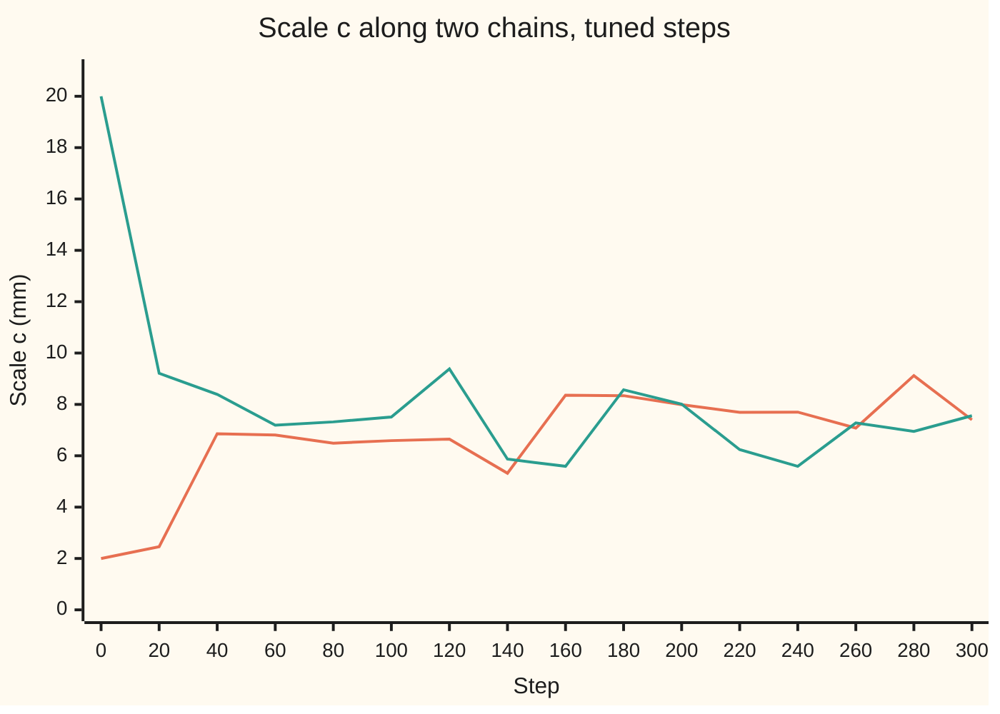

# MCMC as a tool: Metropolis-Hastings when you cannot sample directly

[Syllabus](../../../SYLLABUS.md) → [Applied and computational](../README.md) → [Randomised and Approximate Algorithms](../README.md#s02) → MCMC as a tool

---

## General Overview

A weather station has 200 daily rainfall records. On 70 days it rained, 594.0 mm in all, and the wettest day brought 37.9 mm. The records here are synthetic: made by a stated rule from a seeded generator, so every number can be checked. A council engineer sizing a drain wants one number: **the chance that a day brings more than 25 mm**, with an honest error bar.

The model has three unknowns. $p$ is the chance a day is wet. A wet day's amount follows a **Weibull law**: the chance it tops $x$ mm is $e^{-(x/c)^k}$. The **scale** $c$ (in mm) sets the typical amount and the **shape** $k$ sets how heavy the tail is. Each triple $(p, k, c)$ is a candidate explanation of the 200 days.

The **posterior**, the probability law of the unknowns given the data ([MCMC in outline](../../09-Probability%20and%20statistics/10-Bayesian%20Inference/06-markov-chain-monte-carlo-in-outline.md)), says how plausible each triple is. Its formula is known only up to a constant, and no recipe draws from it directly.

A **Metropolis random walk** does the drawing. It steps from triple to triple, accepting or refusing each step by a ratio of posterior heights. In the long run it spends its time in proportion to the posterior; [MCMC](../../11-Stochastic%20processes%20and%20calculus/03-Markov%20Chains/07-markov-chain-monte-carlo.md) proves why.

This card is the practice: step sizes, four chains from scattered starts, a check that they agree, and error bars. The answer for the engineer: a day tops 25 mm with chance about 3.0%, give or take 1.0%, about 1 day in 33.

**Give each unknown its own step, sized to its own spread, run several chains from far-apart starts until they agree, drop the start, and report two error bars: the posterior spread, which is uncertainty about the rain, and the Monte Carlo error, which is uncertainty about the run.**

**What kind of fact this is:** a method. That the walk's long-run law is the posterior is a theorem proved on [MCMC](../../11-Stochastic%20processes%20and%20calculus/03-Markov%20Chains/07-markov-chain-monte-carlo.md). The step-size rule is a theorem about a limit of many independent unknowns, used here as a first guess. The agreement check and the error bars are diagnostics: they can show trouble, never prove it absent.

### The picture: two chains from opposite ends forget where they began



First line: the chain started at c = 2 mm. Second line: the chain started at c = 20 mm. Within about 40 steps both wander over the same band around the posterior average of 7.70 mm. The steps before that still remember the start; they are the **burn-in**, and they are thrown away.

---

## The formula

Notation first, in words. $n$ is the number of days and $n_w$ the number of wet days; $x_1, \dots, x_{n_w}$ are the wet-day amounts in mm. $\theta$ (theta) is the current triple $(p, k, c)$ and $\theta'$ a proposed one. $\prod$ means "multiply together, one factor per wet day".

Suppose there is no preference between triples before the data, inside a wide box (a flat prior on $0 < p < 1$, $0 < k < 5$ and $0 < c < 100$ mm). Then the posterior is proportional to the chance of the data inside the box and 0 outside it:

$$f(p, k, c) = p^{\,n_w}(1-p)^{\,n-n_w}\prod_{i=1}^{n_w}\frac{k}{c}\Bigl(\frac{x_i}{c}\Bigr)^{k-1}e^{-(x_i/c)^k}$$

**Read it aloud:** the posterior height of a triple is the chance of 70 wet and 130 dry days, times the Weibull density of each wet day's amount.

One step of the walk moves every unknown at once, by its own step size times a fresh bell-curve draw, then accepts by the **Metropolis ratio**:

$$\theta'_i = \theta_i + s_i z_i, \qquad \alpha = \min\Bigl(1,\ \frac{f(\theta')}{f(\theta)}\Bigr), \qquad s_i \approx \frac{2.38}{\sqrt d}\,\sigma_i$$

**Read it aloud:** nudge each unknown by its own step; always move uphill, move downhill with chance equal to the height ratio, otherwise stay and record the old triple again; make each step about 2.38 over root d times that unknown's spread.

A step from $\theta$ to $\theta'$ is as likely as the reverse, so the Hastings correction for lopsided proposals is 1 here. A triple outside the box has height 0 and is always refused.

Run $m$ chains, keep $N$ steps of each, and check them and report them with:

$$\hat R = \sqrt{\frac{\frac{N-1}{N}\,W + \frac{B}{N}}{W}}, \qquad \text{MCSE} = \frac{\sigma}{\sqrt{\text{ESS}}}$$

**Read it aloud:** R-hat is the square root of the pooled spread over the within-chain spread, and it falls to 1 when the chains agree; the Monte Carlo standard error is the posterior spread over the root of the effective number of draws.

| Symbol | Plain meaning | In our example | Push it up and the answer… |
| --- | --- | --- | --- |
| $n$, $n_w$ | days on record; wet days among them | 200; 70 | more data: narrower posterior |
| $x_i$ | amount on wet day i, mm | 70 amounts, mean 8.5 mm | — |
| $p$ | chance a day is wet | posterior mean 0.3521 | more days over 25 mm |
| $k$ | Weibull shape: below 1, a long tail of big days | 0.7681 | fewer very big days |
| $c$ | Weibull scale: the typical wet-day amount, mm | 7.7191 mm | more days over 25 mm |
| $\theta$, $\theta'$, $f$ | current triple; proposed triple; posterior height up to a constant | start triples in the code | — |
| $s_i$, $z_i$ | step size for unknown i; a standard bell-curve draw (average 0, spread 1) | tuned steps 0.0447, 0.0996, 1.7201 | fewer steps accepted |
| $\alpha$ | chance of accepting a proposal | 0.3133 of proposals accepted, tuned | — |
| $d$, $\sigma_i$ | number of unknowns; posterior standard deviation (sd: its spread) of unknown i | 3; 0.0330, 0.0739, 1.2902 | — |
| $m$, $N$ | chains; steps kept per chain after burn-in | 4; 10,000 | smaller Monte Carlo error |
| $B$, $W$, $\hat R$ | N times the variance of the chain averages; average variance within a chain; R-hat | R-hat 1.0000 for c | chains disagree |
| ESS, MCSE | effective sample size: independent draws the run is worth; Monte Carlo standard error | c: 2,481.9 of 40,000; 0.0259 mm | — |

### When it holds

- **Every plausible triple can be reached.** A bell-curve step can land anywhere with positive height. Set one step to 0 and that unknown freezes at its start.
- **Each unknown gets a step matched to its own spread.** One step of 0.1 for all three accepts 0.2593 of proposals, yet 10,000 steps are worth 29 independent draws of c, against 863 with tuned steps.
- **The run is long, and the start is dropped.** Four chains started together at c = 20 and stopped after 100 steps average c = 9.0898 against 7.70.
- **Steps are frozen during the kept run.** Steps that react to where the chain has been make the walk depend on its past, and the posterior is then no longer guaranteed to be its long-run law.
- **The posterior has finite total weight, in one region.** A prior flat on every $k > 0$ and $c > 0$ would give infinite total weight, piled up at tiny shapes and huge scales, so there would be no probability law to sample; the box prevents that, and no chain can tell the difference. With two separate peaks, each chain can settle in one and never cross; no check sees a region the chains never visit.

---

## Why it works

### Step 0: the ratio is all the walk needs

The posterior's missing constant cancels in $f(\theta')/f(\theta)$. The acceptance rule makes as much probability flow from any triple to any other as flows back. Therefore the posterior is the walk's equilibrium, and long-run averages converge to posterior averages; [MCMC](../../11-Stochastic%20processes%20and%20calculus/03-Markov%20Chains/07-markov-chain-monte-carlo.md) proves both, using [Stationary distributions](../../11-Stochastic%20processes%20and%20calculus/03-Markov%20Chains/04-stationary-distributions.md). Three practical questions remain: how big a step, how long a run, and how sure the answer is.

### Step 1: the step size trades acceptance against distance

Too small, and nearly every step is accepted but each covers almost no ground. A random walk wanders like a drunkard: after t steps of size s it is typically about $s\sqrt t$ from where it began. Steps ten times smaller therefore need about 10 × 10 = 100 times as many steps to cross the same distance.

Too big, and nearly every proposal lands far out in the tails where $f$ is tiny, so it is refused and the chain sits still.

Both failures show up in the effective sample size of c over one 10,000-step chain:

| Steps | Acceptance | ESS of c per 10,000 |
| --- | --- | --- |
| tuned × 0.1 | 0.9131 | 54 |
| tuned | 0.3133 | 863 |
| tuned × 10 | 0.0020 | 35 |
| one step 0.1 for all | 0.2593 | 29 |
| one step 1.0 for all | 0.0049 | 26 |

The last two rows are the quiet failure: p moves in hundredths, c in millimetres, and one shared step cannot suit both.

Batch means (Step 4) needs each batch to be much longer than the chain's memory, the number of steps it takes to forget where it was. For the four poor settings a batch of 400 steps is not, so their small ESS values are upper bounds: the truth is lower still.

### Step 2: size each step from a pilot run

For a posterior whose d unknowns are independent and bell-shaped, a 1997 theorem (see Sources) shows that as d grows the best random-walk step for each coordinate tends to $2.38/\sqrt d$ times its spread. That step accepts about 23% of proposals. For small d the best rate is somewhat higher.

Proved only in that limit, and only for independent unknowns, it is used here as a starting guess: k and c are correlated, 0.2555 on the grid. With d = 3 the factor is 1.3741.

The spreads are unknown before the run, so the practice is a few pilot rounds. Start with a guess, here 0.1 for every step from the triple (0.5, 1.0, 5.0). Run 2,000 steps. Measure each unknown's spread over the second half. Set each step to 1.3741 times that spread. Repeat.

| Pilot round | Steps for p, k, c | Acceptance |
| --- | --- | --- |
| 1 | 0.1000, 0.1000, 0.1000 | 0.2535 |
| 2 | 0.0515, 0.0975, 0.4944 | 0.4120 |
| 3 | 0.0476, 0.1000, 1.7818 | 0.3195 |
| fixed for the run | 0.0447, 0.0996, 1.7201 | 0.3133 |

The exact spreads give steps of 0.0460, 0.1021 and 1.7668: the pilots got within a few percent. Then the steps are frozen. Every pilot step is thrown away.

### Step 3: several chains from scattered starts, and R-hat

One chain can look settled while still drifting. Several chains started far apart give a test: if all have forgotten their starts, their averages differ only by run-to-run noise.

R-hat turns that into one number. $W$ is the average spread inside a chain. $B/N$ is the spread between chain averages.

While the chains are still far apart, each chain alone has seen only part of the posterior, so $W$ is too small. Pooling the chains, $\tfrac{N-1}{N}W + \tfrac{B}{N}$, counts the gaps between them as well, so it is too large. Their ratio is above 1 and falls to 1 as the chains merge.

A common modern threshold is 1.01 (the 2021 paper in Sources). That threshold was set for the paper's improved R-hat, which also splits each chain in half and works with ranks. The classic form computed here is less sensitive, though close to it once chains are long and settled.

The four rainfall chains start at $(0.10, 0.30, 2)$, $(0.80, 2.00, 20)$, $(0.50, 1.20, 3)$ and $(0.20, 0.50, 15)$, scattered well beyond the plausible region in every direction:

| Kept steps | R-hat p | R-hat k | R-hat c |
| --- | --- | --- | --- |
| first 100, start included | 1.0872 | 1.2428 | 1.2127 |
| 10,000 after a burn-in of 2,000 | 1.0002 | 1.0001 | 1.0000 |

The burn-in of 2,000 is generous, since the chart shows the chains merging within about 40 steps; a long burn-in costs little, a short one biases every average.

Scattering the starts is what gives R-hat its power. Four chains started together at c = 20 drift down together. After 100 steps their R-hat for c is only 1.0207, against 1.2127 from scattered starts, while their average c is 9.0898. An R-hat of 1.0207 is just over 1.01 and under the older rule of thumb of 1.1: easy to accept as a pass by mistake.

### Step 4: two different error bars

The 40,000 kept draws give each unknown's posterior average and spread. The spread is the **uncertainty about the rain**: with 200 days, c carries 1.29 mm either side of 7.72 mm. Only more data can shrink it.

The average also wobbles because the run is finite: the **Monte Carlo error**. For independent draws it would be $\sigma/\sqrt N$, as on [Monte Carlo integration](05-monte-carlo-integration-in-many-dimensions.md). Chain draws are correlated, each repeating part of the last.

**Batch means** measures the real error: cut each chain into 25 batches of 400 steps and read the error off the spread of the 100 batch averages ([MCMC](../../11-Stochastic%20processes%20and%20calculus/03-Markov%20Chains/07-markov-chain-monte-carlo.md) explains why). For c that gives 0.0259 mm, the error of 2,481.9 independent draws: one per 16.1 steps.

| Unknown | Posterior mean | Posterior sd | MCSE | Naive $\sigma/\sqrt{40{,}000}$ | ESS |
| --- | --- | --- | --- | --- | --- |
| p | 0.3521 | 0.0330 | 0.0005 | 0.0002 | 4,637.5 |
| k | 0.7681 | 0.0739 | 0.0014 | 0.0004 | 2,803.9 |
| c, mm | 7.7191 | 1.2902 | 0.0259 | 0.0065 | 2,481.9 |
| P(day > 25 mm) | 0.03030 | 0.01037 | 0.00017 | | |

Every MCSE is far smaller than its posterior spread, so the run is long enough.

The engineer's number is a function of the unknowns, $p\,e^{-(25/c)^k}$: the chance a day is wet times the chance a wet day tops 25 mm. Each draw gives one value; their average, 0.03030, is the posterior chance, with the uncertainty carried through and no extra algebra.

---

## Worked numbers, by hand

| Step | Arithmetic | Value |
| --- | --- | --- |
| wet days | 70 of 200 | 70 |
| exact posterior mean of p, flat prior | (70 + 1) / (200 + 2) | 0.3515 |
| exact posterior sd of p | √(71 × 131 / (202² × 203)) | 0.0335 |
| step factor for d = 3 | 2.38 / √3 | 1.3741 |
| step for c from the exact spread | 1.3741 × 1.2858 | 1.7668 |
| steps per independent draw of c | 40,000 / 2,481.9 | 16.1 |
| Monte Carlo error of the mean of c | 1.2902 / √2,481.9 | 0.0259 |
| naive error, as if independent | 1.2902 / √40,000 | 0.0065 |
| chance at the posterior means | $0.3521 \times e^{-(25/7.7191)^{0.7681}}$ | 0.02990 |
| **chance a day tops 25 mm, averaged over the draws** | average of 40,000 values of $p\,e^{-(25/c)^k}$ | **0.03030 ± 0.01037** |
| as a frequency | 1 / 0.03030 | about 1 day in 33.0 |

The engineer reads it as: a day tops 25 mm with chance about 3.0%, give or take 1.0% from what 200 days cannot pin down. The simulation adds only ±0.017 percentage points to that.

The exact posterior for p is a **Beta law**, the law of an unknown chance after counting successes, with mean and spread straight from the counts. The chains agree: 0.3521 against 0.3515, within 4 MCSE. For k and c, a grid of 161 × 361 pairs gives 0.7679 and 7.7000, and the grid chance of a day over 25 mm is 0.03012: again within a few MCSE.

### What breaks if you drop a piece

| Mistake | Comes out at | What went wrong |
| --- | --- | --- |
| One step of 0.1 for all three unknowns | acceptance 0.2593, but 29 effective draws of c per 10,000 (tuned: 863) | the acceptance rate looked fine; c, on a scale of millimetres, barely moved |
| Four chains all started at c = 20, stopped after 100 steps | R-hat 1.0207 (scattered: 1.2127), mean c 9.0898 (right: 7.70) | chains that start together drift together, so R-hat barely rises while every average is off |
| Error bar on the mean of c taken as $\sigma/\sqrt N$ | ±0.0065 (right: ±0.0259) | correlated draws: 40,000 steps are worth 2,481.9 independent draws |
| Monte Carlo error reported as the uncertainty about c | 7.72 ± 0.026 mm (right: ± 1.29 mm) | the MCSE measures the run, not the rain |

---

## Code, from first principles, and it actually runs

The script makes the 200 synthetic days from a written-out SplitMix64 generator (seed 2026), so Python and Rust see the same data and draw the same random numbers. It reaches the answer by **three independent roads**. The model splits into a part with p only and a part with k and c only, so road 1 is the exact Beta posterior for p, by formula. Road 2 puts k and c on a fine grid and sums, with no randomness. Road 3 is the practice of this card: pilot tuning, five step settings compared, four chains from scattered starts, R-hat, and batch-means error bars. The asserts hold each chain average to within 4 MCSE of roads 1 and 2. They also check that the grid posterior lies within 3 spreads of the k = 0.75 and c = 6 mm that made the data. That catches a wrong likelihood (the chance of the data given a triple) that all roads would share.

### Python

```python
# MCMC as a tool: fit wet-day chance p, Weibull shape k and scale c (mm) to 200 synthetic rainfall days.
# Roads: 1 the exact Beta posterior for p; 2 a 2-D grid for (k, c), no randomness;
# 3 seeded Metropolis chains (SplitMix64, Box-Muller), tuned, run four at a time, error bars by batch means.
from math import exp, log, sqrt, cos, pi, floor
M64 = (1 << 64) - 1
class Rng:
    def __init__(s, seed): s.s = seed
    def u(s):
        s.s = (s.s + 0x9E3779B97F4A7C15) & M64
        z = s.s
        z = ((z ^ (z >> 30)) * 0xBF58476D1CE4E5B9) & M64
        z = ((z ^ (z >> 27)) * 0x94D049BB133111EB) & M64
        return ((z ^ (z >> 31)) >> 11) * 2.0 ** -53
    def n(s):
        u1 = s.u(); u2 = s.u()
        return sqrt(-2.0 * log(1.0 - u1)) * cos(2.0 * pi * u2)
def tot(v):                                   # plain left-to-right sum, the same in Rust
    s = 0.0
    for x in v: s += x
    return s
def out(k, *v, d=4): print(f"{k:<40}" + "".join(f" {x:.{d}f}" for x in v))
# ---- the data: 200 days, wet with chance 0.35, wet amounts Weibull(shape 0.75, scale 6 mm), to 0.1 mm ----
R = Rng(2026); DAYS = []
for day in range(200):
    if R.u() < 0.35: DAYS.append(max(0.1, floor(10 * 6.0 * (-log(1 - R.u())) ** (1 / 0.75) + 0.5) / 10))
    else: DAYS.append(0.0)
WET = [x for x in DAYS if x > 0]; NW = len(WET); ND = len(DAYS); SL = tot(log(x) for x in WET)
print(f"{'data: days, wet days, total mm':<40} {ND} {NW} {tot(WET):.1f}"); out("data: mean and largest wet-day mm", tot(WET) / NW, max(WET), d=1)
def logf(p, k, c):                            # log posterior up to a constant, flat prior on a box
    if not (0 < p < 1 and 0 < k < 5 and 0 < c < 100): return -1e300
    return (NW * log(p) + (ND - NW) * log(1 - p) + NW * log(k) - NW * k * log(c) + (k - 1) * SL
            - tot((x / c) ** k for x in WET))
def over25(p, k, c): return p * exp(-(25.0 / c) ** k)   # chance a day brings more than 25 mm
# ---- road 1: p alone has an exact Beta posterior ----
a1, b1 = NW + 1, ND - NW + 1
pm = a1 / (a1 + b1); psd = sqrt(a1 * b1 / ((a1 + b1) ** 2 * (a1 + b1 + 1)))
out("exact p: mean, sd", pm, psd)
# ---- road 2: (k, c) on a 161 x 361 grid, k 0.40 to 1.20, c 2 to 20 mm ----
GK = [0.40 + 0.005 * i for i in range(161)]; GC = [2.0 + 0.05 * j for j in range(361)]
L = [[logf(pm, k, c) for c in GC] for k in GK]; top = max(map(max, L))
G = [[exp(v - top) for v in r] for r in L]; T = tot(tot(r) for r in G)
def gE(h): return tot(G[i][j] * h(GK[i], GC[j]) for i in range(161) for j in range(361)) / T
gk, gc = gE(lambda k, c: k), gE(lambda k, c: c)
gks, gcs = sqrt(gE(lambda k, c: (k - gk) * (k - gk))), sqrt(gE(lambda k, c: (c - gc) * (c - gc)))
grho = gE(lambda k, c: (k - gk) * (c - gc)) / (gks * gcs)
g25 = pm * gE(lambda k, c: exp(-(25.0 / c) ** k))   # p is independent of (k, c), so the average splits
out("grid k: mean, sd", gk, gks); out("grid c: mean, sd", gc, gcs); out("grid corr(k, c)", grho)
out("grid P(day > 25 mm)", g25, d=5)
# ---- road 3: random-walk Metropolis ----
def chain(seed, th, step, n):
    R = Rng(seed); lf = logf(*th); xs = []; acc = 0
    for t in range(n):
        prop = [th[i] + step[i] * R.n() for i in range(3)]
        lp = logf(*prop)
        if log(1.0 - R.u()) < lp - lf: th, lf, acc = prop, lp, acc + 1
        xs.append(th)
    return xs, acc / n
def sd(v): m = tot(v) / len(v); return sqrt(tot((x - m) * (x - m) for x in v) / (len(v) - 1))
def bm(cs, per=25):                           # batch means over several chains: mean, Monte Carlo SE, ESS
    bs = []
    for c in cs:
        Lb = len(c) // per; bs += [tot(c[q * Lb:(q + 1) * Lb]) / Lb for q in range(per)]
    allv = [x for c in cs for x in c]; m = tot(allv) / len(allv); se = sd(bs) / sqrt(len(bs)); r = sd(allv) / se
    return m, se, r * r
def rhat(cs):                                 # Gelman-Rubin: spread between chains against spread within
    m = len(cs); N = len(cs[0]); mus = [tot(c) / N for c in cs]; g = tot(mus) / m
    B = N * tot((x - g) * (x - g) for x in mus) / (m - 1); Wv = tot(sd(c) * sd(c) for c in cs) / m
    return sqrt(((N - 1) / N * Wv + B / N) / Wv)
step = [0.1, 0.1, 0.1]; th = [0.5, 1.0, 5.0]                  # tuning: a guess, then 2.38/sqrt(3) x pilot sd
for rnd in range(1, 4):
    xs, acc = chain(100 + rnd, th, step, 2000)
    out(f"tune round {rnd}: steps p k c, accept", *step, acc)
    half = xs[1000:]; th = half[-1]
    step = [2.38 / sqrt(3) * sd([x[i] for x in half]) for i in range(3)]
out("tuned steps p k c", *step)
out("rule 2.38/sqrt(3); times exact sd p k c", 2.38 / sqrt(3), *[2.38 / sqrt(3) * v for v in (psd, gks, gcs)])
START = [pm, gk, gc]; tests = {}
for name, st in [("one step 0.1 for all", [0.1] * 3), ("one step 1.0 for all", [1.0] * 3),
                 ("tuned x 0.1", [s * 0.1 for s in step]), ("tuned", step), ("tuned x 10", [s * 10 for s in step])]:
    xs, acc = chain(7, START, st, 10000); tests[name] = (acc, bm([[x[2] for x in xs]])[2])
    print(f"{name + ': accept, ESS of c':<40} {acc:.4f} {tests[name][1]:.0f}")
STARTS = [[0.10, 0.30, 2.0], [0.80, 2.00, 20.0], [0.50, 1.20, 3.0], [0.20, 0.50, 15.0]]
runs = []
for i, s0 in enumerate(STARTS):
    xs, acc = chain(11 + i, s0, step, 12000); runs.append(xs)
    out(f"chain {i + 1} from p k c, accept", *s0, acc)
early = [[[x[j] for x in xs[:100]] for xs in runs] for j in range(3)]
kept = [[[x[j] for x in xs[2000:]] for xs in runs] for j in range(3)]
out("R-hat p k c, first 100 steps", *[rhat(e) for e in early])
out("R-hat p k c, 10,000 kept after 2,000", *[rhat(e) for e in kept])
same = [chain(31 + i, [0.35, 0.75, 20.0], step, 100)[0] for i in range(4)]
out("4 chains all from c=20: R-hat c, mean c", rhat([[x[2] for x in xs] for xs in same]),
    tot(x[2] for xs in same for x in xs) / 400)
rep = {}
for j, name in enumerate(["p", "k", "c"]):
    allv = [x for c in kept[j] for x in c]; m, se, ess = bm(kept[j]); rep[name] = (m, sd(allv), se)
    out(f"report {name}: mean, sd, MCSE, naive SE", m, sd(allv), se, sd(allv) / sqrt(40000)); out(f"  ESS of {name} out of 40,000; N/ESS", ess, 40000 / ess, d=1)
q = [[over25(*x) for x in xs[2000:]] for xs in runs]; m25, se25, _ = bm(q)
out("report P(>25 mm): mean, sd, MCSE", m25, sd([x for c in q for x in c]), se25, d=5)
out("  as about 1 day in", 1 / m25, d=1)
out("plug-in P(>25 mm) at the means", over25(rep["p"][0], rep["k"][0], rep["c"][0]), d=5)
print(f"{'chart, step':<19}" + "".join(f"{t:6d}" for t in range(0, 301, 20)))
for i in (0, 1):
    print(f"{'chart, c from ' + format(STARTS[i][2], '.1f'):<19}" + "".join(f"{runs[i][t][2]:6.2f}" for t in range(0, 301, 20)))
assert abs(rep["p"][0] - pm) < 4 * rep["p"][2], "chains' p against the exact Beta mean"
assert abs(rep["k"][0] - gk) < 4 * rep["k"][2], "chains' k against the grid"
assert abs(rep["c"][0] - gc) < 4 * rep["c"][2], "chains' c against the grid"
assert abs(m25 - g25) < 4 * se25, "P(day > 25 mm) against the grid"
assert abs(rep["p"][1] / psd - 1) < 0.05, "posterior sd of p against the Beta formula"
assert abs(rep["c"][1] / gcs - 1) < 0.05, "posterior sd of c against the grid"
assert max(rhat(e) for e in early) > 1.1, "R-hat flags the scattered starts"
assert max(rhat(e) for e in kept) < 1.01, "R-hat clears after burn-in"
assert 0.15 < tests["tuned"][0] < 0.5, "tuned acceptance in the workable band"
assert tests["tuned"][1] > 10 * tests["one step 0.1 for all"][1], "per-parameter steps beat one shared step"
assert abs(gk - 0.75) < 3 * gks, "grid posterior covers the generator's shape k = 0.75"
assert abs(gc - 6.0) < 3 * gcs, "grid posterior covers the generator's scale c = 6 mm"
print("ALL CHECKS PASS")
```

**Ran 2026-11-11 on macOS, Python 3.14.10, standard library only. All checks passed. Output, pasted from the run:**

```
data: days, wet days, total mm           200 70 594.0
data: mean and largest wet-day mm        8.5 37.9
exact p: mean, sd                        0.3515 0.0335
grid k: mean, sd                         0.7679 0.0743
grid c: mean, sd                         7.7000 1.2858
grid corr(k, c)                          0.2555
grid P(day > 25 mm)                      0.03012
tune round 1: steps p k c, accept        0.1000 0.1000 0.1000 0.2535
tune round 2: steps p k c, accept        0.0515 0.0975 0.4944 0.4120
tune round 3: steps p k c, accept        0.0476 0.1000 1.7818 0.3195
tuned steps p k c                        0.0447 0.0996 1.7201
rule 2.38/sqrt(3); times exact sd p k c  1.3741 0.0460 0.1021 1.7668
one step 0.1 for all: accept, ESS of c   0.2593 29
one step 1.0 for all: accept, ESS of c   0.0049 26
tuned x 0.1: accept, ESS of c            0.9131 54
tuned: accept, ESS of c                  0.3133 863
tuned x 10: accept, ESS of c             0.0020 35
chain 1 from p k c, accept               0.1000 0.3000 2.0000 0.3168
chain 2 from p k c, accept               0.8000 2.0000 20.0000 0.3148
chain 3 from p k c, accept               0.5000 1.2000 3.0000 0.3175
chain 4 from p k c, accept               0.2000 0.5000 15.0000 0.3109
R-hat p k c, first 100 steps             1.0872 1.2428 1.2127
R-hat p k c, 10,000 kept after 2,000     1.0002 1.0001 1.0000
4 chains all from c=20: R-hat c, mean c  1.0207 9.0898
report p: mean, sd, MCSE, naive SE       0.3521 0.0330 0.0005 0.0002
  ESS of p out of 40,000; N/ESS          4637.5 8.6
report k: mean, sd, MCSE, naive SE       0.7681 0.0739 0.0014 0.0004
  ESS of k out of 40,000; N/ESS          2803.9 14.3
report c: mean, sd, MCSE, naive SE       7.7191 1.2902 0.0259 0.0065
  ESS of c out of 40,000; N/ESS          2481.9 16.1
report P(>25 mm): mean, sd, MCSE         0.03030 0.01037 0.00017
  as about 1 day in                      33.0
plug-in P(>25 mm) at the means           0.02990
chart, step             0    20    40    60    80   100   120   140   160   180   200   220   240   260   280   300
chart, c from 2.0    2.00  2.46  6.86  6.81  6.49  6.59  6.65  5.32  8.36  8.34  7.99  7.69  7.70  7.08  9.12  7.40
chart, c from 20.0  20.00  9.21  8.39  7.19  7.32  7.51  9.38  5.87  5.59  8.57  8.01  6.24  5.59  7.28  6.95  7.56
ALL CHECKS PASS
```

### Rust

```rust
// MCMC as a tool: fit wet-day chance p, Weibull shape k and scale c (mm) to 200 synthetic rainfall days.
// Roads: 1 the exact Beta posterior for p; 2 a 2-D grid for (k, c), no randomness;
// 3 seeded Metropolis chains (SplitMix64, Box-Muller), tuned, run four at a time, error bars by batch means.
// Std only, no crates.  Same generator, same order of draws, same output as the Python check.
use std::f64::consts::PI;

struct Rng { s: u64 }
impl Rng {
    fn u(&mut self) -> f64 {
        self.s = self.s.wrapping_add(0x9E3779B97F4A7C15);
        let mut z = self.s;
        z = (z ^ (z >> 30)).wrapping_mul(0xBF58476D1CE4E5B9);
        z = (z ^ (z >> 27)).wrapping_mul(0x94D049BB133111EB);
        ((z ^ (z >> 31)) >> 11) as f64 / 9007199254740992.0
    }
    fn n(&mut self) -> f64 {
        let u1 = self.u(); let u2 = self.u();
        (-2.0 * (1.0 - u1).ln()).sqrt() * (2.0 * PI * u2).cos()
    }
}
type P3 = [f64; 3];
struct Data { wet: Vec<f64>, nw: f64, nd: f64, sl: f64 }

fn tot<I: IntoIterator<Item = f64>>(v: I) -> f64 { let mut s = 0.0; for x in v { s += x; } s }
fn out(k: &str, v: &[f64], d: usize) {
    let mut line = format!("{:<40}", k); for x in v { line.push_str(&format!(" {:.*}", d, x)); } println!("{}", line);
}
fn logf(dt: &Data, p: f64, k: f64, c: f64) -> f64 {              // log posterior up to a constant, flat prior on a box
    if !(0.0 < p && p < 1.0 && 0.0 < k && k < 5.0 && 0.0 < c && c < 100.0) { return -1e300; }
    dt.nw * p.ln() + (dt.nd - dt.nw) * (1.0 - p).ln() + dt.nw * k.ln() - dt.nw * k * c.ln() + (k - 1.0) * dt.sl
        - tot(dt.wet.iter().map(|x| (x / c).powf(k)))
}
fn over25(t: &P3) -> f64 { t[0] * (-(25.0 / t[2]).powf(t[1])).exp() }   // chance a day brings more than 25 mm
fn chain(dt: &Data, seed: u64, start: P3, step: &P3, n: usize) -> (Vec<P3>, f64) {
    let mut r = Rng { s: seed }; let mut th = start; let mut lf = logf(dt, th[0], th[1], th[2]);
    let mut xs = Vec::with_capacity(n); let mut acc = 0usize;
    for _ in 0..n {
        let mut prop = [0.0; 3];
        for i in 0..3 { prop[i] = th[i] + step[i] * r.n(); }
        let lp = logf(dt, prop[0], prop[1], prop[2]);
        if (1.0 - r.u()).ln() < lp - lf { th = prop; lf = lp; acc += 1; }
        xs.push(th);
    }
    (xs, acc as f64 / n as f64)
}
fn sd(v: &[f64]) -> f64 {
    let m = tot(v.iter().copied()) / v.len() as f64;
    (tot(v.iter().map(|x| (x - m) * (x - m))) / (v.len() - 1) as f64).sqrt()
}
fn bm(cs: &[Vec<f64>]) -> (f64, f64, f64) {        // batch means over several chains: mean, Monte Carlo SE, ESS
    let per = 25; let mut bs = Vec::new();
    for c in cs {
        let lb = c.len() / per;
        for q in 0..per { bs.push(tot(c[q * lb..(q + 1) * lb].iter().copied()) / lb as f64); }
    }
    let allv: Vec<f64> = cs.iter().flatten().copied().collect();
    let m = tot(allv.iter().copied()) / allv.len() as f64; let se = sd(&bs) / (bs.len() as f64).sqrt();
    let r = sd(&allv) / se;
    (m, se, r * r)
}
fn rhat(cs: &[Vec<f64>]) -> f64 {                  // Gelman-Rubin: spread between chains against spread within
    let m = cs.len() as f64; let n = cs[0].len() as f64;
    let mus: Vec<f64> = cs.iter().map(|c| tot(c.iter().copied()) / n).collect();
    let g = tot(mus.iter().copied()) / m;
    let b = n * tot(mus.iter().map(|x| (x - g) * (x - g))) / (m - 1.0);
    let wv = tot(cs.iter().map(|c| sd(c) * sd(c))) / m;
    (((n - 1.0) / n * wv + b / n) / wv).sqrt()
}
fn col(xs: &[P3], j: usize, a: usize, b: usize) -> Vec<f64> { xs[a..b].iter().map(|x| x[j]).collect() }

fn main() {
    // ---- the data: 200 days, wet with chance 0.35, wet amounts Weibull(shape 0.75, scale 6 mm), to 0.1 mm ----
    let mut r = Rng { s: 2026 }; let mut days = Vec::new();
    for _ in 0..200 {
        if r.u() < 0.35 {
            let a = (10.0 * 6.0 * (-(1.0 - r.u()).ln()).powf(1.0 / 0.75) + 0.5).floor() / 10.0;
            days.push(if a < 0.1 { 0.1 } else { a });
        } else { days.push(0.0); }
    }
    let wet: Vec<f64> = days.iter().copied().filter(|x| *x > 0.0).collect();
    let dt = Data { nw: wet.len() as f64, nd: days.len() as f64, sl: tot(wet.iter().map(|x| x.ln())), wet };
    let big = dt.wet.iter().copied().fold(0.0, f64::max);
    println!("{:<40} {} {} {:.1}", "data: days, wet days, total mm", days.len(), dt.wet.len(), tot(dt.wet.iter().copied()));
    out("data: mean and largest wet-day mm", &[tot(dt.wet.iter().copied()) / dt.nw, big], 1);
    // ---- road 1: p alone has an exact Beta posterior ----
    let (a1, b1) = (dt.nw + 1.0, dt.nd - dt.nw + 1.0);
    let pm = a1 / (a1 + b1); let psd = (a1 * b1 / ((a1 + b1) * (a1 + b1) * (a1 + b1 + 1.0))).sqrt();
    out("exact p: mean, sd", &[pm, psd], 4);
    // ---- road 2: (k, c) on a 161 x 361 grid, k 0.40 to 1.20, c 2 to 20 mm ----
    let gkv: Vec<f64> = (0..161).map(|i| 0.40 + 0.005 * i as f64).collect();
    let gcv: Vec<f64> = (0..361).map(|j| 2.0 + 0.05 * j as f64).collect();
    let l: Vec<Vec<f64>> = gkv.iter().map(|&k| gcv.iter().map(|&c| logf(&dt, pm, k, c)).collect()).collect();
    let top = l.iter().flatten().copied().fold(f64::NEG_INFINITY, f64::max);
    let g: Vec<Vec<f64>> = l.iter().map(|row| row.iter().map(|v| (v - top).exp()).collect()).collect();
    let t = tot(g.iter().map(|row| tot(row.iter().copied())));
    let ge = |h: &dyn Fn(f64, f64) -> f64| -> f64 {
        let mut s = 0.0;
        for i in 0..161 { for j in 0..361 { s += g[i][j] * h(gkv[i], gcv[j]); } }
        s / t
    };
    let gk = ge(&|k, _| k); let gc = ge(&|_, c| c);
    let gks = ge(&|k, _| (k - gk) * (k - gk)).sqrt(); let gcs = ge(&|_, c| (c - gc) * (c - gc)).sqrt();
    let grho = ge(&|k, c| (k - gk) * (c - gc)) / (gks * gcs);
    let g25 = pm * ge(&|k, c| (-(25.0 / c).powf(k)).exp());       // p is independent of (k, c), so the average splits
    out("grid k: mean, sd", &[gk, gks], 4); out("grid c: mean, sd", &[gc, gcs], 4); out("grid corr(k, c)", &[grho], 4);
    out("grid P(day > 25 mm)", &[g25], 5);
    // ---- road 3: random-walk Metropolis ----
    let mut step: P3 = [0.1, 0.1, 0.1]; let mut th: P3 = [0.5, 1.0, 5.0];   // tuning: a guess, then 2.38/sqrt(3) x pilot sd
    for rnd in 1..4u64 {
        let (xs, acc) = chain(&dt, 100 + rnd, th, &step, 2000);
        out(&format!("tune round {}: steps p k c, accept", rnd), &[step[0], step[1], step[2], acc], 4);
        th = xs[1999];
        for i in 0..3 { step[i] = 2.38 / 3f64.sqrt() * sd(&col(&xs, i, 1000, 2000)); }
    }
    out("tuned steps p k c", &step, 4);
    let f = 2.38 / 3f64.sqrt();
    out("rule 2.38/sqrt(3); times exact sd p k c", &[f, f * psd, f * gks, f * gcs], 4);
    let (start, s): (P3, P3) = ([pm, gk, gc], step);
    let cases: [(&str, P3); 5] = [("one step 0.1 for all", [0.1; 3]), ("one step 1.0 for all", [1.0; 3]),
        ("tuned x 0.1", [s[0] * 0.1, s[1] * 0.1, s[2] * 0.1]), ("tuned", s), ("tuned x 10", [s[0] * 10.0, s[1] * 10.0, s[2] * 10.0])];
    let mut tests = Vec::new();
    for (name, st) in cases.iter() {
        let (xs, acc) = chain(&dt, 7, start, st, 10000); let ess = bm(&[col(&xs, 2, 0, 10000)]).2; tests.push((acc, ess));
        println!("{:<40} {:.4} {:.0}", format!("{}: accept, ESS of c", name), acc, ess);
    }
    let starts: [P3; 4] = [[0.10, 0.30, 2.0], [0.80, 2.00, 20.0], [0.50, 1.20, 3.0], [0.20, 0.50, 15.0]];
    let mut runs = Vec::new();
    for (i, s0) in starts.iter().enumerate() {
        let (xs, acc) = chain(&dt, 11 + i as u64, *s0, &step, 12000); runs.push(xs);
        out(&format!("chain {} from p k c, accept", i + 1), &[s0[0], s0[1], s0[2], acc], 4);
    }
    let early: Vec<Vec<Vec<f64>>> = (0..3).map(|j| runs.iter().map(|xs| col(xs, j, 0, 100)).collect()).collect();
    let kept: Vec<Vec<Vec<f64>>> = (0..3).map(|j| runs.iter().map(|xs| col(xs, j, 2000, 12000)).collect()).collect();
    let re: Vec<f64> = early.iter().map(|e| rhat(e)).collect(); let rk: Vec<f64> = kept.iter().map(|e| rhat(e)).collect();
    out("R-hat p k c, first 100 steps", &re, 4);
    out("R-hat p k c, 10,000 kept after 2,000", &rk, 4);
    let same: Vec<Vec<P3>> = (0..4).map(|i| chain(&dt, 31 + i, [0.35, 0.75, 20.0], &step, 100).0).collect();
    let samec: Vec<Vec<f64>> = same.iter().map(|xs| col(xs, 2, 0, 100)).collect();
    out("4 chains all from c=20: R-hat c, mean c", &[rhat(&samec), tot(samec.iter().flatten().copied()) / 400.0], 4);
    let mut rep = Vec::new();
    for (j, name) in ["p", "k", "c"].iter().enumerate() {
        let allv: Vec<f64> = kept[j].iter().flatten().copied().collect(); let (m, se, ess) = bm(&kept[j]);
        rep.push((m, sd(&allv), se));
        out(&format!("report {}: mean, sd, MCSE, naive SE", name), &[m, sd(&allv), se, sd(&allv) / 40000f64.sqrt()], 4);
        out(&format!("  ESS of {} out of 40,000; N/ESS", name), &[ess, 40000.0 / ess], 1);
    }
    let q: Vec<Vec<f64>> = runs.iter().map(|xs| xs[2000..].iter().map(over25).collect()).collect();
    let (m25, se25, _) = bm(&q); let qall: Vec<f64> = q.iter().flatten().copied().collect();
    out("report P(>25 mm): mean, sd, MCSE", &[m25, sd(&qall), se25], 5);
    out("  as about 1 day in", &[1.0 / m25], 1);
    out("plug-in P(>25 mm) at the means", &[over25(&[rep[0].0, rep[1].0, rep[2].0])], 5);
    let ts: Vec<usize> = (0..=300).step_by(20).collect();
    println!("{:<19}{}", "chart, step", ts.iter().map(|t| format!("{:6}", t)).collect::<String>());
    for i in 0..2 {
        println!("{:<19}{}", format!("chart, c from {:.1}", starts[i][2]), ts.iter().map(|&t| format!("{:6.2}", runs[i][t][2])).collect::<String>());
    }
    assert!((rep[0].0 - pm).abs() < 4.0 * rep[0].2, "chains' p against the exact Beta mean");
    assert!((rep[1].0 - gk).abs() < 4.0 * rep[1].2, "chains' k against the grid");
    assert!((rep[2].0 - gc).abs() < 4.0 * rep[2].2, "chains' c against the grid");
    assert!((m25 - g25).abs() < 4.0 * se25, "P(day > 25 mm) against the grid");
    assert!((rep[0].1 / psd - 1.0).abs() < 0.05, "posterior sd of p against the Beta formula");
    assert!((rep[2].1 / gcs - 1.0).abs() < 0.05, "posterior sd of c against the grid");
    assert!(re.iter().copied().fold(0.0, f64::max) > 1.1, "R-hat flags the scattered starts");
    assert!(rk.iter().copied().fold(0.0, f64::max) < 1.01, "R-hat clears after burn-in");
    assert!(0.15 < tests[3].0 && tests[3].0 < 0.5, "tuned acceptance in the workable band");
    assert!(tests[3].1 > 10.0 * tests[0].1, "per-parameter steps beat one shared step");
    assert!((gk - 0.75).abs() < 3.0 * gks, "grid posterior covers the generator's shape k = 0.75");
    assert!((gc - 6.0).abs() < 3.0 * gcs, "grid posterior covers the generator's scale c = 6 mm");
    println!("ALL CHECKS PASS");
}
```

**Ran 2026-11-11 on macOS, rustc 1.98.1, no crates. All checks passed. Output, pasted from the run:**

```
data: days, wet days, total mm           200 70 594.0
data: mean and largest wet-day mm        8.5 37.9
exact p: mean, sd                        0.3515 0.0335
grid k: mean, sd                         0.7679 0.0743
grid c: mean, sd                         7.7000 1.2858
grid corr(k, c)                          0.2555
grid P(day > 25 mm)                      0.03012
tune round 1: steps p k c, accept        0.1000 0.1000 0.1000 0.2535
tune round 2: steps p k c, accept        0.0515 0.0975 0.4944 0.4120
tune round 3: steps p k c, accept        0.0476 0.1000 1.7818 0.3195
tuned steps p k c                        0.0447 0.0996 1.7201
rule 2.38/sqrt(3); times exact sd p k c  1.3741 0.0460 0.1021 1.7668
one step 0.1 for all: accept, ESS of c   0.2593 29
one step 1.0 for all: accept, ESS of c   0.0049 26
tuned x 0.1: accept, ESS of c            0.9131 54
tuned: accept, ESS of c                  0.3133 863
tuned x 10: accept, ESS of c             0.0020 35
chain 1 from p k c, accept               0.1000 0.3000 2.0000 0.3168
chain 2 from p k c, accept               0.8000 2.0000 20.0000 0.3148
chain 3 from p k c, accept               0.5000 1.2000 3.0000 0.3175
chain 4 from p k c, accept               0.2000 0.5000 15.0000 0.3109
R-hat p k c, first 100 steps             1.0872 1.2428 1.2127
R-hat p k c, 10,000 kept after 2,000     1.0002 1.0001 1.0000
4 chains all from c=20: R-hat c, mean c  1.0207 9.0898
report p: mean, sd, MCSE, naive SE       0.3521 0.0330 0.0005 0.0002
  ESS of p out of 40,000; N/ESS          4637.5 8.6
report k: mean, sd, MCSE, naive SE       0.7681 0.0739 0.0014 0.0004
  ESS of k out of 40,000; N/ESS          2803.9 14.3
report c: mean, sd, MCSE, naive SE       7.7191 1.2902 0.0259 0.0065
  ESS of c out of 40,000; N/ESS          2481.9 16.1
report P(>25 mm): mean, sd, MCSE         0.03030 0.01037 0.00017
  as about 1 day in                      33.0
plug-in P(>25 mm) at the means           0.02990
chart, step             0    20    40    60    80   100   120   140   160   180   200   220   240   260   280   300
chart, c from 2.0    2.00  2.46  6.86  6.81  6.49  6.59  6.65  5.32  8.36  8.34  7.99  7.69  7.70  7.08  9.12  7.40
chart, c from 20.0  20.00  9.21  8.39  7.19  7.32  7.51  9.38  5.87  5.59  8.57  8.01  6.24  5.59  7.28  6.95  7.56
ALL CHECKS PASS
```

The two outputs are identical line for line: same generator, same order of draws, same plain left-to-right sums.

### Lean

Lean proves the three facts behind the Metropolis walk, for any number of unknowns, and checks the card's exact arithmetic.

- Suppose the posterior height $f$ is never negative, has finite total weight, and every step is above 0. Then as much probability flows from $\theta$ to $\theta'$ as flows back.
- A bell-curve step from $\theta$ to $\theta'$ is exactly as likely as the reverse step, so the Hastings correction is 1.
- Suppose every height $f$ is multiplied by the same constant above 0. Then the acceptance chance $\alpha$ is unchanged, so the missing constant cancels.
- By hand, 70 wet days of 200 leave 130 dry, and the exact posterior mean of $p$ is $71/202$.
- The fraction under the root in the exact sd of $p$ reduces to $9301/8283212$.
- Steps ten times smaller need 10 × 10 = 100 times as many steps.
- Each chain keeps 12,000 − 2,000 = 10,000 steps, 40,000 in all, cut into 100 batches of 400.
- The grid for k and c has 161 × 361 = 58,121 pairs.

The step rule, R-hat, the error bars and every decimal are left to the Python and Rust checks.

```lean
-- MCMC as a tool: the Metropolis rule with independent bell-curve steps sends as much posterior weight from any point to any other as flows back, the step's chance is the same in both directions, and the unknown constant cancels from the acceptance chance.
import Mathlib.Probability.Distributions.Gaussian.Real
import Mathlib.MeasureTheory.Function.L1Space.Integrable

open MeasureTheory ProbabilityTheory
open scoped NNReal

/-- The chance density of proposing `θ'` from `θ` when every unknown `i` is nudged by its own
step `s i` times a fresh standard bell-curve draw: `θ'ᵢ = θᵢ + sᵢ zᵢ`. -/
noncomputable def proposalDensity {d : ℕ} (s : Fin d → ℝ≥0) (θ θ' : Fin d → ℝ) : ℝ :=
  ∏ i, gaussianPDFReal 0 (s i ^ 2) (θ' i - θ i)

/-- The Metropolis acceptance chance `α = min(1, f(θ') / f(θ))`. -/
noncomputable def acceptance {d : ℕ} (f : (Fin d → ℝ) → ℝ) (θ θ' : Fin d → ℝ) : ℝ :=
  min 1 (f θ' / f θ)

/-- Helper: for nonnegative `a`, `b`, the flow `a * min(1, b/a)` equals `min a b`. -/
lemma mul_min_one_div_eq_min (a b : ℝ) (ha : 0 ≤ a) (hb : 0 ≤ b) :
    a * min 1 (b / a) = min a b := by
  rcases ha.eq_or_lt with h | h
  · subst h; simp [hb]
  · rw [mul_min_of_nonneg _ _ h.le, mul_one, mul_div_cancel₀ _ h.ne']

/-- Card claim (Step 0): for a posterior height `f` (nonnegative, finite total weight) on the
`d` unknowns, and a random walk that moves each unknown by its own nonzero frozen step times a
bell-curve draw and accepts with chance `min(1, f(θ')/f(θ))`, as much probability flows from any
point `θ` to any other point `θ'` as flows back (detailed balance), so the posterior is the walk's
equilibrium. -/
theorem metropolis_flow_balanced {d : ℕ} (f : (Fin d → ℝ) → ℝ) (hf : ∀ θ, 0 ≤ f θ)
    (hfint : Integrable f) (s : Fin d → ℝ≥0) (hs : ∀ i, s i ≠ 0) (θ θ' : Fin d → ℝ) :
    f θ * proposalDensity s θ θ' * acceptance f θ θ' =
      f θ' * proposalDensity s θ' θ * acceptance f θ' θ := by
  have hsym : proposalDensity s θ' θ = proposalDensity s θ θ' := by
    unfold proposalDensity
    refine Finset.prod_congr rfl fun i _ => ?_
    simp only [gaussianPDFReal]
    ring_nf
  rw [hsym, acceptance, acceptance, mul_right_comm, mul_min_one_div_eq_min _ _ (hf θ) (hf θ'),
    mul_right_comm (f θ'), mul_min_one_div_eq_min _ _ (hf θ') (hf θ), min_comm]

/-- Card claim: a bell-curve step from `θ` to `θ'` is exactly as likely as the reverse step, so
the Hastings correction for lopsided proposals is 1. -/
theorem bell_curve_step_symmetric {d : ℕ} (s : Fin d → ℝ≥0) (θ θ' : Fin d → ℝ) :
    proposalDensity s θ θ' = proposalDensity s θ' θ := by
  unfold proposalDensity
  refine Finset.prod_congr rfl fun i _ => ?_
  simp only [gaussianPDFReal]
  ring_nf

/-- Card claim: the posterior is known only up to a constant, and that constant cancels from the
acceptance chance: scaling the height `f` by any `C > 0` leaves `min(1, f(θ')/f(θ))` unchanged. -/
theorem acceptance_ignores_constant {d : ℕ} (f : (Fin d → ℝ) → ℝ) (C : ℝ) (hC : 0 < C)
    (θ θ' : Fin d → ℝ) :
    acceptance (fun x => C * f x) θ θ' = acceptance f θ θ' := by
  simp only [acceptance]
  rw [mul_div_mul_left _ _ hC.ne']

-- Worked numbers from the card, whole numbers and exact fractions only.
-- 70 wet days of 200 leaves 130 dry days.
example : (200 : ℕ) - 70 = 130 := by norm_num
-- Exact posterior mean of p under the flat prior: (70 + 1) / (200 + 2) = 71/202.
example : ((70 + 1 : ℚ) / (200 + 2)) = 71 / 202 := by norm_num
-- Exact posterior variance of p: 71 × 131 / (202² × 203).
example : ((71 * 131 : ℚ) / (202 ^ 2 * 203)) = 9301 / 8283212 := by norm_num
-- Steps ten times smaller need 10 × 10 = 100 times as many steps.
example : (10 : ℕ) * 10 = 100 := by norm_num
-- 12,000 steps per chain, 2,000 burn-in: 10,000 kept; four chains: 40,000 kept draws.
example : (12000 : ℕ) - 2000 = 10000 := by norm_num
example : (4 : ℕ) * 10000 = 40000 := by norm_num
-- Batch means: 25 batches of 400 steps fill a 10,000-step chain; 4 chains give 100 batch averages.
example : (25 : ℕ) * 400 = 10000 := by norm_num
example : (4 : ℕ) * 25 = 100 := by norm_num
-- The grid for (k, c): 161 × 361 pairs.
example : (161 : ℕ) * 361 = 58121 := by norm_num

#print axioms mul_min_one_div_eq_min
#print axioms metropolis_flow_balanced
#print axioms bell_curve_step_symmetric
#print axioms acceptance_ignores_constant
```

**Checked 2026-11-14 on macOS, Lean 4.36.0-rc2, Mathlib v4.36.0-rc2. Every proof is complete and uses only Lean's standard axioms. Output, pasted from the run:**

```
'mul_min_one_div_eq_min' depends on axioms: [propext, Classical.choice, Quot.sound]
'metropolis_flow_balanced' depends on axioms: [propext, Classical.choice, Quot.sound]
'bell_curve_step_symmetric' depends on axioms: [propext, Classical.choice, Quot.sound]
'acceptance_ignores_constant' depends on axioms: [propext, Classical.choice, Quot.sound]
```

> [!TIP]
> **Try changing**
> Make each step change on a new line just after `out("tuned steps p k c", *step)` and read the `tuned:` row. The asserts are pinned to the right answer, so expect one to stop the run after the rows print.
> - Guess first: what do steps ten times smaller do to the acceptance rate and to the effective draws of c? Add `step = [s * 0.1 for s in step]`. Acceptance rises to 0.9131; effective draws per 10,000 fall from 863 to 54.
> - Guess first: steps ten times bigger? Multiply by 10 instead. Acceptance falls to 0.0020 and effective draws to 35. Both extremes waste the run.
> - Guess first: one step of 1.0 for every unknown? Add `step = [1.0] * 3`. Acceptance 0.0049, effective draws of c 26: p, whose whole range is 0 to 1, is thrown out of range almost every time.
> - Guess first: what does R-hat say if the kept run is only the first 100 steps, start included? In the `kept =` line, change `xs[2000:]` to `xs[:100]` and read the second R-hat row. R-hat is 1.0872, 1.2428 and 1.2127 for p, k and c: all above 1.01, so the check catches the missing burn-in.

---

## The usual mistake

> [!warning]
> **Trusting a good acceptance rate.** An acceptance rate between about 20% and 50% says only that the steps suit the unknowns on average. One shared step of 0.1 accepts 0.2593 of proposals, a textbook-looking rate, while c crawls: 29 effective draws in 10,000 steps. Check the effective sample size of every unknown, not the acceptance rate of the whole chain.
>
> Smaller traps:
> - **Starting every chain in the same place.** R-hat reads only 1.0207 after 100 steps from c = 20, against 1.2127 from scattered starts, while the average of c is 9.0898 against 7.70.
> - **Quoting $\sigma/\sqrt N$ as the simulation's error.** For c it gives 0.0065; batch means gives 0.0259, because neighbouring draws overlap.
> - **Mixing up the two error bars.** The posterior sd of c, 1.29 mm, is what the data leave unknown; the MCSE, 0.026 mm, is what the run leaves unknown. Reporting 7.72 ± 0.026 mm claims far more than 200 days can give.
> - **Plugging the averages into the formula.** $p\,e^{-(25/c)^k}$ at the posterior means gives 0.02990; averaged over the draws it is 0.03030. Average the function, not its inputs.

---

## Where you meet it in real life

- **Drainage and flood design.** A few-parameter law fitted to short rain or river records gives the chance of an extreme day, and the posterior spread dominates its error bar, as here.
- **Bayesian fitting software.** Standard packages print R-hat and an effective sample size beside each parameter and warn above an R-hat of about 1.01.
- **Epidemic models.** [The SIR model](../../08-Differential%20equations%20and%20dynamics/06-Nonlinear%20Dynamics%20in%20the%20Plane/07-the-sir-epidemic-model.md) splits a town into susceptible, infected and recovered people. Its contact rate b and recovery rate g are fitted to case counts by chains like these, with the step for each rate tuned to its own scale.
- **Physics.** The method began in 1953, averaging over the positions of hundreds of particles in a liquid.
- **Annealing.** [Local search](07-local-search-and-metaheuristics.md) uses the same accept-downhill-with-a-chance rule, with a temperature T that falls over time, to search rather than to sample.

> **Say it back**
> When a posterior can be evaluated but not sampled, a Metropolis walk samples it by accepting each proposed step with the ratio of posterior heights. In practice each unknown needs its own step, about 2.38 over root d times its spread, found from pilot runs and then frozen. Several chains from scattered starts, with the start thrown away, must agree before any average is trusted; R-hat near 1 is the sign. Every reported number has two error bars: the posterior spread, about the world, and the Monte Carlo error from batch means, about the run. For the rain gauge, a day tops 25 mm with chance 3.0%, give or take 1.0%.

---

## What this builds on

- [Tail bounds](02-tail-bounds-and-repeated-trials.md): why an average of many independent trials concentrates near its expectation; with chain draws, the effective sample size takes the place of the number of trials.
- [Monte Carlo integration](05-monte-carlo-integration-in-many-dimensions.md): an average over random draws estimates an integral with error falling like $1/\sqrt N$; this card supplies the draws when no direct sampler exists.
- [MCMC](../../11-Stochastic%20processes%20and%20calculus/03-Markov%20Chains/07-markov-chain-monte-carlo.md): the proofs behind the method (detailed balance, the Metropolis–Hastings rule, the correlated-average error), and batch means.
- [Stationary distributions](../../11-Stochastic%20processes%20and%20calculus/03-Markov%20Chains/04-stationary-distributions.md): the equilibrium law, and the theorem that long-run time averages match it.
- [MCMC in outline](../../09-Probability%20and%20statistics/10-Bayesian%20Inference/06-markov-chain-monte-carlo-in-outline.md): the posterior, the flat prior, and the Metropolis walk on one unknown.

## Where this goes next

- [Expanders](../07-Network%20Science%20and%20Spectral%20Graphs/07-expanders-and-mixing.md): graphs on which a random walk forgets its start in a few steps, turning fast mixing from something diagnosed after a run into something designed in advance.

The question this card leaves open: how many steps are enough, guaranteed before the run, rather than checked after it.

---

## Sources

Verified 2026-11-11: every link below resolves to the publisher's page.

- Metropolis, N., A. W. Rosenbluth, M. N. Rosenbluth, A. H. Teller and E. Teller. "Equation of State Calculations by Fast Computing Machines." *The Journal of Chemical Physics* 21, no. 6 (1953): 1087–1092. [doi:10.1063/1.1699114](https://doi.org/10.1063/1.1699114). The original random walk with the accept-by-ratio rule.
- Gelman, A., and D. B. Rubin. "Inference from Iterative Simulation Using Multiple Sequences." *Statistical Science* 7, no. 4 (1992): 457–472. [doi:10.1214/ss/1177011136](https://doi.org/10.1214/ss/1177011136). Several chains from scattered starts, and the R-hat comparison of between-chain and within-chain spread.
- Roberts, G. O., A. Gelman and W. R. Gilks. "Weak Convergence and Optimal Scaling of Random Walk Metropolis Algorithms." *The Annals of Applied Probability* 7, no. 1 (1997): 110–120. [doi:10.1214/aoap/1034625254](https://doi.org/10.1214/aoap/1034625254). The 2.38 over root d step and the 23% acceptance rate, proved in the limit of many independent unknowns.
- Flegal, J. M., M. Haran and G. L. Jones. "Markov Chain Monte Carlo: Can We Trust the Third Significant Figure?" *Statistical Science* 23, no. 2 (2008): 250–260. [doi:10.1214/08-STS257](https://doi.org/10.1214/08-STS257). Batch-means Monte Carlo standard errors, and why a run should report them.
- Vehtari, A., A. Gelman, D. Simpson, B. Carpenter and P.-C. Bürkner. "Rank-Normalization, Folding, and Localization: An Improved R̂ for Assessing Convergence of MCMC." *Bayesian Analysis* 16, no. 2 (2021): 667–718. [doi:10.1214/20-BA1221](https://doi.org/10.1214/20-BA1221). The modern R-hat and the 1.01 threshold.
