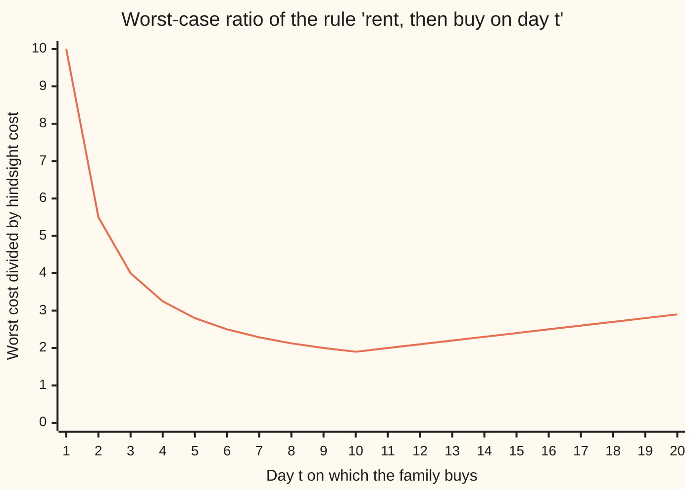

# Online algorithms: decide before the future arrives, and compare with hindsight

[Syllabus](../../../SYLLABUS.md) → [Applied and computational](../README.md) → [Randomised and Approximate Algorithms](../README.md#s02) → Online algorithms

---

## General Overview

A family arrives at a ski resort. Skis rent for £25 a day, or cost £250 to buy. Nobody knows how many days the snow will last, or how long the children will want to ski. Each morning the family must choose: rent once more, or buy now.

With hindsight the choice is easy: rent every day in a short season, buy on the first morning in a season of 10 days or more. But the choice is made each morning, before the rest of the season is known.

This is an **online problem**: the input arrives one piece at a time, and each decision must be made before the next piece is seen. An **online algorithm** is a rule for making those decisions. The rule cannot be the best on every season. The question is how far from the best it can ever be.

The answer here is a rule with a promise. Rent for 9 days, and buy on the morning of day 10. Whatever the season, this rule never pays more than 1.9 times what hindsight would have paid. In the worst case the family skis exactly 10 days: they pay 225 + 250 = 475 pounds, where hindsight pays 250. No rule without coin flips makes a smaller promise.

The same question runs a phone. A phone with little free space keeps 4 tracks downloaded for offline play. When the listener asks for a track that is not stored, the phone must download it and delete one of the 4. Which one? The phone cannot see the next request. This card shows that "delete the track played longest ago" downloads at most about 4 times as often as a rule that knew the future, that no fixed rule can promise better than 4, and that a rule with coin flips changes the picture.

**An online algorithm decides without seeing the future, and its competitive ratio is the worst case, over every possible input, of its cost divided by the cost of the best decisions made with hindsight.**

**What kind of fact this is:** the competitive ratio is a definition. The ski-rental ratio 2 − 1/10, the paging ratio k (the number of tracks the phone holds, 4 here) for "evict the least recently used track", the lower bound k for every deterministic rule, and the bound $`2H_k`$ for random marking ($`H_k`$ = 1 + 1/2 + … + 1/k) are theorems, proved on this card in Why it works.

### The picture: when should the family buy?



The line is the worst ratio of each buying day, over every season length, from the checks. Buying early loses badly if the family skis one day. Buying late wastes rent if they ski all winter. The bottom of the curve is day 10, when the rent paid so far nearly equals the price: ratio 1.900.

---

## The formula

Some names first.

- A **request sequence** σ ("sigma", elsewhere in the library a standard deviation) is the whole input: the days of the season, or the tracks the listener asks for, in order. Its length is n.
- **ALG(σ)** is what the online rule pays on σ: pounds, or downloads.
- **OPT(σ)** is the least any rule could pay on σ if it saw all of σ in advance. It is the cost "with hindsight".
- The **adversary** is the imagined opponent who picks σ to make the rule look as bad as possible.

A rule is **c-competitive** when, for every request sequence,

```math
\mathrm{ALG}(\sigma) \le c \cdot \mathrm{OPT}(\sigma) + a
```

**Read it aloud:** whatever the input, the rule never pays more than c times what hindsight pays, plus a fixed allowance a that does not grow with the input.

The allowance a covers a start-up cost, such as filling an empty phone. Ski rental uses the strict ratio, a = 0: every ski bill is bounded, so an allowance as large as the bill would make any rule look perfect. The **competitive ratio** of a rule is the smallest c that works. For a randomised rule, ALG(σ) is replaced by its expected cost over the rule's own coin flips ([Randomised algorithms](01-randomised-algorithms-and-expectation.md)).

The card's four results, with B = 10 the purchase price counted in days of rent and k = 4 the number of tracks the phone holds:

```math
\text{ski rental: } \frac{2B-1}{B} = 2 - \frac{1}{B} = 1.9, \qquad \text{LRU: } k = 4, \qquad \text{any deterministic rule: } \ge k, \qquad \text{marking: } 2H_k = 4.17
```

**Read it aloud:** the best ski rule pays at most 2 − 1/10 times hindsight; least-recently-used paging is within 4; no rule without coins can promise less than 4; random marking is within twice the harmonic sum of 4, in expectation.

$`H_k = 1 + \frac{1}{2} + \dots + \frac{1}{k}`$ is the harmonic sum from [Approximation](06-approximation-algorithms.md), written H(n) there. For k = 4 it is 2.0833, so $`2H_4`$ = 4.1667.

| Symbol | Plain meaning | In our example | Push it up and the answer… |
| --- | --- | --- | --- |
| σ, n | the request sequence, and how many requests it has | a ski season; 20 or 2000 track requests | more room for the adversary |
| ALG(σ) | what the online rule pays on σ | 475 pounds; 2000 downloads | the ratio worsens |
| OPT(σ) | the least any rule pays on σ, knowing σ in advance | 250 pounds; 503 downloads | the ratio improves |
| c | the competitive ratio: the worst ALG/OPT allowed | 1.9; 4; 4.17 | a weaker promise |
| a | the fixed allowance that does not grow with n | 0 for ski rental; the first k downloads into an empty phone | matters less as n grows; as large as a ski bill, it would hide every gap |
| B | the purchase price, in days of rent | 10 (£250 at £25 a day) | best ratio 2 − 1/B creeps up towards 2 |
| t, d | the day the rule buys; the days the family actually skis | t = 10; worst d = 10 | — |
| k | how many tracks the phone stores | 4; 5 in one What-breaks run | LRU's ratio k grows; marking's grows only like ln k |
| $`H_k`$ | the harmonic sum 1 + 1/2 + … + 1/k | $`H_4`$ = 2.0833 | — |
| P | the number of phases: stretches with exactly k different tracks | 500 on the 2000-request cycle | each costs LRU at most k |
| $`f_i`$ | fresh tracks in phase i: asked for in phase i but not in phase i − 1 | 1 per phase on the cycle | marking pays more, OPT too |
| i, j | a phase's number; the order in which a stale track is first asked for in its phase | i = 2 to 500; j = 1 to 3 | — |

### When it holds

- **The rule commits before it sees the next request.** If the family could check a 30-day forecast, the problem is no longer online, and rent-or-buy becomes a plain comparison.
- **The cost of each request is fixed in advance.** Ski rental assumes the price stays £250. If the price can change, the break-even day moves, and the ratio 1.9 is no longer the right one.
- **OPT has the same resources.** The paging ratios compare a phone of 4 tracks with a hindsight rule that also holds 4. Give the hindsight rule fewer slots and the comparison changes.
- **For marking, the adversary is oblivious.** The oblivious adversary writes the whole sequence before the coins are flipped. If the next request may depend on what the phone holds now, the adversary sees the result of the coins, and marking does no better than LRU: it faults on every request (2000 of 2000 in the checks, with 5 slots), and its promise breaks.

---

## Why it works

### Step 0: the adversary picks the moment of greatest regret

An online rule fixes its plan before the input is known. So the input can be chosen against the plan. The adversary waits for the rule to commit, then stops the input at the worst moment.

For ski rental, the worst moment is the morning after the purchase: the family stops skiing as soon as they own skis. For paging, the worst moment is every moment: always ask for the one track the phone just deleted.

Each result has two halves: an upper bound for one rule, and a lower bound, an input on which every rule of a given kind does at least that badly.

### Step 1: ski rental, the upper bound

Fix the rule "rent, and buy on the morning of day t". Count costs in days of rent, so buying costs B = 10. If the family skis d days:

```math
\mathrm{ALG} = \begin{cases} d & d < t \\ (t-1) + B & d \ge t \end{cases} \qquad \mathrm{OPT} = \min(d, B)
```

**Read it aloud:** before day t the rule just rents, and pays the d days; from day t on it has paid t − 1 days of rent plus the price, and pays nothing more. Hindsight pays the smaller of renting every day and buying at once.

If d ≥ t, the rule's bill is fixed, and hindsight's bill can only grow with d. So among those seasons the worst is the shortest, d = t. If d < t, the rule has only rented. Its ratio d/min(d, B) is 1 when d ≤ B, and at most (t − 1)/B when d > B. Both are below the d = t case. So the worst season is the one that ends the day the skis are bought:

```math
\text{worst ratio}(t) = \frac{t - 1 + B}{\min(t, B)}
```

For t ≤ B this is 1 + (B − 1)/t, which falls as t grows. For t ≥ B it is (t − 1 + B)/B, which rises. The bottom is at t = B:

```math
\frac{B - 1 + B}{B} = \frac{2B - 1}{B} = 2 - \frac{1}{B} = 2 - \frac{1}{10} = 1.9
```

In pounds: 9 days of rent, £225, plus the price, £250, is £475, against hindsight's £250.

### Step 2: ski rental, no deterministic rule does better

A **deterministic** rule is one with no coin flips: the same input always gives the same choices. Each morning the family learns only one thing: they still want to ski. So a deterministic rule can only be "buy on day t" for some fixed t, or "never buy".

The adversary reads t and stops the season on day t. Step 1 showed that this costs the rule (t − 1 + B)/min(t, B) times hindsight, which is at least 1.9 for every t. "Never buy" does worse still: after 100 days it has paid 10 times hindsight, after 1000 days 100 times, with no bound. So 1.9 is the best ratio any deterministic rule can promise.

This is the strict ratio, with allowance a = 0. A rule that buys on day t never pays more than t − 1 + B days in all, so an allowance that large would make every rule look perfect.

### Step 3: paging, the setting

The phone stores k = 4 tracks. A request for a stored track is a **hit** and costs nothing. A request for a missing track is a **page fault** (a fault for short): the phone downloads the track, and if all 4 slots are full, it **evicts** (deletes) one. The cost is the number of faults.

Two rules matter here.

- **LRU**, least recently used: evict the stored track whose last request is oldest.
- **OPT**, the hindsight rule: evict the stored track whose next request is furthest in the future. This rule, due to Belady, gives the fewest faults possible on every sequence. That is a theorem this card uses without proving it; the checks confirm it on every sequence they run, against a search over every possible eviction choice.

To count, split the sequence into **phases**. A phase starts at the first request and grows until a fifth different track is asked for; that request starts the next phase. So each phase asks for exactly k different tracks, except possibly the last.

### Step 4: LRU faults at most k times per phase

Take a track asked for in a phase. To evict it, LRU must find it the least recently used of the 4 stored tracks at a fault. That means 4 other different tracks have been asked for since, all inside this phase. Together with the track itself, that is 5 different tracks in one phase, which a phase cannot hold.

So within a phase, each different track faults at most once, and LRU faults at most k times per phase: at most kP in all.

### Step 5: OPT faults at least once per phase, after the first

Look at phase i and the first request of phase i + 1. Just after the first request of phase i, say for track x, every rule holds x. The rest of phase i asks for k − 1 other tracks. The first request of phase i + 1 asks for a track new to phase i. That is k different tracks, none of them x.

A phone holding x has room for only k − 1 others. So any rule, OPT included, faults at least once in that stretch. The stretches for different phases do not overlap, so OPT ≥ P − 1. Combining with Step 4:

```math
\mathrm{LRU}(\sigma) \le kP \le k \cdot \mathrm{OPT}(\sigma) + k
```

**Read it aloud:** LRU pays at most k times hindsight, plus k for the start. The allowance a is k.

On the 2000-request cycle the checks count P = 500 phases, LRU 2000 faults, exactly k × P, and OPT 503, above P − 1 = 499.

### Step 6: no deterministic rule beats k

Use k + 1 = 5 tracks. The adversary always asks for the one track the phone does not hold. With 5 tracks and 4 slots there is always exactly one. A deterministic rule's choices are known in advance, so the adversary can compute the sequence. The rule faults on every request: n faults.

OPT faults far less on the same sequence. When OPT faults, it evicts the track whose next request is furthest away. The other 3 stored tracks are all needed before it. The next fault must be a request for the evicted track, since that is the only missing one, so OPT's faults come at least k requests apart:

```math
\mathrm{OPT}(\sigma) \le k + \left\lceil \frac{n - k}{k} \right\rceil
```

Here ⌈ ⌉ means round up. For n = 2000, OPT ≤ 4 + 499 = 503, and the ratio n/OPT is 2000/503 = 3.976. As n grows, the ratio climbs towards k = 4. No allowance a fixed in advance can hide that, so no deterministic rule is better than k-competitive. The checks run this adversary against LRU and against FIFO (first in, first out: evict the track downloaded longest ago), and both reach 3.976.

### Step 7: random marking, and why coins help

The adversary of Step 6 needs to know which track the phone lacks. Coin flips hide that.

**Marking** works in phases, like the proof:

1. When a track is requested, mark it.
2. On a fault with all slots full, if every stored track is marked, unmark them all. A new phase begins.
3. Evict one unmarked track, chosen uniformly at random.

A marked track has been asked for in the current phase, so marking never evicts one: LRU's good habit. The randomness is new.

Call the k tracks of phase i − 1 the **old** tracks. At the start of phase i, marking holds exactly these. A track is **fresh** in phase i if it is requested in phase i but is not old, and $`f_i`$ counts them; every fresh track is a fault. The other tracks of phase i are **stale**: old tracks requested again, which marking may or may not have deleted.

**Marking's cost per phase.** The f fresh tracks cost f faults. A stale track is missing only if one of the random evictions hit it. The evictions fall evenly on the old tracks not yet requested in the phase. When the j-th stale track is requested, k − j + 1 old tracks are still unrequested, and at most f of them are missing. So it is missing with chance at most f/(k − j + 1). Adding over the k − f stale tracks:

```math
\mathbb{E}[\text{faults in phase } i] \le f_i + f_i \left( \frac{1}{k} + \dots + \frac{1}{f_i + 1} \right) = f_i \left( H_k - H_{f_i} + 1 \right) \le f_i H_k
```

**Read it aloud:** the expected faults of a phase are at most the fresh tracks times the harmonic sum of k.

**OPT's cost.** Phases i − 1 and i together ask for k + $`f_i`$ different tracks: k in phase i − 1, then $`f_i`$ more. OPT holds only k, so it faults at least $`f_i`$ times across the two phases. Pair the phases so the pairs do not overlap, once for even i and once for odd i. That gives $`\mathrm{OPT} \ge \sum f_i / 2`$. Combining:

```math
\mathbb{E}[\mathrm{MARK}(\sigma)] \le H_k \sum_i f_i \le 2 H_k \cdot \mathrm{OPT}(\sigma)
```

**Read it aloud:** in expectation, marking pays at most twice the harmonic sum of k times hindsight.

<details>
<summary>Detailed proof: the chance that a stale track is missing</summary>

Fix phase i, with f fresh tracks. At the start of the phase, marking holds exactly the k tracks of phase i − 1, since each was requested and marked in that phase and none could be evicted while marked.

Suppose the j-th different stale track is about to be requested for the first time in the phase. At most f fresh tracks have arrived so far, and each arrival evicted one unmarked track. The j − 1 stale tracks already requested were marked on request. Whenever one of them was found missing, it too evicted a track, but it then holds a slot again, so the count of missing tracks among the unrequested old ones stays at most f.

By symmetry, every unrequested old track is equally likely to be among the missing ones: the evictions are uniform among unmarked tracks, and the rule never favours one of them. There are k − (j − 1) unrequested old tracks: the k old tracks less the j − 1 stale ones already requested. At most f of them are missing. So the chance that this one is missing is at most

$`\displaystyle \frac{f}{k - j + 1}.`$

Adding over j = 1 to k − f gives

$`\displaystyle f \left( \frac{1}{k} + \frac{1}{k-1} + \dots + \frac{1}{f+1} \right) = f \left( H_k - H_f \right).`$

With the f faults on fresh tracks, the phase costs at most $`f(H_k - H_f + 1)`$ in expectation. On the 5-track cycle every phase after the first has f = 1, and the bound is exactly $`H_4`$ = 2.0833 per phase: the checks' exact computation gives the same.

</details>

On the 2000-request cycle the checks compute marking's expected faults exactly, by carrying every coin outcome with its chance: 1043.58. That is $`H_4`$ = 2.0833 per phase where LRU pays 4. The ratio to OPT is 2.075, against LRU's 3.976.

At k = 4 the guarantee $`2H_4`$ = 4.17 is not yet smaller than LRU's 4. It wins from k = 5 on (4.57 against 5) and wins by far at real sizes: 10.37 against 100, and 14.97 against 1000. A lower bound of $`H_k`$ for every randomised rule, half of marking's guarantee, is in the Fiat et al. paper under Sources; this card does not prove it.

---

## Worked numbers, by hand

The 5-track cycle A B C D E repeated, with k = 4. In the traces, F is a fault that fills an empty slot, a lower-case letter is a fault that evicts that track, and a dot is a hit.

| Step | Arithmetic | Value |
| --- | --- | --- |
| ski rule, season of 3 days | 3 days rent, against 3 | 75 pounds, hindsight 75 |
| ski rule, season of 10 days | 9 × 25 + 250, against 250 | 475 pounds, ratio 1.9 |
| ski rule, season of 25 days | still 475, against 250 | ratio 1.9 |
| LRU on ABCDE ×4 | FFFFabcdeabcdeabcdea | 20 faults |
| OPT on ABCDE ×4 | FFFFd...c...b...a... | 8 faults |
| why OPT evicts D first | at request 5, the next requests are A, B, C, then D | D is wanted latest |
| adversary, n = 2000 | LRU 2000, OPT 4 + 499 | 2000/503 = 3.976 |
| phases on that cycle | 4 requests each | P = 500, LRU = 4 × 500 |
| marking per phase | 1 fresh: $`1 + (H_4 - 1)`$ | 2.0833 expected faults |
| marking on 2000 requests | 4 + 499 × 2.0833 | 1043.58 |
| ratios to OPT on the cycle | 1043.58/503, 2000/503 | **marking 2.075, LRU 3.976** |

On the input built to defeat LRU, marking downloads about half as often. The adversary can still pick the sequence, but cannot aim at a track it cannot predict.

A friendly input tells a different story. On a synthetic listener's day of 40 requests over 6 tracks (seed 2026, weights A 6, B 5, C 3, D 3, E 2, F 1 in 20), LRU faults 16 times, FIFO 15, OPT 10, and marking 17.58 in expectation. Guarantees bound the worst case. They do not rank rules on a typical day.

### What breaks if you drop a piece

| Mistake | Comes out at | What went wrong |
| --- | --- | --- |
| Buy on day 1 | 250 against 25 pounds, ratio 10.00 | The adversary stops after one day |
| Never buy | ratio 10 at 100 days, 100 at 1000: no bound | Rent keeps growing, hindsight stops at £250 |
| Evict the most recent track (MRU) | 2000 faults against OPT 5 | The adversary asks A B C D E D E D E …: MRU deletes exactly the track wanted next |
| Adversary sees marking's coins, 5 slots | 2000 of 2000 faults against OPT 404: ratio 4.950, above $`2H_5`$ = 4.567 | Marking's bound assumes the sequence is fixed before the coins |

The code prints all four.

```
faults on the 2000-request cycle, k = 4
LRU                       ████████████████████████████████████████  2000
marking, expected         █████████████████████                     1043.58
OPT, with hindsight       ██████████                                503
```

---

## Code, from first principles, and it actually runs

The scripts take four independent roads. Ski rental's worst ratio is found by brute force over every season up to 400 days and matched to the formula (t − 1 + B)/min(t, B). Belady's hindsight rule is matched against a search over every eviction choice, merged by cache contents, on every sequence. LRU's count on the listener's day is matched against a second rule: a request faults when k other tracks came since its last use. Marking's expected faults are computed exactly, by carrying every coin outcome with its probability, and matched against 200 seeded runs of a written-out SplitMix64 generator, within 4 standard errors. Costs count rentals and faults, never time. Both scripts use no imports.

### Python

```python
# Online algorithms and competitive analysis -- the check behind the card.
# Standard library only, no imports.  Costs count days of rent and page faults
# (a requested track that is not in the phone's cache), never time.
B, RENT, K = 10, 25, 4              # skis: 25 pounds a day, or buy for 250; 4 tracks cached
L = "ABCDEF"
def ski(t, d):                      # buy on the morning of day t (0 = never), ski d days
    return d if t == 0 or d < t else (t - 1) + B
def worst(t, dmax=400):             # brute force: every season length from 1 to dmax days
    return max(ski(t, d) / min(d, B) for d in range(1, dmax + 1))
print(f"ski rental: rent {RENT} a day, buy {B * RENT} = {B} days of rent")
w = [worst(t) for t in range(1, 41)]
for t in range(1, 41):              # formula: the adversary stops skiing on day t
    assert abs(w[t - 1] - (t - 1 + B) / min(t, B)) < 1e-12
best = min(range(1, 41), key=lambda t: w[t - 1])
assert best == B and abs(w[best - 1] - (2 - 1 / B)) < 1e-12
print("chart, worst ratio of 'buy on day t', t = 1..20:", " ".join(f"{x:.3f}" for x in w[:20]))
print(f"best day {best}: worst ratio {w[best-1]:.2f} = 2 - 1/{B}; every other day is worse")
print(f"skis exactly {B} days: {(B-1)*RENT} + {B*RENT} = {(2*B-1)*RENT} pounds against hindsight {B*RENT}")
for d in (3, 25): print(f"  season of {d} days: rule pays {ski(B, d)*RENT}, hindsight {min(d, B)*RENT}")
print(f"mistake, buy on day 1, ski 1 day: {B*RENT} against {RENT}, ratio {w[0]:.2f}")
print(f"mistake, never buy: 100 days {100*RENT} against {B*RENT}, ratio {ski(0,100)/B:.0f};"
      f" 1000 days, ratio {ski(0,1000)/B:.0f}: no bound")

def nxt(seq, i, p):                 # next time after i that track p is requested
    return next((j for j in range(i + 1, len(seq)) if seq[j] == p), len(seq))
def bits(m): return [p for p in range(8) if m >> p & 1]
def rng(seed):                      # SplitMix64, written out
    s = seed
    def f():
        nonlocal s
        s = (s + 0x9E3779B97F4A7C15) & (2**64 - 1); z = s
        z = ((z ^ (z >> 30)) * 0xBF58476D1CE4E5B9) & (2**64 - 1)
        z = ((z ^ (z >> 27)) * 0x94D049BB133111EB) & (2**64 - 1)
        return z ^ (z >> 31)
    return f
def run(seq, rule, coin=None, adv=False, k=K):  # adv: build the sequence against the rule
    cache = marked = faults = 0; last = [-1] * 8; born = [-1] * 8; seq = list(seq); log = []
    for i in range(len(seq)):
        if adv: seq[i] = next(p for p in range(k + 1) if not cache >> p & 1)
        p = seq[i]
        log.append(".")
        if not cache >> p & 1:
            faults += 1; log[-1] = "F"
            if len(bits(cache)) == k:
                c = bits(cache)
                if rule == "LRU": v = min(c, key=lambda q: last[q])
                if rule == "FIFO": v = min(c, key=lambda q: born[q])
                if rule == "MRU": v = max(c, key=lambda q: last[q])
                if rule == "OPT": v = max(c, key=lambda q: nxt(seq, i, q))
                if rule == "MARK":
                    if marked == cache: marked = 0           # all marked: a new phase
                    u = bits(cache & ~marked); v = u[coin() % len(u)]
                cache &= ~(1 << v); log[-1] = L[v].lower()
            cache |= 1 << p; born[p] = i
        last[p] = i; marked |= 1 << p
    return faults, seq, "".join(log)
def brute_opt(seq, k=K):            # every eviction choice, merged by cache contents
    best = {0: 0}
    for p in seq:
        new = {}
        for m, f in best.items():
            if m >> p & 1: outs = [(m, f)]
            elif len(bits(m)) < k: outs = [(m | 1 << p, f + 1)]
            else: outs = [((m & ~(1 << v)) | 1 << p, f + 1) for v in bits(m)]
            for m2, f2 in outs:
                if m2 not in new or f2 < new[m2]: new[m2] = f2
        best = new
    return min(best.values())
def mark_exact(seq):                # expected marking faults: every coin, with its chance
    dist, ef = {(0, 0): 1.0}, 0.0
    for p in seq:
        new = {}
        for (m, mk), pr in dist.items():
            if m >> p & 1: outs = [(m, mk, 1.0)]
            else:
                ef += pr
                if len(bits(m)) < K: outs = [(m, mk, 1.0)]
                else:
                    if mk == m: mk = 0
                    u = bits(m & ~mk); outs = [(m & ~(1 << v), mk, 1 / len(u)) for v in u]
            for m2, mk2, q in outs:
                key = (m2 | 1 << p, mk2 | 1 << p); new[key] = new.get(key, 0.0) + pr * q
        dist = new
    return ef
def phases(seq):                    # split into phases of K distinct tracks; fresh counts
    ph = [[]]
    for p in seq:
        if p not in ph[-1] and len(ph[-1]) == K: ph.append([])
        if p not in ph[-1]: ph[-1].append(p)
    return len(ph), [len([p for p in ph[i] if i == 0 or p not in ph[i-1]]) for i in range(len(ph))]
H = lambda n: sum(1 / j for j in range(1, n + 1))

print(f"paging: cache of k = {K} tracks; H_4 = {H(4):.4f}; 2 H_4 = {2*H(4):.4f}")
cyc = [i % 5 for i in range(20)]
(f_lru, _, t_lru), (f_opt, _, t_opt) = run(cyc, "LRU"), run(cyc, "OPT")
assert f_opt == brute_opt(cyc) == 8 and f_lru == 20
print("cycle ABCDE repeated, 20 requests:", "".join(L[p] for p in cyc))
print(f"  LRU {t_lru} {f_lru} faults (F: fill an empty slot, letter: track evicted, dot: hit)")
print(f"  OPT {t_opt} {f_opt} faults (evict the track wanted latest); brute force agrees")
for n in (20, 200, 2000):            # any deterministic rule: ask for the track it lacks
    row, cap = [], K + -(-(n - K) // K)
    for rule in ("LRU", "FIFO"):
        fa, sq, _ = run([0] * n, rule, adv=True); fo = run(sq, "OPT")[0]
        assert fo <= cap and fo == brute_opt(sq)
        row.append(f"{rule} {fa} against OPT {fo}, ratio {fa / fo:.3f}")
    print(f"adversary, n = {n}: " + "; ".join(row) + f"; OPT cap k + (n - k)/k = {cap}")
fa, sq, _ = run([0] * 2000, "MRU", adv=True); fo = run(sq, "OPT")[0]; assert fo == brute_opt(sq)
print(f"mistake, evict the most recent (MRU): adversary gets {fa} faults against OPT {fo}:",
      "".join(L[p] for p in sq[:12]) + "...")
seq = [i % 5 for i in range(2000)]
fl, fo = run(seq, "LRU")[0], run(seq, "OPT")[0]
np_, cl = phases(seq)
assert fl <= K * np_ and fo >= np_ - 1 and fo == brute_opt(seq)
print(f"phases on the 2000-request cycle: {np_}; LRU {fl} <= k x phases = {K*np_}; OPT {fo} >= phases - 1 = {np_-1}")
em = mark_exact(seq)
sims = [run(seq, "MARK", coin=rng(s))[0] for s in range(200)]
mean = sum(sims) / 200; sd = (sum((x - mean) ** 2 for x in sims) / 199) ** 0.5
bound = sum(c * (H(K) - H(c) + 1) for c in cl)
assert abs(mean - em) < 4 * sd / 200 ** 0.5 and em <= bound + 1e-9 and sum(cl) <= 2 * fo
assert abs((em - K) / (np_ - 1) - H(K)) < 1e-9    # H_4 per phase after the first, as the fold says
print(f"marking, exact over every coin: {em:.2f} expected faults; 200 seeded runs: mean {mean:.2f}, sd {sd:.2f}")
print(f"  fresh tracks per phase sum to {sum(cl)} <= 2 OPT = {2*fo}; bound sum f(H_k - H_f + 1) = {bound:.2f}"
      f" <= 2 H_4 OPT = {2*H(K)*fo:.2f}")
print(f"  per phase after the first: marking {(em - K) / (np_ - 1):.4f} = H_4, LRU {(fl - K) // (np_ - 1)};"
      f" ratio to OPT: marking {em/fo:.3f}, LRU {fl/fo:.3f}")
g, lis = rng(2026), []
for _ in range(40):                 # synthetic listener: A 6, B 5, C 3, D 3, E 2, F 1 in 20
    r = g() % 20
    lis.append(0 if r < 6 else 1 if r < 11 else 2 if r < 14 else 3 if r < 17 else 4 if r < 19 else 5)
res = {r: run(lis, r)[0] for r in ("LRU", "FIFO", "OPT")}
assert res["OPT"] == brute_opt(lis)
# LRU again, by another road: a request faults when K other tracks came since its last use
assert res["LRU"] == sum(p not in lis[:i] or len(set(lis[i - lis[i - 1::-1].index(p):i])) >= K for i, p in enumerate(lis))
print("listener, 40 requests, seed 2026:", "".join(L[p] for p in lis))
print("  " + ", ".join(f"{r} {f}" for r, f in res.items()) + f", marking expected {mark_exact(lis):.2f}")
fa, sq, _ = run([0] * 2000, "MARK", coin=rng(7), adv=True, k=5); fo = run(sq, "OPT", k=5)[0]
assert fo == brute_opt(sq, 5) <= 5 + -(-(2000 - 5) // 5) and fa > 2 * H(5) * fo
print(f"mistake, adversary sees the coins (k = 5): marking {fa} of 2000, OPT {fo}, ratio {fa/fo:.3f} > 2 H_5 = {2*H(5):.3f}")
for k in (4, 5, 100, 1000): print(f"guarantee at k = {k}: LRU {k}, marking 2 H_k = {2*H(k):.2f}")
print("ALL CHECKS PASS")
```

**Ran 2026-11-23 on macOS, Python 3.14.10, standard library only. All checks passed. Output, pasted from the run:**

```
ski rental: rent 25 a day, buy 250 = 10 days of rent
chart, worst ratio of 'buy on day t', t = 1..20: 10.000 5.500 4.000 3.250 2.800 2.500 2.286 2.125 2.000 1.900 2.000 2.100 2.200 2.300 2.400 2.500 2.600 2.700 2.800 2.900
best day 10: worst ratio 1.90 = 2 - 1/10; every other day is worse
skis exactly 10 days: 225 + 250 = 475 pounds against hindsight 250
  season of 3 days: rule pays 75, hindsight 75
  season of 25 days: rule pays 475, hindsight 250
mistake, buy on day 1, ski 1 day: 250 against 25, ratio 10.00
mistake, never buy: 100 days 2500 against 250, ratio 10; 1000 days, ratio 100: no bound
paging: cache of k = 4 tracks; H_4 = 2.0833; 2 H_4 = 4.1667
cycle ABCDE repeated, 20 requests: ABCDEABCDEABCDEABCDE
  LRU FFFFabcdeabcdeabcdea 20 faults (F: fill an empty slot, letter: track evicted, dot: hit)
  OPT FFFFd...c...b...a... 8 faults (evict the track wanted latest); brute force agrees
adversary, n = 20: LRU 20 against OPT 8, ratio 2.500; FIFO 20 against OPT 8, ratio 2.500; OPT cap k + (n - k)/k = 8
adversary, n = 200: LRU 200 against OPT 53, ratio 3.774; FIFO 200 against OPT 53, ratio 3.774; OPT cap k + (n - k)/k = 53
adversary, n = 2000: LRU 2000 against OPT 503, ratio 3.976; FIFO 2000 against OPT 503, ratio 3.976; OPT cap k + (n - k)/k = 503
mistake, evict the most recent (MRU): adversary gets 2000 faults against OPT 5: ABCDEDEDEDED...
phases on the 2000-request cycle: 500; LRU 2000 <= k x phases = 2000; OPT 503 >= phases - 1 = 499
marking, exact over every coin: 1043.58 expected faults; 200 seeded runs: mean 1041.66, sd 16.80
  fresh tracks per phase sum to 503 <= 2 OPT = 1006; bound sum f(H_k - H_f + 1) = 1043.58 <= 2 H_4 OPT = 2095.83
  per phase after the first: marking 2.0833 = H_4, LRU 4; ratio to OPT: marking 2.075, LRU 3.976
listener, 40 requests, seed 2026: CADBAFBEADCACEAAABAEDBCBAEDADDEAADCFAAAA
  LRU 16, FIFO 15, OPT 10, marking expected 17.58
mistake, adversary sees the coins (k = 5): marking 2000 of 2000, OPT 404, ratio 4.950 > 2 H_5 = 4.567
guarantee at k = 4: LRU 4, marking 2 H_k = 4.17
guarantee at k = 5: LRU 5, marking 2 H_k = 4.57
guarantee at k = 100: LRU 100, marking 2 H_k = 10.37
guarantee at k = 1000: LRU 1000, marking 2 H_k = 14.97
ALL CHECKS PASS
```

### Rust

Same numbers, same labels, built with `rustc --edition 2021 -O`.

```rust
// Online algorithms and competitive analysis -- the check behind the card.
// Standard library only, no crates.  Costs count days of rent and page faults
// (a requested track that is not in the phone's cache), never time.
const B: i64 = 10; const RENT: i64 = 25; const K: usize = 4; // 4 tracks cached
const L: &[u8] = b"ABCDEF";
fn ski(t: i64, d: i64) -> i64 { if t == 0 || d < t { d } else { (t - 1) + B } }
fn worst(t: i64) -> f64 { // brute force: every season length from 1 to 400 days
    (1..=400).map(|d| ski(t, d) as f64 / d.min(B) as f64).fold(0.0, f64::max)
}
fn bits(m: u32) -> Vec<usize> { (0..8).filter(|p| m >> p & 1 == 1).collect() }
fn nxt(seq: &[usize], i: usize, p: usize) -> usize {
    (i + 1..seq.len()).find(|&j| seq[j] == p).unwrap_or(seq.len())
}
struct Rng(u64); // SplitMix64, written out
impl Rng { fn next(&mut self) -> u64 {
    self.0 = self.0.wrapping_add(0x9E3779B97F4A7C15); let mut z = self.0;
    z = (z ^ (z >> 30)).wrapping_mul(0xBF58476D1CE4E5B9);
    z = (z ^ (z >> 27)).wrapping_mul(0x94D049BB133111EB); z ^ (z >> 31) } }
// adv: build the sequence against the rule by asking for a track it lacks
fn run(seq0: &[usize], rule: &str, coin: &mut Rng, adv: bool, k: usize) -> (usize, Vec<usize>, String) {
    let (mut cache, mut marked, mut faults) = (0u32, 0u32, 0usize);
    let (mut last, mut born) = ([0i64; 8], [0i64; 8]);
    let mut seq = seq0.to_vec(); let mut log = String::new();
    for i in 0..seq.len() {
        if adv { seq[i] = (0..=k).find(|&p| cache >> p & 1 == 0).unwrap(); }
        let p = seq[i]; let mut ch = '.';
        if cache >> p & 1 == 0 {
            faults += 1; ch = 'F';
            if bits(cache).len() == k {
                let c = bits(cache);
                let v = match rule {
                    "LRU" => *c.iter().min_by_key(|&&q| last[q]).unwrap(),
                    "FIFO" => *c.iter().min_by_key(|&&q| born[q]).unwrap(),
                    "MRU" => *c.iter().rev().max_by_key(|&&q| last[q]).unwrap(),
                    "OPT" => *c.iter().rev().max_by_key(|&&q| nxt(&seq, i, q)).unwrap(),
                    _ => { if marked == cache { marked = 0; } // all marked: a new phase
                           let u = bits(cache & !marked); u[(coin.next() % u.len() as u64) as usize] }
                };
                cache &= !(1 << v); ch = (L[v] as char).to_ascii_lowercase();
            }
            cache |= 1 << p; born[p] = i as i64;
        }
        log.push(ch); last[p] = i as i64; marked |= 1 << p;
    }
    (faults, seq, log)
}
fn opt(seq: &[usize], k: usize) -> usize { run(seq, "OPT", &mut Rng(0), false, k).0 }
fn brute_opt(seq: &[usize], k: usize) -> usize { // every eviction choice, merged by cache contents
    let mut best: Vec<(u32, usize)> = vec![(0, 0)];
    for &p in seq {
        let mut new: Vec<(u32, usize)> = Vec::new();
        for &(m, f) in &best {
            let outs: Vec<(u32, usize)> = if m >> p & 1 == 1 { vec![(m, f)] }
                else if bits(m).len() < k { vec![(m | 1 << p, f + 1)] }
                else { bits(m).iter().map(|&v| ((m & !(1 << v)) | 1 << p, f + 1)).collect() };
            for (m2, f2) in outs {
                match new.iter_mut().find(|e| e.0 == m2) {
                    Some(e) => { if f2 < e.1 { e.1 = f2; } } None => new.push((m2, f2)) }
            }
        }
        best = new;
    }
    best.iter().map(|e| e.1).min().unwrap()
}
fn mark_exact(seq: &[usize]) -> f64 { // expected marking faults: every coin, with its chance
    let mut dist: Vec<(u32, u32, f64)> = vec![(0, 0, 1.0)]; let mut ef = 0.0;
    for &p in seq {
        let mut new: Vec<(u32, u32, f64)> = Vec::new();
        for &(m, mk0, pr) in &dist {
            let mut mk = mk0;
            let outs: Vec<(u32, u32, f64)> = if m >> p & 1 == 1 { vec![(m, mk, 1.0)] } else {
                ef += pr;
                if bits(m).len() < K { vec![(m, mk, 1.0)] } else {
                    if mk == m { mk = 0; }
                    let u = bits(m & !mk);
                    u.iter().map(|&v| (m & !(1 << v), mk, 1.0 / u.len() as f64)).collect() } };
            for (m2, mk2, q) in outs {
                let key = (m2 | 1 << p, mk2 | 1 << p);
                match new.iter_mut().find(|e| (e.0, e.1) == key) {
                    Some(e) => e.2 += pr * q, None => new.push((key.0, key.1, 0.0 + pr * q)) }
            }
        }
        dist = new;
    }
    ef
}
fn phases(seq: &[usize]) -> (usize, Vec<usize>) { // phases of K distinct tracks; fresh counts
    let mut ph: Vec<Vec<usize>> = vec![vec![]];
    for &p in seq {
        if !ph.last().unwrap().contains(&p) && ph.last().unwrap().len() == K { ph.push(vec![]); }
        if !ph.last().unwrap().contains(&p) { ph.last_mut().unwrap().push(p); }
    }
    let cl = (0..ph.len()).map(|i| ph[i].iter().filter(|p| i == 0 || !ph[i - 1].contains(p)).count()).collect();
    (ph.len(), cl)
}
fn h(n: usize) -> f64 { (1..=n).map(|j| 1.0 / j as f64).sum() }
fn name(s: &[usize]) -> String { s.iter().map(|&p| L[p] as char).collect() }

fn main() {
    println!("ski rental: rent {} a day, buy {} = {} days of rent", RENT, B * RENT, B);
    let w: Vec<f64> = (1..=40).map(worst).collect();
    for t in 1..=40i64 { // formula: the adversary stops skiing on day t
        assert!((w[t as usize - 1] - (t - 1 + B) as f64 / t.min(B) as f64).abs() < 1e-12);
    }
    let best = (1..=40usize).fold(1, |b, t| if w[t - 1] < w[b - 1] { t } else { b });
    assert!(best as i64 == B && (w[best - 1] - (2.0 - 1.0 / B as f64)).abs() < 1e-12);
    let ch: Vec<String> = w[..20].iter().map(|x| format!("{:.3}", x)).collect();
    println!("chart, worst ratio of 'buy on day t', t = 1..20: {}", ch.join(" "));
    println!("best day {}: worst ratio {:.2} = 2 - 1/{}; every other day is worse", best, w[best - 1], B);
    println!("skis exactly {} days: {} + {} = {} pounds against hindsight {}", B, (B - 1) * RENT, B * RENT, (2 * B - 1) * RENT, B * RENT);
    for d in [3, 25] { println!("  season of {} days: rule pays {}, hindsight {}", d, ski(B, d) * RENT, d.min(B) * RENT); }
    println!("mistake, buy on day 1, ski 1 day: {} against {}, ratio {:.2}", B * RENT, RENT, w[0]);
    println!("mistake, never buy: 100 days {} against {}, ratio {:.0}; 1000 days, ratio {:.0}: no bound",
             100 * RENT, B * RENT, ski(0, 100) as f64 / B as f64, ski(0, 1000) as f64 / B as f64);

    let r0 = &mut Rng(0);
    println!("paging: cache of k = {} tracks; H_4 = {:.4}; 2 H_4 = {:.4}", K, h(4), 2.0 * h(4));
    let cyc: Vec<usize> = (0..20).map(|i| i % 5).collect();
    let ((f_lru, _, t_lru), (f_opt, _, t_opt)) = (run(&cyc, "LRU", r0, false, K), run(&cyc, "OPT", r0, false, K));
    assert!(f_opt == brute_opt(&cyc, K) && f_opt == 8 && f_lru == 20);
    println!("cycle ABCDE repeated, 20 requests: {}", name(&cyc));
    println!("  LRU {} {} faults (F: fill an empty slot, letter: track evicted, dot: hit)", t_lru, f_lru);
    println!("  OPT {} {} faults (evict the track wanted latest); brute force agrees", t_opt, f_opt);
    for n in [20usize, 200, 2000] { // any deterministic rule: ask for the track it lacks
        let cap = K + (n - K + K - 1) / K; let mut row = vec![];
        for rule in ["LRU", "FIFO"] {
            let (fa, sq, _) = run(&vec![0; n], rule, r0, true, K); let fo = opt(&sq, K);
            assert!(fo <= cap && fo == brute_opt(&sq, K));
            row.push(format!("{} {} against OPT {}, ratio {:.3}", rule, fa, fo, fa as f64 / fo as f64));
        }
        println!("adversary, n = {}: {}; OPT cap k + (n - k)/k = {}", n, row.join("; "), cap);
    }
    let (fa, sq, _) = run(&vec![0; 2000], "MRU", r0, true, K); let fo = opt(&sq, K); assert!(fo == brute_opt(&sq, K));
    println!("mistake, evict the most recent (MRU): adversary gets {} faults against OPT {}: {}...", fa, fo, name(&sq[..12]));
    let seq: Vec<usize> = (0..2000).map(|i| i % 5).collect();
    let (fl, fo) = (run(&seq, "LRU", r0, false, K).0, opt(&seq, K));
    let (np, cl) = phases(&seq);
    assert!(fl <= K * np && fo + 1 >= np && fo == brute_opt(&seq, K));
    println!("phases on the 2000-request cycle: {}; LRU {} <= k x phases = {}; OPT {} >= phases - 1 = {}", np, fl, K * np, fo, np - 1);
    let em = mark_exact(&seq);
    let sims: Vec<f64> = (0..200).map(|s| run(&seq, "MARK", &mut Rng(s), false, K).0 as f64).collect();
    let mean = sims.iter().sum::<f64>() / 200.0;
    let sd = (sims.iter().map(|x| (x - mean).powi(2)).sum::<f64>() / 199.0).sqrt();
    let bound: f64 = cl.iter().map(|&c| c as f64 * (h(K) - h(c) + 1.0)).sum();
    let sc: usize = cl.iter().sum();
    assert!((mean - em).abs() < 4.0 * sd / 200f64.sqrt() && em <= bound + 1e-9 && sc <= 2 * fo);
    assert!(((em - K as f64) / (np - 1) as f64 - h(K)).abs() < 1e-9); // H_4 per phase after the first, as the fold says
    println!("marking, exact over every coin: {:.2} expected faults; 200 seeded runs: mean {:.2}, sd {:.2}", em, mean, sd);
    println!("  fresh tracks per phase sum to {} <= 2 OPT = {}; bound sum f(H_k - H_f + 1) = {:.2} <= 2 H_4 OPT = {:.2}", sc, 2 * fo, bound, 2.0 * h(K) * fo as f64);
    println!("  per phase after the first: marking {:.4} = H_4, LRU {}; ratio to OPT: marking {:.3}, LRU {:.3}",
             (em - K as f64) / (np - 1) as f64, (fl - K) / (np - 1), em / fo as f64, fl as f64 / fo as f64);
    let mut g = Rng(2026); let mut lis = vec![];
    for _ in 0..40 { // synthetic listener: A 6, B 5, C 3, D 3, E 2, F 1 in 20
        let r = g.next() % 20;
        lis.push(if r < 6 { 0 } else if r < 11 { 1 } else if r < 14 { 2 } else if r < 17 { 3 } else if r < 19 { 4 } else { 5 });
    }
    let res: Vec<(&str, usize)> = ["LRU", "FIFO", "OPT"].iter().map(|&r| (r, run(&lis, r, r0, false, K).0)).collect();
    // LRU again, by another road: a request faults when K other tracks came since its last use
    let lru2 = (0..40).filter(|&i| match lis[..i].iter().rposition(|&q| q == lis[i]) {
        None => true, Some(j) => (j + 1..i).filter(|&a| !lis[a + 1..i].contains(&lis[a])).count() >= K }).count();
    assert!(res[2].1 == brute_opt(&lis, K) && res[0].1 == lru2);
    println!("listener, 40 requests, seed 2026: {}", name(&lis));
    let parts: Vec<String> = res.iter().map(|(r, f)| format!("{} {}", r, f)).collect();
    println!("  {}, marking expected {:.2}", parts.join(", "), mark_exact(&lis));
    let (fa, sq, _) = run(&vec![0; 2000], "MARK", &mut Rng(7), true, 5); let fo = opt(&sq, 5);
    assert!(fo == brute_opt(&sq, 5) && fo <= 5 + (2000 - 5 + 4) / 5 && fa as f64 > 2.0 * h(5) * fo as f64);
    println!("mistake, adversary sees the coins (k = 5): marking {} of 2000, OPT {}, ratio {:.3} > 2 H_5 = {:.3}", fa, fo, fa as f64 / fo as f64, 2.0 * h(5));
    for k in [4usize, 5, 100, 1000] { println!("guarantee at k = {}: LRU {}, marking 2 H_k = {:.2}", k, k, 2.0 * h(k)); }
    println!("ALL CHECKS PASS");
}
```

**Ran 2026-11-23 on macOS, rustc 1.98.1, no crates. All checks passed. Output, pasted from the run:**

```
ski rental: rent 25 a day, buy 250 = 10 days of rent
chart, worst ratio of 'buy on day t', t = 1..20: 10.000 5.500 4.000 3.250 2.800 2.500 2.286 2.125 2.000 1.900 2.000 2.100 2.200 2.300 2.400 2.500 2.600 2.700 2.800 2.900
best day 10: worst ratio 1.90 = 2 - 1/10; every other day is worse
skis exactly 10 days: 225 + 250 = 475 pounds against hindsight 250
  season of 3 days: rule pays 75, hindsight 75
  season of 25 days: rule pays 475, hindsight 250
mistake, buy on day 1, ski 1 day: 250 against 25, ratio 10.00
mistake, never buy: 100 days 2500 against 250, ratio 10; 1000 days, ratio 100: no bound
paging: cache of k = 4 tracks; H_4 = 2.0833; 2 H_4 = 4.1667
cycle ABCDE repeated, 20 requests: ABCDEABCDEABCDEABCDE
  LRU FFFFabcdeabcdeabcdea 20 faults (F: fill an empty slot, letter: track evicted, dot: hit)
  OPT FFFFd...c...b...a... 8 faults (evict the track wanted latest); brute force agrees
adversary, n = 20: LRU 20 against OPT 8, ratio 2.500; FIFO 20 against OPT 8, ratio 2.500; OPT cap k + (n - k)/k = 8
adversary, n = 200: LRU 200 against OPT 53, ratio 3.774; FIFO 200 against OPT 53, ratio 3.774; OPT cap k + (n - k)/k = 53
adversary, n = 2000: LRU 2000 against OPT 503, ratio 3.976; FIFO 2000 against OPT 503, ratio 3.976; OPT cap k + (n - k)/k = 503
mistake, evict the most recent (MRU): adversary gets 2000 faults against OPT 5: ABCDEDEDEDED...
phases on the 2000-request cycle: 500; LRU 2000 <= k x phases = 2000; OPT 503 >= phases - 1 = 499
marking, exact over every coin: 1043.58 expected faults; 200 seeded runs: mean 1041.66, sd 16.80
  fresh tracks per phase sum to 503 <= 2 OPT = 1006; bound sum f(H_k - H_f + 1) = 1043.58 <= 2 H_4 OPT = 2095.83
  per phase after the first: marking 2.0833 = H_4, LRU 4; ratio to OPT: marking 2.075, LRU 3.976
listener, 40 requests, seed 2026: CADBAFBEADCACEAAABAEDBCBAEDADDEAADCFAAAA
  LRU 16, FIFO 15, OPT 10, marking expected 17.58
mistake, adversary sees the coins (k = 5): marking 2000 of 2000, OPT 404, ratio 4.950 > 2 H_5 = 4.567
guarantee at k = 4: LRU 4, marking 2 H_k = 4.17
guarantee at k = 5: LRU 5, marking 2 H_k = 4.57
guarantee at k = 100: LRU 100, marking 2 H_k = 10.37
guarantee at k = 1000: LRU 1000, marking 2 H_k = 14.97
ALL CHECKS PASS
```

The two outputs match line for line.

### Lean

Lean proves the two ski-rental results for every price B, and the harmonic-sum step of marking's phase bound, for every k and f.

- Take any price B, counted in days of rent. Then buying on the morning of day B never pays more than $`2 - 1/B`$ times hindsight, in any season.
- Take a price B of at least one day of rent, and any c below $`2 - 1/B`$. Then no deterministic rule pays at most c times hindsight in every season, with no allowance.
- Take a cache of k tracks and a phase with f fresh tracks, f at most k. Then the f fresh faults plus the chances $`f/(k - j + 1)`$ over the stale tracks add up to $`f(H_k - H_f + 1)`$.
- Take the same k and f. Then $`f(H_k - H_f + 1)`$ is at most $`f H_k`$.
- Take B = 10. Then buying on day 10 pays 475 pounds against hindsight's 250 in a 10-day season. Buying on day 1 pays 250 against 25.
- Take the same price. Then never buying pays 10 times hindsight after 100 days, and 100 times after 1000.
- As arithmetic, $`H_4 = 25/12`$, $`2H_4 = 25/6`$ and $`4 + 499 H_4 = 12523/12`$, about 1043.58 expected faults.
- As arithmetic, OPT's cap on the 2000-request adversary is $`4 + 499 = 503`$.

The paging bounds for LRU, the chance argument behind marking, and all the runs are left to the Python and Rust checks.

```lean
-- Online algorithms: buying skis on day B is (2 - 1/B)-competitive, no deterministic rule does better, and random marking's phase cost is at most f times the harmonic sum H_k.
import Mathlib.NumberTheory.Harmonic.Defs
import Mathlib.Order.Interval.Finset.Nat
import Mathlib.Algebra.Order.Field.Rat
import Mathlib.Tactic.NormNum
import Mathlib.Tactic.Linarith
import Mathlib.Algebra.BigOperators.Intervals
import Mathlib.Algebra.BigOperators.Ring.Finset
import Mathlib.Tactic.FieldSimp
import Mathlib.Tactic.Ring
import Mathlib.Tactic.Positivity
import Mathlib.Tactic.Push

/-- A rule is `c`-competitive with allowance `a` when, on every request sequence `σ`,
it pays at most `c` times what hindsight pays, plus `a`. -/
def IsCompetitive {S : Type*} (alg opt : S → ℕ) (c a : ℚ) : Prop :=
  ∀ σ : S, (alg σ : ℚ) ≤ c * (opt σ : ℚ) + a

/-- Ski rental, costs in days of rent, buying costs `B`. A deterministic rule is
`some t` ("rent, and buy on the morning of day `t`") or `none` ("never buy").
The family skis `d` days. -/
def skiCost (B : ℕ) : Option ℕ → ℕ → ℕ
  | none, d => d
  | some t, d => if d < t then d else t - 1 + B

/-- Hindsight pays the smaller of renting every day and buying at once. -/
def skiOpt (B d : ℕ) : ℕ := min d B


/-- The reflected tail of the harmonic sum: `1/(f+n) + ... + 1/(f+1) = H_(f+n) - H_f`. -/
lemma harmonic_tail_reflect (f n : ℕ) :
    ∑ i ∈ Finset.range n, (1 : ℚ) / ((f : ℚ) + n - i) = harmonic (f + n) - harmonic f := by
  induction n with
  | zero => simp
  | succ n ih =>
    calc ∑ i ∈ Finset.range (n + 1), (1 : ℚ) / ((f : ℚ) + ((n + 1 : ℕ) : ℚ) - i)
        = ∑ i ∈ Finset.range n, (1 : ℚ) / ((f : ℚ) + ((n + 1 : ℕ) : ℚ) - ((i + 1 : ℕ) : ℚ))
          + (1 : ℚ) / ((f : ℚ) + ((n + 1 : ℕ) : ℚ) - ((0 : ℕ) : ℚ)) :=
          Finset.sum_range_succ' _ _
      _ = ∑ i ∈ Finset.range n, (1 : ℚ) / ((f : ℚ) + n - i) + (1 : ℚ) / ((f : ℚ) + n + 1) := by
          congr 1
          · exact Finset.sum_congr rfl (fun i _ => by push_cast; ring_nf)
          · push_cast; ring_nf
      _ = harmonic (f + (n + 1)) - harmonic f := by
          rw [ih, ← add_assoc, harmonic_succ]
          push_cast
          ring

/-- `H_f ≥ 1` once `f ≥ 1`. -/
lemma one_le_harmonic_of_pos (f : ℕ) (hf : 1 ≤ f) : (1 : ℚ) ≤ harmonic f := by
  induction f with
  | zero => omega
  | succ n ih =>
    rw [harmonic_succ]
    rcases Nat.eq_zero_or_pos n with h | h
    · subst h; norm_num
    · have := ih h
      have : (0 : ℚ) ≤ (↑(n + 1))⁻¹ := by positivity
      linarith

/-- Ski rental: the rule "rent, and buy on the morning of day `B`" never pays more than
`2 - 1/B` times what hindsight pays, whatever the length of the season (strict ratio, a = 0). -/
theorem buy_on_day_B_is_two_minus_inv_B_competitive (B : ℕ) :
    IsCompetitive (skiCost B (some B)) (skiOpt B) (2 - 1 / (B : ℚ)) 0 := by
  intro d
  simp only [skiCost, skiOpt]
  rcases Nat.eq_zero_or_pos B with hB | hB
  · subst hB
    simp
  · have hBq : (1 : ℚ) ≤ B := by exact_mod_cast hB
    have hinv : 1 / (B : ℚ) ≤ 1 := by
      rw [div_le_one (by linarith)]; exact hBq
    have hBne : (B : ℚ) ≠ 0 := by positivity
    split_ifs with h
    · rw [min_eq_left h.le]
      have hd : (0 : ℚ) ≤ d := by positivity
      nlinarith
    · rw [not_lt] at h
      rw [min_eq_right h]
      have : ((B - 1 + B : ℕ) : ℚ) = 2 * B - 1 := by
        rw [Nat.cast_add, Nat.cast_sub hB]; push_cast; ring
      rw [this, sub_mul, one_div, inv_mul_cancel₀ hBne]
      linarith

/-- Ski rental lower bound: when buying costs at least one day of rent, no deterministic rule
(buy on some fixed day, or never buy) is `c`-competitive with the strict ratio for any
`c < 2 - 1/B`. -/
theorem no_deterministic_ski_rule_beats_two_minus_inv_B (B : ℕ) (hB : 1 ≤ B)
    (rule : Option ℕ) (c : ℚ) (hc : c < 2 - 1 / (B : ℚ)) :
    ¬ IsCompetitive (skiCost B rule) (skiOpt B) c 0 := by
  intro hcomp
  have hBq : (1 : ℚ) ≤ B := by exact_mod_cast hB
  have hBpos : (0 : ℚ) < B := by linarith
  have hinvpos : 0 < 1 / (B : ℚ) := by positivity
  have hBne : (B : ℚ) ≠ 0 := by positivity
  cases rule with
  | none =>
    have h := hcomp (2 * B)
    simp only [skiCost, skiOpt] at h
    rw [min_eq_right (by omega)] at h
    push_cast at h
    nlinarith
  | some t =>
    rcases Nat.eq_zero_or_pos t with ht | ht
    · subst ht
      have h := hcomp 0
      simp only [skiCost, skiOpt] at h
      simp at h
      linarith
    · have h := hcomp t
      simp only [skiCost, skiOpt, lt_irrefl, ite_false] at h
      have htq : (1 : ℚ) ≤ t := by exact_mod_cast ht
      have hcast : ((t - 1 + B : ℕ) : ℚ) = t - 1 + B := by
        rw [Nat.cast_add, Nat.cast_sub ht]; push_cast; ring
      rw [hcast] at h
      rcases le_total t B with htB | htB
      · rw [min_eq_left htB] at h
        have htBq : (t : ℚ) ≤ B := by exact_mod_cast htB
        -- c * t < (2 - 1/B) * t ≤ t - 1 + B
        have h1 : c * t < (2 - 1 / (B : ℚ)) * t := by nlinarith
        have h2 : (2 - 1 / (B : ℚ)) * t ≤ t - 1 + B := by
          have key : (t - 1 + B) - (2 - 1 / (B : ℚ)) * t = (B - t) * (1 - 1 / B) := by
            field_simp; ring
          have hinv1 : 1 / (B : ℚ) ≤ 1 := by rw [div_le_one hBpos]; exact hBq
          nlinarith [key]
        linarith
      · rw [min_eq_right htB] at h
        have htBq : (B : ℚ) ≤ t := by exact_mod_cast htB
        have h1 : c * B < (2 - 1 / (B : ℚ)) * B := by nlinarith
        have h2 : (2 - 1 / (B : ℚ)) * B = 2 * B - 1 := by
          rw [sub_mul, one_div, inv_mul_cancel₀ hBne]
        linarith

/-- Random marking, one phase with `f` fresh tracks and a cache of `k` tracks: the `f` faults
on fresh tracks plus the chances `f/(k - j + 1)` that the `j`-th stale track is missing add up
to `f (H_k - H_f + 1)`, and that is at most `f H_k`. -/
theorem marking_phase_expected_faults_le (k f : ℕ) (hfk : f ≤ k) :
    (f : ℚ) + ∑ j ∈ Finset.Icc 1 (k - f), (f : ℚ) / ((k : ℚ) - j + 1)
        = f * (harmonic k - harmonic f + 1) ∧
      (f : ℚ) * (harmonic k - harmonic f + 1) ≤ f * harmonic k := by
  obtain ⟨n, rfl⟩ := Nat.exists_eq_add_of_le hfk
  refine ⟨?_, ?_⟩
  · have hsub : f + n - f = n := by omega
    have hmap : Finset.Icc 1 n = (Finset.range n).map ⟨(· + 1), add_left_injective 1⟩ := by
      ext j; simp only [Finset.mem_Icc, Finset.mem_map, Finset.mem_range,
        Function.Embedding.coeFn_mk]
      constructor
      · intro h; exact ⟨j - 1, by omega, by omega⟩
      · rintro ⟨i, hi, rfl⟩; omega
    rw [hsub, hmap, Finset.sum_map]
    simp only [Function.Embedding.coeFn_mk]
    have h : ∀ i ∈ Finset.range n,
        (f : ℚ) / (((f + n : ℕ) : ℚ) - ((i + 1 : ℕ) : ℚ) + 1)
          = (f : ℚ) * ((1 : ℚ) / ((f : ℚ) + n - i)) := by
      intro i _
      rw [mul_one_div]
      congr 1
      push_cast
      ring
    rw [Finset.sum_congr rfl h, ← Finset.mul_sum, harmonic_tail_reflect]
    ring
  · rcases Nat.eq_zero_or_pos f with hf | hf
    · subst hf; simp
    · have := one_le_harmonic_of_pos f hf
      have hfq : (0 : ℚ) ≤ f := by positivity
      nlinarith

-- Ski rental with B = 10 days (£250 at £25 a day): buy on day 10.
example : skiCost 10 (some 10) 3 = 3 ∧ skiOpt 10 3 = 3 := by decide
example : skiCost 10 (some 10) 10 = 19 ∧ skiOpt 10 10 = 10 := by decide
example : skiCost 10 (some 10) 25 = 19 ∧ skiOpt 10 25 = 10 := by decide
example : 25 * skiCost 10 (some 10) 10 = 475 ∧ 25 * skiOpt 10 10 = 250 := by decide
example : (2 : ℚ) - 1 / 10 = 19 / 10 := by norm_num
-- Buy on day 1: 250 against 25 pounds, ratio 10.
example : skiCost 10 (some 1) 1 = 10 ∧ skiOpt 10 1 = 1 := by decide
-- Never buy: ratio 10 at 100 days, 100 at 1000.
example : skiCost 10 none 100 = 10 * skiOpt 10 100 := by decide
example : skiCost 10 none 1000 = 100 * skiOpt 10 1000 := by decide

-- Paging with k = 4 on 2000 requests: the adversary's OPT cap k + ⌈(n - k)/k⌉ = 503,
-- LRU pays k per phase over 500 phases, and OPT 503 is at least 500 - 1.
example : 4 + (2000 - 4 + 3) / 4 = 503 := by norm_num
example : 4 * 500 = 2000 ∧ 500 - 1 ≤ 503 := by norm_num
-- H_4 = 25/12 (2.0833), 2 H_4 = 25/6 (4.17), 2 H_5 = 137/30 (4.567).
example : harmonic 4 = 25 / 12 := by norm_num [harmonic, Finset.sum_range_succ]
example : 2 * harmonic 4 = 25 / 6 := by norm_num [harmonic, Finset.sum_range_succ]
example : 2 * harmonic 5 = 137 / 30 := by norm_num [harmonic, Finset.sum_range_succ]
-- Marking on the 2000-request cycle: 4 + 499 H_4 = 12523/12 (1043.58) expected faults.
example : (4 : ℚ) + 499 * harmonic 4 = 12523 / 12 := by norm_num [harmonic, Finset.sum_range_succ]
-- One fresh track per phase: the bound f (H_4 - H_f + 1) is exactly H_4.
example : (1 : ℚ) * (harmonic 4 - harmonic 1 + 1) = harmonic 4 := by norm_num [harmonic]

#print axioms harmonic_tail_reflect
#print axioms one_le_harmonic_of_pos
#print axioms buy_on_day_B_is_two_minus_inv_B_competitive
#print axioms no_deterministic_ski_rule_beats_two_minus_inv_B
#print axioms marking_phase_expected_faults_le
```

**Checked 2026-11-23 on macOS, Lean 4.36.0-rc2, Mathlib v4.36.0-rc2. Every proof is complete and uses only Lean's standard axioms. Output, pasted from the run:**

```
'harmonic_tail_reflect' depends on axioms: [propext, Classical.choice, Quot.sound]
'one_le_harmonic_of_pos' depends on axioms: [propext, Classical.choice, Quot.sound]
'buy_on_day_B_is_two_minus_inv_B_competitive' depends on axioms: [propext, Classical.choice, Quot.sound]
'no_deterministic_ski_rule_beats_two_minus_inv_B' depends on axioms: [propext, Classical.choice, Quot.sound]
'marking_phase_expected_faults_le' depends on axioms: [propext, Classical.choice, Quot.sound]
```

> [!TIP]
> **Try changing**
> Guess first, then run the Python.
> - **A dearer pair of skis.** Guess first: if the skis cost 20 days of rent, what is the best ratio? Set `B, RENT, K = 20, 25, 4`. The best day becomes 20, the ratio 1.95 = 2 − 1/20, and the worst bill 975 pounds against 500. The asserts follow B, so the run passes.
> - **Evict the soonest-needed track.** Guess first: what does the opposite of Belady's rule cost? In the `OPT` line of `run`, change `max(c,` to `min(c,`. On the 20-request cycle it faults 20 times, as badly as LRU, and the assert against the brute-force optimum of 8 stops the program.
> - **More seeded runs.** Guess first: does the simulation close in on 1043.58? Change `range(200)` to `range(2000)`, with `/ 2000` and `/ 1999` in the mean and spread and `2000 ** 0.5` in the assert. The mean moves from 1041.66 to 1043.76 (the label still reads 200).

---

## The usual mistake

> [!warning]
> **Reading a competitive ratio as a forecast.** "LRU is 4-competitive" does not mean LRU downloads 4 times as much as it should. It is a ceiling over every input, against a rival who knows the future. On the listener's day LRU paid 16 against 10, and marking, which beat LRU on the adversary's cycle (2.075 against 3.976), paid more: 17.58.
>
> - **Quoting a short run's ratio as the true one.** On 20 requests the adversary pushes LRU only to 20 against 8, ratio 2.500. The allowance a hides the gap at small n; at 2000 requests it is 3.976.
> - **Forgetting the adversary model.** Marking's $`2H_k`$ assumes the requests are fixed before the coins fall. If the input can react to the phone's contents, marking faults on every request: with 5 slots, 2000 against OPT 404, ratio 4.950, above its promise of $`2H_5`$ = 4.567.
> - **Assuming any sensible rule is competitive.** Evicting the most recent track sounds harmless. The adversary makes it fault 2000 times where OPT faults 5: no bound at all.
> - **Never committing.** Renting forever has no worst-case bound: ratio 100 after 1000 days.

---

## Where you meet it in real life

- **Operating systems.** Memory pages and disk blocks are cached under LRU or a cheap stand-in for it. The phase argument caps their worst case, but FIFO earns the same cap. LRU's edge in practice comes from programs reusing what they used recently.
- **Web caches.** A web service handling 10 million requests a day keeps popular pages in fast memory. Each miss means slower work from the database, and the eviction rule faces the same choice the phone does.
- **Cloud servers.** Paying by the hour or reserving a server for a year is ski rental. A common practice is to pay by the hour until the bills reach the price of a reservation, then reserve.
- **Waiting for a lock.** A program waiting for a shared resource can keep checking (cheap per moment, wasteful if the wait is long) or sleep (a fixed cost). Checking until that cost is spent, then sleeping, is the break-even rule.

> **Say it back**
> An online algorithm decides each step before it sees the next request. Its competitive ratio is the worst ratio, over every input, of its cost to the cost of the best choices made with hindsight. For ski rental, renting until the rent nearly equals the price and then buying is within 2 − 1/B, which is 1.9 for skis at 10 days' rent. For a phone storing k tracks, LRU is within k, and an adversary who always asks for the missing track forces every rule without coins to k. Random marking hides which track is missing and is within $`2H_k`$ in expectation, if the requests are fixed in advance.

---

## What this builds on

- [Approximation](06-approximation-algorithms.md): a ratio against the best answer, guaranteed on every input. There, the best is out of reach because it is slow to compute; here, because it needs the future.
- [Randomised algorithms](01-randomised-algorithms-and-expectation.md): expected cost over the method's own coins, which is what marking's guarantee measures.
- [Which case are you quoting? Worst, average and amortised cost](../01-Algorithms%20and%20Growth/02-worst-case-average-case-and-amortised.md): the worst case and the idea of paying for a run of operations, which the phase argument uses to bound LRU.

## Where this goes next

- [Regret](../../24-Computability%20and%20complexity/06-Data%2C%20Learning%20and%20Fine-Grained%20Complexity/05-online-learning-and-regret.md): another way to judge decisions made online, against the best single choice in hindsight rather than the best sequence of choices.
- [Streaming](../../24-Computability%20and%20complexity/06-Data%2C%20Learning%20and%20Fine-Grained%20Complexity/01-streaming-and-sketching.md): data that also arrives one piece at a time, where the limit is memory rather than foresight.
- [Optimal stopping](../../15-Optimization/07-Dynamic%20Programming%20and%20Learning/06-optimal-stopping-as-a-dynamic-program.md): deciding when to act if the future follows a known probability law, instead of being chosen by an adversary.
- [Two-stage stochastic programming](../../15-Optimization/07-Dynamic%20Programming%20and%20Learning/07-stochastic-programming-with-recourse.md): decide now and adjust later, with the future described by scenarios and their chances.

The question this card leaves open: when the input is neither adversarial nor fully known, but partly predictable, how much of the gap to hindsight can a rule close?

---

## Sources

Verified 2026-11-23: every link below resolves to the publisher's page.

- Sleator, Daniel D., and Robert E. Tarjan. "Amortized efficiency of list update and paging rules." *Communications of the ACM* 28(2), 1985, 202–208. [doi:10.1145/2786.2793](https://doi.org/10.1145/2786.2793). The comparison with hindsight on every input, LRU's ratio k, and the lower bound k for deterministic rules.
- Fiat, Amos, Richard M. Karp, Michael Luby, Lyle A. McGeoch, Daniel D. Sleator, and Neal E. Young. "Competitive paging algorithms." *Journal of Algorithms* 12(4), 1991, 685–699. [doi:10.1016/0196-6774(91)90041-V](https://doi.org/10.1016/0196-6774%2891%2990041-V). The marking algorithm, its $`2H_k`$ bound, and the lower bound $`H_k`$ for randomised rules.
- Karlin, Anna R., Mark S. Manasse, Larry Rudolph, and Daniel D. Sleator. "Competitive snoopy caching." *Algorithmica* 3, 1988, 79–119. [doi:10.1007/BF01762111](https://doi.org/10.1007/BF01762111). The term "competitive", and the rent-or-buy argument behind ski rental.
- Belady, L. A. "A study of replacement algorithms for a virtual-storage computer." *IBM Systems Journal* 5(2), 1966, 78–101. [doi:10.1147/sj.52.0078](https://doi.org/10.1147/sj.52.0078). The hindsight rule: evict the page whose next use is furthest away.
