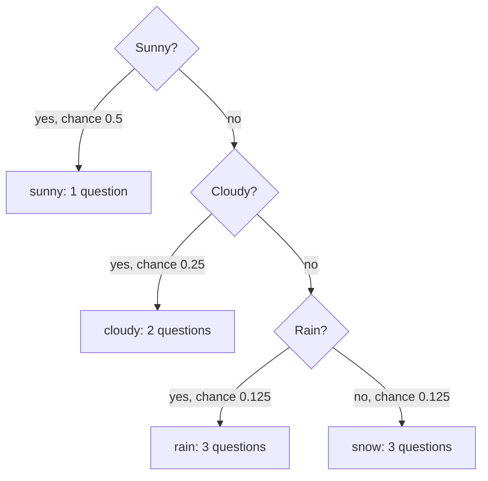
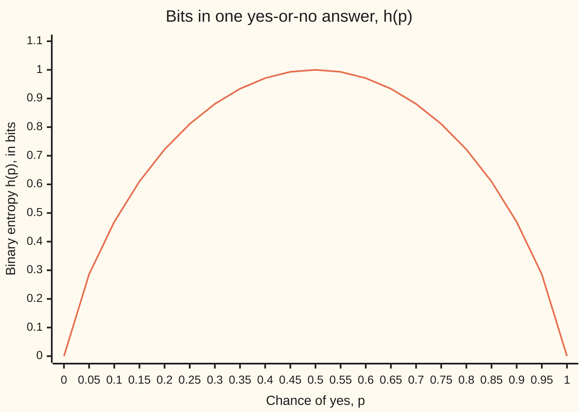

# Entropy: the average number of yes-or-no questions an outcome costs

[Syllabus](../../../SYLLABUS.md) → [Applied and computational](../README.md) → [Information Theory](../README.md#s03) → Entropy

---

## General Overview

A weather station on a hilltop sends one forecast a day down a radio link: sunny, cloudy, rain or snow. Its records say sunny comes up half the time, cloudy a quarter, rain one day in eight and snow one day in eight.

Four outcomes fit in two binary digits: 00, 01, 10, 11. That costs 2 bits a day, 730 bits a year. A **bit** is the answer to one yes-or-no question.

The station can do better by asking the questions in a smart order. First: "sunny?" Half the time the answer is yes and the day is settled with one question. If not: "cloudy?" If not: "rain?" A no there means snow. Sunny costs 1 question, cloudy 2, rain and snow 3 each. Weighted by how often each happens, that is 0.5 × 1 + 0.25 × 2 + 0.125 × 3 + 0.125 × 3 = **1.75 questions a day**, about 639 bits a year instead of 730.

1.75 is not a lucky trick of this tree. It is the **entropy** of the forecast, and no question scheme, however clever, averages fewer questions than that. If all four outcomes were equally likely, nothing could beat 2. Equal chances are the hardest case: the entropy is largest when nothing is favoured.

**Entropy is the average number of fair yes-or-no questions needed to pin down an outcome: each outcome of chance p costs log2(1/p) questions, and entropy is the average of that cost, at most log2 of the number of outcomes, reached only when every outcome is equally likely.**

**What kind of fact this is:** a definition; that equal chances give the maximum is a theorem, proved on this card in Why it works. That no scheme beats it on average is the source coding theorem, stated here and proved on the [Huffman coding](05-source-coding-and-huffman.md) and [Typical sequences](04-typical-sequences-and-the-aep.md) cards.

### The picture: the station's question tree



Every question splits what is left into two halves of equal chance. That is why this tree hits the entropy exactly.

---

## The formula

Notation first, in words. X is the day's forecast, a random variable: an outcome fixed by chance ([Expectation](../../09-Probability%20and%20statistics/02-Random%20Variables/02-expectation.md)). The outcomes are numbered i = 1 to n, and p_i is the chance of outcome i. log2 is the logarithm to base 2: log2 8 = 3 because three 2s multiplied give 8 ([Logarithms](../../01-Foundations/03-Powers%2C%20Roots%20and%20Logarithms/05-logarithms.md)). H(X), read "the entropy of X", is the new symbol, measured in bits.

$$H(X) = \sum_{i=1}^{n} p_i \log_2 \frac{1}{p_i}$$

**Read it aloud:** for every outcome, take its chance times the number of questions it costs, and add them up.

The cost of one outcome, log2(1/p_i), is its **surprise**. A sunny day (chance 0.5) carries 1 bit of surprise; a snow day (chance 0.125) carries 3. Entropy is the expected surprise.

With only two outcomes, yes with chance p and no with chance 1 − p, the formula gets its own name, the **binary entropy** h(p):

$$h(p) = p \log_2 \frac{1}{p} + (1 - p) \log_2 \frac{1}{1 - p}$$

The ceiling for n outcomes:

$$H(X) \le \log_2 n, \quad \text{with equality exactly when every } p_i = \tfrac{1}{n}$$

| Symbol | Plain meaning | In our example | Push it up and the answer… |
| --- | --- | --- | --- |
| $X$ | the day's forecast, fixed by chance | sunny, cloudy, rain or snow | — |
| $n$ | how many outcomes there are | 4 | the ceiling log2 n rises |
| $i$ | which outcome, counted 1 to n | 1 = sunny, …, 4 = snow | — |
| $p_i$ | the chance of outcome i | 0.5, 0.25, 0.125, 0.125 | H rises while p_i moves toward an equal share, falls past it |
| $\log_2 \frac{1}{p_i}$ | the surprise of outcome i: the questions it costs | 1, 2, 3, 3 bits | a rarer outcome costs more questions |
| $H(X)$ | the entropy: average surprise, in bits | 1.75 bits | more bits a day on the radio |
| $p$ | in h(p), the chance of "yes" to one question | 0.5 for "sunny?" | h rises up to p = 0.5, then falls |
| $h(p)$ | binary entropy: bits in one yes-or-no answer | h(0.5) = 1 bit | at most 1, at p = 0.5 |
| bit | one fair yes-or-no answer, the unit of H | 2 bits name one of 4 equal outcomes | — |
| $\ln$ | the natural logarithm, base e; log2 y = ln y / ln 2 | 1 / ln 2 ≈ 1.4427 | — |
| $x$, $y$ | any positive number, in the fact ln x ≤ x − 1 of Step 5 | y = 1/(n p_i) | — |

### When it holds

- **The chances are the real ones.** The tree is built for the station's usual chances. Used in a snowy winter month (snow 0.5, rain 0.25, cloudy and sunny 0.125 each), it costs 2.625 bits a day, more than the 2 bits of the plain code, while that month's own entropy is still 1.75.
- **A finite list of outcomes.** A temperature read to any precision has endless outcomes, and its "entropy" is a different quantity that can even be negative.
- **Each day stands alone.** Weather runs in spells: tomorrow often looks like today. Then the bits needed per day, given yesterday, are fewer than 1.75 ([Conditional entropy and mutual information](02-conditional-entropy-and-mutual-information.md)).
- **An average over many outcomes.** One day cannot use 1.75 questions. A whole number of questions per outcome matches H exactly only when every chance is a power of one half; otherwise the best tree is within 1 bit of H, and coding long blocks closes the gap.
- **Outcomes of chance 0 add nothing.** Their term p log2(1/p) is taken as 0, the value it shrinks to as p shrinks.

---

## Why it works

### Step 0: a fair question halves the possibilities

One fair yes-or-no question splits the possibilities into two halves of equal chance. Two questions leave a quarter, three leave an eighth. So three fair questions single out one of 2 × 2 × 2 = 8 equally likely outcomes, and each extra question doubles the count.

Turn it round. An outcome of chance 1/8 is one of eight equally likely pieces, and finding it takes three halvings: log2 8 = 3. An outcome of chance p takes log2(1/p) halvings. That is where the logarithm comes from.

### Step 1: surprise adds when chances multiply

Two days that do not affect each other have chances that multiply: sunny then snow has chance 0.5 × 0.125 = 0.0625. The questions to name both days should add: 1 + 3 = 4. The logarithm does exactly that, since log2(1/0.0625) = log2 16 = 4.

A measure of information should be 0 for a sure thing, larger for a rarer thing, and should add over independent events. The only measure that passes all three is the logarithm of 1/p, in some base; Shannon's 1948 paper proves the matching fact for the average, entropy itself. Base 2 makes the unit one fair question.

### Step 2: entropy is the average surprise

A single day costs 1, 2 or 3 questions. Over many days, what matters is the long-run average, the expectation of the surprise ([Expectation](../../09-Probability%20and%20statistics/02-Random%20Variables/02-expectation.md)):

0.5 × 1 + 0.25 × 2 + 0.125 × 3 + 0.125 × 3 = 1.75 bits.

That is the formula. The simulation in the code plays the tree on 100,000 synthetic days and asks 1.7472 questions a day on average, within about one standard error of 1.75.

### Step 3: one question at a time, and why 50-50 is best

Read the tree as a chain of yes-or-no questions. "Sunny?" has chance 0.5 of yes, so its answer carries h(0.5) = 1 bit. Half the time that ends it. The other half, "cloudy?" is again 50-50 among what is left, and so on:

H = h(0.5) + 0.5 × (h(0.5) + 0.5 × h(0.5)) = 1 + 0.5 × 1.5 = 1.75 bits.

Each question can carry at most 1 bit, and only when its two answers are equally likely. The curve below shows h(p). A lopsided question, such as "snow?" alone with chance 0.125 of yes, carries only 0.5436 bits. A tree whose every question is 50-50 wastes nothing, which is why this one hits H exactly.

### The picture: the binary entropy curve



The one line is h(p). It is 0 at both ends, where the answer is known in advance, and peaks at 1 bit at p = 0.5. It is symmetric: a 5% chance of rain and a 95% chance of rain are equally predictable, 0.2864 bits each.

### Step 4: no scheme beats H on average

The tree above matches H, but could a cleverer scheme beat it? No. Take any yes-or-no scheme that never confuses two outcomes. Multiply each outcome's chance by the number of questions the scheme spends on it, and add: that average cost is at least H. The proof rests on a counting fact about trees (the Kraft sum) and is done on the [Huffman coding](05-source-coding-and-huffman.md) card. This card uses the result, not its proof.

### Step 5: equal chances give the most entropy

Why should H never pass log2 n? Here is the full argument. It uses one fact about the natural logarithm ln: ln x ≤ x − 1 for every positive x, with equality only at x = 1. (The straight line x − 1 touches the curve ln x at x = 1 and stays above it.)

Write the gap between the ceiling and H as one sum, using p_1 + … + p_n = 1:

$$H(X) - \log_2 n = \sum_i p_i \log_2 \frac{1}{n\,p_i}$$

Change base, log2 y = ln y / ln 2, and apply ln y ≤ y − 1 to each term with y = 1/(n p_i):

$$H(X) - \log_2 n \le \frac{1}{\ln 2} \sum_i p_i \left(\frac{1}{n\,p_i} - 1\right) = \frac{1}{\ln 2}\left(\sum_i \frac{1}{n} - \sum_i p_i\right) = \frac{1}{\ln 2}(1 - 1) = 0$$

(Outcomes with p_i = 0 are left out of the sum; they only shrink the first total, so the bound still holds.) Equality needs y = 1 in every term, so every p_i = 1/n. So H ≤ log2 n, and only the all-equal forecast reaches it.

For the station, the gap is 2 − 1.75 = 0.25 bits, and the sum p_i log2(p_i / 0.25) gives the same 0.25. That sum measures how far the forecast sits from all-equal; it has its own card, [KL divergence](03-kl-divergence-and-cross-entropy.md). The same bound also follows from [Jensen's inequality](../../09-Probability%20and%20statistics/02-Random%20Variables/06-jensens-inequality.md), since log2 bends downward.

The code checks the theorem by brute force too. It tries every four-way forecast in steps of 0.05, 1,771 of them, and the largest entropy found is 2.0000 bits, at 0.25 each.

### The same four outcomes, five climates

Synthetic chance lists, one bar per climate, 20 hashes to the bit:

```
every day sunny                                           0.0000
desert           ################                         0.7837
our station      ###################################      1.7500
four-way spread  #####################################    1.8464
all four equal   ######################################## 2.0000
```

A place where every day is sunny needs 0 bits: the forecast tells nothing. The desert, sunny 85% of days, needs 0.78. All four equal needs the full 2.

---

## Worked numbers, by hand

| Step | Arithmetic | Value |
| --- | --- | --- |
| sunny's share | 0.5 × log2(1/0.5) = 0.5 × 1 | 0.5 |
| cloudy's share | 0.25 × log2(1/0.25) = 0.25 × 2 | 0.5 |
| rain's share | 0.125 × log2(1/0.125) = 0.125 × 3 | 0.375 |
| snow's share | 0.125 × 3 | 0.375 |
| entropy H | 0.5 + 0.5 + 0.375 + 0.375 | **1.75 bits** |
| the ceiling for 4 outcomes | log2 4 | 2 bits |
| a year by the question tree | 365 × 1.75 | 638.75 bits |
| a year by two fixed bits | 365 × 2 | 730 bits |

The station's daily forecast carries 1.75 bits on average: the radio can send a year of forecasts in about 639 bits instead of 730, and no scheme can average less.

### What breaks if you drop a piece

| Mistake | Comes out at | What went wrong |
| --- | --- | --- |
| Natural log ln in place of log2 | 1.2130 | That is the answer in nats, a unit 1/ln 2 ≈ 1.44 times bigger than the bit |
| Averaging 1, 2, 3, 3 questions without the chances | 2.2500 | Sunny days are half of all days; they must count for half |
| The usual tree used in a snowy winter month (snow 0.5, rain 0.25, cloudy and sunny 0.125 each) | 2.6250 bits a day | The chances changed; the month's own H is still 1.75, and 0.875 bits a day are wasted |
| Counting outcomes: log2 4 | 2.0000 | That is the all-equal ceiling, 0.25 bits too many for this forecast |

The third row is a broken assumption: the tree assumes the usual chances, and the snowy month breaks them. The code prints all four.

---

## Code, from first principles, and it actually runs

The code takes four roads to the station's 1.75 bits: the formula; the question tree played outcome by outcome; the chain of single questions using h(p); and a seeded simulation of 100,000 synthetic days that counts every question it asks. It then checks that all-equal is the maximum, by the proof's gap and by brute force over 1,771 forecasts, and prints the binary entropy curve, the climate bars and the four mistakes. Its random numbers come from SplitMix64, a small generator written out in both languages, so the two outputs match.

### Python

```python
# Entropy -- the check behind the card.  Standard library only: math.log2 and
# math.log are the only imports, and neither knows what entropy is.
# A weather station sends one forecast a day: sunny, cloudy, rain or snow.
# The entropy of its forecast is reached four ways: the formula, the question
# tree played outcome by outcome, one yes-or-no question at a time, and a
# seeded simulation that counts the questions it actually asks.
from math import log2, log

NAMES = ["sunny", "cloudy", "rain", "snow"]
P = [0.5, 0.25, 0.125, 0.125]            # the station's forecast chances
WINTER = [0.125, 0.125, 0.25, 0.5]       # a snowy month, same four outcomes
SEED = 2026                              # the simulation's starting state

def term(p):                             # one outcome's share: p x log2(1/p), 0 when p = 0
    return 0.0 if p == 0 else p * log2(1 / p)

def H(ps):                               # road 1: the formula
    return sum(term(p) for p in ps)

def h(p):                                # binary entropy: a yes-or-no with chance p
    return term(p) + term(1 - p)

def questions(k):                        # play the tree: sunny? then cloudy? then rain?
    asked = 0
    for guess in range(3):
        asked += 1
        if k == guess or guess == 2:     # a yes ends it; a no to "rain?" means snow
            return asked
    return asked

MASK = (1 << 64) - 1
def splitmix64(state):                   # small seeded generator, written out
    state = (state + 0x9E3779B97F4A7C15) & MASK
    z = state
    z = ((z ^ (z >> 30)) * 0xBF58476D1CE4E5B9) & MASK
    z = ((z ^ (z >> 27)) * 0x94D049BB133111EB) & MASK
    return state, z ^ (z >> 31)

def draw(u, ps):                         # which outcome a uniform number u picks
    acc = 0.0
    for k, p in enumerate(ps):
        acc += p
        if u < acc:
            return k
    return len(ps) - 1

H1 = H(P)
qs = [questions(k) for k in range(4)]
tree = sum(p * q for p, q in zip(P, qs))                       # road 2
chain = h(0.5) + 0.5 * (h(0.5) + 0.5 * h(0.5))                 # road 3
state, n, total, total_sq, year = SEED, 100000, 0, 0, 0       # road 4
for day in range(n):
    state, z = splitmix64(state)
    q = questions(draw((z >> 11) / 2.0**53, P))
    total += q
    total_sq += q * q
    if day == 364:
        year = total
mean = total / n
se = ((total_sq / n - mean * mean) / n) ** 0.5
gap = sum(p * log2(p / 0.25) for p in P)
grid, best, best_at = 0, -1.0, None
for a in range(21):
    for b in range(21 - a):
        for c in range(21 - a - b):
            ks = (a, b, c, 20 - a - b - c)
            grid += 1
            v = H([k / 20 for k in ks])
            if v > best:
                best, best_at = v, ks
curve = [h(i / 20) for i in range(21)]
climates = [("every day sunny", [1.0, 0.0, 0.0, 0.0]), ("desert", [0.85, 0.1, 0.04, 0.01]),
            ("our station", P), ("four-way spread", [0.4, 0.3, 0.2, 0.1]),
            ("all four equal", [0.25] * 4)]
winter_cost = sum(p * q for p, q in zip(WINTER, qs))
winter_kl = sum(p * log2(p / 2.0**-q) for p, q in zip(WINTER, qs))

print("forecast: " + ", ".join(f"{a} {p}" for a, p in zip(NAMES, P)))
print("surprise log2(1/p), bits: " + ", ".join(f"{a} {log2(1 / p):.4f}" for a, p in zip(NAMES, P)))
print(f"road 1, the formula: H = {H1:.4f} bits")
print(f"road 2, the question tree: questions {qs}, weighted average {tree:.4f}")
print(f"road 3, one question at a time: h(0.5) + 0.5 x (h(0.5) + 0.5 x h(0.5)) = {chain:.4f}")
print(f"road 4, {n} simulated days, seed {SEED}: {total} questions, {mean:.4f} a day, standard error {se:.4f}")
print(f"first simulated year, 365 days: {year} questions, against {2 * 365} for two fixed bits a day")
print(f"expected over 365 days: {365 * H1:.2f} bits by questions, {365 * 2:.2f} by two fixed bits")
print(f"all four equal: H = {H([0.25] * 4):.4f} bits; log2 4 = {log2(4):.4f}")
print(f"gap to all-equal, sum of p log2(p / 0.25): {gap:.4f}; 2 - H = {2 - H1:.4f}")
print(f"grid search, {grid} forecasts in steps of 0.05: largest H {best:.4f} at {[k / 20 for k in best_at]}")
print("binary entropy h(p), p = 0, 0.05, ..., 1:")
print(" ".join(f"{v:.3f}" for v in curve))
print(f"h(0.5) sunny or not {h(0.5):.4f}; h(0.125) snow or not {h(0.125):.4f}; "
      f"h(0.05) {h(0.05):.4f}; h(0.95) {h(0.95):.4f}")
for name, ps in climates:
    v = H(ps)
    print(f"{name:<16} {'#' * int(v * 20 + 0.5):<40} {v:.4f}")
print(f"mistake 1, natural log in place of log2: {sum(p * log(1 / p) for p in P):.4f}")
print(f"mistake 2, questions averaged without weights: {sum(qs) / 4:.4f}")
print(f"mistake 3, usual tree on winter weather: {winter_cost:.4f} a day; "
      f"winter's own H {H(WINTER):.4f}; extra {winter_kl:.4f}")
print(f"mistake 4, counting outcomes, log2 4: {log2(4):.4f}, {log2(4) - H1:.4f} too many")
print(f"sunny then snow: chance {0.5 * 0.125}, surprise {log2(1 / (0.5 * 0.125)):.4f} = 1 + 3")
print(f"asides: 1 nat = {1 / log(2):.4f} bits; log2 26 = {log2(26):.4f}; log2 3 = {log2(3):.4f}; "
      f"h(0.01) = {h(0.01):.4f}; 2^20 = {2**20}")

assert abs(H1 - tree) < 1e-12 and abs(H1 - chain) < 1e-12           # roads 1, 2, 3 agree
assert abs(mean - H1) < 4 * se                                       # road 4, within 4 errors
assert best_at == (5, 5, 5, 5) and abs(best - log2(4)) < 1e-12       # all-equal is the top
assert all(abs(H([a / 20, 1 - a / 20, 0, 0]) - h(a / 20)) < 1e-12 for a in range(21))  # zero chances add nothing
assert abs(gap - (2 - H1)) < 1e-12                                   # the gap is the divergence
assert all(abs(curve[i] - curve[20 - i]) < 1e-12 for i in range(21)) and max(curve) == curve[10]
assert abs(winter_cost - (H(WINTER) + winter_kl)) < 1e-12 and winter_cost > 2
print("ALL CHECKS PASS")
```

**Ran 2026-11-11 on macOS, Python 3.14.10, standard library only. All checks passed. Output, pasted from the run:**

```
forecast: sunny 0.5, cloudy 0.25, rain 0.125, snow 0.125
surprise log2(1/p), bits: sunny 1.0000, cloudy 2.0000, rain 3.0000, snow 3.0000
road 1, the formula: H = 1.7500 bits
road 2, the question tree: questions [1, 2, 3, 3], weighted average 1.7500
road 3, one question at a time: h(0.5) + 0.5 x (h(0.5) + 0.5 x h(0.5)) = 1.7500
road 4, 100000 simulated days, seed 2026: 174720 questions, 1.7472 a day, standard error 0.0026
first simulated year, 365 days: 628 questions, against 730 for two fixed bits a day
expected over 365 days: 638.75 bits by questions, 730.00 by two fixed bits
all four equal: H = 2.0000 bits; log2 4 = 2.0000
gap to all-equal, sum of p log2(p / 0.25): 0.2500; 2 - H = 0.2500
grid search, 1771 forecasts in steps of 0.05: largest H 2.0000 at [0.25, 0.25, 0.25, 0.25]
binary entropy h(p), p = 0, 0.05, ..., 1:
0.000 0.286 0.469 0.610 0.722 0.811 0.881 0.934 0.971 0.993 1.000 0.993 0.971 0.934 0.881 0.811 0.722 0.610 0.469 0.286 0.000
h(0.5) sunny or not 1.0000; h(0.125) snow or not 0.5436; h(0.05) 0.2864; h(0.95) 0.2864
every day sunny                                           0.0000
desert           ################                         0.7837
our station      ###################################      1.7500
four-way spread  #####################################    1.8464
all four equal   ######################################## 2.0000
mistake 1, natural log in place of log2: 1.2130
mistake 2, questions averaged without weights: 2.2500
mistake 3, usual tree on winter weather: 2.6250 a day; winter's own H 1.7500; extra 0.8750
mistake 4, counting outcomes, log2 4: 2.0000, 0.2500 too many
sunny then snow: chance 0.0625, surprise 4.0000 = 1 + 3
asides: 1 nat = 1.4427 bits; log2 26 = 4.7004; log2 3 = 1.5850; h(0.01) = 0.0808; 2^20 = 1048576
ALL CHECKS PASS
```

### Rust

Same numbers, same labels, built with `rustc --edition 2021 -O`.

```rust
// Entropy -- the same check as the Python, in Rust.  No crates; f64's log2
// and ln are the only maths used, and neither knows what entropy is.
// A weather station sends one forecast a day: sunny, cloudy, rain or snow.
// The entropy of its forecast is reached four ways: the formula, the question
// tree played outcome by outcome, one yes-or-no question at a time, and a
// seeded simulation that counts the questions it actually asks.
const NAMES: [&str; 4] = ["sunny", "cloudy", "rain", "snow"];
const P: [f64; 4] = [0.5, 0.25, 0.125, 0.125];       // the station's forecast chances
const WINTER: [f64; 4] = [0.125, 0.125, 0.25, 0.5];  // a snowy month, same four outcomes
const SEED: u64 = 2026;                              // the simulation's starting state

fn term(p: f64) -> f64 {                     // one outcome's share: p x log2(1/p), 0 when p = 0
    if p == 0.0 { 0.0 } else { p * (1.0 / p).log2() }
}

fn entropy(ps: &[f64]) -> f64 {              // road 1: the formula
    ps.iter().map(|&p| term(p)).sum()
}

fn h(p: f64) -> f64 {                        // binary entropy: a yes-or-no with chance p
    term(p) + term(1.0 - p)
}

fn questions(k: usize) -> u64 {              // play the tree: sunny? then cloudy? then rain?
    let mut asked = 0;
    for guess in 0..3 {
        asked += 1;
        if k == guess || guess == 2 { return asked; }   // a no to "rain?" means snow
    }
    asked
}

fn splitmix64(state: u64) -> (u64, u64) {    // small seeded generator, written out
    let s = state.wrapping_add(0x9E3779B97F4A7C15);
    let mut z = s;
    z = (z ^ (z >> 30)).wrapping_mul(0xBF58476D1CE4E5B9);
    z = (z ^ (z >> 27)).wrapping_mul(0x94D049BB133111EB);
    (s, z ^ (z >> 31))
}

fn draw(u: f64, ps: &[f64]) -> usize {       // which outcome a uniform number u picks
    let mut acc = 0.0;
    for (k, &p) in ps.iter().enumerate() {
        acc += p;
        if u < acc { return k; }
    }
    ps.len() - 1
}

fn main() {
    let h1 = entropy(&P);
    let qs: Vec<u64> = (0..4).map(questions).collect();
    let tree: f64 = P.iter().zip(&qs).map(|(&p, &q)| p * q as f64).sum();       // road 2
    let chain = h(0.5) + 0.5 * (h(0.5) + 0.5 * h(0.5));                           // road 3
    let (mut state, n, mut total, mut total_sq, mut year) = (SEED, 100000u64, 0u64, 0u64, 0u64);
    for day in 0..n {                                                            // road 4
        let (s, z) = splitmix64(state);
        state = s;
        let q = questions(draw((z >> 11) as f64 / 2f64.powi(53), &P));
        total += q;
        total_sq += q * q;
        if day == 364 { year = total; }
    }
    let mean = total as f64 / n as f64;
    let se = ((total_sq as f64 / n as f64 - mean * mean) / n as f64).sqrt();
    let gap: f64 = P.iter().map(|&p| p * (p / 0.25).log2()).sum();
    let (mut grid, mut best, mut best_at) = (0, -1.0f64, [0usize; 4]);
    for a in 0..21 {
        for b in 0..21 - a {
            for c in 0..21 - a - b {
                let ks = [a, b, c, 20 - a - b - c];
                grid += 1;
                let v = entropy(&ks.map(|k| k as f64 / 20.0));
                if v > best { best = v; best_at = ks; }
            }
        }
    }
    let curve: Vec<f64> = (0..21).map(|i| h(i as f64 / 20.0)).collect();
    let climates: [(&str, [f64; 4]); 5] = [("every day sunny", [1.0, 0.0, 0.0, 0.0]),
        ("desert", [0.85, 0.1, 0.04, 0.01]), ("our station", P),
        ("four-way spread", [0.4, 0.3, 0.2, 0.1]), ("all four equal", [0.25; 4])];
    let winter_cost: f64 = WINTER.iter().zip(&qs).map(|(&p, &q)| p * q as f64).sum();
    let winter_kl: f64 = WINTER.iter().zip(&qs).map(|(&p, &q)| p * (p / 2f64.powi(-(q as i32))).log2()).sum();

    let f: Vec<String> = NAMES.iter().zip(P).map(|(a, p)| format!("{} {}", a, p)).collect();
    println!("forecast: {}", f.join(", "));
    let s: Vec<String> = NAMES.iter().zip(P).map(|(a, p)| format!("{} {:.4}", a, (1.0 / p).log2())).collect();
    println!("surprise log2(1/p), bits: {}", s.join(", "));
    println!("road 1, the formula: H = {:.4} bits", h1);
    println!("road 2, the question tree: questions {:?}, weighted average {:.4}", qs, tree);
    println!("road 3, one question at a time: h(0.5) + 0.5 x (h(0.5) + 0.5 x h(0.5)) = {:.4}", chain);
    println!("road 4, {} simulated days, seed {}: {} questions, {:.4} a day, standard error {:.4}", n, SEED, total, mean, se);
    println!("first simulated year, 365 days: {} questions, against {} for two fixed bits a day", year, 2 * 365);
    println!("expected over 365 days: {:.2} bits by questions, {:.2} by two fixed bits", 365.0 * h1, 365.0 * 2.0);
    println!("all four equal: H = {:.4} bits; log2 4 = {:.4}", entropy(&[0.25; 4]), 4f64.log2());
    println!("gap to all-equal, sum of p log2(p / 0.25): {:.4}; 2 - H = {:.4}", gap, 2.0 - h1);
    println!("grid search, {} forecasts in steps of 0.05: largest H {:.4} at {:?}", grid, best,
             best_at.map(|k| k as f64 / 20.0));
    println!("binary entropy h(p), p = 0, 0.05, ..., 1:");
    let c: Vec<String> = curve.iter().map(|v| format!("{:.3}", v)).collect();
    println!("{}", c.join(" "));
    println!("h(0.5) sunny or not {:.4}; h(0.125) snow or not {:.4}; h(0.05) {:.4}; h(0.95) {:.4}",
             h(0.5), h(0.125), h(0.05), h(0.95));
    for (name, ps) in climates.iter() {
        let v = entropy(ps);
        println!("{:<16} {:<40} {:.4}", name, "#".repeat((v * 20.0 + 0.5) as usize), v);
    }
    println!("mistake 1, natural log in place of log2: {:.4}", P.iter().map(|&p| p * (1.0 / p).ln()).sum::<f64>());
    println!("mistake 2, questions averaged without weights: {:.4}", qs.iter().sum::<u64>() as f64 / 4.0);
    println!("mistake 3, usual tree on winter weather: {:.4} a day; winter's own H {:.4}; extra {:.4}",
             winter_cost, entropy(&WINTER), winter_kl);
    println!("mistake 4, counting outcomes, log2 4: {:.4}, {:.4} too many", 4f64.log2(), 4f64.log2() - h1);
    println!("sunny then snow: chance {}, surprise {:.4} = 1 + 3", 0.5 * 0.125, (1.0 / (0.5 * 0.125f64)).log2());
    println!("asides: 1 nat = {:.4} bits; log2 26 = {:.4}; log2 3 = {:.4}; h(0.01) = {:.4}; 2^20 = {}",
             1.0 / 2f64.ln(), 26f64.log2(), 3f64.log2(), h(0.01), 1u64 << 20);

    assert!((h1 - tree).abs() < 1e-12 && (h1 - chain).abs() < 1e-12);         // roads 1, 2, 3 agree
    assert!((mean - h1).abs() < 4.0 * se);                                      // road 4, within 4 errors
    assert!(best_at == [5, 5, 5, 5] && (best - 4f64.log2()).abs() < 1e-12);     // all-equal is the top
    assert!((0..21).all(|a| (entropy(&[a as f64 / 20.0, 1.0 - a as f64 / 20.0, 0.0, 0.0]) - h(a as f64 / 20.0)).abs() < 1e-12));
    assert!((gap - (2.0 - h1)).abs() < 1e-12);                                  // the gap is the divergence
    assert!((0..21).all(|i| (curve[i] - curve[20 - i]).abs() < 1e-12)
        && curve.iter().cloned().fold(f64::MIN, f64::max) == curve[10]);
    assert!((winter_cost - (entropy(&WINTER) + winter_kl)).abs() < 1e-12 && winter_cost > 2.0);
    println!("ALL CHECKS PASS");
}
```

**Ran 2026-11-11 on macOS, rustc 1.98.1, no crates. All checks passed. Output, pasted from the run:**

```
forecast: sunny 0.5, cloudy 0.25, rain 0.125, snow 0.125
surprise log2(1/p), bits: sunny 1.0000, cloudy 2.0000, rain 3.0000, snow 3.0000
road 1, the formula: H = 1.7500 bits
road 2, the question tree: questions [1, 2, 3, 3], weighted average 1.7500
road 3, one question at a time: h(0.5) + 0.5 x (h(0.5) + 0.5 x h(0.5)) = 1.7500
road 4, 100000 simulated days, seed 2026: 174720 questions, 1.7472 a day, standard error 0.0026
first simulated year, 365 days: 628 questions, against 730 for two fixed bits a day
expected over 365 days: 638.75 bits by questions, 730.00 by two fixed bits
all four equal: H = 2.0000 bits; log2 4 = 2.0000
gap to all-equal, sum of p log2(p / 0.25): 0.2500; 2 - H = 0.2500
grid search, 1771 forecasts in steps of 0.05: largest H 2.0000 at [0.25, 0.25, 0.25, 0.25]
binary entropy h(p), p = 0, 0.05, ..., 1:
0.000 0.286 0.469 0.610 0.722 0.811 0.881 0.934 0.971 0.993 1.000 0.993 0.971 0.934 0.881 0.811 0.722 0.610 0.469 0.286 0.000
h(0.5) sunny or not 1.0000; h(0.125) snow or not 0.5436; h(0.05) 0.2864; h(0.95) 0.2864
every day sunny                                           0.0000
desert           ################                         0.7837
our station      ###################################      1.7500
four-way spread  #####################################    1.8464
all four equal   ######################################## 2.0000
mistake 1, natural log in place of log2: 1.2130
mistake 2, questions averaged without weights: 2.2500
mistake 3, usual tree on winter weather: 2.6250 a day; winter's own H 1.7500; extra 0.8750
mistake 4, counting outcomes, log2 4: 2.0000, 0.2500 too many
sunny then snow: chance 0.0625, surprise 4.0000 = 1 + 3
asides: 1 nat = 1.4427 bits; log2 26 = 4.7004; log2 3 = 1.5850; h(0.01) = 0.0808; 2^20 = 1048576
ALL CHECKS PASS
```

The two outputs match line for line.

> [!TIP]
> **Try changing**
> An assert is a line that stops the program when a number comes out wrong. Guess first, then run it.
> - **Guess first:** what is the entropy of a three-way forecast, chances 1/3 each? Set `P` to three values of `1 / 3` (and trim `NAMES`). Answer: log2 3 = 1.585 bits. The tree road breaks: no tree of whole questions averages 1.585, and the first assert stops it.
> - **Guess first:** does the simulation drift if the seed changes? Set `SEED` to `7`. The average moves from 1.7472 to 1.7489, stays within four standard errors of 1.75, and every assert still passes.
> - **Guess first:** what does a fog-prone month do, sunny 0.25, cloudy 0.5? Swap the first two values of `P`. H stays 1.75, since entropy ignores which outcome has which chance, but the tree now asks "sunny?" first on a 25-75 split and averages 2.0 questions. The first assert stops it.
> - **Guess first:** what is h(0.01)? Read it on the `asides` line of the output. Answer: 0.0808 bits. A 1-in-100 yes-or-no is nearly known in advance.

---

## The usual mistake

> [!warning]
> **Counting the outcomes instead of weighing them.** Four outcomes do not mean 2 bits. 2 bits is the ceiling, reached only when all four are equally likely. The station's forecast is 1.75 bits because sunny days are common and cheap to name. Entropy depends on the chances, not on the length of the list.
>
> - **Using the natural log** gives 1.2130 and calls it bits. It is in nats; divide by ln 2 to get 1.75 bits.
> - **Leaving out the weights** averages 1, 2, 3, 3 to 2.25. A rare 3-question snow day must count for one day in eight, not one in four.
> - **Trusting old chances.** The usual tree in a snowy winter month costs 2.625 bits a day, worse than the plain 2-bit code. The entropy is right; the tree is wrong for the new weather.
> - **Reading entropy as one day's cost.** A snow day costs 3 bits and a sunny day 1. The 1.75 is the long-run average.

---

## Where you meet it in real life

- **Compression.** ZIP files, PNG images and the like squeeze data by giving common symbols short codes and rare ones long codes. The entropy of the source is the floor they press against ([Huffman coding](05-source-coding-and-huffman.md)).
- **English text.** Shannon estimated in 1951 that printed English carries roughly 1 bit per letter once context is used, far below the 4.7 bits (log2 26) of 26 equally likely letters. That gap is why text compresses so well.
- **Passwords and keys.** Password strength is quoted in bits of entropy. A key of 128 bits chosen with equal chances is the all-equal case: the ceiling, with nothing for an attacker to favour ([The one-time pad](../04-Cryptography/01-one-time-pad-and-perfect-secrecy.md)).
- **Decision trees in machine learning.** A tree that sorts data picks, at each step, the question whose answer removes the most entropy about the label, the category the tree is trying to predict.
- **Twenty questions.** Twenty fair yes-or-no answers single out one of 2^20, about a million, equally likely things.

> **Say it back**
> A fair yes-or-no question halves the possibilities, so an outcome of chance p costs log2(1/p) questions to pin down. Entropy is the average of that cost, weighted by the chances. The station's forecast, with chances 0.5, 0.25, 0.125 and 0.125, has entropy 1.75 bits, and a tree of 50-50 questions reaches it. With n outcomes the entropy is at most log2 n, reached only when all are equally likely. No yes-or-no scheme beats the entropy on average.

---

## What this builds on

- [Expectation](../../09-Probability%20and%20statistics/02-Random%20Variables/02-expectation.md): entropy is the expectation of the surprise log2(1/p), a weighted sum like any other average.
- [Logarithms](../../01-Foundations/03-Powers%2C%20Roots%20and%20Logarithms/05-logarithms.md): log2 answers "how many halvings got me here?", which is the number of questions.

## Where this goes next

- [Conditional entropy and mutual information](02-conditional-entropy-and-mutual-information.md): how many bits are left once you know yesterday's weather, and how much one signal tells about another.
- [Typical sequences](04-typical-sequences-and-the-aep.md): why a long run of forecasts almost always needs close to 1.75 bits a day, and where the limit comes from.
- [Huffman coding](05-source-coding-and-huffman.md): the best whole-question tree for any chances, and the proof that none beats H.
- [The one-time pad](../04-Cryptography/01-one-time-pad-and-perfect-secrecy.md): a key at full entropy hides a message completely.

This card measures one source with known chances. It leaves open what happens when the radio link itself makes mistakes, and how many bits a day can get through.

---

## Sources

Verified 2026-11-11: every link below resolves to the publisher's page.

- Shannon, C. E. "A Mathematical Theory of Communication." *Bell System Technical Journal* 27, no. 3 (1948): 379–423. [doi:10.1002/j.1538-7305.1948.tb01338.x](https://doi.org/10.1002/j.1538-7305.1948.tb01338.x). Defines entropy, shows the log measure is the only one with its properties, and proves equal chances give the maximum.
- Shannon, C. E. "Prediction and Entropy of Printed English." *Bell System Technical Journal* 30, no. 1 (1951): 50–64. [doi:10.1002/j.1538-7305.1951.tb01366.x](https://doi.org/10.1002/j.1538-7305.1951.tb01366.x). The estimate of about 1 bit per letter of English.
- Cover, Thomas M., and Joy A. Thomas. *Elements of Information Theory*, 2nd ed. Wiley, 2006. [doi:10.1002/047174882X](https://doi.org/10.1002/047174882X). Chapter 2 gives entropy, binary entropy and the bound H ≤ log2 n in the notation used here.
- Huffman, David A. "A Method for the Construction of Minimum-Redundancy Codes." *Proceedings of the IRE* 40, no. 9 (1952): 1098–1101. [doi:10.1109/JRPROC.1952.273898](https://doi.org/10.1109/JRPROC.1952.273898). The best whole-question tree, whose average cost entropy bounds from below.
