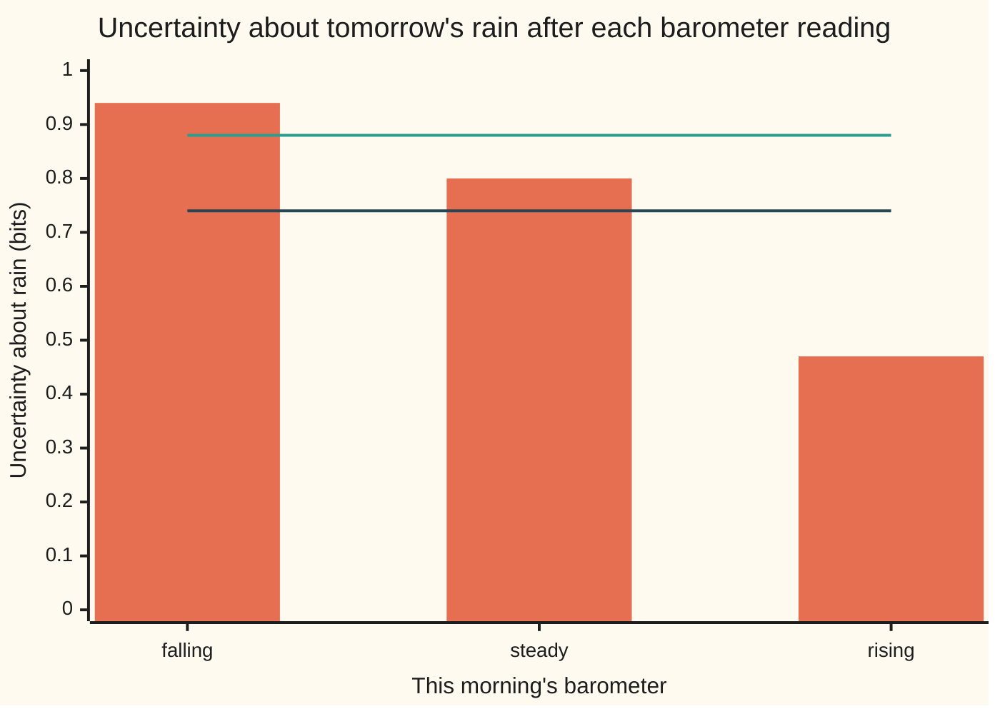

# Conditional entropy and mutual information: how much one signal tells you about another

[Syllabus](../../../SYLLABUS.md) → [Applied and computational](../README.md) → [Information Theory](../README.md#s03) → Conditional entropy and mutual information

---

## General Overview

A weather station on a hill sends one reading to town each morning over a radio link. The reading is the barometer: is the air pressure **falling**, **steady** or **rising**? A forecaster in town wants one thing from it: will it rain tomorrow?

Over 100 mornings of synthetic records, rain followed on 30. Before any reading arrives, tomorrow is a 30% chance of rain. On the [Entropy](01-entropy.md) card's scale that is **0.8813 bits** of uncertainty: a bit is the answer to one fair yes-or-no question, and a 30% chance is a little easier to call than a coin toss.

Then the reading arrives. After a falling barometer, rain followed 16 times in 25 (64%). After a rising one, only 3 times in 30 (10%). Each reading leaves its own amount of uncertainty about rain. Weight each by how often that reading turns up and the average left over is **0.7374 bits**. The barometer removed **0.1439 bits**, about 16% of the uncertainty about rain.

The uncertainty left after the reading is the **conditional entropy**. The amount removed is the **mutual information**: how much one signal tells you about another, in bits. It is the same in both directions: rain tells you exactly as much about the barometer.

One surprise sits inside the table. A falling barometer leaves *more* uncertainty, 0.9427 bits, than knowing nothing did, because 64% rain is closer to a coin toss than 30% is. Knowing can hurt for one reading. It never hurts on average, and this card proves it.

**Conditional entropy is the uncertainty about one thing left after seeing another, averaged over what you might see; mutual information is the drop from the plain entropy, it is the same seen from either side, and it is never negative.**

**What kind of fact this is:** conditional entropy and mutual information are definitions; the chain rule, the symmetry and "conditioning never increases entropy" are theorems, proved on this card in Why it works.

### The picture: uncertainty about rain, reading by reading



Bars: the uncertainty about rain left after each reading. Upper flat line: 0.88 bits, knowing nothing. Lower flat line: 0.74 bits, the bars averaged with weights 25%, 45% and 30%, how often each reading occurs. The falling bar pokes above the upper line; the average still sits below it.

---

## The formula

Notation first, in words.

- As on [Two variables at once](../../09-Probability%20and%20statistics/02-Random%20Variables/04-joint-distributions-and-covariance.md), capital letters name the two readings and P(X = x, Y = y) is one cell of their joint table.
- As on [Entropy](01-entropy.md), H(Y) is the entropy of Y in bits: the average of $-\log_2$ of the chance of what happens, with $\log_2$ the logarithm to base 2.
- A capital sigma, Σ, means: add one term for every value.

This card introduces three new symbols.

- $H(X, Y)$ is the **joint entropy**, the entropy of the pair.
- $H(Y \mid X)$, read "H of Y given X", is the **conditional entropy**.
- $I(X; Y)$, read "I of X and Y", is the **mutual information**.

$$H(Y \mid X) = \sum_x P(X = x)\, H(Y \mid X = x), \qquad H(Y \mid X = x) = -\sum_y P(Y = y \mid X = x)\,\log_2 P(Y = y \mid X = x)$$

**Read it aloud:** for each reading, work out the entropy of rain among the mornings with that reading, then average those entropies, weighting each reading by how often it occurs.

$$I(X; Y) = H(Y) - H(Y \mid X) = H(X) - H(X \mid Y) = H(X) + H(Y) - H(X, Y)$$

**Read it aloud:** the information one signal carries about another is how much it lowers the other's uncertainty, and the drop comes out the same whichever signal you start from.

The engine under both is the **chain rule**:

$$H(X, Y) = H(X) + H(Y \mid X)$$

**Read it aloud:** the uncertainty of the pair is the uncertainty of the first reading plus what is still uncertain about the second once the first is known.

And the inequality the job asks for, **conditioning never increases entropy**:

$$H(Y \mid X) \le H(Y), \quad\text{equivalently}\quad I(X; Y) \ge 0,$$

with equality exactly when X and Y are independent.

| Symbol | Plain meaning | In our example | Push it up and the answer… |
| --- | --- | --- | --- |
| $X$ | the signal you see: this morning's barometer | falling, steady or rising | — |
| $Y$ | the thing you want: rain tomorrow | rain or dry | — |
| $x$, $y$ | one particular value of each | x = falling, y = rain | picks a different row or column |
| P(X = x, Y = y), p(x, y) | joint chance: one cell of the table; Step 4 shortens it to p(x, y), and the chance of each reading alone to p(x), p(y) | falling and rain: 0.16 | a heavier cell pulls the two together |
| P(Y = y \| X = x) | the chance of y among mornings with reading x | P(rain \| falling) = 0.64 | nearer 0 or 1: that reading settles rain |
| $\log_2$, ln, Σ | logarithm to base 2, so answers are in bits; ln is the natural logarithm, used in Step 4 on any positive number t; Σ adds over every value | — | — |
| $H(Y)$, $H(X)$, $h(p)$ | entropy of rain alone, and of the barometer alone; h(p) is the entropy of a yes-or-no event with chance p | H(Y) = h(0.30) = 0.8813 bits; H(X) = 1.5395 | p nearer 0.5: more uncertainty |
| $H(Y \mid X = x)$ | uncertainty about rain left after one particular reading | falling 0.9427, steady 0.8024, rising 0.4690 | can sit above H(Y) |
| $H(Y \mid X)$ | conditional entropy: those, averaged by how often each reading occurs; $H(X \mid Y)$ is the same with the roles swapped | 0.7374 bits; H(X \| Y) = 1.3956 | a sharper barometer: lower |
| $H(X, Y)$ | joint entropy: uncertainty of the pair | 2.2769 bits | — |
| $I(X; Y)$ | mutual information: uncertainty removed, in bits; $I(Y; X \mid Z)$ is the same computed within each value of Z, then averaged | 0.1439 bits | a sharper barometer: higher, up to H(Y) |
| $Z$ | the reading as it arrives in town after the radio | 90% arrive right; I(Z; Y) = 0.0993 bits | a cleaner link: closer to 0.1439 |

### When it holds

- **The chances are the true long-run ones.** Every formula here takes the table as exact. Estimate it from a short record and the numbers drift upward: 20 mornings from a barometer that knows nothing about rain still show 0.0871 bits on average.
- **"Never increases" is about the average.** One particular reading can raise the uncertainty: a falling barometer takes it from 0.8813 to 0.9427 bits. Only the weighted average is guaranteed not to rise.
- **One logarithm base throughout.** Base 2 gives bits. The natural logarithm gives **nats**, and the same 0.1439 bits reads 0.0997 nats. Mix them in one sum and the answer means nothing.
- **Readings with a finite list of values.** For a reading on a continuous scale, entropy needs a different definition, which this card does not build.
- **The radio ignores the weather.** The claim that the radio can only lose information needs its errors to depend on the reading alone. If static came with storms, the noise itself would carry news of rain.

---

## Why it works

### Step 0: entropy averages surprise, so conditioning is an average of averages

Entropy is the average surprise, $-\log_2$ of the chance of what happened. Once the barometer is read, the forecaster's chances change to the chances within that reading's row of the table. So the surprise left is an ordinary entropy, computed row by row, and the overall amount left is those row entropies averaged by how often each row occurs. That is the same "average within groups, then average the group answers" move as the tower rule on [Conditional expectation](../../09-Probability%20and%20statistics/02-Random%20Variables/05-conditional-expectation-in-tables.md).

The rest follows from one fact: the log of a product is the sum of the logs.

### Step 1: the chance of a pair splits into two chances

The chance of "falling and rain" is the chance of falling times the chance of rain given falling: 0.16 = 0.25 × 0.64. In general,

$$P(X = x, Y = y) = P(X = x)\,P(Y = y \mid X = x).$$

Take $-\log_2$ of both sides. The product becomes a sum: the surprise of the pair is the surprise of the reading plus the surprise of the rain given the reading.

### Step 2: the chain rule

Average that sum over every cell of the table, weighting each cell by its chance. The left side averages to $H(X, Y)$. The first term on the right depends only on x, so its average is $H(X)$. The second term, averaged within each row and then across rows, is Step 0's $H(Y \mid X)$. So

$$H(X, Y) = H(X) + H(Y \mid X).$$

On the barometer: 1.5395 + 0.7374 = 2.2769 bits, which is the entropy of the six cells computed directly.

### Step 3: the drop is the same from either side

Split the pair the other way round, rain first: $H(X, Y) = H(Y) + H(X \mid Y)$. Two expressions for one number are equal:

$$H(X) + H(Y \mid X) = H(Y) + H(X \mid Y).$$

Move terms across: $H(Y) - H(Y \mid X) = H(X) - H(X \mid Y)$. The barometer removes 0.1439 bits from rain, and rain removes 0.1439 bits from the barometer, even though the two start from very different amounts, 0.8813 and 1.5395.

```
the pair, 2.2769 bits, split two ways (█ first reading, ▒ what is left)
barometer, then rain   ███████████████████████████████▒▒▒▒▒▒▒▒▒▒▒▒▒▒▒   1.5395 + 0.7374
rain, then barometer   ██████████████████▒▒▒▒▒▒▒▒▒▒▒▒▒▒▒▒▒▒▒▒▒▒▒▒▒▒▒▒   0.8813 + 1.3956
```

Both bars have the same length. The top bar starts with the longer piece, the barometer's 1.5395 bits against rain's 0.8813, and ends with the shorter one, 0.7374 against 1.3956, by exactly the same amount. The mutual information is what the two readings share: counted once in the pair, and twice if you add the two separate entropies. That gives the third form, $I = H(X) + H(Y) - H(X, Y)$, and with Step 1 written into it, a fourth:

$$I(X; Y) = \sum_{x, y} P(X = x, Y = y)\,\log_2 \frac{P(X = x, Y = y)}{P(X = x)\,P(Y = y)}.$$

Each term compares a real cell with the cell you would expect if the barometer and rain had nothing to do with each other.

### Step 4: conditioning never increases entropy

The proof needs one fact about the natural logarithm: $\ln t \le t - 1$ for every positive t, with equality only at t = 1. The curve $\ln t$ touches the straight line $t - 1$ at t = 1 and bends away below it everywhere else.

Turn the fourth form upside down inside the log. Writing p(x, y) for P(X = x, Y = y), and p(x), p(y) for the chances of each reading alone, and adding only over cells with p(x, y) above zero,

$$-I(X; Y) = \sum p(x, y)\,\log_2 \frac{p(x)\,p(y)}{p(x, y)} \;\le\; \frac{1}{\ln 2}\sum p(x, y)\left(\frac{p(x)\,p(y)}{p(x, y)} - 1\right) = \frac{1}{\ln 2}\left(\sum p(x)\,p(y) - 1\right) \le 0.$$

The last step holds because $\sum p(x)\,p(y)$ over all cells is $1 \times 1 = 1$, and over only some of them it is at most 1. So $I(X; Y) \ge 0$, which is $H(Y \mid X) \le H(Y)$. Equality needs every ratio to be 1: every cell equals its row chance times its column chance, which is independence.

Why can one reading still raise the uncertainty? Because rain after a falling barometer is 64%, nearer a coin toss than 30% is. The guarantee is about the average: the calmer steady and rising rows pull it back down, and the proof above says they always pull hard enough.

### Step 5: a noisy radio can only lose information

Suppose 90% of readings arrive in town as sent, and a wrong one is equally likely to be either of the other two. Call the received reading Z. The forecaster now learns about rain from Z, and $I(Z; Y) = 0.0993$ bits, less than 0.1439.

That always happens, provided the radio's mistakes depend only on the reading and not on the weather. This is the **data processing inequality**: if Z is made from X alone, then $I(Z; Y) \le I(X; Y)$. No processing of a signal, clever or careless, adds information about anything else, such as tomorrow's rain.

<details>
<summary>The proof, in four lines, from Steps 2 and 4</summary>

Write $I(Y; X \mid Z)$ for mutual information computed within each value of Z and then averaged, exactly as Step 0 averaged entropies. The chain rule of Step 2, applied to the information the pair (X, Z) carries about Y, splits it two ways:

$I(Y; X, Z) = I(Y; X) + I(Y; Z \mid X) = I(Y; Z) + I(Y; X \mid Z).$

Once X is known, Z is X plus radio noise that ignores the weather, so Z adds nothing about Y: $I(Y; Z \mid X) = 0$. Step 4, applied within each value of Z, gives $I(Y; X \mid Z) \ge 0$. So $I(Y; X) \ge I(Y; Z)$.

</details>

---

## Worked numbers, by hand

The 100 mornings, rain first:

| Reading | Mornings | Then rain | Chance of rain |
| --- | --- | --- | --- |
| falling | 25 | 16 | 0.64 |
| steady | 45 | 11 | 0.2444 |
| rising | 30 | 3 | 0.10 |
| all | 100 | 30 | 0.30 |

| Step | Arithmetic | Value |
| --- | --- | --- |
| rain, nothing known | h(0.30) = −0.3 log₂ 0.3 − 0.7 log₂ 0.7 | 0.8813 bits |
| after falling | h(0.64), weighted by 0.25 | 0.9427, giving 0.2357 |
| after steady | h(0.2444), weighted by 0.45 | 0.8024, giving 0.3611 |
| after rising | h(0.10), weighted by 0.30 | 0.4690, giving 0.1407 |
| H(Y \| X) | 0.2357 + 0.3611 + 0.1407, unrounded | 0.7374 bits |
| I(X; Y) | 0.8813 − 0.7374 | **0.1439 bits** |
| share removed | 0.1439 ÷ 0.8813 | 0.1632 |
| chain rule | H(X) + H(Y \| X) = 1.5395 + 0.7374 | 2.2769 = H(X, Y) |
| from the other side | H(X) − H(X \| Y) = 1.5395 − 1.3956 | 0.1439 |

(The three rounded terms add to one more in the last place; the code sums them unrounded.)

The barometer removes about a sixth of the forecaster's uncertainty about rain: useful, nowhere near a sure thing.

### What breaks if you drop a piece

| Mistake | Comes out at | What went wrong |
| --- | --- | --- |
| Reading one value as the whole answer | 0.9427 bits after a falling barometer, above the 0.8813 before | "Conditioning never increases entropy" is a promise about the average, not about each reading |
| Adding the separate entropies for the pair | H(X) + H(Y) = 2.4208, not 2.2769 | Treats the readings as independent, counting the shared 0.1439 bits twice |
| Swapping the conditioning | H(X \| Y) = 1.3956 used for H(Y \| X) = 0.7374 | The mutual information is symmetric; conditional entropy is not |
| Estimating from 20 mornings | 0.0871 bits from a barometer that knows nothing | Short records always show some chance pattern; the plug-in estimate, which uses the counted shares as if they were the true chances, is biased upward |
| Natural logs in place of base 2 | 0.0997, read as bits | That is 0.1439 bits written in nats |

The short-record row breaks the first item of "When it holds": the true mutual information there is 0, and the code draws 2,000 records of 20 mornings each, and the estimates centre on 0.0871, not on 0.

---

## Code, from first principles, and it actually runs

The script builds the 100-morning table and reaches the mutual information **four independent ways**:

1. row by row, as $H(Y) - H(Y \mid X)$;
2. through the joint entropy, as $H(X) + H(Y) - H(X, Y)$;
3. as the direct sum over the six cells;
4. by drawing 200,000 synthetic mornings from the table with a SplitMix64 random-number generator (seed 2026, written out in both languages) and counting.

It then checks the symmetry, the chain rule, the inequality on 10,000 random 3-by-2 tables, the radio's loss, and the short-record bias. The only imports are `log2` and `log`.

### Python

```python
# Conditional entropy and mutual information -- the check behind the card.
# Standard library only: math supplies log2 and nothing else.  X is this
# morning's barometer (falling, steady, rising), Y is rain tomorrow (rain, dry).
# The table is 100 synthetic mornings.  Road 1: reading by reading.  Road 2:
# the chain rule on the joint table.  Road 3: the direct sum over cells.
# Road 4: 200,000 mornings drawn with SplitMix64, seed 2026, and counted.
from math import log, log2

READ = ["falling", "steady", "rising"]
COUNTS = [[16, 9], [11, 34], [3, 27]]          # rows: barometer; columns: rain, dry
MASK = (1 << 64) - 1

def H(ps):                                     # entropy in bits of a list of chances
    return -sum(p * log2(p) for p in ps if p > 0)

def measures(c):                               # c: a table of counts or chances
    n = sum(sum(r) for r in c)
    p = [[v / n for v in r] for r in c]
    px = [sum(r) for r in p]
    py = [sum(r[j] for r in p) for j in range(len(p[0]))]
    hx, hy, hxy = H(px), H(py), H([v for r in p for v in r])
    hy_x = sum(px[i] * H([v / px[i] for v in p[i]]) for i in range(len(p)) if px[i] > 0)
    hx_y = sum(py[j] * H([r[j] / py[j] for r in p]) for j in range(len(py)) if py[j] > 0)
    direct = sum(p[i][j] * log2(p[i][j] / (px[i] * py[j]))
                 for i in range(len(p)) for j in range(len(py)) if p[i][j] > 0)
    return px, py, hx, hy, hxy, hy_x, direct, hx_y

class SplitMix64:
    def __init__(self, seed): self.s = seed
    def next(self):
        self.s = (self.s + 0x9E3779B97F4A7C15) & MASK
        z = self.s
        z = ((z ^ (z >> 30)) * 0xBF58476D1CE4E5B9) & MASK
        z = ((z ^ (z >> 27)) * 0x94D049BB133111EB) & MASK
        return z ^ (z >> 31)
    def unif(self): return (self.next() >> 11) / 9007199254740992.0

def draw(rng, p, days):                        # count `days` mornings drawn from table p
    cells = [v for r in p for v in r]
    out = [0] * len(cells)
    for _ in range(days):
        u, k = rng.unif(), 0
        while k < len(cells) - 1 and u >= cells[k]:
            u -= cells[k]; k += 1
        out[k] += 1
    return [out[0:2], out[2:4], out[4:6]]

def radio(c, keep):                            # the reading as received over a noisy link
    q = [[keep if z == x else (1 - keep) / 2 for z in range(3)] for x in range(3)]
    return [[sum(c[x][y] * q[x][z] for x in range(3)) for y in range(2)] for z in range(3)]

px, py, hx, hy, hxy, hy_x, direct, hx_y = measures(COUNTS)
per = [H([v / sum(r) for v in r]) for r in COUNTS]
i1 = hy - hy_x                                 # road 1: what the reading removes
i2 = hx + hy - hxy                             # road 2: chain rule, overlap of the two
i_sym = hx - hx_y                              # the same overlap, seen from the barometer
rng = SplitMix64(2026)
p = [[v / 100 for v in r] for r in COUNTS]
sim = measures(draw(rng, p, 200000))
i4 = sim[3] - sim[5]
indep = [[px[i] * py[j] for j in range(2)] for i in range(3)]
short = []
for _ in range(2000):                          # 20-day records of a useless barometer
    m = measures(draw(rng, indep, 20))
    short.append(m[3] - m[5])
bias = sum(short) / len(short)
se = (sum((s - bias) ** 2 for s in short) / (len(short) - 1) / len(short)) ** 0.5
worst, raised = 1.0, 0
for _ in range(10000):                         # random 3-by-2 tables: does knowing ever hurt on average?
    t = [[rng.unif() for _ in range(2)] for _ in range(3)]
    m = measures(t)
    worst = min(worst, m[3] - m[5])
    raised += sum(1 for r in t if H([v / sum(r) for v in r]) > m[3])
rad = measures(radio(COUNTS, 0.9))

print("reading   days  rain  P(x)    P(x,rain)  P(rain|x)  H(Y|X=x)  P(x) x H(Y|X=x)")
for i, r in enumerate(COUNTS):
    print(f"{READ[i]:<8}  {sum(r):>4}  {r[0]:>4}  {px[i]:.4f}  {r[0] / 100:.4f}     {r[0] / sum(r):.4f}     {per[i]:.4f}    {px[i] * per[i]:.4f}")
print(f"H(Y)    rain tomorrow, nothing known      {hy:.4f}")
print(f"H(X)    the barometer                     {hx:.4f}")
print(f"H(X,Y)  the pair                          {hxy:.4f}")
print(f"H(Y|X)  rain once the barometer is read   {hy_x:.4f}")
print(f"H(X|Y)  barometer once the rain is known  {hx_y:.4f}")
print(f"1 I = H(Y) - H(Y|X)                       {i1:.4f}")
print(f"2 I = H(X) + H(Y) - H(X,Y)                {i2:.4f}")
print(f"3 I = sum P(x,y) log2 P(x,y)/(P(x)P(y))   {direct:.4f}")
print(f"  I = H(X) - H(X|Y)                       {i_sym:.4f}")
print(f"4 I from 200,000 simulated mornings       {i4:.4f}")
print(f"chain: H(X) + H(Y|X)                      {hx + hy_x:.4f}")
print(f"share of rain uncertainty removed         {i1 / hy:.4f}")
print(f"I in nats (ln, not log2)                  {i1 * log(2):.4f}")
print(f"wrong: H(X) + H(Y) taken as H(X,Y)        {hx + hy:.4f}")
print(f"wrong: one reading, H(Y|X=falling)        {per[0]:.4f}")
print(f"short record: mean I, useless barometer   {bias:.4f}")
print(f"  standard error of that mean             {se:.4f}")
print(f"  first-order bias 2/(2 x 20 x ln 2)      {2 / (40 * log(2)):.4f}")
print(f"random tables: smallest H(Y) - H(Y|X)     {worst:.4f}")
print(f"  single readings that raised H: {raised} of 30000")
print(f"radio, 90% kept: I(Z;Y) received          {rad[3] - rad[5]:.4f}")
t1, t2, t3 = measures([[6, 14], [15, 35], [9, 21]]), measures([[30, 0], [0, 45], [0, 25]]), measures(radio(COUNTS, 0.4))
print(f"try: useless barometer, I                 {t1[3] - t1[5]:.4f}")
print(f"try: barometer settles rain, I            {t2[3] - t2[5]:.4f}")
print(f"try: radio keeps only 40%, I(Z;Y)         {t3[3] - t3[5]:.4f}")
print("bars: H(Y|X=x) " + " ".join(f"{v:.2f}" for v in per) + f"; H(Y) {hy:.2f}; H(Y|X) {hy_x:.2f}")
bar = lambda a, b: "█" * int(20 * a + 0.5) + "▒" * int(20 * b + 0.5)
print(f"the pair, {hxy:.4f} bits, split two ways (█ first reading, ▒ what is left)")
print(f"barometer, then rain   {bar(hx, hy_x)}   {hx:.4f} + {hy_x:.4f}")
print(f"rain, then barometer   {bar(hy, hx_y)}   {hy:.4f} + {hx_y:.4f}")
assert abs(i1 - 0.143862) < 1e-6                         # pinned to the worked table
assert abs(i1 - i2) < 1e-12 and abs(i1 - direct) < 1e-12  # three roads agree
assert abs(i_sym - i1) < 1e-12                           # symmetric: I(X;Y) = I(Y;X)
assert abs(hx_y - (hxy - hy)) < 1e-12                    # chain rule, rain first
assert abs(i4 - i1) < 0.005                              # simulation within a few standard errors
assert worst > -1e-12 and hy_x < hy                       # conditioning never raises entropy on average
assert per[0] > hy and raised > 0                         # but one reading can
assert bias > 0.03 and bias > 10 * se                     # short records invent information
assert rad[3] - rad[5] < i1                              # the radio cannot add information
assert abs(rad[3] - rad[5] - 0.099289) < 1e-6             # pinned: Bayes through the radio, by hand
print("ALL CHECKS PASS")
```

**Ran 2026-11-11 on macOS, Python 3.14.10, standard library only. All checks passed. Output, pasted from the run:**

```
reading   days  rain  P(x)    P(x,rain)  P(rain|x)  H(Y|X=x)  P(x) x H(Y|X=x)
falling     25    16  0.2500  0.1600     0.6400     0.9427    0.2357
steady      45    11  0.4500  0.1100     0.2444     0.8024    0.3611
rising      30     3  0.3000  0.0300     0.1000     0.4690    0.1407
H(Y)    rain tomorrow, nothing known      0.8813
H(X)    the barometer                     1.5395
H(X,Y)  the pair                          2.2769
H(Y|X)  rain once the barometer is read   0.7374
H(X|Y)  barometer once the rain is known  1.3956
1 I = H(Y) - H(Y|X)                       0.1439
2 I = H(X) + H(Y) - H(X,Y)                0.1439
3 I = sum P(x,y) log2 P(x,y)/(P(x)P(y))   0.1439
  I = H(X) - H(X|Y)                       0.1439
4 I from 200,000 simulated mornings       0.1445
chain: H(X) + H(Y|X)                      2.2769
share of rain uncertainty removed         0.1632
I in nats (ln, not log2)                  0.0997
wrong: H(X) + H(Y) taken as H(X,Y)        2.4208
wrong: one reading, H(Y|X=falling)        0.9427
short record: mean I, useless barometer   0.0871
  standard error of that mean             0.0017
  first-order bias 2/(2 x 20 x ln 2)      0.0721
random tables: smallest H(Y) - H(Y|X)     0.0000
  single readings that raised H: 8530 of 30000
radio, 90% kept: I(Z;Y) received          0.0993
try: useless barometer, I                 0.0000
try: barometer settles rain, I            0.8813
try: radio keeps only 40%, I(Z;Y)         0.0012
bars: H(Y|X=x) 0.94 0.80 0.47; H(Y) 0.88; H(Y|X) 0.74
the pair, 2.2769 bits, split two ways (█ first reading, ▒ what is left)
barometer, then rain   ███████████████████████████████▒▒▒▒▒▒▒▒▒▒▒▒▒▒▒   1.5395 + 0.7374
rain, then barometer   ██████████████████▒▒▒▒▒▒▒▒▒▒▒▒▒▒▒▒▒▒▒▒▒▒▒▒▒▒▒▒   0.8813 + 1.3956
ALL CHECKS PASS
```

The four roads land together: the first three agree to twelve decimals, and the simulation lands at 0.1445. Across 10,000 random tables the average never rose, while 8,530 of the 30,000 single readings did raise the uncertainty, a little over one in four.

### Rust

Same table, same generator, same labels. Built with `rustc --edition 2021 -O`, no crates.

```rust
// Conditional entropy and mutual information -- the same check as the Python,
// in Rust.  No crates.  X is this morning's barometer (falling, steady,
// rising), Y is rain tomorrow (rain, dry), over 100 synthetic mornings.
// Road 1: reading by reading.  Road 2: the chain rule on the joint table.
// Road 3: the direct sum over cells.  Road 4: 200,000 mornings drawn with
// SplitMix64, seed 2026, and counted.
type T = Vec<Vec<f64>>;
const READ: [&str; 3] = ["falling", "steady", "rising"];

fn h(ps: &[f64]) -> f64 {                          // entropy in bits of a list of chances
    -ps.iter().filter(|&&p| p > 0.0).fold(0.0, |a, &p| a + p * p.log2())
}

struct M { px: Vec<f64>, hx: f64, hy: f64, hxy: f64, hy_x: f64, hx_y: f64, direct: f64 }

fn measures(c: &T) -> M {                          // c: a table of counts or chances
    let n = c.iter().fold(0.0, |a, r| a + r.iter().sum::<f64>());
    let p: T = c.iter().map(|r| r.iter().map(|v| v / n).collect()).collect();
    let px: Vec<f64> = p.iter().map(|r| r.iter().sum()).collect();
    let py: Vec<f64> = (0..p[0].len()).map(|j| p.iter().fold(0.0, |a, r| a + r[j])).collect();
    let cells: Vec<f64> = p.iter().flatten().copied().collect();
    let (hx, hy, hxy) = (h(&px), h(&py), h(&cells));
    let mut hy_x = 0.0;
    let mut hx_y = 0.0;
    let mut direct = 0.0;
    for i in 0..p.len() {
        if px[i] > 0.0 {
            let row: Vec<f64> = p[i].iter().map(|v| v / px[i]).collect();
            hy_x += px[i] * h(&row);
        }
        for j in 0..py.len() {
            if p[i][j] > 0.0 { direct += p[i][j] * (p[i][j] / (px[i] * py[j])).log2(); }
        }
    }
    for j in 0..py.len() {
        if py[j] > 0.0 {
            let col: Vec<f64> = p.iter().map(|r| r[j] / py[j]).collect();
            hx_y += py[j] * h(&col);
        }
    }
    M { px, hx, hy, hxy, hy_x, hx_y, direct }
}

struct SplitMix64 { s: u64 }
impl SplitMix64 {
    fn next(&mut self) -> u64 {
        self.s = self.s.wrapping_add(0x9E3779B97F4A7C15);
        let mut z = self.s;
        z = (z ^ (z >> 30)).wrapping_mul(0xBF58476D1CE4E5B9);
        z = (z ^ (z >> 27)).wrapping_mul(0x94D049BB133111EB);
        z ^ (z >> 31)
    }
    fn unif(&mut self) -> f64 { (self.next() >> 11) as f64 / 9007199254740992.0 }
}

fn draw(rng: &mut SplitMix64, p: &T, days: usize) -> T {   // count `days` mornings drawn from p
    let cells: Vec<f64> = p.iter().flatten().copied().collect();
    let mut out = vec![0.0; cells.len()];
    for _ in 0..days {
        let (mut u, mut k) = (rng.unif(), 0);
        while k < cells.len() - 1 && u >= cells[k] { u -= cells[k]; k += 1; }
        out[k] += 1.0;
    }
    vec![out[0..2].to_vec(), out[2..4].to_vec(), out[4..6].to_vec()]
}

fn radio(c: &T, keep: f64) -> T {                  // the reading as received over a noisy link
    let q = |x: usize, z: usize| if z == x { keep } else { (1.0 - keep) / 2.0 };
    (0..3).map(|z| (0..2).map(|y| (0..3).fold(0.0, |a, x| a + c[x][y] * q(x, z))).collect()).collect()
}

fn tab(rows: [[f64; 2]; 3]) -> T { rows.iter().map(|r| r.to_vec()).collect() }
fn info(m: &M) -> f64 { m.hy - m.hy_x }

fn main() {
    let counts = tab([[16.0, 9.0], [11.0, 34.0], [3.0, 27.0]]);   // rows: barometer; columns: rain, dry
    let m = measures(&counts);
    let per: Vec<f64> = counts.iter().map(|r| h(&[r[0] / (r[0] + r[1]), r[1] / (r[0] + r[1])])).collect();
    let i1 = m.hy - m.hy_x;                        // road 1: what the reading removes
    let i2 = m.hx + m.hy - m.hxy;                  // road 2: chain rule, overlap of the two
    let hx_y = m.hx_y;
    let i_sym = m.hx - hx_y;                       // the same overlap, seen from the barometer
    let mut rng = SplitMix64 { s: 2026 };
    let p: T = counts.iter().map(|r| r.iter().map(|v| v / 100.0).collect()).collect();
    let i4 = info(&measures(&draw(&mut rng, &p, 200000)));
    let py = [p[0][0] + p[1][0] + p[2][0], p[0][1] + p[1][1] + p[2][1]];
    let indep: T = (0..3).map(|i| (0..2).map(|j| m.px[i] * py[j]).collect()).collect();
    let short: Vec<f64> = (0..2000).map(|_| info(&measures(&draw(&mut rng, &indep, 20)))).collect();
    let bias = short.iter().sum::<f64>() / 2000.0;
    let se = (short.iter().fold(0.0, |a, s| a + (s - bias).powi(2)) / 1999.0 / 2000.0).sqrt();
    let (mut worst, mut raised) = (1.0_f64, 0);
    for _ in 0..10000 {                            // random 3-by-2 tables: does knowing ever hurt on average?
        let t: T = (0..3).map(|_| (0..2).map(|_| rng.unif()).collect()).collect();
        let mt = measures(&t);
        worst = worst.min(info(&mt));
        raised += t.iter().filter(|r| h(&[r[0] / (r[0] + r[1]), r[1] / (r[0] + r[1])]) > mt.hy).count();
    }
    let rad = info(&measures(&radio(&counts, 0.9)));

    println!("reading   days  rain  P(x)    P(x,rain)  P(rain|x)  H(Y|X=x)  P(x) x H(Y|X=x)");
    for i in 0..3 {
        let r = &counts[i];
        println!("{:<8}  {:>4}  {:>4}  {:.4}  {:.4}     {:.4}     {:.4}    {:.4}", READ[i], r[0] + r[1], r[0],
                 m.px[i], r[0] / 100.0, r[0] / (r[0] + r[1]), per[i], m.px[i] * per[i]);
    }
    let rows: Vec<(&str, f64)> = vec![
        ("H(Y)    rain tomorrow, nothing known", m.hy), ("H(X)    the barometer", m.hx),
        ("H(X,Y)  the pair", m.hxy), ("H(Y|X)  rain once the barometer is read", m.hy_x),
        ("H(X|Y)  barometer once the rain is known", hx_y), ("1 I = H(Y) - H(Y|X)", i1),
        ("2 I = H(X) + H(Y) - H(X,Y)", i2), ("3 I = sum P(x,y) log2 P(x,y)/(P(x)P(y))", m.direct),
        ("  I = H(X) - H(X|Y)", i_sym), ("4 I from 200,000 simulated mornings", i4),
        ("chain: H(X) + H(Y|X)", m.hx + m.hy_x), ("share of rain uncertainty removed", i1 / m.hy),
        ("I in nats (ln, not log2)", i1 * 2f64.ln()),
        ("wrong: H(X) + H(Y) taken as H(X,Y)", m.hx + m.hy), ("wrong: one reading, H(Y|X=falling)", per[0]),
        ("short record: mean I, useless barometer", bias), ("  standard error of that mean", se),
        ("  first-order bias 2/(2 x 20 x ln 2)", 2.0 / (40.0 * 2f64.ln())),
        ("random tables: smallest H(Y) - H(Y|X)", worst),
    ];
    for (name, v) in &rows { println!("{:<41} {:.4}", name, v); }
    println!("  single readings that raised H: {} of 30000", raised);
    println!("{:<41} {:.4}", "radio, 90% kept: I(Z;Y) received", rad);
    let t1 = info(&measures(&tab([[6.0, 14.0], [15.0, 35.0], [9.0, 21.0]])));
    let t2 = info(&measures(&tab([[30.0, 0.0], [0.0, 45.0], [0.0, 25.0]])));
    let t3 = info(&measures(&radio(&counts, 0.4)));
    println!("{:<41} {:.4}", "try: useless barometer, I", t1);
    println!("{:<41} {:.4}", "try: barometer settles rain, I", t2);
    println!("{:<41} {:.4}", "try: radio keeps only 40%, I(Z;Y)", t3);
    println!("bars: H(Y|X=x) {:.2} {:.2} {:.2}; H(Y) {:.2}; H(Y|X) {:.2}", per[0], per[1], per[2], m.hy, m.hy_x);
    let bar = |a: f64, b: f64| "█".repeat((20.0 * a + 0.5) as usize) + &"▒".repeat((20.0 * b + 0.5) as usize);
    println!("the pair, {:.4} bits, split two ways (█ first reading, ▒ what is left)", m.hxy);
    println!("barometer, then rain   {}   {:.4} + {:.4}", bar(m.hx, m.hy_x), m.hx, m.hy_x);
    println!("rain, then barometer   {}   {:.4} + {:.4}", bar(m.hy, hx_y), m.hy, hx_y);
    assert!((i1 - 0.143862).abs() < 1e-6);                         // pinned to the worked table
    assert!((i1 - i2).abs() < 1e-12 && (i1 - m.direct).abs() < 1e-12);  // three roads agree
    assert!((i_sym - i1).abs() < 1e-12);                           // symmetric: I(X;Y) = I(Y;X)
    assert!((hx_y - (m.hxy - m.hy)).abs() < 1e-12);                // chain rule, rain first
    assert!((i4 - i1).abs() < 0.005);                              // simulation within a few standard errors
    assert!(worst > -1e-12 && m.hy_x < m.hy);                       // conditioning never raises entropy on average
    assert!(per[0] > m.hy && raised > 0);                           // but one reading can
    assert!(bias > 0.03 && bias > 10.0 * se);                       // short records invent information
    assert!(rad < i1);                                             // the radio cannot add information
    assert!((rad - 0.099289).abs() < 1e-6);                        // pinned: Bayes through the radio, by hand
    println!("ALL CHECKS PASS");
}
```

**Ran 2026-11-11 on macOS, rustc 1.98.1, no crates. All checks passed. Output, pasted from the run:**

```
reading   days  rain  P(x)    P(x,rain)  P(rain|x)  H(Y|X=x)  P(x) x H(Y|X=x)
falling     25    16  0.2500  0.1600     0.6400     0.9427    0.2357
steady      45    11  0.4500  0.1100     0.2444     0.8024    0.3611
rising      30     3  0.3000  0.0300     0.1000     0.4690    0.1407
H(Y)    rain tomorrow, nothing known      0.8813
H(X)    the barometer                     1.5395
H(X,Y)  the pair                          2.2769
H(Y|X)  rain once the barometer is read   0.7374
H(X|Y)  barometer once the rain is known  1.3956
1 I = H(Y) - H(Y|X)                       0.1439
2 I = H(X) + H(Y) - H(X,Y)                0.1439
3 I = sum P(x,y) log2 P(x,y)/(P(x)P(y))   0.1439
  I = H(X) - H(X|Y)                       0.1439
4 I from 200,000 simulated mornings       0.1445
chain: H(X) + H(Y|X)                      2.2769
share of rain uncertainty removed         0.1632
I in nats (ln, not log2)                  0.0997
wrong: H(X) + H(Y) taken as H(X,Y)        2.4208
wrong: one reading, H(Y|X=falling)        0.9427
short record: mean I, useless barometer   0.0871
  standard error of that mean             0.0017
  first-order bias 2/(2 x 20 x ln 2)      0.0721
random tables: smallest H(Y) - H(Y|X)     0.0000
  single readings that raised H: 8530 of 30000
radio, 90% kept: I(Z;Y) received          0.0993
try: useless barometer, I                 0.0000
try: barometer settles rain, I            0.8813
try: radio keeps only 40%, I(Z;Y)         0.0012
bars: H(Y|X=x) 0.94 0.80 0.47; H(Y) 0.88; H(Y|X) 0.74
the pair, 2.2769 bits, split two ways (█ first reading, ▒ what is left)
barometer, then rain   ███████████████████████████████▒▒▒▒▒▒▒▒▒▒▒▒▒▒▒   1.5395 + 0.7374
rain, then barometer   ██████████████████▒▒▒▒▒▒▒▒▒▒▒▒▒▒▒▒▒▒▒▒▒▒▒▒▒▒▒▒   0.8813 + 1.3956
ALL CHECKS PASS
```

The two outputs match line for line, simulated numbers included, because both programs draw the same SplitMix64 stream.

### Lean

Lean proves the chain rule, the symmetry and "conditioning never increases entropy" for every joint table on two readings with finitely many values.

- Take a joint table whose chances are each at least 0 and add to 1. Then $H(Y \mid X) \le H(Y)$, so $I(X; Y) \ge 0$.
- Take the same table. Then $H(Y \mid X) = H(Y)$ exactly when every cell equals its row chance times its column chance.
- Take the same table. Then $H(X, Y) = H(X) + H(Y \mid X)$, the chain rule.
- Take the same table. Then $H(Y) - H(Y \mid X) = H(X) - H(X \mid Y)$, and both equal $H(X) + H(Y) - H(X, Y)$.
- The 100 mornings add up: rows of 25, 45 and 30, with 30 rainy mornings in all.
- The chance of falling and rain splits as 0.16 = 0.25 × 0.64, as in Step 1.
- In the Try changing table `[6, 14], [15, 35], [9, 21]`, each cell is row total times column total over 100.

The noisy radio's loss, the short-record bias, the decimals and the simulations are left to the Python and Rust checks.

```lean
-- Conditional entropy and mutual information: for any joint table of chances on two finite readings, seeing one reading never raises the average uncertainty about the other (with no change exactly when they are independent), the pair's entropy splits by the chain rule, and the uncertainty removed is the same from either side.
import Mathlib.Analysis.SpecialFunctions.Log.Base
import Mathlib.Algebra.BigOperators.Ring.Finset
import Mathlib.Tactic

open Finset

namespace CondEntropyCard

variable {α β ι : Type*} [Fintype α] [Fintype β] [Fintype ι]

/-- Entropy in bits of a list of chances `q`: `H = -Σ q i · log₂ (q i)`.
(Mathlib's `Real.logb 2 0 = 0`, so empty cells add nothing, as on the card.) -/
noncomputable def entropy (q : ι → ℝ) : ℝ := -∑ i, q i * Real.logb 2 (q i)

/-- The chance of each value of the first reading `X`: the row sums of the joint table. -/
def margX (p : α × β → ℝ) (x : α) : ℝ := ∑ y, p (x, y)

/-- The chance of each value of the second reading `Y`: the column sums of the joint table. -/
def margY (p : α × β → ℝ) (y : β) : ℝ := ∑ x, p (x, y)

/-- `H(Y | X) = Σ_x P(X = x) · H(Y | X = x)`, where `H(Y | X = x)` is the entropy of the row of
`x` divided by its total, `P(Y = y | X = x) = P(X = x, Y = y) / P(X = x)`. -/
noncomputable def condEntYX (p : α × β → ℝ) : ℝ :=
  ∑ x, margX p x * entropy (fun y => p (x, y) / margX p x)

/-- `H(X | Y)`, the same with the roles of the two readings swapped. -/
noncomputable def condEntXY (p : α × β → ℝ) : ℝ :=
  ∑ y, margY p y * entropy (fun x => p (x, y) / margY p y)

/-- One row's share: `s · H(f / s) = -Σ f log f + s log s`, where `s` is the row total. -/
lemma row_term (f : β → ℝ) (hf : ∀ y, 0 ≤ f y) :
    (∑ y, f y) * entropy (fun y => f y / ∑ y, f y) =
      -∑ y, f y * Real.logb 2 (f y) + (∑ y, f y) * Real.logb 2 (∑ y, f y) := by
  have hs : 0 ≤ ∑ y, f y := Finset.sum_nonneg (fun y _ => hf y)
  rcases hs.eq_or_lt with h | h
  · have h0 : ∀ y, f y = 0 := fun y =>
      (Finset.sum_eq_zero_iff_of_nonneg (fun y _ => hf y)).1 h.symm y (Finset.mem_univ y)
    simp [h0]
  · unfold entropy
    generalize hS : ∑ y, f y = s at h ⊢
    have key : ∀ y, s * (f y / s * Real.logb 2 (f y / s)) =
        f y * Real.logb 2 (f y) - f y * Real.logb 2 s := by
      intro y
      rcases (hf y).eq_or_lt with hy | hy
      · simp [← hy]
      · rw [Real.logb_div hy.ne' h.ne']
        field_simp
    rw [mul_neg, Finset.mul_sum, Finset.sum_congr rfl (fun y _ => key y),
      Finset.sum_sub_distrib, ← Finset.sum_mul, hS]
    ring

/-- One cell: `p (log p - log a - log b) ≥ p - a b`, with equality exactly when `p = a b`. -/
lemma cell_bound (p a b : ℝ) (hp : 0 ≤ p) (ha : p ≤ a) (hb : p ≤ b) :
    0 ≤ p * (Real.log p - Real.log a - Real.log b) - (p - a * b) ∧
      (p * (Real.log p - Real.log a - Real.log b) - (p - a * b) = 0 ↔ p = a * b) := by
  rcases hp.eq_or_lt with h | h
  · subst h
    have hab : 0 ≤ a * b := mul_nonneg ha hb
    refine ⟨by simpa using hab, ?_⟩
    constructor
    · intro e; linarith
    · intro e; rw [← e]; simp
  · have ha' : 0 < a := lt_of_lt_of_le h ha
    have hb' : 0 < b := lt_of_lt_of_le h hb
    have ht : 0 < a * b / p := by positivity
    have hkey : Real.log p - Real.log a - Real.log b = -Real.log (a * b / p) := by
      rw [Real.log_div (by positivity) h.ne', Real.log_mul ha'.ne' hb'.ne']; ring
    have hexp : p * (Real.log p - Real.log a - Real.log b) - (p - a * b)
        = p * (a * b / p - 1 - Real.log (a * b / p)) := by
      rw [hkey]; field_simp; ring
    rw [hexp]
    have hle := Real.log_le_sub_one_of_pos ht
    refine ⟨mul_nonneg h.le (by linarith), ?_⟩
    constructor
    · intro e
      have e2 : a * b / p - 1 - Real.log (a * b / p) = 0 := by
        rcases mul_eq_zero.1 e with e3 | e3
        · exact absurd e3 h.ne'
        · exact e3
      by_contra hne
      have h1 : a * b / p ≠ 1 := by
        intro h1; apply hne; field_simp at h1; linarith
      have := Real.log_lt_sub_one_of_pos ht h1
      linarith
    · intro e
      have : a * b / p = 1 := by rw [← e]; exact div_self h.ne'
      rw [this]; simp

/-- The chain rule, `H(X, Y) = H(X) + H(Y | X)`. -/
lemma chain_aux (p : α × β → ℝ) (hp : ∀ z, 0 ≤ p z) :
    entropy p = entropy (margX p) + condEntYX p := by
  have h : ∀ x, margX p x * entropy (fun y => p (x, y) / margX p x) =
      -∑ y, p (x, y) * Real.logb 2 (p (x, y)) + margX p x * Real.logb 2 (margX p x) :=
    fun x => row_term (fun y => p (x, y)) (fun y => hp _)
  rw [condEntYX, Finset.sum_congr rfl (fun x _ => h x), Finset.sum_add_distrib]
  simp only [entropy]
  rw [Fintype.sum_prod_type, Finset.sum_neg_distrib]
  ring

/-- The chain rule the other way round, `H(X, Y) = H(Y) + H(X | Y)`. -/
lemma chain_aux' (p : α × β → ℝ) (hp : ∀ z, 0 ≤ p z) :
    entropy p = entropy (margY p) + condEntXY p := by
  have h : ∀ y, margY p y * entropy (fun x => p (x, y) / margY p y) =
      -∑ x, p (x, y) * Real.logb 2 (p (x, y)) + margY p y * Real.logb 2 (margY p y) :=
    fun y => row_term (fun x => p (x, y)) (fun x => hp _)
  rw [condEntXY, Finset.sum_congr rfl (fun y _ => h y), Finset.sum_add_distrib]
  simp only [entropy]
  rw [Fintype.sum_prod_type, Finset.sum_comm, Finset.sum_neg_distrib]
  ring

/-- `H(X) + H(Y) - H(X, Y)` as a sum of cell terms that are each at least zero. -/
lemma mi_formula (p : α × β → ℝ) (hsum : ∑ z, p z = 1) :
    entropy (margX p) + entropy (margY p) - entropy p =
      (∑ x, ∑ y, (p (x, y) * (Real.log (p (x, y)) - Real.log (margX p x) -
        Real.log (margY p y)) - (p (x, y) - margX p x * margY p y))) / Real.log 2 := by
  have h1 : ∑ x, ∑ y, p (x, y) = 1 := by rw [← Fintype.sum_prod_type']; exact hsum
  have hX : ∑ x, margX p x = 1 := h1
  have hY : ∑ y, margY p y = 1 := by
    unfold margY; rw [Finset.sum_comm]; exact h1
  have h2 : ∑ x, ∑ y, margX p x * margY p y = 1 := by
    rw [← Finset.sum_mul_sum, hX, hY, one_mul]
  have hA : ∑ x, margX p x * Real.logb 2 (margX p x) =
      ∑ x, ∑ y, p (x, y) * Real.logb 2 (margX p x) :=
    Finset.sum_congr rfl (fun x _ => Finset.sum_mul _ _ _)
  have hB : ∑ y, margY p y * Real.logb 2 (margY p y) =
      ∑ x, ∑ y, p (x, y) * Real.logb 2 (margY p y) := by
    rw [Finset.sum_comm]
    exact Finset.sum_congr rfl (fun y _ => Finset.sum_mul _ _ _)
  have hlhs : entropy (margX p) + entropy (margY p) - entropy p =
      ∑ x, ∑ y, p (x, y) * (Real.logb 2 (p (x, y)) - Real.logb 2 (margX p x) -
        Real.logb 2 (margY p y)) := by
    simp only [entropy]
    rw [hA, hB, Fintype.sum_prod_type]
    simp only [mul_sub, Finset.sum_sub_distrib]
    ring
  rw [hlhs]
  simp only [Finset.sum_sub_distrib]
  rw [h1, h2, sub_self, sub_zero, Finset.sum_div]
  refine Finset.sum_congr rfl (fun x _ => ?_)
  rw [Finset.sum_div]
  refine Finset.sum_congr rfl (fun y _ => ?_)
  simp only [Real.logb]
  ring

#print axioms row_term
#print axioms cell_bound
#print axioms chain_aux
#print axioms chain_aux'
#print axioms mi_formula

/-- `I(X; Y) = H(X) + H(Y) - H(X, Y) ≥ 0`, with equality exactly when `X` and `Y` are independent. -/
lemma mi_nonneg_iff (p : α × β → ℝ) (hp : ∀ z, 0 ≤ p z) (hsum : ∑ z, p z = 1) :
    0 ≤ entropy (margX p) + entropy (margY p) - entropy p ∧
      (entropy (margX p) + entropy (margY p) - entropy p = 0 ↔
        ∀ x y, p (x, y) = margX p x * margY p y) := by
  have hlog : 0 < Real.log 2 := Real.log_pos (by norm_num)
  have hcell : ∀ x y, 0 ≤ p (x, y) * (Real.log (p (x, y)) - Real.log (margX p x) -
        Real.log (margY p y)) - (p (x, y) - margX p x * margY p y) ∧
      (p (x, y) * (Real.log (p (x, y)) - Real.log (margX p x) -
        Real.log (margY p y)) - (p (x, y) - margX p x * margY p y) = 0 ↔
          p (x, y) = margX p x * margY p y) := fun x y =>
    cell_bound _ _ _ (hp _)
      (Finset.single_le_sum (f := fun y => p (x, y)) (fun y _ => hp _) (Finset.mem_univ y))
      (Finset.single_le_sum (f := fun x => p (x, y)) (fun x _ => hp _) (Finset.mem_univ x))
  rw [mi_formula p hsum]
  have hnn := fun x => Finset.sum_nonneg (s := Finset.univ) (fun y _ => (hcell x y).1)
  refine ⟨div_nonneg (Finset.sum_nonneg (fun x _ => hnn x)) hlog.le, ?_⟩
  rw [div_eq_zero_iff, or_iff_left hlog.ne', Finset.sum_eq_zero_iff_of_nonneg (fun x _ => hnn x)]
  simp only [Finset.mem_univ, true_implies]
  refine forall_congr' (fun x => ?_)
  rw [Finset.sum_eq_zero_iff_of_nonneg (fun y _ => (hcell x y).1)]
  simp only [Finset.mem_univ, true_implies]
  exact forall_congr' (fun y => (hcell x y).2)

#print axioms mi_nonneg_iff

/-- Conditioning never increases entropy. For any joint table of chances `p` on two readings
with finitely many values (each chance at least 0, all adding to 1), the uncertainty about `Y`
left after seeing `X`, averaged over the readings, is at most the uncertainty about `Y` with
nothing known: `H(Y | X) ≤ H(Y)`, that is `I(X; Y) ≥ 0`. Equality holds exactly when `X` and `Y`
are independent: every cell equals its row chance times its column chance. -/
theorem conditioning_never_increases_entropy (p : α × β → ℝ) (hp : ∀ z, 0 ≤ p z)
    (hsum : ∑ z, p z = 1) :
    condEntYX p ≤ entropy (margY p) ∧
      (condEntYX p = entropy (margY p) ↔ ∀ x y, p (x, y) = margX p x * margY p y) := by
  have hc := chain_aux p hp
  obtain ⟨h1, h2⟩ := mi_nonneg_iff p hp hsum
  refine ⟨by linarith, ?_⟩
  rw [← h2]
  constructor <;> intro e <;> linarith

/-- The chain rule: the uncertainty of the pair is the uncertainty of the first reading plus
what is still uncertain about the second once the first is known, `H(X, Y) = H(X) + H(Y | X)`. -/
theorem chain_rule (p : α × β → ℝ) (hp : ∀ z, 0 ≤ p z) (hsum : ∑ z, p z = 1) :
    entropy p = entropy (margX p) + condEntYX p := by
  exact chain_aux p hp

/-- Mutual information is the same from either side: the drop `H(Y) - H(Y | X)` equals the drop
`H(X) - H(X | Y)`, and both equal `H(X) + H(Y) - H(X, Y)`. -/
theorem mutual_information_symmetric (p : α × β → ℝ) (hp : ∀ z, 0 ≤ p z)
    (hsum : ∑ z, p z = 1) :
    entropy (margY p) - condEntYX p = entropy (margX p) - condEntXY p ∧
      entropy (margY p) - condEntYX p = entropy (margX p) + entropy (margY p) - entropy p := by
  have hc := chain_aux p hp
  have hc' := chain_aux' p hp
  constructor <;> linarith

end CondEntropyCard

open CondEntropyCard

-- The card's whole-number checks.
-- The 100 mornings: rows falling 16 + 9, steady 11 + 34, rising 3 + 27; 30 rainy mornings in all.
example : 16 + 9 = 25 ∧ 11 + 34 = 45 ∧ 3 + 27 = 30 ∧ 25 + 45 + 30 = 100 ∧ 16 + 11 + 3 = 30 := by
  decide
-- Step 1: the chance of falling and rain splits as 16/100 = 25/100 × 16/25.
example : (16 / 100 : ℚ) = 25 / 100 * (16 / 25) := by norm_num
-- Try changing: the useless barometer [6, 14], [15, 35], [9, 21] (rows 20, 50, 30; columns 30, 70
-- out of 100) has every cell equal to row total × column total ÷ 100, so it is independent.
example : 6 * 100 = 20 * 30 ∧ 14 * 100 = 20 * 70 ∧ 15 * 100 = 50 * 30 ∧ 35 * 100 = 50 * 70 ∧
    9 * 100 = 30 * 30 ∧ 21 * 100 = 30 * 70 := by decide

#print axioms conditioning_never_increases_entropy
#print axioms chain_rule
#print axioms mutual_information_symmetric
```

**Checked 2026-11-14 on macOS, Lean 4.36.0-rc2, Mathlib v4.36.0-rc2. Every proof is complete and uses only Lean's standard axioms. Output, pasted from the run:**

```
'CondEntropyCard.row_term' depends on axioms: [propext, Classical.choice, Quot.sound]
'CondEntropyCard.cell_bound' depends on axioms: [propext, Classical.choice, Quot.sound]
'CondEntropyCard.chain_aux' depends on axioms: [propext, Classical.choice, Quot.sound]
'CondEntropyCard.chain_aux'' depends on axioms: [propext, Classical.choice, Quot.sound]
'CondEntropyCard.mi_formula' depends on axioms: [propext, Classical.choice, Quot.sound]
'CondEntropyCard.mi_nonneg_iff' depends on axioms: [propext, Classical.choice, Quot.sound]
'CondEntropyCard.conditioning_never_increases_entropy' depends on axioms: [propext, Classical.choice, Quot.sound]
'CondEntropyCard.chain_rule' depends on axioms: [propext, Classical.choice, Quot.sound]
'CondEntropyCard.mutual_information_symmetric' depends on axioms: [propext, Classical.choice, Quot.sound]
```

> [!TIP]
> **Try changing**
> The script already prints each answer on a `try:` line. Edit a table yourself and the pinned assert stops the run, since it guards the worked numbers.
> - **Guess first:** what does a barometer that tells nothing look like? Set the table to `[6, 14], [15, 35], [9, 21]`, 30% rain after every reading. Mutual information: **0.0000** bits.
> - **Guess first:** what if a falling barometer always meant rain and the others never did? Table `[30, 0], [0, 45], [0, 25]`. Mutual information: **0.8813** bits, all of H(Y). Nothing is left to learn.
> - **Guess first:** how bad must the radio get before the reading is nearly worthless? Change `radio(COUNTS, 0.9)` to `0.4`. With 40% kept and 30% to each wrong reading, I(Z; Y) falls to **0.0012** bits.

---

## The usual mistake

> [!warning]
> **Believing every reading must reduce uncertainty.** It need not. A falling barometer moves the forecaster from 0.8813 to 0.9427 bits, because 64% rain is a closer call than 30%. The theorem is $H(Y \mid X) \le H(Y)$, an average over readings weighted by how often they occur. A forecaster who learns one surprising fact can honestly be less sure than before.
>
> Smaller traps:
> - **Swapping the two conditional entropies.** H(Y | X) is 0.7374 bits; H(X | Y) is 1.3956. Only their drops from H(Y) and H(X) are equal, both 0.1439.
> - **Treating the pair as independent.** H(X) + H(Y) = 2.4208 overstates the pair's 2.2769 by exactly the shared 0.1439 bits.
> - **Trusting a short record.** 20 mornings from a useless barometer show 0.0871 bits on average. A first-order correction, (rows − 1) × (columns − 1) ÷ (2 × mornings × ln 2), predicts 0.0721 of that; the rest is the correction's own error at so few mornings. Information measured from a small table needs that correction, or a comparison with shuffled data.
> - **Reading information as cause or direction.** The 0.1439 bits say the barometer and the rain go together. They do not say which drives which, and they do not say whether falling means more rain or less.

---

## Where you meet it in real life

- **Decision trees in machine learning.** A tree chooses which question to ask first by its "information gain", which is exactly I(question; label) computed from the training table.
- **Medical image alignment.** Software lines up a CT scan with an MRI scan of the same head by sliding one until the mutual information between their pixel brightnesses is largest. The two scans show tissue in different brightnesses, so plain correlation fails; mutual information does not need the brightnesses to match.
- **Neuroscience.** Experimenters ask how many bits a nerve cell's firing carries about a sound or a picture. Their records are short, so the upward bias of the short-record row above is a working problem, with published corrections.
- **The radio link itself.** Channel capacity is the largest mutual information between what goes into a noisy link and what comes out, over every way of choosing the inputs.

> **Say it back**
> Conditional entropy is the uncertainty about one thing left after seeing another: work out the entropy within each reading, then average by how often each reading occurs. Mutual information is the drop from the plain entropy, and it is the same from either side, because the pair's entropy splits by the chain rule either way round. It is never negative, so on average seeing a signal never adds uncertainty, though one reading can. Here the barometer removes 0.1439 of 0.8813 bits about rain, and the noisy radio leaves 0.0993 of them. No processing of a signal can add information about anything else, such as tomorrow's rain.

---

## What this builds on

- [Entropy](01-entropy.md): the bit, H(X) with log₂, and h(p). This card applies them to each row of a table.
- [Two variables at once](../../09-Probability%20and%20statistics/02-Random%20Variables/04-joint-distributions-and-covariance.md): the joint table, its margins, and independence as "every cell equals its row chance times its column chance", which is where the equality case of Step 4 lands.
- [Conditional expectation](../../09-Probability%20and%20statistics/02-Random%20Variables/05-conditional-expectation-in-tables.md): averaging within each group and then across groups, the move that turns row entropies into H(Y | X).

## Where this goes next

- [KL divergence](03-kl-divergence-and-cross-entropy.md): the fourth form of I(X; Y) is a KL divergence, the gap between the real table and the table independence would give, and that card explains why such a gap is always at least zero.
- [Channel capacity](07-channel-capacity-and-the-noisy-channel-theorem.md): treats the radio as a channel and asks for the largest I between what is sent and what arrives, then proves that number is the fastest rate of reliable messages.

This card measured what a reading tells, given the table; how close a real link can come to sending that much without errors is the question it leaves open.

---

## Sources

Verified 2026-11-11: every link below resolves to the publisher's or the book's own page.

- Shannon, C. E. "A Mathematical Theory of Communication." *Bell System Technical Journal* 27, no. 3 (1948): 379–423. [doi:10.1002/j.1538-7305.1948.tb01338.x](https://doi.org/10.1002/j.1538-7305.1948.tb01338.x). The origin of conditional entropy, the chain rule and the inequality $H(Y \mid X) \le H(Y)$.
- Cover, Thomas M., and Joy A. Thomas. *Elements of Information Theory*, 2nd ed. Wiley, 2006. [Publisher page](https://www.wiley.com/en-us/Elements+of+Information+Theory%2C+2nd+Edition-p-9780471241959). Chapter 2: joint and conditional entropy, mutual information, the chain rules and the data processing inequality, in the form used here.
- MacKay, David J. C. *Information Theory, Inference, and Learning Algorithms*. Cambridge University Press, 2003. [The book's page, with the full text](https://www.inference.org.uk/itila/book.html). Chapter 8: joint, conditional and mutual information on small tables, including a single outcome that raises the uncertainty while the average falls.
- Paninski, Liam. "Estimation of Entropy and Mutual Information." *Neural Computation* 15, no. 6 (2003): 1191–1253. [doi:10.1162/089976603321780272](https://doi.org/10.1162/089976603321780272). Why estimates from short records are biased upward, and the first-order (Miller–Madow) correction quoted in The usual mistake.
