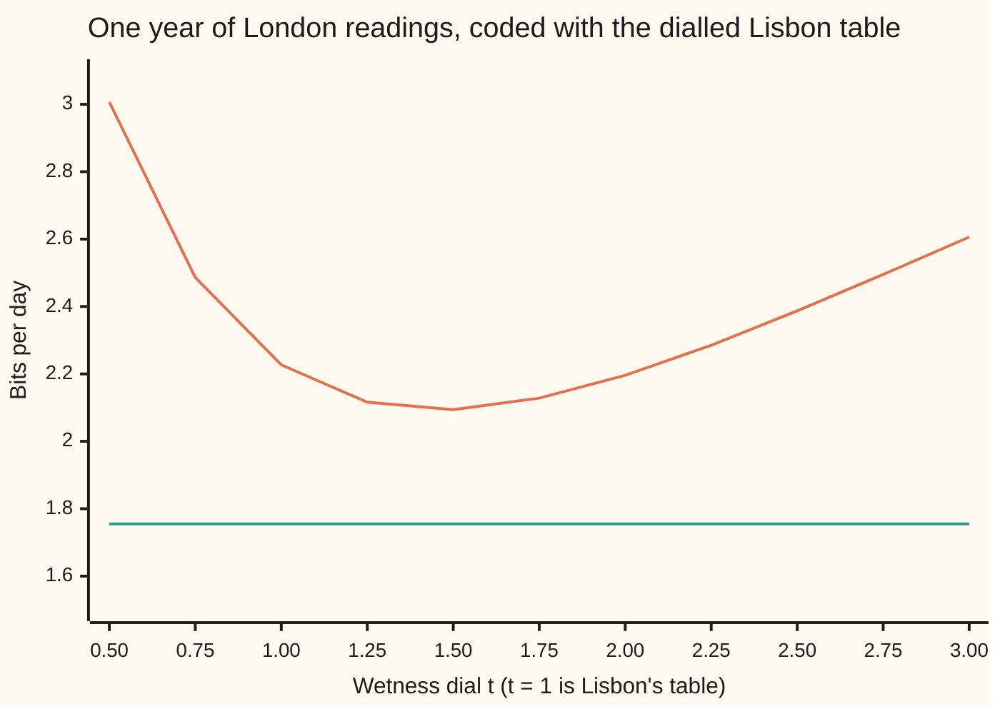

# KL divergence: the bits you waste by coding for the wrong distribution

[Syllabus](../../../SYLLABUS.md) → [Applied and computational](../README.md) → [Information Theory](../README.md#s03) → KL divergence

---

## General Overview

A weather station in London sends one reading a day over a radio link: sunny, cloudy, drizzle or rain. Radio time costs power, so each reading goes out as a short string of 0s and 1s. The station's codebook was copied from a sister station in Lisbon.

Lisbon's codebook is a good one, for Lisbon. Half of Lisbon's days are sunny, so "sunny" gets the shortest codeword, a single `0`. Rain is rare there, so rain gets three bits, `111`. In London the sky is different: cloudy on half the days, sunny on only one in eight. The Lisbon book spends two bits on London's commonest reading and keeps its one-bit word for a reading London rarely sends.

With a codebook built for London, the station sends 1.75 bits a day on average. With Lisbon's book it sends 2.25. The extra half bit a day, 182.5 bits a year, buys nothing. That waste is the **Kullback-Leibler divergence** (KL divergence, written D); the average 2.25 is the **cross-entropy**. Both tables are synthetic: round numbers in the rough shape of the two climates, chosen so every codeword is a whole number of bits.

The count also runs backwards. Fitting a model to a year of London readings by **maximum likelihood** (picking the table under which the observed year was most probable) picks the table that wastes the fewest bits on that year.

**Coding readings from one table p with a code built for another table q costs D(p‖q) extra bits per reading on average; that waste is never negative, is zero only when the tables agree, and maximum likelihood is the act of making it as small as the model allows.**

**What kind of fact this is:** a definition (the divergence and the cross-entropy) and two theorems proved on this card in Why it works: the divergence is never negative (Gibbs' inequality), and maximising likelihood minimises the divergence from the data.

### The picture: bits per day for London's sky

```
London's own code    ███████████████████████████████████            1.75 bits/day
Lisbon's code        █████████████████████████████████████████████  2.25 bits/day
                                                        └ waste  ┘  0.50 bits/day
```

One bar is 20 blocks per bit. The ten extra blocks on the Lisbon bar are the divergence.

---

## The formula

Notation from [Entropy](01-entropy.md): a table p lists the chance p(x) of each reading x, and H(p), the entropy, is the fewest bits per reading any code can average. log2 is the logarithm base 2, so log2(8) = 3: a reading with chance 1 in 8 is worth 3 bits.

$$H(p, q) = \sum_x p(x)\,\log_2\frac{1}{q(x)} \qquad D(p\,\|\,q) = \sum_x p(x)\,\log_2\frac{p(x)}{q(x)} = H(p, q) - H(p)$$

**Read it aloud:** the cross-entropy is the bits a code built for q spends per reading when the readings really follow p, and the divergence is how much of that is waste over the best code for p.

The order matters: D(p‖q) is read "the divergence of p from q", and the true table p always comes first, because it supplies the weights.

| Symbol | Plain meaning | In our example | Push it up and the answer… |
| --- | --- | --- | --- |
| $x$ | one day's reading | sunny, cloudy, drizzle or rain | — |
| $p(x)$ | the true chance of reading x, the sky that actually happens | London: 0.125, 0.500, 0.250, 0.125 | more weight on the readings the code serves badly raises the waste |
| $q(x)$ | the chance the code was built for; Step 2 writes y for the ratio q(x)/p(x) | Lisbon: 0.500, 0.250, 0.125, 0.125 | moving q towards p lowers the waste to 0 |
| $\ell(x)$ | the codeword length for x, in bits; a code built for q uses $\ell(x) = \log_2 (1/q(x))$ | Lisbon: 1, 2, 3, 3 | a longer word on a common reading costs more |
| $H(p)$ | entropy: bits per reading with the best code for p | 1.75 | — |
| $H(p, q)$ | cross-entropy: bits per reading with q's code on p's sky | 2.25 | grows as q drifts from p |
| $D(p\,\|\,q)$ | KL divergence: the wasted bits per reading; with the natural log ln in place of log2 it counts nats | 0.5 (0.346574 in nats) | grows as q drifts; infinite if q(x) = 0 for a reading p sends |
| $n$ | the number of days observed | 365 | more days pull the year's table towards p |
| $\hat p(x)$ | "p-hat": the share of the n days that read x | 49, 184, 86 and 46 days of 365 | — |
| $k(x)$, $\bar k$ | the wetness score of a reading: 0 sunny, 1 cloudy, 2 drizzle, 3 rain; $\bar k$ is its average over the year | $\bar k$ = 1.353425 | — |
| $t$, $\theta$ | the wetness dial on Lisbon's table; t = 1 is Lisbon itself; the fold writes $t = e^\theta$ | best fit 1.455 | above 1 moves weight towards rain |
| $q_t(x)$, $Z(t)$ | the dialled table $q(x)\,t^{k(x)}/Z(t)$; Z(t) is the total that makes it add to 1 | fitted: 0.330, 0.240, 0.175, 0.254 | — |

### When it holds

- **q must give every reading p can send a chance above zero.** If Lisbon's table had rain at 0, the Lisbon code would have no codeword for rain, and the first rainy London day could not be sent. The divergence is then infinite, and the check prints `inf`.
- **The lengths log2(1/q) are whole numbers only when every chance is a power of 1/2.** Here they are, by design. Otherwise a real code such as [Huffman coding](05-source-coding-and-huffman.md) pays up to one extra bit per reading, and [Arithmetic and Lempel-Ziv coding](06-arithmetic-and-lempel-ziv-coding.md) closes that gap over long runs. The divergence counts the waste of the ideal code.
- **The days follow one fixed table, independently.** The averages are long-run averages; over a single week the waste can be more or less than half a bit a day.
- **p is the truth, and nobody knows it.** In practice p is replaced by $\hat p$, a sample's own table (Step 3).
- **Bits need log2.** The same sum with the natural logarithm ln counts in nats, a larger unit, and gives 0.346574 for the same waste.

---

## Why it works

### Step 0: a code is a bet on a table

A prefix code (no codeword is the start of another, so a string of bits splits into readings one way only) with lengths ℓ(x) satisfies the Kraft sum: the numbers $2^{-\ell(x)}$ add to at most 1 ([Huffman coding](05-source-coding-and-huffman.md)). So every code quietly names a table, $q(x) = 2^{-\ell(x)}$, and every table names a code with $\ell(x) = \log_2(1/q(x))$. Lisbon's lengths 1, 2, 3, 3 are the table 0.5, 0.25, 0.125, 0.125; both Kraft sums print as exactly 1.

Choosing a code is betting on how often each reading will come.

### Step 1: the cross-entropy is the bill

Under London's sky, a reading x arrives a share p(x) of the days and costs log2(1/q(x)) bits under Lisbon's code. Average over the days:

$$H(p, q) = \sum_x p(x) \log_2\frac{1}{q(x)} = 0.125 \times 1 + 0.5 \times 2 + 0.25 \times 3 + 0.125 \times 3 = 2.25 \text{ bits.}$$

London's own code charges log2(1/p(x)), and its bill is the entropy, 1.75 bits. Subtract the two bills reading by reading:

$$H(p, q) - H(p) = \sum_x p(x) \left[\log_2\frac{1}{q(x)} - \log_2\frac{1}{p(x)}\right] = \sum_x p(x)\log_2\frac{p(x)}{q(x)} = D(p\,\|\,q).$$

Sunny days save Lisbon's code 2 bits but come one day in eight. Cloudy days cost 1 extra bit every other day; drizzle 1 extra bit one day in four. Net: half a bit a day.

### Step 2: the waste is never negative (Gibbs' inequality)

[Densities and likelihood ratios](../../10-Measure%20and%20integration/08-Densities%20and%20Changing%20Measure/06-densities-and-likelihood-ratios.md) proves the divergence non-negative for any two models with [Jensen's inequality](../../09-Probability%20and%20statistics/02-Random%20Variables/06-jensens-inequality.md). For finite tables, one fact about logarithms is enough.

The fact: $\ln y \le y - 1$ for every y > 0, with equality only at y = 1. The curve ln y bends downward ([Convex functions](../../06-Calculus%20and%20analysis/07-Several%20Variables/09-convex-functions.md)) and touches its tangent line y − 1 at y = 1.

Put $y = q(x)/p(x)$ for each reading with p(x) > 0, multiply by p(x) and add:

$$\sum_x p(x)\ln\frac{q(x)}{p(x)} \;\le\; \sum_x p(x)\left(\frac{q(x)}{p(x)} - 1\right) = \sum_x q(x) - \sum_x p(x) \le 1 - 1 = 0.$$

The left side is minus the divergence, in nats. So $D(p\,\|\,q) \ge 0$. Equality needs y = 1 at every reading, so the waste is zero only when q = p. For London and Lisbon the left side is −0.346574 and the right side 0, and the check confirms the inequality reading by reading.

Two consequences come free. No code beats the entropy: any code is some table q, and its bill H(p, q) is H(p) plus something non-negative. And the divergence is not a distance: D(q‖p), coding Lisbon's sky with London's book, is 0.625 bits, not 0.5.

### Step 3: maximum likelihood is divergence minimisation

Now turn it around. London's true table is unknown; what exists is a log of n = 365 days. In the simulated year, the counts are 49 sunny, 184 cloudy, 86 drizzle and 46 rain, so $\hat p$ is those counts divided by 365.

A model is a table q. Its likelihood ([Maximum likelihood](../../09-Probability%20and%20statistics/07-Sampling%20and%20Estimation/04-maximum-likelihood.md)) is the product of q over the 365 days. Take minus log2 and divide by n:

$$-\frac{1}{n}\log_2 \prod_{\text{days}} q(x_{\text{day}}) = \sum_x \hat p(x)\log_2\frac{1}{q(x)} = H(\hat p, q) = H(\hat p) + D(\hat p\,\|\,q).$$

The middle step groups the days by reading: reading x turns up $n\,\hat p(x)$ times. So minus the average log-likelihood is the bits per day the model's code would spend sending this very year.

$H(\hat p)$, 1.755044 bits, belongs to the data and does not move with the model. So the table with the highest likelihood is the one with the smallest $D(\hat p\,\|\,q)$. If every table is allowed, Gibbs says the answer is $q = \hat p$, the year's own shares, and the divergence falls to zero.

Usually the model is restricted. Give the Lisbon forecaster one dial t, "wetter": multiply each reading's Lisbon chance by t once per step of wetness, then rescale so the table adds to 1. The chart scans the dial. At every setting, the bits per day equals 1.755044 plus the divergence, which the check confirms to nine decimals.



Orange: bits per day, which is minus the average log-likelihood. Green: the year's entropy, 1.755 bits, the floor no table can beat. The gap between them is the divergence. The likelihood peak and the divergence floor fall at the same dial, t = 1.455, and the divergence left there is 0.337930 bits a day: the price of a one-dial model that cannot reproduce London's cloudy days.

<details>
<summary>Why the best dial matches the average wetness</summary>

Write the dialled table as $q_t(x) = q(x)\,t^{k(x)}/Z(t)$ with $Z(t) = \sum_x q(x)\,t^{k(x)}$. The average log-likelihood per day, in nats, is

$$\sum_x \hat p(x)\left[\ln q(x) + k(x)\ln t\right] - \ln Z(t).$$

Its slope in t is $\bar k / t - Z'(t)/Z(t)$, where $\bar k = \sum_x \hat p(x)\,k(x)$ is the year's average wetness. Since $Z'(t) = \sum_x q(x)\,k(x)\,t^{k(x)-1}$, the ratio $Z'(t)/Z(t)$ is $\frac1t\sum_x q_t(x)\,k(x)$, the model's average wetness over t. The slope is zero exactly when the model's average wetness equals the year's, 1.353425. This is the tilt of [Densities and likelihood ratios](../../10-Measure%20and%20integration/08-Densities%20and%20Changing%20Measure/06-densities-and-likelihood-ratios.md) with $e^\theta = t$ (θ is that card's tilt strength). Bisection on that equation gives t = 1.455125, the third road to the fit.

</details>

### Step 4: a small divergence means close tables

Pinsker's inequality, stated here and proved in Cover and Thomas (Sources): the largest difference in chance two tables give to any event is at most $\sqrt{D \ln 2 / 2}$, with D in bits. For London and Lisbon that largest difference is 0.375 (the reading "sunny": 0.5 under Lisbon against 0.125 under London), and the ceiling is 0.416277. So a small divergence forces the two tables to agree on every event. The year's own table $\hat p$, the unrestricted fit, drifts towards London's true p as days pile up, so its divergence from p shrinks and Pinsker turns that into closeness event by event. A restricted model such as the one-dial table keeps a floor of divergence that no amount of data removes: 0.353661 bits for London's true table, at t = 1.477712. This one year's fit shows 0.337930; more days pull it toward the floor.

---

## Worked numbers, by hand

London's sky, Lisbon's code.

| Step | Arithmetic | Value |
| --- | --- | --- |
| Lisbon lengths | log2(1/0.5), log2(1/0.25), log2(1/0.125), log2(1/0.125) | 1, 2, 3, 3 bits |
| London lengths | log2(1/0.125), log2(1/0.5), log2(1/0.25), log2(1/0.125) | 3, 1, 2, 3 bits |
| H(p), London's code | 0.125 × 3 + 0.5 × 1 + 0.25 × 2 + 0.125 × 3 | 1.75 bits |
| H(p, q), Lisbon's code | 0.125 × 1 + 0.5 × 2 + 0.25 × 3 + 0.125 × 3 | 2.25 bits |
| D by subtraction | 2.25 − 1.75 | 0.5 bits |
| D by the sum | 0.125 × log2(0.25) + 0.5 × log2(2) + 0.25 × log2(2) + 0.125 × log2(1) = −0.25 + 0.5 + 0.25 + 0 | 0.5 bits |
| a year of waste | 365 × 0.5 | **182.5 bits** |

The Lisbon codebook costs London's station half a bit on every reading, 182.5 bits a year, against a codebook built for London. The simulated 100,000 days agree: 224,997 bits with Lisbon's code against 175,110 with London's.

### What breaks if you drop a piece

| Mistake | Comes out at | What went wrong |
| --- | --- | --- |
| Swap the arguments: D(q‖p) | 0.625 bits | That is the waste of coding Lisbon's sky with London's book, a different question |
| Drop the weights: add log2(p/q) over the four readings | 0 bits | Rare sunny days count as much as common cloudy ones, and the gains and losses cancel by accident |
| Use ln instead of log2 | 0.346574 | That is the right waste in nats, a larger unit; read as bits it undercounts the waste |
| Lisbon's table gives rain chance 0, rain's share moved to cloudy and drizzle | infinite | The hypothesis q(x) > 0 fails: rain has no codeword, so a rainy day cannot be sent at any cost |

---

## Code, from first principles, and it actually runs

The script takes three roads. One: the sums, with the divergence computed directly and as a difference. Two: an instrumented run that draws 100,000 synthetic days from London's table with a written-out SplitMix64 generator (a small, repeatable pseudo-random number generator; seed 20261111), turns them into a real bit string with each code, counts the bits and decodes the string back. Three: the wetness dial fitted to the first 365 days by largest likelihood, by smallest divergence, and by bisection on the average-wetness equation. It also checks Gibbs' inequality reading by reading and Pinsker's ceiling, and finds the one-dial floor for London's true table.

### Python

```python
# KL divergence and cross-entropy -- the check behind the card.  Standard library only.
# A London station codes its daily sky with a Lisbon station's codebook.
# Roads: the sums; a simulated radio log encoded, counted and decoded bit by bit;
# and a fitted dial found by likelihood, by divergence and by matching the mean.
import math

SKY = ["sunny", "cloudy", "drizzle", "rain"]
P = [0.125, 0.5, 0.25, 0.125]                  # London's table (synthetic, round numbers)
Q = [0.5, 0.25, 0.125, 0.125]                  # Lisbon's table (synthetic, round numbers)
LISBON = ["0", "10", "110", "111"]             # Lisbon's prefix code
LONDON = ["110", "0", "10", "111"]             # London's own prefix code

def H(p): return -sum(a * math.log2(a) for a in p if a > 0)
def cross(p, q): return sum(a * (-math.log2(b) if b > 0 else math.inf) for a, b in zip(p, q) if a > 0)
def kl(p, q): return sum(a * (math.log2(a / b) if b > 0 else math.inf) for a, b in zip(p, q) if a > 0)

def splitmix(state):                           # SplitMix64, written out
    state = (state + 0x9E3779B97F4A7C15) & 0xFFFFFFFFFFFFFFFF
    z = state
    z = ((z ^ (z >> 30)) * 0xBF58476D1CE4E5B9) & 0xFFFFFFFFFFFFFFFF
    z = ((z ^ (z >> 27)) * 0x94D049BB133111EB) & 0xFFFFFFFFFFFFFFFF
    return state, z ^ (z >> 31)

def draw_days(n, seed):
    s, days = seed, []
    for _ in range(n):
        s, z = splitmix(s)
        u = (z >> 11) / 9007199254740992.0
        acc, k = 0.0, 0
        while k < 3 and u >= acc + P[k]:
            acc += P[k]; k += 1
        days.append(k)
    return days

def decode(bits, code):
    out, word = [], ""
    for b in bits:
        word += b
        if word in code:
            out.append(code.index(word)); word = ""
    return out

def dial(t):                                   # Lisbon's table, each step wetter times t
    w = [Q[0], Q[1] * t, Q[2] * t * t, Q[3] * t * t * t]
    return [x / sum(w) for x in w]

def fit(target):                               # bisection: the dial whose mean wetness is target
    lo, hi = 0.5, 3.0
    for _ in range(60):
        mid = (lo + hi) / 2
        if sum(k * w for k, w in enumerate(dial(mid))) < target: lo = mid
        else: hi = mid
    return lo

def f(label, x): print(f"{label:<40}{x:>12.6f}")

print("sky              " + "".join(f"{s:>9}" for s in SKY))
print("London p         " + "".join(f"{a:>9.3f}" for a in P))
print("Lisbon q         " + "".join(f"{a:>9.3f}" for a in Q))
print("Lisbon codeword  " + "".join(f"{c:>9}" for c in LISBON))
print("London codeword  " + "".join(f"{c:>9}" for c in LONDON))
print("Kraft sums, Lisbon and London         " + f"{sum(2.0 ** -len(c) for c in LISBON):.3f} {sum(2.0 ** -len(c) for c in LONDON):.3f}")
hp, hpq, d, drev = H(P), cross(P, Q), kl(P, Q), kl(Q, P)
f("H(p)     London sky, London code", hp)
f("H(p,q)   London sky, Lisbon code", hpq)
f("D(p||q)  by the sum of p log2(p/q)", d)
f("D(p||q)  as H(p,q) - H(p)", hpq - hp)
f("D(q||p)  Lisbon sky, London code", drev)
f("bits wasted in a 365-day year", 365 * d)
terms = [(a * math.log(b / a), a * (b / a - 1)) for a, b in zip(P, Q)]
f("-D in nats, sum of p ln(q/p)", sum(x for x, _ in terms))
f("Gibbs ceiling, sum of p (q/p - 1)", sum(y for _, y in terms))
tv = 0.5 * sum(abs(a - b) for a, b in zip(P, Q))
f("total variation TV(p,q)", tv)
f("Pinsker ceiling sqrt(D ln2 / 2)", math.sqrt(d * math.log(2) / 2))

N = 100000
days = draw_days(N, 20261111)
for name, code in (("Lisbon", LISBON), ("London", LONDON)):
    bits = "".join(code[k] for k in days)
    lens = [len(code[k]) for k in days]
    mean = len(bits) / N
    se = math.sqrt(sum((x - mean) ** 2 for x in lens) / (N - 1) / N)
    assert decode(bits, code) == days, "the prefix code must decode back to the log"
    print(f"simulated {N} days, {name} code: {len(bits)} bits = {mean:.6f} per day (se {se:.6f})")
    if name == "Lisbon": sim_lis, se_lis = mean, se
    else: sim_lon = mean

print("wrong: arguments swapped, D(q||p)       " + f"{drev:12.6f}")
print("wrong: sum of log2(p/q), no weights     " + f"{sum(math.log2(a / b) for a, b in zip(P, Q)):12.6f}")
print("wrong: natural log, nats not bits       " + f"{sum(a * math.log(a / b) for a, b in zip(P, Q)):12.6f}")
print("broken: Lisbon table with rain at 0     " + f"{kl(P, [0.5, 0.3125, 0.1875, 0.0]):12.6f}")

year = days[:365]
cnt = [year.count(k) for k in range(4)]
ph = [c / 365 for c in cnt]
print("one year of the log, counts          " + " ".join(f"{c:>4}" for c in cnt) + f"   mean wetness {sum(k * c for k, c in enumerate(cnt)) / 365:.6f}")
f("H(p-hat), the year's own entropy", H(ph))
ts = [0.5 + 0.25 * i for i in range(11)]
nll = [-sum(math.log2(dial(t)[k]) for k in year) / 365 for t in ts]
gap = [H(ph) + kl(ph, dial(t)) for t in ts]
print("chart, dial t   " + " ".join(f"{t:5.2f}" for t in ts))
print("chart, bits/day " + " ".join(f"{x:5.3f}" for x in nll))
grid = [0.5 + 0.001 * i for i in range(2501)]
t_like = max(grid, key=lambda t: sum(math.log2(dial(t)[k]) for k in year))
t_div = min(grid, key=lambda t: kl(ph, dial(t)))
t_mean = fit(sum(year) / 365)                  # the year's own table
t_true = fit(sum(k * a for k, a in enumerate(P)))   # London's true table: the floor data tends to
f("best dial by likelihood (grid 0.001)", t_like)
f("best dial by divergence (grid 0.001)", t_div)
f("best dial by matching mean wetness", t_mean)
f("divergence left at the best dial", kl(ph, dial(t_mean)))
print("fitted table     " + "".join(f"{a:>9.3f}" for a in dial(t_mean)))
f("best dial for London's true table", t_true)
f("divergence floor for London's true table", kl(P, dial(t_true)))

assert abs(hp - 1.75) < 1e-12 and abs(hpq - 2.25) < 1e-12, "hand values of the card"
assert abs(d - (hpq - hp)) < 1e-12 and d > 0 and drev != d, "divergence = cross-entropy - entropy"
assert abs(sum(P[k] * len(LISBON[k]) for k in range(4)) - hpq) < 1e-12, "Lisbon lengths are -log2 q"
assert abs(sim_lis - hpq) < 4 * se_lis and abs((sim_lis - sim_lon) - d) < 0.02, "simulated radio log"
assert all(x <= y for x, y in terms) and tv <= math.sqrt(d * math.log(2) / 2), "Gibbs and Pinsker"
assert all(abs(a - b) < 1e-9 for a, b in zip(nll, gap)), "average code length = H(p-hat) + D"
assert abs(t_like - t_div) < 0.0011 and abs(t_like - t_mean) < 0.001, "likelihood peak = divergence floor"
assert all(kl(P, dial(t)) >= kl(P, dial(t_true)) - 1e-12 for t in grid), "the true table's floor"
print("ALL CHECKS PASS")
```

**Ran 2026-11-11 on macOS, Python 3.14.10, standard library only. All checks passed. Output, pasted from the run:**

```
sky                  sunny   cloudy  drizzle     rain
London p             0.125    0.500    0.250    0.125
Lisbon q             0.500    0.250    0.125    0.125
Lisbon codeword          0       10      110      111
London codeword        110        0       10      111
Kraft sums, Lisbon and London         1.000 1.000
H(p)     London sky, London code            1.750000
H(p,q)   London sky, Lisbon code            2.250000
D(p||q)  by the sum of p log2(p/q)          0.500000
D(p||q)  as H(p,q) - H(p)                   0.500000
D(q||p)  Lisbon sky, London code            0.625000
bits wasted in a 365-day year             182.500000
-D in nats, sum of p ln(q/p)               -0.346574
Gibbs ceiling, sum of p (q/p - 1)           0.000000
total variation TV(p,q)                     0.375000
Pinsker ceiling sqrt(D ln2 / 2)             0.416277
simulated 100000 days, Lisbon code: 224997 bits = 2.249970 per day (se 0.002093)
simulated 100000 days, London code: 175110 bits = 1.751100 per day (se 0.002623)
wrong: arguments swapped, D(q||p)           0.625000
wrong: sum of log2(p/q), no weights         0.000000
wrong: natural log, nats not bits           0.346574
broken: Lisbon table with rain at 0              inf
one year of the log, counts            49  184   86   46   mean wetness 1.353425
H(p-hat), the year's own entropy            1.755044
chart, dial t    0.50  0.75  1.00  1.25  1.50  1.75  2.00  2.25  2.50  2.75  3.00
chart, bits/day 3.007 2.486 2.227 2.116 2.094 2.128 2.196 2.285 2.387 2.495 2.606
best dial by likelihood (grid 0.001)        1.455000
best dial by divergence (grid 0.001)        1.455000
best dial by matching mean wetness          1.455125
divergence left at the best dial            0.337930
fitted table         0.330    0.240    0.175    0.254
best dial for London's true table           1.477712
divergence floor for London's true table    0.353661
ALL CHECKS PASS
```

### Rust

```rust
// KL divergence and cross-entropy -- the check behind the card.  std only, no crates.
// A London station codes its daily sky with a Lisbon station's codebook.
// Roads: the sums; a simulated radio log encoded, counted and decoded bit by bit;
// and a fitted dial found by likelihood, by divergence and by matching the mean.
const SKY: [&str; 4] = ["sunny", "cloudy", "drizzle", "rain"];
const P: [f64; 4] = [0.125, 0.5, 0.25, 0.125]; // London's table (synthetic, round numbers)
const Q: [f64; 4] = [0.5, 0.25, 0.125, 0.125]; // Lisbon's table (synthetic, round numbers)
const LISBON: [&str; 4] = ["0", "10", "110", "111"]; // Lisbon's prefix code
const LONDON: [&str; 4] = ["110", "0", "10", "111"]; // London's own prefix code

fn h(p: &[f64]) -> f64 { -p.iter().filter(|&&a| a > 0.0).map(|a| a * a.log2()).sum::<f64>() }
fn cross(p: &[f64], q: &[f64]) -> f64 {
    p.iter().zip(q).filter(|(a, _)| **a > 0.0)
        .map(|(a, b)| a * if *b > 0.0 { -b.log2() } else { f64::INFINITY }).sum()
}
fn kl(p: &[f64], q: &[f64]) -> f64 {
    p.iter().zip(q).filter(|(a, _)| **a > 0.0)
        .map(|(a, b)| a * if *b > 0.0 { (a / b).log2() } else { f64::INFINITY }).sum()
}
fn splitmix(state: u64) -> (u64, u64) { // SplitMix64, written out
    let s = state.wrapping_add(0x9E3779B97F4A7C15);
    let mut z = s;
    z = (z ^ (z >> 30)).wrapping_mul(0xBF58476D1CE4E5B9);
    z = (z ^ (z >> 27)).wrapping_mul(0x94D049BB133111EB);
    (s, z ^ (z >> 31))
}
fn draw_days(n: usize, seed: u64) -> Vec<usize> {
    let (mut s, mut days) = (seed, Vec::with_capacity(n));
    for _ in 0..n {
        let (s2, z) = splitmix(s);
        s = s2;
        let u = (z >> 11) as f64 / 9007199254740992.0;
        let (mut acc, mut k) = (0.0, 0);
        while k < 3 && u >= acc + P[k] { acc += P[k]; k += 1; }
        days.push(k);
    }
    days
}
fn decode(bits: &str, code: &[&str; 4]) -> Vec<usize> {
    let (mut out, mut word) = (Vec::new(), String::new());
    for b in bits.chars() {
        word.push(b);
        if let Some(k) = code.iter().position(|c| *c == word) { out.push(k); word.clear(); }
    }
    out
}
fn dial(t: f64) -> [f64; 4] { // Lisbon's table, each step wetter times t
    let w = [Q[0], Q[1] * t, Q[2] * t * t, Q[3] * t * t * t];
    let s: f64 = w.iter().sum();
    [w[0] / s, w[1] / s, w[2] / s, w[3] / s]
}
fn fit(target: f64) -> f64 { // bisection: the dial whose mean wetness is target
    let (mut lo, mut hi) = (0.5, 3.0);
    for _ in 0..60 {
        let mid = (lo + hi) / 2.0;
        let m: f64 = dial(mid).iter().enumerate().map(|(k, w)| k as f64 * w).sum();
        if m < target { lo = mid; } else { hi = mid; }
    }
    lo
}
fn f(label: &str, x: f64) { println!("{:<40}{:>12.6}", label, x); }
fn row(label: &str, v: &[f64]) { println!("{}{}", label, v.iter().map(|a| format!("{:>9.3}", a)).collect::<String>()); }
fn loglik(t: f64, year: &[usize]) -> f64 { let q = dial(t); year.iter().map(|&k| q[k].log2()).sum() }

fn main() {
    println!("sky              {}", SKY.iter().map(|s| format!("{:>9}", s)).collect::<String>());
    row("London p         ", &P);
    row("Lisbon q         ", &Q);
    println!("Lisbon codeword  {}", LISBON.iter().map(|s| format!("{:>9}", s)).collect::<String>());
    println!("London codeword  {}", LONDON.iter().map(|s| format!("{:>9}", s)).collect::<String>());
    let kraft = |c: &[&str; 4]| c.iter().map(|w| 2f64.powi(-(w.len() as i32))).sum::<f64>();
    println!("Kraft sums, Lisbon and London         {:.3} {:.3}", kraft(&LISBON), kraft(&LONDON));
    let (hp, hpq, d, drev) = (h(&P), cross(&P, &Q), kl(&P, &Q), kl(&Q, &P));
    f("H(p)     London sky, London code", hp);
    f("H(p,q)   London sky, Lisbon code", hpq);
    f("D(p||q)  by the sum of p log2(p/q)", d);
    f("D(p||q)  as H(p,q) - H(p)", hpq - hp);
    f("D(q||p)  Lisbon sky, London code", drev);
    f("bits wasted in a 365-day year", 365.0 * d);
    let terms: Vec<(f64, f64)> = P.iter().zip(&Q).map(|(a, b)| (a * (b / a).ln(), a * (b / a - 1.0))).collect();
    f("-D in nats, sum of p ln(q/p)", terms.iter().map(|t| t.0).sum());
    f("Gibbs ceiling, sum of p (q/p - 1)", terms.iter().map(|t| t.1).sum());
    let tv = 0.5 * P.iter().zip(&Q).map(|(a, b)| (a - b).abs()).sum::<f64>();
    let pinsker = (d * 2f64.ln() / 2.0).sqrt();
    f("total variation TV(p,q)", tv);
    f("Pinsker ceiling sqrt(D ln2 / 2)", pinsker);

    let n = 100000usize;
    let days = draw_days(n, 20261111);
    let (mut sim_lis, mut se_lis, mut sim_lon) = (0.0, 0.0, 0.0);
    for (name, code) in [("Lisbon", &LISBON), ("London", &LONDON)] {
        let bits: String = days.iter().map(|&k| code[k]).collect();
        let lens: Vec<f64> = days.iter().map(|&k| code[k].len() as f64).collect();
        let mean = bits.len() as f64 / n as f64;
        let se = (lens.iter().map(|x| (x - mean) * (x - mean)).sum::<f64>() / (n - 1) as f64 / n as f64).sqrt();
        assert!(decode(&bits, code) == days, "the prefix code must decode back to the log");
        println!("simulated {} days, {} code: {} bits = {:.6} per day (se {:.6})", n, name, bits.len(), mean, se);
        if name == "Lisbon" { sim_lis = mean; se_lis = se; } else { sim_lon = mean; }
    }

    let noweights: f64 = P.iter().zip(&Q).map(|(a, b)| (a / b).log2()).sum();
    let nats: f64 = P.iter().zip(&Q).map(|(a, b)| a * (a / b).ln()).sum();
    println!("wrong: arguments swapped, D(q||p)       {:12.6}", drev);
    println!("wrong: sum of log2(p/q), no weights     {:12.6}", noweights);
    println!("wrong: natural log, nats not bits       {:12.6}", nats);
    println!("broken: Lisbon table with rain at 0     {:12.6}", kl(&P, &[0.5, 0.3125, 0.1875, 0.0]));

    let year = &days[..365];
    let cnt: Vec<usize> = (0..4).map(|k| year.iter().filter(|&&x| x == k).count()).collect();
    let ph: Vec<f64> = cnt.iter().map(|&c| c as f64 / 365.0).collect();
    let wet: usize = cnt.iter().enumerate().map(|(k, c)| k * c).sum();
    println!("one year of the log, counts          {}   mean wetness {:.6}",
             cnt.iter().map(|c| format!("{:>4}", c)).collect::<Vec<_>>().join(" "), wet as f64 / 365.0);
    f("H(p-hat), the year's own entropy", h(&ph));
    let ts: Vec<f64> = (0..11).map(|i| 0.5 + 0.25 * i as f64).collect();
    let nll: Vec<f64> = ts.iter().map(|&t| -loglik(t, year) / 365.0).collect();
    let gap: Vec<f64> = ts.iter().map(|&t| h(&ph) + kl(&ph, &dial(t))).collect();
    println!("chart, dial t   {}", ts.iter().map(|t| format!("{:5.2}", t)).collect::<Vec<_>>().join(" "));
    println!("chart, bits/day {}", nll.iter().map(|x| format!("{:5.3}", x)).collect::<Vec<_>>().join(" "));
    let (mut t_like, mut best_l, mut t_div, mut best_d) = (0.5, f64::NEG_INFINITY, 0.5, f64::INFINITY);
    for i in 0..2501 {
        let t = 0.5 + 0.001 * i as f64;
        let l = loglik(t, year);
        if l > best_l { best_l = l; t_like = t; }
        let dd = kl(&ph, &dial(t));
        if dd < best_d { best_d = dd; t_div = t; }
    }
    let t_mean = fit(wet as f64 / 365.0);                                  // the year's own table
    let t_true = fit((0..4).map(|k| k as f64 * P[k]).sum());             // London's true table
    f("best dial by likelihood (grid 0.001)", t_like);
    f("best dial by divergence (grid 0.001)", t_div);
    f("best dial by matching mean wetness", t_mean);
    f("divergence left at the best dial", kl(&ph, &dial(t_mean)));
    row("fitted table     ", &dial(t_mean));
    f("best dial for London's true table", t_true);
    f("divergence floor for London's true table", kl(&P, &dial(t_true)));

    let lis_len: f64 = (0..4).map(|k| P[k] * LISBON[k].len() as f64).sum();
    assert!((hp - 1.75).abs() < 1e-12 && (hpq - 2.25).abs() < 1e-12, "hand values of the card");
    assert!((d - (hpq - hp)).abs() < 1e-12 && d > 0.0 && drev != d, "divergence = cross-entropy - entropy");
    assert!((lis_len - hpq).abs() < 1e-12, "Lisbon lengths are -log2 q");
    assert!((sim_lis - hpq).abs() < 4.0 * se_lis && ((sim_lis - sim_lon) - d).abs() < 0.02, "simulated radio log");
    assert!(terms.iter().all(|(x, y)| x <= y) && tv <= pinsker, "Gibbs and Pinsker");
    assert!(nll.iter().zip(&gap).all(|(a, b)| (a - b).abs() < 1e-9), "average code length = H(p-hat) + D");
    assert!((t_like - t_div).abs() < 0.0011 && (t_like - t_mean).abs() < 0.001, "likelihood peak = divergence floor");
    assert!((0..2501).all(|i| kl(&P, &dial(0.5 + 0.001 * i as f64)) >= kl(&P, &dial(t_true)) - 1e-12), "the true table's floor");
    println!("ALL CHECKS PASS");
}
```

**Ran 2026-11-11 on macOS, rustc 1.98.1, no crates. All checks passed. Output, pasted from the run:**

```
sky                  sunny   cloudy  drizzle     rain
London p             0.125    0.500    0.250    0.125
Lisbon q             0.500    0.250    0.125    0.125
Lisbon codeword          0       10      110      111
London codeword        110        0       10      111
Kraft sums, Lisbon and London         1.000 1.000
H(p)     London sky, London code            1.750000
H(p,q)   London sky, Lisbon code            2.250000
D(p||q)  by the sum of p log2(p/q)          0.500000
D(p||q)  as H(p,q) - H(p)                   0.500000
D(q||p)  Lisbon sky, London code            0.625000
bits wasted in a 365-day year             182.500000
-D in nats, sum of p ln(q/p)               -0.346574
Gibbs ceiling, sum of p (q/p - 1)           0.000000
total variation TV(p,q)                     0.375000
Pinsker ceiling sqrt(D ln2 / 2)             0.416277
simulated 100000 days, Lisbon code: 224997 bits = 2.249970 per day (se 0.002093)
simulated 100000 days, London code: 175110 bits = 1.751100 per day (se 0.002623)
wrong: arguments swapped, D(q||p)           0.625000
wrong: sum of log2(p/q), no weights         0.000000
wrong: natural log, nats not bits           0.346574
broken: Lisbon table with rain at 0              inf
one year of the log, counts            49  184   86   46   mean wetness 1.353425
H(p-hat), the year's own entropy            1.755044
chart, dial t    0.50  0.75  1.00  1.25  1.50  1.75  2.00  2.25  2.50  2.75  3.00
chart, bits/day 3.007 2.486 2.227 2.116 2.094 2.128 2.196 2.285 2.387 2.495 2.606
best dial by likelihood (grid 0.001)        1.455000
best dial by divergence (grid 0.001)        1.455000
best dial by matching mean wetness          1.455125
divergence left at the best dial            0.337930
fitted table         0.330    0.240    0.175    0.254
best dial for London's true table           1.477712
divergence floor for London's true table    0.353661
ALL CHECKS PASS
```

The two outputs match line for line. The simulated Lisbon bill, 2.249970 bits a day, sits within one standard error (0.002093) of the formula's 2.25. The likelihood and the divergence pick the same grid point, and bisection lands within a thousandth of it.

> [!TIP]
> **Try changing**
> Guess first, then run it. The asserts are pinned to the card's numbers, so most changes stop the script after the lines print.
> - **Give Lisbon London's table.** Set `Q = P`. Guess the waste first. The divergence prints 0.000000 and the cross-entropy prints 1.750000, the entropy: a code built for the right table wastes nothing. The hand-value assert stops it.
> - **Swap which sky is true.** Exchange the lists in `P` and `Q`. Guess whether the waste stays at half a bit. It prints 0.625000, the old D(q‖p): the waste depends on which table is the truth.
> - **Change the seed.** Replace `20261111` with another number. Guess whether the fitted dial moves. It shifts a little with the new year of data, but the likelihood peak and the divergence floor still land on the same grid point, because they are one quantity read two ways.
> - **Shrink the log.** Set `N = 1000`. Guess the standard error. It grows about tenfold, since a hundred times fewer days gives a spread ten times wider.

---

## The usual mistake

> [!warning]
> **Reading the divergence as a distance.** It is not symmetric. Coding London with Lisbon's book wastes 0.5 bits a day; coding Lisbon with London's book wastes 0.625. The first argument is the sky that actually happens. Ask "whose readings, whose codebook?" before writing D(·‖·).
>
> - **Dropping the weights.** Adding log2(p/q) over the readings without the weights p(x) gives 0 here, a claim of no waste at all.
> - **Mixing log bases.** The natural logarithm gives 0.346574 for the same waste. That is nats, not bits.
> - **A zero in the model's table.** A model that gives any observed reading chance 0 has infinite divergence and zero likelihood. Fitted tables are often smoothed (every count raised by one, say) so this cannot happen.
> - **Expecting the cross-entropy to reach zero.** The fitted year's loss cannot fall below its own entropy, 1.755044 bits a day. Only the divergence part, the gap above that floor, belongs to the model.

---

## Where you meet it in real life

- **Compression with a borrowed model.** A compressor tuned on one kind of file pays the divergence in extra bits per symbol on another kind.
- **Training classifiers.** The standard loss for a classifier that outputs chances is the cross-entropy against the labels. Minimising it is maximum likelihood, and so minimises the divergence from the data.
- **Scoring weather forecasts.** The logarithmic score, also called the ignorance score, charges a forecaster log2(1/q) bits for the chance q it gave to what happened. Its long-run average is the cross-entropy, and its excess over a forecaster who issues the true chances is the divergence.
- **Language models.** "Bits per character" on held-out text is a cross-entropy.

> **Say it back**
> A code is a bet on a table: a reading with chance q gets log2(1/q) bits. Coding readings from the true table p with a code built for q costs the cross-entropy H(p, q) bits per reading, and the excess over the best code, H(p), is the KL divergence D(p‖q). For London's sky with Lisbon's code that is 2.25 bits against 1.75, half a bit a day wasted. Gibbs' inequality, from ln y ≤ y − 1, shows the waste is never negative and zero only when the tables agree. Maximum likelihood minimises the divergence from the data's own table, so the best-fitting model is the one that would code the data in the fewest bits.

---

## What this builds on

- [Conditional entropy and mutual information](02-conditional-entropy-and-mutual-information.md): mutual information is itself a divergence, between the joint table and the product of its two parts.
- [Maximum likelihood](../../09-Probability%20and%20statistics/07-Sampling%20and%20Estimation/04-maximum-likelihood.md): the rule that picks the model under which the data were most probable, read here as a bit count.
- [Jensen's inequality](../../09-Probability%20and%20statistics/02-Random%20Variables/06-jensens-inequality.md): the general reason a bent function and an average do not commute, which gives the divergence its sign.
- [Convex functions](../../06-Calculus%20and%20analysis/07-Several%20Variables/09-convex-functions.md): what it means for a curve to bend, the shape behind ln y ≤ y − 1 and Gibbs' inequality.
- [Densities and likelihood ratios](../../10-Measure%20and%20integration/08-Densities%20and%20Changing%20Measure/06-densities-and-likelihood-ratios.md): the divergence for any two models, continuous ones included, as the average log of a likelihood ratio, and the tilt that the wetness dial uses.

## Where this goes next

- [Rate and distortion](10-lossy-compression-and-rate-distortion-in-outline.md): when some error in the readings is allowed, the fewest bits per reading is a minimised mutual information, which is a divergence.
- [Entropy](01-entropy.md): the cross-entropy as the training loss of a network that turns scores into chances.

The divergence measures how far a model sits from the data; how many days of data it takes before the fitted table can be trusted to a given divergence is the question this card leaves open.

---

## Sources

Verified 2026-11-11: every link below resolves to the publisher's page.

- Kullback, S., and R. A. Leibler. "On Information and Sufficiency." *The Annals of Mathematical Statistics* 22, no. 1 (1951). [doi:10.1214/aoms/1177729694](https://doi.org/10.1214/aoms/1177729694). The paper that defined the divergence, as the information for telling two hypotheses apart.
- Shannon, C. E. "A Mathematical Theory of Communication." *Bell System Technical Journal* 27, no. 3 (1948). [doi:10.1002/j.1538-7305.1948.tb01338.x](https://doi.org/10.1002/j.1538-7305.1948.tb01338.x). Entropy as the fewest bits per symbol, the floor the cross-entropy is measured against.
- Cover, T. M., and J. A. Thomas. *Elements of Information Theory*, 2nd ed. Wiley, 2006. [doi:10.1002/047174882X](https://doi.org/10.1002/047174882X). The divergence and Gibbs' inequality, the cost of coding with the wrong distribution, and Pinsker's inequality with proof.
