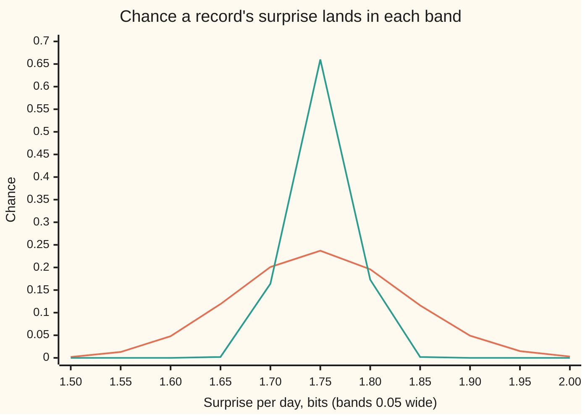
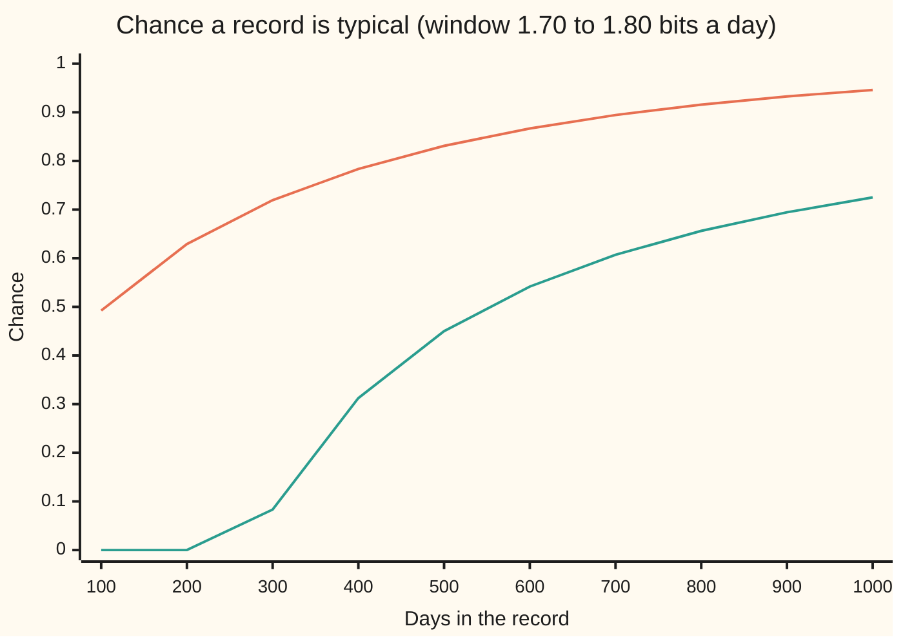
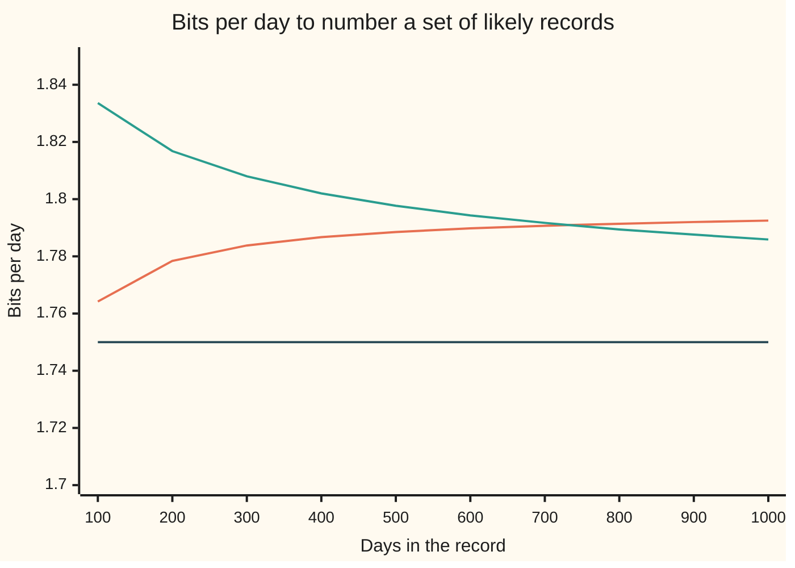

# Typical sequences: long messages all look alike, and that is where the limit comes from

[Syllabus](../../../SYLLABUS.md) → [Applied and computational](../README.md) → [Information Theory](../README.md#s03) → Typical sequences

---

## General Overview

A weather station on a hill radios one reading a day over a slow, noisy link: sunny, cloudy, rain or snow. Over the years, half the days have been sunny, a quarter cloudy, an eighth rain and an eighth snow, and one day tells nothing about the next. Every bit sent costs airtime. The question is how many bits a record of 1,000 days really needs.

Give each reading a 2-bit label and the record takes 2,000 bits. That covers every possible record: 4^1000 of them, which is 2^2000. Almost all of those will never be sent.

A real record holds close to 500 sunny days, 250 cloudy, 125 rain and 125 snow. Every record mixed in about those proportions has about the same chance: near 2^−1750, and between 2^−1800 and 2^−1700.

Together these **typical** records carry 94.59% of all the chance. There are about 2^1792.45 of them. That is a share of 2^−207.5 of all possible records: almost none of them.

So long records all look alike: the same mix, and so the same chance. Number the typical records and a 1,793-bit label names any one of them, against 2,000 bits for plain labels.

As the record grows and "about the same chance" is held to a tighter band, the cost per day falls toward 1.75 bits. That is the **entropy** of one reading, its average surprise ([Entropy](01-entropy.md)). This card shows why the cost falls toward the entropy, and why no scheme can get below it.

**In a long run of independent readings, nearly all the chance sits on about 2^(nH) records, each with chance close to 2^(−nH), so a record costs about H bits per reading and no fewer.**

**What kind of fact this is:** a theorem, the asymptotic equipartition property, proved on this card in Why it works for independent readings. The version for readings that depend on each other (the Shannon–McMillan–Breiman theorem) is stated, not proved.

### The picture: long records pile up at 1.75 bits a day



Orange: records of 100 days. Green: records of 1,000 days. A record's surprise per day is minus log2 of its chance, divided by the number of days. Ten times the days and the spread narrows sharply around 1.75.

---

## The formula

Start with one reading. Its **surprise** is $s(x) = -\log_2 p(x)$: minus the base-2 logarithm of its chance $p(x)$, in bits. A sunny day, chance 1/2, carries 1 bit of surprise. Cloudy, 1/4, carries 2 bits. Rain and snow, 1/8 each, carry 3 bits.

The entropy $H$, written $H(X)$ on the [Entropy](01-entropy.md) card, is the average surprise: $\tfrac12 \cdot 1 + \tfrac14 \cdot 2 + \tfrac18 \cdot 3 + \tfrac18 \cdot 3 = 1.75$ bits.

A **record** is $n$ readings in a row, written $x^n = (x_1, x_2, \dots, x_n)$. Here $n$ counts days; on the [Entropy](01-entropy.md) card it counted outcomes. The days are independent, so its chance is the product $p(x^n) = p(x_1)\,p(x_2) \cdots p(x_n)$. The capital $X_i$ is the reading on day $i$ before it is seen: a random variable. The equipartition property says:

$$-\frac{1}{n}\log_2 p(X_1, X_2, \dots, X_n) \;\longrightarrow\; H \quad \text{in probability}$$

**Read it aloud:** the surprise of a random record, per reading, lands close to the entropy with a chance that tends to 1 as the record grows.

"In probability" means: for any tolerance, the chance of missing by that much goes to zero.

Pick a tolerance $\varepsilon$ (Greek epsilon), here 0.05 bits a day. The **typical set** $A$ is every record whose surprise per day is within $\varepsilon$ of $H$:

$$A = \Big\{\, x^n \;:\; 2^{-n(H+\varepsilon)} \le p(x^n) \le 2^{-n(H-\varepsilon)} \,\Big\}$$

**Read it aloud:** a record is typical when its chance lies between 2 to the minus $n(H+\varepsilon)$ and 2 to the minus $n(H-\varepsilon)$.

For the station, a 1,000-day record is typical when its chance lies between 2^−1800 and 2^−1700. The card proves three promises about $A$:

$$P(A) \ge 1 - \frac{\sigma^2}{n\varepsilon^2}, \qquad |A| \le 2^{n(H+\varepsilon)}, \qquad |A| \ge P(A)\, 2^{n(H-\varepsilon)}$$

**Read it aloud:** the typical set holds nearly all the chance, and it has between about $2^{n(H-\varepsilon)}$ and $2^{n(H+\varepsilon)}$ members.

| Symbol | Plain meaning | In our example | Push it up and the answer… |
| --- | --- | --- | --- |
| $x$, $X_i$ | one reading; the reading on day $i$, before it is seen | sunny, cloudy, rain, snow | — |
| $p(x)$ | the chance of one reading | 1/2, 1/4, 1/8, 1/8 | — |
| $s(x)$, $Y_i$ | its surprise, $-\log_2 p(x)$, in bits; the fold writes $Y_i = s(X_i)$ for day $i$'s surprise and $E[Y_i]$ for its average | 1, 2, 3, 3; $E[Y_i] = H$ | — |
| $n$ | days in the record | 1,000 | more of the chance is typical |
| $x^n$, $p(x^n)$ | a whole record, and its chance | 500 sunny, 250 cloudy, 125 rain, 125 snow: $2^{-1750}$ | — |
| $L$ | a record's total surprise, $-\log_2 p(x^n)$, in bits | 1,750 for that record | its chance halves per extra bit |
| $H$ | the entropy: the average surprise of one reading | 1.75 bits | every count grows as $2^{nH}$ |
| $\sigma^2$ | the variance of one reading's surprise | 0.6875 | the miss bound rises with it |
| $\varepsilon$ | the window's half-width, bits per day | 0.05 | more chance is typical, and the bounds on the count spread apart |
| $A$, $\lvert A\rvert$, $P(A)$ | the typical set, its member count, the chance a record lands in it | — , $2^{1792.45}$, 0.9459 | — |
| $B$ | any other set of records, used in the converse | the $2^{1650}$ most likely records | — |

### When it holds

- **Independent readings.** Each day must tell nothing about the next. A stuck station that repeats its first reading for all 1,000 days sends a record whose surprise per day, by the independent formula, is 1.00, 2.00 or 3.00 bits: never in the window. The chance of a typical record is 0.
- **The same chances every day.** The average surprise settles on the average of the daily entropies. If the chances drift with the seasons, it settles there, not on 1.75.
- **Readings that depend on yesterday.** The property survives for a source whose statistics do not change over time and whose long runs reflect its long-run averages (a stationary ergodic source). Then $H$ becomes the **entropy rate**: the bits per reading once the past is known. This is the Shannon–McMillan–Breiman theorem, stated here and not proved.
- **A finite variance of the surprise, for this proof.** Chebyshev's inequality, the bound used in Step 2, needs $\sigma^2$. With four readings it is 0.6875; a finite alphabet always has one.
- **A long record.** The promises speak about large $n$. At 100 days only 0.4924 of the chance is typical.

---

## Why it works

### Step 0: chances multiply, so surprises add, so the law of large numbers applies

The chance of a record is a product of daily chances, because the days are independent. A logarithm turns a product into a sum. So a record's surprise is the sum of its days' surprises. Its surprise per day is an average of independent numbers, each with mean $H$. The weak law of large numbers pins such an average near its mean. That is the whole idea. The rest is counting.

### Step 1: a record's surprise is the sum of its days

Take the record with 500 sunny, 250 cloudy, 125 rain and 125 snow days. Its total surprise is $500 \times 1 + 250 \times 2 + 250 \times 3 = 1{,}750$ bits, so its chance is $2^{-1750}$. Order does not matter: any record with the same mix has the same chance.

Every record's chance is $2^{-L}$, where $L$ is its total surprise. So "chance near $2^{-1750}$" and "surprise near 1.75 bits a day" are the same statement.

### Step 2: the weak law pins the surprise per day

The [Law of large numbers](../../09-Probability%20and%20statistics/06-Limit%20Theorems%20in%20Practice/01-law-of-large-numbers.md) proves, from Chebyshev's inequality, that an average of $n$ independent draws with variance $\sigma^2$ misses its mean by $\varepsilon$ or more with chance at most $\sigma^2/(n\varepsilon^2)$.

Here the draws are the daily surprises. Their mean is $H = 1.75$. Their mean square is $\tfrac12 \cdot 1 + \tfrac14 \cdot 4 + \tfrac14 \cdot 9 = 3.75$, so their variance is $3.75 - 1.75^2 = 0.6875$. With 1,000 days and a window of 0.05:

$$P(\text{not typical}) \le \frac{0.6875}{1000 \times 0.05^2} = 0.2750, \qquad P(A) \ge 0.7250$$

The exact chance, computed in the code, is 0.9459. Chebyshev gives a floor, not the answer. Both rise toward 1 as the record grows:



Orange: the exact chance. Green: Chebyshev's floor, which is zero at 100 and 200 days and always below the truth.

### Step 3: the count has a ceiling

Every typical record has chance at least $2^{-1800}$. All records together have chance 1. So there cannot be more than $2^{1800}$ typical records: more would add up to more than 1. In general, $|A| \le 2^{n(H+\varepsilon)}$.

### Step 4: the count has a floor

Every typical record has chance at most $2^{-1700}$. Together they hold 0.9459 of the chance. So there are at least $0.9459 \times 2^{1700}$ of them, which is $2^{1699.92}$. In general, $|A| \ge P(A)\,2^{n(H-\varepsilon)}$.

The true count, $2^{1792.45}$, sits near the ceiling. Inside the window, one more bit of total surprise halves a record's chance but roughly doubles the number of records with that total. So the records near 1.80 bits a day far outnumber those near 1.70, and the count leans to the top of the window.

<details>
<summary>Detailed proof of the three promises</summary>

Let $Y_i = s(X_i) = -\log_2 p(X_i)$. The $Y_i$ are independent, with mean $E[Y_i] = \sum_x p(x)\,s(x) = H$ and variance $\sigma^2$. By independence, $-\frac1n \log_2 p(X_1, \dots, X_n) = \frac1n \sum_{i=1}^n Y_i$.

**Chance.** Chebyshev applied to this average gives $P\big(\lvert \frac1n \sum Y_i - H\rvert \ge \varepsilon\big) \le \sigma^2/(n\varepsilon^2)$. A record outside $A$ has $\lvert \frac1n \sum Y_i - H\rvert > \varepsilon$, so $P(A) \ge 1 - \sigma^2/(n\varepsilon^2)$, which tends to 1.

**Ceiling.** $1 = \sum_{\text{all } x^n} p(x^n) \ge \sum_{x^n \in A} p(x^n) \ge |A|\,2^{-n(H+\varepsilon)}$, so $|A| \le 2^{n(H+\varepsilon)}$.

**Floor.** $P(A) = \sum_{x^n \in A} p(x^n) \le |A|\,2^{-n(H-\varepsilon)}$, so $|A| \ge P(A)\,2^{n(H-\varepsilon)}$.

</details>

### Step 5: no smaller set will do

Could some cleverer set of records, much smaller than $2^{1750}$, still catch most of the chance? No. Take any set $B$ of at most $2^{n(H-2\varepsilon)} = 2^{1650}$ records. Split it in two.

- Its typical members each have chance at most $2^{-1700}$. There are at most $2^{1650}$ of them, so together they hold at most $2^{1650} \times 2^{-1700} = 2^{-50}$.
- Its other members hold at most what lies outside $A$: $1 - 0.9459 = 0.0541$.

So $B$ holds at most $2^{-50} + 0.0541$, which rounds to 0.0541. The best possible $B$, the $2^{1650}$ most likely records, actually holds 0.000448. In general, a list $2^{2n\varepsilon}$ times shorter than $2^{nH}$ catches at most $2^{-n\varepsilon}$ plus the chance outside $A$, and both shrink to zero as the record grows.

### Step 6: entropy is the cost per reading

A simple code: one flag bit says "typical" or not. A typical record is then sent as its position in a numbered list of $A$: 1,793 bits. Anything else is sent raw: 2,000 bits. On average that costs 1,805.2 bits, or 1.8052 bits a day, against 2 bits a day for plain labels.

Step 5 sets the floor. Any list short enough to label in about $n(H - 2\varepsilon)$ bits misses almost all the chance. Step 3 sets the ceiling: about $n(H+\varepsilon)$ bits suffice. Let the window narrow slowly as the record grows and both ends close on $H$. So **$H$ bits per reading is the cost of a long record**: reachable as $n$ grows, and impossible to beat.

The approach is slow. The smallest set holding 95% of the chance costs 1.7859 bits a day at 1,000 days:



Orange: log2 of the typical set's size, per day, with the window fixed at 0.05. It climbs toward the top of the window, not toward 1.75. Green: the smallest set holding 95% of the chance, falling toward the entropy. Dark: $H$ = 1.75. The smallest set falls toward $H$ for any fixed share of the chance; this is the form of the result that compression uses.

For these four chances, all whole powers of one half, a day-by-day code already reaches 1.75 bits ([Huffman coding](05-source-coding-and-huffman.md)); for most sources only long blocks get close.

---

## Worked numbers, by hand

| Step | Arithmetic | Value |
| --- | --- | --- |
| entropy of one reading | ½·1 + ¼·2 + ⅛·3 + ⅛·3 | 1.75 bits |
| variance of the surprise | ½·1 + ¼·4 + ¼·9 − 1.75² | 0.6875 |
| all records of 1,000 days | 4^1000 | 2^2000 |
| typical window | 1.75 ± 0.05 bits a day | 1.70 to 1.80 |
| the centre record | 500·1 + 250·2 + 250·3 | 1,750 bits, chance 2^−1750 |
| Chebyshev floor on P(A) | 1 − 0.6875 / (1000 × 0.05²) | 0.7250 |
| exact P(A) | computed in the code | 0.9459 |
| ceiling on the count | 2^(1000 × 1.80) | 2^1800 |
| floor on the count | 0.9459 × 2^1700 | 2^1699.92 |
| exact count | computed in the code | **2^1792.45** |
| share of all records | 2^1792.45 / 2^2000 | 2^−207.5 |

A share of 2^−207.5 of all possible records carries 94.59% of the chance: with chance 0.9459, the station's 1,000-day record is one of about 2^1792.45 look-alikes.

A small case can be checked by listing. For 8 days, the window allows only a total surprise of exactly 14 bits. The code lists all 65,536 records and finds 2,716 with that total, each of chance 2^−14. Together they hold 0.1658: eight days is far too short for the promises to bite.

### What breaks if you drop a piece

| Mistake | Comes out at | What went wrong |
| --- | --- | --- |
| Taking the most likely record as typical | all sunny: chance 2^−1000, 1.00 bit a day | One record, outside the window; typical records are each less likely but vastly more numerous |
| Readings not independent: a stuck station | 1.00, 2.00 or 3.00 bits a day; typical chance 0 | Repeats add no averaging, so the law of large numbers never starts |
| Natural log in place of log2 | 2^1213 records | That is the entropy in nats (natural-log units), 1.2130 per day, used as bits |
| Reading 2^(nH) as the exact count | 2^1750, short by 2^42.5 | At a fixed window the count leans to the top edge; 2^(nH) is right only per day, in the limit |

The code prints all four.

---

## Code, from first principles, and it actually runs

Four roads reach the typical set. Road 1 builds the law of a record's total surprise one day at a time: each day adds 1, 2 or 3 bits with chance 1/2, 1/4, 1/4. Road 2 counts records by their mix of sunny, cloudy and wet days, with factorials. Road 3 lists every 8-day record. Road 4 simulates 2,000 records of 1,000 days with a seeded generator, SplitMix64, written out in both languages. The asserts check road against road, the theorem's bounds against the exact numbers, and that the all-sunny and stuck-station records are never typical.

### Python

```python
# Typical sequences -- the check behind the card.  Standard library only: math
# for log2 and sqrt.  A weather station sends one reading a day: sunny (chance
# 1/2), cloudy (1/4), rain (1/8) or snow (1/8), days independent.  A record is
# N = 1,000 readings.  Surprise of one reading: s = -log2 p, so 1, 2, 3, 3 bits.
# Typical set: the records whose surprise per day is within EPS of H.
from math import log2, sqrt
P, S = [1/2, 1/4, 1/8, 1/8], [1, 2, 3, 3]
N, EPS = 1000, 0.05
H = sum(p * s for p, s in zip(P, S))                    # entropy: mean surprise
H2 = sum(-p * log2(p) for p in P)                       # the same, from the chances
MS = sum(p * s * s for p, s in zip(P, S))              # mean square of one surprise
VAR = MS - H * H                                        # its variance

def typical(L, n):      # total surprise L bits over n days: |L/n - 1.75| <= 0.05
    return abs(20 * L - 35 * n) <= n                    # whole numbers, no rounding

def lse(xs):            # log2 of a sum of 2^x, without overflow
    m = max(xs)
    return m + log2(sum(2 ** (x - m) for x in xs))

def smallest(dist, share):  # most likely records first (L upward), the last level in part
    acc, L, logs = 0.0, 0, []
    while acc + dist[L] < share:
        if dist[L] > 0: acc += dist[L]; logs.append(log2(dist[L]) + L)
        L += 1
    return lse(logs + [log2(share - acc) + L])    # (share - acc) x 2^L records of level L

# Road 1: the law of a record's total surprise, built one day at a time.
# dist[L] = chance the total is L bits.  Every record with total L has chance
# exactly 2^-L, so the number of records with total L is dist[L] * 2^L.
dist, by_n = [1.0], {}
for n in range(1, N + 1):
    new = [0.0] * (len(dist) + 3)
    for L, v in enumerate(dist):
        new[L + 1] += v / 2; new[L + 2] += v / 4; new[L + 3] += v / 4
    dist = new
    if n % 100 == 0 or n == 8:
        inA = [L for L in range(len(dist)) if typical(L, n)]
        by_n[n] = (sum(dist[L] for L in inA), lse([log2(dist[L]) + L for L in inA]),
                   smallest(dist, 0.95), dist)
pA, logA, log95, _ = by_n[N]
mL = sum(L * v for L, v in enumerate(dist))             # mean and variance of the
vL = sum(L * L * v for L, v in enumerate(dist)) - mL * mL  # total, from the law itself

# Road 2: count records by type: a sunny, b cloudy, c wet (rain or snow) days.
# N!/(a! b! c!) orders, times 2^c ways to make each wet day rain or snow.
lf = [0.0]
for k in range(1, N + 1): lf.append(lf[-1] + log2(k))
terms, pA2 = [], 0.0
for b in range(N + 1):
    for c in range(N - b + 1):
        L = N + b + 2 * c
        if typical(L, N):
            lc = lf[N] - lf[N - b - c] - lf[b] - lf[c] + c
            terms.append(lc); pA2 += 2 ** (lc - L)
logA2 = lse(terms)

# Road 3: every record of 8 days, all 65,536 of them, listed and tested.
cnt8, p8 = 0, 0.0
for code in range(4 ** 8):
    L, pr = 0, 1.0
    for _ in range(8):
        L += S[code % 4]; pr *= P[code % 4]; code //= 4
    if typical(L, 8): cnt8 += 1; p8 += pr
pA8, logA8 = by_n[8][0], by_n[8][1]

# Road 4: simulate 2,000 records of 1,000 days with SplitMix64, seed 2026.
state, MASK = 2026, (1 << 64) - 1
def splitmix():
    global state
    state = (state + 0x9E3779B97F4A7C15) & MASK
    z = ((state ^ (state >> 30)) * 0xBF58476D1CE4E5B9) & MASK
    z = ((z ^ (z >> 27)) * 0x94D049BB133111EB) & MASK
    return z ^ (z >> 31)
COST = [1, 1, 1, 1, 2, 2, 3, 3]     # top 3 bits: 4 of 8 sunny, 2 cloudy, 1 rain, 1 snow
RUNS, hits, tot = 2000, 0, 0
for _ in range(RUNS):
    L = sum(COST[splitmix() >> 61] for _ in range(N))
    hits += typical(L, N); tot += L
sim, se = hits / RUNS, sqrt(pA * (1 - pA) / RUNS)

# The converse: the most likely records, up to 2^(N(H - 2 EPS)) of them.
room, logs, held = N * (H - 2 * EPS), [], 0.0
for L in range(len(dist)):
    if dist[L] > 0:
        if lse(logs + [log2(dist[L]) + L]) > room:   # fill up from this total's records
            held += 2 ** (room - L) - 2 ** (lse(logs) - L); break
        logs.append(log2(dist[L]) + L); held += dist[L]
promise = 2 ** (-N * EPS) + 1 - pA
cheb = 1 - VAR / (N * EPS * EPS)
lab = int(logA) + 1                 # whole bits to number every typical record
code = (1 + lab) * pA + (1 + 2 * N) * (1 - pA)      # flag bit, then label or raw
sunny, stuck = N * S[0], sum(P[k] for k in range(4) if typical(N * S[k], N))  # all sunny; day 1 repeated

print(f"surprises {S} bits; entropy H = {H:.4f} = {H2:.4f} bits a day; "
      f"mean square {MS:.4f}, variance {VAR:.4f}")
print(f"records of {N} days: 4^{N} = 2^{2 * N}; typical window {H - EPS:.2f} to {H + EPS:.2f} bits a day,"
      f" chance 2^-{N * (H + EPS):.0f} to 2^-{N * (H - EPS):.0f}")
print(f"centre record, 500 sunny 250 cloudy 125 rain 125 snow: {500 * 1 + 250 * 2 + 250 * 3} bits")
print(f"chance a record is typical, road 1 (day by day): {pA:.4f}")
print(f"chance a record is typical, road 2 (by type):    {pA2:.4f}")
print(f"chance a record is typical, road 4 (2,000 runs): {sim:.4f}, standard error {se:.4f}")
print(f"mean surprise per day over the 2,000 runs: {tot / (RUNS * N):.4f}")
print(f"Chebyshev: miss at most {VAR:.4f}/({N} x {EPS}^2) = {1 - cheb:.4f}, floor {cheb:.4f}")
print(f"log2 of the typical set's size, road 1: {logA:.2f}; road 2: {logA2:.2f}")
print(f"bounds: {log2(pA) + N * (H - EPS):.2f} <= log2 size <= {N * (H + EPS):.2f}")
print(f"typical share of all records: 2^{logA - 2 * N:.1f}")
print(f"8 days: {4 ** 8} listed, {cnt8} typical (total {7 * 8 // 4} bits), chance {p8:.4f}; "
      f"road 1: 2^{logA8:.4f} = {2 ** logA8:.1f}, chance {pA8:.4f}")
print(f"code: 1 flag bit + {lab}-bit label, else 1 + {2 * N} raw bits: "
      f"{code:.1f} bits on average, {code / N:.4f} a day")
print(f"smallest set holding 95%: log2 size {log95:.2f}, {log95 / N:.4f} bits a day")
print(f"most likely 2^{room:.0f} records hold {held:.6f}; "
      f"promise at most 2^-{N * EPS:.0f} + {1 - pA:.4f} = {promise:.4f}")
print(f"mistake, all-sunny record: chance 2^-{sunny}, {sunny / N:.2f} bits a day, "
      f"typical: {'yes' if typical(sunny, N) else 'no'}")
print(f"mistake, stuck station: {S[0]:.2f}, {S[1]:.2f} or {S[2]:.2f} bits a day, typical chance {stuck:.4f}")
print(f"mistake, natural log: {H * 0.6931471805599453:.4f} a day, 2^{N * H * 0.6931471805599453:.0f}; "
      f"2^{N * H:.0f} read as the count: "
      f"short by 2^{logA - N * H:.1f}")
print("chance by surprise per day, bins centred 1.50, 1.55, ..., 2.00:")
for n in (100, 1000):
    dd = by_n[n][3]
    row = [sum(dd[L] for L in range(len(dd)) if (2 * k - 1) * n <= 40 * L < (2 * k + 1) * n)
           for k in range(30, 41)]
    print(f"n = {n}: " + ", ".join(f"{x:.3f}" for x in row))
print("n, chance typical, Chebyshev floor, bits a day: typical set, smallest 95% set")
for n in range(100, N + 1, 100):
    t = by_n[n]
    print(f"{n}, {t[0]:.4f}, {max(0.0, 1 - VAR / (n * EPS * EPS)):.4f}, {t[1] / n:.4f}, {t[2] / n:.4f}")

assert S == [-log2(p) for p in P] and abs(H - H2) < 1e-12        # surprise table is right
assert abs(mL / N - H) < 1e-9 and abs(vL / N - VAR) < 1e-9        # mean and variance add up
assert abs(pA - pA2) < 1e-9 and abs(logA - logA2) < 1e-6          # road 1 meets road 2
assert cnt8 == round(2 ** logA8) and abs(p8 - pA8) < 1e-12        # road 1 meets the list
assert abs(sim - pA) < 4 * se                                     # road 4, the simulation
assert cheb <= pA and log2(pA) + N * (H - EPS) <= logA <= N * (H + EPS)   # the theorem's bounds
assert held <= promise and log95 < logA                           # the converse
assert not typical(sunny, N) and stuck == 0                       # broken hypotheses: not typical
print("ALL CHECKS PASS")
```

**Ran 2026-11-11 on macOS, Python 3.14.10, standard library only. All checks passed. Output, pasted from the run:**

```
surprises [1, 2, 3, 3] bits; entropy H = 1.7500 = 1.7500 bits a day; mean square 3.7500, variance 0.6875
records of 1000 days: 4^1000 = 2^2000; typical window 1.70 to 1.80 bits a day, chance 2^-1800 to 2^-1700
centre record, 500 sunny 250 cloudy 125 rain 125 snow: 1750 bits
chance a record is typical, road 1 (day by day): 0.9459
chance a record is typical, road 2 (by type):    0.9459
chance a record is typical, road 4 (2,000 runs): 0.9455, standard error 0.0051
mean surprise per day over the 2,000 runs: 1.7503
Chebyshev: miss at most 0.6875/(1000 x 0.05^2) = 0.2750, floor 0.7250
log2 of the typical set's size, road 1: 1792.45; road 2: 1792.45
bounds: 1699.92 <= log2 size <= 1800.00
typical share of all records: 2^-207.5
8 days: 65536 listed, 2716 typical (total 14 bits), chance 0.1658; road 1: 2^11.4073 = 2716.0, chance 0.1658
code: 1 flag bit + 1793-bit label, else 1 + 2000 raw bits: 1805.2 bits on average, 1.8052 a day
smallest set holding 95%: log2 size 1785.93, 1.7859 bits a day
most likely 2^1650 records hold 0.000448; promise at most 2^-50 + 0.0541 = 0.0541
mistake, all-sunny record: chance 2^-1000, 1.00 bits a day, typical: no
mistake, stuck station: 1.00, 2.00 or 3.00 bits a day, typical chance 0.0000
mistake, natural log: 1.2130 a day, 2^1213; 2^1750 read as the count: short by 2^42.5
chance by surprise per day, bins centred 1.50, 1.55, ..., 2.00:
n = 100: 0.002, 0.013, 0.048, 0.119, 0.201, 0.237, 0.196, 0.116, 0.049, 0.015, 0.003
n = 1000: 0.000, 0.000, 0.000, 0.002, 0.164, 0.660, 0.173, 0.002, 0.000, 0.000, 0.000
n, chance typical, Chebyshev floor, bits a day: typical set, smallest 95% set
100, 0.4924, 0.0000, 1.7642, 1.8336
200, 0.6292, 0.0000, 1.7784, 1.8168
300, 0.7194, 0.0833, 1.7838, 1.8080
400, 0.7836, 0.3125, 1.7867, 1.8020
500, 0.8310, 0.4500, 1.7885, 1.7977
600, 0.8668, 0.5417, 1.7898, 1.7943
700, 0.8944, 0.6071, 1.7907, 1.7917
800, 0.9158, 0.6562, 1.7914, 1.7894
900, 0.9327, 0.6944, 1.7920, 1.7876
1000, 0.9459, 0.7250, 1.7925, 1.7859
ALL CHECKS PASS
```

### Rust

Same numbers, same labels, built with `rustc --edition 2021 -O`.

```rust
// Typical sequences -- the same check as the Python, in Rust.  No crates.  A
// weather station sends one reading a day: sunny (chance 1/2), cloudy (1/4),
// rain (1/8) or snow (1/8), days independent.  A record is N = 1,000 readings.
// Surprise of one reading: s = -log2 p, so 1, 2, 3, 3 bits.
// Typical set: the records whose surprise per day is within EPS of H.
use std::collections::BTreeMap;
const P: [f64; 4] = [0.5, 0.25, 0.125, 0.125];
const S: [i64; 4] = [1, 2, 3, 3];
const N: usize = 1000;
const EPS: f64 = 0.05;

fn typical(l: usize, n: usize) -> bool {   // |L/n - 1.75| <= 0.05, in whole numbers
    (20 * l as i64 - 35 * n as i64).abs() <= n as i64
}
fn lse(xs: &[f64]) -> f64 {                 // log2 of a sum of 2^x, without overflow
    let m = xs.iter().cloned().fold(f64::NEG_INFINITY, f64::max);
    m + xs.iter().fold(0.0, |a, x| a + 2f64.powf(x - m)).log2()
}
fn smallest(dist: &[f64], share: f64) -> f64 {   // most likely records first, the last level in part
    let (mut acc, mut l, mut logs) = (0.0, 0usize, Vec::new());
    while acc + dist[l] < share {
        if dist[l] > 0.0 { acc += dist[l]; logs.push(dist[l].log2() + l as f64); }
        l += 1;
    }
    logs.push((share - acc).log2() + l as f64);      // (share - acc) x 2^L records of level L
    lse(&logs)
}
fn splitmix(state: &mut u64) -> u64 {
    *state = state.wrapping_add(0x9E3779B97F4A7C15);
    let mut z = (*state ^ (*state >> 30)).wrapping_mul(0xBF58476D1CE4E5B9);
    z = (z ^ (z >> 27)).wrapping_mul(0x94D049BB133111EB);
    z ^ (z >> 31)
}
fn f4(xs: &[f64]) -> String { xs.iter().map(|x| format!("{:.3}", x)).collect::<Vec<_>>().join(", ") }

fn main() {
    let h = P.iter().zip(S.iter()).fold(0.0, |a, (p, s)| a + p * *s as f64);
    let h2 = P.iter().fold(0.0, |a, p| a + -p * p.log2());
    let ms = P.iter().zip(S.iter()).fold(0.0, |a, (p, s)| a + p * *s as f64 * *s as f64);
    let var = ms - h * h;                                   // variance of one surprise
    // Road 1: the law of a record's total surprise, built one day at a time.
    let mut dist = vec![1.0f64];
    let mut by_n: BTreeMap<usize, (f64, f64, f64, Vec<f64>)> = BTreeMap::new();
    for n in 1..=N {
        let mut new = vec![0.0f64; dist.len() + 3];
        for (l, &v) in dist.iter().enumerate() {
            new[l + 1] += v / 2.0; new[l + 2] += v / 4.0; new[l + 3] += v / 4.0;
        }
        dist = new;
        if n % 100 == 0 || n == 8 {
            let in_a: Vec<usize> = (0..dist.len()).filter(|&l| typical(l, n)).collect();
            let pa = in_a.iter().fold(0.0, |a, &l| a + dist[l]);
            let la = lse(&in_a.iter().map(|&l| dist[l].log2() + l as f64).collect::<Vec<_>>());
            by_n.insert(n, (pa, la, smallest(&dist, 0.95), dist.clone()));
        }
    }
    let (pa, log_a, log95) = (by_n[&N].0, by_n[&N].1, by_n[&N].2);
    let ml = dist.iter().enumerate().fold(0.0, |a, (l, v)| a + l as f64 * v);   // mean and
    let vl = dist.iter().enumerate().fold(0.0, |a, (l, v)| a + (l * l) as f64 * v) - ml * ml;  // variance
    // Road 2: count records by type: a sunny, b cloudy, c wet (rain or snow) days.
    let mut lf = vec![0.0f64];
    for k in 1..=N { let last = lf[k - 1]; lf.push(last + (k as f64).log2()); }
    let (mut terms, mut pa2) = (Vec::new(), 0.0f64);
    for b in 0..=N {
        for c in 0..=(N - b) {
            let l = N + b + 2 * c;
            if typical(l, N) {
                let lc = lf[N] - lf[N - b - c] - lf[b] - lf[c] + c as f64;
                terms.push(lc); pa2 += 2f64.powf(lc - l as f64);
            }
        }
    }
    let log_a2 = lse(&terms);
    // Road 3: every record of 8 days, all 65,536 of them, listed and tested.
    let (mut cnt8, mut p8) = (0u64, 0.0f64);
    for code0 in 0..4usize.pow(8) {
        let (mut code, mut l, mut pr) = (code0, 0i64, 1.0f64);
        for _ in 0..8 { l += S[code % 4]; pr *= P[code % 4]; code /= 4; }
        if typical(l as usize, 8) { cnt8 += 1; p8 += pr; }
    }
    let (pa8, log_a8) = (by_n[&8].0, by_n[&8].1);
    // Road 4: simulate 2,000 records of 1,000 days with SplitMix64, seed 2026.
    let cost: [usize; 8] = [1, 1, 1, 1, 2, 2, 3, 3];   // top 3 bits
    let (runs, mut hits, mut tot, mut state) = (2000usize, 0usize, 0usize, 2026u64);
    for _ in 0..runs {
        let mut l = 0;
        for _ in 0..N { l += cost[(splitmix(&mut state) >> 61) as usize]; }
        if typical(l, N) { hits += 1; }
        tot += l;
    }
    let (sim, se) = (hits as f64 / runs as f64, (pa * (1.0 - pa) / runs as f64).sqrt());
    // The converse: the most likely records, up to 2^(N(H - 2 EPS)) of them.
    let room = N as f64 * (h - 2.0 * EPS);
    let (mut logs, mut held): (Vec<f64>, f64) = (Vec::new(), 0.0);
    for l in 0..dist.len() {
        if dist[l] > 0.0 {
            let x = dist[l].log2() + l as f64;
            let mut trial = logs.clone(); trial.push(x);
            if lse(&trial) > room {             // fill up from this total's records
                held += 2f64.powf(room - l as f64) - 2f64.powf(lse(&logs) - l as f64); break;
            }
            logs.push(x); held += dist[l];
        }
    }
    let promise = 2f64.powf(-(N as f64) * EPS) + 1.0 - pa;
    let cheb = 1.0 - var / (N as f64 * EPS * EPS);
    let nf = N as f64;
    let lab = log_a as usize + 1;               // whole bits to number every typical record
    let code = (1 + lab) as f64 * pa + (1 + 2 * N) as f64 * (1.0 - pa);   // flag, then label or raw
    let sunny = N * S[0] as usize;                // total surprise of the all-sunny record
    let stuck = (0..4).filter(|&k| typical(N * S[k] as usize, N)).fold(0.0, |a, k| a + P[k]);  // day 1 repeated

    println!("surprises {:?} bits; entropy H = {:.4} = {:.4} bits a day; mean square {:.4}, variance {:.4}",
             S, h, h2, ms, var);
    println!("records of {} days: 4^{} = 2^{}; typical window {:.2} to {:.2} bits a day, chance 2^-{:.0} to 2^-{:.0}",
             N, N, 2 * N, h - EPS, h + EPS, nf * (h + EPS), nf * (h - EPS));
    println!("centre record, 500 sunny 250 cloudy 125 rain 125 snow: {} bits", 500 * 1 + 250 * 2 + 250 * 3);
    println!("chance a record is typical, road 1 (day by day): {:.4}", pa);
    println!("chance a record is typical, road 2 (by type):    {:.4}", pa2);
    println!("chance a record is typical, road 4 (2,000 runs): {:.4}, standard error {:.4}", sim, se);
    println!("mean surprise per day over the 2,000 runs: {:.4}", tot as f64 / (runs * N) as f64);
    println!("Chebyshev: miss at most {:.4}/({} x {}^2) = {:.4}, floor {:.4}", var, N, EPS, 1.0 - cheb, cheb);
    println!("log2 of the typical set's size, road 1: {:.2}; road 2: {:.2}", log_a, log_a2);
    println!("bounds: {:.2} <= log2 size <= {:.2}", pa.log2() + nf * (h - EPS), nf * (h + EPS));
    println!("typical share of all records: 2^{:.1}", log_a - 2.0 * nf);
    println!("8 days: {} listed, {} typical (total {} bits), chance {:.4}; road 1: 2^{:.4} = {:.1}, chance {:.4}",
             4usize.pow(8), cnt8, 7 * 8 / 4, p8, log_a8, 2f64.powf(log_a8), pa8);
    println!("code: 1 flag bit + {}-bit label, else 1 + {} raw bits: {:.1} bits on average, {:.4} a day",
             lab, 2 * N, code, code / nf);
    println!("smallest set holding 95%: log2 size {:.2}, {:.4} bits a day", log95, log95 / nf);
    println!("most likely 2^{:.0} records hold {:.6}; promise at most 2^-{:.0} + {:.4} = {:.4}",
             room, held, nf * EPS, 1.0 - pa, promise);
    println!("mistake, all-sunny record: chance 2^-{}, {:.2} bits a day, typical: {}", sunny, sunny as f64 / nf,
             if typical(sunny, N) { "yes" } else { "no" });
    println!("mistake, stuck station: {:.2}, {:.2} or {:.2} bits a day, typical chance {:.4}",
             S[0] as f64, S[1] as f64, S[2] as f64, stuck);
    println!("mistake, natural log: {:.4} a day, 2^{:.0}; 2^{:.0} read as the count: short by 2^{:.1}",
             h * 0.6931471805599453, nf * h * 0.6931471805599453, nf * h, log_a - nf * h);
    println!("chance by surprise per day, bins centred 1.50, 1.55, ..., 2.00:");
    for n in [100usize, 1000] {
        let dd = &by_n[&n].3;
        let row: Vec<f64> = (30..41usize).map(|k| (0..dd.len())
            .filter(|&l| (2 * k - 1) * n <= 40 * l && 40 * l < (2 * k + 1) * n)
            .fold(0.0, |a, l| a + dd[l])).collect();
        println!("n = {}: {}", n, f4(&row));
    }
    println!("n, chance typical, Chebyshev floor, bits a day: typical set, smallest 95% set");
    for n in (100..=N).step_by(100) {
        let t = &by_n[&n];
        let fl = f64::max(0.0, 1.0 - var / (n as f64 * EPS * EPS));
        println!("{}, {:.4}, {:.4}, {:.4}, {:.4}", n, t.0, fl, t.1 / n as f64, t.2 / n as f64);
    }

    assert!(S.iter().zip(P.iter()).all(|(s, p)| *s as f64 == -p.log2()) && (h - h2).abs() < 1e-12);
    assert!((ml / nf - h).abs() < 1e-9 && (vl / nf - var).abs() < 1e-9);   // mean and variance add up
    assert!((pa - pa2).abs() < 1e-9 && (log_a - log_a2).abs() < 1e-6);   // road 1 meets road 2
    assert!(cnt8 == 2f64.powf(log_a8).round() as u64 && (p8 - pa8).abs() < 1e-12);
    assert!((sim - pa).abs() < 4.0 * se);                                 // road 4, the simulation
    assert!(cheb <= pa && pa.log2() + nf * (h - EPS) <= log_a && log_a <= nf * (h + EPS));
    assert!(held <= promise && log95 < log_a);                            // the converse
    assert!(!typical(sunny, N) && stuck == 0.0);                          // broken hypotheses: not typical
    println!("ALL CHECKS PASS");
}
```

**Ran 2026-11-11 on macOS, rustc 1.98.1, no crates. All checks passed. Output, pasted from the run:**

```
surprises [1, 2, 3, 3] bits; entropy H = 1.7500 = 1.7500 bits a day; mean square 3.7500, variance 0.6875
records of 1000 days: 4^1000 = 2^2000; typical window 1.70 to 1.80 bits a day, chance 2^-1800 to 2^-1700
centre record, 500 sunny 250 cloudy 125 rain 125 snow: 1750 bits
chance a record is typical, road 1 (day by day): 0.9459
chance a record is typical, road 2 (by type):    0.9459
chance a record is typical, road 4 (2,000 runs): 0.9455, standard error 0.0051
mean surprise per day over the 2,000 runs: 1.7503
Chebyshev: miss at most 0.6875/(1000 x 0.05^2) = 0.2750, floor 0.7250
log2 of the typical set's size, road 1: 1792.45; road 2: 1792.45
bounds: 1699.92 <= log2 size <= 1800.00
typical share of all records: 2^-207.5
8 days: 65536 listed, 2716 typical (total 14 bits), chance 0.1658; road 1: 2^11.4073 = 2716.0, chance 0.1658
code: 1 flag bit + 1793-bit label, else 1 + 2000 raw bits: 1805.2 bits on average, 1.8052 a day
smallest set holding 95%: log2 size 1785.93, 1.7859 bits a day
most likely 2^1650 records hold 0.000448; promise at most 2^-50 + 0.0541 = 0.0541
mistake, all-sunny record: chance 2^-1000, 1.00 bits a day, typical: no
mistake, stuck station: 1.00, 2.00 or 3.00 bits a day, typical chance 0.0000
mistake, natural log: 1.2130 a day, 2^1213; 2^1750 read as the count: short by 2^42.5
chance by surprise per day, bins centred 1.50, 1.55, ..., 2.00:
n = 100: 0.002, 0.013, 0.048, 0.119, 0.201, 0.237, 0.196, 0.116, 0.049, 0.015, 0.003
n = 1000: 0.000, 0.000, 0.000, 0.002, 0.164, 0.660, 0.173, 0.002, 0.000, 0.000, 0.000
n, chance typical, Chebyshev floor, bits a day: typical set, smallest 95% set
100, 0.4924, 0.0000, 1.7642, 1.8336
200, 0.6292, 0.0000, 1.7784, 1.8168
300, 0.7194, 0.0833, 1.7838, 1.8080
400, 0.7836, 0.3125, 1.7867, 1.8020
500, 0.8310, 0.4500, 1.7885, 1.7977
600, 0.8668, 0.5417, 1.7898, 1.7943
700, 0.8944, 0.6071, 1.7907, 1.7917
800, 0.9158, 0.6562, 1.7914, 1.7894
900, 0.9327, 0.6944, 1.7920, 1.7876
1000, 0.9459, 0.7250, 1.7925, 1.7859
ALL CHECKS PASS
```

The two outputs match line for line.

### Lean

Lean proves the three promises, the equipartition property and Step 5 for any reading with finitely many values, and checks the worked numbers.

- Take independent readings with the same chances every day, each at least 0 and adding to 1. Take a tolerance $\varepsilon > 0$. Then $P(A) \ge 1 - \sigma^2/(n\varepsilon^2)$.
- Take the same readings and tolerance. Then the typical set has at most $2^{n(H+\varepsilon)}$ members and at least $P(A)\, 2^{n(H-\varepsilon)}$.
- Take the same readings and tolerance. Then $P(A)$ tends to 1 as the record grows.
- Take the same readings and any set $B$ of at most $2^{n(H-2\varepsilon)}$ records. Then $B$ holds at most $2^{-n\varepsilon} + 1 - P(A)$ of the chance.
- For the station, the entropy is 1.75 bits and the variance of the surprise is 0.6875.
- Take records of 1,000 days. Then there are $2^{2000}$ of them, and the window runs from chance $2^{-1800}$ to $2^{-1700}$.
- The centre record has 1,750 bits of surprise, and Chebyshev's floor at 1,000 days is 0.7250.
- Take $2^{1650}$ records, each of chance at most $2^{-1700}$. Then together they hold at most $2^{-50}$.
- Take records of 8 days. Then only a total surprise of 14 bits is typical: 2,716 of the 65,536 records, each of chance $2^{-14}$.

The exact chance 0.9459, the count $2^{1792.45}$, the simulation and the codes are left to the Python and Rust checks.

```lean
-- Typical sequences: for independent readings with the same chances every day, the typical records hold at least 1 - σ²/(nε²) of the chance and number between P(A)·2^(n(H-ε)) and 2^(n(H+ε)), the chance of the typical set tends to 1 as the record grows, any set of at most 2^(n(H-2ε)) records holds at most 2^(-nε) plus the chance outside the typical set, and the card's weather numbers are exact.
import Mathlib.Analysis.SpecialFunctions.Log.Base
import Mathlib.Analysis.SpecialFunctions.Pow.Real
import Mathlib.Algebra.BigOperators.Fin
import Mathlib.Order.Filter.AtTopBot.Basic
import Mathlib.Topology.Instances.Real.Lemmas
import Mathlib.Tactic

open Finset Filter Topology

namespace TypicalSetCard

variable {α : Type*} [Fintype α]

/-- The surprise of one reading of chance `p x`, in bits: `s(x) = -log₂ p(x)`. -/
noncomputable def surprise (p : α → ℝ) (x : α) : ℝ := -Real.logb 2 (p x)

/-- The entropy in bits: the average surprise of one reading, `H = Σ p(x) s(x)`.
(Mathlib's `Real.logb 2 0 = 0`, so a reading of chance 0 adds nothing.) -/
noncomputable def entropy (p : α → ℝ) : ℝ := ∑ x, p x * surprise p x

/-- The variance of one reading's surprise: `σ² = Σ p(x) (s(x) - H)²`. -/
noncomputable def surpriseVar (p : α → ℝ) : ℝ := ∑ x, p x * (surprise p x - entropy p) ^ 2

/-- The chance of a record `xⁿ = (x₁, …, xₙ)` of independent readings with the same chances
every day: the product `p(x₁) p(x₂) ⋯ p(xₙ)`. -/
def recordProb (p : α → ℝ) {n : ℕ} (r : Fin n → α) : ℝ := ∏ i, p (r i)

/-- The typical set `A`: every record of `n` days whose chance lies between
`2^(-n(H+ε))` and `2^(-n(H-ε))`. -/
noncomputable def typicalSet (p : α → ℝ) (n : ℕ) (ε : ℝ) : Finset (Fin n → α) :=
  univ.filter fun r => (2 : ℝ) ^ (-((n : ℝ) * (entropy p + ε))) ≤ recordProb p r ∧
    recordProb p r ≤ (2 : ℝ) ^ (-((n : ℝ) * (entropy p - ε)))

/-- The chance `P(A)` that a record of `n` days lands in the typical set. -/
noncomputable def typicalProb (p : α → ℝ) (n : ℕ) (ε : ℝ) : ℝ :=
  ∑ r ∈ typicalSet p n ε, recordProb p r


/-! ### Helper lemmas -/

lemma sum_record_prod {n : ℕ} (q : Fin n → α → ℝ) :
    ∑ r : Fin n → α, ∏ i, q i (r i) = ∏ i, ∑ x, q i x := by
  classical
  exact (Fintype.prod_sum q).symm

lemma sum_recordProb (p : α → ℝ) (hsum : ∑ x, p x = 1) (n : ℕ) :
    ∑ r : Fin n → α, recordProb p r = 1 := by
  unfold recordProb
  rw [sum_record_prod (fun _ x => p x)]
  simp [hsum]

lemma recordProb_nonneg (p : α → ℝ) (hp : ∀ x, 0 ≤ p x) {n : ℕ} (r : Fin n → α) :
    0 ≤ recordProb p r :=
  Finset.prod_nonneg fun i _ => hp _

lemma recordProb_eq_rpow (p : α → ℝ) (hp : ∀ x, 0 ≤ p x) {n : ℕ} (r : Fin n → α)
    (h : 0 < recordProb p r) :
    recordProb p r = (2 : ℝ) ^ (-∑ i, surprise p (r i)) := by
  have hpos : ∀ i, 0 < p (r i) := by
    intro i
    rcases (hp (r i)).lt_or_eq with h1 | h1
    · exact h1
    · exfalso
      have : recordProb p r = 0 := Finset.prod_eq_zero (Finset.mem_univ i) h1.symm
      linarith
  unfold surprise
  rw [show -∑ i, -Real.logb 2 (p (r i)) = ∑ i, Real.logb 2 (p (r i)) by
    simp [Finset.sum_neg_distrib]]
  rw [Real.rpow_sum_of_pos (by norm_num)]
  unfold recordProb
  refine Finset.prod_congr rfl fun i _ => ?_
  rw [Real.rpow_logb (by norm_num) (by norm_num) (hpos i)]

lemma mem_typicalSet_of (p : α → ℝ) (hp : ∀ x, 0 ≤ p x) (n : ℕ) (ε : ℝ) (r : Fin n → α)
    (h : 0 < recordProb p r)
    (hS : |∑ i, surprise p (r i) - n * entropy p| ≤ n * ε) : r ∈ typicalSet p n ε := by
  simp only [typicalSet, Finset.mem_filter, Finset.mem_univ, true_and]
  rw [recordProb_eq_rpow p hp r h]
  rw [abs_le] at hS
  constructor
  · apply Real.rpow_le_rpow_of_exponent_le (by norm_num)
    nlinarith [hS.2]
  · apply Real.rpow_le_rpow_of_exponent_le (by norm_num)
    nlinarith [hS.1]

lemma sum_recordProb_mul_sq (p : α → ℝ) (hsum : ∑ x, p x = 1) (n : ℕ) :
    ∑ r : Fin n → α, recordProb p r * (∑ i, surprise p (r i) - n * entropy p) ^ 2 =
      n * surpriseVar p := by
  classical
  set f : α → ℝ := fun x => surprise p x - entropy p with hfdef
  have hf0 : ∑ x, p x * f x = 0 := by
    simp only [f, mul_sub, Finset.sum_sub_distrib, ← Finset.sum_mul, hsum]
    unfold entropy
    ring
  have key : ∀ r : Fin n → α, ∑ i, surprise p (r i) - n * entropy p = ∑ i, f (r i) := by
    intro r
    simp [f, Finset.sum_sub_distrib]
  have hij : ∀ i j : Fin n, ∑ r : Fin n → α, recordProb p r * (f (r i) * f (r j)) =
      if i = j then surpriseVar p else 0 := by
    intro i j
    have hr : ∀ r : Fin n → α, recordProb p r * (f (r i) * f (r j)) =
        ∏ k, (p (r k) * ((if k = i then f (r k) else 1) * (if k = j then f (r k) else 1))) := by
      intro r
      rw [Finset.prod_mul_distrib, Finset.prod_mul_distrib, Finset.prod_ite_eq',
        Finset.prod_ite_eq']
      simp [recordProb]
    rw [Finset.sum_congr rfl (fun r _ => hr r),
      sum_record_prod (fun k x => p x * ((if k = i then f x else 1) * (if k = j then f x else 1)))]
    by_cases hij : i = j
    · subst hij
      simp only [if_true]
      rw [Finset.prod_eq_single i]
      · simp [surpriseVar, f, sq]
      · intro k _ hk
        simp [hk, hsum]
      · intro h; exact absurd (Finset.mem_univ i) h
    · simp only [hij, if_false]
      apply Finset.prod_eq_zero (Finset.mem_univ i)
      simp [hij, hf0]
  calc ∑ r : Fin n → α, recordProb p r * (∑ i, surprise p (r i) - n * entropy p) ^ 2
      = ∑ r : Fin n → α, ∑ i, ∑ j, recordProb p r * (f (r i) * f (r j)) := by
        refine Finset.sum_congr rfl fun r _ => ?_
        rw [key, sq, Finset.sum_mul_sum, Finset.mul_sum]
        refine Finset.sum_congr rfl fun i _ => ?_
        rw [Finset.mul_sum]
    _ = ∑ i, ∑ j, ∑ r : Fin n → α, recordProb p r * (f (r i) * f (r j)) := by
        rw [Finset.sum_comm]
        refine Finset.sum_congr rfl fun i _ => ?_
        rw [Finset.sum_comm]
    _ = ∑ i : Fin n, ∑ j : Fin n, (if i = j then surpriseVar p else 0) := by
        simp only [hij]
    _ = n * surpriseVar p := by
        simp

lemma typicalProb_le_one (p : α → ℝ) (hp : ∀ x, 0 ≤ p x) (hsum : ∑ x, p x = 1)
    (n : ℕ) (ε : ℝ) : typicalProb p n ε ≤ 1 := by
  rw [← sum_recordProb p hsum n]
  exact Finset.sum_le_sum_of_subset_of_nonneg (Finset.subset_univ _)
    (fun r _ _ => recordProb_nonneg p hp r)

lemma one_sub_typicalProb [DecidableEq α] (p : α → ℝ) (hsum : ∑ x, p x = 1) (n : ℕ) (ε : ℝ) :
    1 - typicalProb p n ε = ∑ r ∈ univ \ typicalSet p n ε, recordProb p r := by
  classical
  rw [← sum_recordProb p hsum n, typicalProb,
    ← Finset.sum_sdiff (Finset.subset_univ (typicalSet p n ε))]
  ring

lemma chebyshev_bound (p : α → ℝ) (hp : ∀ x, 0 ≤ p x) (hsum : ∑ x, p x = 1)
    (n : ℕ) (ε : ℝ) (hε : 0 < ε) :
    1 - surpriseVar p / ((n : ℝ) * ε ^ 2) ≤ typicalProb p n ε := by
  classical
  rcases Nat.eq_zero_or_pos n with hn | hn
  · subst hn
    have h1 : typicalProb p 0 ε = 1 := by
      have hA : typicalSet p 0 ε = univ := by
        ext r
        simp [typicalSet, recordProb]
      unfold typicalProb
      rw [hA]
      exact sum_recordProb p hsum 0
    rw [h1]
    simp
  have hnε : (0 : ℝ) < (n : ℝ) * ε := by positivity
  have hpt : ∀ r ∈ univ \ typicalSet p n ε, recordProb p r ≤
      recordProb p r * (∑ i, surprise p (r i) - n * entropy p) ^ 2 / ((n : ℝ) * ε) ^ 2 := by
    intro r hr
    rcases (recordProb_nonneg p hp r).lt_or_eq with h | h
    · have hnot : r ∉ typicalSet p n ε := (Finset.mem_sdiff.mp hr).2
      have hD : (n : ℝ) * ε < |∑ i, surprise p (r i) - n * entropy p| := by
        by_contra hc
        exact hnot (mem_typicalSet_of p hp n ε r h (not_lt.mp hc))
      have hD2 : ((n : ℝ) * ε) ^ 2 ≤ (∑ i, surprise p (r i) - n * entropy p) ^ 2 := by
        rw [← sq_abs (∑ i, surprise p (r i) - n * entropy p)]
        exact pow_le_pow_left₀ hnε.le hD.le 2
      rw [le_div_iff₀ (by positivity)]
      exact mul_le_mul_of_nonneg_left hD2 h.le
    · rw [← h]; simp
  have hle : 1 - typicalProb p n ε ≤ surpriseVar p / ((n : ℝ) * ε ^ 2) := by
    rw [one_sub_typicalProb p hsum n ε]
    calc ∑ r ∈ univ \ typicalSet p n ε, recordProb p r
        ≤ ∑ r ∈ univ \ typicalSet p n ε,
            recordProb p r * (∑ i, surprise p (r i) - n * entropy p) ^ 2 / ((n : ℝ) * ε) ^ 2 :=
          Finset.sum_le_sum hpt
      _ ≤ ∑ r : Fin n → α,
            recordProb p r * (∑ i, surprise p (r i) - n * entropy p) ^ 2 / ((n : ℝ) * ε) ^ 2 :=
          Finset.sum_le_sum_of_subset_of_nonneg (Finset.subset_univ _)
            (fun r _ _ => by
              have := recordProb_nonneg p hp r
              positivity)
      _ = (n * surpriseVar p) / ((n : ℝ) * ε) ^ 2 := by
          rw [← Finset.sum_div, sum_recordProb_mul_sq p hsum n]
      _ = surpriseVar p / ((n : ℝ) * ε ^ 2) := by
          have : (n : ℝ) ≠ 0 := by positivity
          field_simp
  linarith

/-- **The three promises about the typical set.** Take a reading with finitely many values and
chances `p(x)`, each at least 0 and adding to 1, independent from day to day with the same
chances every day. For every record length `n` and every tolerance `ε > 0`:
the typical set holds at least `1 - σ²/(nε²)` of the chance, it has at most `2^(n(H+ε))`
members, and it has at least `P(A) · 2^(n(H-ε))` members. -/
theorem typical_set_three_promises (p : α → ℝ) (hp : ∀ x, 0 ≤ p x) (hsum : ∑ x, p x = 1)
    (n : ℕ) (ε : ℝ) (hε : 0 < ε) :
    1 - surpriseVar p / ((n : ℝ) * ε ^ 2) ≤ typicalProb p n ε ∧
      ((typicalSet p n ε).card : ℝ) ≤ (2 : ℝ) ^ ((n : ℝ) * (entropy p + ε)) ∧
      typicalProb p n ε * (2 : ℝ) ^ ((n : ℝ) * (entropy p - ε)) ≤ (typicalSet p n ε).card := by
  classical
  refine ⟨chebyshev_bound p hp hsum n ε hε, ?_, ?_⟩
  · have hpos : (0 : ℝ) < (2 : ℝ) ^ ((n : ℝ) * (entropy p + ε)) := by positivity
    have h1 : ((typicalSet p n ε).card : ℝ) * ((2 : ℝ) ^ ((n : ℝ) * (entropy p + ε)))⁻¹ ≤ 1 := by
      calc ((typicalSet p n ε).card : ℝ) * ((2 : ℝ) ^ ((n : ℝ) * (entropy p + ε)))⁻¹
          = ∑ r ∈ typicalSet p n ε, (2 : ℝ) ^ (-((n : ℝ) * (entropy p + ε))) := by
            rw [Finset.sum_const, nsmul_eq_mul, Real.rpow_neg (by norm_num)]
        _ ≤ typicalProb p n ε := by
            apply Finset.sum_le_sum
            intro r hr
            exact ((Finset.mem_filter.mp hr).2).1
        _ ≤ 1 := typicalProb_le_one p hp hsum n ε
    rw [← div_eq_mul_inv, div_le_one hpos] at h1
    exact h1
  · have hpos : (0 : ℝ) < (2 : ℝ) ^ ((n : ℝ) * (entropy p - ε)) := by positivity
    have h1 : typicalProb p n ε ≤
        ((typicalSet p n ε).card : ℝ) * ((2 : ℝ) ^ ((n : ℝ) * (entropy p - ε)))⁻¹ := by
      calc typicalProb p n ε
          ≤ ∑ r ∈ typicalSet p n ε, (2 : ℝ) ^ (-((n : ℝ) * (entropy p - ε))) := by
            apply Finset.sum_le_sum
            intro r hr
            exact ((Finset.mem_filter.mp hr).2).2
        _ = ((typicalSet p n ε).card : ℝ) * ((2 : ℝ) ^ ((n : ℝ) * (entropy p - ε)))⁻¹ := by
            rw [Finset.sum_const, nsmul_eq_mul, Real.rpow_neg (by norm_num)]
    rw [← div_eq_mul_inv, le_div_iff₀ hpos] at h1
    exact h1

/-- **The equipartition property, in probability.** For every tolerance `ε > 0`, the chance
that a random record's surprise per reading lands within `ε` of the entropy `H` (that is, the
chance of the typical set) tends to 1 as the record grows. -/
theorem typical_prob_tendsto_one (p : α → ℝ) (hp : ∀ x, 0 ≤ p x) (hsum : ∑ x, p x = 1)
    (ε : ℝ) (hε : 0 < ε) :
    Tendsto (fun n : ℕ => typicalProb p n ε) atTop (𝓝 1) := by
  have hlow : Tendsto (fun n : ℕ => 1 - surpriseVar p / ((n : ℝ) * ε ^ 2)) atTop (𝓝 1) := by
    have h0 : Tendsto (fun n : ℕ => (surpriseVar p / ε ^ 2) / (n : ℝ)) atTop (𝓝 0) :=
      tendsto_const_div_atTop_nhds_zero_nat _
    have h0' : Tendsto (fun n : ℕ => surpriseVar p / ((n : ℝ) * ε ^ 2)) atTop (𝓝 0) := by
      refine h0.congr fun n => ?_
      rw [div_div, mul_comm]
    simpa using (tendsto_const_nhds (x := (1 : ℝ))).sub h0'
  exact tendsto_of_tendsto_of_tendsto_of_le_of_le hlow tendsto_const_nhds
    (fun n => chebyshev_bound p hp hsum n ε hε) (fun n => typicalProb_le_one p hp hsum n ε)

/-- **No smaller set will do.** Any set `B` of at most `2^(n(H-2ε))` records holds at most
`2^(-nε)` of the chance plus the chance outside the typical set, `1 - P(A)`. -/
theorem small_set_misses_chance (p : α → ℝ) (hp : ∀ x, 0 ≤ p x) (hsum : ∑ x, p x = 1)
    (n : ℕ) (ε : ℝ) (B : Finset (Fin n → α))
    (hB : (B.card : ℝ) ≤ (2 : ℝ) ^ ((n : ℝ) * (entropy p - 2 * ε))) :
    ∑ r ∈ B, recordProb p r ≤ (2 : ℝ) ^ (-((n : ℝ) * ε)) + (1 - typicalProb p n ε) := by
  classical
  have hy : (0 : ℝ) < (2 : ℝ) ^ ((n : ℝ) * (entropy p - ε)) := by positivity
  rw [← Finset.sum_inter_add_sum_sdiff B (typicalSet p n ε)]
  gcongr ?_ + ?_
  · calc ∑ r ∈ B ∩ typicalSet p n ε, recordProb p r
        ≤ ∑ r ∈ B ∩ typicalSet p n ε, (2 : ℝ) ^ (-((n : ℝ) * (entropy p - ε))) := by
          apply Finset.sum_le_sum
          intro r hr
          exact ((Finset.mem_filter.mp (Finset.mem_inter.mp hr).2).2).2
      _ = ((B ∩ typicalSet p n ε).card : ℝ) * ((2 : ℝ) ^ ((n : ℝ) * (entropy p - ε)))⁻¹ := by
          rw [Finset.sum_const, nsmul_eq_mul, Real.rpow_neg (by norm_num)]
      _ ≤ (B.card : ℝ) * ((2 : ℝ) ^ ((n : ℝ) * (entropy p - ε)))⁻¹ := by
          gcongr
          exact Finset.inter_subset_left
      _ ≤ (2 : ℝ) ^ ((n : ℝ) * (entropy p - 2 * ε)) *
            ((2 : ℝ) ^ ((n : ℝ) * (entropy p - ε)))⁻¹ := by
          gcongr
      _ = (2 : ℝ) ^ (-((n : ℝ) * ε)) := by
          rw [← div_eq_mul_inv, ← Real.rpow_sub (by norm_num)]
          congr 1
          ring
  · rw [one_sub_typicalProb p hsum n ε]
    apply Finset.sum_le_sum_of_subset_of_nonneg
    · intro r hr
      simp only [Finset.mem_sdiff, Finset.mem_univ, true_and] at hr ⊢
      exact hr.2
    · intro r _ _
      exact recordProb_nonneg p hp r

end TypicalSetCard

open TypicalSetCard

-- The card's whole-number checks.
-- Entropy of the station: 1/2·1 + 1/4·2 + 1/8·3 + 1/8·3 = 7/4 bits.
example : (1 / 2 : ℚ) * 1 + 1 / 4 * 2 + 1 / 8 * 3 + 1 / 8 * 3 = 7 / 4 := by norm_num
-- Variance of the surprise: mean square 1/2·1 + 1/4·4 + 1/4·9 = 15/4, minus (7/4)² is 11/16.
example : (1 / 2 : ℚ) * 1 + 1 / 4 * 4 + 1 / 4 * 9 = 15 / 4 ∧
    (15 / 4 : ℚ) - (7 / 4) ^ 2 = 11 / 16 := by norm_num
-- All records of 1,000 days: 4^1000 = 2^2000.
set_option exponentiation.threshold 2000 in
example : (4 : ℕ) ^ 1000 = 2 ^ 2000 := by norm_num
-- The window at 1,000 days: 1000 · (7/4 + 1/20) = 1800 and 1000 · (7/4 - 1/20) = 1700.
example : (1000 : ℚ) * (7 / 4 + 1 / 20) = 1800 ∧ (1000 : ℚ) * (7 / 4 - 1 / 20) = 1700 := by
  norm_num
-- The centre record: 500·1 + 250·2 + 250·3 = 1,750 bits.
example : 500 * 1 + 250 * 2 + 250 * 3 = 1750 := by norm_num
-- Chebyshev at 1,000 days: miss at most (11/16)/(1000 · (1/20)²) = 11/40, floor 29/40.
example : (11 / 16 : ℚ) / (1000 * (1 / 20) ^ 2) = 11 / 40 ∧ 1 - (11 / 40 : ℚ) = 29 / 40 := by
  norm_num
-- Step 5: 2^1650 records of chance at most 2^-1700 hold at most 2^-50.
set_option exponentiation.threshold 2000 in
example : (2 : ℚ) ^ 1650 * (2 ^ 1700)⁻¹ = (2 ^ 50)⁻¹ := by norm_num
-- 8 days: the window |L/8 - 7/4| ≤ 1/20 allows only a total surprise of exactly 14 bits.
example : ∀ L : Fin 25, ((20 * (L : ℤ) - 280).natAbs ≤ 8 ↔ (L : ℕ) = 14) := by decide
-- 8 days: 4^8 = 65,536 records in all.
example : (4 : ℕ) ^ 8 = 65536 := by norm_num
-- 8 days, total 14 bits: a sunny, b cloudy, c wet days with a + b + c = 8 and b + 2c = 6;
-- each mix gives 8!/(a! b! c!) orders and 2^c ways to make wet days rain or snow: 2,716 records.
example : Nat.factorial 8 / (Nat.factorial 2 * Nat.factorial 6 * Nat.factorial 0) * 2 ^ 0 +
    Nat.factorial 8 / (Nat.factorial 3 * Nat.factorial 4 * Nat.factorial 1) * 2 ^ 1 +
    Nat.factorial 8 / (Nat.factorial 4 * Nat.factorial 2 * Nat.factorial 2) * 2 ^ 2 +
    Nat.factorial 8 / (Nat.factorial 5 * Nat.factorial 0 * Nat.factorial 3) * 2 ^ 3 = 2716 := by
  decide
-- 8 days: each of those records has chance 2^-14, so together 2716/16384 of the chance.
example : (2716 : ℚ) * (2 ^ 14)⁻¹ = 2716 / 16384 := by norm_num

#print axioms sum_record_prod
#print axioms sum_recordProb
#print axioms recordProb_nonneg
#print axioms recordProb_eq_rpow
#print axioms mem_typicalSet_of
#print axioms sum_recordProb_mul_sq
#print axioms typicalProb_le_one
#print axioms one_sub_typicalProb
#print axioms chebyshev_bound
#print axioms typical_set_three_promises
#print axioms typical_prob_tendsto_one
#print axioms small_set_misses_chance
```

**Checked 2026-11-14 on macOS, Lean 4.36.0-rc2, Mathlib v4.36.0-rc2. Every proof is complete and uses only Lean's standard axioms. Output, pasted from the run:**

```
'TypicalSetCard.sum_record_prod' depends on axioms: [propext, Classical.choice, Quot.sound]
'TypicalSetCard.sum_recordProb' depends on axioms: [propext, Classical.choice, Quot.sound]
'TypicalSetCard.recordProb_nonneg' depends on axioms: [propext, Classical.choice, Quot.sound]
'TypicalSetCard.recordProb_eq_rpow' depends on axioms: [propext, Classical.choice, Quot.sound]
'TypicalSetCard.mem_typicalSet_of' depends on axioms: [propext, Classical.choice, Quot.sound]
'TypicalSetCard.sum_recordProb_mul_sq' depends on axioms: [propext, Classical.choice, Quot.sound]
'TypicalSetCard.typicalProb_le_one' depends on axioms: [propext, Classical.choice, Quot.sound]
'TypicalSetCard.one_sub_typicalProb' depends on axioms: [propext, Classical.choice, Quot.sound]
'TypicalSetCard.chebyshev_bound' depends on axioms: [propext, Classical.choice, Quot.sound]
'TypicalSetCard.typical_set_three_promises' depends on axioms: [propext, Classical.choice, Quot.sound]
'TypicalSetCard.typical_prob_tendsto_one' depends on axioms: [propext, Classical.choice, Quot.sound]
'TypicalSetCard.small_set_misses_chance' depends on axioms: [propext, Classical.choice, Quot.sound]
```

> [!TIP]
> **Try changing**
> Guess first, then run it. An assert is a line that stops the program when a number comes out wrong.
> - **Guess first: does doubling the record help?** Set `N` to `2000`. The chance of a typical record rises to 0.9933, the smallest 95% set falls to 1.7766 bits a day, and the flag-and-label code costs 1.7969 bits a day. Every assert still passes.
> - **Guess first: does the simulation depend on the seed?** Change the seed `2026` to `7`. The simulated chance becomes 0.9490 and the mean surprise 1.7499 bits a day: still within four standard errors of 0.9459, so it passes.
> - **Guess first: what if the window is doubled but `EPS` is not?** In `typical`, change `<= n` to `<= 2 * n`. The typical set grows to 2^1834.85, above the ceiling 2^1800 that `EPS` still promises, and the bounds assert stops it.
> - **Guess first: what if the simulated station is cloudy too often?** In `COST`, change the fourth `1` to `2`, so the simulation draws cloudy 3 days in 8. Its records now land in the window 0.0010 of the time, and the simulation's assert stops it.

---

## The usual mistake

> [!warning]
> **Typical is not the same as most likely.** The single most likely 1,000-day record is all sunny, with chance 2^−1000. That beats any typical record, each near 2^−1750. Yet nobody will ever see it: its surprise is 1.00 bit a day, far outside the window. The typical records win by numbers, not by chance each. Step 5 makes this exact: even the 2^1650 most likely records together hold only 0.000448 of the chance.
>
> - **Reading 2^(nH) as the count.** At 1,000 days with a 0.05 window, the typical set has 2^1792.45 members, not 2^1750: off by a factor of 2^42.5. "About 2^(nH)" is a statement about bits per day as the record grows.
> - **Natural logs.** The entropy in natural-log units is 1.2130 a day, giving 2^1213. Bits need log2.
> - **Forgetting independence.** For readings that depend on yesterday, the right $H$ is the entropy rate, not one day's entropy; a stuck station's typical chance is 0.

---

## Where you meet it in real life

- **File compression.** Every lossless compressor, from a zip file to an image format, is bounded by this card: it cannot average fewer bits per symbol than the source's entropy rate. Practical coders that get close are [Arithmetic and Lempel-Ziv coding](06-arithmetic-and-lempel-ziv-coding.md).
- **Radio and mobile links.** The proof that a noisy channel can carry data with almost no errors uses typical records of both what is sent and what is received. That is [Channel capacity](07-channel-capacity-and-the-noisy-channel-theorem.md).
- **Physics.** A gas's entropy is the logarithm of how many microscopic arrangements match what is measured; $\log_2 |A| \approx nH$ is the same idea for messages. "Equipartition" means the chance is shared almost equally among the typical records.

> **Say it back**
> A long record of independent readings has a surprise per day that is an average of daily surprises, so the law of large numbers pins it near the entropy H. Every record near that average has chance close to 2^(−nH), so about 2^(nH) of them carry nearly all the chance. For 1,000 days of weather that is 2^1792.45 records holding 94.59% of the chance, out of 2^2000. Numbering them costs about H bits a day, and Step 5 shows that any much smaller list misses almost everything. That is why entropy is the limit for compression.

---

## What this builds on

- [Entropy](01-entropy.md): the average surprise H, here 1.75 bits for the station's four readings.
- [Law of large numbers](../../09-Probability%20and%20statistics/06-Limit%20Theorems%20in%20Practice/01-law-of-large-numbers.md): the weak law from Chebyshev's inequality, applied here to each day's surprise.

## Where this goes next

- [Huffman coding](05-source-coding-and-huffman.md): a real code that gets within one bit per symbol of H, and reaches 1.75 exactly for this station.
- [Channel capacity](07-channel-capacity-and-the-noisy-channel-theorem.md): typical sets of sent and received records, used to prove the noisy-channel theorem.

The station's readings were taken as independent; when today's weather leans on yesterday's, what replaces 1.75 bits a day, and how is it measured?

---

## Sources

Verified 2026-11-11: every link below resolves to the publisher's page.

- Shannon, C. E. "A Mathematical Theory of Communication." *Bell System Technical Journal* 27, no. 3 (1948): 379–423. [doi:10.1002/j.1538-7305.1948.tb01338.x](https://doi.org/10.1002/j.1538-7305.1948.tb01338.x). Theorem 3 splits long sequences into a rare set and a set whose members all have chance near 2^(−nH).
- McMillan, Brockway. "The Basic Theorems of Information Theory." *Annals of Mathematical Statistics* 24, no. 2 (1953): 196–219. [doi:10.1214/aoms/1177729028](https://doi.org/10.1214/aoms/1177729028). The proof for stationary ergodic sources, in probability.
- Breiman, Leo. "The Individual Ergodic Theorem of Information Theory." *Annals of Mathematical Statistics* 28, no. 3 (1957): 809–811. [doi:10.1214/aoms/1177706899](https://doi.org/10.1214/aoms/1177706899). Strengthens McMillan's result to hold for almost every single sequence.
- Cover, Thomas M., and Joy A. Thomas. *Elements of Information Theory*, 2nd ed. Wiley, 2006. [Publisher page](https://www.wiley.com/en-us/Elements+of+Information+Theory%2C+2nd+Edition-p-9780471241959). Chapter 3: the typical set, its three properties, and the smallest high-probability set.
