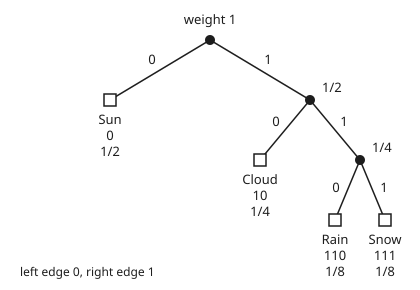

# Huffman coding: the shortest prefix-free code, built from the bottom up

[Syllabus](../../../SYLLABUS.md) → [Applied and computational](../README.md) → [Information Theory](../README.md#s03) → Huffman coding

---

## General Overview

A weather station on a hill sends one forecast a day down a radio link: Sun, Cloud, Rain or Snow. Radio time costs battery, so every bit counts. Over the years, half the days have been Sun, a quarter Cloud, an eighth Rain and an eighth Snow.

The obvious code gives each forecast two bits: 00, 01, 10, 11. That is 2 bits a day, 730 bits a year. A better code gives the common forecast a short word and the rare ones long words: Sun `0`, Cloud `10`, Rain `110`, Snow `111`. On an average day this costs **1.75 bits**, or 638.75 bits a year, and 91.25 bits a year are saved.

Two things make that code work. First, no word is the start of another word, so the receiver can cut a stream like `0010110011110` into forecasts without any gaps or separators. A code with that property is **prefix-free**.

Second, 1.75 bits is the **entropy** of the forecast: the average number of yes-or-no questions an outcome costs ([Entropy](01-entropy.md)). No code that can be read back does better. **Huffman's method** builds the best prefix-free code for any list of odds in a few lines: join the two least likely forecasts, and repeat.

**Huffman's method finds the prefix-free code with the shortest average length by repeatedly joining the two least likely symbols; every code that can be read back obeys Kraft's sum, and that sum forces its average length to be at least the entropy, while Huffman stays less than one bit above it.**

**What kind of fact this is:** a method, Huffman's, and three theorems proved on this card in Why it works: the Kraft–McMillan inequality, the entropy bound, and the fact that Huffman's code is the shortest.

### The picture: the forecast code as a tree

<p align="center"></p>

Schematic, not to scale. Read a codeword by walking from the top to a forecast: a left step writes 0, a right step writes 1. The forecasts sit only at the ends of branches ([Rooted trees](../../04-Combinatorics%20and%20graphs/10-Trees%20and%20Cheapest%20Routes/02-rooted-and-binary-trees.md)), never on the way to another one. That is what prefix-free means, drawn. The numbers at the joins are the weights Huffman's method created when it joined two branches: 1/4, then 1/2, then 1.

---

## The formula

Notation first, in words. Tomorrow's forecast is $X$, one of $n$ symbols. Symbol $i$ turns up with probability $p_i$ and gets a codeword $\ell_i$ bits long; $\ell_i$ is its **codeword length**, introduced on this card. The average length is $L$, the entropy is $H(X)$, and the **Kraft sum** $K$ adds up one half raised to each codeword length.

$$L = \sum_i p_i\,\ell_i, \qquad K = \sum_i 2^{-\ell_i} \le 1, \qquad H(X) \;\le\; L_{\text{Huffman}} \;<\; H(X) + 1$$

**Read it aloud:** the average length is each codeword's length weighted by how often it is sent; a code can be read back only if one half to the power of each length adds up to at most one; and Huffman's average sits at or above the entropy, but less than one bit above it.

| Symbol | Plain meaning | In our example | Push it up and the answer… |
| --- | --- | --- | --- |
| $X$ | tomorrow's forecast, one random symbol | Sun, Cloud, Rain or Snow | — |
| $n$ | how many symbols there are | 4 | $L$ and $H$ both grow, about like $\log_2 n$ for even odds |
| $p_i$ | probability of symbol $i$; $i$ counts the symbols ($p_a$, $p_b$ name two particular ones) | 0.5, 0.25, 0.125, 0.125 | a likelier symbol earns a shorter codeword |
| $\ell_i$ | codeword length of symbol $i$, in bits ($\ell_a$, $\ell_b$ likewise) | 1, 2, 3, 3 | $L$ rises; $K$ falls |
| $L$ | average codeword length, bits a day | 1.75 | more radio time |
| $H(X)$ | entropy: the average bits a perfect code would need | 1.75 | every code's $L$ rises with it |
| $K$ | Kraft sum, $\sum_i 2^{-\ell_i}$ | 1 | above 1, the code cannot be read back |
| $\ell_{\max}$ | the longest codeword length | 3 | — |
| $L'$ | average length of a code for the shorter list left after one join | 1.75 − 0.25, after joining Rain and Snow | $L$ rises by the same amount |
| $k$ | how many forecasts are sent as one block | 1, 2 or 3 | the bits a day fall toward $H$ |
| $m$ | the total bits in one $k$-forecast message | 4, for 3 forecasts | — |
| $A_m$ | how many $k$-forecast messages come out $m$ bits long | 24, for the code `0`, `1`, `10`, `11` | above $2^m$, two messages share a bit string |

### When it holds

- **The odds are known and do not drift.** The code is built from 0.5, 0.25, 0.125, 0.125. Use it in a season with other odds and it costs extra bits; how many is the subject of [KL divergence](03-kl-divergence-and-cross-entropy.md).
- **Each day is coded on its own.** Codeword lengths are whole numbers, so a symbol costs at least 1 bit. A desert station that sees rain one day in ten has entropy 0.469 bits but pays 1.000 bit a day. Coding days in blocks fixes most of this (Step 6).
- **Days are independent.** If Rain usually follows Rain, the true cost per day is lower than $H(X)$, and a code that ignores yesterday leaves bits unused ([Conditional entropy and mutual information](02-conditional-entropy-and-mutual-information.md)).
- **The code can be read back.** Break the Kraft sum and two different messages send the same bits: with Sun `0`, Cloud `1`, Rain `10`, Snow `11`, the string `10` is Rain or Cloud-then-Sun.
- **The bits arrive intact.** One flipped bit on the radio garbles the forecasts around it and can change how many forecasts are read, so every later day can slip out of place. Compression removes the redundancy; [Hamming and Reed-Solomon](08-error-correcting-codes-hamming-and-reed-solomon.md) add some back, on purpose, before the bits go on air.

---

## Why it works

### Step 0: a prefix-free code is a tree, and a tree has a fixed budget

Draw every codeword as a path in a binary tree: left for 0, right for 1. A prefix-free code puts each symbol at the end of a branch, never on the way to another symbol.

Go down to depth 3, the longest codeword. There are $2^3 = 8$ slots there. A codeword of length $\ell$ owns every slot below it: Sun at depth 1 owns 4 slots, Cloud 2, Rain 1, Snow 1. The four claims cannot overlap, so they add to at most 8. Divide by 8 and you have the Kraft sum: $\tfrac12 + \tfrac14 + \tfrac18 + \tfrac18 = 1$.

So short codewords are expensive. Each one uses up a large share of a fixed budget. Every result below is about spending that budget well.

### Step 1: Kraft's inequality, both ways

**Every prefix-free code has $K \le 1$.** That is the slot count above, for any lengths: a codeword of length $\ell_i$ owns $2^{\ell_{\max} - \ell_i}$ of the $2^{\ell_{\max}}$ slots, the claims are disjoint, so $\sum_i 2^{\ell_{\max} - \ell_i} \le 2^{\ell_{\max}}$.

**Any lengths with $K \le 1$ have a prefix-free code.** List the lengths shortest first. Hand each symbol a block of $2^{\ell_{\max} - \ell_i}$ bottom slots, starting at the first unused slot. Because the lengths only grow, every earlier block is a whole number of the new block's size, so the new block starts on a boundary and is exactly the set of slots under one branch at depth $\ell_i$. That branch is the codeword. Because $K \le 1$, the blocks never run past the last slot.

So the question "which codeword lengths can I have?" has a one-line answer: any whole numbers with $K \le 1$.

### Step 2: McMillan: dropping the prefix rule buys nothing

A code can be read back without being prefix-free. Sun `0`, Cloud `01`, Rain `011`, Snow `111` is one: read it from the right-hand end. McMillan proved that every code that can be read back, prefix-free or not, still has $K \le 1$. So prefix-free codes lose nothing, and they decode as the bits arrive.

The proof counts messages. Raise $K$ to the power $k$ and multiply out:

$$K^k = \Big(\sum_i 2^{-\ell_i}\Big)^k = \sum_{\text{messages of } k \text{ symbols}} 2^{-(\text{total length})} = \sum_m A_m\, 2^{-m}.$$

Here $A_m$ counts the $k$-symbol messages whose bits total $m$. If the code can be read back, different messages give different bit strings, and there are only $2^m$ strings of $m$ bits, so $A_m \le 2^m$. Each term is then at most 1, and $m$ runs from $k$ to $k\,\ell_{\max}$, so $K^k \le k\,\ell_{\max}$.

If $K$ were above 1, the left side would grow like a power while the right side grows in a straight line. For large $k$ the inequality fails. So $K \le 1$.

The bad code Sun `0`, Cloud `1`, Rain `10`, Snow `11` has $K = 1.5$. Take $k = 3$ forecasts. There are 24 three-forecast messages that come out 4 bits long, and only 16 strings of 4 bits. At least two messages must share a string, so the receiver cannot tell them apart. For the Huffman code, three-forecast messages never outnumber strings: at most 0.28125 messages per string, at any length.

### Step 3: no code beats the entropy

Take any code with $K \le 1$. Compare its average with the entropy, symbol by symbol:

$$H(X) - L = \sum_i p_i \log_2 \frac{2^{-\ell_i}}{p_i} \;\le\; \frac{1}{\ln 2}\sum_i p_i\Big(\frac{2^{-\ell_i}}{p_i} - 1\Big) = \frac{K - 1}{\ln 2} \;\le\; 0.$$

Here $\ln$ is the natural logarithm, to base $e$. The middle step uses $\log_2 x \le (x - 1)/\ln 2$: the logarithm curve lies under its tangent line at $x = 1$. So $L \ge H(X)$ for every code that can be read back. The same inequality is the heart of [KL divergence](03-kl-divergence-and-cross-entropy.md).

Equality needs $2^{-\ell_i} = p_i$ for every symbol: each probability a power of one half. The forecast odds are exactly that, so the code meets the entropy: 1.75 bits.

### Step 4: one bit above the entropy is always reachable

Choose $\ell_i = \lceil \log_2(1/p_i) \rceil$: round each symbol's "ideal" length up to a whole number. Then $2^{-\ell_i} \le p_i$, so $K \le 1$ and Step 1 builds the code. Each length is less than $\log_2(1/p_i) + 1$, so $L < H(X) + 1$. These are **Shannon lengths**. They prove the bound, but they are not the best: rounding up can waste slots.

### Step 5: Huffman's code is the shortest

Huffman's method: list the symbols with their probabilities. Join the two least likely into one new symbol whose probability is their sum. Repeat until one symbol is left. Read the codewords back down the tree. Each join adds one bit to every symbol inside it, so $L$ equals the sum of all the joined weights: $0.25 + 0.5 + 1 = 1.75$.

Why no prefix-free code is shorter, in four facts about a best code:

1. **Likelier symbols are never longer.** If $p_a > p_b$ but $\ell_a > \ell_b$, swap their codewords. The average changes by $(p_a - p_b)(\ell_b - \ell_a)$, which is negative. So that code was not the best.
2. **The tree is full.** In a best code every join has two branches. A join with one branch could be cut out, shortening every codeword below it.
3. **The two least likely symbols can be siblings at the bottom.** A full tree has at least two leaves side by side at its deepest level. By fact 1, the two least likely symbols can be moved there without raising the average.
4. **Joining them gives a smaller problem with the same answer.** Treat the two siblings as one symbol of weight $p_a + p_b$. Any code for that smaller list, average $L'$, gives a code for the original list with $L = L' + p_a + p_b$, by splitting the joined symbol's branch in two. The extra $p_a + p_b$ is the same for every such code, and by fact 3 some best code is of this kind. So the best smaller code gives the best larger one.

Fact 4 is Huffman's first join. The method then solves the smaller list the same way. With one symbol left there is nothing to choose, so by induction (proving a claim for one symbol, then from each size to the next) the method is optimal for every list. It is a greedy method whose safety argument is facts 1 to 4 ([Greedy](../01-Algorithms%20and%20Growth/08-greedy-algorithms-and-matroids.md)).

Huffman's $L$ is no longer than the Shannon lengths' $L$, so Step 4 gives $L_{\text{Huffman}} < H(X) + 1$, and Step 3 gives $L_{\text{Huffman}} \ge H(X)$.

### Step 6: closing the last bit by coding blocks

The "+1" comes from whole-number lengths, and it is spread over a single symbol. Code $k$ forecasts at once as one symbol of a bigger list. For independent days the entropy of the block is $k\,H(X)$, so the block's Huffman code costs less than $k\,H(X) + 1$ bits, which is less than $H(X) + 1/k$ bits a day.

In the desert, rain one day in ten: 1.000 bit a day coding one day at a time, 0.645 coding two, 0.533 coding three, against an entropy of 0.469. Step 3, applied to a $k$-day block, already shows the cost never drops below $H(X)$ a day, since the block's entropy is $k\,H(X)$. [Typical sequences](04-typical-sequences-and-the-aep.md) explains why: long runs of weather nearly all look alike, and there are about $2^{kH}$ of them to name.

---

## Worked numbers, by hand

The summer odds: Sun 0.5, Cloud 0.25, Rain 0.125, Snow 0.125.

| Step | Arithmetic | Value |
| --- | --- | --- |
| join the two least likely, Rain and Snow | 0.125 + 0.125 | 0.250 |
| join the two least likely, Cloud and Rain-or-Snow | 0.250 + 0.250 | 0.500 |
| join the last two, Sun and the rest | 0.500 + 0.500 | 1.000 |
| read the codewords down the tree | Sun 0, Cloud 10, Rain 110, Snow 111 | lengths 1, 2, 3, 3 |
| average length $L$ | 0.500 + 0.500 + 0.375 + 0.375 | 1.750 |
| same, as the sum of the joins | 0.250 + 0.500 + 1.000 | 1.750 |
| entropy, $\sum p_i \log_2(1/p_i)$ | 0.5 × 1 + 0.25 × 2 + 0.125 × 3 + 0.125 × 3 | 1.750 |
| Kraft sum | 1/2 + 1/4 + 1/8 + 1/8 | 1 |
| a year of forecasts | 365 × 1.75, against 365 × 2 = 730 | **638.75 bits** |

The station sends 638.75 bits a year on average, 91.25 fewer than the two-bit code, and no code that can be read back does better, because 1.75 is the entropy.

A week checks the decoding. Sun, Sun, Cloud, Rain, Sun, Snow, Cloud goes out as `0010110011110`: 13 bits, against 14 for the two-bit code. Read it left to right: `0` is Sun, `0` Sun, `10` Cloud, `110` Rain, `0` Sun, `111` Snow, `10` Cloud. No separators needed.

Autumn is less tidy: Sun 0.4, Cloud 0.3, Rain 0.2, Snow 0.1. The joins are 0.1 + 0.2, then 0.3 + 0.3, then 0.4 + 0.6; the three results add to 1.9. The codewords are Sun `0`, Cloud `10`, Snow `110`, Rain `111`, and the average is 1.900 bits against an entropy of 1.846. The gap is there because 0.4, 0.3, 0.2 and 0.1 are not powers of one half. Coding autumn days in pairs brings it down to 1.865 bits a day.

### What breaks if you drop a piece

| Mistake | Comes out at | What went wrong |
| --- | --- | --- |
| Codewords `0`, `1`, `10`, `11`: shorter than Kraft allows | 1.25 bits a day, below the entropy | The Kraft sum is 1.5. The string `10` is Rain or Cloud-then-Sun, and 24 three-forecast messages share 16 four-bit strings. The station saves bits by sending nonsense. |
| Short words to the rare days: Sun and Cloud 3 bits, Rain 2, Snow 1 | 2.625 bits a day | Fact 1 broken: worse than the plain two-bit code |
| Shannon lengths in autumn, rounding each $\log_2(1/p_i)$ up: 2, 2, 3, 4 | 2.4 bits a day, against Huffman's 1.9 | Kraft sum only 0.6875: almost a third of the slots wasted |
| One desert day per codeword | 1.000 bit a day, against entropy 0.469 | Whole-number lengths: no symbol costs less than one bit. Blocks fix it. |

---

## Code, from first principles, and it actually runs

The scripts build Huffman's code with a plain scan for the two lightest nodes, with no sorting or heap from a library. They then reach the best average by five roads. The first is Huffman's code itself. The second is brute force: every ordered choice of four different codewords of 1 to 3 bits, 24,024 codes, of which 4,968 are prefix-free. A best code for four symbols never needs more than 3 bits. The third is the sum of the joined weights. The fourth is the entropy floor. The fifth is a run of 10,000 synthetic days, drawn with the SplitMix64 generator from seed 2026, encoded and decoded back. SplitMix64 is a small random-number generator, and the seed is its fixed starting value. They also count McMillan's messages, cost out the mistakes, and code the autumn and desert odds in blocks.

### Python

```python
# Huffman codes -- the check behind the card.  Standard library only, nothing imported that codes.
# A weather station sends one 4-way forecast a day.  Roads: Huffman merging; brute force
# over every code of words up to 3 bits; the entropy bound; Kraft's sum; McMillan's counting
# argument on a code that breaks the rule; and 10,000 synthetic days drawn with SplitMix64.
from math import log2, ceil

NAMES = ["Sun", "Cloud", "Rain", "Snow"]
SUMMER = [0.5, 0.25, 0.125, 0.125]     # the forecast odds: powers of one half
AUTUMN = [0.4, 0.3, 0.2, 0.1]          # a second season: not powers of one half

def entropy(p): return -sum(q * log2(q) for q in p)
def avg(p, lens): return sum(q * l for q, l in zip(p, lens))
def kraft(lens): return sum(2.0 ** -l for l in lens)

def huffman(p, log=None):
    # each node: [weight, creation number, {symbol: code so far}]; merge the two lightest
    nodes = [[q, i, {i: ""}] for i, q in enumerate(p)]
    made = len(p)
    while len(nodes) > 1:
        pair = []
        for _ in range(2):                       # linear scan: lightest, ties to the older node
            best = 0
            for j in range(1, len(nodes)):
                if (nodes[j][0], nodes[j][1]) < (nodes[best][0], nodes[best][1]): best = j
            pair.append(nodes.pop(best))
        (wa, _, ca), (wb, _, cb) = pair
        codes = {s: "0" + c for s, c in ca.items()}
        codes.update({s: "1" + c for s, c in cb.items()})
        if log is not None: log.append((wa, wb, wa + wb))
        nodes.append([wa + wb, made, codes]); made += 1
    return [nodes[0][2][i] for i in range(len(p))]

def brute(p):
    # every ordered choice of 4 distinct words of 1 to 3 bits; keep the prefix-free ones
    words = [format(v, "0%db" % n) for n in (1, 2, 3) for v in range(2 ** n)]
    tried = free = 0; best = 99.0
    for a in words:
        for b in words:
            for c in words:
                for d in words:
                    code = [a, b, c, d]
                    if len(set(code)) < 4: continue
                    tried += 1
                    if any(x != y and y.startswith(x) for x in code for y in code): continue
                    free += 1; best = min(best, avg(p, [len(w) for w in code]))
    return best, tried, free

def decode(bits, code):
    out, word = [], ""
    for b in bits:
        word += b
        if word in code: out.append(code.index(word)); word = ""
    return out

def splitmix(state):
    state = (state + 0x9E3779B97F4A7C15) & 0xFFFFFFFFFFFFFFFF
    z = state
    z = ((z ^ (z >> 30)) * 0xBF58476D1CE4E5B9) & 0xFFFFFFFFFFFFFFFF
    z = ((z ^ (z >> 27)) * 0x94D049BB133111EB) & 0xFFFFFFFFFFFFFFFF
    return state, (z ^ (z >> 31)) >> 11

def counts(lens, k):                             # k-forecast messages, counted by total bits
    a = {0: 1}
    for _ in range(k):
        b = {}
        for m, c in a.items():
            for l in lens: b[m + l] = b.get(m + l, 0) + c
        a = b
    return a

def line(label, v): print(f"{label:<44}{v:>12.6f}")

log = []
code = huffman(SUMMER, log)
lens = [len(c) for c in code]
for i in range(4): print(f"{NAMES[i]:<6} p {SUMMER[i]:.3f}  code {code[i]:<4} length {lens[i]}  p*length {SUMMER[i] * lens[i]:.3f}  p*log2(1/p) {-SUMMER[i] * log2(SUMMER[i]):.3f}")
for wa, wb, w in log: print(f"merge {wa:.3f} + {wb:.3f} -> {w:.3f}")
line("sum of the merged weights", sum(w for _, _, w in log))
print("slots at depth 3 claimed: " + " ".join(str(2 ** (3 - l)) for l in lens) + " of 8")
H, L = entropy(SUMMER), avg(SUMMER, lens)
best, tried, free = brute(SUMMER)
line("entropy H, bits a day", H); line("Huffman average L, bits a day", L)
line("brute force best prefix-free L", best); line("fixed 2-bit code, bits a day", 2.0)
line("Kraft sum of the Huffman code", kraft(lens))
print(f"codes tried {tried}, prefix-free {free}")
print(f"a year: fixed {365 * 2} bits, Huffman {365 * L:.2f} bits, saved {365 * (2 - L):.2f}")
week = [0, 0, 1, 2, 0, 3, 1]
bits = "".join(code[s] for s in week)
print(f"week Sun Sun Cloud Rain Sun Snow Cloud -> {bits} ({len(bits)} bits, fixed 14)")
state, days, cum = 2026, [], [0.5, 0.75, 0.875, 1.0]
for _ in range(10000):
    state, r = splitmix(state)
    u = r / 2.0 ** 53
    days.append(next(i for i in range(4) if u < cum[i]))
stream = "".join(code[s] for s in days)
sim = len(stream) / 10000
se = (sum(q * l * l for q, l in zip(SUMMER, lens)) - L * L) ** 0.5 / 100
print(f"10000 synthetic days (seed 2026): {len(stream)} bits, {sim:.4f} a day, standard error {se:.4f}")
print(f"decoded back exactly: {decode(stream, code) == days}")
bad = ["0", "1", "10", "11"]                     # too short: breaks Kraft
blens = [len(w) for w in bad]
line("wrong: code 0,1,10,11, Kraft sum", kraft(blens)); line("wrong: code 0,1,10,11, average", avg(SUMMER, blens))
print(f"  Rain -> {bad[2]}, Cloud Sun -> {bad[1] + bad[0]}")
cb, cg = counts(blens, 3), counts(lens, 3)
print(f"  3 forecasts in 4 bits: {cb[4]} messages, {2 ** 4} bit strings")
print(f"  Huffman code: 3-forecast messages per bit string, at most {max(c / 2 ** m for m, c in cg.items()):.6f}")
line("wrong: short codes to the rare days", avg(SUMMER, lens[::-1]))
shan = [ceil(-log2(q)) for q in AUTUMN]
acode = huffman(AUTUMN, alog := [])
alens = [len(c) for c in acode]
HA, LA, abest = entropy(AUTUMN), avg(AUTUMN, alens), brute(AUTUMN)[0]
print("autumn odds 0.4 0.3 0.2 0.1, Huffman code " + " ".join(acode))
print("autumn merges " + ", ".join(f"{a:.1f}+{b:.1f}" for a, b, _ in alog) + f", sum {sum(w for _, _, w in alog):.6f}")
line("autumn entropy H", HA); line("autumn Huffman L", LA); line("autumn brute force best L", abest)
print(f"autumn Shannon lengths {' '.join(map(str, shan))}, Kraft {kraft(shan):.4f}")
line("autumn Shannon-length average", avg(AUTUMN, shan))
pairs = [a * b for a in AUTUMN for b in AUTUMN]
L2 = avg(pairs, [len(c) for c in huffman(pairs)]) / 2
line("autumn, two days per codeword, bits a day", L2)
DESERT = [0.9, 0.1]
HD = entropy(DESERT)
line("desert 0.9 dry 0.1 rain: entropy H", HD)
for k in (1, 2, 3):
    blk = [1.0]
    for _ in range(k): blk = [a * b for a in blk for b in DESERT]
    line(f"desert, {k}-day blocks, bits a day", avg(blk, [len(c) for c in huffman(blk)]) / k)
pos = {"": (210, 40)}
for c in ["0", "1", "10", "11", "110", "111"]:
    x, y = pos[c[:-1]]
    pos[c] = (x + (100 if c[-1] == "1" else -100) // 2 ** (len(c) - 1), y + 60)
print("figure, " + " ".join(f"{c or 'root'}=({pos[c][0]},{pos[c][1]})" for c in pos))

assert abs(L - best) < 1e-12 and abs(LA - abest) < 1e-12, "Huffman must match brute force"
assert abs(sum(w for _, _, w in log) - L) < 1e-12 and abs(sum(w for _, _, w in alog) - LA) < 1e-12, "merges"
assert H <= L + 1e-12 and L < H + 1 and HA <= LA < HA + 1, "entropy bound"
assert abs(kraft(lens) - 1) < 1e-12 and kraft(shan) <= 1, "Kraft"
assert abs(sim - H) < 5 * se and decode(stream, code) == days, "simulation"
assert cb[4] > 2 ** 4 and max(c / 2 ** m for m, c in cg.items()) <= 1, "McMillan counting"
assert HA <= L2 < LA and abs(H - 1.75) < 1e-12, "pairs close the gap"
print("ALL CHECKS PASS")
```

**Ran 2026-11-11 on macOS, Python 3.14.10, standard library only. All checks passed. Output, pasted from the run:**

```
Sun    p 0.500  code 0    length 1  p*length 0.500  p*log2(1/p) 0.500
Cloud  p 0.250  code 10   length 2  p*length 0.500  p*log2(1/p) 0.500
Rain   p 0.125  code 110  length 3  p*length 0.375  p*log2(1/p) 0.375
Snow   p 0.125  code 111  length 3  p*length 0.375  p*log2(1/p) 0.375
merge 0.125 + 0.125 -> 0.250
merge 0.250 + 0.250 -> 0.500
merge 0.500 + 0.500 -> 1.000
sum of the merged weights                       1.750000
slots at depth 3 claimed: 4 2 1 1 of 8
entropy H, bits a day                           1.750000
Huffman average L, bits a day                   1.750000
brute force best prefix-free L                  1.750000
fixed 2-bit code, bits a day                    2.000000
Kraft sum of the Huffman code                   1.000000
codes tried 24024, prefix-free 4968
a year: fixed 730 bits, Huffman 638.75 bits, saved 91.25
week Sun Sun Cloud Rain Sun Snow Cloud -> 0010110011110 (13 bits, fixed 14)
10000 synthetic days (seed 2026): 17488 bits, 1.7488 a day, standard error 0.0083
decoded back exactly: True
wrong: code 0,1,10,11, Kraft sum                1.500000
wrong: code 0,1,10,11, average                  1.250000
  Rain -> 10, Cloud Sun -> 10
  3 forecasts in 4 bits: 24 messages, 16 bit strings
  Huffman code: 3-forecast messages per bit string, at most 0.281250
wrong: short codes to the rare days             2.625000
autumn odds 0.4 0.3 0.2 0.1, Huffman code 0 10 111 110
autumn merges 0.1+0.2, 0.3+0.3, 0.4+0.6, sum 1.900000
autumn entropy H                                1.846439
autumn Huffman L                                1.900000
autumn brute force best L                       1.900000
autumn Shannon lengths 2 2 3 4, Kraft 0.6875
autumn Shannon-length average                   2.400000
autumn, two days per codeword, bits a day       1.865000
desert 0.9 dry 0.1 rain: entropy H              0.468996
desert, 1-day blocks, bits a day                1.000000
desert, 2-day blocks, bits a day                0.645000
desert, 3-day blocks, bits a day                0.532667
figure, root=(210,40) 0=(110,100) 1=(310,100) 10=(260,160) 11=(360,160) 110=(335,220) 111=(385,220)
ALL CHECKS PASS
```

### Rust

The same steps, in the same order, with the same tie rule, so the output matches line for line.

```rust
// Huffman codes -- the same check as source_coding_and_huffman_check.py, in Rust.  std only.
// A weather station sends one 4-way forecast a day.  Roads: Huffman merging; brute force
// over every code of words up to 3 bits; the entropy bound; Kraft's sum; McMillan's counting
// argument on a code that breaks the rule; and 10,000 synthetic days drawn with SplitMix64.
const NAMES: [&str; 4] = ["Sun", "Cloud", "Rain", "Snow"];

fn entropy(p: &[f64]) -> f64 { -p.iter().map(|q| q * q.log2()).sum::<f64>() }
fn avg(p: &[f64], lens: &[usize]) -> f64 { p.iter().zip(lens).map(|(q, l)| q * *l as f64).sum() }
fn kraft(lens: &[usize]) -> f64 { lens.iter().map(|l| 2f64.powi(-(*l as i32))).sum() }

fn huffman(p: &[f64], log: &mut Vec<(f64, f64, f64)>) -> Vec<String> {
    // each node: (weight, creation number, [(symbol, code so far)]); merge the two lightest
    let mut nodes: Vec<(f64, usize, Vec<(usize, String)>)> =
        p.iter().enumerate().map(|(i, q)| (*q, i, vec![(i, String::new())])).collect();
    let mut made = p.len();
    while nodes.len() > 1 {
        let mut pair = Vec::new();
        for _ in 0..2 {                          // linear scan: lightest, ties to the older node
            let mut best = 0;
            for j in 1..nodes.len() {
                let (a, b) = (&nodes[j], &nodes[best]);
                if a.0 < b.0 || (a.0 == b.0 && a.1 < b.1) { best = j; }
            }
            pair.push(nodes.remove(best));
        }
        let (wa, wb) = (pair[0].0, pair[1].0);
        let mut codes: Vec<(usize, String)> = pair[0].2.iter().map(|(s, c)| (*s, format!("0{}", c))).collect();
        codes.extend(pair[1].2.iter().map(|(s, c)| (*s, format!("1{}", c))));
        log.push((wa, wb, wa + wb));
        nodes.push((wa + wb, made, codes));
        made += 1;
    }
    (0..p.len()).map(|i| nodes[0].2.iter().find(|(s, _)| *s == i).unwrap().1.clone()).collect()
}

fn brute(p: &[f64]) -> (f64, usize, usize) {
    // every ordered choice of 4 distinct words of 1 to 3 bits; keep the prefix-free ones
    let mut words = Vec::new();
    for n in 1..=3usize { for v in 0..(1usize << n) { words.push(format!("{:0width$b}", v, width = n)); } }
    let (mut tried, mut free, mut best) = (0, 0, 99.0f64);
    for a in &words { for b in &words { for c in &words { for d in &words {
        let code = [a, b, c, d];
        let distinct = (0..4).all(|i| (0..4).all(|j| i == j || code[i] != code[j]));
        if !distinct { continue; }
        tried += 1;
        if code.iter().any(|x| code.iter().any(|y| x != y && y.starts_with(x.as_str()))) { continue; }
        free += 1;
        let lens: Vec<usize> = code.iter().map(|w| w.len()).collect();
        best = best.min(avg(p, &lens));
    } } } }
    (best, tried, free)
}

fn decode(bits: &str, code: &[String]) -> Vec<usize> {
    let (mut out, mut word) = (Vec::new(), String::new());
    for b in bits.chars() {
        word.push(b);
        if let Some(i) = code.iter().position(|c| *c == word) { out.push(i); word.clear(); }
    }
    out
}

fn splitmix(state: u64) -> (u64, u64) {
    let s = state.wrapping_add(0x9E3779B97F4A7C15);
    let mut z = s;
    z = (z ^ (z >> 30)).wrapping_mul(0xBF58476D1CE4E5B9);
    z = (z ^ (z >> 27)).wrapping_mul(0x94D049BB133111EB);
    (s, (z ^ (z >> 31)) >> 11)
}

fn counts(lens: &[usize], k: usize) -> Vec<u64> {     // k-forecast messages, counted by total bits
    let mut a = vec![1u64];
    for _ in 0..k {
        let mut b = vec![0u64; a.len() + 3];
        for (m, c) in a.iter().enumerate() { for l in lens { b[m + l] += c; } }
        a = b;
    }
    a
}

fn line(label: &str, v: f64) { println!("{:<44}{:>12.6}", label, v); }
fn tf(b: bool) -> &'static str { if b { "True" } else { "False" } }
fn lens_of(code: &[String]) -> Vec<usize> { code.iter().map(|c| c.len()).collect() }

fn main() {
    let summer = [0.5, 0.25, 0.125, 0.125];
    let autumn = [0.4, 0.3, 0.2, 0.1];
    let mut log = Vec::new();
    let code = huffman(&summer, &mut log);
    let lens = lens_of(&code);
    for i in 0..4 { println!("{:<6} p {:.3}  code {:<4} length {}  p*length {:.3}  p*log2(1/p) {:.3}",
        NAMES[i], summer[i], code[i], lens[i], summer[i] * lens[i] as f64, -summer[i] * summer[i].log2()); }
    for (wa, wb, w) in &log { println!("merge {:.3} + {:.3} -> {:.3}", wa, wb, w); }
    let msum: f64 = log.iter().map(|t| t.2).sum(); line("sum of the merged weights", msum);
    let slots: Vec<String> = lens.iter().map(|l| (1 << (3 - l)).to_string()).collect();
    println!("slots at depth 3 claimed: {} of 8", slots.join(" "));
    let (h, l) = (entropy(&summer), avg(&summer, &lens));
    let (best, tried, free) = brute(&summer);
    line("entropy H, bits a day", h); line("Huffman average L, bits a day", l);
    line("brute force best prefix-free L", best); line("fixed 2-bit code, bits a day", 2.0);
    line("Kraft sum of the Huffman code", kraft(&lens));
    println!("codes tried {}, prefix-free {}", tried, free);
    println!("a year: fixed {} bits, Huffman {:.2} bits, saved {:.2}", 365 * 2, 365.0 * l, 365.0 * (2.0 - l));
    let week = [0usize, 0, 1, 2, 0, 3, 1];
    let bits: String = week.iter().map(|s| code[*s].as_str()).collect();
    println!("week Sun Sun Cloud Rain Sun Snow Cloud -> {} ({} bits, fixed 14)", bits, bits.len());
    let (mut state, mut days, cum) = (2026u64, Vec::new(), [0.5, 0.75, 0.875, 1.0]);
    for _ in 0..10000 {
        let (s, r) = splitmix(state); state = s;
        let u = r as f64 / 2f64.powi(53);
        days.push((0..4).find(|i| u < cum[*i]).unwrap());
    }
    let stream: String = days.iter().map(|s| code[*s].as_str()).collect();
    let sim = stream.len() as f64 / 10000.0;
    let se = (summer.iter().zip(&lens).map(|(q, k)| q * (k * k) as f64).sum::<f64>() - l * l).sqrt() / 100.0;
    println!("10000 synthetic days (seed 2026): {} bits, {:.4} a day, standard error {:.4}", stream.len(), sim, se);
    let back_ok = decode(&stream, &code) == days;
    println!("decoded back exactly: {}", tf(back_ok));
    let bad: Vec<String> = ["0", "1", "10", "11"].iter().map(|s| s.to_string()).collect();
    let blens = lens_of(&bad);
    line("wrong: code 0,1,10,11, Kraft sum", kraft(&blens)); line("wrong: code 0,1,10,11, average", avg(&summer, &blens));
    println!("  Rain -> {}, Cloud Sun -> {}{}", bad[2], bad[1], bad[0]);
    let (cb, cg) = (counts(&blens, 3), counts(&lens, 3));
    println!("  3 forecasts in 4 bits: {} messages, {} bit strings", cb[4], 1 << 4);
    let ratio = cg.iter().enumerate().filter(|(_, c)| **c > 0).map(|(m, c)| *c as f64 / 2f64.powi(m as i32)).fold(0.0, f64::max);
    println!("  Huffman code: 3-forecast messages per bit string, at most {:.6}", ratio);
    let rev: Vec<usize> = lens.iter().rev().cloned().collect();
    line("wrong: short codes to the rare days", avg(&summer, &rev));
    let shan: Vec<usize> = autumn.iter().map(|q: &f64| (-q.log2()).ceil() as usize).collect();
    let mut alog = Vec::new();
    let acode = huffman(&autumn, &mut alog);
    let alens = lens_of(&acode);
    let (ha, la) = (entropy(&autumn), avg(&autumn, &alens));
    let abest = brute(&autumn).0;
    println!("autumn odds 0.4 0.3 0.2 0.1, Huffman code {}", acode.join(" "));
    let am: Vec<String> = alog.iter().map(|(a, b, _)| format!("{:.1}+{:.1}", a, b)).collect();
    let asum: f64 = alog.iter().map(|t| t.2).sum(); println!("autumn merges {}, sum {:.6}", am.join(", "), asum);
    line("autumn entropy H", ha); line("autumn Huffman L", la); line("autumn brute force best L", abest);
    println!("autumn Shannon lengths {}, Kraft {:.4}", shan.iter().map(|s| s.to_string()).collect::<Vec<_>>().join(" "), kraft(&shan));
    line("autumn Shannon-length average", avg(&autumn, &shan));
    let pairs: Vec<f64> = autumn.iter().flat_map(|a| autumn.iter().map(move |b| a * b)).collect();
    let l2 = avg(&pairs, &lens_of(&huffman(&pairs, &mut Vec::new()))) / 2.0;
    line("autumn, two days per codeword, bits a day", l2);
    let desert = [0.9, 0.1];
    line("desert 0.9 dry 0.1 rain: entropy H", entropy(&desert));
    for k in 1..=3 {
        let mut blk = vec![1.0f64];
        for _ in 0..k { blk = blk.iter().flat_map(|a| desert.iter().map(move |b| a * b)).collect(); }
        let lb = avg(&blk, &lens_of(&huffman(&blk, &mut Vec::new()))) / k as f64;
        line(&format!("desert, {}-day blocks, bits a day", k), lb);
    }
    let mut pos: Vec<(String, (i32, i32))> = vec![(String::new(), (210, 40))];
    for c in ["0", "1", "10", "11", "110", "111"] {
        let (x, y) = pos.iter().find(|(k, _)| k.as_str() == &c[..c.len() - 1]).unwrap().1;
        let step = 100 / (1 << (c.len() - 1));
        pos.push((c.to_string(), (x + if c.ends_with('1') { step } else { -step }, y + 60)));
    }
    let fig: Vec<String> = pos.iter().map(|(c, (x, y))| format!("{}=({},{})", if c.is_empty() { "root" } else { c }, x, y)).collect();
    println!("figure, {}", fig.join(" "));

    assert!((l - best).abs() < 1e-12 && (la - abest).abs() < 1e-12, "Huffman must match brute force");
    assert!((msum - l).abs() < 1e-12 && (asum - la).abs() < 1e-12, "merges");
    assert!(h <= l + 1e-12 && l < h + 1.0 && ha <= la && la < ha + 1.0, "entropy bound");
    assert!((kraft(&lens) - 1.0).abs() < 1e-12 && kraft(&shan) <= 1.0, "Kraft");
    assert!((sim - h).abs() < 5.0 * se && back_ok, "simulation");
    assert!(cb[4] > 1 << 4 && ratio <= 1.0, "McMillan counting");
    assert!(ha <= l2 && l2 < la && (h - 1.75).abs() < 1e-12, "pairs close the gap");
    println!("ALL CHECKS PASS");
}
```

**Ran 2026-11-11 on macOS, rustc 1.98.1, no crates. All checks passed. Output, pasted from the run:**

```
Sun    p 0.500  code 0    length 1  p*length 0.500  p*log2(1/p) 0.500
Cloud  p 0.250  code 10   length 2  p*length 0.500  p*log2(1/p) 0.500
Rain   p 0.125  code 110  length 3  p*length 0.375  p*log2(1/p) 0.375
Snow   p 0.125  code 111  length 3  p*length 0.375  p*log2(1/p) 0.375
merge 0.125 + 0.125 -> 0.250
merge 0.250 + 0.250 -> 0.500
merge 0.500 + 0.500 -> 1.000
sum of the merged weights                       1.750000
slots at depth 3 claimed: 4 2 1 1 of 8
entropy H, bits a day                           1.750000
Huffman average L, bits a day                   1.750000
brute force best prefix-free L                  1.750000
fixed 2-bit code, bits a day                    2.000000
Kraft sum of the Huffman code                   1.000000
codes tried 24024, prefix-free 4968
a year: fixed 730 bits, Huffman 638.75 bits, saved 91.25
week Sun Sun Cloud Rain Sun Snow Cloud -> 0010110011110 (13 bits, fixed 14)
10000 synthetic days (seed 2026): 17488 bits, 1.7488 a day, standard error 0.0083
decoded back exactly: True
wrong: code 0,1,10,11, Kraft sum                1.500000
wrong: code 0,1,10,11, average                  1.250000
  Rain -> 10, Cloud Sun -> 10
  3 forecasts in 4 bits: 24 messages, 16 bit strings
  Huffman code: 3-forecast messages per bit string, at most 0.281250
wrong: short codes to the rare days             2.625000
autumn odds 0.4 0.3 0.2 0.1, Huffman code 0 10 111 110
autumn merges 0.1+0.2, 0.3+0.3, 0.4+0.6, sum 1.900000
autumn entropy H                                1.846439
autumn Huffman L                                1.900000
autumn brute force best L                       1.900000
autumn Shannon lengths 2 2 3 4, Kraft 0.6875
autumn Shannon-length average                   2.400000
autumn, two days per codeword, bits a day       1.865000
desert 0.9 dry 0.1 rain: entropy H              0.468996
desert, 1-day blocks, bits a day                1.000000
desert, 2-day blocks, bits a day                0.645000
desert, 3-day blocks, bits a day                0.532667
figure, root=(210,40) 0=(110,100) 1=(310,100) 10=(260,160) 11=(360,160) 110=(335,220) 111=(385,220)
ALL CHECKS PASS
```

The 10,000 synthetic days cost 17,488 bits: 1.7488 a day, a fraction of one standard error (0.0083) from the promised 1.75. A standard error is the typical size of the chance error in a run of that length. The stream decodes back to the same 10,000 forecasts.

### Lean

Lean proves the three theorems for any list of probabilities, and checks the worked numbers exactly.

- Take probabilities $p_i$ that add to 1. Then Huffman's code is prefix-free, and no prefix-free code has a smaller average length $L$.
- Every code that can be read back, prefix-free or not, has Kraft sum $K \le 1$.
- Take whole-number lengths $\ell_i$. Then some prefix-free code has exactly those lengths when $K \le 1$, and only then.
- Take probabilities $p_i$, all above zero, that add to 1. Then every code that can be read back has $L \ge H(X)$, and Huffman's code has $L < H(X) + 1$.
- In summer, Huffman's method gives Sun `0`, Cloud `10`, Rain `110`, Snow `111`. The average is 1.75 bits and the Kraft sum is 1.
- Take $\log_2(1/p_i)$ as 1, 2, 3 and 3 for the summer odds. Then the entropy sum comes to 1.75 bits.
- A year costs 638.75 bits against 730, a saving of 91.25.
- The week Sun, Sun, Cloud, Rain, Sun, Snow, Cloud goes out as `0010110011110`.
- In autumn, Huffman's method gives Sun `0`, Cloud `10`, Rain `111`, Snow `110`. The average is 1.9 bits, the same as the sum of the three joins.
- Autumn's Shannon lengths 2, 2, 3, 4 have Kraft sum 0.6875 and average 2.4 bits.
- Short words to the rare summer days, lengths 3, 3, 2, 1, cost 2.625 bits a day.
- The bad code `0`, `1`, `10`, `11` has Kraft sum 1.5 and averages 1.25 bits. Rain's `10` is also Cloud then Sun.
- With that code, 24 three-forecast messages come out 4 bits long, and there are only 16 strings of 4 bits.

The brute-force search, the 10,000 synthetic days, the autumn and desert entropies and the block codes are left to the Python and Rust checks.

```lean
-- Huffman coding: joining the two least likely symbols again and again gives the shortest prefix-free code, every code that can be read back has Kraft sum at most one, and its average length is at least the entropy while Huffman's is less than one bit above it.
import Mathlib.InformationTheory.Coding.KraftMcMillan
import Mathlib.InformationTheory.Coding.PrefixFree
import Mathlib.Analysis.SpecialFunctions.Log.NegMulLog
import Mathlib.Data.List.Sort
import Mathlib.InformationTheory.Coding.Kraft
import Mathlib.Algebra.BigOperators.Field
import Mathlib.Analysis.SpecialFunctions.Log.Base

open InformationTheory

namespace HuffmanCard

/-! ### Codes, as on the card

A code for `n` symbols gives symbol `i` a codeword `c i : List Bool` (`false` is the bit 0,
`true` the bit 1). -/

/-- A prefix-free code: different symbols get different codewords, and no codeword is the
start of another one (Mathlib's `IsPrefixFree`). -/
def IsPrefixFreeCode {n : ℕ} (c : Fin n → List Bool) : Prop :=
  Function.Injective c ∧ IsPrefixFree (Set.range c)

/-- A code that can be read back: different symbols get different codewords, and two different
messages never send the same bits (Mathlib's `IsUniquelyDecodable`). -/
def CanBeReadBack {n : ℕ} (c : Fin n → List Bool) : Prop :=
  Function.Injective c ∧ IsUniquelyDecodable (Set.range c)

/-- The average codeword length `L = ∑ pᵢ ℓᵢ`. -/
noncomputable def avgLength {n : ℕ} (p : Fin n → ℝ) (c : Fin n → List Bool) : ℝ :=
  ∑ i, p i * ((c i).length : ℝ)

/-- The Kraft sum `K = ∑ 2^(-ℓᵢ)` of a list of codeword lengths. -/
noncomputable def kraftSum {n : ℕ} (ℓ : Fin n → ℕ) : ℝ :=
  ∑ i, (1 / 2 : ℝ) ^ ℓ i

/-- The entropy in bits, `H = ∑ pᵢ log₂ (1/pᵢ)`. -/
noncomputable def entropyBits {n : ℕ} (p : Fin n → ℝ) : ℝ :=
  ∑ i, Real.negMulLog (p i) / Real.log 2

/-! ### Huffman's method -/

/-- A binary tree with the symbols at its leaves. -/
inductive CodeTree (n : ℕ) where
  | leaf : Fin n → CodeTree n
  | node : CodeTree n → CodeTree n → CodeTree n
  deriving DecidableEq

/-- Read the codewords down the tree: a left step writes 0, a right step writes 1. -/
def CodeTree.words {n : ℕ} : CodeTree n → List (Fin n × List Bool)
  | .leaf i => [(i, [])]
  | .node l r =>
      l.words.map (fun e => (e.1, false :: e.2)) ++ r.words.map (fun e => (e.1, true :: e.2))

/-- Huffman's joins on a list kept sorted by weight, lightest first: join the two lightest into
one node whose weight is their sum, put it back in order (after any node of equal weight, so
ties go to the older node), and repeat. `fuel` counts the joins still allowed. -/
def huffmanJoin {K : Type*} [LinearOrder K] [Add K] {n : ℕ} :
    ℕ → List (K × CodeTree n) → Option (CodeTree n)
  | _, [] => none
  | _, [(_, t)] => some t
  | 0, (_, t) :: _ :: _ => some t
  | fuel + 1, (w₁, t₁) :: (w₂, t₂) :: rest =>
      huffmanJoin fuel
        (rest.orderedInsert (fun a b => a.1 < b.1) (w₁ + w₂, CodeTree.node t₁ t₂))

/-- Huffman's tree for the weights `p`: sort the symbols by weight, then make the `n - 1` joins. -/
def huffmanTree {K : Type*} [LinearOrder K] [Add K] {n : ℕ} (p : Fin n → K) :
    Option (CodeTree n) :=
  huffmanJoin n
    (((List.finRange n).map (fun i => (p i, CodeTree.leaf i))).insertionSort
      (fun a b => a.1 ≤ b.1))

/-- Huffman's code for the weights `p`: the codeword of each symbol in Huffman's tree. -/
def huffmanCode {K : Type*} [LinearOrder K] [Add K] {n : ℕ} (p : Fin n → K) (i : Fin n) :
    List Bool :=
  match huffmanTree p with
  | none => []
  | some t => (t.words.lookup i).getD []

/-! ### Helper lemmas for the proofs -/

/-- `(1/2)^x * 2^b = 2^(b - x)` when `x ≤ b`. -/
lemma half_pow_mul (x b : ℕ) (h : x ≤ b) : (1 / 2 : ℝ) ^ x * 2 ^ b = 2 ^ (b - x) := by
  obtain ⟨d, rfl⟩ := Nat.exists_eq_add_of_le h
  rw [Nat.add_sub_cancel_left, pow_add, ← mul_assoc, ← mul_pow]
  norm_num

/-- The Kraft sum of a code that can be read back is at most one (Mathlib's Kraft–McMillan). -/
lemma kraft_of_readBack {n : ℕ} {c : Fin n → List Bool} (hc : CanBeReadBack c) :
    kraftSum (fun i => (c i).length) ≤ 1 := by
  have hS : ((Finset.univ.image c : Finset (List Bool)) : Set (List Bool)) = Set.range c := by
    ext w; simp
  have h := IsUniquelyDecodable.finsetSum_one_div_card_pow_length_le_one
    (S := Finset.univ.image c) (by rw [hS]; exact hc.2)
  rw [Finset.sum_image (fun i _ j _ hij => hc.1 hij)] at h
  simpa [kraftSum, Fintype.card_bool] using h

/-- The Kraft sum of a prefix-free code is at most one (Mathlib's Kraft inequality). -/
lemma kraft_of_prefixFree {n : ℕ} {c : Fin n → List Bool} (hc : IsPrefixFreeCode c) :
    kraftSum (fun i => (c i).length) ≤ 1 := by
  have hS : ((Finset.univ.image c : Finset (List Bool)) : Set (List Bool)) = Set.range c := by
    ext w; simp
  have h := IsPrefixFree.finsetSum_one_div_card_pow_length_le_one
    (S := Finset.univ.image c) (by rw [hS]; exact hc.2)
  rw [Finset.sum_image (fun i _ j _ hij => hc.1 hij)] at h
  simpa [kraftSum, Fintype.card_bool] using h

/-- Kraft's construction: lengths with Kraft sum at most one on a set `s` of symbols can be given
codewords on `s`, none the start of another. Built by adding symbols longest-last and picking a
free word of the right length by counting. -/
lemma kraft_construct {n : ℕ} (ℓ : Fin n → ℕ) (s : Finset (Fin n)) :
    ∑ i ∈ s, (1 / 2 : ℝ) ^ ℓ i ≤ 1 →
      ∃ c : Fin n → List Bool, (∀ i ∈ s, (c i).length = ℓ i) ∧
        ∀ i ∈ s, ∀ j ∈ s, c i <+: c j → i = j := by
  induction s using Finset.induction_on_max_value ℓ with
  | empty => intro _; exact ⟨fun _ => [], by simp, by simp⟩
  | insert a s has hmax ih =>
    intro hK
    rw [Finset.sum_insert has] at hK
    have hpos : 0 < (1 / 2 : ℝ) ^ ℓ a := by positivity
    obtain ⟨c, hlen, hpf⟩ := ih (by linarith)
    let bad : Fin n → Finset (Fin (ℓ a) → Bool) :=
      fun j => Finset.univ.filter (fun g => c j <+: List.ofFn g)
    have hbad : ∀ j ∈ s, (bad j).card ≤ 2 ^ (ℓ a - ℓ j) := by
      intro j hj
      have hcard : (Finset.univ : Finset (Fin (ℓ a - ℓ j) → Bool)).card = 2 ^ (ℓ a - ℓ j) := by
        simp
      rw [← hcard]
      refine Finset.card_le_card_of_injOn
        (fun g k => g ⟨ℓ j + k.1, by omega⟩) (fun _ _ => by simp) ?_
      intro g1 hg1 g2 hg2 heq
      simp only [bad, Finset.coe_filter, Finset.mem_univ, true_and, Set.mem_ofPred_eq] at hg1 hg2
      funext k
      by_cases hk : k.1 < ℓ j
      · have hk' : k.1 < (c j).length := by rw [hlen j hj]; exact hk
        have e1 := hg1.getElem hk'
        have e2 := hg2.getElem hk'
        simp only [List.getElem_ofFn] at e1 e2
        rw [← e1, ← e2]
      · have := congrFun heq ⟨k.1 - ℓ j, by omega⟩
        simp only at this
        have hk2 : (⟨ℓ j + (k.1 - ℓ j), by omega⟩ : Fin (ℓ a)) = k := by
          ext; simp; omega
        rw [hk2] at this
        exact this
    have hsum : ∑ j ∈ s, 2 ^ (ℓ a - ℓ j) < 2 ^ ℓ a := by
      have h1 : ((∑ j ∈ s, 2 ^ (ℓ a - ℓ j) : ℕ) : ℝ) = (∑ j ∈ s, (1 / 2 : ℝ) ^ ℓ j) * 2 ^ ℓ a := by
        push_cast
        rw [Finset.sum_mul]
        exact Finset.sum_congr rfl (fun j hj => (half_pow_mul _ _ (hmax j hj)).symm)
      have h2 : (1 / 2 : ℝ) ^ ℓ a * 2 ^ ℓ a = 1 := by rw [← mul_pow]; norm_num
      have h3 : (∑ j ∈ s, (1 / 2 : ℝ) ^ ℓ j) * 2 ^ ℓ a ≤ (1 - (1 / 2 : ℝ) ^ ℓ a) * 2 ^ ℓ a :=
        mul_le_mul_of_nonneg_right (by linarith) (by positivity)
      have : ((∑ j ∈ s, 2 ^ (ℓ a - ℓ j) : ℕ) : ℝ) < 2 ^ ℓ a := by
        rw [h1]; nlinarith
      exact_mod_cast this
    have hlt : (s.biUnion bad).card < (Finset.univ : Finset (Fin (ℓ a) → Bool)).card := by
      calc (s.biUnion bad).card ≤ ∑ j ∈ s, (bad j).card := Finset.card_biUnion_le
        _ ≤ ∑ j ∈ s, 2 ^ (ℓ a - ℓ j) := Finset.sum_le_sum hbad
        _ < 2 ^ ℓ a := hsum
        _ = _ := by simp
    obtain ⟨g, -, hg⟩ := Finset.exists_mem_notMem_of_card_lt_card hlt
    have hg' : ∀ j ∈ s, ¬ c j <+: List.ofFn g := fun j hj h =>
      hg (Finset.mem_biUnion.mpr ⟨j, hj, by simp [bad, h]⟩)
    have hne : ∀ k ∈ s, k ≠ a := fun k hk h => has (h ▸ hk)
    refine ⟨Function.update c a (List.ofFn g), ?_, ?_⟩
    · intro i hi
      rcases Finset.mem_insert.mp hi with h | hi
      · subst h; simp
      · rw [Function.update_of_ne (hne i hi), hlen i hi]
    · intro i hi j hj hij
      rcases Finset.mem_insert.mp hi with h1 | hi <;>
        rcases Finset.mem_insert.mp hj with h2 | hj
      · rw [h1, h2]
      · exfalso
        rw [h1, Function.update_self, Function.update_of_ne (hne j hj)] at hij
        have hl : (List.ofFn g).length = (c j).length :=
          le_antisymm hij.length_le (by simp [hlen j hj, hmax j hj])
        have := hij.eq_of_length hl
        exact hg' j hj (this ▸ List.prefix_refl _)
      · exfalso
        rw [h2, Function.update_self, Function.update_of_ne (hne i hi)] at hij
        exact hg' i hi hij
      · rw [Function.update_of_ne (hne i hi), Function.update_of_ne (hne j hj)] at hij
        exact hpf i hi j hj hij

/-- Gibbs' inequality in the form needed: if the lengths have Kraft sum at most one, the
average length is at least the entropy. -/
lemma entropy_le_of_kraft {n : ℕ} (p : Fin n → ℝ) (hp : ∀ i, 0 < p i) (hsum : ∑ i, p i = 1)
    (ℓ : Fin n → ℕ) (hK : ∑ i, (1 / 2 : ℝ) ^ ℓ i ≤ 1) :
    ∑ i, Real.negMulLog (p i) / Real.log 2 ≤ ∑ i, p i * (ℓ i : ℝ) := by
  have hlog2 : 0 < Real.log 2 := Real.log_pos (by norm_num)
  have key : ∀ i, Real.negMulLog (p i) - p i * ℓ i * Real.log 2 ≤ (1 / 2 : ℝ) ^ ℓ i - p i := by
    intro i
    have hpi := hp i
    have hx : 0 < (1 / 2 : ℝ) ^ ℓ i / p i := by positivity
    have h1 := Real.log_le_sub_one_of_pos hx
    rw [Real.log_div (by positivity) hpi.ne', Real.log_pow, one_div, Real.log_inv] at h1
    have h2 := mul_le_mul_of_nonneg_left h1 hpi.le
    have h3 : p i * ((2⁻¹ : ℝ) ^ ℓ i / p i - 1) = (2⁻¹ : ℝ) ^ ℓ i - p i := by
      field_simp
    rw [h3] at h2
    simp only [Real.negMulLog, one_div]
    nlinarith
  rw [← Finset.sum_div, div_le_iff₀ hlog2]
  have h := Finset.sum_le_sum (fun i (_ : i ∈ Finset.univ) => key i)
  rw [Finset.sum_sub_distrib, Finset.sum_sub_distrib, hsum] at h
  rw [Finset.sum_mul]
  linarith

/-! #### Huffman's tree: weights, costs and leaves -/

/-- The total weight of a tree's leaves. -/
noncomputable def tWeight {n : ℕ} (p : Fin n → ℝ) (t : CodeTree n) : ℝ :=
  (t.words.map (fun e => p e.1)).sum

/-- The weighted depth `∑ pᵢ ℓᵢ` over a tree's leaves. -/
noncomputable def tCost {n : ℕ} (p : Fin n → ℝ) (t : CodeTree n) : ℝ :=
  (t.words.map (fun e => p e.1 * (e.2.length : ℝ))).sum

/-- The total cost of the trees in a forest. -/
noncomputable def fCost {n : ℕ} (p : Fin n → ℝ) (F : List (ℝ × CodeTree n)) : ℝ :=
  (F.map (fun x => tCost p x.2)).sum

/-- All the symbols at the leaves of a forest. -/
def fKeys {n : ℕ} (F : List (ℝ × CodeTree n)) : List (Fin n) :=
  F.flatMap (fun x => x.2.words.map Prod.fst)

/-- The cost `∑ w λ` of a list of (weight, length) pairs. -/
noncomputable def pCost (P : List (ℝ × ℕ)) : ℝ :=
  (P.map (fun x => x.1 * (x.2 : ℝ))).sum

/-- The Kraft sum of a list of lengths. -/
noncomputable def pKraft (L : List ℕ) : ℝ :=
  (L.map (fun k => (1 / 2 : ℝ) ^ k)).sum

lemma words_node_keys {n : ℕ} (l r : CodeTree n) :
    (CodeTree.node l r).words.map Prod.fst = l.words.map Prod.fst ++ r.words.map Prod.fst := by
  simp [CodeTree.words, Function.comp_def]

lemma tWeight_node {n : ℕ} (p : Fin n → ℝ) (l r : CodeTree n) :
    tWeight p (CodeTree.node l r) = tWeight p l + tWeight p r := by
  simp [tWeight, CodeTree.words, Function.comp_def]

lemma tCost_node {n : ℕ} (p : Fin n → ℝ) (l r : CodeTree n) :
    tCost p (CodeTree.node l r) = tCost p l + tCost p r + tWeight p l + tWeight p r := by
  simp only [tCost, tWeight, CodeTree.words, List.map_append, List.map_map, List.sum_append,
    Function.comp_def, List.length_cons, Nat.cast_add, Nat.cast_one, mul_add, mul_one,
    List.sum_map_add]
  ring

lemma tWeight_nonneg {n : ℕ} (p : Fin n → ℝ) (hp : ∀ i, 0 ≤ p i) (t : CodeTree n) :
    0 ≤ tWeight p t :=
  List.sum_nonneg (by simp only [List.mem_map]; rintro _ ⟨e, -, rfl⟩; exact hp _)

lemma pCost_perm {P P' : List (ℝ × ℕ)} (h : P.Perm P') : pCost P = pCost P' :=
  (h.map _).sum_eq

lemma pKraft_perm {L L' : List ℕ} (h : L.Perm L') : pKraft L = pKraft L' :=
  (h.map _).sum_eq

lemma fCost_perm {n : ℕ} (p : Fin n → ℝ) {F F' : List (ℝ × CodeTree n)} (h : F.Perm F') :
    fCost p F = fCost p F' :=
  (h.map _).sum_eq

/-- The words of any tree: no word is the start of a different entry's word. -/
lemma words_pairwise {n : ℕ} (t : CodeTree n) :
    t.words.Pairwise (fun e e' => ¬ e.2 <+: e'.2 ∧ ¬ e'.2 <+: e.2) := by
  induction t with
  | leaf i => simp [CodeTree.words]
  | node l r ihl ihr =>
    simp only [CodeTree.words]
    rw [List.pairwise_append, List.pairwise_map, List.pairwise_map]
    refine ⟨ihl.imp ?_, ihr.imp ?_, ?_⟩
    · intro a b h; simpa using h
    · intro a b h; simpa using h
    · intro a ha b hb
      obtain ⟨e, -, rfl⟩ := List.mem_map.mp ha
      obtain ⟨e', -, rfl⟩ := List.mem_map.mp hb
      simp

/-- With distinct keys, `lookup` finds the entry. -/
lemma lookup_of_mem {n : ℕ} {β : Type*} :
    ∀ (l : List (Fin n × β)) (a : Fin n) (b : β), (l.map Prod.fst).Nodup → (a, b) ∈ l →
      l.lookup a = some b
  | [], _, _, _, h => by simp at h
  | (k, v) :: l, a, b, hnd, h => by
    rw [List.map_cons, List.nodup_cons] at hnd
    rcases List.mem_cons.mp h with h1 | h1
    · obtain ⟨rfl, rfl⟩ := Prod.mk.inj h1
      simp
    · have hak : a ≠ k := by
        intro hak
        subst hak
        exact hnd.1 (List.mem_map.mpr ⟨_, h1, rfl⟩)
      have := lookup_of_mem l a b hnd.2 h1
      rw [List.lookup_cons, beq_false_of_ne hak]
      exact this

/-- Reading the code off a tree whose leaves are the symbols, each once: it is prefix-free and
its average length is the tree's cost. -/
lemma code_props {n : ℕ} (p : Fin n → ℝ) (t : CodeTree n)
    (ht : (t.words.map Prod.fst).Perm (List.finRange n))
    (c : Fin n → List Bool) (hc : ∀ i, c i = (t.words.lookup i).getD []) :
    IsPrefixFreeCode c ∧ avgLength p c = tCost p t := by
  have hnd : (t.words.map Prod.fst).Nodup := ht.nodup_iff.mpr (List.nodup_finRange n)
  have hmem : ∀ e ∈ t.words, c e.1 = e.2 := by
    intro e he
    rw [hc, lookup_of_mem _ e.1 e.2 hnd he]
    rfl
  have hall : ∀ i, (i, c i) ∈ t.words := by
    intro i
    have : i ∈ t.words.map Prod.fst := ht.symm.subset (List.mem_finRange i)
    obtain ⟨e, he, rfl⟩ := List.mem_map.mp this
    rw [hmem e he]
    exact he
  have : Std.Symm (fun e e' : Fin n × List Bool => ¬ e.2 <+: e'.2 ∧ ¬ e'.2 <+: e.2) :=
    ⟨fun _ _ h => ⟨h.2, h.1⟩⟩
  have key : ∀ i j, c i <+: c j → i = j := by
    intro i j hij
    by_contra hne
    have := List.Pairwise.forall (words_pairwise t) (hall i) (hall j) (by simp [hne])
    exact this.1 hij
  refine ⟨⟨fun i j h => key i j (h ▸ List.prefix_refl _), ?_⟩, ?_⟩
  · rintro _ ⟨i, rfl⟩ _ ⟨j, rfl⟩ h
    rw [key i j h]
  · let g : Fin n → ℝ := fun i => p i * ((c i).length : ℝ)
    have h1 : t.words.map (fun e => p e.1 * (e.2.length : ℝ)) = (t.words.map Prod.fst).map g := by
      rw [List.map_map]
      apply List.map_congr_left
      intro e he
      simp [g, hmem e he]
    unfold avgLength tCost
    rw [h1, (ht.map g).sum_eq, Fin.sum_univ_def]

/-- `orderedInsert` keeps a list sorted by weight. -/
lemma pairwise_orderedInsert_fst {T : Type*} (r : ℝ × T → ℝ × T → Prop) [DecidableRel r]
    (x : ℝ × T) (hr1 : ∀ b, r x b → x.1 ≤ b.1) (hr2 : ∀ b, ¬ r x b → b.1 ≤ x.1) :
    ∀ l : List (ℝ × T), l.Pairwise (fun a b => a.1 ≤ b.1) →
      (l.orderedInsert r x).Pairwise (fun a b => a.1 ≤ b.1)
  | [], _ => by simp
  | b :: l, h => by
    rw [List.pairwise_cons] at h
    by_cases hxb : r x b
    · simp only [List.orderedInsert_cons, hxb, ↓reduceIte]
      refine List.Pairwise.cons ?_ (List.Pairwise.cons h.1 h.2)
      intro y hy
      rcases List.mem_cons.mp hy with hy' | hy
      · rw [hy']; exact hr1 _ hxb
      · exact le_trans (hr1 _ hxb) (h.1 y hy)
    · simp only [List.orderedInsert_cons, hxb, ↓reduceIte]
      refine List.Pairwise.cons ?_ (pairwise_orderedInsert_fst r x hr1 hr2 l h.2)
      intro y hy
      rcases List.mem_cons.mp (((List.perm_orderedInsert r x l).mem_iff).mp hy) with hy' | hy
      · rw [hy']; exact hr2 _ hxb
      · exact h.1 y hy

/-- Sorting by weight gives a list sorted by weight. -/
lemma pairwise_insertionSort_fst {T : Type*} :
    ∀ l : List (ℝ × T),
      (l.insertionSort (fun a b => a.1 ≤ b.1)).Pairwise (fun a b => a.1 ≤ b.1)
  | [] => by simp
  | x :: l => by
    rw [List.insertionSort_cons]
    exact pairwise_orderedInsert_fst _ x (fun _ h => h)
      (fun _ h => (le_total _ _).resolve_left h) _ (pairwise_insertionSort_fst l)

/-- Take one entry of weight `w` out of a list of (weight, length) pairs. -/
lemma perm_extract {P : List (ℝ × ℕ)} {w : ℝ} {R : List ℝ}
    (h : (P.map Prod.fst).Perm (w :: R)) :
    ∃ a Q, P.Perm ((w, a) :: Q) ∧ (Q.map Prod.fst).Perm R := by
  have hw : w ∈ P.map Prod.fst := h.symm.subset List.mem_cons_self
  obtain ⟨x, hx, rfl⟩ := List.mem_map.mp hw
  refine ⟨x.2, P.erase x, List.perm_cons_erase hx, ?_⟩
  have h2 : ((x :: P.erase x).map Prod.fst).Perm (x.1 :: R) :=
    ((List.perm_cons_erase hx).map Prod.fst).symm.trans h
  exact List.Perm.cons_inv h2

/-- Exchange step: give the lightest weight a length at least as long as every later one,
without raising the cost and without changing the lengths used. -/
lemma swap_aux (w₁ : ℝ) : ∀ (a : ℕ) (Q : List (ℝ × ℕ)), (∀ x ∈ Q, w₁ ≤ x.1) →
    ∃ a' Q', Q'.map Prod.fst = Q.map Prod.fst ∧
      (a' :: Q'.map Prod.snd).Perm (a :: Q.map Prod.snd) ∧
      (∀ x ∈ Q', x.2 ≤ a') ∧ w₁ * a' + pCost Q' ≤ w₁ * a + pCost Q
  | a, [], _ => ⟨a, [], rfl, List.Perm.refl _, by simp, le_rfl⟩
  | a, (w, l) :: Q, hQ => by
    obtain ⟨a'', Q'', h1, h2, h3, h4⟩ :=
      swap_aux w₁ a Q (fun x hx => hQ x (List.mem_cons_of_mem _ hx))
    have hw : w₁ ≤ w := hQ (w, l) List.mem_cons_self
    by_cases hl : l ≤ a''
    · refine ⟨a'', (w, l) :: Q'', by simp [h1], ?_, ?_, ?_⟩
      · simp only [List.map_cons]
        exact (List.Perm.swap _ _ _).trans ((h2.cons l).trans (List.Perm.swap _ _ _))
      · intro x hx
        rcases List.mem_cons.mp hx with rfl | hx
        · exact hl
        · exact h3 x hx
      · simp only [pCost, List.map_cons, List.sum_cons] at h4 ⊢
        linarith
    · push Not at hl
      refine ⟨l, (w, a'') :: Q'', by simp [h1], ?_, ?_, ?_⟩
      · simp only [List.map_cons]
        exact (h2.cons l).trans (List.Perm.swap _ _ _)
      · intro x hx
        rcases List.mem_cons.mp hx with rfl | hx
        · exact hl.le
        · exact (h3 x hx).trans hl.le
      · have hl' : (a'' : ℝ) ≤ l := by exact_mod_cast hl.le
        have : 0 ≤ (w - w₁) * ((l : ℝ) - a'') := mul_nonneg (by linarith) (by linarith)
        simp only [pCost, List.map_cons, List.sum_cons] at h4 ⊢
        nlinarith

/-- Dyadic step: if the two longest lengths are `a ≥ b`, joining them into one word of length
`b - 1` keeps the Kraft sum at most one. -/
lemma dyadic_merge (a b : ℕ) (L : List ℕ) (_hab : b ≤ a) (hL : ∀ x ∈ L, x ≤ b)
    (hK : (1 / 2 : ℝ) ^ a + (1 / 2) ^ b + pKraft L ≤ 1) :
    1 ≤ b ∧ (1 / 2 : ℝ) ^ (b - 1) + pKraft L ≤ 1 := by
  have hN : ∀ L : List ℕ, (∀ x ∈ L, x ≤ b) →
      pKraft L * 2 ^ b = ((L.map (fun x => 2 ^ (b - x))).sum : ℕ) := by
    intro L hL
    induction L with
    | nil => simp [pKraft]
    | cons x L ih =>
      have hx := hL x List.mem_cons_self
      have := ih (fun y hy => hL y (List.mem_cons_of_mem _ hy))
      simp only [pKraft, List.map_cons, List.sum_cons] at this ⊢
      rw [add_mul, this, half_pow_mul _ _ hx]
      push_cast
      ring
  set N : ℕ := (L.map (fun x => 2 ^ (b - x))).sum with hNdef
  have hNL := hN L hL
  have hpa : 0 < (1 / 2 : ℝ) ^ a := by positivity
  have h2b : (0 : ℝ) < 2 ^ b := by positivity
  have hbb : (1 / 2 : ℝ) ^ b * 2 ^ b = 1 := by rw [← mul_pow]; norm_num
  have hlt : (1 : ℝ) + N < 2 ^ b := by
    have : ((1 / 2 : ℝ) ^ b + pKraft L) * 2 ^ b < 1 * 2 ^ b :=
      mul_lt_mul_of_pos_right (by linarith) h2b
    rw [add_mul, hbb, hNL] at this
    linarith
  have hltN : 1 + N < 2 ^ b := by exact_mod_cast hlt
  have hb1 : 1 ≤ b := by
    rcases Nat.eq_zero_or_pos b with h0 | h0
    · rw [h0] at hltN; simp at hltN
    · exact h0
  refine ⟨hb1, ?_⟩
  have hb' : (1 / 2 : ℝ) ^ (b - 1) * 2 ^ b = 2 := by
    rw [half_pow_mul _ _ (Nat.sub_le b 1), Nat.sub_sub_self hb1]; norm_num
  have h2N : 2 + N ≤ 2 ^ b := by omega
  have h2N' : (2 : ℝ) + N ≤ 2 ^ b := by exact_mod_cast h2N
  have : ((1 / 2 : ℝ) ^ (b - 1) + pKraft L) * 2 ^ b ≤ 1 * 2 ^ b := by
    rw [add_mul, hb', hNL]; linarith
  exact le_of_mul_le_mul_right this h2b

/-- The exchange argument behind Huffman's method: any lengths for the two lightest weights and
the rest can be traded for lengths where the two lightest share one joined word, at no extra
cost. -/
lemma exchange (w₁ w₂ : ℝ) (a b : ℕ) (Q : List (ℝ × ℕ)) (h0 : 0 ≤ w₁) (h12 : w₁ ≤ w₂)
    (hQ : ∀ x ∈ Q, w₂ ≤ x.1)
    (hK : (1 / 2 : ℝ) ^ a + (1 / 2) ^ b + pKraft (Q.map Prod.snd) ≤ 1) :
    ∃ m : ℕ, ∃ Q' : List (ℝ × ℕ), Q'.map Prod.fst = Q.map Prod.fst ∧ (1 / 2 : ℝ) ^ m + pKraft (Q'.map Prod.snd) ≤ 1 ∧
      (w₁ + w₂) * (1 + m) + pCost Q' ≤ w₁ * a + w₂ * b + pCost Q := by
  obtain ⟨a', R1, h1, h2, h3, h4⟩ := swap_aux w₁ a ((w₂, b) :: Q) (by
    intro x hx
    rcases List.mem_cons.mp hx with rfl | hx
    · exact h12
    · exact h12.trans (hQ x hx))
  obtain ⟨⟨w', b1⟩, Q1, rfl⟩ : ∃ y Q1, R1 = y :: Q1 := by
    cases R1 with
    | nil => simp at h1
    | cons y Q1 => exact ⟨y, Q1, rfl⟩
  simp only [List.map_cons, List.cons.injEq] at h1
  obtain ⟨rfl, h1⟩ := h1
  have hQ1 : ∀ x ∈ Q1, w' ≤ x.1 := by
    intro x hx
    have : x.1 ∈ Q.map Prod.fst := h1 ▸ List.mem_map_of_mem hx
    obtain ⟨y, hy, hyx⟩ := List.mem_map.mp this
    rw [← hyx]; exact hQ y hy
  obtain ⟨b', Q2, g1, g2, g3, g4⟩ := swap_aux w' b1 Q1 hQ1
  have hb'a' : b' ≤ a' := by
    have : b' ∈ b1 :: Q1.map Prod.snd := g2.subset List.mem_cons_self
    rcases List.mem_cons.mp this with h | h
    · rw [h]; exact h3 (w', b1) List.mem_cons_self
    · obtain ⟨y, hy, rfl⟩ := List.mem_map.mp h
      exact h3 y (List.mem_cons_of_mem _ hy)
  have hperm : (a' :: b' :: Q2.map Prod.snd).Perm (a :: b :: Q.map Prod.snd) := by
    have := h2
    simp only [List.map_cons] at this
    exact (g2.cons a').trans this
  have hK2 : (1 / 2 : ℝ) ^ a' + (1 / 2) ^ b' + pKraft (Q2.map Prod.snd) ≤ 1 := by
    have := pKraft_perm hperm
    simp only [pKraft, List.map_cons, List.sum_cons] at this hK ⊢
    linarith
  obtain ⟨hb1, hK3⟩ := dyadic_merge a' b' (Q2.map Prod.snd) hb'a'
    (by intro x hx; obtain ⟨y, hy, rfl⟩ := List.mem_map.mp hx; exact g3 y hy) hK2
  refine ⟨b' - 1, Q2, g1.trans h1, hK3, ?_⟩
  have hcast : ((b' - 1 : ℕ) : ℝ) = (b' : ℝ) - 1 := by
    rw [Nat.cast_sub hb1]; simp
  have hab : (b' : ℝ) ≤ a' := by exact_mod_cast hb'a'
  rw [hcast]
  simp only [pCost, List.map_cons, List.sum_cons] at h4 g4 ⊢
  nlinarith

lemma pCost_nonneg {P : List (ℝ × ℕ)} (h : ∀ x ∈ P, 0 ≤ x.1) : 0 ≤ pCost P :=
  List.sum_nonneg (by
    simp only [List.mem_map]
    rintro _ ⟨x, hx, rfl⟩
    exact mul_nonneg (h x hx) (Nat.cast_nonneg _))

/-- What Huffman's joins produce from a sorted forest: a tree with all the forest's leaves, whose
cost is at most the forest's cost plus the cost of any lengths with Kraft sum at most one for
the forest's weights. -/
lemma huffmanJoin_spec {n : ℕ} (p : Fin n → ℝ) (hp : ∀ i, 0 ≤ p i) (fuel : ℕ) :
    ∀ F : List (ℝ × CodeTree n), F ≠ [] → F.length ≤ fuel + 1 →
      F.Pairwise (fun a b => a.1 ≤ b.1) → (∀ x ∈ F, x.1 = tWeight p x.2) →
      ∃ t, huffmanJoin fuel F = some t ∧ (t.words.map Prod.fst).Perm (fKeys F) ∧
        ∀ P : List (ℝ × ℕ), (P.map Prod.fst).Perm (F.map Prod.fst) →
          pKraft (P.map Prod.snd) ≤ 1 → tCost p t ≤ fCost p F + pCost P := by
  have single : ∀ (fuel : ℕ) (w : ℝ) (t : CodeTree n), w = tWeight p t →
      ∃ t', huffmanJoin fuel [(w, t)] = some t' ∧ (t'.words.map Prod.fst).Perm (fKeys [(w, t)]) ∧
        ∀ P : List (ℝ × ℕ), (P.map Prod.fst).Perm ([(w, t)].map Prod.fst) →
          pKraft (P.map Prod.snd) ≤ 1 → tCost p t' ≤ fCost p [(w, t)] + pCost P := by
    intro fuel w t hw
    refine ⟨t, by cases fuel <;> rfl, by simp [fKeys], ?_⟩
    intro P hP _
    have : 0 ≤ pCost P := pCost_nonneg (by
      intro x hx
      have : x.1 ∈ [(w, t)].map Prod.fst := hP.subset (List.mem_map_of_mem hx)
      simp only [List.map_cons, List.map_nil, List.mem_singleton] at this
      rw [this, hw]; exact tWeight_nonneg p hp t)
    simp only [fCost, List.map_cons, List.map_nil, List.sum_cons, List.sum_nil]
    linarith
  induction fuel with
  | zero =>
    intro F hF hlen _ hw
    rcases F with _ | ⟨⟨w, t⟩, _ | ⟨y, rest⟩⟩
    · exact absurd rfl hF
    · exact single 0 w t (hw _ List.mem_cons_self)
    · simp at hlen
  | succ f ih =>
    intro F hF hlen hs hw
    rcases F with _ | ⟨⟨w₁, t₁⟩, _ | ⟨⟨w₂, t₂⟩, rest⟩⟩
    · exact absurd rfl hF
    · exact single (f + 1) w₁ t₁ (hw _ List.mem_cons_self)
    · have hw1 : w₁ = tWeight p t₁ := hw _ List.mem_cons_self
      have hw2 : w₂ = tWeight p t₂ := hw _ (List.mem_cons_of_mem _ List.mem_cons_self)
      have hwr : ∀ x ∈ rest, x.1 = tWeight p x.2 := fun x hx =>
        hw x (List.mem_cons_of_mem _ (List.mem_cons_of_mem _ hx))
      rw [List.pairwise_cons, List.pairwise_cons] at hs
      have h12 : w₁ ≤ w₂ := hs.1 (w₂, t₂) List.mem_cons_self
      have h2r : ∀ y ∈ rest, w₂ ≤ y.1 := hs.2.1
      have h0 : 0 ≤ w₁ := hw1 ▸ tWeight_nonneg p hp t₁
      have hperm : (rest.orderedInsert (fun a b : ℝ × CodeTree n => a.1 < b.1)
          (w₁ + w₂, CodeTree.node t₁ t₂)).Perm ((w₁ + w₂, CodeTree.node t₁ t₂) :: rest) :=
        List.perm_orderedInsert _ _ _
      obtain ⟨t, ht, hkeys, hcost⟩ := ih
        (rest.orderedInsert (fun a b : ℝ × CodeTree n => a.1 < b.1)
          (w₁ + w₂, CodeTree.node t₁ t₂))
        (fun h => by simpa [h] using hperm.length_eq)
        (by rw [hperm.length_eq]; simp at hlen ⊢; omega)
        (pairwise_orderedInsert_fst _ _ (fun _ h => h.le) (fun _ h => not_lt.mp h) _ hs.2.2)
        (by
          intro x hx
          rcases List.mem_cons.mp (hperm.subset hx) with rfl | hx
          · simp [tWeight_node, hw1, hw2]
          · exact hwr x hx)
      refine ⟨t, ?_, ?_, ?_⟩
      · rw [huffmanJoin]; exact ht
      · refine hkeys.trans ((hperm.flatMap_right _).trans ?_)
        simp [fKeys, words_node_keys]
      · intro P hP hK
        simp only [List.map_cons] at hP
        obtain ⟨a, P1, hPP1, hP1⟩ := perm_extract hP
        obtain ⟨b, Q, hP1Q, hQ⟩ := perm_extract hP1
        have hPQ : P.Perm ((w₁, a) :: (w₂, b) :: Q) := hPP1.trans (hP1Q.cons _)
        have hQw : ∀ x ∈ Q, w₂ ≤ x.1 := by
          intro x hx
          have : x.1 ∈ rest.map Prod.fst := hQ.subset (List.mem_map_of_mem hx)
          obtain ⟨y, hy, hyx⟩ := List.mem_map.mp this
          rw [← hyx]; exact h2r y hy
        have hK' : (1 / 2 : ℝ) ^ a + (1 / 2) ^ b + pKraft (Q.map Prod.snd) ≤ 1 := by
          have := pKraft_perm (hPQ.map Prod.snd)
          simp only [pKraft, List.map_cons, List.sum_cons] at this hK ⊢
          linarith
        obtain ⟨m, Q', hQ'1, hQ'K, hQ'c⟩ := exchange w₁ w₂ a b Q h0 h12 hQw hK'
        have hP' : (((w₁ + w₂, m) :: Q').map Prod.fst).Perm
            ((rest.orderedInsert (fun a b : ℝ × CodeTree n => a.1 < b.1)
              (w₁ + w₂, CodeTree.node t₁ t₂)).map Prod.fst) := by
          refine List.Perm.trans ?_ (hperm.map Prod.fst).symm
          simp only [List.map_cons, hQ'1]
          exact hQ.cons _
        have hc := hcost _ hP' (by simpa [pKraft] using hQ'K)
        rw [fCost_perm p hperm] at hc
        have hPc := pCost_perm hPQ
        simp only [fCost, pCost, List.map_cons, List.sum_cons, tCost_node] at hc hPc hQ'c ⊢
        rw [hPc]
        rw [← hw1, ← hw2] at hc
        nlinarith

/-- Huffman's tree for nonnegative weights: its leaves are the symbols, each once, and its cost
is at most the cost of any lengths with Kraft sum at most one. -/
lemma huffman_main {n : ℕ} (p : Fin n → ℝ) (hp : ∀ i, 0 ≤ p i) (hn : n ≠ 0) :
    ∃ t, huffmanTree p = some t ∧ (t.words.map Prod.fst).Perm (List.finRange n) ∧
      ∀ P : List (ℝ × ℕ), (P.map Prod.fst).Perm ((List.finRange n).map p) →
        pKraft (P.map Prod.snd) ≤ 1 → tCost p t ≤ pCost P := by
  have hperm : (((List.finRange n).map (fun i => (p i, CodeTree.leaf i))).insertionSort
      (fun a b : ℝ × CodeTree n => a.1 ≤ b.1)).Perm
        ((List.finRange n).map (fun i => (p i, CodeTree.leaf i))) :=
    List.perm_insertionSort _ _
  obtain ⟨t, ht, hkeys, hcost⟩ := huffmanJoin_spec p hp n _
    (fun h => by
      have := hperm.length_eq
      rw [h] at this
      simp at this
      exact hn this.symm)
    (by rw [hperm.length_eq]; simp)
    (pairwise_insertionSort_fst _)
    (by
      intro x hx
      obtain ⟨i, -, rfl⟩ := List.mem_map.mp (hperm.subset hx)
      simp [tWeight, CodeTree.words])
  refine ⟨t, ht, ?_, ?_⟩
  · refine hkeys.trans ((hperm.flatMap_right _).trans ?_)
    simp [CodeTree.words, List.flatMap_map]
  · intro P hP hK
    have h1 := hcost P (hP.trans (by
      have := (hperm.map Prod.fst).symm
      simpa [List.map_map, Function.comp_def] using this)) hK
    have h0 : fCost p (((List.finRange n).map (fun i => (p i, CodeTree.leaf i))).insertionSort
        (fun a b : ℝ × CodeTree n => a.1 ≤ b.1)) = 0 := by
      rw [fCost_perm p hperm]
      simp [fCost, tCost, Function.comp_def, CodeTree.words]
    linarith


#print axioms half_pow_mul
#print axioms kraft_of_readBack
#print axioms kraft_of_prefixFree
#print axioms kraft_construct
#print axioms entropy_le_of_kraft
#print axioms tWeight
#print axioms tCost
#print axioms fCost
#print axioms fKeys
#print axioms pCost
#print axioms pKraft
#print axioms words_node_keys
#print axioms tWeight_node
#print axioms tCost_node
#print axioms tWeight_nonneg
#print axioms pCost_perm
#print axioms pKraft_perm
#print axioms fCost_perm
#print axioms words_pairwise
#print axioms lookup_of_mem
#print axioms code_props
#print axioms pairwise_orderedInsert_fst
#print axioms pairwise_insertionSort_fst
#print axioms perm_extract
#print axioms swap_aux
#print axioms dyadic_merge
#print axioms exchange
#print axioms pCost_nonneg
#print axioms huffmanJoin_spec
#print axioms huffman_main

/-! ### The card's theorems -/

/-- **Huffman's code is the shortest prefix-free code.** For any probabilities `p₁, …, pₙ`,
the code built by joining the two least likely symbols again and again is prefix-free, and no
prefix-free code for the same symbols has a smaller average length `∑ pᵢ ℓᵢ`. -/
theorem huffman_code_is_shortest_prefix_free {n : ℕ} (p : Fin n → ℝ)
    (hp : ∀ i, 0 ≤ p i) (hsum : ∑ i, p i = 1) :
    IsPrefixFreeCode (huffmanCode p) ∧
      ∀ c : Fin n → List Bool, IsPrefixFreeCode c →
        avgLength p (huffmanCode p) ≤ avgLength p c := by
  have hn : n ≠ 0 := by
    rintro rfl
    simp at hsum
  obtain ⟨t, ht, hkeys, hopt⟩ := huffman_main p hp hn
  have hc : ∀ i, huffmanCode p i = (t.words.lookup i).getD [] := by
    intro i
    simp [huffmanCode, ht]
  obtain ⟨hpf, havg⟩ := code_props p t hkeys (huffmanCode p) hc
  refine ⟨hpf, fun c hc' => ?_⟩
  rw [havg]
  have hK := kraft_of_prefixFree hc'
  have h := hopt ((List.finRange n).map (fun i => (p i, (c i).length)))
    (by simp [List.map_map, Function.comp_def])
    (by
      simp only [pKraft, List.map_map, Function.comp_def]
      rw [← Fin.sum_univ_def]
      exact hK)
  have he : pCost ((List.finRange n).map (fun i => (p i, (c i).length))) = avgLength p c := by
    simp only [pCost, List.map_map, Function.comp_def, avgLength]
    rw [← Fin.sum_univ_def]
  linarith

/-- **Kraft–McMillan, both ways.** Every code that can be read back, prefix-free or not, has
Kraft sum `∑ 2^(-ℓᵢ)` at most one; and whole-number lengths `ℓ₁, …, ℓₙ` belong to some
prefix-free code exactly when their Kraft sum is at most one. -/
theorem kraft_mcmillan {n : ℕ} :
    (∀ c : Fin n → List Bool, CanBeReadBack c → kraftSum (fun i => (c i).length) ≤ 1) ∧
      ∀ ℓ : Fin n → ℕ,
        (∃ c : Fin n → List Bool, IsPrefixFreeCode c ∧ ∀ i, (c i).length = ℓ i) ↔
          kraftSum ℓ ≤ 1 := by
  refine ⟨fun c hc => kraft_of_readBack hc, fun ℓ => ⟨?_, ?_⟩⟩
  · rintro ⟨c, hc, hlen⟩
    have h : (fun i => (c i).length) = ℓ := funext hlen
    rw [← h]
    exact kraft_of_prefixFree hc
  · intro hK
    obtain ⟨c, hlen, hpf⟩ := kraft_construct ℓ Finset.univ (by simpa [kraftSum] using hK)
    refine ⟨c, ⟨fun i j h => hpf i (Finset.mem_univ _) j (Finset.mem_univ _)
      (h ▸ List.prefix_refl _), ?_⟩, fun i => hlen i (Finset.mem_univ _)⟩
    rintro _ ⟨i, rfl⟩ _ ⟨j, rfl⟩ h
    rw [hpf i (Finset.mem_univ _) j (Finset.mem_univ _) h]

/-- **The entropy bound.** For probabilities `p₁, …, pₙ`, all positive, every code that can be
read back has average length at least the entropy `H = ∑ pᵢ log₂ (1/pᵢ)`, and Huffman's code
has average length less than `H + 1`. -/
theorem entropy_le_avg_length_and_huffman_lt_entropy_add_one {n : ℕ} (p : Fin n → ℝ)
    (hp : ∀ i, 0 < p i) (hsum : ∑ i, p i = 1) :
    (∀ c : Fin n → List Bool, CanBeReadBack c → entropyBits p ≤ avgLength p c) ∧
      avgLength p (huffmanCode p) < entropyBits p + 1 := by
  have hn : n ≠ 0 := by
    rintro rfl
    simp at hsum
  have hp1 : ∀ i, p i ≤ 1 := fun i =>
    hsum ▸ Finset.single_le_sum (fun j _ => (hp j).le) (Finset.mem_univ i)
  refine ⟨fun c hc => ?_, ?_⟩
  · have hK := kraft_of_readBack hc
    exact entropy_le_of_kraft p hp hsum (fun i => (c i).length) hK
  · let ℓ : Fin n → ℕ := fun i => ⌈-Real.logb 2 (p i)⌉₊
    have hℓK : ∀ i, (1 / 2 : ℝ) ^ ℓ i ≤ p i := by
      intro i
      have h1 : -Real.logb 2 (p i) ≤ (ℓ i : ℝ) := Nat.le_ceil _
      have h2 : (2 : ℝ) ^ (-(ℓ i : ℝ)) ≤ (2 : ℝ) ^ (Real.logb 2 (p i)) :=
        Real.rpow_le_rpow_of_exponent_le (by norm_num) (by linarith)
      rw [Real.rpow_logb (by norm_num) (by norm_num) (hp i), Real.rpow_neg (by norm_num),
        Real.rpow_natCast] at h2
      rw [one_div, inv_pow]
      exact h2
    have hℓlt : ∀ i, (ℓ i : ℝ) < -Real.logb 2 (p i) + 1 := by
      intro i
      exact Nat.ceil_lt_add_one (by
        have := Real.logb_nonpos (b := 2) (by norm_num) (hp i).le (hp1 i)
        linarith)
    obtain ⟨c, hc, hlen⟩ := (kraft_mcmillan.2 ℓ).2 (by
      unfold kraftSum
      calc ∑ i, (1 / 2 : ℝ) ^ ℓ i ≤ ∑ i, p i := Finset.sum_le_sum (fun i _ => hℓK i)
        _ = 1 := hsum)
    have h1 := (huffman_code_is_shortest_prefix_free p (fun i => (hp i).le) hsum).2 c hc
    have hne : (Finset.univ : Finset (Fin n)).Nonempty := ⟨⟨0, Nat.pos_of_ne_zero hn⟩, by simp⟩
    calc avgLength p (huffmanCode p) ≤ avgLength p c := h1
      _ = ∑ i, p i * (ℓ i : ℝ) := by simp [avgLength, hlen]
      _ < ∑ i, p i * (-Real.logb 2 (p i) + 1) :=
          Finset.sum_lt_sum_of_nonempty hne (fun i _ => mul_lt_mul_of_pos_left (hℓlt i) (hp i))
      _ = entropyBits p + 1 := by
          simp only [mul_add, mul_one, Finset.sum_add_distrib, hsum, entropyBits]
          congr 1
          apply Finset.sum_congr rfl
          intro i _
          simp only [Real.negMulLog, Real.logb]
          ring

/-! ### The card's worked numbers, checked exactly

Symbols in the card's order: 0 Sun, 1 Cloud, 2 Rain, 3 Snow. -/

/-- Summer odds: 1/2, 1/4, 1/8, 1/8. -/
def summer : Fin 4 → ℚ := ![1/2, 1/4, 1/8, 1/8]

/-- Autumn odds: 2/5, 3/10, 1/5, 1/10. -/
def autumn : Fin 4 → ℚ := ![2/5, 3/10, 1/5, 1/10]

-- Summer: Huffman gives Sun 0, Cloud 10, Rain 110, Snow 111.
example : List.ofFn (huffmanCode summer) =
    [[false], [true, false], [true, true, false], [true, true, true]] := by decide +kernel

-- Summer: average length 1/2·1 + 1/4·2 + 1/8·3 + 1/8·3 = 7/4 = 1.75 bits a day.
example : ∑ i, summer i * (huffmanCode summer i).length = 7 / 4 := by decide +kernel

-- Summer: Kraft sum 1/2 + 1/4 + 1/8 + 1/8 = 1.
example : ∑ i, (1 / 2 : ℚ) ^ (huffmanCode summer i).length = 1 := by decide +kernel

-- Summer: entropy 1/2·1 + 1/4·2 + 1/8·3 + 1/8·3 = 7/4, with log₂(1/pᵢ) = 1, 2, 3, 3.
example : (1/2 : ℚ) * 1 + 1/4 * 2 + 1/8 * 3 + 1/8 * 3 = 7 / 4 := by norm_num

-- A year: 365 · 7/4 = 638.75 bits against 730, saving 91.25.
example : (365 : ℚ) * (7 / 4) = 2555 / 4 ∧ (730 : ℚ) - 2555 / 4 = 365 / 4 := by norm_num

-- The week Sun Sun Cloud Rain Sun Snow Cloud goes out as 0010110011110: 13 bits.
example : (([0, 0, 1, 2, 0, 3, 1] : List (Fin 4)).map (huffmanCode summer)).flatten =
    [false, false, true, false, true, true, false, false, true, true, true, true, false] := by
  decide +kernel

-- Autumn: Huffman gives Sun 0, Cloud 10, Rain 111, Snow 110, average 19/10 = 1.9 bits.
example : List.ofFn (huffmanCode autumn) =
    [[false], [true, false], [true, true, true], [true, true, false]] := by decide +kernel

example : ∑ i, autumn i * (huffmanCode autumn i).length = 19 / 10 := by decide +kernel

-- Autumn: the joins 1/10 + 1/5, then 3/10 + 3/10, then 2/5 + 3/5 add up to 19/10.
example : (1/10 + 1/5 : ℚ) + (3/10 + 3/10) + (2/5 + 3/5) = 19 / 10 := by norm_num

-- Autumn, Shannon lengths 2, 2, 3, 4: Kraft sum 11/16 = 0.6875, average 12/5 = 2.4 bits.
example : (1/2 : ℚ)^2 + (1/2)^2 + (1/2)^3 + (1/2)^4 = 11 / 16 := by norm_num
example : (2/5 : ℚ) * 2 + 3/10 * 2 + 1/5 * 3 + 1/10 * 4 = 12 / 5 := by norm_num

-- Short words to the rare days (lengths 3, 3, 2, 1) cost 21/8 = 2.625 bits a day.
example : (1/2 : ℚ) * 3 + 1/4 * 3 + 1/8 * 2 + 1/8 * 1 = 21 / 8 := by norm_num

-- The bad code 0, 1, 10, 11: Kraft sum 3/2, average 5/4 = 1.25 bits, and Rain = Cloud then Sun.
example : (1/2 : ℚ)^1 + (1/2)^1 + (1/2)^2 + (1/2)^2 = 3 / 2 := by norm_num
example : (1/2 : ℚ) * 1 + 1/4 * 1 + 1/8 * 2 + 1/8 * 2 = 5 / 4 := by norm_num
example : [true, false] = [true] ++ [false] := by decide

-- The bad code: 24 three-forecast messages come out 4 bits long, and there are only 16
-- strings of 4 bits.
example : (Finset.univ.filter
    (fun m : Fin 3 → Fin 4 => ∑ j, (![1, 1, 2, 2] : Fin 4 → ℕ) (m j) = 4)).card = 24 ∧
    2 ^ 4 = 16 := by decide

#print axioms huffman_code_is_shortest_prefix_free
#print axioms kraft_mcmillan
#print axioms entropy_le_avg_length_and_huffman_lt_entropy_add_one

end HuffmanCard
```

**Checked 2026-11-14 on macOS, Lean 4.36.0-rc2, Mathlib v4.36.0-rc2. Every proof is complete and uses only Lean's standard axioms. Output, pasted from the run:**

```
'HuffmanCard.half_pow_mul' depends on axioms: [propext, Classical.choice, Quot.sound]
'HuffmanCard.kraft_of_readBack' depends on axioms: [propext, Classical.choice, Quot.sound]
'HuffmanCard.kraft_of_prefixFree' depends on axioms: [propext, Classical.choice, Quot.sound]
'HuffmanCard.kraft_construct' depends on axioms: [propext, Classical.choice, Quot.sound]
'HuffmanCard.entropy_le_of_kraft' depends on axioms: [propext, Classical.choice, Quot.sound]
'HuffmanCard.tWeight' depends on axioms: [propext, Classical.choice, Quot.sound]
'HuffmanCard.tCost' depends on axioms: [propext, Classical.choice, Quot.sound]
'HuffmanCard.fCost' depends on axioms: [propext, Classical.choice, Quot.sound]
'HuffmanCard.fKeys' depends on axioms: [propext, Classical.choice, Quot.sound]
'HuffmanCard.pCost' depends on axioms: [propext, Classical.choice, Quot.sound]
'HuffmanCard.pKraft' depends on axioms: [propext, Classical.choice, Quot.sound]
'HuffmanCard.words_node_keys' depends on axioms: [propext]
'HuffmanCard.tWeight_node' depends on axioms: [propext, Classical.choice, Quot.sound]
'HuffmanCard.tCost_node' depends on axioms: [propext, Classical.choice, Quot.sound]
'HuffmanCard.tWeight_nonneg' depends on axioms: [propext, Classical.choice, Quot.sound]
'HuffmanCard.pCost_perm' depends on axioms: [propext, Classical.choice, Quot.sound]
'HuffmanCard.pKraft_perm' depends on axioms: [propext, Classical.choice, Quot.sound]
'HuffmanCard.fCost_perm' depends on axioms: [propext, Classical.choice, Quot.sound]
'HuffmanCard.words_pairwise' depends on axioms: [propext, Quot.sound]
'HuffmanCard.lookup_of_mem' depends on axioms: [propext, Classical.choice, Quot.sound]
'HuffmanCard.code_props' depends on axioms: [propext, Classical.choice, Quot.sound]
'HuffmanCard.pairwise_orderedInsert_fst' depends on axioms: [propext, Classical.choice, Quot.sound]
'HuffmanCard.pairwise_insertionSort_fst' depends on axioms: [propext, Classical.choice, Quot.sound]
'HuffmanCard.perm_extract' depends on axioms: [propext, Classical.choice, Quot.sound]
'HuffmanCard.swap_aux' depends on axioms: [propext, Classical.choice, Quot.sound]
'HuffmanCard.dyadic_merge' depends on axioms: [propext, Classical.choice, Quot.sound]
'HuffmanCard.exchange' depends on axioms: [propext, Classical.choice, Quot.sound]
'HuffmanCard.pCost_nonneg' depends on axioms: [propext, Classical.choice, Quot.sound]
'HuffmanCard.huffmanJoin_spec' depends on axioms: [propext, Classical.choice, Quot.sound]
'HuffmanCard.huffman_main' depends on axioms: [propext, Classical.choice, Quot.sound]
'HuffmanCard.huffman_code_is_shortest_prefix_free' depends on axioms: [propext, Classical.choice, Quot.sound]
'HuffmanCard.kraft_mcmillan' depends on axioms: [propext, Classical.choice, Quot.sound]
'HuffmanCard.entropy_le_avg_length_and_huffman_lt_entropy_add_one' depends on axioms: [propext, Classical.choice, Quot.sound]
```

> [!TIP]
> **Try changing**
> - Guess first: does coding two autumn days at a time beat 1.9 bits a day? The line "autumn, two days per codeword" says yes, 1.865, still above the entropy of 1.846.
> - Guess first: how close do three-day blocks get in the desert? Change `(1, 2, 3)` to `(1, 2, 3, 4)` to go further. At three days the cost is 0.533 bits a day against an entropy of 0.469; four-day blocks cost 0.493.
> - Guess first: what if the scan picks the heaviest node instead of the lightest? Change `<` to `>` in the comparison just below the comment "linear scan". The code gets longer, and the first assert, against brute force, stops the run.
> - Guess first: does the tie rule matter? Let newer nodes win ties: write `-nodes[j][1]` and `-nodes[best][1]` in that same comparison. Sun becomes `1` and Snow `000`, but the lengths and the 1.75 do not change, and every assert still passes.

---

## The usual mistake

> [!warning]
> **Expecting Huffman to reach the entropy.** The entropy is a floor, not a promise. Huffman meets it only when every probability is a power of one half, as in summer. In autumn it pays 1.900 bits against 1.846. In the desert it pays 1.000 bit against 0.469, more than double. The gap comes from whole-number codeword lengths, and only blocks or [Arithmetic and Lempel-Ziv coding](06-arithmetic-and-lempel-ziv-coding.md) remove it.
>
> - **A code that "beats" the entropy is broken.** Sun `0`, Cloud `1`, Rain `10`, Snow `11` averages 1.25 bits, but its Kraft sum is 1.5 and `10` means two different things.
> - **Rounding the ideal lengths up is not Huffman.** Shannon lengths 2, 2, 3, 4 in autumn average 2.4 bits, not 1.9. They prove the bound; they do not win.
> - **Giving short words to rare symbols.** Reversing the summer lengths costs 2.625 bits a day, worse than two fixed bits.
> - **Hoping a code that isn't prefix-free can do better.** McMillan says no: any code that can be read back obeys the same Kraft sum, so the same lengths, and the same floor.

---

## Where you meet it in real life

- **ZIP files and PNG images.** Their compression format, DEFLATE, first replaces repeats with pointers, then Huffman-codes what is left, usually with a fresh code built for each block of data.
- **JPEG photos.** Baseline JPEG Huffman-codes the rounded frequency values of each 8 by 8 pixel square; the code tables travel in the file's header.
- **Fax machines.** Group 3 fax codes each run of white or black pixels along a line with a fixed Huffman-style table built from typical documents.
- **MP3 and AAC audio.** The rounded sound values are sent with Huffman tables chosen to fit the music frame by frame.
- **Morse code.** E is one dot and Q is dash-dash-dot-dash: short signals for common letters, chosen by hand long before Huffman. Morse is not prefix-free, so it needs pauses between letters; Huffman codes do not.

> **Say it back**
> A prefix-free code puts every symbol at the end of a branch, so a stream of bits can be cut up without separators. Short codewords use up a large share of a fixed budget, and Kraft's sum says the shares add to at most one, for every code that can be read back. That budget forces the average length to be at least the entropy. Huffman's method, joining the two least likely symbols again and again, gives the shortest prefix-free code, less than one bit above the entropy. The forecast station pays exactly 1.75 bits a day because its odds are powers of one half; with other odds, coding days in blocks closes the gap.

---

## What this builds on

- [Entropy](01-entropy.md): $H(X)$, the average number of yes-or-no questions an outcome costs. This card proves it is the floor for every code that can be read back.
- [Typical sequences](04-typical-sequences-and-the-aep.md): why long blocks of $k$ symbols can be named in about $kH$ bits and no fewer, which is where block coding in Step 6 is heading.
- [Rooted trees](../../04-Combinatorics%20and%20graphs/10-Trees%20and%20Cheapest%20Routes/02-rooted-and-binary-trees.md): binary trees, depth and leaves. A prefix-free code is a binary tree with the symbols at its leaves.

## Where this goes next

- [Arithmetic and Lempel-Ziv coding](06-arithmetic-and-lempel-ziv-coding.md): codes that spend fractions of a bit per symbol, closing the desert's gap without huge blocks, and codes that learn the odds as they go.

The question this card leaves open: what if nobody knows the odds in advance, or they change from season to season?

---

## Sources

Verified 2026-11-11: every link below resolves to the publisher's page.

- Huffman, David A. "A Method for the Construction of Minimum-Redundancy Codes." *Proceedings of the IRE* 40, no. 9 (1952): 1098–1101. [doi:10.1109/JRPROC.1952.273898](https://doi.org/10.1109/JRPROC.1952.273898). The joining method and its proof of optimality.
- Shannon, C. E. "A Mathematical Theory of Communication." *Bell System Technical Journal* 27, no. 3 (1948): 379–423. [doi:10.1002/j.1538-7305.1948.tb01338.x](https://doi.org/10.1002/j.1538-7305.1948.tb01338.x). Entropy as the limit for compression, and the rounded-up lengths of Step 4.
- McMillan, Brockway. "Two Inequalities Implied by Unique Decipherability." *IRE Transactions on Information Theory* 2, no. 4 (1956): 115–116. [doi:10.1109/TIT.1956.1056818](https://doi.org/10.1109/TIT.1956.1056818). Kraft's sum holds for every code that can be read back, not only prefix-free ones.
- Cover, Thomas M., and Joy A. Thomas. *Elements of Information Theory*, 2nd ed. Wiley, 2006. [doi:10.1002/047174882X](https://doi.org/10.1002/047174882X). Chapter 5, "Data Compression": Kraft's inequality, the entropy bound, the counting proof of McMillan's theorem and Huffman's optimality, in the form used here.
