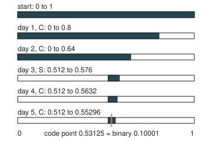
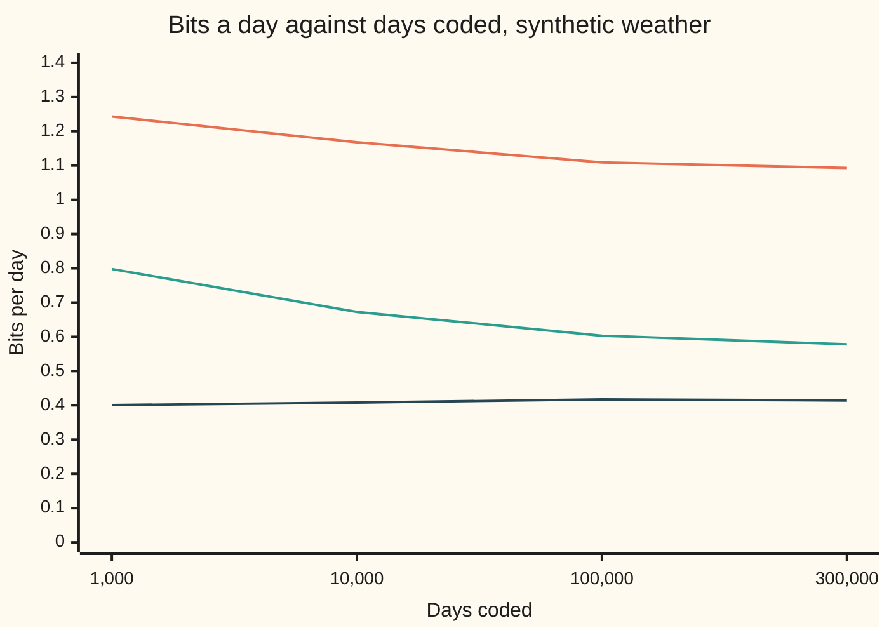

# Arithmetic and Lempel-Ziv coding: beating Huffman on fractions and on repetition

[Syllabus](../../../SYLLABUS.md) → [Applied and computational](../README.md) → [Information Theory](../README.md#s03) → Arithmetic and Lempel-Ziv coding

---

## General Overview

A second weather station, on a hill further north, sends one reading a day down a radio link: C for cloud, S for sun, R for rain. It is a grey place. Its records say cloud 8 days in 10, sun 1 in 10, rain 1 in 10. This month went `CCSCCCCCRCCCCCCSCCCCRCCCCCCSCR`: 24 cloudy days, 3 sunny, 3 rainy, 30 in all.

The best code that gives each day its own codeword is Huffman's ([Huffman coding](05-source-coding-and-huffman.md)): C as 1 bit, S and R as 2 bits each. The month costs 36 bits. But a cloudy day carries only 0.3219 bits of surprise (log2 of one over its chance, log2(1/0.8)), and a codeword cannot be shorter than 1 whole bit. On every cloudy day Huffman pays for most of a bit that carries no news. The entropy, the floor no code can beat on average ([Entropy](01-entropy.md)), is 0.9219 bits a day: 27.6578 bits for this month.

**Arithmetic coding** stops giving each day its own codeword. It treats the whole month as one point on a ruler from 0 to 1. Every possible month owns a slice of the ruler, as wide as its chance of happening. This month's slice is about 1 in 212 million of the ruler, and the station sends a binary fraction (a number such as 0.10001 written in base 2) that lands inside it: 28 bits instead of 36. The fractions of a bit add up across days instead of being rounded up each day.

**Lempel-Ziv coding** attacks a different waste. Real weather comes in spells: a cloudy day is usually followed by another, and a per-day code never sees that. LZ78, one of the Lempel-Ziv methods, builds a dictionary of phrases already sent and points back to them. On 300,000 synthetic days of spell weather it spends 0.5782 bits a day. Huffman spends 1.1991, and no per-day code can average below 0.9219.

**Arithmetic coding turns a whole message into one interval whose width is the message's chance, and sends a binary fraction inside it, so a long message costs within one bit of its information content; Lempel-Ziv coding needs no chances at all, and wins on repetition by sending each new phrase as a pointer to an earlier phrase plus one new symbol.**

**What kind of fact this is:** arithmetic coding's length bound is a theorem, proved on this card in Why it works. That LZ78 reaches the best possible rate on long inputs is a theorem of Ziv and Lempel (1978), stated here with its source and not proved. The spell-weather figures are measurements on synthetic data from a stated rule and seed.

### The picture: five days narrow the interval

<p align="center"></p>

Drawn to scale. Each row is the ruler from 0 to 1. Cloud always takes the first 80% of the current slice, sun the next 10%, rain the last 10%. The month's first five days are C, C, S, C, C, and each one keeps its share of what is left. The orange mark is 0.53125, which is 0.10001 in binary: five bits that name the five days.

---

## The formula

Notation first, in words. The message is n days long, here n = 30. The days are x_1, x_2, …, x_n, each one C, S or R. p(x) is the chance of reading x on one day: 0.8, 0.1 or 0.1. W is the width of the message's slice of the ruler, and L is its low end. ℓ, read "ell", is the number of bits sent, and k counts the digits of a binary fraction. ⌈y⌉ means y rounded **up** to a whole number. H is the entropy of one day, from the [Entropy](01-entropy.md) card. Three letters change meaning from the [Huffman coding](05-source-coding-and-huffman.md) card, where L was the average length, n the number of symbols and k the block size.

$$W = p(x_1)\,p(x_2)\cdots p(x_n), \qquad \ell = \left\lceil \log_2 \frac{1}{W} \right\rceil$$

**Read it aloud:** the slice is as wide as the chances of the days multiplied together, and the code needs log2 of one over that width, rounded up.

Averaged over all messages of n independent days, that gives the promise:

$$\frac{\text{average } \ell}{n} \lt H + \frac{1}{n}$$

**Read it aloud:** the cost per day is less than the entropy plus one bit shared out over the whole message.

For LZ78, c is the number of phrases the message splits into and i counts them, 1 to c. Phrase i is sent as a pointer to an earlier phrase, which takes ⌈log2 i⌉ bits, plus one new reading, which takes 2 bits:

$$\text{LZ78 bits} = \sum_{i=1}^{c} \left( \lceil \log_2 i \rceil + 2 \right) \quad \text{(less 2 if the last phrase needs no new reading)}$$

| Symbol | Plain meaning | In our example | Push it up and the answer… |
| --- | --- | --- | --- |
| $n$ | days in the message | 30 | more bits in total; the 1-bit overhead is shared more thinly |
| $x_j$ | the reading on day j | C, C, S, C, C, … | — |
| $p(x)$ | the chance of reading x on one day | 0.8 for C, 0.1 for S and R | a likelier day costs fewer bits |
| $W$ | width of the message's slice: its chance | about 1 in 212 million | a wider slice needs fewer bits |
| $L$ | low end of the slice | 0.512 after five days | — |
| $k$ | digits in a binary fraction; its grid step is 2^−k | 5 for five days | a finer grid reaches narrower slices |
| $\ell$ | bits sent: the smallest k whose step fits in the slice | 28 | — |
| $\lceil y \rceil$ | y rounded up to a whole number | ⌈27.6578⌉ = 28 | — |
| $H$ | entropy: average bits of news per day | 0.9219 | the floor for any code rises |
| $c$ | phrases in the LZ78 dictionary | 11 for the month | more pointers to pay for |
| $i$ | which phrase, counted from 1 | 1 to 11 | later pointers need more bits |

### When it holds

- **The chances are right.** The bound counts bits for the chances the coder is told. On spell weather, a coder told only "0.8, 0.1, 0.1 every day" can never average below 0.9219 bits a day. Told the spell rule, the same coder needs about 0.4142. Arithmetic coding is only as good as its model.
- **The receiver knows when to stop.** A binary fraction does not say how many days it holds. Asked for 33 days, the decoder reads the month and then three cloudy days that never happened. The length must be sent, or an end-of-message symbol added.
- **The arithmetic is exact.** With the computer's ordinary 64-bit floats (numbers with a fractional part, kept to a fixed count of binary digits), the slice shrinks below the gap between neighbouring floats and collapses to zero width on day 60. Real coders use whole numbers and shift out leading bits once they are settled.
- **The message is long.** The rounding up costs up to one bit per message. Coded one day at a time, arithmetic coding pays a whole rounding every day and loses to Huffman: 48 bits for the month.
- **For LZ78: long input with repetition.** Pointers cost bits up front. On these 30 days it spends 49 bits, more than Huffman; it pays off only once long phrases repeat.

---

## Why it works

### Step 0: a likely message gets a wide slice, and a wide slice is easy to point at

A binary fraction with k digits after the point can name any mark on a grid of evenly spaced marks 2^−k apart. So a slice of the ruler at least 2^−k wide is sure to contain a mark that k digits can name.

Arithmetic coding gives every possible message a slice as wide as its chance. A likely message gets a wide slice and a short code; an unlikely one gets a narrow slice and a long code. The steps below check that the slices never overlap, that their widths are the chances, and that the rounding costs at most one bit.

### Step 1: the slices tile the ruler, and their widths multiply

Start with the whole ruler, from 0 to 1. On each day, cut the current slice into three parts in the ratio 0.8 to 0.1 to 0.1: cloud, then sun, then rain. Keep the part for the day's reading.

Parts cut side by side never overlap. After day 1 the three one-day messages own three side-by-side slices; day 2 cuts each again, giving nine. After n days every n-day message has its own slice, the slices cover the ruler, and no two overlap.

Each cut keeps a share p(x_j) of the current width, so the widths multiply: W = p(x_1) p(x_2) ⋯ p(x_n). For n independent days that product is exactly the chance of the message. For the month it is 0.8 multiplied 24 times and 0.1 multiplied 6 times. In whole numbers out of 10^30, that is 4722366482869645213696, or 1 in 211,758,236.8.

### Step 2: enough bits to land inside, and a way back out

Take the smallest k with 2^−k ≤ W, which is ℓ = ⌈log2(1/W)⌉. The first mark of the k-digit grid at or above the low end L is less than one grid step past L. One grid step is at most W, so that mark lies inside the slice, below L + W. The station sends its k digits.

The receiver knows the month has 30 days. It makes the same cuts, and each day it writes down whichever part holds the point. Only one message's slice holds the point, so the decoding is unique.

For the month, log2(1/W) = 27.6578, so ℓ = 28, and the code is `1000100000000101100100010101`. That is 0.9333 bits a day, against Huffman's 36 bits and 60 bits for two plain bits a day.

If several messages are sent back to back with no length, the receiver also needs to see where each code ends. Then the coder picks a fraction whose whole grid cell, not just its mark, sits inside the slice. That costs at most one more bit (Cover and Thomas, chapter 5, on Shannon-Fano-Elias coding).

### Step 3: within one bit of the entropy, on average

For n independent days, the chance of a message is its width W. The average code length is the sum, over every message, of W × ⌈log2(1/W)⌉. Rounding up adds less than 1, so

$$\text{average } \ell \lt \sum W \left(\log_2 \frac{1}{W} + 1\right) = nH + 1.$$

The middle sum is the average surprise of the whole message. Surprises of independent days add, so it is n times one day's average, nH ([Entropy](01-entropy.md)). The last sum of W is 1, since the slices cover the ruler. Divide by n: the cost per day is below H + 1/n.

Huffman could get close too by coding blocks of days, but it would need a codeword for every possible block, a table that triples with each extra day. Arithmetic coding computes the slice on the fly and needs no table.

The code encodes and decodes all 243 five-day messages: an average of 1.0000 bits a day, the same as a count grouped by cloudy days. Longer messages get closer to 0.9219:

| Days coded as one message | 1 | 2 | 5 | 10 | 30 | 100 |
| --- | ---: | ---: | ---: | ---: | ---: | ---: |
| Average bits a day | 1.6000 | 1.1000 | 1.0000 | 1.0000 | 0.9333 | 0.9300 |

Coded one day at a time (n = 1), arithmetic coding is worse than Huffman's 1.2000: a cloudy day's 0.3219 bits round up to 1, and a sunny day's 3.3219 round up to ⌈3.3219⌉ = 4. The fractions only pay off once many days share the rounding.

### Step 4: LZ78 builds a dictionary out of what it has already seen

LZ78 knows no chances at all. It keeps a numbered list of phrases, starting with phrase 0, the empty phrase. At each step it reads the longest phrase already on the list, plus the next reading, and adds that longer phrase to the list. It sends a pair: the number of the old phrase and the new reading.

The month splits into 11 phrases:

`C | CS | CC | CCC | R | CCCC | CCS | CCCCR | CCCCC | CSC | R`

Phrase 6, `CCCC`, is sent as "phrase 4 (`CCC`) plus C". The receiver builds the same list as it goes, so every pointer names a phrase it already has. Phrase i points to one of i earlier phrases (counting the empty one), so the pointer takes ⌈log2 i⌉ bits; the new reading takes 2. The last phrase, `R`, is already phrase 5 and needs no new reading. Total: 49 bits.

### Step 5: why repetition wins, and how slowly

In spell weather the phrases grow as long as the spells they copy, yet each still costs one pointer and one reading. The more the weather repeats itself, the cheaper each day.

The synthetic spell weather follows a stated rule: after a cloudy day, cloud again with chance 0.95, sun 0.025, rain 0.025; a sunny or rainy day repeats with chance 0.8, else turns cloudy. In the long run that still gives cloud 80% of days, so any per-day code is stuck at or above 0.9219 bits a day. But knowing yesterday, each day carries only 0.4135 bits of news: the **entropy rate**, the average surprise of a day given the days before it ([Conditional entropy and mutual information](02-conditional-entropy-and-mutual-information.md)).

Ziv and Lempel proved in 1978 that for any source whose statistics do not drift over time and that never gets stuck in one regime for good (stationary and ergodic, in the technical terms), LZ78's bits per symbol tend to the entropy rate as the input grows. It is **universal**: it gets there without being told the chances or the rule. This card states that theorem; the proof is in their paper and in Cover and Thomas, chapter 13. The approach is slow, as LZ78's own bit counts on seeded synthetic data show:



Orange: LZ78 on independent days, still at 1.0928 after 300,000 days against a limit of 0.9219. Green: LZ78 on spell weather, 0.5782, below any per-day code but above the 0.4135 limit. Dark: the ideal cost for an arithmetic coder told the spell rule, about 0.4142. Huffman spends 1.1991 on the spell days. LZ78 needs no model; arithmetic coding with the right model does best. The steps along the bottom are uneven: each size is ten times the one before, except the last, which is three times.

---

## Worked numbers, by hand

The first five days, `CCSCC`, coded by arithmetic coding:

| Step | Arithmetic | Value |
| --- | --- | --- |
| day 1, C | keep the first 0.8 of 0 to 1 | 0 to 0.8 |
| day 2, C | keep the first 0.8 of 0 to 0.8 | 0 to 0.64 |
| day 3, S | sun's part, 0.8 to 0.9 of the slice: 0.64 × 0.8 to 0.64 × 0.9 | 0.512 to 0.576 |
| day 4, C | 0.512 + (0.576 − 0.512) × 0.8 | 0.512 to 0.5632 |
| day 5, C | 0.512 + (0.5632 − 0.512) × 0.8 | 0.512 to 0.55296 |
| width | 0.8 × 0.8 × 0.1 × 0.8 × 0.8 | 0.04096 |
| bits needed | ⌈log2(1/0.04096)⌉ = ⌈4.6096⌉ | 5 |
| code | first 5-digit binary fraction at or above 0.512 | 0.10001 = 0.53125 |
| Huffman for the same days | 1 + 1 + 2 + 1 + 1 | 6 bits |
| the whole month | ⌈27.6578⌉ | **28 bits** |

The month goes down the radio in 28 bits instead of Huffman's 36, just above its 27.6578 bits of information.

LZ78 on the same month, each phrase the longest known phrase plus one new reading:

| Step | Arithmetic | Value |
| --- | --- | --- |
| phrase 1, `C` | empty + C: pointer 0 bits, reading 2 | (0, C), 2 bits |
| phrase 2, `CS` | phrase 1 + S: ⌈log2 2⌉ + 2 | (1, S), 3 bits |
| phrase 3, `CC` | phrase 1 + C: ⌈log2 3⌉ + 2 | (1, C), 4 bits |
| phrase 4, `CCC` | phrase 3 + C | (3, C), 4 bits |
| phrase 5, `R` | empty + R: ⌈log2 5⌉ + 2 | (0, R), 5 bits |
| phrase 6, `CCCC` | phrase 4 + C | (4, C), 5 bits |
| phrase 7, `CCS` | phrase 3 + S | (3, S), 5 bits |
| phrase 8, `CCCCR` | phrase 6 + R | (6, R), 5 bits |
| phrase 9, `CCCCC` | phrase 6 + C: ⌈log2 9⌉ + 2 | (6, C), 6 bits |
| phrase 10, `CSC` | phrase 2 + C | (2, C), 6 bits |
| phrase 11, `R` | already phrase 5: pointer only | (5, –), 4 bits |
| total | 2 + 3 + 4 + 4 + 5 + 5 + 5 + 5 + 6 + 6 + 4 | **49 bits** |

On a single month LZ78 loses, 49 bits against Huffman's 36 and arithmetic coding's 28: its dictionary has had no time to fill with long phrases.

### What breaks if you drop a piece

| Mistake | Comes out at | What went wrong |
| --- | --- | --- |
| Arithmetic coding one day at a time | 48 bits for the month | Each day rounds up on its own: cloud to 1 bit, sun and rain to 4 |
| No length sent; decoder asked for 33 days | `CCSCCCCCRCCCCCCSCCCCRCCCCCCSCRCCC` | The point keeps decoding past day 30 into days that never happened |
| Ordinary 64-bit floats for the slice (month repeated) | zero width on day 60 | The slice gets narrower than the gap between neighbouring floats |
| LZ78 on just the 30 days | 49 bits | Pointers cost more than the few short repeats save |
| LZ78 on independent days, 300,000 of them | 1.0928 bits a day, above 0.9219 | No spells to find, and the approach to the limit is slow |

The last two rows break LZ78's hypothesis: a long input with repetition in it. The code prints all five.

---

## Code, from first principles, and it actually runs

The arithmetic coder uses exact whole numbers: the slice is kept in units of 1 over 10^30, about 2^99.7, too big for ordinary 64-bit integers. It takes three independent roads: the exact slice against the product of the chances and the formula for ℓ; a decoder that reads the 28 bits back into the month; and all 243 five-day messages encoded and decoded, against a formula grouped by the number of cloudy days. LZ78 is built as a tree of phrases and checked by a decoder that rebuilds the input. The spell weather comes from SplitMix64, a small seeded generator written out in both languages, so the two outputs match line for line.

### Python

```python
# Arithmetic and Lempel-Ziv coding -- the check behind the card.  Standard library
# only: math.log2 and math.ceil know nothing about compression.  A weather station
# sends C (cloudy), S (sunny) or R (rain) each day.  Arithmetic coding turns a month
# into one interval and one binary fraction; LZ78 builds a dictionary of phrases.
from math import log2, ceil

NAMES = "CSR"                            # cloudy, sunny, rain
F = [8, 1, 1]                            # chances in tenths: 0.8, 0.1, 0.1
CUM = [0, 8, 9]                          # where each slice starts, in tenths
MONTH = "CCSCCCCCRCCCCCCSCCCCRCCCCCCSCR"  # 30 days: 24 cloudy, 3 sunny, 3 rain
HUFF = [1, 2, 2]                         # Huffman lengths for 0.8, 0.1, 0.1
SEED = 2026

def encode(msg):                         # interval [L/D, (L+W)/D), then the code
    L, W, D = 0, 1, 1
    for ch in msg:
        s = NAMES.index(ch)
        L, W, D = 10 * L + W * CUM[s], W * F[s], 10 * D
    k = 0
    while W << k < D:                    # smallest k with 2^-k <= width
        k += 1
    x = -(-(L << k) // D)                # first k-bit fraction at or above L/D
    assert x * D < (L + W) << k          # ... and it lies inside the interval
    return L, W, D, k, x

def decode(x, k, n):                     # follow the point x/2^k down the splits;
    num, den, out = x, 1 << k, ""        # num/den = where it sits inside the interval
    for _ in range(n):
        s = next(s for s in (2, 1, 0) if CUM[s] * den <= 10 * num)
        num, den, out = 10 * num - CUM[s] * den, F[s] * den, out + NAMES[s]
    return out

def lz78(x, m):                          # phrases = earlier phrase + one new symbol
    trie, i, bits, out = [[0] * m], 0, 0, []
    while i < len(x):
        node = 0
        while i < len(x) and trie[node][x[i]]:
            node, i = trie[node][x[i]], i + 1
        bits += (len(trie) - 1).bit_length()          # index: ceil(log2 of phrases so far + 1)
        if i < len(x):
            trie[node][x[i]] = len(trie)
            trie.append([0] * m)
            out.append((node, x[i]))
            bits, i = bits + 2, i + 1                 # new symbol: 2 bits
        else:
            out.append((node, -1))                    # last phrase already known
    return out, bits

def unlz78(pairs):                       # rebuild the phrases from the pairs
    phrases = [[]]
    for j, s in pairs:
        phrases.append(phrases[j] + ([s] if s >= 0 else []))
    return phrases[1:]

MASK = (1 << 64) - 1
def splitmix64(state):
    state = (state + 0x9E3779B97F4A7C15) & MASK
    z = state
    z = ((z ^ (z >> 30)) * 0xBF58476D1CE4E5B9) & MASK
    z = ((z ^ (z >> 27)) * 0x94D049BB133111EB) & MASK
    return state, z ^ (z >> 31)

def weather(n, rows):                    # synthetic days; rows[t] = chances after state t
    state, today, out = SEED, 0, []
    for _ in range(n):
        state, z = splitmix64(state)
        u = (z >> 11) / 2.0**53          # uniform in [0, 1); pick the first slice past u
        today = next((s for s in range(3) if u < sum(rows[today][:s + 1])), 2)
        out.append(today)
    return out

P = [f / 10 for f in F]
H = sum(p * log2(1 / p) for p in P)
L, W, D, k, x = encode(MONTH)
ideal = sum(log2(10 / F[NAMES.index(c)]) for c in MONTH)
huff = sum(HUFF[NAMES.index(c)] for c in MONTH)
print(f"chances 0.8, 0.1, 0.1: surprise {log2(1.25):.4f}, {log2(10):.4f} bits; H = {H:.4f} bits a day; "
      f"Huffman lengths {HUFF}, {sum(p * l for p, l in zip(P, HUFF)):.4f} a day")
print(f"month: {MONTH}: {MONTH.count('C')} C, {MONTH.count('S')} S, {MONTH.count('R')} R")
print(f"width = 0.8^24 x 0.1^6 = {W}/10^30, 1 in {D / W:.1f}; log2(1/width) = {ideal:.4f}")
print(f"arithmetic code: {k} bits, {x:0{k}b}; bits per day {k / 30:.4f}")
print(f"Huffman {huff} bits; two fixed bits a day {2 * 30}; 30 x H = {30 * H:.4f}; 10^30 is about 2^{log2(D):.1f}")
lo, hi, rows5 = 0.0, 1.0, []
for c in MONTH[:5]:
    s = NAMES.index(c)
    lo, hi = lo + (hi - lo) * CUM[s] / 10, lo + (hi - lo) * (CUM[s] + F[s]) / 10
    rows5.append((c, lo, hi))
print("first 5 days: " + "; ".join(f"{c} [{a:.5f}, {b:.5f})" for c, a, b in rows5))
L5, W5, D5, k5, x5 = encode(MONTH[:5])
print(f"5 days: width {W5 / D5:.5f}, log2(1/width) {log2(D5 / W5):.4f}, code {x5:0{k5}b} = {x5 / 2**k5:.5f}, "
      f"Huffman {sum(HUFF[NAMES.index(c)] for c in MONTH[:5])} bits")
print("figure, x = 30 + 300 v: " + " ".join(f"{30 + 300 * a:.1f}-{30 + 300 * b:.1f}" for _, a, b in rows5)
      + f" code {30 + 300 * x5 / 2**k5:.1f}")
def by_formula(n):                       # expected bits per day, grouped by counts
    e, coef = 0.0, 2.0**n
    for a in range(n + 1):               # a cloudy days, n - a others: coef = C(n, a) 2^(n-a)
        e += coef * 0.8**a * 0.1**(n - a) * ceil(a * log2(1.25) + (n - a) * log2(10))
        coef = coef * (n - a) / (a + 1) / 2
    return e / n
total, ok = 0.0, 0                       # every 5-day message, encoded and decoded
for m in range(3**5):
    msg = "".join(NAMES[m // 3**j % 3] for j in range(5))
    Lm, Wm, Dm, km, xm = encode(msg)
    total, ok = total + Wm / Dm * km, ok + (decode(xm, km, 5) == msg)
print(f"all 243 five-day messages: {ok} decode; average {total / 5:.4f} bits a day; formula {by_formula(5):.4f}")
print("expected bits a day, coding n days as one: " + ", ".join(f"n={n} {by_formula(n):.4f}" for n in (1, 2, 5, 10, 30, 100)))
pairs, bits = lz78([NAMES.index(c) for c in MONTH], 3)
show = ["".join(NAMES[s] for s in p) + f"=({j},{NAMES[s] if s >= 0 else '-'}):{i.bit_length() + 2 * (s >= 0)}"
        for i, (p, (j, s)) in enumerate(zip(unlz78(pairs), pairs))]   # phrase = (earlier, new):bits
print(f"LZ78 on the month: {len(pairs)} phrases, {bits} bits: " + " ".join(show))
SPELL = [[0.95, 0.025, 0.025], [0.2, 0.8, 0.0], [0.2, 0.0, 0.8]]   # weather in spells
INDEP = [P, P, P]                                                  # every day fresh
rate = 0.8 * sum(p * log2(1 / p) for p in SPELL[0]) + 0.2 * sum(p * log2(1 / p) for p in SPELL[1] if p)
lo, hi, day = 0.0, 1.0, 0                # mistake: ordinary floats for the interval
while lo < hi:
    s, day = NAMES.index(MONTH[day % 30]), day + 1
    lo, hi = lo + (hi - lo) * CUM[s] / 10, lo + (hi - lo) * (CUM[s] + F[s]) / 10
print(f"mistakes: one day at a time {by_formula(1) * 30:.0f} bits; no length sent, 33 days decode as "
      f"{decode(x, k, 33)}; floats collapse to zero width on day {day}")
print(f"spells: after C, C 0.95, S 0.025, R 0.025; S or R stays 0.8, else C; entropy rate {rate:.4f} bits a day")
for n in (1000, 10000, 100000, 300000):
    sp, iid = weather(n, SPELL), weather(n, INDEP)
    ps, bs = lz78(sp, 3)
    pi, bi = lz78(iid, 3)
    assert [s for p in unlz78(ps) for s in p] == sp and [s for p in unlz78(pi) for s in p] == iid
    model = sum(log2(1 / SPELL[a][b]) for a, b in zip([0] + sp, sp))   # start after a cloudy day
    print(f"n={n}: LZ78 spells {bs / n:.4f}, independent {bi / n:.4f}; "
          f"Huffman spells {sum(HUFF[s] for s in sp) / n:.4f}; spell-model ideal {model / n:.4f}")

assert W == 8**24 and D == 10**30 and k == ceil(30 * log2(5) - 42)   # width = product of chances
assert decode(x, k, 30) == MONTH and k < huff < 60                    # round trip; beats Huffman
assert ok == 243 and abs(total / 5 - by_formula(5)) < 1e-12           # brute force = formula
assert all(H <= by_formula(n) < H + 1 / n for n in (1, 2, 5, 10, 30, 100))  # never below H, within 1 bit a message
assert [s for p in unlz78(pairs) for s in p] == [NAMES.index(c) for c in MONTH] and bits > k
assert bits == sum(ceil(log2(i)) + 2 for i in range(1, len(pairs) + 1)) - 2 * (pairs[-1][1] < 0)  # LZ78 formula
assert model / n < bs / n < H and bi / n > H                         # spells: LZ beats per-day codes
assert abs(model / n - rate) < 0.01 and rate < bs / n                # model cost meets the rate; LZ78 above it
print("ALL CHECKS PASS")
```

**Ran 2026-11-11 on macOS, Python 3.14.10, standard library only. All checks passed. Output, pasted from the run:**

```
chances 0.8, 0.1, 0.1: surprise 0.3219, 3.3219 bits; H = 0.9219 bits a day; Huffman lengths [1, 2, 2], 1.2000 a day
month: CCSCCCCCRCCCCCCSCCCCRCCCCCCSCR: 24 C, 3 S, 3 R
width = 0.8^24 x 0.1^6 = 4722366482869645213696/10^30, 1 in 211758236.8; log2(1/width) = 27.6578
arithmetic code: 28 bits, 1000100000000101100100010101; bits per day 0.9333
Huffman 36 bits; two fixed bits a day 60; 30 x H = 27.6578; 10^30 is about 2^99.7
first 5 days: C [0.00000, 0.80000); C [0.00000, 0.64000); S [0.51200, 0.57600); C [0.51200, 0.56320); C [0.51200, 0.55296)
5 days: width 0.04096, log2(1/width) 4.6096, code 10001 = 0.53125, Huffman 6 bits
figure, x = 30 + 300 v: 30.0-270.0 30.0-222.0 183.6-202.8 183.6-199.0 183.6-195.9 code 189.4
all 243 five-day messages: 243 decode; average 1.0000 bits a day; formula 1.0000
expected bits a day, coding n days as one: n=1 1.6000, n=2 1.1000, n=5 1.0000, n=10 1.0000, n=30 0.9333, n=100 0.9300
LZ78 on the month: 11 phrases, 49 bits: C=(0,C):2 CS=(1,S):3 CC=(1,C):4 CCC=(3,C):4 R=(0,R):5 CCCC=(4,C):5 CCS=(3,S):5 CCCCR=(6,R):5 CCCCC=(6,C):6 CSC=(2,C):6 R=(5,-):4
mistakes: one day at a time 48 bits; no length sent, 33 days decode as CCSCCCCCRCCCCCCSCCCCRCCCCCCSCRCCC; floats collapse to zero width on day 60
spells: after C, C 0.95, S 0.025, R 0.025; S or R stays 0.8, else C; entropy rate 0.4135 bits a day
n=1000: LZ78 spells 0.7980, independent 1.2430; Huffman spells 1.1770; spell-model ideal 0.4006
n=10000: LZ78 spells 0.6727, independent 1.1679; Huffman spells 1.2010; spell-model ideal 0.4080
n=100000: LZ78 spells 0.6033, independent 1.1091; Huffman spells 1.2035; spell-model ideal 0.4173
n=300000: LZ78 spells 0.5782, independent 1.0928; Huffman spells 1.1991; spell-model ideal 0.4142
ALL CHECKS PASS
```

### Rust

Same numbers, same labels, built with `rustc --edition 2021 -O`.

```rust
// Arithmetic and Lempel-Ziv coding -- the same check as the Python, in Rust.  No
// crates; f64's log2 and powf know nothing about compression.  A weather station
// sends C (cloudy), S (sunny) or R (rain) each day.  Arithmetic coding turns a month
// into one interval and one binary fraction; LZ78 builds a dictionary of phrases.
const NAMES: [char; 3] = ['C', 'S', 'R'];               // cloudy, sunny, rain
const F: [u128; 3] = [8, 1, 1];                         // chances in tenths: 0.8, 0.1, 0.1
const CUM: [u128; 3] = [0, 8, 9];                       // where each slice starts, in tenths
const MONTH: &str = "CCSCCCCCRCCCCCCSCCCCRCCCCCCSCR";   // 30 days: 24 cloudy, 3 sunny, 3 rain
const HUFF: [u64; 3] = [1, 2, 2];                       // Huffman lengths for 0.8, 0.1, 0.1
const SEED: u64 = 2026;
const NONE: usize = usize::MAX;                         // "no new symbol" on the last phrase

fn idx(c: char) -> usize { NAMES.iter().position(|&n| n == c).unwrap() }

fn encode(msg: &str) -> (u128, u128, u128, u32, u128) { // interval [L/D, (L+W)/D), then the code
    let (mut l, mut w, mut d) = (0u128, 1u128, 1u128);
    for s in msg.chars().map(idx) { (l, w, d) = (10 * l + w * CUM[s], w * F[s], 10 * d); }
    let mut k = 0;
    while (w << k) < d { k += 1; }                      // smallest k with 2^-k <= width
    let x = ((l << k) + d - 1) / d;                     // first k-bit fraction at or above L/D
    assert!(x * d < (l + w) << k);                      // ... and it lies inside the interval
    (l, w, d, k, x)
}

fn decode(x: u128, k: u32, n: usize) -> String {       // follow the point x/2^k down the splits;
    let (mut num, mut den, mut out) = (x, 1u128 << k, String::new()); // num/den = place in interval
    for _ in 0..n {
        let s = [2, 1, 0].into_iter().find(|&s| CUM[s] * den <= 10 * num).unwrap();
        (num, den) = (10 * num - CUM[s] * den, F[s] * den);
        out.push(NAMES[s]);
    }
    out
}

fn lz78(x: &[usize]) -> (Vec<(usize, usize)>, u64) {   // phrases = earlier phrase + one new symbol
    let (mut trie, mut i, mut bits, mut out) = (vec![[0usize; 3]], 0, 0u64, Vec::new());
    while i < x.len() {
        let mut node = 0;
        while i < x.len() && trie[node][x[i]] != 0 { (node, i) = (trie[node][x[i]], i + 1); }
        bits += (usize::BITS - (trie.len() - 1).leading_zeros()) as u64; // index bits
        if i < x.len() {
            let next = trie.len();
            trie[node][x[i]] = next;
            trie.push([0; 3]);
            out.push((node, x[i]));
            (bits, i) = (bits + 2, i + 1);              // new symbol: 2 bits
        } else {
            out.push((node, NONE));                     // last phrase already known
        }
    }
    (out, bits)
}

fn unlz78(pairs: &[(usize, usize)]) -> Vec<Vec<usize>> { // rebuild the phrases from the pairs
    let mut phrases: Vec<Vec<usize>> = vec![vec![]];
    for &(j, s) in pairs {
        phrases.push([phrases[j].clone(), if s == NONE { vec![] } else { vec![s] }].concat());
    }
    phrases.split_off(1)
}

fn splitmix64(state: u64) -> (u64, u64) {
    let s = state.wrapping_add(0x9E3779B97F4A7C15);
    let mut z = s;
    z = (z ^ (z >> 30)).wrapping_mul(0xBF58476D1CE4E5B9);
    z = (z ^ (z >> 27)).wrapping_mul(0x94D049BB133111EB);
    (s, z ^ (z >> 31))
}

fn weather(n: usize, rows: &[[f64; 3]; 3]) -> Vec<usize> { // synthetic days; rows[t] = chances after t
    let (mut state, mut today, mut out) = (SEED, 0usize, Vec::new());
    for _ in 0..n {
        let z;
        (state, z) = splitmix64(state);
        let u = (z >> 11) as f64 / 2f64.powi(53);       // uniform in [0, 1); first slice past u
        today = (0..3).find(|&s| u < rows[today][..s + 1].iter().fold(0.0, |a, b| a + b)).unwrap_or(2);
        out.push(today);
    }
    out
}

fn by_formula(n: i32) -> f64 {                          // expected bits per day, grouped by counts
    let (mut e, mut coef) = (0.0, 2f64.powi(n));
    for a in 0..=n {                                    // a cloudy days: coef = C(n, a) 2^(n-a)
        let bits = (a as f64 * 1.25f64.log2() + (n - a) as f64 * 10f64.log2()).ceil();
        e += coef * 0.8f64.powf(a as f64) * 0.1f64.powf((n - a) as f64) * bits;
        coef = coef * (n - a) as f64 / (a + 1) as f64 / 2.0;
    }
    e / n as f64
}

fn text(p: &[usize]) -> String { p.iter().map(|&s| NAMES[s]).collect() }

fn main() {
    let p: Vec<f64> = F.iter().map(|&f| f as f64 / 10.0).collect();
    let h: f64 = p.iter().map(|&q| q * (1.0 / q).log2()).sum();
    let (_, w, d, k, x) = encode(MONTH);
    let ideal: f64 = MONTH.chars().map(|c| (10.0 / F[idx(c)] as f64).log2()).sum();
    let huff: u64 = MONTH.chars().map(|c| HUFF[idx(c)]).sum();
    let count = |ch: char| MONTH.chars().filter(|&c| c == ch).count();
    println!("chances 0.8, 0.1, 0.1: surprise {:.4}, {:.4} bits; H = {:.4} bits a day; Huffman lengths {:?}, {:.4} a day",
        1.25f64.log2(), 10f64.log2(), h, HUFF, p.iter().zip(HUFF).map(|(q, l)| q * l as f64).sum::<f64>());
    println!("month: {}: {} C, {} S, {} R", MONTH, count('C'), count('S'), count('R'));
    println!("width = 0.8^24 x 0.1^6 = {}/10^30, 1 in {:.1}; log2(1/width) = {:.4}", w, d as f64 / w as f64, ideal);
    println!("arithmetic code: {} bits, {:0w$b}; bits per day {:.4}", k, x, k as f64 / 30.0, w = k as usize);
    println!("Huffman {} bits; two fixed bits a day {}; 30 x H = {:.4}; 10^30 is about 2^{:.1}", huff, 2 * 30, 30.0 * h, (d as f64).log2());
    let (mut lo, mut hi, mut rows5) = (0.0f64, 1.0f64, Vec::new());
    for c in MONTH.chars().take(5) {
        let s = idx(c);
        (lo, hi) = (lo + (hi - lo) * CUM[s] as f64 / 10.0, lo + (hi - lo) * (CUM[s] + F[s]) as f64 / 10.0);
        rows5.push((c, lo, hi));
    }
    let r: Vec<String> = rows5.iter().map(|(c, a, b)| format!("{} [{:.5}, {:.5})", c, a, b)).collect();
    println!("first 5 days: {}", r.join("; "));
    let (_, w5, d5, k5, x5) = encode(&MONTH[..5]);
    let h5: u64 = MONTH.chars().take(5).map(|c| HUFF[idx(c)]).sum();
    println!("5 days: width {:.5}, log2(1/width) {:.4}, code {:0w$b} = {:.5}, Huffman {} bits", w5 as f64 / d5 as f64,
        (d5 as f64 / w5 as f64).log2(), x5, x5 as f64 / 2f64.powi(k5 as i32), h5, w = k5 as usize);
    let fig: Vec<String> = rows5.iter().map(|(_, a, b)| format!("{:.1}-{:.1}", 30.0 + 300.0 * a, 30.0 + 300.0 * b)).collect();
    println!("figure, x = 30 + 300 v: {} code {:.1}", fig.join(" "), 30.0 + 300.0 * x5 as f64 / 2f64.powi(k5 as i32));
    let (mut total, mut ok) = (0.0f64, 0);              // every 5-day message, encoded and decoded
    for m in 0..243usize {
        let msg: String = (0..5).map(|j| NAMES[m / 3usize.pow(j) % 3]).collect();
        let (_, wm, dm, km, xm) = encode(&msg);
        total += wm as f64 / dm as f64 * km as f64;
        if decode(xm, km, 5) == msg { ok += 1; }
    }
    println!("all 243 five-day messages: {} decode; average {:.4} bits a day; formula {:.4}", ok, total / 5.0, by_formula(5));
    let ns = [1, 2, 5, 10, 30, 100];
    let e: Vec<String> = ns.iter().map(|&n| format!("n={} {:.4}", n, by_formula(n))).collect();
    println!("expected bits a day, coding n days as one: {}", e.join(", "));
    let month: Vec<usize> = MONTH.chars().map(idx).collect();
    let (pairs, bits) = lz78(&month);
    let show: Vec<String> = unlz78(&pairs).iter().zip(&pairs).enumerate().map(|(i, (q, &(j, s)))| format!("{}=({},{}):{}", // phrase = (earlier, new):bits
        text(q), j, if s == NONE { '-' } else { NAMES[s] }, usize::BITS - i.leading_zeros() + if s == NONE { 0 } else { 2 })).collect();
    println!("LZ78 on the month: {} phrases, {} bits: {}", pairs.len(), bits, show.join(" "));
    let spell = [[0.95, 0.025, 0.025], [0.2, 0.8, 0.0], [0.2, 0.0, 0.8]]; // weather in spells
    let indep = [[0.8, 0.1, 0.1]; 3];                                     // every day fresh
    let ent = |r: &[f64; 3]| r.iter().filter(|&&q| q > 0.0).map(|&q| q * (1.0 / q).log2()).sum::<f64>();
    let rate = 0.8 * ent(&spell[0]) + 0.2 * ent(&spell[1]);
    let (mut lo, mut hi, mut day) = (0.0f64, 1.0f64, 0); // mistake: ordinary floats for the interval
    while lo < hi {
        let s = month[day % 30];
        (lo, hi, day) = (lo + (hi - lo) * CUM[s] as f64 / 10.0, lo + (hi - lo) * (CUM[s] + F[s]) as f64 / 10.0, day + 1);
    }
    println!("mistakes: one day at a time {:.0} bits; no length sent, 33 days decode as {}; floats collapse to zero width on day {}",
        by_formula(1) * 30.0, decode(x, k, 33), day);
    println!("spells: after C, C 0.95, S 0.025, R 0.025; S or R stays 0.8, else C; entropy rate {:.4} bits a day", rate);
    let (mut bs, mut bi, mut model, mut nn) = (0.0, 0.0, 0.0, 0.0);
    for n in [1000usize, 10000, 100000, 300000] {
        let (sp, iid) = (weather(n, &spell), weather(n, &indep));
        let ((ps, b1), (pi, b2)) = (lz78(&sp), lz78(&iid));
        assert!(unlz78(&ps).concat() == sp && unlz78(&pi).concat() == iid);
        let mut prev = 0;                               // start after a cloudy day
        model = 0.0;
        for &s in &sp { (model, prev) = (model + (1.0 / spell[prev][s]).log2(), s); }
        let hs: u64 = sp.iter().map(|&s| HUFF[s]).sum();
        (nn, bs, bi) = (n as f64, b1 as f64, b2 as f64);
        println!("n={}: LZ78 spells {:.4}, independent {:.4}; Huffman spells {:.4}; spell-model ideal {:.4}",
            n, bs / nn, bi / nn, hs as f64 / nn, model / nn);
    }
    assert!(w == 8u128.pow(24) && d == 10u128.pow(30) && k as f64 == (30.0 * 5f64.log2() - 42.0).ceil()); // width = product
    assert!(decode(x, k, 30) == MONTH && (k as u64) < huff && huff < 60);           // round trip; beats Huffman
    assert!(ok == 243 && (total / 5.0 - by_formula(5)).abs() < 1e-12);               // brute force = formula
    assert!(ns.iter().all(|&n| h <= by_formula(n) && by_formula(n) < h + 1.0 / n as f64)); // never below H, within 1 bit
    assert!(unlz78(&pairs).concat() == month && bits > k as u64 && bits == (1..=pairs.len())    // LZ78 formula
        .map(|i| (i as f64).log2().ceil() as u64 + 2).sum::<u64>() - 2 * (pairs[pairs.len() - 1].1 == NONE) as u64);
    assert!(model / nn < bs / nn && bs / nn < h && bi / nn > h && (model / nn - rate).abs() < 0.01 && rate < bs / nn);
    println!("ALL CHECKS PASS");
}
```

**Ran 2026-11-11 on macOS, rustc 1.98.1, no crates. All checks passed. Output, pasted from the run:**

```
chances 0.8, 0.1, 0.1: surprise 0.3219, 3.3219 bits; H = 0.9219 bits a day; Huffman lengths [1, 2, 2], 1.2000 a day
month: CCSCCCCCRCCCCCCSCCCCRCCCCCCSCR: 24 C, 3 S, 3 R
width = 0.8^24 x 0.1^6 = 4722366482869645213696/10^30, 1 in 211758236.8; log2(1/width) = 27.6578
arithmetic code: 28 bits, 1000100000000101100100010101; bits per day 0.9333
Huffman 36 bits; two fixed bits a day 60; 30 x H = 27.6578; 10^30 is about 2^99.7
first 5 days: C [0.00000, 0.80000); C [0.00000, 0.64000); S [0.51200, 0.57600); C [0.51200, 0.56320); C [0.51200, 0.55296)
5 days: width 0.04096, log2(1/width) 4.6096, code 10001 = 0.53125, Huffman 6 bits
figure, x = 30 + 300 v: 30.0-270.0 30.0-222.0 183.6-202.8 183.6-199.0 183.6-195.9 code 189.4
all 243 five-day messages: 243 decode; average 1.0000 bits a day; formula 1.0000
expected bits a day, coding n days as one: n=1 1.6000, n=2 1.1000, n=5 1.0000, n=10 1.0000, n=30 0.9333, n=100 0.9300
LZ78 on the month: 11 phrases, 49 bits: C=(0,C):2 CS=(1,S):3 CC=(1,C):4 CCC=(3,C):4 R=(0,R):5 CCCC=(4,C):5 CCS=(3,S):5 CCCCR=(6,R):5 CCCCC=(6,C):6 CSC=(2,C):6 R=(5,-):4
mistakes: one day at a time 48 bits; no length sent, 33 days decode as CCSCCCCCRCCCCCCSCCCCRCCCCCCSCRCCC; floats collapse to zero width on day 60
spells: after C, C 0.95, S 0.025, R 0.025; S or R stays 0.8, else C; entropy rate 0.4135 bits a day
n=1000: LZ78 spells 0.7980, independent 1.2430; Huffman spells 1.1770; spell-model ideal 0.4006
n=10000: LZ78 spells 0.6727, independent 1.1679; Huffman spells 1.2010; spell-model ideal 0.4080
n=100000: LZ78 spells 0.6033, independent 1.1091; Huffman spells 1.2035; spell-model ideal 0.4173
n=300000: LZ78 spells 0.5782, independent 1.0928; Huffman spells 1.1991; spell-model ideal 0.4142
ALL CHECKS PASS
```

> [!TIP]
> **Try changing**
> - Guess first: how many bits if day 3 had been cloudy? Set `MONTH = "CCCCCCCCRCCCCCCSCCCCRCCCCCCSCR"`. Arithmetic coding needs 25 bits, Huffman 35, LZ78 45. Then the asserts pinned to the real month stop the script, as they should.
> - Guess first: what if the records said 0.6, 0.2, 0.2? Set `F = [6, 2, 2]` and `CUM = [0, 6, 8]`. The entropy rises to 1.3710 bits a day and the same month needs 32 bits, because the coder now expects less cloud than it got.
> - Guess first: does LZ78 reach the limit at a million days? Change the last size to 1000000. Spell weather falls to 0.5572 bits a day and independent days to 1.0746: closer, still not there.

---

## The usual mistake

> [!warning]
> **"Arithmetic coding gives each symbol a fraction of a bit."** It does not; no single day has a codeword at all. The fractions only exist because the rounding up happens once, for the whole message. Code each day as its own message and arithmetic coding costs 1.6000 bits a day, worse than Huffman's 1.2000: 48 bits for the month instead of 36.
>
> - **Forgetting the length.** A binary fraction has no natural end. Asked for 33 days, the decoder happily invents three cloudy ones after the month.
> - **Using floats.** The slice for a long message is far narrower than the gaps between computer floats. With 64-bit floats the month, repeated, collapses to a zero-width slice on day 60. Exact whole numbers are needed, or an integer coder that shifts out leading bits once they are settled.
> - **Expecting LZ to shine on small files.** On one month LZ78 spends 49 bits, more than Huffman's 36. Its gains arrive only after thousands of symbols.
> - **Thinking LZ78 reaches the limit at a practical size.** At 300,000 spell days it spends 0.5782 bits a day against a limit of 0.4135. The theorem is about the limit, not about any size you will run.

---

## Where you meet it in real life

- **zip, gzip and PNG images.** All three use DEFLATE: LZ77, the 1977 sibling of LZ78, sends "copy so many symbols from so far back", and Huffman codes those instructions.
- **GIF images and Unix `compress`.** Both use LZW, Welch's 1984 variant of LZ78, which starts the dictionary with every single symbol and so sends only pointers.
- **xz and 7-Zip.** Their LZMA format finds LZ77-style repeats, then codes everything with a range coder, which is arithmetic coding done with whole numbers.
- **H.264 and H.265 video.** H.265 uses CABAC throughout, and H.264 offers it in its main and high profiles: context-adaptive binary arithmetic coding: the chances change with what was just coded, the "right model" idea of Step 5.
- **JPEG 2000 and JBIG2 scanned documents.** Both use the MQ coder, a binary arithmetic coder built for speed in hardware.
- **Zstandard and bzip2.** Zstandard pairs LZ77 with asymmetric numeral systems (ANS), a newer coder with arithmetic coding's sizes at nearly Huffman's speed. bzip2 reorders its input with the Burrows-Wheeler transform, which gathers repeats into runs, then uses Huffman codes.

> **Say it back**
> Huffman gives every symbol a whole number of bits, so a cloudy day worth 0.3219 bits still costs 1.
> Arithmetic coding gives the whole message one slice of the ruler from 0 to 1, as wide as its chance, and sends a binary fraction inside it: 28 bits for the month instead of 36.
> The rounding happens once per message, so a long message costs less than one bit more than its information.
> LZ78 needs no chances: it sends each new phrase as a pointer to an old phrase plus one reading, so long repeats become cheap.
> On short inputs LZ loses, and on long ones it approaches the best rate only slowly; arithmetic coding with a good model does best of all.

---

## What this builds on

- [Huffman coding](05-source-coding-and-huffman.md): the best code with one whole-bit codeword per symbol, here 1.2000 bits a day, and the entropy bound that every code on this card also obeys.
- [Entropy](01-entropy.md): the surprise log2(1/p) of one reading and the average H = 0.9219 bits a day that arithmetic coding approaches.

## Where this goes next

- [Channel capacity](07-channel-capacity-and-the-noisy-channel-theorem.md), the next card: compression strips out redundancy; a noisy radio link needs some put back, in a controlled way, and capacity says how much.
- [Rate and distortion](10-lossy-compression-and-rate-distortion-in-outline.md): what happens when the station may send a slightly wrong reading in exchange for fewer bits, as JPEG and MP3 do.

The open question is the model: arithmetic coding turns any good set of chances into bits, so how should a coder learn the chances of data it has never seen?

---

## Sources

Verified 2026-11-11: every link below resolves to the publisher's page.

- T. M. Cover and J. A. Thomas, *Elements of Information Theory*, 2nd ed., Wiley, 2006, [doi:10.1002/047174882X](https://doi.org/10.1002/047174882X). Chapter 5 for Shannon-Fano-Elias coding and its extra bit; chapter 13 for arithmetic coding, Lempel-Ziv and the proof that LZ78 reaches the entropy rate.
- I. H. Witten, R. M. Neal and J. G. Cleary, "Arithmetic coding for data compression", *Communications of the ACM* 30(6), 1987, [doi:10.1145/214762.214771](https://doi.org/10.1145/214762.214771). The practical coder with whole numbers and shifting out settled bits.
- J. Ziv and A. Lempel, "A universal algorithm for sequential data compression", *IEEE Transactions on Information Theory* 23(3), 1977, [doi:10.1109/TIT.1977.1055714](https://doi.org/10.1109/TIT.1977.1055714). LZ77, the sliding-window method behind DEFLATE and LZMA.
- J. Ziv and A. Lempel, "Compression of individual sequences via variable-rate coding", *IEEE Transactions on Information Theory* 24(5), 1978, [doi:10.1109/TIT.1978.1055934](https://doi.org/10.1109/TIT.1978.1055934). LZ78, the dictionary method on this card, and its optimality theorem.
- T. A. Welch, "A technique for high-performance data compression", *Computer* 17(6), 1984, [doi:10.1109/MC.1984.1659158](https://doi.org/10.1109/MC.1984.1659158). LZW, the variant used in GIF and Unix `compress`.
