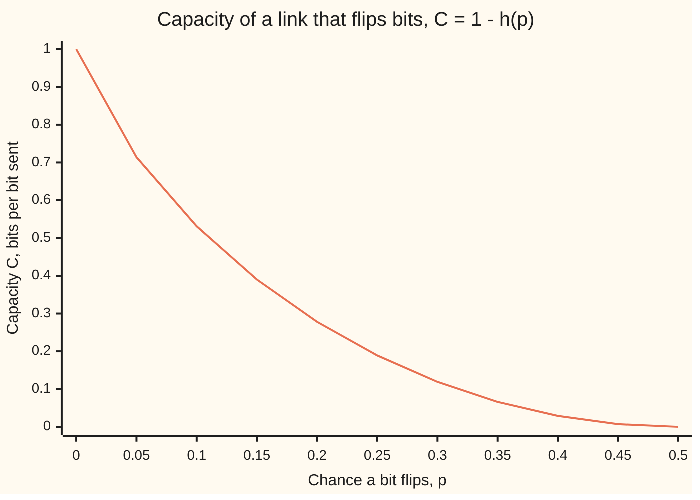

# Channel capacity: the fastest error-free rate a noisy link will allow

[Syllabus](../../../SYLLABUS.md) → [Applied and computational](../README.md) → [Information Theory](../README.md#s03) → Channel capacity

---

## General Overview

A weather station on a hilltop logs one reading every second, 16 bits each. Every evening it sends the day's log down a radio link: 86,400 readings, 1,382,400 bits. The radio sends 1,000 bits a second, so the upload takes 23.04 minutes. But the link is noisy. It flips 1 bit in every 100: a 0 arrives as a 1, or a 1 as a 0, and the receiver cannot tell which. A plain upload arrives with about 13,824 wrong bits.

The obvious fix is to send every bit three times and take a majority vote. A bit then goes wrong only if two or more of its three copies flip: 3 in 10,000. The wrong bits drop to about 412, but the upload takes 69.12 minutes. Five copies take 115.2 minutes and still leave about 14. Every step towards perfect costs more airtime, and perfect is never reached.

Information theory shows that this road is the wrong one. A link that flips 1 bit in 100 has a **capacity**: a rate of 0.919 message bits per bit sent, 919 bits a second here. Below that rate, clever coding of long blocks can make errors as rare as anyone wants. Above it, nothing can. The station's log needs at least 25.07 minutes, not an ever-growing multiple of 23.

**Every noisy link has a capacity C, a rate in bits per use: below C, long enough codes make the error chance as small as wanted; above C, the error chance stays above a fixed floor whatever code is used.**

**What kind of fact this is:** a theorem. The capacity formulas and the converse (the "above C, nothing works" half) are proved on this card in Why it works. The achievable half is a long proof: the card gives its key steps and names where the full proof is. Shannon–Hartley applies the theorem to a model of radio noise, normal and evenly spread, which fits many links well but is an assumption.

### The picture: airtime for the day's log

```
                    minutes to send 1,382,400 bits                  wrong bits left
plain, one copy     ████████                                  23.04  13,824
three copies, vote  ████████████████████████                  69.12  about 412
five copies, vote   ████████████████████████████████████████ 115.20  about 14
at capacity         █████████                                 25.07  as few as wanted, in the limit
```

The last bar is a limit, not a code anyone has run. Real codes get close to it, and the closer they get, the longer their blocks.

---

## The formula

Notation first, in words. One use of the link sends one bit X and delivers one bit Y. The link flips the bit with chance p, the **crossover probability**. The sender may favour 1s or 0s: q is the chance X is 1. From [Entropy](01-entropy.md), h(p) is the binary entropy, the bits in one yes-or-no answer of chance p. From [Conditional entropy and mutual information](02-conditional-entropy-and-mutual-information.md), I(X; Y) is the mutual information: how many bits Y tells about X on average. A link like this, the same flip chance for 0 and 1 and no memory between uses, is a **binary symmetric channel**.

$$C = \max_{q}\; I(X;Y) = 1 - h(p)$$

**Read it aloud:** capacity is the most a single use can tell the receiver, over every way of choosing the sent bits; for a link that flips with chance p, it is one bit minus the bits of noise.

A **code** turns a block of message bits into a longer block of n sent bits. Its **rate** R is message bits per sent bit: three copies have R = 1/3. P_e is the chance the receiver decodes a block wrongly. The **noisy-channel coding theorem** has two halves:

$$R < C:\ \text{for long enough } n \text{ some code of rate } R \text{ has } P_e \text{ as small as wanted;}\qquad R > C:\ P_e \ge 1 - \frac{C}{R} - \frac{1}{nR}$$

**Read it aloud:** under capacity, errors can be driven down without slowing down; over capacity, every code fails on at least a fixed share of its blocks.

For a radio channel B hertz wide (hertz: cycles a second), with signal power S and noise power N inside the band (the noise per hertz times B, so a wider band lets in more noise), the **Shannon–Hartley theorem** gives the capacity in bits a second:

$$C = B \log_2\!\left(1 + \frac{S}{N}\right)$$

**Read it aloud:** the width of the channel times the bits each slice of time can carry, which grow only as the log of how much louder the signal is than the noise.

| Symbol | Plain meaning | In our example | Push it up and the answer… |
| --- | --- | --- | --- |
| $p$ | the crossover probability: chance one bit flips | 0.01 | C falls, to 0 at p = 0.5 |
| $X$, $Y$ | the bit sent and the bit received | 0 or 1 | — |
| $q$ | chance the sender's bit is a 1 | best at 0.5 | I(X; Y) rises until q = 0.5, then falls |
| $h(p)$, $H(Y)$, $H(Y \mid X)$ | entropies in bits: of one flip; of the received bit; of the received bit once the sent bit is known | 0.0808; 1; 0.0808 | more noise, less gets through |
| $I(X;Y)$ | mutual information: bits Y tells about X | 0.9192 at q = 0.5 | — |
| $C$ | capacity: the most bits per use that can get through error-free | 0.9192 per bit, 919.2 a second | faster reliable upload |
| $R$ | rate: message bits per bit sent | 1/3 for three copies; 1/2 for the random codes below | harder to protect; impossible above C |
| $n$ | block length: bits sent per block | 8, 16, 24; 1,000 in the counting | below C, block errors fall |
| $P_e$ | chance a block is decoded wrongly | 0.000742 at n = 24 | — |
| $B$ | channel width, in hertz | 500 Hz, so 1,000 pulses a second | C rises, but less than in proportion at the same power: the wider band lets in more noise |
| $S/N$ | signal-to-noise ratio: signal power over the noise power inside the band | 5.412, or 7.33 dB | C rises, but only as a log |
| $a$, $\Phi$ | pulse height in noise spreads; Φ is the standard bell's area to the left ([Normal](../../09-Probability%20and%20statistics/04-Continuous%20Distributions/04-normal-distribution.md)) | a = 2.326, Φ(−a) = 0.01 | fewer flips |

The decibel (dB) is wing 13's log scale for ratios: 10 log10(S/N).

### The picture: capacity against flip chance



The one line is C. It falls fast at first: a 5% flip rate already costs over a quarter of the link. At p = 0.5 it hits 0, because the received bit is then a coin toss that says nothing about the sent one.

### When it holds

- **Flips are independent from bit to bit.** Lightning can flip twenty bits in a row with the average still 1 in 100. Then 0.919 no longer describes the link, and a code built for scattered flips breaks on the burst.
- **The flip chance is known and steady.** On a stormy evening when p climbs to 0.05, capacity falls to 0.714. A code run at rate 0.9 for calm weather is then above capacity and must fail.
- **Long blocks are allowed.** Capacity is a limit as n grows. A short block, so a short delay, keeps some error even well below C.
- **The rate is strictly below C.** At R = 0.95 the converse holds every code of 1,000 bits to at least 3.14% bad blocks, and longer codes to nearly 3.24%.
- **For Shannon–Hartley: the noise is added, normal, and evenly spread across the band, and the signal's average power is capped.** For any other added noise of the same power the true capacity is at least this figure, since normal noise is the worst case.

---

## Why it works

### Step 0: long blocks make noise predictable

One bit's flip cannot be foreseen. In a thousand bits, about 10 flip, give or take a few. So protect long blocks, not single bits.

Count. A block of 1,000 bits can arrive as any of 2^1,000 words. Given the word sent, the flips that are at all likely number about 2^80.8, because n h(p) = 1,000 × 0.0808 = 80.8 ([Typical sequences](04-typical-sequences-and-the-aep.md)). The single most common case, exactly 10 flips, already gives 2^77.8 patterns. So each codeword sent lands somewhere in a cloud of about 2^80.8 received words.

If the clouds do not overlap, the receiver can always tell which codeword was sent. How many clouds fit into 2^1,000 words? About 2^1,000 ÷ 2^80.8 = 2^919.2. That is 919.2 message bits in 1,000 sent: a rate of 0.919, which is C. The whole theorem is this packing count, made exact.

### Step 1: capacity is the most information one use carries

From [Conditional entropy and mutual information](02-conditional-entropy-and-mutual-information.md), the information Y gives about X is the uncertainty in Y minus the uncertainty left once X is known:

I(X; Y) = H(Y) − H(Y | X).

Once X is known, Y is uncertain only through the flip, which has chance p whatever X is. So H(Y | X) = h(p) = 0.0808 bits, fixed by the link.

The sender controls only H(Y). Y is a single bit, so H(Y) is at most 1, and it reaches 1 when Y is 0 or 1 equally often. That happens when the sender sends 0 and 1 equally often, q = 0.5. Hence

C = 1 − h(p) = 1 − 0.0808 = 0.9192 bits per use.

That is a complete proof. The code's search over 1,001 input mixes, q = 0, 0.001, …, 1, finds the same best: 0.919207 at q = 0.5.

### Step 2: below capacity, a random code works (key steps)

The full proof is long: the 1948 paper and chapter 7 of Cover and Thomas, both in Sources. Its key steps:

1. **Pick a code at random.** Choose 2^(nR) codewords, each n fair coin flips. No design at all.
2. **Decode by the likely cloud.** On receiving a word, look for the one codeword it differs from in about np places.
3. **Failure one: the noise was unusual.** The true flips are far from np. By the law behind [Typical sequences](04-typical-sequences-and-the-aep.md), this chance shrinks to 0 as n grows.
4. **Failure two: a wrong codeword fits.** A random wrong codeword differs from the received word in a pattern of fair coin flips. The chance it lands inside the likely cloud is about 2^(n h(p)) ÷ 2^n = 2^(−nC). There are fewer than 2^(nR) wrong codewords, so the chance any of them fits is at most about 2^(nR) × 2^(−nC) = 2^(−n(C − R)). When R is below C, this shrinks to 0 as n grows.
5. **From average to one code.** The error chance, averaged over all random codes, goes to 0, so at least one code is that good. Discarding its worse half of codewords makes every message safe, at a cost of 1/n in rate.

The code watches this happen. It draws one random code of rate 1/2 at each of three block lengths (a random linear code: random parity checks, which works as well as fully random codewords on this link) and computes its exact block error with the best decoder, the one that always assumes the fewest flips:

| Block length n | Message bits per block | Chance the block is wrong |
| --- | --- | --- |
| 8 | 4 | 0.011258 |
| 16 | 8 | 0.003004 |
| 24 | 12 | 0.000742 |

Same rate, longer blocks, fewer errors. Tripling the same 12 message bits puts 36 bits on air and loses the block with chance 0.003570. The random code uses 24 and fails about five times less often.

### Step 3: above capacity, no code works (complete proof)

Send one of 2^(nR) equally likely messages, so the message holds nR bits. The receiver ends with a guess. Split those nR bits:

nR = (bits the received block told) + (bits still unknown after decoding).

**Bits told: at most nC.** Each use of the link tells at most C bits about what was sent, by Step 1, and the uses do not interfere, so n uses tell at most nC. Processing the received block cannot add information about the message.

**Bits still unknown: at most 1 + P_e × nR.** This is Fano's inequality. To finish naming the message, first say whether the guess was right: at most 1 bit. If it was wrong, which happens with chance P_e, name the true message: at most nR bits.

So nR ≤ nC + 1 + P_e nR. Divide by nR and rearrange:

$$P_e \ge 1 - \frac{C}{R} - \frac{1}{nR}.$$

At R = 0.95 and n = 1,000 the floor is 0.0314; as n grows it climbs to 1 − 0.9192 ÷ 0.95 = 0.0324. Every code at that rate with blocks of 1,000 bits or more gets more than 3% of its blocks wrong. A sharper theorem, the strong converse, proved by Wolfowitz in 1957 (Sources) and not on this card, shows the share in fact tends to 1.

<details>
<summary>Detailed proof: why n uses tell at most nC bits</summary>

Write X for the n bits sent and Y for the n bits received. The information is I = H(Y) − H(Y | X). The link flips each bit on its own, so H(Y | X) is the sum of the n single-bit terms, each h(p). The entropy of a block is at most the sum of its bits' entropies, so H(Y) is at most n × 1. So I is at most n(1 − h(p)) = nC. The message reaches the guess only through Y, so the guess cannot hold more information about the message than Y holds about X.

</details>

### Step 4: Shannon–Hartley, the same idea with normal noise

A radio does not really send bits. It sends pulses of chosen height, and the receiver measures each pulse plus normal noise ([Normal](../../09-Probability%20and%20statistics/04-Continuous%20Distributions/04-normal-distribution.md)). Call the average signal power S and the noise power N.

Step 1 carries over, with entropy for measured values in place of bits. One fact is needed: a normal value has an uncertainty score, its differential entropy, of ½ log2(2πe × its variance) (e ≈ 2.718 is the base of natural logs), and among all values with the same variance, the normal scores highest (Cover and Thomas, chapter 8). The score is not a count of bits and can even be negative; only the difference of two scores counts as bits, and the steps below use only differences.

- Given the pulse sent, the uncertainty left is the noise's: ½ log2(2πe N).
- The received value has variance at most S + N, so its uncertainty is at most ½ log2(2πe(S + N)), reached when the sent heights are themselves normal.
- Subtract: each pulse carries at most ½ log2((S + N)/N) = ½ log2(1 + S/N) bits.

A channel B hertz wide carries at most 2B independent pulses a second, a result from the 1949 paper in Sources. Multiply: C = 2B × ½ log2(1 + S/N) = B log2(1 + S/N).

Measuring both uncertainties with Simpson's rule (summing thin slices under the curve) gives the same 1.340375 bits per pulse.

### Step 5: the 1% link is a normal channel read by its sign

The station sends a pulse of height +a for a 1 and −a for a 0, where a counts noise spreads. The receiver reads only the sign. A bit flips when the noise pushes a pulse past zero, with chance Φ(−a). Setting Φ(−a) = 0.01 gives a = 2.326, so S/N = a² = 5.412, or 7.33 dB. The code also sends 200,000 synthetic pulses through seeded normal noise and counts flips at 0.009955.

Same radio, same power, two readings:

- **Reading the sign only:** 1,000 pulses a second × 0.9192 = 919.2 bits a second.
- **Using the full measured value, with the best possible signal:** 500 × log2(1 + 5.412) = 1,340.4 bits a second.

The gap has two causes: the sender uses only two heights, and the receiver throws away how far from zero each pulse landed. Modern decoders keep that "how sure" figure for each bit ([LDPC, turbo and polar codes](09-ldpc-turbo-and-polar-codes-in-outline.md)).

---

## Worked numbers, by hand

The station's link: p = 0.01, 1,000 bits a second, a log of 1,382,400 bits.

| Step | Arithmetic | Value |
| --- | --- | --- |
| noise from the flip | 0.01 × log2(100) | 0.0664 |
| noise from no flip | 0.99 × log2(1/0.99) | 0.0144 |
| h(p) | 0.0664 + 0.0144 | 0.0808 bits |
| capacity per bit sent | 1 − 0.0808 | 0.9192 |
| capacity per second | 1,000 × 0.9192 | 919.2 bits |
| fewest minutes for the log | 1,382,400 ÷ 919.2 ÷ 60 | **25.07** |
| three copies: one bit wrong | 3 × 0.01² × 0.99 + 0.01³ | 0.000298 |
| three copies: minutes, wrong bits | 3 × 23.04; 1,382,400 × 0.000298 | 69.12; 411.96 |
| pulse height for 1% flips | Φ(−a) = 0.01, from the bell table | a = 2.326 |
| signal-to-noise ratio | 2.326² | 5.412 (7.33 dB) |
| Shannon–Hartley, B = 500 Hz | 500 × log2(1 + 5.412) | **1,340.4 bits a second** |

No code can send the log essentially error-free in under 25.07 minutes. Long enough codes can get as close to that limit as wanted, about 2 minutes more than the error-ridden plain upload. With pulses of any height, chosen like normal noise, and a receiver that uses the full measured values, the same radio could in principle carry 1,340 bits a second. Two heights alone can never pass 1 bit a pulse.

### What breaks if you drop a piece

| Mistake | Comes out at | What went wrong |
| --- | --- | --- |
| Capacity as 1 − p | 0.99 | Assumes the receiver knows which bits flipped. It does not, and naming the flips costs h(p) = 0.0808 bits per bit |
| Natural log in h(p) | 0.9440 | That measures the noise in nats (the natural-log unit), which is larger than a bit, so too little noise is subtracted |
| S/N in decibels put into Shannon–Hartley | 1,529.5 bits a second | 7.33 is a log already; the formula needs the plain ratio 5.412 |
| Running at R = 0.95, above C: a broken hypothesis | at least 0.0314 of blocks wrong at n = 1,000, and the floor rises to 0.0324 for long blocks | The converse: no code beats this floor |

The code prints every row.

---

## Code, from first principles, and it actually runs

Three roads lead to the 1% link's capacity: the formula 1 − h(p); a search over 1,001 input mixes computing I(X; Y) from the full table of chances; and a seeded simulation of 200,000 synthetic bits. Majority voting is checked by the binomial formula and by a best decoder that tries flip patterns from fewest flips up; the same decoder then scores random rate-1/2 codes. For Shannon–Hartley, bisection (halving an interval until it pins the answer) on a bell-curve area, measured by Simpson's rule, finds the pulse height; a series for the same area, with no integral, checks that area; simulated normal noise checks the flip chance; and entropies measured by Simpson's rule check ½ log2(1 + S/N). Random numbers come from SplitMix64, a small generator written out in both languages, so the two outputs match.

### Python

```python
# Channel capacity -- the check behind the card.  Standard library only: no function imported from
# math knows what capacity is.  A radio link sends 1000 bits a second and flips 1 bit in every 100.
from math import log2, sqrt, exp, cos, log, pi, comb, log10, prod

P, BITS_PER_S, LOG_BITS = 0.01, 1000, 86400 * 16  # flip chance; link speed; a day's log
B = 500.0                                 # channel width in hertz: 2B = 1000 pulses a second
MASK = (1 << 64) - 1
def splitmix64(s):                        # small seeded generator, written out
    s = (s + 0x9E3779B97F4A7C15) & MASK
    z = s
    z = ((z ^ (z >> 30)) * 0xBF58476D1CE4E5B9) & MASK
    z = ((z ^ (z >> 27)) * 0x94D049BB133111EB) & MASK
    return s, z ^ (z >> 31)
def uniform(s):                           # a number in (0, 1]
    s, z = splitmix64(s)
    return s, ((z >> 11) + 1) / 2.0**53

def h(p):                                 # binary entropy, in bits
    return 0.0 if p <= 0 or p >= 1 else -p * log2(p) - (1 - p) * log2(1 - p)
def mutual_info(q, p):                    # I(X;Y) straight from the joint table
    px = [1 - q, q]
    joint = [[px[x] * ((1 - p) if x == y else p) for y in (0, 1)] for x in (0, 1)]
    py = [joint[0][y] + joint[1][y] for y in (0, 1)]
    return sum(joint[x][y] * log2(joint[x][y] / (px[x] * py[y]))
               for x in (0, 1) for y in (0, 1) if joint[x][y] > 0)

# road 1: the formula; road 2: search all input mixes; road 3: send synthetic bits
C = 1 - h(P)
best_I, best_q = -1.0, -1.0
for i in range(1001):
    v = mutual_info(i / 1000, P)
    if v > best_I:
        best_I, best_q = v, i / 1000
s, N_SIM, count = 2026, 200000, [[0, 0], [0, 0]]
for _ in range(N_SIM):
    s, z = splitmix64(s)
    x = z >> 63                            # a fair random bit
    s, u = uniform(s)
    count[x][x ^ (1 if u <= P else 0)] += 1
flips_sim = (count[0][1] + count[1][0]) / N_SIM
I_sim = 0.0
for x in (0, 1):
    for y in (0, 1):
        pxy, pxs, pys = count[x][y] / N_SIM, sum(count[x]) / N_SIM, (count[0][y] + count[1][y]) / N_SIM
        I_sim += pxy * log2(pxy / (pxs * pys)) if pxy > 0 else 0.0

def rep_error(r, p):                      # majority vote over r copies: more than half flipped
    return sum(comb(r, k) * p**k * (1 - p)**(r - k) for k in range(r // 2 + 1, r + 1))
def best_decoder_error(cols, n, m, p):    # exact block error when the decoder always picks the
    seen, left, ok, w = [False] * (1 << m), 1 << m, 0.0, 0   # fewest flips that explain the output
    while left:
        x = (1 << w) - 1                  # every n-bit flip pattern with w flips, in turn
        while x < (1 << n):
            syn, y, i = 0, x, 0
            while y:
                if y & 1:
                    syn ^= cols[i]
                y, i = y >> 1, i + 1
            if not seen[syn]:
                seen[syn], left, ok = True, left - 1, ok + p**w * (1 - p)**(n - w)
            if x == 0:
                break
            c = x & -x; r = x + c
            x = (((r ^ x) >> 2) // c) | r
        w += 1
    return 1 - ok
rep3_brute = best_decoder_error([3, 1, 2], 3, 2, P)            # repetition codes, written as
rep5_brute = best_decoder_error([15, 1, 2, 4, 8], 5, 4, P)     # parity checks
rand_err, sc = {}, 2026
for n in (8, 16, 24):                     # random rate-1/2 codes: n/2 message bits, n/2 checks
    m, cols = n // 2, []
    for _ in range(n // 2):
        sc, z = splitmix64(sc)
        cols.append(z & ((1 << m) - 1))
    rand_err[n] = best_decoder_error(cols + [1 << j for j in range(m)], n, m, P)

def phi(t): return exp(-t * t / 2) / sqrt(2 * pi)
def Phi(x, k=2000):                       # bell-curve area left of x, by Simpson's rule
    hh = x / k
    tot = phi(0) + phi(x) + sum((4 if j % 2 else 2) * phi(j * hh) for j in range(1, k))
    return 0.5 + tot * hh / 3
def Phi_series(x):                        # second road, no integral: 1/2 + phi(x) (x + x^3/3 + x^5/15 + ...)
    return 0.5 + phi(x) * sum(x ** (2 * j + 1) / prod(range(1, 2 * j + 2, 2)) for j in range(60))
lo, hi = 0.0, 10.0                        # pulse height a, in noise spreads, with Phi(-a) = P
for _ in range(60):
    mid = (lo + hi) / 2
    lo, hi = (mid, hi) if Phi(-mid) > P else (lo, mid)
a = (lo + hi) / 2; snr = a * a
def diff_entropy(var, k=4000):            # -integral of f log2 f for a normal, by Simpson
    sd = sqrt(var); L = 12 * sd; hh = 2 * L / k
    f = lambda y: exp(-y * y / (2 * var)) / sqrt(2 * pi * var)
    g = lambda y: -f(y) * log2(f(y))
    return (g(-L) + g(L) + sum((4 if j % 2 else 2) * g(-L + j * hh) for j in range(1, k))) * hh / 3
per_pulse = 0.5 * log2(1 + snr)
per_pulse_num = diff_entropy(1 + snr) - diff_entropy(1.0)
neg, sg = 0, 7
for _ in range(N_SIM):                    # send +a, add normal noise (Box-Muller), read the sign
    sg, u1 = uniform(sg)
    sg, u2 = uniform(sg)
    neg += 1 if a + sqrt(-2 * log(u1)) * cos(2 * pi * u2) < 0 else 0
se = sqrt(P * (1 - P) / N_SIM)
fano = lambda R, n: 1 - C / R - (1 / (n * R) if n else 0.0)

rows = [("flip chance p", P), ("  0.01 x log2(100)", P * log2(1 / P)), ("  0.99 x log2(1/0.99)", (1 - P) * log2(1 / (1 - P))),
        ("h(p), bits of noise per bit", h(P)), ("1 formula C = 1 - h(p)", C), ("2 best I(X;Y) over 1001 input mixes", best_I), ("  at input chance q", best_q),
        ("3 simulated flip rate, 200000 bits", flips_sim), ("  simulated I(X;Y)", I_sim),
        ("capacity, bits a second", C * BITS_PER_S), ("day's log, bits", LOG_BITS),
        ("plain: minutes", LOG_BITS / BITS_PER_S / 60), ("plain: wrong bits expected", LOG_BITS * P),
        ("triple: minutes", 3 * LOG_BITS / BITS_PER_S / 60), ("triple: wrong bits expected", LOG_BITS * rep_error(3, P)),
        ("five-fold: minutes", 5 * LOG_BITS / BITS_PER_S / 60), ("five-fold: wrong bits expected", LOG_BITS * rep_error(5, P)),
        ("capacity: fewest minutes", LOG_BITS / (C * BITS_PER_S) / 60),
        ("triple vote error, formula", rep_error(3, P)), ("  by best decoder", rep3_brute),
        ("five-fold vote error, formula", rep_error(5, P)), ("  by best decoder", rep5_brute),
        ("12 bits sent plain, block error", 1 - (1 - P)**12),
        ("12 bits tripled (36 sent), block error", 1 - (1 - rep_error(3, P))**12),
        ("random code n=8, 4 bits, block error", rand_err[8]), ("random code n=16, 8 bits", rand_err[16]),
        ("random code n=24, 12 bits", rand_err[24]),
        ("n=1000: n h(p), log2 likely patterns", 1000 * h(P)), ("  log2 C(1000,10)", sum(log2((1000 - i) / (i + 1)) for i in range(10))),
        ("  n C, log2 codewords", 1000 * C), ("Fano floor, R=0.95, long blocks", fano(0.95, 0)),
        ("  R=0.95, n=1000", fano(0.95, 1000)), ("Gauss: a, height in noise spreads", a),
        ("  Phi(-a), by Simpson", Phi(-a)), ("  Phi(-a), by series", Phi_series(-a)), ("  simulated flip rate", neg / N_SIM), ("  S/N", snr), ("  S/N in dB", 10 * log10(snr)),
        ("  per pulse, 1/2 log2(1+S/N)", per_pulse), ("  per pulse, by entropies", per_pulse_num),
        ("  Shannon-Hartley, B=500 Hz", B * log2(1 + snr)), ("  sign only: 1000 x C", 1000 * C),
        ("wrong: C = 1 - p", 1 - P), ("wrong: natural log", 1 - (-P * log(P) - (1 - P) * log(1 - P))),
        ("wrong: S/N in dB in the formula", B * log2(1 + 10 * log10(snr))),
        ("try: p = 0.1", 1 - h(0.1)), ("try: p = 0.5", 1 - h(0.5)), ("try: p = 0.99", 1 - h(0.99)),
        ("try: S/N doubled", B * log2(1 + 2 * snr)), ("try: B doubled, same power", 2 * B * log2(1 + snr / 2))]
for name, v in rows:
    print(f"{name:<40} {v:>17.9f}")
print("chart, C at p = 0, 0.05, ..., 0.5:", " ".join(f"{1 - h(j / 20):.3f}" for j in range(11)))

assert abs(best_I - C) < 1e-9 and best_q == 0.5           # search lands on the formula
assert abs(flips_sim - P) < 4 * se and abs(I_sim - C) < 0.01
assert abs(rep3_brute - rep_error(3, P)) < 1e-12 and abs(rep5_brute - rep_error(5, P)) < 1e-12
assert rand_err[8] > rand_err[16] > rand_err[24]            # longer blocks, same rate, fewer errors
assert rand_err[24] < 1 - (1 - rep_error(3, P))**12         # beats tripling, at a higher rate
assert abs(Phi(-a) - Phi_series(-a)) < 1e-9 and abs(neg / N_SIM - P) < 4 * se   # two roads to the bell area
assert abs(per_pulse_num - per_pulse) < 1e-6
assert C < per_pulse and fano(0.95, 0) > 0                   # reading the sign loses information
print("ALL CHECKS PASS")
```

**Ran 2026-11-11 on macOS, Python 3.14.10, standard library only. All checks passed. Output, pasted from the run:**

```
flip chance p                                  0.010000000
  0.01 x log2(100)                             0.066438562
  0.99 x log2(1/0.99)                          0.014354574
h(p), bits of noise per bit                    0.080793136
1 formula C = 1 - h(p)                         0.919206864
2 best I(X;Y) over 1001 input mixes            0.919206864
  at input chance q                            0.500000000
3 simulated flip rate, 200000 bits             0.009835000
  simulated I(X;Y)                             0.920301014
capacity, bits a second                      919.206864104
day's log, bits                          1382400.000000000
plain: minutes                                23.040000000
plain: wrong bits expected                 13824.000000000
triple: minutes                               69.120000000
triple: wrong bits expected                  411.955200000
five-fold: minutes                           115.200000000
five-fold: wrong bits expected                13.617469440
capacity: fewest minutes                      25.065086978
triple vote error, formula                     0.000298000
  by best decoder                              0.000298000
five-fold vote error, formula                  0.000009851
  by best decoder                              0.000009851
12 bits sent plain, block error                0.113615128
12 bits tripled (36 sent), block error         0.003570145
random code n=8, 4 bits, block error           0.011257547
random code n=16, 8 bits                       0.003004277
random code n=24, 12 bits                      0.000741791
n=1000: n h(p), log2 likely patterns          80.793135896
  log2 C(1000,10)                             77.801653892
  n C, log2 codewords                        919.206864104
Fano floor, R=0.95, long blocks                0.032413827
  R=0.95, n=1000                               0.031361196
Gauss: a, height in noise spreads              2.326347874
  Phi(-a), by Simpson                          0.010000000
  Phi(-a), by series                           0.010000000
  simulated flip rate                          0.009955000
  S/N                                          5.411894431
  S/N in dB                                    7.333493163
  per pulse, 1/2 log2(1+S/N)                   1.340375336
  per pulse, by entropies                      1.340375336
  Shannon-Hartley, B=500 Hz                 1340.375336183
  sign only: 1000 x C                        919.206864104
wrong: C = 1 - p                               0.990000000
wrong: natural log                             0.943998466
wrong: S/N in dB in the formula             1529.460679519
try: p = 0.1                                   0.531004406
try: p = 0.5                                   0.000000000
try: p = 0.99                                  0.919206864
try: S/N doubled                            1781.810253724
try: B doubled, same power                  1889.842332947
chart, C at p = 0, 0.05, ..., 0.5: 1.000 0.714 0.531 0.390 0.278 0.189 0.119 0.066 0.029 0.007 0.000
ALL CHECKS PASS
```

### Rust

```rust
// Channel capacity -- the check behind the card.  Rust std only, no crates.
// A radio link sends 1000 bits a second and flips 1 bit in every 100. Same output as the Python.
use std::f64::consts::PI;

const P: f64 = 0.01; const BITS_PER_S: f64 = 1000.0; // flip chance; link speed
const LOG_BITS: f64 = 86400.0 * 16.0; // a day's log: one 16-bit reading a second
const B: f64 = 500.0; // channel width in hertz: 2B = 1000 pulses a second

fn splitmix64(s: u64) -> (u64, u64) {
    let s = s.wrapping_add(0x9E3779B97F4A7C15);
    let mut z = s;
    z = (z ^ (z >> 30)).wrapping_mul(0xBF58476D1CE4E5B9);
    z = (z ^ (z >> 27)).wrapping_mul(0x94D049BB133111EB);
    (s, z ^ (z >> 31))
}
fn uniform(s: u64) -> (u64, f64) { let (s, z) = splitmix64(s); (s, ((z >> 11) + 1) as f64 / 2f64.powi(53)) }
fn h(p: f64) -> f64 { if p <= 0.0 || p >= 1.0 { 0.0 } else { -p * p.log2() - (1.0 - p) * (1.0 - p).log2() } }
fn mutual_info(q: f64, p: f64) -> f64 {
    let px = [1.0 - q, q];
    let mut joint = [[0.0; 2]; 2];
    for x in 0..2 { for y in 0..2 { joint[x][y] = px[x] * if x == y { 1.0 - p } else { p }; } }
    let py = [joint[0][0] + joint[1][0], joint[0][1] + joint[1][1]];
    let mut s = 0.0;
    for x in 0..2 { for y in 0..2 {
        if joint[x][y] > 0.0 { s += joint[x][y] * (joint[x][y] / (px[x] * py[y])).log2(); }
    } }
    s
}
fn comb(n: u64, k: u64) -> f64 { (0..k).fold(1.0, |c, i| c * (n - i) as f64 / (i + 1) as f64) }
fn rep_error(r: u64, p: f64) -> f64 { // majority vote over r copies: more than half flipped
    ((r / 2 + 1)..=r).fold(0.0, |s, k| s + comb(r, k) * p.powf(k as f64) * (1.0 - p).powf((r - k) as f64))
}
fn best_decoder_error(cols: &[u64], n: u32, m: u32, p: f64) -> f64 {
    let mut seen = vec![false; 1 << m];
    let (mut left, mut ok, mut w) = (1u64 << m, 0.0, 0u32);
    while left > 0 {
        let mut x: u64 = (1u64 << w) - 1; // every n-bit flip pattern with w flips, in turn
        while x < (1u64 << n) {
            let (mut syn, mut y, mut i) = (0u64, x, 0usize);
            while y > 0 {
                if y & 1 == 1 { syn ^= cols[i]; }
                y >>= 1; i += 1;
            }
            if !seen[syn as usize] {
                seen[syn as usize] = true; left -= 1;
                ok += p.powf(w as f64) * (1.0 - p).powf((n - w) as f64);
            }
            if x == 0 { break; }
            let c = x & x.wrapping_neg(); let r = x + c;
            x = (((r ^ x) >> 2) / c) | r;
        }
        w += 1;
    }
    1.0 - ok
}
fn phi(t: f64) -> f64 { (-t * t / 2.0).exp() / (2.0 * PI).sqrt() }
fn big_phi(x: f64) -> f64 {
    let k = 2000; let hh = x / k as f64;
    let mut inner = 0.0;
    for j in 1..k { inner += (if j % 2 == 1 { 4.0 } else { 2.0 }) * phi(j as f64 * hh); }
    0.5 + (phi(0.0) + phi(x) + inner) * hh / 3.0
}
fn phi_series(x: f64) -> f64 { // second road, no integral: 1/2 + phi(x) (x + x^3/3 + x^5/15 + ...)
    0.5 + phi(x) * (0..60).map(|j| x.powi(2 * j + 1) / (1..=2 * j + 1).step_by(2).map(|k| k as f64).product::<f64>()).sum::<f64>()
}
fn diff_entropy(var: f64) -> f64 {
    let k = 4000; let sd = var.sqrt(); let l = 12.0 * sd; let hh = 2.0 * l / k as f64;
    let f = |y: f64| (-y * y / (2.0 * var)).exp() / (2.0 * PI * var).sqrt();
    let g = |y: f64| -f(y) * f(y).log2();
    let mut inner = 0.0;
    for j in 1..k { inner += (if j % 2 == 1 { 4.0 } else { 2.0 }) * g(-l + j as f64 * hh); }
    (g(-l) + g(l) + inner) * hh / 3.0
}

fn main() {
    let c_cap = 1.0 - h(P);
    let (mut best_i, mut best_q) = (-1.0, -1.0);
    for i in 0..=1000 {
        let v = mutual_info(i as f64 / 1000.0, P);
        if v > best_i { best_i = v; best_q = i as f64 / 1000.0; }
    }
    let n_sim = 200000;
    let (mut s, mut count) = (2026u64, [[0u64; 2]; 2]);
    for _ in 0..n_sim {
        let (s1, z) = splitmix64(s); let x = (z >> 63) as usize; // a fair random bit
        let (s2, u) = uniform(s1); s = s2;
        count[x][x ^ if u <= P { 1 } else { 0 }] += 1;
    }
    let nf = n_sim as f64;
    let flips_sim = (count[0][1] + count[1][0]) as f64 / nf;
    let mut i_sim = 0.0;
    for x in 0..2 { for y in 0..2 {
        let pxy = count[x][y] as f64 / nf;
        let pxs = (count[x][0] + count[x][1]) as f64 / nf;
        let pys = (count[0][y] + count[1][y]) as f64 / nf;
        i_sim += if pxy > 0.0 { pxy * (pxy / (pxs * pys)).log2() } else { 0.0 };
    } }
    let rep3_brute = best_decoder_error(&[3, 1, 2], 3, 2, P);
    let rep5_brute = best_decoder_error(&[15, 1, 2, 4, 8], 5, 4, P);
    let (mut rand_err, mut sc) = ([0.0; 3], 2026u64);
    for (idx, n) in [8u32, 16, 24].iter().enumerate() {
        let m = n / 2;
        let mut cols: Vec<u64> = Vec::new();
        for _ in 0..(n / 2) {
            let (s1, z) = splitmix64(sc); sc = s1;
            cols.push(z & ((1u64 << m) - 1));
        }
        for j in 0..m { cols.push(1u64 << j); }
        rand_err[idx] = best_decoder_error(&cols, *n, m, P);
    }
    let (mut lo, mut hi) = (0.0, 10.0);
    for _ in 0..60 {
        let mid = (lo + hi) / 2.0;
        if big_phi(-mid) > P { lo = mid; } else { hi = mid; }
    }
    let a = (lo + hi) / 2.0; let snr = a * a;
    let per_pulse = 0.5 * (1.0 + snr).log2();
    let per_pulse_num = diff_entropy(1.0 + snr) - diff_entropy(1.0);
    let (mut neg, mut sg) = (0u64, 7u64);
    for _ in 0..n_sim {
        let (s1, u1) = uniform(sg); let (s2, u2) = uniform(s1); sg = s2;
        if a + (-2.0 * u1.ln()).sqrt() * (2.0 * PI * u2).cos() < 0.0 { neg += 1; }
    }
    let se = (P * (1.0 - P) / nf).sqrt();
    let fano = |r: f64, n: f64| 1.0 - c_cap / r - if n > 0.0 { 1.0 / (n * r) } else { 0.0 };
    let log2_c: f64 = (0..10).map(|i| ((1000 - i) as f64 / (i + 1) as f64).log2()).fold(0.0, |acc, v| acc + v);
    let rep3 = rep_error(3, P);
    let rows: Vec<(&str, f64)> = vec![
        ("flip chance p", P), ("  0.01 x log2(100)", P * (1.0 / P).log2()), ("  0.99 x log2(1/0.99)", (1.0 - P) * (1.0 / (1.0 - P)).log2()),
        ("h(p), bits of noise per bit", h(P)), ("1 formula C = 1 - h(p)", c_cap), ("2 best I(X;Y) over 1001 input mixes", best_i), ("  at input chance q", best_q),
        ("3 simulated flip rate, 200000 bits", flips_sim), ("  simulated I(X;Y)", i_sim),
        ("capacity, bits a second", c_cap * BITS_PER_S), ("day's log, bits", LOG_BITS),
        ("plain: minutes", LOG_BITS / BITS_PER_S / 60.0), ("plain: wrong bits expected", LOG_BITS * P),
        ("triple: minutes", 3.0 * LOG_BITS / BITS_PER_S / 60.0), ("triple: wrong bits expected", LOG_BITS * rep3),
        ("five-fold: minutes", 5.0 * LOG_BITS / BITS_PER_S / 60.0), ("five-fold: wrong bits expected", LOG_BITS * rep_error(5, P)),
        ("capacity: fewest minutes", LOG_BITS / (c_cap * BITS_PER_S) / 60.0),
        ("triple vote error, formula", rep3), ("  by best decoder", rep3_brute),
        ("five-fold vote error, formula", rep_error(5, P)), ("  by best decoder", rep5_brute),
        ("12 bits sent plain, block error", 1.0 - (1.0 - P).powf(12.0)),
        ("12 bits tripled (36 sent), block error", 1.0 - (1.0 - rep3).powf(12.0)),
        ("random code n=8, 4 bits, block error", rand_err[0]), ("random code n=16, 8 bits", rand_err[1]),
        ("random code n=24, 12 bits", rand_err[2]),
        ("n=1000: n h(p), log2 likely patterns", 1000.0 * h(P)), ("  log2 C(1000,10)", log2_c),
        ("  n C, log2 codewords", 1000.0 * c_cap), ("Fano floor, R=0.95, long blocks", fano(0.95, 0.0)),
        ("  R=0.95, n=1000", fano(0.95, 1000.0)), ("Gauss: a, height in noise spreads", a),
        ("  Phi(-a), by Simpson", big_phi(-a)), ("  Phi(-a), by series", phi_series(-a)), ("  simulated flip rate", neg as f64 / nf), ("  S/N", snr),
        ("  S/N in dB", 10.0 * snr.log10()),
        ("  per pulse, 1/2 log2(1+S/N)", per_pulse), ("  per pulse, by entropies", per_pulse_num),
        ("  Shannon-Hartley, B=500 Hz", B * (1.0 + snr).log2()), ("  sign only: 1000 x C", 1000.0 * c_cap),
        ("wrong: C = 1 - p", 1.0 - P), ("wrong: natural log", 1.0 - (-P * P.ln() - (1.0 - P) * (1.0 - P).ln())),
        ("wrong: S/N in dB in the formula", B * (1.0 + 10.0 * snr.log10()).log2()),
        ("try: p = 0.1", 1.0 - h(0.1)), ("try: p = 0.5", 1.0 - h(0.5)), ("try: p = 0.99", 1.0 - h(0.99)),
        ("try: S/N doubled", B * (1.0 + 2.0 * snr).log2()), ("try: B doubled, same power", 2.0 * B * (1.0 + snr / 2.0).log2()),
    ];
    for (name, v) in &rows { println!("{:<40} {:>17.9}", name, v); }
    let pts: Vec<String> = (0..11).map(|j| format!("{:.3}", 1.0 - h(j as f64 / 20.0))).collect();
    println!("chart, C at p = 0, 0.05, ..., 0.5: {}", pts.join(" "));

    assert!((best_i - c_cap).abs() < 1e-9 && best_q == 0.5); // search lands on the formula
    assert!((flips_sim - P).abs() < 4.0 * se && (i_sim - c_cap).abs() < 0.01);
    assert!((rep3_brute - rep3).abs() < 1e-12 && (rep5_brute - rep_error(5, P)).abs() < 1e-12);
    assert!(rand_err[0] > rand_err[1] && rand_err[1] > rand_err[2]); // longer blocks, fewer errors
    assert!(rand_err[2] < 1.0 - (1.0 - rep3).powf(12.0)); // beats tripling, at a higher rate
    assert!((big_phi(-a) - phi_series(-a)).abs() < 1e-9 && (neg as f64 / nf - P).abs() < 4.0 * se); // two roads
    assert!((per_pulse_num - per_pulse).abs() < 1e-6);
    assert!(c_cap < per_pulse && fano(0.95, 0.0) > 0.0); // reading the sign loses information
    println!("ALL CHECKS PASS");
}
```

**Ran 2026-11-11 on macOS, rustc 1.98.1, no crates. All checks passed. Output, pasted from the run:**

```
flip chance p                                  0.010000000
  0.01 x log2(100)                             0.066438562
  0.99 x log2(1/0.99)                          0.014354574
h(p), bits of noise per bit                    0.080793136
1 formula C = 1 - h(p)                         0.919206864
2 best I(X;Y) over 1001 input mixes            0.919206864
  at input chance q                            0.500000000
3 simulated flip rate, 200000 bits             0.009835000
  simulated I(X;Y)                             0.920301014
capacity, bits a second                      919.206864104
day's log, bits                          1382400.000000000
plain: minutes                                23.040000000
plain: wrong bits expected                 13824.000000000
triple: minutes                               69.120000000
triple: wrong bits expected                  411.955200000
five-fold: minutes                           115.200000000
five-fold: wrong bits expected                13.617469440
capacity: fewest minutes                      25.065086978
triple vote error, formula                     0.000298000
  by best decoder                              0.000298000
five-fold vote error, formula                  0.000009851
  by best decoder                              0.000009851
12 bits sent plain, block error                0.113615128
12 bits tripled (36 sent), block error         0.003570145
random code n=8, 4 bits, block error           0.011257547
random code n=16, 8 bits                       0.003004277
random code n=24, 12 bits                      0.000741791
n=1000: n h(p), log2 likely patterns          80.793135896
  log2 C(1000,10)                             77.801653892
  n C, log2 codewords                        919.206864104
Fano floor, R=0.95, long blocks                0.032413827
  R=0.95, n=1000                               0.031361196
Gauss: a, height in noise spreads              2.326347874
  Phi(-a), by Simpson                          0.010000000
  Phi(-a), by series                           0.010000000
  simulated flip rate                          0.009955000
  S/N                                          5.411894431
  S/N in dB                                    7.333493163
  per pulse, 1/2 log2(1+S/N)                   1.340375336
  per pulse, by entropies                      1.340375336
  Shannon-Hartley, B=500 Hz                 1340.375336183
  sign only: 1000 x C                        919.206864104
wrong: C = 1 - p                               0.990000000
wrong: natural log                             0.943998466
wrong: S/N in dB in the formula             1529.460679519
try: p = 0.1                                   0.531004406
try: p = 0.5                                   0.000000000
try: p = 0.99                                  0.919206864
try: S/N doubled                            1781.810253724
try: B doubled, same power                  1889.842332947
chart, C at p = 0, 0.05, ..., 0.5: 1.000 0.714 0.531 0.390 0.278 0.189 0.119 0.066 0.029 0.007 0.000
ALL CHECKS PASS
```

> [!TIP]
> **Try changing**
> - Guess first: if the link flips ten times as often, p = 0.1, does capacity fall tenfold? The `try: p = 0.1` line prints 0.531: it falls by less than half.
> - Guess first: what is the capacity at p = 0.5? The `try: p = 0.5` line prints 0. The received bit is a coin toss, and nothing gets through at any rate.
> - Guess first: a link that flips 99 bits in 100 sounds hopeless. The `try: p = 0.99` line prints 0.919, the same as at 0.01. The receiver just flips every bit back.
> - Guess first: is it better to double the signal power or double the channel width? Doubling the power doubles S/N: the `try: S/N doubled` line prints 1,781.8 bits a second. Doubling B at the same power gives 1,889.8, on the `try: B doubled, same power` line: more, but far from double, because the wider band lets in twice the noise and halves S/N.

---

## The usual mistake

> [!warning]
> **Subtracting the flipped bits: capacity = 1 − p = 0.99.** It feels right: 1 bit in 100 is lost, so 99 get through. But the receiver does not know *which* bit flipped. Finding out costs h(p) = 0.0808 bits per bit, eight times the 0.01 that was "lost". The capacity is 0.919, not 0.99.
>
> - **Believing reliability costs speed without end.** Repetition makes it look that way: 69.12 minutes for three copies, 115.2 for five. Coding long blocks gets as close to zero error as wanted at any rate below 0.919: 25.07 minutes.
> - **Claiming capacity at a size you ran.** Capacity is a limit as blocks grow. The random code of length 24 is still wrong on 0.000742 of its blocks at rate 1/2, far below C.
> - **Feeding decibels into Shannon–Hartley.** 7.33 dB must become the ratio 5.412 first, or the answer comes out at 1,529.5 bits a second instead of 1,340.4.

---

## Where you meet it in real life

- **Wi-Fi and mobile phones.** The handset measures S/N many times a second and picks how many bits to pack into each pulse and how much protection to add, aiming just under the capacity of the moment. Walk away from the router and the speed steps down for this reason.
- **Dial-up modems.** In the 1990s modem speeds stopped rising at a few tens of thousands of bits a second: they had reached the Shannon–Hartley figure for a telephone line.
- **Deep-space probes.** A probe far from Earth arrives very faintly, at low S/N, so every fraction of a bit counts. Space agencies were early users of codes that come close to capacity ([LDPC, turbo and polar codes](09-ldpc-turbo-and-polar-codes-in-outline.md)).

> **Say it back**
> A link that flips each bit with chance p tells the receiver at most 1 − h(p) bits per bit sent: one bit minus the bits needed to name the flips. For 1 flip in 100 that is 0.919. Below that rate, long random-like codes make errors as rare as wanted, because the likely noise patterns around each codeword can be kept from overlapping. Above it, Fano's inequality puts a floor under the error chance for every code. For a radio with normal noise, the same reasoning gives Shannon–Hartley, B log2(1 + S/N) bits a second.

---

## What this builds on

- [Conditional entropy and mutual information](02-conditional-entropy-and-mutual-information.md): I(X; Y) = H(Y) − H(Y | X), the quantity that capacity maximises.
- [Typical sequences](04-typical-sequences-and-the-aep.md): why a long block almost always holds close to np flips, which makes the noise clouds of Step 0 the right size.
- [Normal](../../09-Probability%20and%20statistics/04-Continuous%20Distributions/04-normal-distribution.md): the bell curve of radio noise, and Φ, the area that turns pulse height into flip chance.

## Where this goes next

- [Hamming and Reed-Solomon](08-error-correcting-codes-hamming-and-reed-solomon.md): the next card. Codes built by design rather than at random, with fast decoders, and how far they sit from capacity.
- [Rate and distortion](10-lossy-compression-and-rate-distortion-in-outline.md): the mirror question. If some error is acceptable, how few bits will do?

The theorem promises good codes but builds none that can be decoded quickly; how to get close to 0.919 with a decoder that runs in real time is the question it leaves open.

---

## Sources

Verified 2026-11-11: every link below resolves to the publisher's page.

- Shannon, C. E. "A Mathematical Theory of Communication." *Bell System Technical Journal* 27, no. 4 (1948): 623–656. [doi:10.1002/j.1538-7305.1948.tb00917.x](https://doi.org/10.1002/j.1538-7305.1948.tb00917.x). The second part of the paper: channel capacity and the noisy-channel coding theorem.
- Shannon, C. E. "Communication in the Presence of Noise." *Proceedings of the IRE* 37, no. 1 (1949): 10–21. [doi:10.1109/JRPROC.1949.232969](https://doi.org/10.1109/JRPROC.1949.232969). The 2B pulses a second and the capacity B log2(1 + S/N) of a channel with normal noise.
- Hartley, R. V. L. "Transmission of Information." *Bell System Technical Journal* 7, no. 3 (1928): 535–563. [doi:10.1002/j.1538-7305.1928.tb01236.x](https://doi.org/10.1002/j.1538-7305.1928.tb01236.x). The earlier logarithmic measure of a line's carrying power, the "Hartley" in the theorem's name.
- Cover, Thomas M., and Joy A. Thomas. *Elements of Information Theory*, 2nd ed. Wiley, 2006. [doi:10.1002/047174882X](https://doi.org/10.1002/047174882X). Chapter 7: the binary symmetric channel, the full proof of the coding theorem and the converse through Fano's inequality. Chapters 8 and 9: entropy for measured values and the normal-noise channel.
- Wolfowitz, J. "The Coding of Messages Subject to Chance Errors." *Illinois Journal of Mathematics* 1, no. 4 (1957). [doi:10.1215/ijm/1255380682](https://doi.org/10.1215/ijm/1255380682). The strong converse: above capacity, the share of blocks decoded wrongly tends to 1 as the blocks grow.
