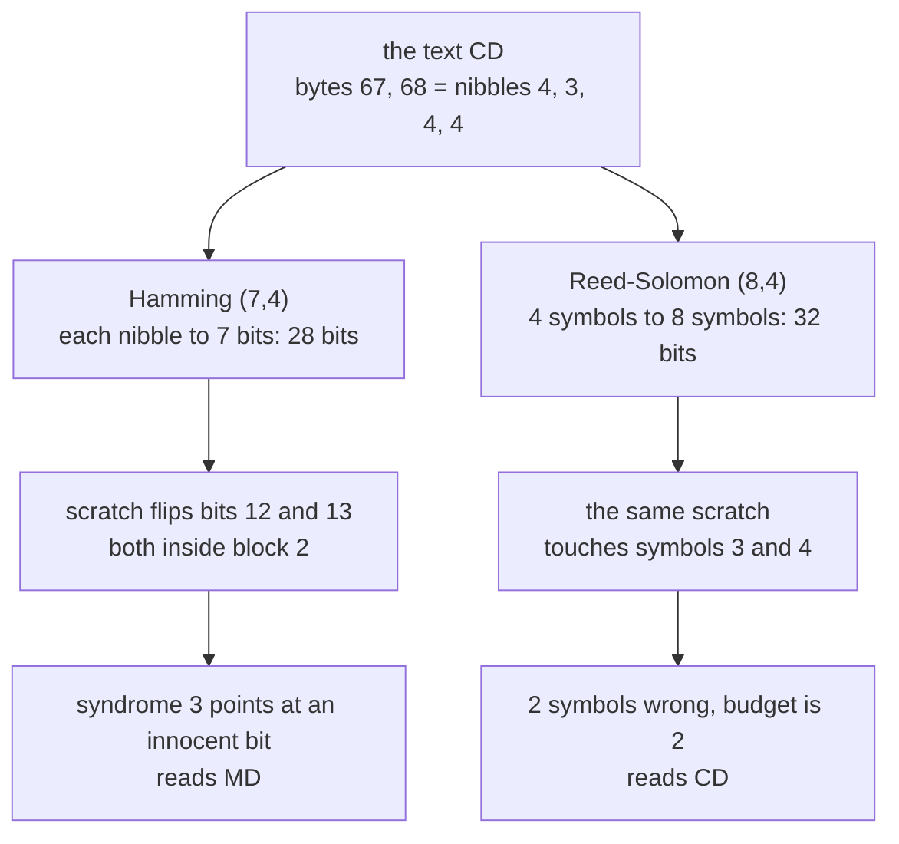

# Hamming and Reed-Solomon: codes that repair what the channel broke

[Syllabus](../../../SYLLABUS.md) → [Applied and computational](../README.md) → [Information Theory](../README.md#s03) → Hamming and Reed-Solomon

---

## General Overview

A disc track holds the two letters "CD": bytes 67 and 68. A laser reads them back as a row of pits and flat spots, and a speck of dust or a scratch makes it misread a few of them. A 1 comes back as a 0. Nothing on the disc says which one.

The fix is to store more than the data. Split each byte into two **nibbles**, 4-bit halves: 4, 3, 4, 4. Hamming's code turns each nibble into 7 bits, so the two bytes take 28 bits on the disc. The 3 extra bits in each block are checks, and they are chosen so that when one bit flips, the pattern of failed checks spells out *which* bit, as a number from 1 to 7. The player flips that bit back and reads "CD" as if nothing happened.

A scratch is different: it flips neighbouring bits together. Two flips in one Hamming block and the checks point at a third, innocent bit; the player "repairs" the track to "MD" and never knows.

Reed-Solomon's code answers bursts by counting damage in symbols, not bits. It treats each nibble as one symbol, stores 8 symbols (32 bits) for the 4 it protects, and repairs *any* 2 damaged symbols, however many bits inside them went wrong. It spends 4 more bits than Hamming's 28 to do so; what those bits buy is a budget counted in symbols, not bits. The same scratch that made "MD" comes back as "CD".

**An error-correcting code keeps its codewords far apart, so a damaged word is still nearest the one that was sent: if the closest two codewords differ in d places, any ⌊(d − 1)/2⌋ errors are repaired, and both Hamming's checks and Reed-Solomon's polynomial values are ways of building that distance cheaply.**

**What kind of fact this is:** theorems, proved on this card in Why it works: that distance d buys ⌊(d − 1)/2⌋ repairs, that Hamming (7,4) has distance 3, and that Reed-Solomon has distance n − k + 1, the most any code of its size can have. Fast Reed-Solomon decoding is outlined and named, not proved.

### The picture: one scratch, two codes



Same track damage on both branches. Hamming's budget is one bit per block; Reed-Solomon's is two symbols per block.

---

## The formula

Notation first, in words. An **(n, k) code** turns k message symbols into n stored symbols. Its **minimum distance** d is the fewest places in which two different codewords differ; the distance between two words is a count of positions that disagree (Hamming distance). On this shelf H(X) is entropy; on this card H is a matrix, below.

$$c = G\,m, \qquad s = H\,r = H\,e, \qquad t = \left\lfloor \frac{d-1}{2} \right\rfloor$$

$$\text{Reed-Solomon:}\quad c = \big(m(1),\, m(a),\, m(a^2),\, \dots,\, m(a^{n-1})\big), \qquad d = n - k + 1$$

**Read it aloud:** the codeword is the generator matrix times the message; the receiver multiplies what it read by the check matrix, and the answer depends only on the error; a code whose codewords sit d apart repairs any t errors, half of d − 1 rounded down. For Reed-Solomon the codeword is a list of values of the message polynomial, and its distance is n − k + 1.

Hamming's arithmetic is on bits, adding without carry: 1 + 1 = 0. Reed-Solomon's is in GF(16) (GF stands for Galois field, another name for a finite field), the sixteen 4-bit symbols built exactly like the four-element field of [Finite fields](../../03-Algebra/09-Rings%20and%20Fields/05-finite-fields.md): polynomials in a with 0-or-1 coefficients, wrapped by the rule a⁴ = a + 1 (from x⁴ + x + 1, which does not factor). Adding is bit by bit without carry; a symbol is written as the number its 4 bits spell, so a = 2 and a + 1 = 3.

| Symbol | Plain meaning | In our example | Push it up and the answer… |
| --- | --- | --- | --- |
| $n$, $k$ | symbols stored per block, and message symbols among them | Hamming 7 and 4 bits; Reed-Solomon 8 and 4 nibbles | more n: more room for checks; more k: more data, less protection |
| $d$ | minimum distance: fewest places two codewords differ | 3; 5 | more repairs |
| $t$ | the repair budget, ⌊(d − 1)/2⌋ | 1 bit; 2 nibbles | — |
| $m$, $m(x)$ | the message: 4 bits m1 to m4, or 4 nibbles read as a polynomial's coefficients | 0, 1, 0, 0; m(x) = 4 + 3x + 4x² + 4x³ | — |
| $G$ | generator matrix: 7 rows by 4 columns, message in, codeword out | below | — |
| $c$ | the codeword written to the disc | 1001100; 7, 7, 1, 4, 15, 5, 12, 13 | — |
| $e$ | the error: 1 where a bit flipped | a 1 at position 6 | more 1s than t, and repair fails |
| $r$ | the word read back, c + e | 1001110 | — |
| $H$ | check matrix: 3 rows by 7 columns; column j is j in binary | below | — |
| $s$ | the syndrome: H r, read as a binary number | 6 | names the flipped position |
| $p$ | flip chance: how often the link flips one bit | 0.01 | more blocks fail; at 0.1, about 15% |
| $a$ | the GF(16) symbol whose powers are the evaluation points | a = 2, points 1, 2, 4, 8, 3, 6, 12, 11 | — |

The two matrices. Positions 1 to 7 hold chk1, chk2, m1, chk4, m2, m3, m4: the three check bits sit at positions 1, 2 and 4, and the message bits m1 to m4 fill the rest.

```
G (rows = positions 1..7)     H (column j = j in binary, low bit on top)
chk1: 1 1 0 1                 1 0 1 0 1 0 1
chk2: 1 0 1 1                 0 1 1 0 0 1 1
  m1: 1 0 0 0                 0 0 0 1 1 1 1
chk4: 0 1 1 1
  m2: 0 1 0 0
  m3: 0 0 1 0
  m4: 0 0 0 1
```

Many books lay G on its side, 4 by 7, with the message as a row; it is the same code.

### When it holds

- **At most t errors per block.** Hamming's t is 1 bit per 7. Two flips in one block land nearer a wrong codeword, and the decoder "repairs" towards it: the scratch on bits 12 and 13 reads "MD".
- **Errors spread out, or counted in symbols.** A burst piles flips into one block. Reed-Solomon counts a whole nibble as one error, so a 5-bit scratch across two nibbles is still 2 errors; real players also shuffle (interleave) symbols so one long scratch spreads over many blocks.
- **Reed-Solomon needs a field.** Every nonzero symbol must have a reciprocal. Nibbles added and multiplied as hours mod 16 fail: the message 0, 0, 8, 8 writes eight zeros, exactly what the empty message writes, so the disc cannot tell them apart.
- **Distinct evaluation points.** The n points must be different symbols, so GF(16) allows at most 16; a disc's codes use GF(256), whose bytes allow far longer blocks.
- **Beyond the budget, no promise.** With 3 damaged symbols, Reed-Solomon (8,4) sometimes finds no codeword within 2 and flags the block, and sometimes finds a wrong one within 2 and returns the wrong bytes.

---

## Why it works

### Step 0: distance is a repair budget

Draw a ball of radius t around each codeword: every word within t changes of it. If 2t < d, two balls never meet, because a word within t of both codewords would put them at most 2t < d apart. So a word with at most t errors sits in exactly one ball, its own codeword's, and "pick the nearest codeword" recovers what was sent. Distance 3 gives t = 1; distance 5 gives t = 2.

The same distance can be spent on detection instead: d − 1 errors can never turn one codeword into another, so they are always noticed, though not located. Hamming (7,4) detects 2 or repairs 1, not both at once.

### Step 1: Hamming's checks are a matrix times a vector

Each check bit makes one group of positions add to 0 (an even number of 1s): chk1 covers positions 1, 3, 5, 7; chk2 covers 2, 3, 6, 7; chk4 covers 4, 5, 6, 7. Position j belongs to the groups named by the 1s in j written in binary: 5 is 101, so groups 1 and 4.

Encoding is a [Matrix times vector](../../03-Algebra/04-Matrices/02-matrix-times-vector.md) with sums wrapped at 2: c = G m. Checking is another: H c = 0, because each row of H is one group's sum. The check prints H times all 16 codewords: every one is 0.

### Step 2: the syndrome is the error's address

The disc returns r = c + e. Multiply by H, and since H c = 0, the codeword drops out:

$$s = H r = H c + H e = H e.$$

When e has a single 1, at position j, H e is column j of H, which is j in binary. Read as a number, the syndrome *is* the position. The player never needs to know what was sent: the checks see only the damage.

That also gives the distance. A codeword's **weight** is its count of nonzero places, and it equals its distance from the all-zero codeword. The sum of two codewords is a codeword, since H(c₁ + c₂) = H c₁ + H c₂ = 0, and the two differ exactly where their sum has a 1. So the least distance between two codewords is the least weight of a nonzero codeword.

A codeword of weight 1 would need a column of zeros, and one of weight 2 would need two equal columns; H has neither, so d ≥ 3. Columns 1, 2 and 3 add to 0 (001 + 010 + 011), so there is a codeword of weight 3, and d = 3 exactly. The check finds the same by comparing all 16 codewords in pairs.

### Step 3: Hamming (7,4) wastes nothing, which is why it lies

Count the balls. 16 codewords, each with itself and 7 one-flip neighbours, make 16 × 8 = 128 words. Since d = 3, no two balls share a word (Step 0), and the check confirms that all 128 are different. 128 = 2⁷ is every 7-bit word there is, so the balls fill the space with no gaps: Hamming (7,4) is a **perfect** code.

That is the price of its efficiency. With two flips the word is in some ball, just not the right one, and there is no leftover word for the decoder to say "too many". Adding an eighth bit, the parity of all seven, separates the cases: one flip upsets the overall parity, two do not, so double flips are flagged instead of mis-repaired. Memory chips use that extended form.

### Step 4: Reed-Solomon stores values of a polynomial

Read the 4 message nibbles as the coefficients of a polynomial over GF(16): m(x) = 4 + 3x + 4x² + 4x³. Store its values at 8 different points: 1, a, a², …, a⁷, which are 1, 2, 4, 8, 3, 6, 12, 11. That gives 7, 7, 1, 4, 15, 5, 12, 13.

Two different messages give two different polynomials, and their difference is a nonzero polynomial of degree at most 3. In a field such a polynomial has at most 3 roots: each root splits off a factor (x − root), and a cubic has room for at most three. So two codewords agree in at most 3 of the 8 places and differ in at least 8 − 3 = 5. That is d = n − k + 1 = 5, and a repair budget of 2 symbols.

The field is what makes "at most 3 roots" true. In the hours mod 16, 8 × 2 = 0, so 8x² + 8x³ is zero at all 8 points and the argument collapses.

### Step 5: no code of this size does better

Delete the last d − 1 symbols of every codeword. The shortened words are still all different, since two codewords differ in at least d places and only d − 1 were removed.

They have n − d + 1 symbols each, so there are at most 16 to the power n − d + 1 of them, while there are 16ᵏ messages. Hence k ≤ n − d + 1, or d ≤ n − k + 1, for *any* code with 16-letter symbols. Reed-Solomon meets the bound exactly: every pair of extra symbols buys one more repair, the best possible trade.

### Step 6: decoding, in outline

Any 4 correct values fix the cubic, by the interpolation formula of Lagrange. With at most 2 bad values among 8, some 4 values are all good, and their cubic agrees with the read word in at least 6 places. No other cubic can: it would be a codeword within 2 of the read word, so within 4 of the true one, closer than 5.

The check decodes this way, fitting every choice of 4 values out of 8, and separately by comparing the read word with all 65536 codewords. Real decoders reach the same answer without trying choices: the Berlekamp-Massey and Berlekamp-Welch algorithms solve for a polynomial whose roots are the error positions. Their derivations belong to coding-theory texts; this card names them and does not prove them.

<details>
<summary>Why some 4 values are all good, and the fit agrees in 6</summary>

With at most 2 bad positions among 8, at least 6 are good; choose 4 of them. Through those 4 the true cubic passes, and a cubic through 4 points is unique (two would differ by a cubic with 4 roots). So the fit is the true message, which matches the read word everywhere except the at most 2 bad positions: at least 6 agreements.

</details>

### Step 7: what the channel-capacity card promised

[Channel capacity](07-channel-capacity-and-the-noisy-channel-theorem.md) says that on a link flipping each bit with chance p = 0.01, codes exist at any rate below the capacity 0.9192 with as few block errors as wanted. Hamming (7,4) runs at rate 4/7 = 0.5714 (4 data bits for every 7 sent), well below, and still fails whenever 2 or more of 7 bits flip: 0.2031% of blocks, against 3.9404% of bare nibbles. Far fewer failures, at the cost of 3 extra bits in 7. Approaching capacity takes long blocks: [LDPC, turbo and polar codes](09-ldpc-turbo-and-polar-codes-in-outline.md).

---

## Worked numbers, by hand

Bits add without carry. The nibble 4 is message bits m1 m2 m3 m4 = 0, 1, 0, 0.

| Step | Arithmetic | Value |
| --- | --- | --- |
| chk1 = m1 + m2 + m4 | 0 + 1 + 0 | 1 |
| chk2 = m1 + m3 + m4 | 0 + 0 + 0 | 0 |
| chk4 = m2 + m3 + m4 | 1 + 0 + 0 | 1 |
| codeword, positions 1 to 7 | chk1 chk2 m1 chk4 m2 m3 m4 | 1001100 |
| a speck flips track bit 6 | position 6 of block 1 | 1001110 |
| check 1: positions 1, 3, 5, 7 | 1 + 0 + 1 + 0 | 0 |
| check 2: positions 2, 3, 6, 7 | 0 + 0 + 1 + 0 | 1 |
| check 4: positions 4, 5, 6, 7 | 1 + 1 + 1 + 0 | 1 |
| syndrome | 0 × 1 + 1 × 2 + 1 × 4 | **6** |
| repair | flip position 6 back | **1001100, the nibble 4** |
| a scratch flips track bits 12 and 13 | block 2, 1000011, positions 5 and 6 | 1000101 |
| syndrome | 101 + 110 = 011 | 3 |
| "repair" flips position 3 | 1010101, data 1101 | nibble 13: byte 77, **"M"** |
| Reed-Solomon value at 1 | 4 + 3 + 4 + 4 | 7 |
| value at a | 4 × 1 + 3 × 2 + 4 × 4 + 4 × 8 = 4 + 6 + 3 + 6 | 7 |
| same scratch on Reed-Solomon | reads 7, 7, 0, 12, 15, 5, 12, 13; one codeword within 2 | **"CD"** |

The speck is found and undone; the scratch, two flips in one block, is "repaired" into the wrong letter, with no warning, while Reed-Solomon reads the same scratch back as "CD". In GF(16), 3 × 2 is (a + 1)a = a² + a = 6, 4 × 4 = a⁴ = 3 and 4 × 8 = a⁵ = 6; the other six values come out the same way.

Reed-Solomon's 8 values go to the disc as 32 bits. The same scratch on bits 12 and 13 changes symbols 3 and 4, reading 7, 7, 0, 12, 15, 5, 12, 13. The nearest codeword is 2 away and is the only one that close: "CD" again.

### What breaks if you drop a piece

| Mistake | Comes out at | What went wrong |
| --- | --- | --- |
| Two flips in one Hamming block (bits 12 and 13) | "MD", byte 77 | The syndrome 3 adds two columns and points at a third position |
| A 5-bit scratch, bits 10 to 14, on Hamming | "DD", byte 68 | Five flips in one block; Reed-Solomon reads the same scratch as "CD" |
| Three symbols damaged in Reed-Solomon (8,4) | case 1: nothing within 2, block flagged; case 2: bytes 20, 78 | Past the budget of 2: refusal at best, wrong bytes at worst |
| Nibbles as hours mod 16, not GF(16) | message 0, 0, 8, 8 writes all zeros; 3 such messages | Not a field: 8 × 2 = 0, so a cubic can vanish at all 8 points |

The code prints every row.

---

## Code, from first principles, and it actually runs

Nothing imported knows a code: matrices, field arithmetic, interpolation and the random flips are written out. Each claim is reached by two independent roads.

Hamming's syndrome decoder is compared with "nearest of all 16 codewords" on all 128 words within one flip; its distance is found by comparing all pairs. Reed-Solomon's distance comes from the weight of all 65535 nonzero codewords, against n − k + 1; each damaged block is decoded by "nearest of all 65536 codewords" and by fitting cubics through every 4 of the 8 values.

Finally 200000 Hamming blocks cross a simulated link flipping each bit with chance 0.01, using a SplitMix64 random-number generator with seed 2026, and the failure rate meets the formula.

### Python

```python
# Hamming (7,4) and Reed-Solomon -- the check behind the card.  Standard library only.
# A disc track holds the text "CD": two bytes, four nibbles (4-bit halves).  Code A:
# each nibble becomes 7 bits by Hamming (7,4).  Code B: the four nibbles are symbols
# of GF(16), and the disc stores 8 values of the polynomial they define.
from math import log2

def bits(v, n): return [(v >> (n - 1 - i)) & 1 for i in range(n)]      # high bit first
def mat_vec(M, v): return [sum(r[i] * v[i] for i in range(len(v))) % 2 for r in M]
def yn(claim): return "yes" if claim else "no"
G = [[1, 1, 0, 1], [1, 0, 1, 1], [1, 0, 0, 0], [0, 1, 1, 1],          # positions 1..7:
     [0, 1, 0, 0], [0, 0, 1, 0], [0, 0, 0, 1]]                         # chk1 chk2 m1 chk4 m2 m3 m4
H = [[(j >> k) & 1 for j in range(1, 8)] for k in range(3)]   # column j is j in binary
def ham_enc(nib): return mat_vec(G, bits(nib, 4))
def syndrome(r): s = mat_vec(H, r); return s[0] + 2 * s[1] + 4 * s[2]
def ham_dec(r):                                               # road 1: the syndrome
    r = r[:]; s = syndrome(r)
    if s: r[s - 1] ^= 1
    return 8 * r[2] + 4 * r[4] + 2 * r[5] + r[6], s
def dist(a, b): return sum(x != y for x, y in zip(a, b))
BOOK = [ham_enc(m) for m in range(16)]
def ham_near(r): return min(range(16), key=lambda m: dist(BOOK[m], r))  # road 2: try all 16
def flip(word, places): return [b ^ (i + 1 in places) for i, b in enumerate(word)]

def gmul(a, b):                    # GF(16): shift and add, wrap by x^4 + x + 1 (binary 10011)
    p = 0
    for _ in range(4):
        if b & 1: p ^= a
        b >>= 1; a <<= 1
        if a & 16: a ^= 0b10011
    return p
def ginv(a): return [b for b in range(1, 16) if gmul(a, b) == 1][0]
PTS = [1]
while len(PTS) < 8: PTS.append(gmul(PTS[-1], 2))              # a^0 .. a^7, with a = 2
def peval(c, x, mul=gmul, add=lambda u, v: u ^ v):            # Horner's rule
    y = 0
    for co in reversed(c): y = add(mul(y, x), co)
    return y
def rs_enc(msg): return [peval(msg, x) for x in PTS]
def interp(xs, ys):                # the one cubic through 4 points, by Lagrange, over GF(16)
    out = [0] * 4
    for i in range(4):
        num, den = [1], 1
        for j in range(4):
            if j != i:             # multiply num by (x + xs[j]); minus is plus here
                num = [(num[k - 1] if k else 0) ^ (gmul(num[k], xs[j]) if k < len(num) else 0)
                       for k in range(len(num) + 1)]
                den = gmul(den, xs[i] ^ xs[j])
        f = gmul(ys[i], ginv(den))
        out = [o ^ gmul(f, c) for o, c in zip(out, num)]
    return out
def rs_fit(r):                     # road 2: fit every 4 of the 8 values, keep a fit within 2
    for s in range(256):
        idx = [i for i in range(8) if s >> i & 1]
        if len(idx) == 4:
            m = interp([PTS[i] for i in idx], [r[i] for i in idx])
            if dist(rs_enc(m), r) <= 2: return m
    return None
ALL = [[m >> 12, (m >> 8) & 15, (m >> 4) & 15, m & 15] for m in range(1 << 16)]
RSBOOK = [rs_enc(m) for m in ALL]
def rs_near(r):                    # road 1: nearest of all 65,536 codewords
    ds = [dist(c, r) for c in RSBOOK]; best = min(ds)
    return ALL[ds.index(best)], best, ds.count(best)

def cut(track, w): return [track[i:i + w] for i in range(0, len(track), w)]
def show(nibs):
    bs = [16 * nibs[i] + nibs[i + 1] for i in range(0, len(nibs), 2)]
    return f"{bs} " + ("".join(chr(b) if 32 <= b < 127 else "?" for b in bs))
msg = [n for ch in b"CD" for n in (ch >> 4, ch & 15)]
print(f"track text CD = bytes {show(msg)} = nibbles {msg}")
print(f"nibble 4 = data bits {bits(4, 4)} -> Hamming codeword {ham_enc(4)}")
r = flip(ham_enc(4), {6})
print(f"flip position 6: {r}; checks (1,3,5,7) (2,3,6,7) (4,5,6,7) = {mat_vec(H, r)}; syndrome {syndrome(r)}")
dmin = min(dist(BOOK[a], BOOK[b]) for a in range(16) for b in range(a + 1, 16))
words = [flip(c, {p}) for c in BOOK for p in range(8)]
agree = all(ham_dec(w)[0] == ham_near(w) for w in words)
print(f"Hamming: H times every codeword = 0: {yn(all(syndrome(c) == 0 for c in BOOK))}; "
      f"min distance {dmin}, fixes {(dmin - 1) // 2}, detects {dmin - 1}")
print(f"Hamming: 16 codewords x 8 words within one flip, all different: {len(set(map(tuple, words)))} = 2^7; "
      f"syndrome = nearest on all {len(words)}: {yn(agree)}")
print(f"Hamming: flip positions 1, 2, 3 of codeword 4: syndrome {syndrome(flip(ham_enc(4), {1, 2, 3}))}, a weight-3 codeword")
track = [b for n in msg for b in ham_enc(n)]
print(f"Hamming track, 28 bits: {''.join(map(str, track))}")
SCARS = (("speck at bit 6", {6}), ("scratch, bits 12-13", {12, 13}),
         ("scratch, bits 10-14", {10, 11, 12, 13, 14}))
for name, places in SCARS:
    out = [ham_dec(b) for b in cut(flip(track, places), 7)]
    print(f"  {name:<20} syndromes {[o[1] for o in out]} -> {show([o[0] for o in out])}")
b2 = flip(track, {12, 13})[7:14]; fixed = flip(b2, {syndrome(b2)})
print(f"  block 2 under the scratch: sent {track[7:14]}, read {b2}, 'repaired' to {fixed} = nibble {ham_dec(b2)[0]}")
code = rs_enc(msg)
terms = [gmul(c, x) for c, x in zip(msg, [1, 2, 4, 8])]
print(f"GF(16): points a^0..a^7 = {PTS}; 1/a = {ginv(2)}; m(1) = {' + '.join(map(str, msg))} = {code[0]}; m(a) = {' + '.join(map(str, terms))} = {code[1]}")
print(f"RS(8,4): message {msg} -> codeword {code}, 32 bits")
wts = [sum(v != 0 for v in c) for c in RSBOOK[1:]]
print(f"RS: {len(RSBOOK)} codewords; least weight of the {len(wts)} nonzero ones = {min(wts)} = 8 - 4 + 1, so fixes 2 symbols")
rs_track = [b for s in code for b in bits(s, 4)]
found = {}
for name, places in SCARS + (("three symbols, case 1", {1, 13, 25}), ("three symbols, case 2", {1, 6, 25})):
    got = [int("".join(map(str, s)), 2) for s in cut(flip(rs_track, places), 4)]
    near, d, ties = rs_near(got); fit = rs_fit(got)
    found[name] = (near, d, fit)
    print(f"  {name:<21} reads {got}: nearest at {d} ({ties} tied) {show(near)}; "
          f"fit within 2: {'none' if fit is None else show(fit)}")
modbook = [[peval(m, x, lambda u, v: u * v % 16, lambda u, v: (u + v) % 16) for x in PTS] for m in ALL]
zero = [ALL[i] for i in range(1, 1 << 16) if not any(modbook[i])]
print(f"mistake, nibbles as hours mod 16: message {zero[0]} also writes {modbook[0]}; {len(zero)} such messages")

state = 2026                       # SplitMix64, seed 2026: the same flips in Python and Rust
def rand():
    global state
    state = (state + 0x9E3779B97F4A7C15) % 2**64; z = state
    z = (z ^ (z >> 30)) * 0xBF58476D1CE4E5B9 % 2**64
    z = (z ^ (z >> 27)) * 0x94D049BB133111EB % 2**64
    return ((z ^ (z >> 31)) >> 11) / 2**53
p, trials, wrong = 0.01, 200000, 0
for t in range(trials):
    sent = ham_enc(t % 16)
    if ham_dec([b ^ (rand() < p) for b in sent])[0] != t % 16: wrong += 1
fail = 1 - (1 - p) ** 7 - 7 * p * (1 - p) ** 6
se = (fail * (1 - fail) / trials) ** 0.5
print(f"flip chance {p}: raw nibble wrong {1 - (1 - p) ** 4:.6f}; Hamming block wrong {fail:.6f} "
      f"by formula, {wrong / trials:.6f} in {trials} blocks")
print(f"rate 4/7 = {4 / 7:.4f}; capacity at p = {p} is {1 + p * log2(p) + (1 - p) * log2(1 - p):.4f}; "
      f"CD: C1 RS(32,28) and C2 RS(28,24) have distance {32 - 28 + 1} and {28 - 24 + 1}, fix {(32 - 28) // 2} each")
def block_fail(q): return 1 - (1 - q) ** 7 - 7 * q * (1 - q) ** 6
print(f"try: Hamming block wrong at flip chance 0.001 is {block_fail(0.001):.6f}, at 0.1 is {block_fail(0.1):.6f}")
got = [int("".join(map(str, s)), 2) for s in cut(flip(rs_track, set(range(9, 17))), 4)]
print(f"try: scratch, bits 9-16: Hamming reads {show([ham_dec(b)[0] for b in cut(flip(track, set(range(9, 17))), 7)])}; "
      f"RS nearest {show(rs_near(got)[0])}, fit {show(rs_fit(got))}")

assert dmin == 3 and agree                                    # exhaustive vs syndrome
assert len(set(map(tuple, words))) == 2 ** 7                  # the 16 balls fill all 7-bit words
assert [r[0] for r in [ham_dec(b) for b in cut(flip(track, {6}), 7)]] == msg
assert min(wts) == 8 - 4 + 1                                  # exhaustive vs n - k + 1
for name, _ in SCARS:                                         # two RS decoders, one answer
    assert found[name][0] == msg and found[name][2] == msg
assert found["three symbols, case 1"][2] is None and found["three symbols, case 2"][2] not in (None, msg)
assert abs(wrong / trials - fail) < 4 * se                    # simulation vs formula
print("ALL CHECKS PASS")
```

**Ran 2026-11-11 on macOS, Python 3.14.10, standard library only. All checks passed. Output, pasted from the run:**

```
track text CD = bytes [67, 68] CD = nibbles [4, 3, 4, 4]
nibble 4 = data bits [0, 1, 0, 0] -> Hamming codeword [1, 0, 0, 1, 1, 0, 0]
flip position 6: [1, 0, 0, 1, 1, 1, 0]; checks (1,3,5,7) (2,3,6,7) (4,5,6,7) = [0, 1, 1]; syndrome 6
Hamming: H times every codeword = 0: yes; min distance 3, fixes 1, detects 2
Hamming: 16 codewords x 8 words within one flip, all different: 128 = 2^7; syndrome = nearest on all 128: yes
Hamming: flip positions 1, 2, 3 of codeword 4: syndrome 0, a weight-3 codeword
Hamming track, 28 bits: 1001100100001110011001001100
  speck at bit 6       syndromes [6, 0, 0, 0] -> [67, 68] CD
  scratch, bits 12-13  syndromes [0, 3, 0, 0] -> [77, 68] MD
  scratch, bits 10-14  syndromes [0, 3, 0, 0] -> [68, 68] DD
  block 2 under the scratch: sent [1, 0, 0, 0, 0, 1, 1], read [1, 0, 0, 0, 1, 0, 1], 'repaired' to [1, 0, 1, 0, 1, 0, 1] = nibble 13
GF(16): points a^0..a^7 = [1, 2, 4, 8, 3, 6, 12, 11]; 1/a = 9; m(1) = 4 + 3 + 4 + 4 = 7; m(a) = 4 + 6 + 3 + 6 = 7
RS(8,4): message [4, 3, 4, 4] -> codeword [7, 7, 1, 4, 15, 5, 12, 13], 32 bits
RS: 65536 codewords; least weight of the 65535 nonzero ones = 5 = 8 - 4 + 1, so fixes 2 symbols
  speck at bit 6        reads [7, 3, 1, 4, 15, 5, 12, 13]: nearest at 1 (1 tied) [67, 68] CD; fit within 2: [67, 68] CD
  scratch, bits 12-13   reads [7, 7, 0, 12, 15, 5, 12, 13]: nearest at 2 (1 tied) [67, 68] CD; fit within 2: [67, 68] CD
  scratch, bits 10-14   reads [7, 7, 6, 8, 15, 5, 12, 13]: nearest at 2 (1 tied) [67, 68] CD; fit within 2: [67, 68] CD
  three symbols, case 1 reads [15, 7, 1, 12, 15, 5, 4, 13]: nearest at 3 (2 tied) [40, 238] (?; fit within 2: none
  three symbols, case 2 reads [15, 3, 1, 4, 15, 5, 4, 13]: nearest at 2 (1 tied) [20, 78] ?N; fit within 2: [20, 78] ?N
mistake, nibbles as hours mod 16: message [0, 0, 8, 8] also writes [0, 0, 0, 0, 0, 0, 0, 0]; 3 such messages
flip chance 0.01: raw nibble wrong 0.039404; Hamming block wrong 0.002031 by formula, 0.002065 in 200000 blocks
rate 4/7 = 0.5714; capacity at p = 0.01 is 0.9192; CD: C1 RS(32,28) and C2 RS(28,24) have distance 5 and 5, fix 2 each
try: Hamming block wrong at flip chance 0.001 is 0.000021, at 0.1 is 0.149694
try: scratch, bits 9-16: Hamming reads [76, 196] L?; RS nearest [67, 68] CD, fit [67, 68] CD
ALL CHECKS PASS
```

The simulated failure rate, 0.2065% of blocks, sits close to the formula's 0.2031%, well inside the assert's allowance of four standard errors.

### Rust

Same numbers, same labels, built with `rustc --edition 2021 -O`.

```rust
// Hamming (7,4) and Reed-Solomon -- the same check as the Python, in Rust.  No crates.
// A disc track holds the text "CD": two bytes, four nibbles (4-bit halves).  Code A:
// each nibble becomes 7 bits by Hamming (7,4).  Code B: the four nibbles are symbols
// of GF(16), and the disc stores 8 values of the polynomial they define.
type V = Vec<u32>;
fn bits(v: u32, n: u32) -> V { (0..n).map(|i| (v >> (n - 1 - i)) & 1).collect() }
fn mat_vec(m: &[V], v: &[u32]) -> V { m.iter().map(|r| r.iter().zip(v).map(|(a, b)| a * b).sum::<u32>() % 2).collect() }
fn yn(c: bool) -> &'static str { if c { "yes" } else { "no" } }
fn g() -> Vec<V> { vec![vec![1, 1, 0, 1], vec![1, 0, 1, 1], vec![1, 0, 0, 0], vec![0, 1, 1, 1],
                        vec![0, 1, 0, 0], vec![0, 0, 1, 0], vec![0, 0, 0, 1]] }   // chk1 chk2 m1 chk4 m2 m3 m4
fn h() -> Vec<V> { (0..3).map(|k| (1..8).map(|j| (j >> k) & 1).collect()).collect() } // column j is j in binary
fn ham_enc(n: u32) -> V { mat_vec(&g(), &bits(n, 4)) }
fn syndrome(r: &[u32]) -> u32 { let s = mat_vec(&h(), r); s[0] + 2 * s[1] + 4 * s[2] }
fn ham_dec(r: &[u32]) -> (u32, u32) {                          // road 1: the syndrome
    let mut r = r.to_vec(); let s = syndrome(&r);
    if s > 0 { r[s as usize - 1] ^= 1; }
    (8 * r[2] + 4 * r[4] + 2 * r[5] + r[6], s)
}
fn dist(a: &[u32], b: &[u32]) -> usize { a.iter().zip(b).filter(|(x, y)| x != y).count() }
fn flip(w: &[u32], places: &[usize]) -> V { w.iter().enumerate().map(|(i, b)| b ^ places.contains(&(i + 1)) as u32).collect() }
fn gmul(mut a: u32, mut b: u32) -> u32 {      // GF(16): shift and add, wrap by x^4 + x + 1
    let mut p = 0;
    for _ in 0..4 {
        if b & 1 == 1 { p ^= a; }
        b >>= 1; a <<= 1;
        if a & 16 != 0 { a ^= 0b10011; }
    }
    p
}
fn ginv(a: u32) -> u32 { (1..16).find(|&b| gmul(a, b) == 1).unwrap() }
fn peval(c: &[u32], x: u32, modular: bool) -> u32 {           // Horner's rule
    let mut y = 0;
    for &co in c.iter().rev() { y = if modular { (y * x + co) % 16 } else { gmul(y, x) ^ co }; }
    y
}
fn rs_enc(m: &[u32], pts: &[u32]) -> V { pts.iter().map(|&x| peval(m, x, false)).collect() }
fn interp(xs: &[u32], ys: &[u32]) -> V {      // the one cubic through 4 points, by Lagrange
    let mut out = vec![0u32; 4];
    for i in 0..4 {
        let (mut num, mut den) = (vec![1u32], 1u32);
        for j in 0..4 {
            if j != i {                           // multiply num by (x + xs[j]); minus is plus here
                num = (0..=num.len()).map(|k| (if k > 0 { num[k - 1] } else { 0 })
                    ^ (if k < num.len() { gmul(num[k], xs[j]) } else { 0 })).collect();
                den = gmul(den, xs[i] ^ xs[j]);
            }
        }
        let f = gmul(ys[i], ginv(den));
        for k in 0..4 { out[k] ^= gmul(f, num[k]); }
    }
    out
}
fn rs_fit(r: &[u32], pts: &[u32]) -> Option<V> {   // road 2: fit every 4 of the 8 values
    for s in 0..256u32 {
        let idx: Vec<usize> = (0..8).filter(|i| s >> i & 1 == 1).collect();
        if idx.len() == 4 {
            let xs: V = idx.iter().map(|&i| pts[i]).collect();
            let ys: V = idx.iter().map(|&i| r[i]).collect();
            let m = interp(&xs, &ys);
            if dist(&rs_enc(&m, pts), r) <= 2 { return Some(m); }
        }
    }
    None
}
fn cut(t: &[u32], w: usize) -> Vec<V> { t.chunks(w).map(|c| c.to_vec()).collect() }
fn show(n: &[u32]) -> String {
    let bs: V = n.chunks(2).map(|p| 16 * p[0] + p[1]).collect();
    let txt: String = bs.iter().map(|&b| if (32..127).contains(&b) { b as u8 as char } else { '?' }).collect();
    format!("{:?} {}", bs, txt)
}
fn join(v: &[u32], sep: &str) -> String { v.iter().map(|x| x.to_string()).collect::<Vec<_>>().join(sep) }
struct Rng(u64);                              // SplitMix64, seed 2026: the same flips as Python
impl Rng { fn next(&mut self) -> f64 {
    self.0 = self.0.wrapping_add(0x9E3779B97F4A7C15); let mut z = self.0;
    z = (z ^ (z >> 30)).wrapping_mul(0xBF58476D1CE4E5B9);
    z = (z ^ (z >> 27)).wrapping_mul(0x94D049BB133111EB);
    ((z ^ (z >> 31)) >> 11) as f64 / 9007199254740992.0 } }

fn main() {
    let book: Vec<V> = (0..16).map(ham_enc).collect();
    let msg: V = b"CD".iter().flat_map(|&c| [c as u32 >> 4, c as u32 & 15]).collect();
    println!("track text CD = bytes {} = nibbles {:?}", show(&msg), msg);
    println!("nibble 4 = data bits {:?} -> Hamming codeword {:?}", bits(4, 4), ham_enc(4));
    let r = flip(&ham_enc(4), &[6]);
    println!("flip position 6: {:?}; checks (1,3,5,7) (2,3,6,7) (4,5,6,7) = {:?}; syndrome {}", r, mat_vec(&h(), &r), syndrome(&r));
    let mut dmin = 7;
    for a in 0..16 { for b in a + 1..16 { dmin = dmin.min(dist(&book[a], &book[b])); } }
    let words: Vec<V> = book.iter().flat_map(|c| (0..8).map(move |p| flip(c, &[p]))).collect();
    let near = |w: &V| (0..16).min_by_key(|&m| dist(&book[m as usize], w)).unwrap();
    let agree = words.iter().all(|w| ham_dec(w).0 == near(w));
    println!("Hamming: H times every codeword = 0: {}; min distance {}, fixes {}, detects {}",
             yn(book.iter().all(|c| syndrome(c) == 0)), dmin, (dmin - 1) / 2, dmin - 1);
    println!("Hamming: 16 codewords x 8 words within one flip, all different: {} = 2^7; syndrome = nearest on all {}: {}", words.iter().collect::<std::collections::BTreeSet<_>>().len(), words.len(), yn(agree));
    println!("Hamming: flip positions 1, 2, 3 of codeword 4: syndrome {}, a weight-3 codeword", syndrome(&flip(&ham_enc(4), &[1, 2, 3])));
    let track: V = msg.iter().flat_map(|&n| ham_enc(n)).collect();
    println!("Hamming track, 28 bits: {}", join(&track, ""));
    let scars: Vec<(&str, Vec<usize>)> = vec![("speck at bit 6", vec![6]), ("scratch, bits 12-13", vec![12, 13]),
        ("scratch, bits 10-14", vec![10, 11, 12, 13, 14]), ("three symbols, case 1", vec![1, 13, 25]),
        ("three symbols, case 2", vec![1, 6, 25])];
    for (name, places) in &scars[..3] {
        let out: Vec<(u32, u32)> = cut(&flip(&track, places), 7).iter().map(|b| ham_dec(b)).collect();
        let s: V = out.iter().map(|o| o.1).collect();
        let n: V = out.iter().map(|o| o.0).collect();
        println!("  {:<20} syndromes {:?} -> {}", name, s, show(&n));
    }
    let b2 = flip(&track, &[12, 13])[7..14].to_vec();
    let fixed = flip(&b2, &[syndrome(&b2) as usize]);
    println!("  block 2 under the scratch: sent {:?}, read {:?}, 'repaired' to {:?} = nibble {}", &track[7..14], b2, fixed, ham_dec(&b2).0);
    let mut pts = vec![1u32];
    while pts.len() < 8 { let last = *pts.last().unwrap(); pts.push(gmul(last, 2)); }
    let code = rs_enc(&msg, &pts);
    let terms: V = msg.iter().zip([1, 2, 4, 8]).map(|(&c, x)| gmul(c, x)).collect();
    println!("GF(16): points a^0..a^7 = {:?}; 1/a = {}; m(1) = {} = {}; m(a) = {} = {}", pts, ginv(2),
             join(&msg, " + "), code[0], join(&terms, " + "), code[1]);
    println!("RS(8,4): message {:?} -> codeword {:?}, 32 bits", msg, code);
    let all: Vec<V> = (0..1u32 << 16).map(|m| vec![m >> 12, (m >> 8) & 15, (m >> 4) & 15, m & 15]).collect();
    let rsbook: Vec<V> = all.iter().map(|m| rs_enc(m, &pts)).collect();
    let least = rsbook[1..].iter().map(|c| c.iter().filter(|&&v| v != 0).count()).min().unwrap();
    println!("RS: {} codewords; least weight of the {} nonzero ones = {} = 8 - 4 + 1, so fixes 2 symbols", rsbook.len(), rsbook.len() - 1, least);
    let rs_track: V = code.iter().flat_map(|&s| bits(s, 4)).collect();
    let mut found: Vec<(V, Option<V>)> = Vec::new();
    for (name, places) in &scars {
        let got: V = cut(&flip(&rs_track, places), 4).iter().map(|s| s.iter().fold(0, |a, b| 2 * a + b)).collect();
        let ds: Vec<usize> = rsbook.iter().map(|c| dist(c, &got)).collect();   // road 1: nearest of all
        let d = *ds.iter().min().unwrap();
        let first = ds.iter().position(|&x| x == d).unwrap();
        let ties = ds.iter().filter(|&&x| x == d).count();
        let fit = rs_fit(&got, &pts);
        println!("  {:<21} reads {:?}: nearest at {} ({} tied) {}; fit within 2: {}", name, got, d, ties,
                 show(&all[first]), match &fit { None => "none".to_string(), Some(m) => show(m) });
        found.push((all[first].clone(), fit));
    }
    let modbook: Vec<V> = all.iter().map(|m| pts.iter().map(|&x| peval(m, x, true)).collect()).collect();
    let zero: Vec<usize> = (1..1usize << 16).filter(|&i| modbook[i].iter().all(|&v| v == 0)).collect();
    println!("mistake, nibbles as hours mod 16: message {:?} also writes {:?}; {} such messages", all[zero[0]], modbook[0], zero.len());

    let mut rng = Rng(2026);
    let (p, trials) = (0.01f64, 200000u32);
    let mut wrong = 0u32;
    for t in 0..trials {
        let got: V = ham_enc(t % 16).iter().map(|b| b ^ (rng.next() < p) as u32).collect();
        if ham_dec(&got).0 != t % 16 { wrong += 1; }
    }
    let fail = 1.0 - (1.0 - p).powi(7) - 7.0 * p * (1.0 - p).powi(6);
    let se = (fail * (1.0 - fail) / trials as f64).sqrt();
    let rate = wrong as f64 / trials as f64;
    println!("flip chance {}: raw nibble wrong {:.6}; Hamming block wrong {:.6} by formula, {:.6} in {} blocks",
             p, 1.0 - (1.0 - p).powi(4), fail, rate, trials);
    println!("rate 4/7 = {:.4}; capacity at p = {} is {:.4}; CD: C1 RS(32,28) and C2 RS(28,24) have distance {} and {}, fix {} each",
             4.0 / 7.0, p, 1.0 + p * p.log2() + (1.0 - p) * (1.0 - p).log2(), 32 - 28 + 1, 28 - 24 + 1, (32 - 28) / 2);
    let block_fail = |q: f64| 1.0 - (1.0 - q).powi(7) - 7.0 * q * (1.0 - q).powi(6);
    println!("try: Hamming block wrong at flip chance 0.001 is {:.6}, at 0.1 is {:.6}", block_fail(0.001), block_fail(0.1));
    let s916: Vec<usize> = (9..17).collect();
    let got: V = cut(&flip(&rs_track, &s916), 4).iter().map(|s| s.iter().fold(0, |a, b| 2 * a + b)).collect();
    let hn: V = cut(&flip(&track, &s916), 7).iter().map(|b| ham_dec(b).0).collect();
    let ds: Vec<usize> = rsbook.iter().map(|c| dist(c, &got)).collect();
    let first = ds.iter().position(|&x| x == *ds.iter().min().unwrap()).unwrap();
    println!("try: scratch, bits 9-16: Hamming reads {}; RS nearest {}, fit {}", show(&hn), show(&all[first]), show(&rs_fit(&got, &pts).unwrap()));

    assert!(dmin == 3 && agree);                                   // exhaustive vs syndrome
    assert!(words.iter().collect::<std::collections::BTreeSet<_>>().len() == 1 << 7);   // the 16 balls fill all 7-bit words
    let back: V = cut(&flip(&track, &[6]), 7).iter().map(|b| ham_dec(b).0).collect();
    assert!(back == msg);
    assert!(least == 8 - 4 + 1);                                   // exhaustive vs n - k + 1
    for f in &found[..3] { assert!(f.0 == msg && f.1.as_ref() == Some(&msg)); }   // two decoders
    assert!(found[3].1.is_none() && found[4].1.is_some() && found[4].1.as_ref() != Some(&msg));
    assert!((rate - fail).abs() < 4.0 * se);                       // simulation vs formula
    println!("ALL CHECKS PASS");
}
```

**Ran 2026-11-11 on macOS, rustc 1.98.1, no crates. All checks passed. Output, pasted from the run:**

```
track text CD = bytes [67, 68] CD = nibbles [4, 3, 4, 4]
nibble 4 = data bits [0, 1, 0, 0] -> Hamming codeword [1, 0, 0, 1, 1, 0, 0]
flip position 6: [1, 0, 0, 1, 1, 1, 0]; checks (1,3,5,7) (2,3,6,7) (4,5,6,7) = [0, 1, 1]; syndrome 6
Hamming: H times every codeword = 0: yes; min distance 3, fixes 1, detects 2
Hamming: 16 codewords x 8 words within one flip, all different: 128 = 2^7; syndrome = nearest on all 128: yes
Hamming: flip positions 1, 2, 3 of codeword 4: syndrome 0, a weight-3 codeword
Hamming track, 28 bits: 1001100100001110011001001100
  speck at bit 6       syndromes [6, 0, 0, 0] -> [67, 68] CD
  scratch, bits 12-13  syndromes [0, 3, 0, 0] -> [77, 68] MD
  scratch, bits 10-14  syndromes [0, 3, 0, 0] -> [68, 68] DD
  block 2 under the scratch: sent [1, 0, 0, 0, 0, 1, 1], read [1, 0, 0, 0, 1, 0, 1], 'repaired' to [1, 0, 1, 0, 1, 0, 1] = nibble 13
GF(16): points a^0..a^7 = [1, 2, 4, 8, 3, 6, 12, 11]; 1/a = 9; m(1) = 4 + 3 + 4 + 4 = 7; m(a) = 4 + 6 + 3 + 6 = 7
RS(8,4): message [4, 3, 4, 4] -> codeword [7, 7, 1, 4, 15, 5, 12, 13], 32 bits
RS: 65536 codewords; least weight of the 65535 nonzero ones = 5 = 8 - 4 + 1, so fixes 2 symbols
  speck at bit 6        reads [7, 3, 1, 4, 15, 5, 12, 13]: nearest at 1 (1 tied) [67, 68] CD; fit within 2: [67, 68] CD
  scratch, bits 12-13   reads [7, 7, 0, 12, 15, 5, 12, 13]: nearest at 2 (1 tied) [67, 68] CD; fit within 2: [67, 68] CD
  scratch, bits 10-14   reads [7, 7, 6, 8, 15, 5, 12, 13]: nearest at 2 (1 tied) [67, 68] CD; fit within 2: [67, 68] CD
  three symbols, case 1 reads [15, 7, 1, 12, 15, 5, 4, 13]: nearest at 3 (2 tied) [40, 238] (?; fit within 2: none
  three symbols, case 2 reads [15, 3, 1, 4, 15, 5, 4, 13]: nearest at 2 (1 tied) [20, 78] ?N; fit within 2: [20, 78] ?N
mistake, nibbles as hours mod 16: message [0, 0, 8, 8] also writes [0, 0, 0, 0, 0, 0, 0, 0]; 3 such messages
flip chance 0.01: raw nibble wrong 0.039404; Hamming block wrong 0.002031 by formula, 0.002065 in 200000 blocks
rate 4/7 = 0.5714; capacity at p = 0.01 is 0.9192; CD: C1 RS(32,28) and C2 RS(28,24) have distance 5 and 5, fix 2 each
try: Hamming block wrong at flip chance 0.001 is 0.000021, at 0.1 is 0.149694
try: scratch, bits 9-16: Hamming reads [76, 196] L?; RS nearest [67, 68] CD, fit [67, 68] CD
ALL CHECKS PASS
```

The two outputs match line for line, including the simulated flips.

### Lean

Lean proves the repair budget, Reed-Solomon's distance and the bound of Step 5 for codes of any size, and checks the worked numbers.

- Suppose codewords sit at least d apart, and a read word has at most ⌊(d − 1)/2⌋ errors. Then the sent codeword is strictly nearer to it than any other codeword.
- Take a field, n different evaluation points and message polynomials of degree below k, with 1 ≤ k ≤ n. Then codewords of different messages differ in at least n − k + 1 places, and some pair differs in exactly that many.
- Take a code over a finite set of at least 2 symbols, with k ≥ 1 message symbols, n stored ones and distance at least d. Then d ≤ n − k + 1.
- G encodes the nibble 4 as 1001100, and H times every one of the 16 codewords is 0.
- The speck gives syndrome 6, the scratch on block 2 gives syndrome 3, and the "repair" lands on nibble 13.
- Codewords of different Hamming messages differ in at least 3 places, and flipping positions 1, 2 and 3 of 0000000 gives a codeword.
- In the hours mod 16, 8x² + 8x³ is zero at all 8 points 1, 2, 4, 8, 3, 6, 12, 11.

Arithmetic in GF(16), both decoders and the simulated link are left to the Python and Rust checks.

```lean
-- Hamming and Reed-Solomon: a code whose codewords sit d apart repairs any ⌊(d − 1)/2⌋ errors, Reed-Solomon codes have distance exactly n − k + 1, and no code of that size can do better.
import Mathlib.InformationTheory.Hamming
import Mathlib.Algebra.Polynomial.Roots
import Mathlib.Data.Matrix.Mul
import Mathlib.LinearAlgebra.Matrix.Notation
import Mathlib.Data.ZMod.Defs
import Mathlib.LinearAlgebra.Lagrange
import Mathlib.Data.Fintype.Pigeonhole
import Mathlib.Data.Fintype.Fin

open Polynomial Matrix

/-- Distance is a repair budget: if every two different codewords differ in at least `d`
places, and the word read back differs from the sent codeword `c` in at most `⌊(d − 1)/2⌋`
places, then `c` is strictly nearer the read word than every other codeword, so
"pick the nearest codeword" recovers what was sent. -/
theorem nearest_codeword_repairs_half_distance {α : Type*} [DecidableEq α] {n d : ℕ}
    (C : Set (Fin n → α))
    (hd : ∀ c₁ ∈ C, ∀ c₂ ∈ C, c₁ ≠ c₂ → d ≤ hammingDist c₁ c₂)
    {c r : Fin n → α} (hc : c ∈ C) (hr : hammingDist r c ≤ (d - 1) / 2) :
    ∀ c' ∈ C, c' ≠ c → hammingDist r c < hammingDist r c' := by
  intro c' hc' hne
  have h1 : 0 < hammingDist c c' := hammingDist_pos.mpr (Ne.symm hne)
  have h2 : d ≤ hammingDist c c' := hd c hc c' hc' (Ne.symm hne)
  have h3 := hammingDist_triangle c r c'
  have h4 : hammingDist c r = hammingDist r c := hammingDist_comm c r
  omega

/-- Reed-Solomon has distance n − k + 1: over a field, store the values of every message
polynomial of degree below `k` at `n` distinct points (`k ≤ n`). Any two different messages
give codewords that differ in at least `n − k + 1` places, and some two differ in exactly
`n − k + 1`. -/
theorem reed_solomon_min_distance {F : Type*} [Field F] [DecidableEq F] {n k : ℕ}
    (hk : 0 < k) (hkn : k ≤ n) (x : Fin n → F) (hx : Function.Injective x) :
    (∀ p q : F[X], p.degree < k → q.degree < k → p ≠ q →
        n - k + 1 ≤ hammingDist (fun i => p.eval (x i)) (fun i => q.eval (x i))) ∧
    ∃ p q : F[X], p.degree < k ∧ q.degree < k ∧ p ≠ q ∧
        hammingDist (fun i => p.eval (x i)) (fun i => q.eval (x i)) = n - k + 1 := by
  -- the set of positions where two codewords agree
  have key : ∀ p q : F[X], p.degree < k → q.degree < k → p ≠ q →
      (Finset.univ.filter (fun i => p.eval (x i) = q.eval (x i))).card ≤ k - 1 := by
    intro p q hp hq hpq
    by_contra hcon
    rw [not_le] at hcon
    set A := Finset.univ.filter (fun i => p.eval (x i) = q.eval (x i)) with hA
    have hcard : (A.image x).card = A.card := Finset.card_image_of_injective A hx
    have hkA : (k : WithBot ℕ) ≤ ((A.image x).card : WithBot ℕ) := by
      rw [hcard]; exact_mod_cast (by omega : k ≤ A.card)
    apply hpq
    refine Polynomial.eq_of_degrees_lt_of_eval_finset_eq (A.image x)
      (lt_of_lt_of_le hp hkA) (lt_of_lt_of_le hq hkA) ?_
    intro y hy
    obtain ⟨i, hi, rfl⟩ := Finset.mem_image.mp hy
    exact (Finset.mem_filter.mp hi).2
  have split : ∀ p q : F[X],
      hammingDist (fun i => p.eval (x i)) (fun i => q.eval (x i)) +
        (Finset.univ.filter (fun i => p.eval (x i) = q.eval (x i))).card = n := by
    intro p q
    unfold hammingDist
    have := Finset.card_filter_add_card_filter_not
      (s := (Finset.univ : Finset (Fin n))) (fun i => p.eval (x i) ≠ q.eval (x i))
    simp only [ne_eq, not_not, Finset.card_univ, Fintype.card_fin] at this
    exact this
  refine ⟨?_, ?_⟩
  · intro p q hp hq hpq
    have h1 := key p q hp hq hpq
    have h2 := split p q
    omega
  · classical
    let S : Finset (Fin n) := Finset.univ.filter (fun i : Fin n => (i : ℕ) < k - 1)
    let q : F[X] := ∏ i ∈ S, (X - C (x i))
    have hqmonic : q.Monic := Polynomial.monic_prod_of_monic _ _ (fun i _ => monic_X_sub_C (x i))
    have hSc : S.card = k - 1 := by
      have := Fin.card_filter_val_lt (n := n) (m := k - 1)
      simp only [S]
      rw [this]; omega
    have hqdeg : q.natDegree = k - 1 := by
      simp only [q]
      rw [Polynomial.natDegree_prod_of_monic _ _ (fun i _ => monic_X_sub_C (x i))]
      simp [hSc]
    refine ⟨0, q, ?_, ?_, ?_, ?_⟩
    · simp only [degree_zero]; exact WithBot.bot_lt_coe k
    · rw [Polynomial.degree_eq_natDegree hqmonic.ne_zero, hqdeg]
      exact_mod_cast (by omega : k - 1 < k)
    · exact (hqmonic.ne_zero).symm
    · have hagree : (Finset.univ.filter
          (fun i => (0 : F[X]).eval (x i) = q.eval (x i))) = S := by
        ext j
        simp only [Finset.mem_filter, Finset.mem_univ, true_and, eval_zero, q, S,
          Polynomial.eval_prod, eval_sub, eval_X, eval_C]
        constructor
        · intro h
          have h' := h.symm
          rw [Finset.prod_eq_zero_iff] at h'
          obtain ⟨i, hi, hzero⟩ := h'
          rw [sub_eq_zero] at hzero
          rw [hx hzero]
          exact (Finset.mem_filter.mp hi).2
        · intro hj
          symm
          rw [Finset.prod_eq_zero_iff]
          exact ⟨j, Finset.mem_filter.mpr ⟨Finset.mem_univ _, hj⟩, sub_self _⟩
      have h2 := split 0 q
      rw [hagree, hSc] at h2
      omega

/-- No code of this size does better (the Singleton bound): if a code turns `k ≥ 1` message
symbols from a finite alphabet into `n` stored symbols, and any two different messages give
codewords that differ in at least `d` places, then `d ≤ n − k + 1`. -/
theorem singleton_bound {α : Type*} [Fintype α] [DecidableEq α] [Nontrivial α] {n k d : ℕ}
    (hk : 0 < k) (enc : (Fin k → α) → (Fin n → α))
    (hd : ∀ m m', m ≠ m' → d ≤ hammingDist (enc m) (enc m')) :
    d ≤ n - k + 1 := by
  classical
  set j := min (k - 1) n with hj
  have hjn : j ≤ n := min_le_right _ _
  let f : (Fin k → α) → (Fin j → α) := fun m i => enc m ⟨i, by omega⟩
  have hα : 1 < Fintype.card α := Fintype.one_lt_card
  have hlt : Fintype.card (Fin j → α) < Fintype.card (Fin k → α) := by
    simp only [Fintype.card_fun, Fintype.card_fin]
    exact Nat.pow_lt_pow_right hα (by omega)
  obtain ⟨m, m', hne, heq⟩ := Fintype.exists_ne_map_eq_of_card_lt f hlt
  have h1 := hd m m' hne
  have hle : hammingDist (enc m) (enc m') + j ≤ n := by
    unfold hammingDist
    have hdisj : Disjoint (Finset.univ.filter (fun i : Fin n => enc m i ≠ enc m' i))
        (Finset.univ.filter (fun i : Fin n => (i : ℕ) < j)) := by
      rw [Finset.disjoint_filter]
      intro i _ hne' hij
      apply hne'
      have := congrFun heq ⟨i, hij⟩
      simpa [f] using this
    have hc := Finset.card_union_of_disjoint hdisj
    have hsub := Finset.card_le_univ
      (Finset.univ.filter (fun i : Fin n => enc m i ≠ enc m' i) ∪
        Finset.univ.filter (fun i : Fin n => (i : ℕ) < j))
    have hcj := Fin.card_filter_val_lt (n := n) (m := j)
    simp only [Fintype.card_fin] at hsub
    rw [hc] at hsub
    rw [hcj] at hsub
    have : min n j = j := min_eq_right hjn
    omega
  omega

/-! Worked numbers from the card. Positions 1 to 7 are chk1, chk2, m1, chk4, m2, m3, m4. -/

/-- The card's generator matrix G, 7 rows by 4 columns, over bits. -/
def hammingG : Matrix (Fin 7) (Fin 4) (ZMod 2) :=
  !![1, 1, 0, 1;
     1, 0, 1, 1;
     1, 0, 0, 0;
     0, 1, 1, 1;
     0, 1, 0, 0;
     0, 0, 1, 0;
     0, 0, 0, 1]

/-- The card's check matrix H, 3 rows by 7 columns: column j is j in binary, low bit on top. -/
def hammingH : Matrix (Fin 3) (Fin 7) (ZMod 2) :=
  !![1, 0, 1, 0, 1, 0, 1;
     0, 1, 1, 0, 0, 1, 1;
     0, 0, 0, 1, 1, 1, 1]

-- The nibble 4 is message bits 0, 1, 0, 0 and encodes to 1001100.
example : hammingG *ᵥ ![0, 1, 0, 0] = ![1, 0, 0, 1, 1, 0, 0] := by decide
-- H times every one of the 16 codewords is 0.
example : ∀ m : Fin 4 → ZMod 2, hammingH *ᵥ (hammingG *ᵥ m) = 0 := by decide
-- A speck flips position 6: 1001110 has syndrome bits 0, 1, 1, that is 6.
example : hammingH *ᵥ ![1, 0, 0, 1, 1, 1, 0] = ![0, 1, 1] := by decide
-- The scratch turns block 2, 1000011, into 1000101: syndrome bits 1, 1, 0, that is 3.
example : hammingG *ᵥ ![0, 0, 1, 1] = ![1, 0, 0, 0, 0, 1, 1] := by decide
example : hammingH *ᵥ ![1, 0, 0, 0, 1, 0, 1] = ![1, 1, 0] := by decide
-- "Repairing" position 3 gives 1010101, the codeword of data 1101: nibble 13.
example : hammingG *ᵥ ![1, 1, 0, 1] = ![1, 0, 1, 0, 1, 0, 1] := by decide
-- Hamming (7,4) has distance 3: different messages give codewords at least 3 apart...
example : ∀ m m' : Fin 4 → ZMod 2, m ≠ m' →
    3 ≤ hammingDist (hammingG *ᵥ m) (hammingG *ᵥ m') := by decide
-- ...and flipping positions 1, 2 and 3 of codeword 0000000 gives the codeword 1110000.
example : hammingH *ᵥ ![1, 1, 1, 0, 0, 0, 0] = 0 := by decide
-- Repair budgets: distance 3 repairs 1, distance 5 repairs 2.
example : (3 - 1) / 2 = 1 ∧ (5 - 1) / 2 = 2 := by decide
-- Perfect code: 16 codewords times 8 words in each ball is every 7-bit word.
example : 16 * (1 + 7) = 2 ^ 7 := by norm_num
-- Reed-Solomon (8,4): distance 8 − 4 + 1 = 5.
example : 8 - 4 + 1 = 5 := by norm_num
-- Mod 16 is not a field: 8x² + 8x³ is zero at all 8 points 1, 2, 4, 8, 3, 6, 12, 11.
example : ∀ x ∈ ([1, 2, 4, 8, 3, 6, 12, 11] : List (ZMod 16)), 8 * x ^ 2 + 8 * x ^ 3 = 0 := by
  decide

#print axioms nearest_codeword_repairs_half_distance
#print axioms reed_solomon_min_distance
#print axioms singleton_bound
```

**Checked 2026-11-14 on macOS, Lean 4.36.0-rc2, Mathlib v4.36.0-rc2. Every proof is complete and uses only Lean's standard axioms. Output, pasted from the run:**

```
'nearest_codeword_repairs_half_distance' depends on axioms: [propext, Classical.choice, Quot.sound]
'reed_solomon_min_distance' depends on axioms: [propext, Classical.choice, Quot.sound]
'singleton_bound' depends on axioms: [propext, Classical.choice, Quot.sound]
```

> [!TIP]
> **Try changing**
> - Guess first: will Hamming (7,4) still be worth it on a far noisier link? Change `p` to 0.1. The block failure formula gives 14.9694%, about 15% of blocks, and the simulation's assert keeps agreeing with it.
> - Guess first: how much does a quieter link help? At `p` = 0.001 a block fails 0.0021% of the time, against 0.2031% at 0.01: failure needs two flips, and that chance falls with the square of p.
> - Guess first: does Reed-Solomon care how many bits a scratch flips? Add `("scratch, bits 9-16", {9, 10, 11, 12, 13, 14, 15, 16})` to `SCARS`: eight flipped bits, still only symbols 3 and 4, and both decoders return "CD". Hamming reads bytes 76, 196. The last `try:` line already prints this case.
> - Guess first: wrap GF(16) by x⁴ + 1 instead, binary `0b10001`. It factors, as (x + 1)⁴, so it is no field. Now a⁴ = 1: the 8 points repeat as 1, 2, 4, 8, 1, 2, 4, 8, and the least weight printed drops from 5 to 0. Then a product of nonzero differences comes out 0, `ginv` is asked for the reciprocal of 0, and the run stops.

---

## The usual mistake

> [!warning]
> **Trusting a repair because the decoder made one.** A decoder returns the nearest codeword, and past the budget the nearest is the wrong one. Hamming (7,4) turns two flipped bits into "MD" with the same confidence it turns one flip into "CD". The budget t = ⌊(d − 1)/2⌋ is the whole promise; outside it, add detection (an overall parity bit, or a checksum over the block) or the errors pass silently.
>
> - **Reading d as the number repaired.** Distance 3 repairs 1, not 3; distance 5 repairs 2. Hamming (7,4) shown 3 flips can land exactly on another codeword (positions 1, 2 and 3) and report syndrome 0: "no error".
> - **Counting bits for Reed-Solomon.** Its budget is 2 *symbols*. The 5-bit scratch on bits 10 to 14 is repaired, because it touches only two nibbles; three single flips in three nibbles (bits 1, 6, 25) are not, and come back as bytes 20, 78.
> - **Doing the arithmetic mod 16.** Nibbles are not hours on a 16-hour clock. With that arithmetic, 3 nonzero messages write the same eight zeros as an empty one.
> - **Mixing up G's orientation.** This card's G is 7 by 4 with the message as a column; many books use 4 by 7 with the message as a row. Mixing the two multiplies the wrong things together.

---

## Where you meet it in real life

- **CDs.** The player runs two Reed-Solomon codes over GF(256) with interleaving between them: C1 is (32, 28) and C2 is (28, 24), each of distance 5 and each repairing 2 bytes per block. The interleaving spreads one long scratch over many C2 blocks, so each sees only a byte or two of it.
- **QR codes.** The squares hold bytes protected by Reed-Solomon; a torn or dirty corner is a run of damaged symbols, the case the code is built for.
- **Computer memory.** Server memory chips store extra check bits per word with an extended Hamming code: one flip, from a stray particle or a weak cell, is repaired, and two are flagged.
- **Deep-space links.** The Voyager probes sent pictures with a Reed-Solomon code wrapped around a second code, so the bursts that the inner decoder leaves behind arrive as a few bad symbols.
- **Disk arrays.** Arrays that survive two failed drives compute their extra drives with Reed-Solomon-style arithmetic over GF(256): a dead drive is a symbol whose position is already known.

> **Say it back**
> A code stores more than the message so that codewords sit at least d apart; a damaged word with at most ⌊(d − 1)/2⌋ errors is still nearest its own codeword. Hamming (7,4) puts 3 check bits on 4 data bits so that the checks that fail spell the flipped position in binary, which repairs one flip per 7 bits and misrepairs two. Reed-Solomon treats symbols of a finite field as a polynomial's coefficients and stores its values; two cubics agree at most 3 times, so 8 values give distance 5 and repair any 2 damaged symbols, however many bits inside them flipped. No code of its size has a larger distance.

---

## What this builds on

- [Channel capacity](07-channel-capacity-and-the-noisy-channel-theorem.md): the flip chance p, the rate R and the capacity C that these codes are measured against.
- [Finite fields](../../03-Algebra/09-Rings%20and%20Fields/05-finite-fields.md): building a field of 2ᵏ symbols by wrapping polynomials; GF(16) here is the same recipe as its GF(4).
- [Matrix times vector](../../03-Algebra/04-Matrices/02-matrix-times-vector.md): encoding as G m and checking as H r, with sums wrapped at 2.

## Where this goes next

- [LDPC, turbo and polar codes](09-ldpc-turbo-and-polar-codes-in-outline.md): long codes with sparse check matrices and iterative decoding that run close to capacity.
- [Two roads and a mutation](../08-Scientific%20Computing%20Practice/06-testing-numerical-code-two-roads-and-mutations.md): this library's practice of checking every claim two ways and breaking the script on purpose, as the check above does with its decoders.

Hamming (7,4) and Reed-Solomon guarantee repairs against a worst case of t errors; how close a code can come to capacity when errors are random, rather than worst-case, is left open here.

---

## Sources

Verified 2026-11-11: every link below resolves to the publisher's page.

- Hamming, R. W. "Error Detecting and Error Correcting Codes." *Bell System Technical Journal* 29, no. 2 (1950): 147–160. [doi:10.1002/j.1538-7305.1950.tb00463.x](https://doi.org/10.1002/j.1538-7305.1950.tb00463.x). The (7,4) code, the check positions read as a binary address, and distance as a repair budget.
- Reed, I. S., and G. Solomon. "Polynomial Codes Over Certain Finite Fields." *Journal of the Society for Industrial and Applied Mathematics* 8, no. 2 (1960): 300–304. [doi:10.1137/0108018](https://doi.org/10.1137/0108018). Codewords as values of a message polynomial, and their distance.
- Singleton, R. C. "Maximum Distance q-nary Codes." *IEEE Transactions on Information Theory* 10, no. 2 (1964): 116–118. [doi:10.1109/TIT.1964.1053661](https://doi.org/10.1109/TIT.1964.1053661). The bound d ≤ n − k + 1 of Step 5.
- Immink, K. A. S. "Reed-Solomon Codes and the Compact Disc." In *Reed-Solomon Codes and Their Applications*, edited by S. B. Wicker and V. K. Bhargava. Wiley-IEEE Press, 1999. [doi:10.1109/9780470546345.ch4](https://doi.org/10.1109/9780470546345.ch4). The disc's two-stage Reed-Solomon scheme and its interleaving.
- Cover, Thomas M., and Joy A. Thomas. *Elements of Information Theory*, 2nd ed. Wiley, 2006. [doi:10.1002/047174882X](https://doi.org/10.1002/047174882X). Hamming codes set against the channel-coding theorem, in this shelf's notation.
