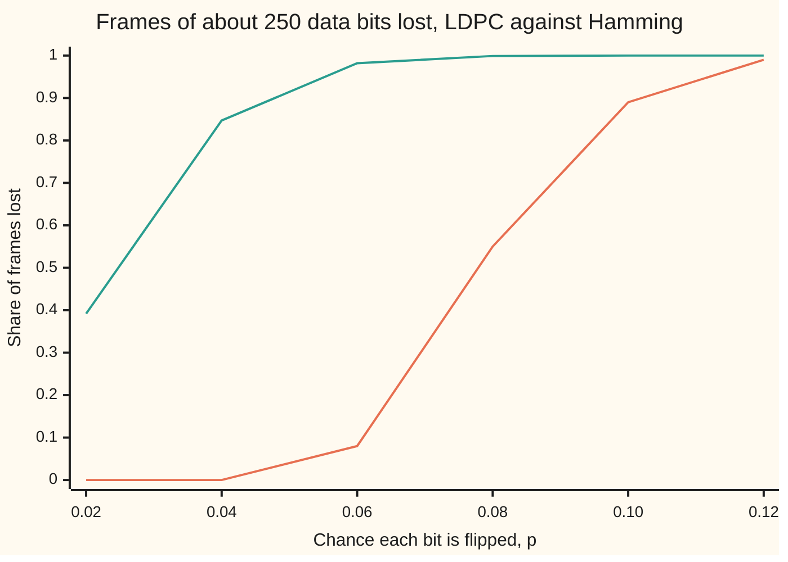
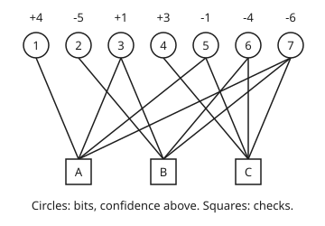

# LDPC, turbo and polar codes: how modern links get within a whisker of capacity

[Syllabus](../../../SYLLABUS.md) → [Applied and computational](../README.md) → [Information Theory](../README.md#s03) → LDPC, turbo and polar codes

---

## General Overview

A weather station on a hilltop radios its readings to a town below. One reading, 23 °C, is 8 bits, and lightning flips some bits on the way. The previous card protected every 4 data bits with 3 check bits, the Hamming (7,4) code ([Hamming and Reed-Solomon](08-error-correcting-codes-hamming-and-reed-solomon.md)), which repairs one flipped bit in seven.

That is not enough for a 5G phone or a probe beyond Jupiter. Take a link that flips 4 bits in 100 and a frame of about 250 data bits. Cut into Hamming blocks, the frame arrives damaged 84.7% of the time. A 504-bit **LDPC code** (low-density parity-check: many checks, each touching few bits) lost 0 of 100 frames in this card's run, spending 504 bits on 254 data bits where Hamming spends 441 on 252. Engineers chose the same way: 5G sends its data with LDPC codes, and deep-space links use LDPC and turbo codes. Their LDPC codes are longer than this card's 504-bit teaching stand-in, and give different bits different numbers of checks.

Two moves make the difference. Make the code long, with sparse checks. Then decode **softly**: keep how sure the receiver is of every bit, and let bits and checks trade those confidences until they agree. That trading is **belief propagation**. Turbo codes trade confidences between two short-memory codes; polar codes split one channel into nearly perfect and nearly useless parts.

**Long codes with sparse checks, decoded by passing soft confidences between bits and the checks they share, come close to the channel's capacity, the largest rate any code can carry reliably; Hamming's one-repair-per-block cannot.**

**What kind of fact this is:** methods with promises of different strength. Belief propagation is exact on a graph without loops and an approximation on real codes. Viterbi decoding is exact, proved on the [Hidden Markov models](../../11-Stochastic%20processes%20and%20calculus/03-Markov%20Chains/08-hidden-markov-models.md) card. The one-step polar formula is proved here; its limit is a theorem, stated with its source. Capacity is a limit: never reached at the sizes run here, and never by the regular LDPC family run here, at any size (The usual mistake).

### The picture: frames lost as the link gets noisier



First line: the 504-bit LDPC code, 100 simulated frames per point (synthetic, seed 2026). Second: 63 Hamming blocks, exact. No rate-1/2 code can work reliably past p = 0.1100, and this code's rate, 0.5040, a shade above 1/2, has a limit a shade below. Its cliff is near 0.08, mostly because of its regular pattern rather than its length (The usual mistake).

---

## The formula

Notation first, in words. A code sends $n$ bits carrying $k$ data bits, at **rate** $R = k/n$. Its **parity-check matrix** $H$ has one row per check, a set of bits whose sum must be even. The channel flips each bit with chance $p$; its capacity $C$ is the largest reliable rate ([Channel capacity](07-channel-capacity-and-the-noisy-channel-theorem.md)).

A **Tanner graph** draws $H$: a circle for each bit $v$, a square for each check $c$ (on this card $c$ is a check, not card 08's codeword), an edge where $c$ contains $v$. The starting confidence in bit $v$ is

$$L_v = \ln \frac{\Pr(\text{bit } v \text{ was } 0 \mid \text{what was heard})}{\Pr(\text{bit } v \text{ was } 1 \mid \text{what was heard})}.$$

Positive means "probably 0"; the size says how sure. Belief propagation sends messages along every edge, both ways, and repeats. Below, $c' \ni v$ reads "the checks $c'$ that contain bit $v$", and $v' \in c$ reads "the bits $v'$ in check $c$":

$$m_{v\to c} = L_v + \sum_{c' \ni v,\ c' \ne c} m_{c'\to v}, \qquad \tanh\frac{m_{c\to v}}{2} = \prod_{v' \in c,\ v' \ne v} \tanh\frac{m_{v'\to c}}{2}, \qquad T_v = L_v + \sum_{c \ni v} m_{c\to v}.$$

**Read it aloud:** a bit tells each check what it heard plus what every other check told it; a check tells each bit how sure the other bits make it, by a product of their certainties; a bit's verdict is the sign of its total.

Hardware decoders mostly use **min-sum** in place of the product: the other signs multiplied, times the smallest other size, less a small offset.

| Symbol | Plain meaning | In our example | Push it up and the answer… |
| --- | --- | --- | --- |
| $n$, $k$, $R$ | bits sent, data bits, rate $k/n$ | Hamming 7, 4; LDPC 504, 254, rate 0.5040 | less room to repair |
| $H$ | parity-check matrix: one row per check | 3 checks on 7 bits; 252 on 504 | more protection, lower rate |
| $p$ | chance the channel flips a bit | 0.02 to 0.12 | more frames lost |
| $C$ | capacity, $1 - h(p)$ bits per bit sent, with $h$ the binary entropy | 0.7577 at $p$ = 0.04 | more room for data |
| $v$, $c$, $x$ | a bit node, a check node; a bit's value, 0 or 1 | bits 1 to 7, checks A, B, C | — |
| $L_v$ | starting confidence in bit $v$ | +4, −5, +1, +3, −1, −4, −6 | surer of 0 |
| $m_{v\to c}$ | bit-to-check message | first round: $L_v$ | — |
| $m_{c\to v}$ | check-to-bit message | check B to bit 3: −4 | the check pushes the bit harder |
| $T_v$ | total confidence; its sign is the decision | bit 3: −2, so 1 | — |
| $M_t(S)$, $d_t$ | Viterbi: fewest disagreements on a path into state $S$ after step $t$; one step's disagreements | 2 at the end | — |
| $\varepsilon$, $z$ | erasure chance of a channel; of one polar sub-channel | 0.5; from 1 to 255 in 256 at $N$ = 8 | more channels useless |
| $N$, $u_i$ | number of polar sub-channels; the bit sent on sub-channel $i$ | $N$ = 8, 1024, $2^{20}$; data on $u_4, u_6, u_7, u_8$ | sharper split |

### When it holds

- **Each heard bit depends only on its own sent bit.** A lightning burst that flips neighbours together breaks this. Real links shuffle bits before sending (interleaving), so a burst lands on scattered bits.
- **No short loops near each bit.** The product rule assumes the other bits' messages are independent. On the Hamming graph bits 3 and 7 share checks A and B, a loop of four edges; after 5 rounds bit 5's total is +4.56 against the exact +1.96.
- **Honest confidences.** Min-sum overstates them. Without its offset, 52 of 100 LDPC frames fail at $p$ = 0.04, against 0 with it.
- **A rate below capacity.** At $p$ = 0.12 capacity is 0.4706, below the rate 0.5040, and 99 frames in 100 fail.
- **For the simulation, a linear code.** Sending the all-zero word stands for every word because the code is linear and the channel and decoder treat 0 and 1 alike.

---

## Why it works

### Step 0: each check is a tiny parity puzzle

A check says its bits add to an even number. If all but one of its bits were known, the last would follow. When the others are only probably known, the check's advice is only probably right, and the product rule says how probably. Each bit adds that advice to what it heard. Repeat, and certainty flows from sure bits to unsure ones.

<p align="center"></p>

Schematic: the Hamming (7,4) code as a Tanner graph, 12 edges. The LDPC code is the same drawing with 504 circles and 252 squares, each circle with 3 edges and each square with 6.

### Step 1: why a check multiplies tanh and a bit adds

For one bit with confidence $L$, the chances are $\Pr(0) = e^{L}/(1 + e^{L})$ and $\Pr(1) = 1/(1 + e^{L})$. Their difference is $(e^{L} - 1)/(e^{L} + 1) = \tanh(L/2)$: a number from −1 (surely 1) to +1 (surely 0).

Now take independent bits and their sum modulo 2. Give each bit the sign $(-1)^{x}$: +1 for a 0, −1 for a 1. The sum is even exactly when the product of signs is +1. The average of a product of independent things is the product of their averages, and each sign's average is $\Pr(0) - \Pr(1)$. So for the sum, that difference is the product of the separate $\tanh(L/2)$ values. The check's message about bit $v$ is this sum over the other bits: the middle formula. On the bit side, independent pieces of evidence multiply likelihood ratios, and logarithms turn that into a sum. A bit leaves out check $c$'s message when replying to $c$, so no check hears its own echo.

### Step 2: min-sum, and why it needs an offset

A product of numbers between −1 and +1 is no larger in size than its smallest factor, so the least sure neighbour dominates. Min-sum keeps only that one. It overstates the message, since the other factors would shrink it further, so a fixed offset is subtracted: here 1 unit when each heard bit is worth ±4. No tanh is needed, which is why chips use it.

### Step 3: exact on a tree, close on a sparse graph

With no loops, the messages into a bit come from branches sharing no bits, so independence holds and the totals are exact. The check tests this: remove edges 7B, 6C and 7C and the Hamming graph becomes a tree, on which 5 rounds of sum-product meet the exact values for all 7 bits. Hamming's graph has loops of four, so its totals drift from the exact values, which the code gets from all 16 codewords. Sparse random checks make an LDPC graph's loops long, so for several rounds each bit sees nearly a tree.

### Step 4: Viterbi on a convolutional code

A **convolutional code** feeds the data through a short memory. The (7,5) code remembers the last two data bits, a state from 00 to 11, and sends two sums per data bit: data plus both remembered bits, and data plus the older one. The 8 bits of 23 °C, plus two 0s to empty the memory, become 20 bits. Drawn as the 4 states against time, the possible paths form a **trellis**.

Decoding is the Viterbi recursion of the [Hidden Markov models](../../11-Stochastic%20processes%20and%20calculus/03-Markov%20Chains/08-hidden-markov-models.md) card, with "fewest disagreements" in place of "largest chance"; that card's forward-backward pass, a chance for each step, is what turbo decoders use. With $d_t$ the received bits that disagree with the step from $S$ to $S'$,

$$M_t(S') = \min_{S \to S'} \big[ M_{t-1}(S) + d_t(S \to S') \big].$$

Flip bits 4 and 13. Step 1 receives 00. From state 00, data 0 sends 00: $M_1(00) = 0$. Data 1 sends 11, two disagreements: $M_1(10) = 2$. Nine more steps, keeping the best path into each state, end at state 00 with 2 disagreements: the two flips, undone. The 256-message search agrees. Every nonzero message gives a codeword with at least 5 ones (the free distance), so any 2 errors are corrected.

### Step 5: turbo codes, in outline

A **turbo code** sends the data plus check bits from two convolutional encoders, the second reading the data in shuffled order. Each decoder runs the forward-backward pass on its own trellis and passes the other only what its own check bits added, which becomes the other's better starting $L_v$. A few rounds came within a fraction of a decibel of capacity. The exchange was later shown to be belief propagation on the combined graph.

### Step 6: polar codes split one channel into good and bad

Take two copies of an **erasure channel**: each bit arrives intact, or as "?" with chance $\varepsilon$. Send $u_1 + u_2$ (mod 2) on one and $u_2$ on the other. Decode $u_1$ first: it needs both outputs, so it is lost unless both arrive:

$$z^- = 1 - (1 - \varepsilon)^2 = 2\varepsilon - \varepsilon^2.$$

Then $u_2$, with $u_1$ known: either output gives it, so it is lost only if both are:

$$z^+ = \varepsilon^2.$$

Their average is $\varepsilon$: nothing lost, only redistributed. Repeat on each new channel, ten times for $N = 1024$, and the erasure chances drift to 0 or 1. Arıkan proved that the share near 0 tends to $1 - \varepsilon$, the capacity. A polar code sends data on the best sub-channels and fixes the rest to 0. At $N = 8$ and $\varepsilon = 0.5$ the best four are $u_4, u_6, u_7, u_8$, lost 81, 49, 31 and 1 time in 256; the code checks all 8 values against all 256 erasure patterns.

The split is slow. At $N = 1024$ a share of 0.3281 is still in between; at $N = 2^{20}$, 0.0507, with 0.4747 nearly perfect against the limit 0.5.

---

## Worked numbers, by hand

The station sends the data bits 1011 as the Hamming word 0110011 (data in positions 3, 5, 6 and 7). The receiver hears it with confidences $L$ = +4, −5, +1, +3, −1, −4, −6. Bits 3 and 5 lean the wrong way, both weakly.

| Step | Arithmetic | Value |
| --- | --- | --- |
| Hard decisions | signs of $L$ | 0100111: bits 3 and 5 wrong |
| Hamming's repair | checks A, B, C give 0, 1, 1, pointing at bit 6 | 0100101: 3 bits wrong |
| Check A to bit 3 | min-sum, no offset: others +4, −1, −6; signs give +, smallest size 1 | +1 |
| Check A to bit 5 | others +4, +1, −6: −, smallest 1 | −1 |
| Check B to bit 3 | others −5, −4, −6: −, smallest 4 | −4 |
| Check C to bit 5 | others +3, −4, −6: +, smallest 3 | +3 |
| Total, bit 3 | +1 + 1 − 4 | −2, so 1 |
| Total, bit 5 | −1 − 1 + 3 | +1, so 0 |
| All seven totals | each $L_v$ plus its checks' messages | +5, −4, −2, +2, +1, −2, −5 |
| Decision | signs | **0110011, 0 bits wrong** |

One round of min-sum fixes both errors. Check B's other bits are all firmly 1s, so it tells bit 3, with size 4, to be 1. Hamming used the same checks but threw the sizes away, and made things worse.

### What breaks if you drop a piece

| Mistake | Comes out at | What went wrong |
| --- | --- | --- |
| Decide each bit first, then repair | 0100101, 3 bits wrong | The sizes, saying bits 3 and 5 were doubtful, were thrown away |
| Flip coded bits 7, 8, 9 of the convolutional code | Viterbi decodes 7, not 23 | Free distance 5 guarantees 2 repairs, not 3 |
| Min-sum without the offset, LDPC at $p$ = 0.04 | 52 of 100 frames lost, against 0 | Overstated messages reinforce errors round after round |
| Send at rate 0.5040 when $p$ = 0.12 | 99 of 100 frames lost | Capacity there is 0.4706, below the rate |

The code prints all four.

---

## Code, from first principles, and it actually runs

Four parts, each by two roads. Belief propagation on the Hamming graph meets all 16 codewords, enumerated, and one sum-product check message meets its 8 parity cases; on the graph cut down to a tree, the totals meet the exact values. Viterbi meets all 256 messages. The polar recursion meets all 256 erasure patterns. Simulated Hamming frames meet the exact formula $1 - \big((1-p)^7 + 7p(1-p)^6\big)^{63}$. The LDPC run has no formula; it is held against capacity, with the rate-1/2 limit found by bisection on $1 - h(p) = 1/2$. Every heard bit in that run is equally sure, $L = \pm 4$, so it shows what a long sparse code gains, not what unequal confidences add; the worked example shows that. Its code follows Gallager's recipe: three bands of checks, each a shuffle of the 504 bits cut into groups of 6. Randomness is SplitMix64, seed 2026, written out in both languages.

### Python

```python
# LDPC, turbo and polar codes in outline -- the check behind the card.  Standard library only.
# Part 1: the Tanner graph of the Hamming (7,4) code; belief propagation (min-sum and
# sum-product) on one received weather reading, against all 16 codewords enumerated.
# Part 2: Viterbi on the (7,5) convolutional code, against all 256 messages enumerated.
# Part 3: polar channels on an erasure channel, recursion against all 256 erasure patterns.
# Part 4: a (3,6) LDPC code of 504 bits against Hamming frames on a bit-flipping channel,
# simulated with SplitMix64, seed 2026; the rate-1/2 limit found by bisection on 1 - h(p).
from math import tanh, atanh, log, log2, exp, sqrt, prod
M64, state = 2 ** 64 - 1, 2026
def draw():                                   # SplitMix64, written out
    global state
    state = (state + 0x9E3779B97F4A7C15) & M64; z = state
    z = ((z ^ (z >> 30)) * 0xBF58476D1CE4E5B9) & M64; z = ((z ^ (z >> 27)) * 0x94D049BB133111EB) & M64
    return z ^ (z >> 31)
unif = lambda: (draw() >> 11) / 2 ** 53; below = lambda m: ((draw() >> 32) * m) >> 32
def bp(checks, n, L, rounds, rule, stop):    # belief propagation on a Tanner graph
    msg = [[0] * len(r) for r in checks]
    for it in range(rounds + 1):
        tot = list(L)
        for c, row in enumerate(checks):
            for t, v in enumerate(row): tot[v] += msg[c][t]
        hard = [1 if x < 0 else 0 for x in tot]
        if it == rounds or (stop and all(sum(hard[v] for v in r) % 2 == 0 for r in checks)): return hard, it, msg, tot
        msg = [rule([tot[v] - msg[c][t] for t, v in enumerate(row)]) for c, row in enumerate(checks)]
def minsum(off):                              # sign of the others times (smallest other size - off)
    def rule(ins):
        out = []
        for t in range(len(ins)):
            o = [x for u, x in enumerate(ins) if u != t]
            out.append((-1) ** sum(x < 0 for x in o) * max(min(abs(x) for x in o) - off, 0))
        return out
    return rule
def sumprod(ins): return [2 * atanh(prod(tanh(x / 2) for u, x in enumerate(ins) if u != t)) for t in range(len(ins))]
f2 = lambda v: " ".join(f"{x:+.2f}" for x in v); s = lambda v: "".join(map(str, v)); wrong = lambda v: sum(a != b for a, b in zip(v, SENT))
# ---- part 1 ----
H = [[1, 0, 1, 0, 1, 0, 1], [0, 1, 1, 0, 0, 1, 1], [0, 0, 0, 1, 1, 1, 1]]
HAM = [[v for v in range(7) if r[v]] for r in H]
SENT, LLR = [0, 1, 1, 0, 0, 1, 1], [4, -5, 1, 3, -1, -4, -6]
hard0 = [1 if x < 0 else 0 for x in LLR]
syn = [sum(hard0[v] for v in r) % 2 for r in HAM]; pos = syn[0] + 2 * syn[1] + 4 * syn[2]
hamfix = [b ^ (v + 1 == pos) for v, b in enumerate(hard0)]
ms, _, msg1, tot1 = bp(HAM, 7, LLR, 1, minsum(0), False)
sp1 = bp(HAM, 7, LLR, 1, sumprod, False)[3]; sp5 = bp(HAM, 7, LLR, 5, sumprod, False)[3]
def marg(checks):                             # exact confidences: every word meeting the checks, weighted by L
    ws = [w for w in ([(x >> (6 - v)) & 1 for v in range(7)] for x in range(128)) if all(sum(w[v] for v in r) % 2 == 0 for r in checks)]
    wt = [exp(sum(LLR[v] / 2 * (1 - 2 * w[v]) for v in range(7))) for w in ws]
    return ws, wt, [log(sum(q for q, w in zip(wt, ws) if w[v] == 0) / sum(q for q, w in zip(wt, ws) if w[v] == 1)) for v in range(7)]
words, wt, exact = marg(HAM)
ml = words[max(range(len(words)), key=lambda i: wt[i])]
print(f"Tanner graph: checks A, B, C on bits {[[v + 1 for v in r] for r in HAM]}; {sum(map(len, HAM))} edges; {len(words)} codewords")
print(f"sent {s(SENT)}; confidences L = {LLR}; hard decisions {s(hard0)}, wrong at bits {[v + 1 for v in range(7) if hard0[v] != SENT[v]]}")
print(f"Hamming syndrome {s(syn)} -> flips bit {pos} -> {s(hamfix)}, wrong bits {wrong(hamfix)}")
for c in range(3): print(f"min-sum round 1, check {'ABC'[c]} to bits {[v + 1 for v in HAM[c]]}: {msg1[c]}")
print(f"min-sum totals {tot1} -> {s(ms)}, wrong bits {wrong(ms)}")
print(f"sum-product totals, 1 round  {f2(sp1)}\nsum-product totals, 5 rounds {f2(sp5)}\nexact, all 16 codewords      {f2(exact)}")
print(f"most likely codeword {s(ml)}; bitwise exact decisions {s([1 if x < 0 else 0 for x in exact])}")
TREE = [HAM[0], [1, 2, 5], [3, 4]]; tr = bp(TREE, 7, LLR, 5, sumprod, False)[3], marg(TREE)[2]   # less edges 7B, 6C, 7C: no loop
print(f"tree, checks on bits {[[v + 1 for v in r] for r in TREE]}: sum-product, 5 rounds {f2(tr[0])}; exact {f2(tr[1])}")
# ---- part 2 ----
def conv(u):                                  # (7,5): outputs u+a+b and u+b, a and b the last two inputs
    a = b = 0; out = []
    for x in u + [0, 0]: out += [x ^ a ^ b, x ^ b]; a, b = x, a
    return out
def viterbi(r):
    M, back, rows = [0, 99, 99, 99], [], []   # state 2a + b
    for t in range(len(r) // 2):
        new, arg = [99] * 4, [None] * 4
        for st in range(4):
            a, b = st >> 1, st & 1
            for x in (0, 1):
                d = M[st] + ((x ^ a ^ b) != r[2 * t]) + ((x ^ b) != r[2 * t + 1])
                if d < new[2 * x + a]: new[2 * x + a], arg[2 * x + a] = d, (st, x)
        M = new; back.append(arg); rows.append(M)
    st, u = 0, []
    for arg in reversed(back): st, x = arg[st]; u.insert(0, x)
    return u[:-2], rows
MSG = [0, 0, 0, 1, 0, 1, 1, 1]
cw = conv(MSG); allm = [[(m >> (7 - i)) & 1 for i in range(8)] for m in range(256)]
dfree = min(sum(conv(m)) for m in allm[1:])
print(f"message {s(MSG)} (23 degrees C); codeword {s(cw)}; free distance by enumeration {dfree}")
vres = []
for ps in ([4, 13], [7, 8, 9]):
    r = [x ^ (i + 1 in ps) for i, x in enumerate(cw)]; dec, rows = viterbi(r)
    ds = [sum(a != b for a, b in zip(conv(m), r)) for m in allm]; best = min(ds)
    vres.append((dec, allm[ds.index(best)], ds.count(best)))
    print(f"errors at {ps}: received {s(r)}; Viterbi {s(dec)} (={int(s(dec), 2)}), metric {rows[-1][0]}; enumeration best {s(allm[ds.index(best)])} at distance {best}, {ds.count(best)} tied")
    if len(ps) == 2: print("  path metrics by step, states 00 01 10 11: " + " | ".join(" ".join(str(m) if m < 99 else "-" for m in row) for row in rows))
# ---- part 3 ----
def polar(n, e):
    z = [e]
    for _ in range(n): z = [w for q in z for w in (2 * q - q * q, q * q)]   # worse, better
    return z
G = [sum(1 << j for j in range(8) if j & ~i == 0) for i in range(8)]   # rows of the 8 x 8 transform, as bit masks
cnt = [0] * 8                                 # erasure patterns (each 1 in 256) that leave u_i undecided
for er in range(256):
    for i in range(8):
        for tail in range(1 << (7 - i)):
            x = G[i]
            for k in range(7 - i): x ^= G[i + 1 + k] * (tail >> k & 1)
            if x & ~er & 255 == 0: cnt[i] += 1; break
z8 = polar(3, 0.5); info = sorted(sorted(range(8), key=lambda i: z8[i])[:4])
print(f"polar N = 8, erasure 0.5: recursion x 256 {[int(q * 256) for q in z8]}; enumeration {cnt}; best 4 channels {[i + 1 for i in info]}")
for n in (10, 20):
    z = polar(n, 0.5)
    print(f"polar N = 2^{n}: share nearly perfect (z < 0.001) {sum(q < 1e-3 for q in z) / 2 ** n:.4f}, nearly useless (z > 0.999) {sum(q > 0.999 for q in z) / 2 ** n:.4f}, in between {sum(1e-3 <= q <= 0.999 for q in z) / 2 ** n:.4f}")
# ---- part 4 ----
NB, J, K, LD, basis = 504, 3, 6, [], {}
for band in range(J):                         # Gallager's construction: three shuffled bands
    perm = list(range(NB))
    for i in range(NB - 1, 0, -1) if band else []:
        j = below(i + 1); perm[i], perm[j] = perm[j], perm[i]
    LD += [perm[c * K:(c + 1) * K] for c in range(NB // K)]
for row in LD:
    r = sum(1 << v for v in row)
    while r and r.bit_length() - 1 in basis: r ^= basis[r.bit_length() - 1]
    if r: basis[r.bit_length() - 1] = r
kb = NB - len(basis)
h = lambda p: -p * log2(p) - (1 - p) * log2(1 - p); lo, hi = 0.01, 0.5
for _ in range(60): lo, hi = ((lo + hi) / 2, hi) if h((lo + hi) / 2) < 0.5 else (lo, (lo + hi) / 2)
print(f"LDPC: {NB} bits, {len(LD)} checks, 3 per bit, 6 per check, rank {len(basis)}, {kb} data bits, rate {kb / NB:.4f}; Hamming frame: 63 blocks, 252 data bits, 441 bits sent; rate-1/2 limit p = {lo:.4f}")
PS, BL, FR, res = [0.02, 0.04, 0.06, 0.08, 0.10, 0.12], 100, 1000, []
for p in PS:
    fail = sum(any(bp(LD, NB, [-4 if unif() < p else 4 for _ in range(NB)], 50, minsum(1), True)[0]) for _ in range(BL))
    hf = sum(sum(sum(unif() < p for _ in range(7)) > 1 for _ in range(63)) > 0 for _ in range(FR))   # draw all 441 bits
    exact_h = 1 - ((1 - p) ** 7 + 7 * p * (1 - p) ** 6) ** 63
    res.append((fail / BL, hf / FR, exact_h))
    print(f"p {p:.2f}  capacity {1 - h(p):.4f}  LDPC 504-bit frames failed {fail}/{BL}  Hamming 63-block frames failed {hf}/{FR} = {hf / FR:.3f} (exact {exact_h:.3f})")
plain = sum(any(bp(LD, NB, [-4 if unif() < 0.04 else 4 for _ in range(NB)], 50, minsum(0), True)[0]) for _ in range(BL))
print(f"what breaks, min-sum without the offset at p 0.04: {plain}/{BL} frames failed")
print(f"chart, LDPC {', '.join(f'{r[0]:.2f}' for r in res)}; Hamming exact {', '.join(f'{r[2]:.3f}' for r in res)}")
print(f"figure, bits at x = {[40 + 47 * v for v in range(7)]}, y = 50; checks A, B, C at x = {[87, 181, 275]}, y = 190; edges {' '.join(f'{v + 1}{chr(65 + c)}' for c in range(3) for v in HAM[c])}")
se = lambda f, m: sqrt(max(f * (1 - f), 1 / m) / m)
assert ms == SENT and ml == SENT and [1 if x < 0 else 0 for x in exact] == SENT and hamfix != SENT
assert all(abs(a - b) < 1e-9 for a, b in zip(*tr))   # on a tree, belief propagation meets the exact confidences
assert vres[0][0] == MSG == vres[0][1] and vres[0][2] == 1 and dfree == 5 and vres[1][0] == vres[1][1] != MSG
assert cnt == [round(q * 256) for q in z8] and abs(lo - 0.110028) < 1e-5
assert all(abs(r[1] - r[2]) < 4 * se(r[2], FR) for r in res) and res[1][0] < res[1][2] / 10
pe = [sum(prod((1 if b >> j & 1 else exp(LLR[v])) / (1 + exp(LLR[v])) for j, v in enumerate((1, 5, 6))) for b in range(8) if bin(b).count("1") % 2 == q) for q in (0, 1)]
assert abs(sumprod([LLR[v] for v in HAM[1]])[1] - log(pe[0] / pe[1])) < 1e-9   # check B to bit 3: rule against its 8 parity cases
print("ALL CHECKS PASS")
```

**Ran 2026-11-11 on macOS, Python 3.14.10, standard library only. All checks passed. Output, pasted from the run:**

```
Tanner graph: checks A, B, C on bits [[1, 3, 5, 7], [2, 3, 6, 7], [4, 5, 6, 7]]; 12 edges; 16 codewords
sent 0110011; confidences L = [4, -5, 1, 3, -1, -4, -6]; hard decisions 0100111, wrong at bits [3, 5]
Hamming syndrome 011 -> flips bit 6 -> 0100101, wrong bits 3
min-sum round 1, check A to bits [1, 3, 5, 7]: [1, 1, -1, -1]
min-sum round 1, check B to bits [2, 3, 6, 7]: [1, -4, 1, 1]
min-sum round 1, check C to bits [4, 5, 6, 7]: [-1, 3, 1, 1]
min-sum totals [5, -4, -2, 2, 1, -2, -5] -> 0110011, wrong bits 0
sum-product totals, 1 round  +4.43 -4.05 -1.64 +2.05 +0.70 -2.14 -4.62
sum-product totals, 5 rounds +5.59 -4.73 -4.62 +3.20 +4.56 -3.92 -7.43
exact, all 16 codewords      +5.87 -5.98 -1.98 +5.36 +1.96 -2.01 -7.36
most likely codeword 0110011; bitwise exact decisions 0110011
tree, checks on bits [[1, 3, 5, 7], [2, 3, 6], [4, 5]]: sum-product, 5 rounds +2.08 -4.17 +2.83 -1.51 -1.51 -3.15 -4.18; exact +2.08 -4.17 +2.83 -1.51 -1.51 -3.15 -4.18
message 00010111 (23 degrees C); codeword 00000011100001100111; free distance by enumeration 5
errors at [4, 13]: received 00010011100011100111; Viterbi 00010111 (=23), metric 2; enumeration best 00010111 at distance 2, 1 tied
  path metrics by step, states 00 01 10 11: 0 - 2 - | 1 4 1 2 | 1 2 3 2 | 2 3 1 3 | 3 1 3 3 | 3 4 1 4 | 4 2 3 2 | 3 3 3 2 | 4 2 4 3 | 2 4 4 4
errors at [7, 8, 9]: received 00000000000001100111; Viterbi 00000111 (=7), metric 2; enumeration best 00000111 at distance 2, 1 tied
polar N = 8, erasure 0.5: recursion x 256 [255, 225, 207, 81, 175, 49, 31, 1]; enumeration [255, 225, 207, 81, 175, 49, 31, 1]; best 4 channels [4, 6, 7, 8]
polar N = 2^10: share nearly perfect (z < 0.001) 0.3359, nearly useless (z > 0.999) 0.3359, in between 0.3281
polar N = 2^20: share nearly perfect (z < 0.001) 0.4747, nearly useless (z > 0.999) 0.4747, in between 0.0507
LDPC: 504 bits, 252 checks, 3 per bit, 6 per check, rank 250, 254 data bits, rate 0.5040; Hamming frame: 63 blocks, 252 data bits, 441 bits sent; rate-1/2 limit p = 0.1100
p 0.02  capacity 0.8586  LDPC 504-bit frames failed 0/100  Hamming 63-block frames failed 376/1000 = 0.376 (exact 0.392)
p 0.04  capacity 0.7577  LDPC 504-bit frames failed 0/100  Hamming 63-block frames failed 857/1000 = 0.857 (exact 0.847)
p 0.06  capacity 0.6726  LDPC 504-bit frames failed 8/100  Hamming 63-block frames failed 981/1000 = 0.981 (exact 0.982)
p 0.08  capacity 0.5978  LDPC 504-bit frames failed 55/100  Hamming 63-block frames failed 996/1000 = 0.996 (exact 0.999)
p 0.10  capacity 0.5310  LDPC 504-bit frames failed 89/100  Hamming 63-block frames failed 1000/1000 = 1.000 (exact 1.000)
p 0.12  capacity 0.4706  LDPC 504-bit frames failed 99/100  Hamming 63-block frames failed 1000/1000 = 1.000 (exact 1.000)
what breaks, min-sum without the offset at p 0.04: 52/100 frames failed
chart, LDPC 0.00, 0.00, 0.08, 0.55, 0.89, 0.99; Hamming exact 0.392, 0.847, 0.982, 0.999, 1.000, 1.000
figure, bits at x = [40, 87, 134, 181, 228, 275, 322], y = 50; checks A, B, C at x = [87, 181, 275], y = 190; edges 1A 3A 5A 7A 2B 3B 6B 7B 4C 5C 6C 7C
ALL CHECKS PASS
```

### Rust

Same numbers, same labels, built with `rustc --edition 2021 -O`.

```rust
// LDPC, turbo and polar codes in outline -- the same check as the Python, in Rust.  No crates.
// Same four parts: belief propagation on the Hamming (7,4) Tanner graph against all 16
// codewords; Viterbi on the (7,5) convolutional code against all 256 messages; polar
// channels on an erasure channel against all 256 erasure patterns; a (3,6) LDPC code of
// 504 bits against Hamming frames, simulated with SplitMix64, seed 2026.
struct Gen(u64);
impl Gen {
    fn draw(&mut self) -> u64 {                   // SplitMix64, written out
        self.0 = self.0.wrapping_add(0x9E3779B97F4A7C15); let mut z = self.0;
        z = (z ^ (z >> 30)).wrapping_mul(0xBF58476D1CE4E5B9); z = (z ^ (z >> 27)).wrapping_mul(0x94D049BB133111EB);
        z ^ (z >> 31)
    }
    fn unif(&mut self) -> f64 { (self.draw() >> 11) as f64 / 9007199254740992.0 } fn below(&mut self, m: u64) -> usize { (((self.draw() >> 32) * m) >> 32) as usize }
}
type Rule = dyn Fn(&[f64]) -> Vec<f64>;
// belief propagation on a Tanner graph: returns decisions, messages, totals
fn bp(checks: &[Vec<usize>], l: &[f64], rounds: usize, rule: &Rule, stop: bool) -> (Vec<u8>, Vec<Vec<f64>>, Vec<f64>) {
    let mut msg: Vec<Vec<f64>> = checks.iter().map(|r| vec![0.0; r.len()]).collect();
    for it in 0..=rounds {
        let mut tot = l.to_vec();
        for (c, row) in checks.iter().enumerate() { for (t, &v) in row.iter().enumerate() { tot[v] += msg[c][t] } }
        let hard: Vec<u8> = tot.iter().map(|&x| (x < 0.0) as u8).collect();
        let ok = checks.iter().all(|r| r.iter().map(|&v| hard[v] as usize).sum::<usize>() % 2 == 0);
        if it == rounds || (stop && ok) { return (hard, msg, tot) }
        msg = checks.iter().enumerate().map(|(c, row)| rule(&row.iter().enumerate().map(|(t, &v)| tot[v] - msg[c][t]).collect::<Vec<_>>())).collect();
    }
    unreachable!()
}
fn minsum(off: f64) -> impl Fn(&[f64]) -> Vec<f64> {   // sign of the others times (smallest other size - off)
    move |ins: &[f64]| (0..ins.len()).map(|t| {
        let o: Vec<f64> = ins.iter().enumerate().filter(|&(u, _)| u != t).map(|(_, &x)| x).collect();
        let neg = o.iter().filter(|&&x| x < 0.0).count();
        let m = o.iter().fold(f64::INFINITY, |a, &x| a.min(x.abs()));
        (if neg % 2 == 1 { -1.0 } else { 1.0 }) * (m - off).max(0.0)
    }).collect()
}
fn sumprod(ins: &[f64]) -> Vec<f64> {
    (0..ins.len()).map(|t| 2.0 * ins.iter().enumerate().filter(|&(u, _)| u != t).fold(1.0, |a, (_, &x)| a * (x / 2.0).tanh()).atanh()).collect()
}
fn s(v: &[u8]) -> String { v.iter().map(|b| b.to_string()).collect() }   // bits as a string
fn f2(v: &[f64]) -> String { v.iter().map(|x| format!("{:+.2}", x)).collect::<Vec<_>>().join(" ") }
fn ints(v: &[f64]) -> String { format!("{:?}", v.iter().map(|&x| x as i64).collect::<Vec<_>>()) }
fn conv(u: &[u8]) -> Vec<u8> {                   // (7,5): outputs u+a+b and u+b, a and b the last two inputs
    let (mut a, mut b, mut out) = (0u8, 0u8, vec![]); for &x in u.iter().chain([0u8, 0].iter()) { out.push(x ^ a ^ b); out.push(x ^ b); b = a; a = x; }
    out
}
fn viterbi(r: &[u8]) -> (Vec<u8>, Vec<[u32; 4]>) {
    let (mut m, mut back, mut rows) = ([0u32, 99, 99, 99], vec![], vec![]);   // state 2a + b
    for t in 0..r.len() / 2 {
        let (mut new, mut arg) = ([99u32; 4], [(0usize, 0u8); 4]);
        for st in 0..4 {
            let (a, b) = ((st >> 1) as u8, (st & 1) as u8);
            for x in 0..2u8 {
                let d = m[st] + ((x ^ a ^ b) != r[2 * t]) as u32 + ((x ^ b) != r[2 * t + 1]) as u32;
                let ns = (2 * x + a) as usize; if d < new[ns] { new[ns] = d; arg[ns] = (st, x) }
            }
        }
        m = new; back.push(arg); rows.push(m);
    }
    let (mut st, mut u) = (0usize, vec![]);
    for arg in back.iter().rev() { let (p, x) = arg[st]; st = p; u.insert(0, x) }
    u.truncate(u.len() - 2); (u, rows)
}
fn polar(n: u32, e: f64) -> Vec<f64> { let mut z = vec![e]; for _ in 0..n { z = z.iter().flat_map(|&q| [2.0 * q - q * q, q * q]).collect() } z }   // worse, better
fn h(p: f64) -> f64 { -p * p.log2() - (1.0 - p) * (1.0 - p).log2() } fn se(f: f64, m: f64) -> f64 { ((f * (1.0 - f)).max(1.0 / m) / m).sqrt() }
fn marg(checks: &[Vec<usize>], llr: &[f64]) -> (Vec<Vec<u8>>, Vec<f64>, Vec<f64>) {   // exact confidences: every word meeting the checks, weighted by L
    let words: Vec<Vec<u8>> = (0..128u32).map(|x| (0..7).map(|v| ((x >> (6 - v)) & 1) as u8).collect::<Vec<u8>>())
        .filter(|w| checks.iter().all(|r| r.iter().map(|&v| w[v]).sum::<u8>() % 2 == 0)).collect();
    let wt: Vec<f64> = words.iter().map(|w| (0..7).map(|v| llr[v] / 2.0 * (1.0 - 2.0 * w[v] as f64)).sum::<f64>().exp()).collect();
    let side = |v: usize, b: u8| words.iter().zip(&wt).filter(|(w, _)| w[v] == b).map(|(_, &q)| q).sum::<f64>();
    let exact = (0..7).map(|v| (side(v, 0) / side(v, 1)).ln()).collect();
    (words, wt, exact)
}

fn main() {
    // ---- part 1 ----
    let hm: Vec<Vec<usize>> = vec![vec![0, 2, 4, 6], vec![1, 2, 5, 6], vec![3, 4, 5, 6]];
    let (sent, llr): (Vec<u8>, Vec<f64>) = (vec![0, 1, 1, 0, 0, 1, 1], vec![4.0, -5.0, 1.0, 3.0, -1.0, -4.0, -6.0]);
    let wrong = |v: &[u8]| v.iter().zip(&sent).filter(|(a, b)| a != b).count();
    let hard0: Vec<u8> = llr.iter().map(|&x| (x < 0.0) as u8).collect();
    let syn: Vec<u8> = hm.iter().map(|r| (r.iter().map(|&v| hard0[v]).sum::<u8>()) % 2).collect();
    let pos = (syn[0] + 2 * syn[1] + 4 * syn[2]) as usize;
    let hamfix: Vec<u8> = hard0.iter().enumerate().map(|(v, &b)| b ^ (v + 1 == pos) as u8).collect();
    let (ms, msg1, tot1) = bp(&hm, &llr, 1, &minsum(0.0), false);
    let sp1 = bp(&hm, &llr, 1, &sumprod, false).2; let sp5 = bp(&hm, &llr, 5, &sumprod, false).2;
    let (words, wt, exact) = marg(&hm, &llr);
    let mut bi = 0; for i in 1..words.len() { if wt[i] > wt[bi] { bi = i } } let ml = words[bi].clone();
    let exact_dec: Vec<u8> = exact.iter().map(|&x| (x < 0.0) as u8).collect();
    let one = |r: &Vec<usize>| format!("{:?}", r.iter().map(|v| v + 1).collect::<Vec<_>>());
    println!("Tanner graph: checks A, B, C on bits [{}]; {} edges; {} codewords", hm.iter().map(one).collect::<Vec<_>>().join(", "), hm.iter().map(|r| r.len()).sum::<usize>(), words.len());
    println!("sent {}; confidences L = {}; hard decisions {}, wrong at bits {:?}", s(&sent), ints(&llr), s(&hard0), (0..7).filter(|&v| hard0[v] != sent[v]).map(|v| v + 1).collect::<Vec<_>>());
    println!("Hamming syndrome {} -> flips bit {} -> {}, wrong bits {}", s(&syn), pos, s(&hamfix), wrong(&hamfix));
    for c in 0..3 { println!("min-sum round 1, check {} to bits {}: {}", ["A", "B", "C"][c], one(&hm[c]), ints(&msg1[c])) }
    println!("min-sum totals {} -> {}, wrong bits {}", ints(&tot1), s(&ms), wrong(&ms));
    println!("sum-product totals, 1 round  {}\nsum-product totals, 5 rounds {}\nexact, all 16 codewords      {}", f2(&sp1), f2(&sp5), f2(&exact));
    println!("most likely codeword {}; bitwise exact decisions {}", s(&ml), s(&exact_dec));
    let tree: Vec<Vec<usize>> = vec![hm[0].clone(), vec![1, 2, 5], vec![3, 4]];   // less edges 7B, 6C, 7C: no loop
    let tr = (bp(&tree, &llr, 5, &sumprod, false).2, marg(&tree, &llr).2);
    println!("tree, checks on bits [{}]: sum-product, 5 rounds {}; exact {}", tree.iter().map(one).collect::<Vec<_>>().join(", "), f2(&tr.0), f2(&tr.1));
    // ---- part 2 ----
    let msgb: Vec<u8> = vec![0, 0, 0, 1, 0, 1, 1, 1]; let cw = conv(&msgb);
    let allm: Vec<Vec<u8>> = (0..256u32).map(|m| (0..8).map(|i| ((m >> (7 - i)) & 1) as u8).collect()).collect();
    let dfree = allm[1..].iter().map(|m| conv(m).iter().map(|&b| b as u32).sum::<u32>()).min().unwrap();
    println!("message {} (23 degrees C); codeword {}; free distance by enumeration {}", s(&msgb), s(&cw), dfree);
    let mut vres = vec![];
    for ps in [vec![4usize, 13], vec![7, 8, 9]] {
        let r: Vec<u8> = cw.iter().enumerate().map(|(i, &x)| x ^ ps.contains(&(i + 1)) as u8).collect();
        let (dec, rows) = viterbi(&r);
        let ds: Vec<usize> = allm.iter().map(|m| conv(m).iter().zip(&r).filter(|(a, b)| a != b).count()).collect();
        let best = *ds.iter().min().unwrap(); let (bidx, ties) = (ds.iter().position(|&d| d == best).unwrap(), ds.iter().filter(|&&d| d == best).count());
        let val = dec.iter().fold(0u32, |a, &b| 2 * a + b as u32);
        println!("errors at {:?}: received {}; Viterbi {} (={}), metric {}; enumeration best {} at distance {}, {} tied", ps, s(&r), s(&dec), val, rows[rows.len() - 1][0], s(&allm[bidx]), best, ties);
        let txt: Vec<String> = rows.iter().map(|row| row.iter().map(|&m| if m < 99 { m.to_string() } else { "-".to_string() }).collect::<Vec<_>>().join(" ")).collect();
        if ps.len() == 2 { println!("  path metrics by step, states 00 01 10 11: {}", txt.join(" | ")) }
        vres.push((dec, allm[bidx].clone(), ties));
    }
    // ---- part 3 ----
    let g: Vec<u32> = (0..8u32).map(|i| (0..8u32).filter(|&j| j & !i == 0).map(|j| 1 << j).sum()).collect();
    let mut cnt = [0u32; 8];                      // erasure patterns (each 1 in 256) that leave u_i undecided
    for er in 0..256u32 { for i in 0..8 { for tail in 0..(1u32 << (7 - i)) {
        let mut x = g[i]; for k in 0..7 - i { x ^= g[i + 1 + k] * ((tail >> k) & 1) }
        if x & !er & 255 == 0 { cnt[i] += 1; break }
    } } }
    let z8 = polar(3, 0.5);
    let mut order: Vec<usize> = (0..8).collect(); order.sort_by(|&a, &b| z8[a].partial_cmp(&z8[b]).unwrap()); let mut info = order[..4].to_vec(); info.sort();
    println!("polar N = 8, erasure 0.5: recursion x 256 {:?}; enumeration {:?}; best 4 channels {:?}", z8.iter().map(|q| (q * 256.0) as i64).collect::<Vec<_>>(), cnt, info.iter().map(|i| i + 1).collect::<Vec<_>>());
    for n in [10u32, 20] {
        let z = polar(n, 0.5); let all = (1u64 << n) as f64;
        let share = |f: &dyn Fn(f64) -> bool| z.iter().filter(|&&q| f(q)).count() as f64 / all;
        println!("polar N = 2^{}: share nearly perfect (z < 0.001) {:.4}, nearly useless (z > 0.999) {:.4}, in between {:.4}", n, share(&|q| q < 1e-3), share(&|q| q > 0.999), share(&|q| (1e-3..=0.999).contains(&q)));
    }
    // ---- part 4 ----
    let (nb, kk, mut gen, mut ld) = (504usize, 6usize, Gen(2026), Vec::<Vec<usize>>::new());
    for band in 0..3 {                            // Gallager's construction: three shuffled bands
        let mut perm: Vec<usize> = (0..nb).collect();
        if band > 0 { for i in (1..nb).rev() { let j = gen.below(i as u64 + 1); perm.swap(i, j) } }
        for c in 0..nb / kk { ld.push(perm[c * kk..(c + 1) * kk].to_vec()) } }
    let lead = |r: &[u64; 8]| (0..8).rev().find(|&w| r[w] != 0).map(|w| 64 * w + 63 - r[w].leading_zeros() as usize);
    let mut basis: Vec<Option<[u64; 8]>> = vec![None; nb];
    for row in &ld {
        let mut r = [0u64; 8]; for &v in row { r[v / 64] |= 1 << (v % 64) }
        while let Some(t) = lead(&r) { match basis[t] { Some(bv) => { for w in 0..8 { r[w] ^= bv[w] } } None => { basis[t] = Some(r); break } } }
    }
    let rank = basis.iter().filter(|b| b.is_some()).count(); let kb = nb - rank;
    let (mut lo, mut hi) = (0.01f64, 0.5f64);
    for _ in 0..60 { let mid = (lo + hi) / 2.0; if h(mid) < 0.5 { lo = mid } else { hi = mid } }
    println!("LDPC: {} bits, {} checks, 3 per bit, 6 per check, rank {}, {} data bits, rate {:.4}; Hamming frame: 63 blocks, 252 data bits, 441 bits sent; rate-1/2 limit p = {:.4}", nb, ld.len(), rank, kb, kb as f64 / nb as f64, lo);
    let (bl, fr, ms1, ms0) = (100usize, 1000usize, minsum(1.0), minsum(0.0)); let mut res = vec![];
    for p in [0.02, 0.04, 0.06, 0.08, 0.10, 0.12] {
        let fail = (0..bl).filter(|_| { let l: Vec<f64> = (0..nb).map(|_| if gen.unif() < p { -4.0 } else { 4.0 }).collect(); bp(&ld, &l, 50, &ms1, true).0.iter().any(|&b| b == 1) }).count();
        let hf = (0..fr).filter(|_| (0..63).map(|_| (0..7).filter(|_| gen.unif() < p).count() > 1).fold(false, |a, b| a || b)).count();
        let exact_h = 1.0 - ((1.0f64 - p).powi(7) + 7.0 * p * (1.0f64 - p).powi(6)).powi(63);
        res.push((fail as f64 / bl as f64, hf as f64 / fr as f64, exact_h));
        println!("p {:.2}  capacity {:.4}  LDPC 504-bit frames failed {}/{}  Hamming 63-block frames failed {}/{} = {:.3} (exact {:.3})", p, 1.0 - h(p), fail, bl, hf, fr, hf as f64 / fr as f64, exact_h);
    }
    let plain = (0..bl).filter(|_| { let l: Vec<f64> = (0..nb).map(|_| if gen.unif() < 0.04 { -4.0 } else { 4.0 }).collect(); bp(&ld, &l, 50, &ms0, true).0.iter().any(|&b| b == 1) }).count();
    println!("what breaks, min-sum without the offset at p 0.04: {}/{} frames failed", plain, bl);
    println!("chart, LDPC {}; Hamming exact {}", res.iter().map(|r| format!("{:.2}", r.0)).collect::<Vec<_>>().join(", "), res.iter().map(|r| format!("{:.3}", r.2)).collect::<Vec<_>>().join(", "));
    let edges: Vec<String> = (0..3).flat_map(|c| hm[c].iter().map(move |v| format!("{}{}", v + 1, ["A", "B", "C"][c]))).collect();
    println!("figure, bits at x = {:?}, y = 50; checks A, B, C at x = [87, 181, 275], y = 190; edges {}", (0..7).map(|v| 40 + 47 * v).collect::<Vec<_>>(), edges.join(" "));
    assert!(ms == sent && ml == sent && exact_dec == sent && hamfix != sent);
    assert!(tr.0.iter().zip(&tr.1).all(|(a, b)| (a - b).abs() < 1e-9));   // on a tree, belief propagation meets the exact confidences
    assert!(vres[0].0 == msgb && vres[0].1 == msgb && vres[0].2 == 1 && dfree == 5 && vres[1].0 == vres[1].1 && vres[1].0 != msgb);
    assert!((0..8).all(|i| cnt[i] as f64 == (z8[i] * 256.0).round()) && (lo - 0.110028).abs() < 1e-5);
    assert!(res.iter().all(|r| (r.1 - r.2).abs() < 4.0 * se(r.2, fr as f64)) && res[1].0 < res[1].2 / 10.0);
    let pe: Vec<f64> = (0..2u32).map(|q| (0..8u32).filter(|b| b.count_ones() % 2 == q).map(|b| [1usize, 5, 6].iter().enumerate().map(|(j, &v)| (if (b >> j) & 1 == 1 { 1.0 } else { llr[v].exp() }) / (1.0 + llr[v].exp())).product::<f64>()).sum()).collect();
    assert!((sumprod(&hm[1].iter().map(|&v| llr[v]).collect::<Vec<_>>())[1] - (pe[0] / pe[1]).ln()).abs() < 1e-9);   // check B to bit 3: rule against its 8 parity cases
    println!("ALL CHECKS PASS");
}
```

**Ran 2026-11-11 on macOS, rustc 1.98.1, no crates. All checks passed. Output, pasted from the run:**

```
Tanner graph: checks A, B, C on bits [[1, 3, 5, 7], [2, 3, 6, 7], [4, 5, 6, 7]]; 12 edges; 16 codewords
sent 0110011; confidences L = [4, -5, 1, 3, -1, -4, -6]; hard decisions 0100111, wrong at bits [3, 5]
Hamming syndrome 011 -> flips bit 6 -> 0100101, wrong bits 3
min-sum round 1, check A to bits [1, 3, 5, 7]: [1, 1, -1, -1]
min-sum round 1, check B to bits [2, 3, 6, 7]: [1, -4, 1, 1]
min-sum round 1, check C to bits [4, 5, 6, 7]: [-1, 3, 1, 1]
min-sum totals [5, -4, -2, 2, 1, -2, -5] -> 0110011, wrong bits 0
sum-product totals, 1 round  +4.43 -4.05 -1.64 +2.05 +0.70 -2.14 -4.62
sum-product totals, 5 rounds +5.59 -4.73 -4.62 +3.20 +4.56 -3.92 -7.43
exact, all 16 codewords      +5.87 -5.98 -1.98 +5.36 +1.96 -2.01 -7.36
most likely codeword 0110011; bitwise exact decisions 0110011
tree, checks on bits [[1, 3, 5, 7], [2, 3, 6], [4, 5]]: sum-product, 5 rounds +2.08 -4.17 +2.83 -1.51 -1.51 -3.15 -4.18; exact +2.08 -4.17 +2.83 -1.51 -1.51 -3.15 -4.18
message 00010111 (23 degrees C); codeword 00000011100001100111; free distance by enumeration 5
errors at [4, 13]: received 00010011100011100111; Viterbi 00010111 (=23), metric 2; enumeration best 00010111 at distance 2, 1 tied
  path metrics by step, states 00 01 10 11: 0 - 2 - | 1 4 1 2 | 1 2 3 2 | 2 3 1 3 | 3 1 3 3 | 3 4 1 4 | 4 2 3 2 | 3 3 3 2 | 4 2 4 3 | 2 4 4 4
errors at [7, 8, 9]: received 00000000000001100111; Viterbi 00000111 (=7), metric 2; enumeration best 00000111 at distance 2, 1 tied
polar N = 8, erasure 0.5: recursion x 256 [255, 225, 207, 81, 175, 49, 31, 1]; enumeration [255, 225, 207, 81, 175, 49, 31, 1]; best 4 channels [4, 6, 7, 8]
polar N = 2^10: share nearly perfect (z < 0.001) 0.3359, nearly useless (z > 0.999) 0.3359, in between 0.3281
polar N = 2^20: share nearly perfect (z < 0.001) 0.4747, nearly useless (z > 0.999) 0.4747, in between 0.0507
LDPC: 504 bits, 252 checks, 3 per bit, 6 per check, rank 250, 254 data bits, rate 0.5040; Hamming frame: 63 blocks, 252 data bits, 441 bits sent; rate-1/2 limit p = 0.1100
p 0.02  capacity 0.8586  LDPC 504-bit frames failed 0/100  Hamming 63-block frames failed 376/1000 = 0.376 (exact 0.392)
p 0.04  capacity 0.7577  LDPC 504-bit frames failed 0/100  Hamming 63-block frames failed 857/1000 = 0.857 (exact 0.847)
p 0.06  capacity 0.6726  LDPC 504-bit frames failed 8/100  Hamming 63-block frames failed 981/1000 = 0.981 (exact 0.982)
p 0.08  capacity 0.5978  LDPC 504-bit frames failed 55/100  Hamming 63-block frames failed 996/1000 = 0.996 (exact 0.999)
p 0.10  capacity 0.5310  LDPC 504-bit frames failed 89/100  Hamming 63-block frames failed 1000/1000 = 1.000 (exact 1.000)
p 0.12  capacity 0.4706  LDPC 504-bit frames failed 99/100  Hamming 63-block frames failed 1000/1000 = 1.000 (exact 1.000)
what breaks, min-sum without the offset at p 0.04: 52/100 frames failed
chart, LDPC 0.00, 0.00, 0.08, 0.55, 0.89, 0.99; Hamming exact 0.392, 0.847, 0.982, 0.999, 1.000, 1.000
figure, bits at x = [40, 87, 134, 181, 228, 275, 322], y = 50; checks A, B, C at x = [87, 181, 275], y = 190; edges 1A 3A 5A 7A 2B 3B 6B 7B 4C 5C 6C 7C
ALL CHECKS PASS
```

The two outputs match line for line. The simulated Hamming shares sit inside the last assert's tolerance of 4 standard errors. The LDPC shares come from 100 frames each: read them as rough.

> [!TIP]
> **Try changing**
> Guess first, then run it.
> - **A confident wrong reading.** Set bit 5's confidence from −1 to −4. The search over all 16 codewords now picks 0100101: the misreading has become the most likely codeword. One round of min-sum gives 0101101, not even a codeword. The first assert stops the run.
> - **Two errors side by side.** Change the Viterbi errors `[4, 13]` to `[4, 5]`. Viterbi still returns 23: free distance 5 covers any two.
> - **A better erasure channel.** Set the polar erasure chance to 0.3. At $N = 2^{20}$ the nearly perfect share becomes 0.6768, heading for 0.7.
> - **Too big an offset.** Use `minsum(2)` for the LDPC run. At $p$ = 0.08, frames lost rise from 55 to 87 of 100.

---

## The usual mistake

> [!warning]
> **Deciding each bit before decoding.** The sizes are the receiver's most valuable information. On the example word, Hamming's repair after hard decisions leaves 3 bits wrong; one round of min-sum on the same checks, sizes kept, leaves 0.
>
> - **Reading belief propagation's totals as exact chances.** With short loops they inflate: bit 5 reaches +4.56 after 5 rounds; the exact value is +1.96.
> - **Reading "free distance 5" as "fixes 5 errors".** It fixes any 2. Three neighbouring errors turn 23 into 7.
> - **Blaming the gap on size alone.** The rate-1/2 limit is $p$ = 0.1100, yet the 504-bit code loses 55 frames in 100 at 0.08. A longer code built the same way would steepen that cliff but not carry it to 0.11: with every bit in 3 checks and every check on 6 bits, belief propagation stops short of capacity at any length. Codes that come within a whisker of capacity give different bits different numbers of checks, a pattern chosen by the calculation this card leaves open.
> - **Calling 1024 polar channels polarised.** At $N$ = 1024 a share of 0.3281 is still in between.

---

## Where you meet it in real life

- **5G phones.** The 2018 standard sends user data with LDPC codes and short control messages with polar codes.
- **3G and 4G.** Their data channels used turbo codes.
- **Deep space.** The Voyager probes sent pictures with a convolutional code decoded by Viterbi, inside a Reed-Solomon code. Later missions moved to turbo and LDPC codes, which the space agencies' joint standards body recommends.
- **Wi-Fi, satellite TV and flash memory.** Modern Wi-Fi, satellite television and the controllers inside solid-state drives decode LDPC codes with belief propagation.

> **Say it back**
> A Tanner graph joins each check to the bits it contains. Belief propagation passes confidences along its edges: checks multiply certainties, bits add advice to what they heard. It is exact on a tree and close on a long, sparse LDPC graph. Viterbi finds the best path through a convolutional code's trellis, and turbo codes swap forward-backward confidences between two such codes. Polar codes split a channel into nearly perfect and nearly useless parts and send data on the good ones.

---

## What this builds on

- [Hamming and Reed-Solomon](08-error-correcting-codes-hamming-and-reed-solomon.md): parity-check matrices, syndromes and the Hamming (7,4) code whose Tanner graph this card draws.
- [Hidden Markov models](../../11-Stochastic%20processes%20and%20calculus/03-Markov%20Chains/08-hidden-markov-models.md): the Viterbi recursion and the forward-backward pass, worked by hand; here they run on a code's trellis.

## Where this goes next

- [Rate and distortion](10-lossy-compression-and-rate-distortion-in-outline.md): from sending every bit correctly to deciding how much error a compressed copy may carry.

This card watched belief propagation work; it leaves open how to predict, before any simulation, the noise level at which a family of LDPC codes stops working.

---

## Sources

Verified 2026-11-11: every link below resolves to the publisher's page, and the Crossref record behind each DOI names the work and its first author.

- Gallager, Robert G. "Low-density parity-check codes." *IRE Transactions on Information Theory* 8, no. 1 (1962): 21–28. [doi:10.1109/TIT.1962.1057683](https://doi.org/10.1109/TIT.1962.1057683). The codes, the banded construction used here, and iterative decoding.
- Tanner, R. Michael. "A recursive approach to low complexity codes." *IEEE Transactions on Information Theory* 27, no. 5 (1981): 533–547. [doi:10.1109/TIT.1981.1056404](https://doi.org/10.1109/TIT.1981.1056404). The graph of bits and checks.
- Viterbi, Andrew J. "Error bounds for convolutional codes and an asymptotically optimum decoding algorithm." *IEEE Transactions on Information Theory* 13, no. 2 (1967): 260–269. [doi:10.1109/TIT.1967.1054010](https://doi.org/10.1109/TIT.1967.1054010). The trellis decoder of Step 4.
- Berrou, C., A. Glavieux, and P. Thitimajshima. "Near Shannon limit error-correcting coding and decoding: Turbo-codes." *Proceedings of ICC '93*, vol. 2 (1993): 1064–1070. [doi:10.1109/ICC.1993.397441](https://doi.org/10.1109/ICC.1993.397441). Turbo codes and their iterated decoding.
- Arıkan, Erdal. "Channel polarization: a method for constructing capacity-achieving codes for symmetric binary-input memoryless channels." *IEEE Transactions on Information Theory* 55, no. 7 (2009): 3051–3073. [doi:10.1109/TIT.2009.2021379](https://doi.org/10.1109/TIT.2009.2021379). The two-channel step, the erasure formulas and the proof that the good share reaches capacity.
