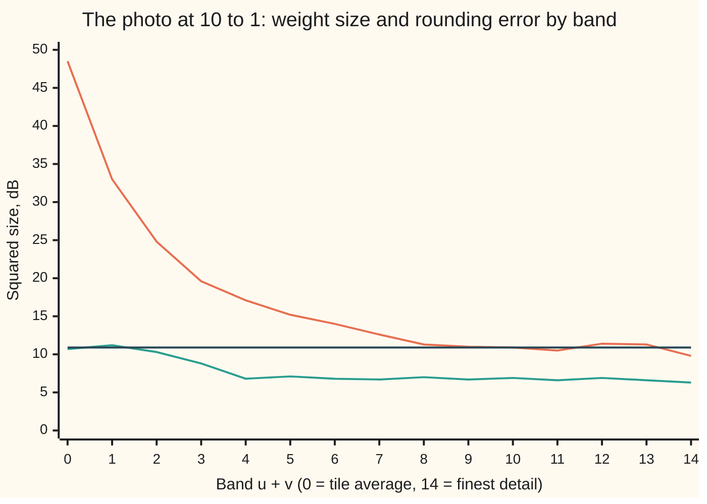
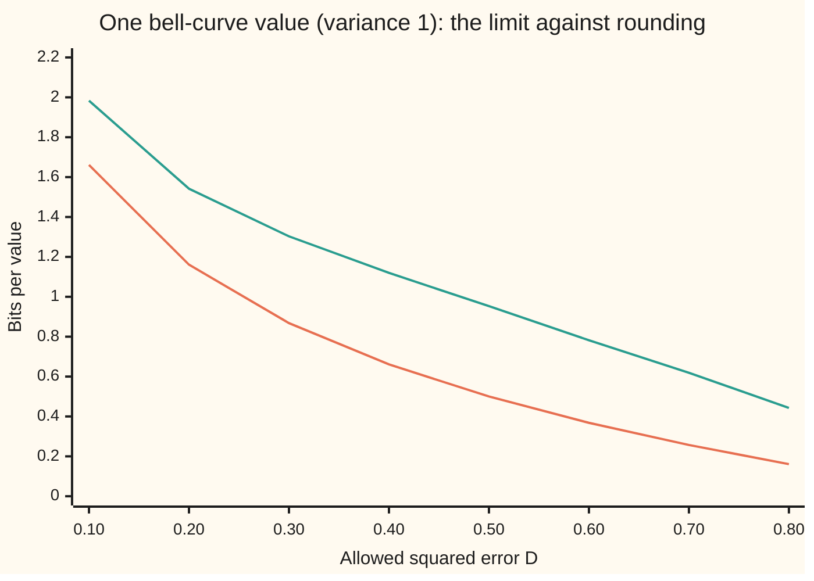

# Rate and distortion: how many bits for a picture you can live with

[Syllabus](../../../SYLLABUS.md) → [Applied and computational](../README.md) → [Information Theory](../README.md#s03) → Rate and distortion

---

## General Overview

A grey photo is 128 by 128 pixels. Each pixel is a brightness from 0 (black) to 255 (white), stored in 8 bits. It shows a lit ball against a shaded wall, with a little sensor grain. The photo is synthetic: it is made by a stated rule and seed, so every number below can be rerun.

The photo has to go out at 10 to 1: 0.8 bits a pixel instead of 8. No lossless code can do that here: the grain is random detail, about 3.06 bits a pixel on its own, and a lossless code such as [Huffman coding](05-source-coding-and-huffman.md) must keep every bit of it. Something must be thrown away. Two questions follow. How few bits can buy a picture that is wrong by no more than a chosen amount? And what does a real compressor throw away to get there?

The run answers the second. The photo is cut into 8 by 8 tiles. Each tile is rewritten as 64 weights on cosine waves, and every weight is rounded to a whole number of steps of size 12.14. Of the 63 detail weights in a tile (all but the tile's average brightness), 90.6% round to zero. Those dropped numbers carried only 4.1% of the detail energy, and most of that was grain. The cost is 0.80 bits a pixel, a ratio of 10.0 to 1, counted as an ideal entropy code would pay it (its code tables not counted). The picture comes back with a mean squared error of 5.64 (grey levels, squared).

**Allowing an average squared error D cuts the fewest bits needed per value to R(D), the rate-distortion function; for a bell-curve source R(D) = ½ log2(σ²/D), so each halving of the error's spread costs one more bit, and a photo compressor gets close by turning pixels into cosine weights, rounding them all with one step, and letting the small ones fall to zero.**

**What kind of fact this is:** a definition (R(D)); a theorem stated with its key steps and a named source (Shannon's rate-distortion theorem: R(D) is the true limit); two theorems proved on this card in Why it works (the bell-curve formula and the water-filling rule); and a method, transform coding, measured on a synthetic photo.

### The picture: what the rounding keeps and what it throws away

A tile's 64 weights sit in slots (u, v): u counts how many half-waves the cosine makes going down the tile, v going across. The band u + v runs from 0, the tile's average brightness, to 14, the finest checkerboard. The chart gives each band's average variance (how much the weight swings from tile to tile) and the squared error left after rounding, both in decibels (dB: ten times the base-10 logarithm, so +10 dB is ten times the size).



The falling line is each band's variance: the energy piles into the first few bands. The middle line is the error left after rounding. The flat line is the step squared over 12, the error a rounded number carries (Step 5 says why). In the coarse bands, the error sits on the flat line: those weights are kept and rounded. In the fine bands, the error drops below it: most of those weights are thrown away, and what they carried was mostly the grain.

---

## The formula

Mutual information I(X; X̂), from [Conditional entropy and mutual information](02-conditional-entropy-and-mutual-information.md), is the number of bits that the copy X̂ tells you about the original X.

$$R(D) \;=\; \min_{\;\text{copies } \hat X \text{ with } E[(X-\hat X)^2] \,\le\, D} \; I(X;\hat X)$$

**Read it aloud:** the rate-distortion function is the smallest amount of information a copy must carry about the original, among all ways of making a copy whose average squared error is at most D.

For one bell-curve value with variance σ², the minimum has a closed form:

$$R(D) = \tfrac12 \log_2 \frac{\sigma^2}{D} \ \text{ for } D < \sigma^2, \qquad R(D) = 0 \ \text{ for } D \ge \sigma^2.$$

For many independent bell-curve values with variances σ_k², the bits are shared by **reverse water-filling**: pick a water level θ, give each value the error min(θ, σ_k²), and pay

$$R = \sum_k \max\!\Big(0,\ \tfrac12 \log_2 \frac{\sigma_k^2}{\theta}\Big), \qquad D = \sum_k \min(\theta, \sigma_k^2).$$

On the photo these sums are averaged over a tile's 64 slots, to give bits and error per pixel.

| Symbol | Plain meaning | In our example | Push it up and the answer… |
| --- | --- | --- | --- |
| $X$ | the original value: one bell-curve number, or one cosine weight | a weight in a tile | — |
| $\hat X$ | "X-hat", the copy the receiver rebuilds | the weight after rounding | — |
| $D$ | the allowed distortion: average squared error between X and X̂ | 0.25 for σ² = 1; 5.64 on the photo | R(D) falls |
| $I(X;\hat X)$ | bits the copy carries about the original | 1 bit for the bell curve at D = 0.25 | — |
| $R(D)$ | rate: the fewest bits per value that keep the error at D | 1 bit at D = 0.25 | — |
| $n$ | how many values are coded together in one block | 1 for a value rounded on its own | the cost can fall towards R(D) |
| $\sigma^2$ | the variance (spread, squared) of the source | 1 | R(D) rises by ½ log2 of the factor |
| $h(\cdot)$ | differential entropy: the bit measure of a continuous spread, ½ log2(2πeσ²) for a bell curve (not the binary entropy h(p) of [Entropy](01-entropy.md)) | used in Step 2 | — |
| $k$, $\sigma_k^2$, $D_k$ | a slot (u, v) of the tile, that slot's variance across tiles, and the error it is allowed | 48.5 dB in band 0 down to 9.8 dB in band 14 | that slot earns more bits |
| $\theta$ | the water level: the error every slot above it is held to | Step 3 | R falls, D rises |
| $\Delta$ | the rounding step | 12.14 | fewer bits, more error |
| $Z$ | in Step 2, the bell-curve error added to the copy to rebuild X | variance D = 0.25 | more error, fewer bits |

### When it holds

- **The error is measured as mean squared error.** Every number here uses squared error. An eye judges blur and blockiness differently, so real codecs weight the slots by how visible each one is; the formula then changes.
- **R(D) is a limit over long blocks.** It is reached only by coding many values together. One value at a time pays more: the best 1-bit code for a single bell-curve value leaves error 0.3634, not 0.25.
- **The bell-curve formula needs a bell curve.** A bell curve is the hardest source of its variance to compress. Treating the photo's 64 slots as bell curves predicts 1.20 bits a pixel at this error; the real photo cost 0.80, because most of its weights are near zero and a few, at the ball's edge, are huge.
- **D must sit below σ².** At D ≥ σ², the receiver can guess the average and send nothing. The formula read past that point gives −0.5 bits at D = 2σ².
- **The transform must keep lengths.** Only an orthonormal transform (one that keeps sums of squares, below) lets error in the weights equal error in the pixels.

---

## Why it works

### Step 0: allowing error lets many pictures share one description

Take n values from a bell curve with variance σ². As a list, they almost always land near the surface of a ball of radius √(nσ²) in n dimensions. A description that is allowed error D only has to name a point within √(nD) of the truth. Each description covers a small ball. Roughly (σ²/D)^(n/2) small balls are needed to cover the big one. Naming one of them takes (n/2) log2(σ²/D) bits: ½ log2(σ²/D) per value. Lossless coding asks for every detail. Lossy coding only asks which small ball.

### Step 1: the theorem, in outline

Shannon proved two halves (1959; full proof in Cover and Thomas, chapter 10, see Sources).

- **No code beats R(D).** Any code at error D makes a copy X̂. The bits sent must be at least the information the copy carries about X, which is at least R(D) by the definition. This half is short and complete in the source.
- **Codes reach R(D) as blocks get long.** Draw a codebook at random from the best copy-making rule, about 2^(nR) entries. With R a little above R(D), some entry lands within the allowed error of almost every source block. This half uses [Typical sequences](04-typical-sequences-and-the-aep.md); the key steps are as stated, and the details are in the source.

It is the mirror of [Channel capacity](07-channel-capacity-and-the-noisy-channel-theorem.md). Capacity is a largest mutual information, over inputs. Rate-distortion is a smallest one, over copies.

### Step 2: the bell-curve case, proved

Lower bound. Differential entropy h is entropy for a continuous value. A bell curve with variance σ² has h = ½ log2(2πeσ²), the largest of any value with that variance. Then

$$I(X;\hat X) = h(X) - h(X \mid \hat X) = h(X) - h(X - \hat X \mid \hat X) \ge h(X) - h(X - \hat X).$$

The error X − X̂ has mean square at most D. So its entropy is at most that of a bell curve with variance D. That gives

$$I(X;\hat X) \ge \tfrac12 \log_2(2\pi e \sigma^2) - \tfrac12 \log_2(2\pi e D) = \tfrac12 \log_2 \frac{\sigma^2}{D}.$$

Reaching the bound. Build the copy X̂ as a bell curve with variance σ² − D, and set X = X̂ + Z, where Z is an independent bell-curve error with variance D. Then X has variance σ², the error is exactly D, and I(X; X̂) = ½ log2(σ²/D). The bound is met, so it is R(D). At σ² = 1 and D = 0.25, that is 1 bit.

The code checks this by a second road. The Blahut-Arimoto algorithm (an iteration that improves the copy-making rule and the copy's distribution in turn until neither changes) knows nothing of the formula. Run on a bell curve cut into 101 grid points, it lands at distortion 0.250000 and rate 0.999992 bits. The formula at that distortion and the grid's own variance gives 0.999992 too.

### Step 3: many bell curves share bits by water-filling

Given independent bell curves with variances σ_k², which should take the error? Each slot's cost ½ log2(σ_k²/D_k) falls at the same rate for every slot when the D_k are equal. So the best split holds every slot at one level θ. A slot whose whole variance is below θ is the exception. Copying it as zero leaves error σ_k² at zero bits, so it is thrown away entirely.

<details>
<summary>Detailed proof: the slots add up, and equal slopes give one water level</summary>

First, why the slots can be costed one at a time. Write X for the whole list of slot values and X̂ for its copy. Independent slots make h(X) the sum of the slots' own h(X_k). The chain rule splits h(X | X̂) slot by slot, and dropping part of what is known never lowers entropy, so h(X | X̂) is at most the sum of the h(X_k | X̂_k). Hence I(X; X̂) is at least the sum of the I(X_k; X̂_k), and by Step 2 each of those is at least ½ log2(σ_k²/D_k), with D_k the error left in slot k. Copying each slot on its own, as in Step 2, meets this bound. So the best code is the best split of D among the slots.

Minimise the sum of ½ log2(σ_k²/D_k) subject to the D_k adding to D and each 0 < D_k ≤ σ_k². Each term is convex in D_k (its slope, −1/(2 D_k ln 2), rises with D_k). For a sum of convex terms under one budget, the minimum has equal slopes in every slot that is not at its limit. Equal slopes mean equal D_k: call it θ. A slot that would need D_k > σ_k² sits at its limit D_k = σ_k², with zero bits. That is min(θ, σ_k²).

</details>

### Step 4: a transform that keeps lengths moves the energy without moving the error

Neighbouring pixels are nearly equal, so a tile carries most of its information in a few smooth patterns. The 8 by 8 cosine transform writes each tile as weights on 64 cosine patterns. Its matrix has perpendicular rows of length 1, so it is orthonormal: like the unitary matrix in [The discrete Fourier transform](../../07-Complex%20analysis/08-Transforms%20in%20Outline/02-discrete-fourier-transform.md), it keeps sums of squares (Parseval). An error made on the weights is the same size as the error it causes in the pixels. The run measures both: 5.638702 on the weights, 5.638702 on the pixels.

The transform throws nothing away. What it does is move the photo's swing into a few slots: band 0 has variance 48.5 dB, band 7 only 12.6 dB.

### Step 5: rounding with one step is rough water-filling, number by number

Each weight is rounded to the nearest multiple of the step Δ. A big weight lands anywhere inside its step. Its error is spread evenly over a width Δ, which has mean square Δ²/12. A weight smaller than half a step rounds to zero. Its error is its own square.

So, roughly, a kept number carries error Δ²/12 and a dropped one its own square. That is Step 3's rule, applied one weight at a time instead of one slot at a time, with Δ²/12 as the water level. The match is rough: a weight between Δ/√12 and Δ/2 is dropped although its square is above the water level, and its error can reach Δ²/4. On the photo, Δ²/12 is 12.29. The kept numbers average error 14.09, close to that. The dropped numbers average 4.66, close to the grain's own variance of 2 squared. The rounding threw the grain away.

This is how the photo beat its bell-curve model. A slot's variance mixes quiet tiles with the few tiles on the ball's edge, so the slot is far from a bell curve. Rounding drops the quiet values and keeps the edges, tile by tile. An ideal entropy code for the rounded numbers, which [Arithmetic and Lempel-Ziv coding](06-arithmetic-and-lempel-ziv-coding.md) comes close to in practice, then pays 0.80 bits a pixel, not the 1.20 that bell curves with the same variances would need.

### Step 6: coding one value at a time costs a fixed gap

R(D) is a limit. A quantiser (a rule that rounds values to a fixed set of levels) that handles one value at a time cannot reach it.

- **One bit per value, fixed.** The best two-level quantiser for a bell curve puts its levels at plus and minus the average size of a value. Its error is 1 − 2/π = 0.3634 (Max, 1960). R(D) promises 0.25 at 1 bit.
- **Uniform rounding plus an entropy code.** At D = 0.25, rounding the bell curve and coding the rounded values ideally costs 1.408 bits, against 1 bit promised. At small D, the gap settles at ½ log2(πe/6) = 0.2546 bits (Gish and Pierce, 1968). The simulation at D = 0.01 measures 0.2655.



The lower line is R(D) = ½ log2(1/D). The upper line is uniform rounding with an ideal entropy code, simulated on 40,000 values. The space between them is what coding long blocks together can still win back.

---

## Worked numbers, by hand

| Step | Arithmetic | Value |
| --- | --- | --- |
| bell curve, σ² = 1, allowed D = 0.25 | ½ log2(1 / 0.25) = ½ log2 4 | 1 bit |
| best one-value 1-bit code | 1 − 2/π | 0.3634 |
| rounding plus entropy code at D = 0.25 | simulated, 40,000 values | 1.408 bits |
| photo: step for 0.8 bits a pixel | found by halving an interval | Δ = 12.14 |
| bits per pixel | ideal code for the rounded weights | 0.80 |
| compression ratio | 8 / 0.799857 | 10.0 to 1 |
| squared error per pixel | measured on weights and on pixels | 5.64 |
| PSNR, peak signal to noise | 10 × log10(255² / 5.638702) | 40.6 dB |
| one tile on the ball's edge (x 48–55, y 48–55): average weight | 1577.25 / Δ = 129.87, rounded | 130 steps: kept |
| that tile's largest detail weight, slot (0, 1) | −240.25 / Δ = −19.78, rounded | −20 steps: kept |
| that tile's largest dropped weight, slot (1, 0) | −5.29 / Δ = −0.44, rounded | 0: thrown away |
| that tile's detail weights rounded to 0 | count | 55 of 63 |
| detail weights dropped, whole photo | count of zeros / (63 × 256) | 90.6% |
| **detail energy those carried** | **squared size of the zeros / all detail** | **4.1%** |

At 10 to 1, the photo loses nine detail weights in ten but keeps nearly all of the detail energy; the error it leaves is about the size of the grain.

### What breaks if you drop a piece

| Mistake | Comes out at | What went wrong |
| --- | --- | --- |
| No transform: round the pixels to reach 0.8 bits a pixel | error 679.5, PSNR 19.8 dB | Pixels share their energy evenly, so there are no small numbers to drop; the step has to be coarse everywhere |
| Fixed-length indices instead of an entropy code | 5.03 bits a pixel | Every index gets enough bits to name every value that occurs, so the 90.6% zeros cost as many bits as the edges |
| The formula read at D = 2σ² | −0.5 bits | The hypothesis D < σ² fails; the right answer is 0 bits: send nothing, guess the average |
| A one-value 1-bit code read as the bound | 0.3634, not 0.25 | R(D) is a limit over long blocks, not a promise for one value |

---

## Code, from first principles, and it actually runs

The script takes three roads. One: the bell-curve formula against Blahut-Arimoto, which finds R(D) by iteration without the formula. Two: 40,000 simulated bell-curve values from a written-out SplitMix64 generator (seed 20261111), rounded and entropy-counted, checked against the high-rate gap ½ log2(πe/6), with the best 1-bit code checked against 1 − 2/π. Three: the synthetic photo (seed 7), coded at 0.8 bits a pixel, with its error measured once on the weights and once on the rebuilt pixels. Its step is rounded up to six decimals, so no weight sits exactly half a step from a level, where the last bit of the arithmetic would decide its rounding. The grain's own entropy, measured on the photo, meets a bell curve's ½ log2(2πe·2²). Nothing imported holds the answer: the cosine matrix is written out, and entropy is counted from tables.

### Python

```python
# Rate and distortion -- the check behind the card.  Standard library only.
# A synthetic 128 x 128 grey photo is cut into 8 x 8 blocks, cosine-transformed,
# rounded with one step size and entropy-counted until it costs 0.8 bits a pixel.
# Roads: the bell-curve R(D) formula against Blahut-Arimoto; a simulated quantiser
# against the bound; pixel error against coefficient error (Parseval).
import math
M64 = 0xFFFFFFFFFFFFFFFF

class Rng:                                     # SplitMix64, written out
    def __init__(s, seed): s.s = seed
    def u(s):
        s.s = (s.s + 0x9E3779B97F4A7C15) & M64; z = s.s
        z = ((z ^ (z >> 30)) * 0xBF58476D1CE4E5B9) & M64; z = ((z ^ (z >> 27)) * 0x94D049BB133111EB) & M64
        return ((z ^ (z >> 31)) >> 11) / 9007199254740992.0
    def gauss(s):                              # Box-Muller, cosine half
        a = 1.0 - s.u(); b = s.u()
        return math.sqrt(-2.0 * math.log(a)) * math.cos(2.0 * math.pi * b)

def entropy(xs):                               # bits per symbol, ideal code for xs's own table
    c, t = {}, 0.0
    for x in xs: c[x] = c.get(x, 0) + 1
    for k in sorted(c): t -= c[k] / len(xs) * math.log2(c[k] / len(xs))
    return t
def q(x, d): return math.floor(x / d + 0.5)    # uniform quantiser: index of the nearest step
def bisect(f, lo, hi, target):                 # f rises with its argument
    for _ in range(50):
        mid = (lo + hi) / 2
        if f(mid) < target: lo = mid
        else: hi = mid
    return (lo + hi) / 2
def show(label, x): print(f"{label:<44}{x:>12.6f}")
def row(label, xs, fmt): print(f"{label:<22}" + "".join(format(x, fmt) for x in xs))

# ---- one bell-curve number, sigma = 1: R(D) = 1/2 log2(1/D) ----
show("R(0.25) by the formula, bits", 0.5 * math.log2(1 / 0.25))
xs = [-5 + 0.1 * i for i in range(101)]        # Blahut-Arimoto on a gridded bell curve
p = [math.exp(-x * x / 2) for x in xs]; tot = sum(p); p = [a / tot for a in p]
var = sum(a * x * x for a, x in zip(p, xs))
A = [[math.exp(-2.0 * (x - y) ** 2) for y in xs] for x in xs]   # slope 2 aims at D = 0.25
r = [1 / 101] * 101
for _ in range(400):
    W = [[r[j] * A[i][j] for j in range(101)] for i in range(101)]
    W = [[w / t for w in wr] for wr in W for t in [sum(wr)]]
    r = [sum(p[i] * W[i][j] for i in range(101)) for j in range(101)]
D_ba = sum(p[i] * W[i][j] * (xs[i] - xs[j]) ** 2 for i in range(101) for j in range(101))
R_ba = sum(p[i] * W[i][j] * math.log2(W[i][j] / r[j]) for i in range(101) for j in range(101) if W[i][j] > 0)
show("Blahut-Arimoto: distortion", D_ba)
show("Blahut-Arimoto: rate, bits", R_ba)
show("formula at that distortion, bits", 0.5 * math.log2(var / D_ba))
assert abs(R_ba - 0.5 * math.log2(var / D_ba)) < 1e-5 and abs(D_ba - 0.25) < 0.01
show("weather: spread 4 C, error 1 C, bits a day", 0.5 * math.log2(4 ** 2 / 1 ** 2))

g = Rng(20261111); N = 40000
z = [g.gauss() for _ in range(N)]
m = sum(abs(x) for x in z) / N                 # best 1-bit quantiser: levels at +-mean|x|
D_lm = sum((abs(x) - m) ** 2 for x in z) / N
show("1 bit, one at a time: distortion, simulated", D_lm)
show("1 bit, one at a time: 1 - 2/pi", 1 - 2 / math.pi)
assert abs(D_lm - (1 - 2 / math.pi)) < 0.01
def mse(d): return sum((x - d * q(x, d)) ** 2 for x in z) / N
def H_at(D): d = bisect(mse, 0.01, 5.0, D); return entropy([q(x, d) for x in z])
Ds = [0.1, 0.2, 0.3, 0.4, 0.5, 0.6, 0.7, 0.8]
H_sq = [H_at(D) for D in Ds]
row("chart, D", Ds, ">7.2f")
row("chart, R(D)", [0.5 * math.log2(1 / D) for D in Ds], ">7.3f")
row("chart, rounding", H_sq, ">7.3f")
assert all(h > 0.5 * math.log2(1 / D) for h, D in zip(H_sq, Ds))
show("rounding plus entropy code at D = 0.25", H_at(0.25))
gap = H_at(0.01) - 0.5 * math.log2(1 / 0.01)
show("gap above R(D) at D = 0.01, simulated", gap)
show("gap, high-rate theory 1/2 log2(pi e / 6)", 0.5 * math.log2(math.pi * math.e / 6))
assert abs(gap - 0.5 * math.log2(math.pi * math.e / 6)) < 0.03

# ---- the photo: synthetic 128 x 128, 8-bit grey: a lit ball on a shaded wall, plus grain ----
S = 128; g = Rng(7)
def base(x, y): return (100.5 + 25 * x / 127 + 45 * math.sin(x / 11) * math.cos(y / 17)
                        + (70 if (x - 80) ** 2 + (y - 52) ** 2 < 900 else 0))           # the photo before its grain
img = [[min(255, max(0, math.floor(base(x, y) + 2 * g.gauss()))) for x in range(S)] for y in range(S)]
C = [[(math.sqrt(1 / 8) if k == 0 else 0.5) * math.cos(math.pi * (2 * n + 1) * k / 16) for n in range(8)] for k in range(8)]
T = [list(c) for c in zip(*C)]
def mul(a, b): return [[sum(a[i][k] * b[k][j] for k in range(8)) for j in range(8)] for i in range(8)]
blocks = [[ln[bx:bx + 8] for ln in img[by:by + 8]] for by in range(0, S, 8) for bx in range(0, S, 8)]
coef = [mul(mul(C, b), T) for b in blocks]     # Y = C X C^T, orthonormal
UV = [(u, v) for u in range(8) for v in range(8)]
def rate(d):                                   # bits per pixel: one table for slot (0,0), one for the 63 others
    dc = [q(Y[0][0], d) for Y in coef]
    ac = [q(Y[u][v], d) for Y in coef for u, v in UV if u + v > 0]
    return (len(dc) * entropy(dc) + len(ac) * entropy(ac)) / (S * S)
step = math.ceil(bisect(lambda d: -rate(d), 1, 200, -0.8) * 1e6) / 1e6   # rounded up: no weight sits on a half step
show("step size for 0.8 bits a pixel", step)
show("bits per pixel", rate(step))
show("compression ratio, 8 bits / that", 8 / rate(step))
assert abs(rate(step) - 0.8) < 0.005
Yq = [[[step * q(Y[u][v], step) for v in range(8)] for u in range(8)] for Y in coef]
err_c = sum((Y[u][v] - Z[u][v]) ** 2 for Y, Z in zip(coef, Yq) for u, v in UV) / (S * S)
rec = [mul(mul(T, Z), C) for Z in Yq]          # X = C^T Y C
err_p = sum((b[i][j] - x[i][j]) ** 2 for b, x in zip(blocks, rec) for i, j in UV) / (S * S)
show("mean squared error, coefficients", err_c)
show("mean squared error, pixels", err_p)
show("PSNR, dB", 10 * math.log10(255 ** 2 / err_p))
assert abs(err_c - err_p) < 1e-9 * err_p
drop = [Y[u][v] ** 2 for Y, Z in zip(coef, Yq) for u, v in UV if u + v > 0 and Z[u][v] == 0]
kept = [(Y[u][v] - Z[u][v]) ** 2 for Y, Z in zip(coef, Yq) for u, v in UV if u + v > 0 and Z[u][v] != 0]
energy = sum(Y[u][v] ** 2 for Y in coef for u, v in UV if u + v > 0)
show("share of the 63 x 256 detail numbers dropped", len(drop) / (63 * len(coef)))
show("share of the detail energy they carried", sum(drop) / energy)
show("mean squared error of a dropped number", sum(drop) / len(drop))
show("mean squared error of a kept number", sum(kept) / len(kept))
show("step^2 / 12", step * step / 12)
Y0 = coef[6 * 16 + 6]; det = [(Y0[u][v], u, v) for u, v in UV if u + v > 0]     # a tile on the ball's left edge
pick = [(Y0[0][0], 0, 0), max(det, key=lambda t: abs(t[0])), max((t for t in det if q(t[0], step) == 0), key=lambda t: abs(t[0]))]
print("tile x 48-55, y 48-55: " + "; ".join(f"({u},{v}) {w:.2f} / step = {w / step:.2f} -> {q(w, step)}" for w, u, v in pick)
      + f"; details rounded to 0: {sum(q(w, step) == 0 for w, u, v in det)} of 63")
mean = [[sum(Y[u][v] for Y in coef) / len(coef) for v in range(8)] for u in range(8)]
vs = [sum((Y[u][v] - mean[u][v]) ** 2 for Y in coef) / len(coef) for u, v in UV]
th = bisect(lambda t: sum(min(t, s) for s in vs) / 64, 0, max(vs), err_p)
show("bell-curve model of the 64 slots, bits/pixel", sum(max(0, 0.5 * math.log2(s / th)) for s in vs) / 64)
db = lambda vals: [10 * math.log10(sum(x for x, (u, v) in zip(vals, UV) if u + v == b) / (min(b, 14 - b) + 1)) for b in range(15)]
row("chart, band u+v", range(15), ">6")
row("chart, variance dB", db(vs), ">6.1f")
row("chart, error dB", db([sum((Y[u][v] - Z[u][v]) ** 2 for Y, Z in zip(coef, Yq)) / len(coef) for u, v in UV]), ">6.1f")
show("chart, step^2/12 in dB", 10 * math.log10(step * step / 12))

# ---- what breaks ----
pix = [v for ln in img for v in ln]
pstep = bisect(lambda d: -entropy([q(v, d) for v in pix]), 1, 200, -0.8)
perr = sum((v - pstep * q(v, pstep)) ** 2 for v in pix) / len(pix)
show("wrong: no transform, error at 0.8 bits", perr)
show("wrong: no transform, PSNR dB", 10 * math.log10(255 ** 2 / perr))
assert perr > 10 * err_p
grain = entropy([v - math.floor(base(x, y)) for y, ln in enumerate(img) for x, v in enumerate(ln)])
show("lossless: grain alone, measured, bits/pixel", grain)
show("lossless: 1/2 log2(2 pi e 2^2), bits/pixel", 0.5 * math.log2(2 * math.pi * math.e * 4))
assert abs(grain - 0.5 * math.log2(2 * math.pi * math.e * 4)) < 0.05
lv = lambda xs: math.ceil(math.log2(len(set(xs))))
fixed = (lv([q(Y[0][0], step) for Y in coef]) + 63 * lv([q(Y[u][v], step) for Y in coef for u, v in UV if u + v > 0])) / 64
show("wrong: fixed-length indices, bits/pixel", fixed)
show("wrong: formula at D = 2 sigma^2, bits", 0.5 * math.log2(1 / 2))
print("ALL CHECKS PASS")
```

**Ran 2026-11-11 on macOS, Python 3.14.10, standard library only. All checks passed. Output, pasted from the run:**

```
R(0.25) by the formula, bits                    1.000000
Blahut-Arimoto: distortion                      0.250000
Blahut-Arimoto: rate, bits                      0.999992
formula at that distortion, bits                0.999992
weather: spread 4 C, error 1 C, bits a day      2.000000
1 bit, one at a time: distortion, simulated     0.364310
1 bit, one at a time: 1 - 2/pi                  0.363380
chart, D                 0.10   0.20   0.30   0.40   0.50   0.60   0.70   0.80
chart, R(D)             1.661  1.161  0.868  0.661  0.500  0.368  0.257  0.161
chart, rounding         1.983  1.542  1.303  1.120  0.953  0.782  0.619  0.443
rounding plus entropy code at D = 0.25          1.408150
gap above R(D) at D = 0.01, simulated           0.265487
gap, high-rate theory 1/2 log2(pi e / 6)        0.254614
step size for 0.8 bits a pixel                 12.144667
bits per pixel                                  0.799857
compression ratio, 8 bits / that               10.001793
mean squared error, coefficients                5.638702
mean squared error, pixels                      5.638702
PSNR, dB                                       40.619012
share of the 63 x 256 detail numbers dropped    0.906250
share of the detail energy they carried         0.041292
mean squared error of a dropped number          4.657584
mean squared error of a kept number            14.089235
step^2 / 12                                    12.291078
tile x 48-55, y 48-55: (0,0) 1577.25 / step = 129.87 -> 130; (0,1) -240.25 / step = -19.78 -> -20; (1,0) -5.29 / step = -0.44 -> 0; details rounded to 0: 55 of 63
bell-curve model of the 64 slots, bits/pixel    1.200252
chart, band u+v            0     1     2     3     4     5     6     7     8     9    10    11    12    13    14
chart, variance dB      48.5  33.0  24.8  19.6  17.1  15.2  14.0  12.6  11.3  11.0  10.9  10.5  11.4  11.3   9.8
chart, error dB         10.7  11.2  10.3   8.8   6.8   7.1   6.8   6.7   7.0   6.7   6.9   6.6   6.9   6.6   6.3
chart, step^2/12 in dB                         10.895900
wrong: no transform, error at 0.8 bits        679.466248
wrong: no transform, PSNR dB                   19.809125
lossless: grain alone, measured, bits/pixel     3.064553
lossless: 1/2 log2(2 pi e 2^2), bits/pixel      3.047096
wrong: fixed-length indices, bits/pixel         5.031250
wrong: formula at D = 2 sigma^2, bits          -0.500000
ALL CHECKS PASS
```

### Rust

```rust
// Rate and distortion -- the check behind the card.  std only, no crates.
// A synthetic 128 x 128 grey photo is cut into 8 x 8 blocks, cosine-transformed,
// rounded with one step size and entropy-counted until it costs 0.8 bits a pixel.
// Roads: the bell-curve R(D) formula against Blahut-Arimoto; a simulated quantiser
// against the bound; pixel error against coefficient error (Parseval).
use std::collections::{BTreeMap, BTreeSet};
use std::f64::consts::{E, PI};

struct Rng(u64); // SplitMix64, written out
impl Rng {
    fn u(&mut self) -> f64 {
        self.0 = self.0.wrapping_add(0x9E3779B97F4A7C15); let mut z = self.0;
        z = (z ^ (z >> 30)).wrapping_mul(0xBF58476D1CE4E5B9); z = (z ^ (z >> 27)).wrapping_mul(0x94D049BB133111EB);
        ((z ^ (z >> 31)) >> 11) as f64 / 9007199254740992.0
    }
    fn gauss(&mut self) -> f64 { let a = 1.0 - self.u(); (-2.0 * a.ln()).sqrt() * (2.0 * PI * self.u()).cos() } // Box-Muller
}
fn entropy(xs: &[i64]) -> f64 { // bits per symbol, ideal code for xs's own table
    let mut c = BTreeMap::new();
    for &x in xs { *c.entry(x).or_insert(0usize) += 1; }
    let n = xs.len() as f64;
    c.values().fold(0.0, |t, &k| t - k as f64 / n * (k as f64 / n).log2())
}
fn q(x: f64, d: f64) -> i64 { (x / d + 0.5).floor() as i64 } // index of the nearest step
fn bisect(f: &dyn Fn(f64) -> f64, mut lo: f64, mut hi: f64, target: f64) -> f64 {
    for _ in 0..50 { let mid = (lo + hi) / 2.0; if f(mid) < target { lo = mid } else { hi = mid } }
    (lo + hi) / 2.0
}
fn show(label: &str, x: f64) { println!("{:<44}{:>12.6}", label, x); }
fn row(label: &str, xs: &[f64], w: usize, p: usize) {
    let s: String = xs.iter().map(|x| format!("{:>w$.p$}", x, w = w, p = p)).collect(); println!("{:<22}{}", label, s);
}
type M = [[f64; 8]; 8];
fn mul(a: &M, b: &M) -> M {
    let mut c = [[0.0; 8]; 8];
    for i in 0..8 { for j in 0..8 { for k in 0..8 { c[i][j] += a[i][k] * b[k][j]; } } } c
}
fn main() {
    // ---- one bell-curve number, sigma = 1: R(D) = 1/2 log2(1/D) ----
    show("R(0.25) by the formula, bits", 0.5 * (1.0f64 / 0.25).log2());
    let xs: Vec<f64> = (0..101).map(|i| -5.0 + 0.1 * i as f64).collect();
    let mut p: Vec<f64> = xs.iter().map(|x| (-x * x / 2.0).exp()).collect();
    let tot: f64 = p.iter().sum(); for a in p.iter_mut() { *a /= tot; }
    let var: f64 = p.iter().zip(&xs).map(|(a, x)| a * x * x).sum();
    let a: Vec<Vec<f64>> = xs.iter().map(|x| xs.iter().map(|y| (-2.0 * (x - y).powi(2)).exp()).collect()).collect();
    let (mut r, mut w) = (vec![1.0 / 101.0; 101], vec![vec![0.0; 101]; 101]);
    for _ in 0..400 {
        for i in 0..101 {
            for j in 0..101 { w[i][j] = r[j] * a[i][j]; }
            let t: f64 = w[i].iter().sum();
            for j in 0..101 { w[i][j] /= t; }
        }
        r = (0..101).map(|j| (0..101).map(|i| p[i] * w[i][j]).sum()).collect();
    }
    let (mut d_ba, mut r_ba) = (0.0, 0.0);
    for i in 0..101 { for j in 0..101 {
        d_ba += p[i] * w[i][j] * (xs[i] - xs[j]).powi(2);
        if w[i][j] > 0.0 { r_ba += p[i] * w[i][j] * (w[i][j] / r[j]).log2(); }
    } }
    show("Blahut-Arimoto: distortion", d_ba);
    show("Blahut-Arimoto: rate, bits", r_ba);
    show("formula at that distortion, bits", 0.5 * (var / d_ba).log2());
    assert!((r_ba - 0.5 * (var / d_ba).log2()).abs() < 1e-5 && (d_ba - 0.25).abs() < 0.01);
    show("weather: spread 4 C, error 1 C, bits a day", 0.5 * (4.0f64.powi(2) / 1.0f64.powi(2)).log2());

    let (mut g, n) = (Rng(20261111), 40000);
    let z: Vec<f64> = (0..n).map(|_| g.gauss()).collect();
    let m = z.iter().map(|x| x.abs()).sum::<f64>() / n as f64; // best 1-bit quantiser: +-mean|x|
    let d_lm = z.iter().map(|x| (x.abs() - m).powi(2)).sum::<f64>() / n as f64;
    show("1 bit, one at a time: distortion, simulated", d_lm);
    show("1 bit, one at a time: 1 - 2/pi", 1.0 - 2.0 / PI);
    assert!((d_lm - (1.0 - 2.0 / PI)).abs() < 0.01);
    let mse = |d: f64| z.iter().map(|&x| (x - d * q(x, d) as f64).powi(2)).sum::<f64>() / n as f64;
    let h_at = |dd: f64| { let d = bisect(&mse, 0.01, 5.0, dd); entropy(&z.iter().map(|&x| q(x, d)).collect::<Vec<_>>()) };
    let ds = [0.1, 0.2, 0.3, 0.4, 0.5, 0.6, 0.7, 0.8];
    let h_sq: Vec<f64> = ds.iter().map(|&d| h_at(d)).collect();
    row("chart, D", &ds, 7, 2);
    row("chart, R(D)", &ds.iter().map(|d| 0.5 * (1.0 / d).log2()).collect::<Vec<_>>(), 7, 3);
    row("chart, rounding", &h_sq, 7, 3);
    assert!(h_sq.iter().zip(&ds).all(|(h, d)| *h > 0.5 * (1.0 / d).log2()));
    show("rounding plus entropy code at D = 0.25", h_at(0.25));
    let (gap, theory) = (h_at(0.01) - 0.5 * (1.0f64 / 0.01).log2(), 0.5 * (PI * E / 6.0).log2());
    show("gap above R(D) at D = 0.01, simulated", gap);
    show("gap, high-rate theory 1/2 log2(pi e / 6)", theory);
    assert!((gap - theory).abs() < 0.03);

    // ---- the photo: synthetic 128 x 128, 8-bit grey: a lit ball on a shaded wall, plus grain ----
    let (s, mut g) = (128usize, Rng(7));
    let mut img = vec![vec![0.0f64; s]; s];
    let base = |x: usize, y: usize| { let (xf, yf) = (x as f64, y as f64);   // the photo before its grain
        100.5 + 25.0 * xf / 127.0 + 45.0 * (xf / 11.0).sin() * (yf / 17.0).cos() + if (xf - 80.0).powi(2) + (yf - 52.0).powi(2) < 900.0 { 70.0 } else { 0.0 } };
    for y in 0..s { for x in 0..s { img[y][x] = (base(x, y) + 2.0 * g.gauss()).floor().max(0.0).min(255.0); } }
    let (mut c, mut t): (M, M) = ([[0.0; 8]; 8], [[0.0; 8]; 8]);
    for k in 0..8 { for i in 0..8 {
        c[k][i] = if k == 0 { (1.0f64 / 8.0).sqrt() } else { 0.5 } * (PI * (2 * i + 1) as f64 * k as f64 / 16.0).cos();
        t[i][k] = c[k][i];
    } }
    let blocks: Vec<M> = (0..256).map(|k| { let mut b = [[0.0; 8]; 8];
        for i in 0..8 { for j in 0..8 { b[i][j] = img[k / 16 * 8 + i][k % 16 * 8 + j]; } } b }).collect();
    let coef: Vec<M> = blocks.iter().map(|b| mul(&mul(&c, b), &t)).collect(); // Y = C X C^T
    let uv: Vec<(usize, usize)> = (0..64).map(|k| (k / 8, k % 8)).collect();
    let px = (s * s) as f64;
    let rate = |d: f64| {
        let dc: Vec<i64> = coef.iter().map(|y| q(y[0][0], d)).collect();
        let ac: Vec<i64> = coef.iter().flat_map(|y| uv[1..].iter().map(move |&(u, v)| q(y[u][v], d))).collect();
        (dc.len() as f64 * entropy(&dc) + ac.len() as f64 * entropy(&ac)) / px
    };
    let step = (bisect(&|d| -rate(d), 1.0, 200.0, -0.8) * 1e6).ceil() / 1e6;   // rounded up: no weight sits on a half step
    show("step size for 0.8 bits a pixel", step);
    show("bits per pixel", rate(step));
    show("compression ratio, 8 bits / that", 8.0 / rate(step));
    assert!((rate(step) - 0.8).abs() < 0.005);
    let yq: Vec<M> = coef.iter().map(|y| { let mut zq = *y; for &(u, v) in &uv { zq[u][v] = step * q(y[u][v], step) as f64; } zq }).collect();
    let (mut err_c, mut err_p, mut drop, mut kept, mut energy, mut nd, mut nk) = (0.0, 0.0, 0.0, 0.0, 0.0, 0usize, 0usize);
    let mut slot_err = [0.0f64; 64];
    for (k, (y, zq)) in coef.iter().zip(&yq).enumerate() {
        let x = mul(&mul(&t, zq), &c); // X = C^T Y C
        for (l, &(u, v)) in uv.iter().enumerate() {
            let e = (y[u][v] - zq[u][v]).powi(2);
            err_c += e; err_p += (blocks[k][u][v] - x[u][v]).powi(2); slot_err[l] += e / 256.0;
            if l > 0 { energy += y[u][v].powi(2); if zq[u][v] == 0.0 { drop += e; nd += 1 } else { kept += e; nk += 1 } }
        }
    }
    let (err_c, err_p, nb) = (err_c / px, err_p / px, coef.len() as f64);
    show("mean squared error, coefficients", err_c);
    show("mean squared error, pixels", err_p);
    show("PSNR, dB", 10.0 * (255.0f64.powi(2) / err_p).log10());
    assert!((err_c - err_p).abs() < 1e-9 * err_p);
    show("share of the 63 x 256 detail numbers dropped", nd as f64 / (63 * coef.len()) as f64);
    show("share of the detail energy they carried", drop / energy);
    show("mean squared error of a dropped number", drop / nd as f64);
    show("mean squared error of a kept number", kept / nk as f64);
    show("step^2 / 12", step * step / 12.0);
    let y0 = &coef[6 * 16 + 6]; let det: Vec<(f64, usize, usize)> = uv[1..].iter().map(|&(u, v)| (y0[u][v], u, v)).collect();   // a tile on the ball's left edge
    let big = |only0: bool| det.iter().filter(|t| !only0 || q(t.0, step) == 0).fold((0.0f64, 0, 0), |a, &t| if t.0.abs() > a.0.abs() { t } else { a });
    println!("tile x 48-55, y 48-55: {}; details rounded to 0: {} of 63", [(y0[0][0], 0, 0), big(false), big(true)].iter().map(|&(w, u, v)| format!("({},{}) {:.2} / step = {:.2} -> {}", u, v, w, w / step, q(w, step))).collect::<Vec<_>>().join("; "), det.iter().filter(|t| q(t.0, step) == 0).count());
    let vs: Vec<f64> = uv.iter().map(|&(u, v)| {
        let mean = coef.iter().map(|y| y[u][v]).sum::<f64>() / nb;
        coef.iter().map(|y| (y[u][v] - mean).powi(2)).sum::<f64>() / nb
    }).collect();
    let vmax = vs.iter().cloned().fold(0.0, f64::max);
    let th = bisect(&|t| vs.iter().map(|&s| s.min(t)).sum::<f64>() / 64.0, 0.0, vmax, err_p);
    show("bell-curve model of the 64 slots, bits/pixel", vs.iter().map(|&s| (0.5 * (s / th).log2()).max(0.0)).sum::<f64>() / 64.0);
    let db = |vals: &[f64]| -> Vec<f64> { (0..15).map(|b| {
        let tot: f64 = vals.iter().zip(&uv).filter(|(_, &(u, v))| u + v == b).map(|(x, _)| x).sum();
        10.0 * (tot / (b.min(14 - b) + 1) as f64).log10() }).collect() };
    println!("{:<22}{}", "chart, band u+v", (0..15).map(|b| format!("{:>6}", b)).collect::<String>());
    row("chart, variance dB", &db(&vs), 6, 1);
    row("chart, error dB", &db(&slot_err), 6, 1);
    show("chart, step^2/12 in dB", 10.0 * (step * step / 12.0).log10());

    // ---- what breaks ----
    let pix: Vec<f64> = img.iter().flatten().cloned().collect();
    let pstep = bisect(&|d| -entropy(&pix.iter().map(|&v| q(v, d)).collect::<Vec<_>>()), 1.0, 200.0, -0.8);
    let perr = pix.iter().map(|&v| (v - pstep * q(v, pstep) as f64).powi(2)).sum::<f64>() / px;
    show("wrong: no transform, error at 0.8 bits", perr);
    show("wrong: no transform, PSNR dB", 10.0 * (255.0f64.powi(2) / perr).log10());
    assert!(perr > 10.0 * err_p);
    let grain = entropy(&(0..s * s).map(|k| (img[k / s][k % s] - base(k % s, k / s).floor()) as i64).collect::<Vec<_>>());
    show("lossless: grain alone, measured, bits/pixel", grain);
    show("lossless: 1/2 log2(2 pi e 2^2), bits/pixel", 0.5 * (2.0 * PI * E * 4.0).log2());
    assert!((grain - 0.5 * (2.0 * PI * E * 4.0).log2()).abs() < 0.05);
    let lv = |xs: Vec<i64>| (xs.into_iter().collect::<BTreeSet<_>>().len() as f64).log2().ceil();
    let fixed = (lv(coef.iter().map(|y| q(y[0][0], step)).collect())
        + 63.0 * lv(coef.iter().flat_map(|y| uv[1..].iter().map(move |&(u, v)| q(y[u][v], step))).collect())) / 64.0;
    show("wrong: fixed-length indices, bits/pixel", fixed);
    show("wrong: formula at D = 2 sigma^2, bits", 0.5 * (0.5f64).log2());
    println!("ALL CHECKS PASS");
}
```

**Ran 2026-11-11 on macOS, rustc 1.98.1, no crates. All checks passed. Output, pasted from the run:**

```
R(0.25) by the formula, bits                    1.000000
Blahut-Arimoto: distortion                      0.250000
Blahut-Arimoto: rate, bits                      0.999992
formula at that distortion, bits                0.999992
weather: spread 4 C, error 1 C, bits a day      2.000000
1 bit, one at a time: distortion, simulated     0.364310
1 bit, one at a time: 1 - 2/pi                  0.363380
chart, D                 0.10   0.20   0.30   0.40   0.50   0.60   0.70   0.80
chart, R(D)             1.661  1.161  0.868  0.661  0.500  0.368  0.257  0.161
chart, rounding         1.983  1.542  1.303  1.120  0.953  0.782  0.619  0.443
rounding plus entropy code at D = 0.25          1.408150
gap above R(D) at D = 0.01, simulated           0.265487
gap, high-rate theory 1/2 log2(pi e / 6)        0.254614
step size for 0.8 bits a pixel                 12.144667
bits per pixel                                  0.799857
compression ratio, 8 bits / that               10.001793
mean squared error, coefficients                5.638702
mean squared error, pixels                      5.638702
PSNR, dB                                       40.619012
share of the 63 x 256 detail numbers dropped    0.906250
share of the detail energy they carried         0.041292
mean squared error of a dropped number          4.657584
mean squared error of a kept number            14.089235
step^2 / 12                                    12.291078
tile x 48-55, y 48-55: (0,0) 1577.25 / step = 129.87 -> 130; (0,1) -240.25 / step = -19.78 -> -20; (1,0) -5.29 / step = -0.44 -> 0; details rounded to 0: 55 of 63
bell-curve model of the 64 slots, bits/pixel    1.200252
chart, band u+v            0     1     2     3     4     5     6     7     8     9    10    11    12    13    14
chart, variance dB      48.5  33.0  24.8  19.6  17.1  15.2  14.0  12.6  11.3  11.0  10.9  10.5  11.4  11.3   9.8
chart, error dB         10.7  11.2  10.3   8.8   6.8   7.1   6.8   6.7   7.0   6.7   6.9   6.6   6.9   6.6   6.3
chart, step^2/12 in dB                         10.895900
wrong: no transform, error at 0.8 bits        679.466248
wrong: no transform, PSNR dB                   19.809125
lossless: grain alone, measured, bits/pixel     3.064553
lossless: 1/2 log2(2 pi e 2^2), bits/pixel      3.047096
wrong: fixed-length indices, bits/pixel         5.031250
wrong: formula at D = 2 sigma^2, bits          -0.500000
ALL CHECKS PASS
```

The two outputs match line for line. Blahut-Arimoto meets the formula to six decimals. The simulated gap, 0.2655, sits within the 0.03 the assert allows of the high-rate value 0.2546. The photo's error is the same on the weights and on the pixels to every printed digit.

> [!TIP]
> **Try changing**
> Guess first, then run it. The asserts are pinned to the card's numbers, so some changes stop the script partway.
> - **Remove the grain.** Change `2 * g.gauss()` to `0 * g.gauss()` in the photo rule. Guess what 10 to 1 now costs in quality. PSNR rises to 44.98 dB, and the dropped numbers' error falls to 1.01: with no grain to throw away, the step can be finer. The grain line then reads 0 bits, and its assert stops the script.
> - **Ask for 20 to 1.** In the line that sets `step`, change the target `-0.8` to `-0.4`, and the `0.8` in the next rate assert to `0.4`. Guess the PSNR. The step grows to 31.52, 96.0% of the detail weights drop, and PSNR falls to 36.62 dB.
> - **Tighten the bell-curve error.** In Blahut-Arimoto, change `math.exp(-2.0 *` to `math.exp(-8.0 *`. Guess the rate. Distortion 0.0625 and 1.999991 bits: a quarter of the error costs one more bit.
> - **Shrink the simulation.** Set `N = 4000`. The 1-bit error comes out 0.3494, more than 0.01 from 0.3634, and the assert stops the script: fewer values, wider scatter.

---

## The usual mistake

> [!warning]
> **Reading R(D) as what a codec achieves.** It is a limit for long blocks of a source with known statistics. A single value, rounded on its own, pays about a quarter of a bit more at high rate (0.2655 measured, 0.2546 in theory). A real photo is not a bell curve either, so the bell-curve figure can be too high (1.20 bits a pixel predicted, 0.80 spent).
>
> - **Measuring the error after a transform that does not keep lengths.** Only an orthonormal transform makes the weights' error equal the pixels' error (5.638702 both ways here). Scale the transform and the two drift apart.
> - **Forgetting the entropy code.** The zeros are what make lossy coding cheap. With fixed-length indices, this photo costs 5.03 bits a pixel, not 0.80.
> - **Using the formula above σ².** At D = 2σ² it gives −0.5 bits. A rate is never negative; the answer there is 0.
> - **Judging quality by dropped count.** Nine weights in ten (90.6%) were dropped, but they held 4.1% of the detail energy. Count energy, not numbers.

---

## Where you meet it in real life

- **JPEG photos.** The same 8 by 8 cosine transform, a step size per slot scaled by a "quality" setting, then a zig-zag run of zeros fed to a Huffman or arithmetic code.
- **Video calls and streaming.** Each frame is predicted from the last, and the prediction error is transform-coded the same way. The bit budget per second sets the step, so the picture blurs when the network slows.
- **MP3 and AAC audio.** A cosine-style transform over short slices of sound, with steps set by a hearing model so that the rounding error hides under louder sounds.
- **The weather station's radio.** Sending a daily temperature that varies with a spread of 4 °C, to within a typical error of 1 °C, costs at least ½ log2(4² / 1²) = 2 bits a day on this card's formula, if the readings behave like a bell curve.

> **Say it back**
> Allowing an average squared error D lowers the bits needed per value to R(D), the smallest mutual information between the original and any copy that close. For a bell curve it is ½ log2(σ²/D): one more bit for each halving of the error's spread, and nothing at all once D reaches σ². Many bell curves share bits by water-filling: every value is held to one error level, and anything smaller than that level is dropped. A photo compressor does this with an orthonormal cosine transform, one rounding step and an entropy code: at 10 to 1, it drops 90.6% of the detail weights, which hold 4.1% of the detail energy. R(D) is a limit for long blocks; one value at a time pays about a quarter of a bit more.

---

## What this builds on

- [KL divergence](03-kl-divergence-and-cross-entropy.md): mutual information is a divergence, between the joint table and the product of its parts, so R(D) is a smallest divergence.
- [Channel capacity](07-channel-capacity-and-the-noisy-channel-theorem.md): the mirror theorem. Capacity is the largest mutual information through a channel; R(D) is the smallest one a copy can get away with. Together they give the separation result: compress to R(D), then protect at a rate below C, and nothing is lost by doing the two jobs apart.
- [Normal](../../09-Probability%20and%20statistics/04-Continuous%20Distributions/04-normal-distribution.md): the bell curve, its variance σ², and the simulated draws behind Step 6.
- [The discrete Fourier transform](../../07-Complex%20analysis/08-Transforms%20in%20Outline/02-discrete-fourier-transform.md): a unitary transform and Parseval's identity, the reason the error on the weights equals the error on the pixels.

## Where this goes next

R(D) has a formula for a bell curve; for a real photo it does not, and how close practical codes come to a photo's own R(D) is the question this card leaves open.

---

## Sources

Verified 2026-11-11: every link below resolves to the publisher's page.

- Cover, T. M., and J. A. Thomas. *Elements of Information Theory*, 2nd ed. Wiley, 2006. [doi:10.1002/047174882X](https://doi.org/10.1002/047174882X). Chapter 10: the rate-distortion theorem with both halves proved, the bell-curve case and reverse water-filling.
- Blahut, R. "Computation of Channel Capacity and Rate-Distortion Functions." *IEEE Transactions on Information Theory* 18, no. 4 (1972): 460–473. [doi:10.1109/TIT.1972.1054855](https://doi.org/10.1109/TIT.1972.1054855). The iteration used as road one in the code.
- Gish, H., and J. Pierce. "Asymptotically Efficient Quantizing." *IEEE Transactions on Information Theory* 14, no. 5 (1968): 676–683. [doi:10.1109/TIT.1968.1054193](https://doi.org/10.1109/TIT.1968.1054193). Uniform rounding with an entropy code sits ½ log2(πe/6) bits above R(D) at high rate.
- Max, J. "Quantizing for Minimum Distortion." *IRE Transactions on Information Theory* 6, no. 1 (1960): 7–12. [doi:10.1109/TIT.1960.1057548](https://doi.org/10.1109/TIT.1960.1057548). The best fixed-level quantiser for a bell curve, including the two-level error 1 − 2/π.
- Ahmed, N., T. Natarajan, and K. R. Rao. "Discrete Cosine Transform." *IEEE Transactions on Computers* C-23, no. 1 (1974): 90–93. [doi:10.1109/T-C.1974.223784](https://doi.org/10.1109/T-C.1974.223784). The cosine transform and its near-ideal energy packing for correlated pixels.
