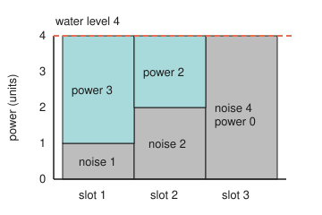
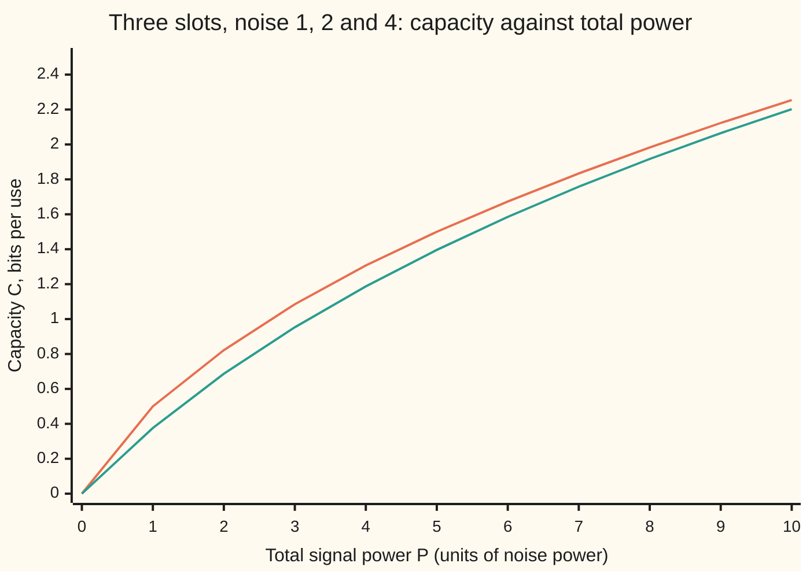

# Differential entropy and water-filling: bits for measured values, and power poured where noise is low

[Syllabus](../../../SYLLABUS.md) → [Applied and computational](../README.md) → [Information Theory](../README.md#s03) → Differential entropy and water-filling

---

## General Overview

A weather station sends one daily reading down a noisy radio link. Two questions about it need bits for measured values, not for symbols from a list.

**How uncertain is the reading?** Take the day's temperature minus the seasonal normal. It spreads like a bell curve with a spread (standard deviation) of 2 °C. Entropy counts bits over a list of outcomes, and a temperature has endless possible values. **Differential entropy** is the version for measured values: 3.047 bits for this reading.

It is a strange number. Write the same reading in Fahrenheit and it becomes 3.895 bits. Write it in tens of degrees and it becomes −0.275 bits. Only once the reading is rounded, say to 0.1 °C, does it turn into a true count of bits: 6.369, which is 3.047 plus log2 10.

**How should the radio share its power?** The radio sends on three frequency slots at once. Interference makes them unequal: noise power 1, 2 and 4, measured in one power unit, such as milliwatts. The radio has 5 units of signal power to share. An even split carries 1.396 bits per use (one use is one value sent on each slot). **Water-filling** carries 1.5.

Picture the noise as the uneven floor of a tank and pour the 5 units of power in as water. It settles at level 4. Slot 1 gets 3 units, slot 2 gets 2, and the noisiest slot gets none.

**Differential entropy measures a measured value's uncertainty against its units, the bell curve has the most of it for a given spread, and so each slot with bell-curve noise carries at most ½ log2(1 + power/noise) bits, which the sender maximises by filling the slots like water to one common level.**

**What kind of fact this is:** a definition (differential entropy) and two theorems proved on this card in Why it works: the bell curve has the largest differential entropy for its variance, and water-filling is the best split of power. The capacity of one slot is a theorem proved on [Channel capacity](07-channel-capacity-and-the-noisy-channel-theorem.md); this card restates its key step. Bell-curve noise and independent slots are a model of the radio, not a law.

### The picture: power poured over the noise floor

<p align="center"></p>

Grey is noise, blue is signal power, and the dashed line is the water level. Slot 3's floor already reaches it, so slot 3 gets no power.

---

## The formula

A measured value $`X`$ has a density $`f(x)`$: a curve whose area between two values is the chance that $`X`$ lands between them. Its differential entropy is

```math
h(X) = -\int f(x)\,\log_2 f(x)\,dx, \qquad h(X) = \tfrac12 \log_2\!\left(2\pi e\,\sigma^2\right) \ \text{for a bell curve of variance } \sigma^2.
```

**Read it aloud:** the differential entropy is the average of minus log2 of the curve's height; for a bell curve it depends only on the spread.

The small $`h`$ here is not the binary entropy $`h(p)`$ of [Entropy](01-entropy.md). Four facts about it, proved on this card:

```math
h(aX) = h(X) + \log_2 |a|, \qquad H(X_\Delta) \approx h(X) - \log_2 \Delta, \qquad h(X) \le \tfrac12 \log_2\!\left(2\pi e\,\sigma^2\right), \qquad h(X) \text{ can be below } 0.
```

**Read it aloud:** stretching the units by a factor adds log2 of the factor; rounding to steps of width Δ gives a true count of bits, h minus log2 Δ; no spread beats the bell curve of the same variance; and nothing stops h from going negative.

For slots $`i = 1, 2, 3`$ with noise power $`N_i`$, sharing a total power $`P`$, water-filling picks a level $`\nu`$ and gives

```math
P_i = \max(0,\ \nu - N_i), \qquad \sum_i P_i = P, \qquad C = \sum_i \tfrac12 \log_2\!\left(1 + \frac{P_i}{N_i}\right).
```

**Read it aloud:** each slot gets the gap between the water level and its noise floor, or nothing if the floor is above the water; the level is set so the gaps use up the budget; and the capacity is the sum of what each slot carries.

| Symbol | Plain meaning | In our example | Push it up and the answer… |
| --- | --- | --- | --- |
| $`X`$, $`f(x)`$, $`\mu`$ | the measured value, its density, and its mean | the reading in °C; a bell curve; 0 | — |
| $`h(X)`$, $`a`$ | differential entropy in bits, against the chosen unit; a factor that changes the unit | 3.047; a = 1.8 for °F | a: h rises by log2 a |
| $`\sigma`$, $`\sigma^2`$, $`e`$ | the spread (standard deviation), the variance, and the base of natural logs, about 2.718 | 2 °C; 4 | σ: h rises 1 bit each time σ doubles |
| $`\Delta`$, $`H(X_\Delta)`$, $`n`$ | the rounding step, and the ordinary entropy of the rounded reading; for Δ = 1/2ⁿ, n is the number of binary places kept | 0.1 °C; 6.369 bits | Δ: H falls 1 bit each time Δ doubles |
| $`g`$, $`D(f \Vert g)`$ | the bell curve with f's mean and variance; the divergence from [KL divergence](03-kl-divergence-and-cross-entropy.md), bits wasted by assuming g when f is true | spread 2 °C; 0.255 for a flat shape | — |
| $`Y`$, $`Z`$, $`I(X;Y)`$ | in one slot: the received value, the noise, and the mutual information (bits Y tells about X) | Y = X + Z | — |
| $`i`$, $`N_i`$ | a slot's number and its noise power | 1, 2, 3; noise 1, 2, 4 | that slot gets less power |
| $`P_i`$, $`P_i^*`$ | the power given to slot i; the water-filled power | 3, 2, 0 | that slot carries more |
| $`P`$ | the total power budget | 5 | ν and C rise |
| $`\nu`$, $`\lambda`$ | the water level, read "nu": noise plus power in every slot in use; λ is every used slot's slope there | 4; 0.180337 | — |
| $`C`$, $`C_{\text{slot}}`$, $`c_i`$ | capacity: the most bits per use, with errors as rare as wanted in the long-block limit; $`C_{\text{slot}}`$ is one slot's capacity with power P and noise N; $`c_i`$ is slot i's share | 1.5; 1 and 0.5 and 0 | — |

### When it holds

- **The value has a density.** A sensor that reports exactly 0.0 on many days puts a lump of chance on one point, and no curve describes it. Then h is undefined, and the rounded entropy stops tracking h − log2 Δ.
- **Two values of h are compared only in the same units.** The reading's h is 3.047 in °C and 3.895 in °F. A difference of two h values, as in a capacity, is unit-free; a single h is not a count of anything.
- **The bell curve wins only at a fixed variance.** Without a cap on spread, h grows without limit. Under a different rule, such as "the value stays between 0 and 1", a different shape wins: there, the flat spread.
- **Water-filling needs independent slots with bell-curve noise, known to the sender.** If interference moves and the sender keeps the old split, the same 5 units carry 0.904 bits per use instead of 1.5.
- **The only limit is the total power.** Radio rules often cap each slot's power too. Then the water meets a ceiling in some slots and the split changes.

---

## Why it works

### Step 0: a measured value is a rounded value with the rounding taken away

Round the reading to steps of width Δ. A bin around x then has chance about f(x)Δ: the curve's height times the width. The ordinary entropy of the rounded reading is the average of −log2 of that chance:

```math
H(X_\Delta) \approx \text{average of } \big(-\log_2 f(X) - \log_2 \Delta\big) = h(X) - \log_2 \Delta.
```

The term −log2 Δ grows without limit as the steps shrink. It is the same for every reading rounded the same way. What is left, h, depends only on the shape and width of the curve. That is differential entropy.

So h measures spread against a box one unit wide. A reading flat on 0 to 0.5 fits in half a box, and its h is log2 0.5 = −1 bit. Negative h does not mean negative information. It means the value is narrower than one unit.

The code rounds the reading to finer and finer steps, summing the exact chance in every bin:

| Step Δ | Entropy of rounded reading | h − log2 Δ |
| --- | --- | --- |
| 1 °C | 3.062 | 3.047 |
| 1/4 °C | 5.048 | 5.047 |
| 1/16 °C | 7.047154 | 7.047096 |
| 0.1 °C | 6.369 | 6.369 |

With Δ = 1/2ⁿ the rule reads: a reading kept to n binary places after the point costs about h + n bits.

### Step 1: the bell curve's value

A bell curve centred at μ (its mean) has height

```math
f(x) = \frac{1}{\sqrt{2\pi\sigma^2}}\, e^{-(x-\mu)^2 / (2\sigma^2)}, \qquad -\log_2 f(x) = \tfrac12 \log_2(2\pi\sigma^2) + \frac{(x-\mu)^2}{2\sigma^2}\,\log_2 e.
```

The squared distance $`(x-\mu)^2`$ averages to σ². So the second term averages to ½ log2 e, and

```math
h = \tfrac12 \log_2(2\pi\sigma^2) + \tfrac12 \log_2 e = \tfrac12 \log_2(2\pi e\,\sigma^2).
```

For the reading, 2πe × 4 = 68.318, log2 of that is 6.094, and half is 3.047 bits. The code reaches 3.047096 by Simpson's rule (adding thin slices under the curve) and 3.047961 by averaging −log2 f over 200,000 seeded draws.

### Step 2: changing units shifts h

Write the reading in new units: aX in place of X. The curve of aX is the curve of X stretched a times wider and a times lower, so its height at every matching point is f/|a|. Then −log2 of the height rises by log2 |a| everywhere, and so does its average:

```math
h(aX) = h(X) + \log_2 |a|.
```

A Fahrenheit degree is smaller than a Celsius degree, so the same spread reads 1.8 times larger in °F: a = 1.8, and h rises by log2 1.8 = 0.848, to 3.895. In tens of degrees, a = 0.1: h falls by log2 10 = 3.322, to −0.275. Adding a constant, such as the 32 in Fahrenheit, slides the curve without changing its shape, so it changes nothing.

### Step 3: the bell curve has the most, for its variance (complete proof)

Take any density f with variance σ², and the bell curve g with the same mean and variance. [KL divergence](03-kl-divergence-and-cross-entropy.md) proves Gibbs' inequality for tables of chances: the divergence is never negative, and is zero only when the two agree. The same proof works with integrals in place of sums:

```math
0 \le D(f \Vert g) = \int f \log_2 \frac{f}{g}\,dx = -h(f) - \int f(x) \log_2 g(x)\,dx.
```

The last integral is the key. By Step 1, −log2 g(x) is a constant plus a multiple of (x − μ)². Its average under f uses only f's mean and variance, and those equal g's. So it is the same as its average under g itself, which is h(g):

```math
-\int f \log_2 g\,dx = -\int g \log_2 g\,dx = h(g), \qquad \text{so} \qquad D(f \Vert g) = h(g) - h(f) \ge 0.
```

So h(f) ≤ h(g) = ½ log2(2πeσ²), with equality only when f is the bell curve. The proof also measures the gap: it is exactly the divergence. The code checks this on two shapes with variance 4:

| Shape, variance 4 | h | Gap below the bell | D(f ‖ g), by Simpson's rule |
| --- | --- | --- | --- |
| bell curve | 3.047 | 0 | 0 |
| Laplace (a two-sided exponential, peaked at the centre) | 2.943 | 0.104 | 0.104 |
| flat, from −2√3 to 2√3 | 2.792 | 0.255 | 0.255 |

### Step 4: one slot carries ½ log2(1 + P/N)

This is Step 4 of [Channel capacity](07-channel-capacity-and-the-noisy-channel-theorem.md), restated in the new terms. A slot receives Y = X + Z: the sent value plus independent bell-curve noise of power N. The mutual information (bits Y tells about X) is

```math
I(X;Y) = h(Y) - h(Z).
```

Given X, the only uncertainty left in Y is the noise, so the second term is h(Z) = ½ log2(2πeN). The received value has variance at most P + N. By Step 3, h(Y) is at most ½ log2(2πe(P + N)), reached when the sent values are themselves bell-shaped. Subtract:

```math
C_{\text{slot}} = \tfrac12 \log_2(2\pi e(P+N)) - \tfrac12 \log_2(2\pi e N) = \tfrac12 \log_2\!\left(1 + \frac{P}{N}\right).
```

The 2πe cancelled, and so did the units: a difference of two h values is a true count of bits. And the bell curve, which makes the noise term as large as possible, is also the best signal.

With independent slots, the information adds slot by slot (Cover and Thomas, chapter 9, in Sources). So the three slots carry the sum of their three terms. What is left is how to split P.

### Step 5: the best split fills to one level

Look at one slot's gain from a little more power. The slope of $`\tfrac12 \log_2(1 + P_i/N_i)`$ is

```math
\frac{d}{dP_i}\ \tfrac12 \log_2\!\left(1 + \frac{P_i}{N_i}\right) = \frac{1}{2\ln 2\,(N_i + P_i)}.
```

It depends only on $`N_i + P_i`$, the height of noise plus power in that slot. The lower that height, the steeper the slope.

Move a sliver of power from a slot standing higher to one standing lower. The lower slot gains more than the higher one loses. Repeat until no move helps. Then:

1. Every slot in use stands at one common height. Call it ν, the water level.
2. Every slot not in use has its floor $`N_i`$ at or above ν. Otherwise a first sliver there would gain.
3. The powers use up the budget: $`\sum_i \max(0, \nu - N_i) = P`$.

That is water poured onto the noise floor. In the example, try using slots 1 and 2: ν = (5 + 1 + 2)/2 = 4. Slot 3's floor is 4, not below the level, so leaving it dry is consistent. The code's slopes at the answer are 0.180337 in all three slots. Slot 3 is exactly at the edge: any more power would start to fill it.

<details>
<summary>Detailed proof: no other split carries more</summary>

The argument above shows a best split must look like water. This shows the water split beats every other split, not only nearby ones.

Write $`c_i(p) = \tfrac12 \log_2(1 + p/N_i)`$, and let $`P_i^*`$ be the water-filled powers, with level ν. The slope of each $`c_i`$ falls as p grows, so each $`c_i`$ is concave: it lies under every tangent line. For any other split $`P_i`$ with the same total,

$`\displaystyle \sum_i c_i(P_i) \le \sum_i c_i(P_i^*) + \sum_i c_i'(P_i^*)\,(P_i - P_i^*).`$

Call $`\lambda = 1/(2\ln 2\,\nu)`$. In a slot in use, $`c_i'(P_i^*) = \lambda`$. In a dry slot, $`P_i^* = 0`$, so $`c_i'(0) = 1/(2\ln 2\,N_i) \le \lambda`$ because $`N_i \ge \nu`$, and $`P_i - P_i^* = P_i \ge 0`$. Either way, each term of the last sum is at most $`\lambda (P_i - P_i^*)`$. Those add to $`\lambda (P - P) = 0`$. So no split beats the water-filled one.

</details>

### Step 6: finding the level

The poured power $`\sum_i \max(0, \nu - N_i)`$ rises steadily with ν, so bisection finds the level: halve an interval that holds it, keep the half where the poured power crosses P, and repeat. Two hundred halvings give ν = 4. A grid search over every split of 5 in steps of 0.01, 125,751 splits in all, lands on the same powers 3, 2, 0 and the same 1.5 bits.

---

## Worked numbers, by hand

The reading: a bell curve with spread 2 °C. The radio: noise 1, 2, 4 and total power 5.

| Step | Arithmetic | Value |
| --- | --- | --- |
| 2πe σ² | 2πe × 4 | 68.318 |
| h in °C | ½ log2 68.318 = ½ × 6.094 | 3.047 bits |
| h in °F | 3.047 + log2 1.8 = 3.047 + 0.848 | 3.895 bits |
| h in tens of degrees | 3.047 − log2 10 = 3.047 − 3.322 | −0.275 bits |
| rounded to 0.1 °C | 3.047 + 3.322 | 6.369 bits |
| water level, slots 1 and 2 used | (5 + 1 + 2) / 2 | 4 |
| powers | 4 − 1, 4 − 2, slot 3 dry | 3, 2, 0 |
| slot 1 | ½ log2(1 + 3/1) = ½ log2 4 | 1 bit |
| slot 2 | ½ log2(1 + 2/2) = ½ log2 2 | 0.5 bits |
| **capacity** | 1 + 0.5 | **1.5 bits per use** |
| equal split, 5/3 each | 0.708 + 0.437 + 0.251 | 1.396 bits per use |

So the right split carries 7.45% more than the even one, with the same power.

### What breaks if you drop a piece

| Mistake | Comes out at | What went wrong |
| --- | --- | --- |
| Split the power evenly, 5/3 per slot | 1.396 bits per use | Power spent on slot 3 meets the most noise; its last sliver gains less than the same sliver in slot 1 |
| Put all 5 units in the quietest slot | 1.292 | Slot 1's slope keeps falling as it fills; slot 2 would have paid more for the last 2 units |
| Give noisier slots more, to equalise S/N (signal-to-noise power ratio) | 1.166 | The instinct to help the weak slot is backwards: power buys the most where noise is low |
| Keep the 3, 2, 0 split after interference moves the noise to 4, 2, 1 (a broken hypothesis: the sender's noise map is stale) | 0.904, against 1.5 for a fresh water-fill | Water-filling assumes the sender knows the floor; now the full 3 units land on the noisiest slot |
| Treat h = 3.047 as the bits to store a 0.1 °C reading | 3.047, against 6.369 | h leaves out −log2 Δ, the cost of the rounding step |

### The picture: capacity as the power budget grows



Upper line (orange): water-filling. Lower line (green): the even split. With a budget of 1 or less, water-filling puts everything in slot 1, and its gain is largest in proportion. The gap in bits is widest near a budget of 2, once slot 2 is in use too. As the budget grows, the water covers every floor, the split grows closer to even, and the lines close up.

---

## Code, from first principles, and it actually runs

The reading's differential entropy comes three ways: the formula, Simpson's rule, and 200,000 seeded bell-curve draws. The draws use the Box–Muller recipe (two uniform numbers in, two bell-curve numbers out) on SplitMix64, a small random generator written out in both languages. Integrals in °F and in tens of degrees check the unit shift; bin-by-bin sums check the rounding rule; each shape's gap in h meets its divergence from the bell, integrated directly. The split comes two independent ways: bisection on the water level, and a grid search over all 125,751 splits. The equal slopes of Step 5 are checked against slopes measured by nudging each slot's power. The code also prints every wrong split, the "Try changing" answers and the chart's points.

### Python

```python
# Differential entropy and water-filling -- the check behind the card.  Standard library only.
# A weather station: its daily temperature reading (spread 2 degrees C) and a radio with three
# frequency slots of noise power 1, 2 and 4 sharing a total signal power of 5.
# Roads: closed forms; Simpson's rule (thin slices under the curve); a seeded simulation;
# bin-by-bin sums; bisection for the water level; a grid search over every split of the power.
from math import log, log2, sqrt, exp, pi, e, cos

SIGMA = 2.0                      # spread of the daily reading, degrees C
NOISE = [1.0, 2.0, 4.0]          # noise power in each frequency slot
POWER = 5.0                      # total signal power the radio may spend

def simpson(f, a, b, n):
    hh = (b - a) / n
    s = f(a) + f(b) + sum((4 if i % 2 else 2) * f(a + i * hh) for i in range(1, n))
    return s * hh / 3

def gauss(x, s): return exp(-x * x / (2 * s * s)) / sqrt(2 * pi * s * s)
def h_gauss(s): return 0.5 * log2(2 * pi * e * s * s)          # the formula
def h_simpson(s):                                              # -integral of f log2 f
    return simpson(lambda x: -gauss(x, s) * log2(gauss(x, s)), -12 * s, 12 * s, 4000)

def splitmix64(st):
    st = (st + 0x9E3779B97F4A7C15) & 0xFFFFFFFFFFFFFFFF
    z = st
    z = ((z ^ (z >> 30)) * 0xBF58476D1CE4E5B9) & 0xFFFFFFFFFFFFFFFF
    z = ((z ^ (z >> 27)) * 0x94D049BB133111EB) & 0xFFFFFFFFFFFFFFFF
    return st, z ^ (z >> 31)
def uniform(st):
    st, z = splitmix64(st)
    return st, ((z >> 11) + 1) / 2.0 ** 53

def h_rounded(s, step):          # entropy in bits of the reading rounded to bins of width step
    tot, k = 0.0, -int(8 * s / step) - 1
    while k * step < 8 * s:
        p = simpson(lambda x: gauss(x, s), k * step, (k + 1) * step, 8)
        if p > 0: tot -= p * log2(p)
        k += 1
    return tot

def capacity(powers, noise):     # bits per use over parallel bell-curve-noise slots
    return sum(0.5 * log2(1 + p / n) for p, n in zip(powers, noise))
def water_level(noise, total):   # bisection: the level nu whose poured power is the total
    lo, hi = 0.0, total + max(noise)
    for _ in range(200):
        mid = (lo + hi) / 2
        if sum(max(0.0, mid - n) for n in noise) < total: lo = mid
        else: hi = mid
    return (lo + hi) / 2
def water_fill(noise, total):
    nu = water_level(noise, total)
    return nu, [max(0.0, nu - n) for n in noise]

out = []
def show(name, v): out.append(f"{name:<44} {v:>12.6f}")

# ---- differential entropy of the reading ----
h_c, h_s = h_gauss(SIGMA), h_simpson(SIGMA)
st, acc, draws = 2026, 0.0, 200000
for _ in range(draws // 2):      # Box-Muller: two uniforms give two bell-curve draws
    st, u1 = uniform(st); st, u2 = uniform(st)
    r = sqrt(-2 * log(u1))
    for z in (r * cos(2 * pi * u2), r * cos(2 * pi * u2 - pi / 2)):
        acc += -log2(gauss(SIGMA * z, SIGMA))
h_mc = acc / draws
show("2 pi e x spread^2", 2 * pi * e * SIGMA ** 2); show("  log2 of it", log2(2 * pi * e * SIGMA ** 2))
show("h, reading in C, formula", h_c); show("  by Simpson", h_s); show("  by 200000 seeded draws", h_mc)
show("h, reading in F (spread 3.6)", h_simpson(3.6)); show("  log2 1.8", log2(1.8)); show("  formula h + log2 1.8", h_c + log2(1.8))
show("h, in tens of degrees (spread 0.2)", h_simpson(0.2)); show("h, uniform on 0 to 0.5", log2(0.5))
for n in (0, 2, 4):
    show(f"rounded to 1/{2 ** n} C: H by bins", h_rounded(SIGMA, 2.0 ** -n)); show(f"  h + {n}", h_c + n)
H01 = h_rounded(SIGMA, 0.1)
show("rounded to 0.1 C: H by bins", H01); show("  h + log2 10", h_c + log2(10))

# ---- the bell curve has the most, for a fixed variance ----
a = SIGMA * sqrt(3); b = SIGMA / sqrt(2)          # uniform on -a..a and Laplace with scale b: variance 4
h_uni, h_lap = log2(2 * a), log2(2 * e * b)
kl_uni = simpson(lambda x: (1 / (2 * a)) * log2((1 / (2 * a)) / gauss(x, SIGMA)), -a, a, 2000)
lap = lambda x: exp(-abs(x) / b) / (2 * b)
kl_lap = 2 * simpson(lambda x: lap(x) * log2(lap(x) / gauss(x, SIGMA)), 0.0, 30 * SIGMA, 20000)
show("uniform, same variance: h", h_uni); show("  gap to bell, h(bell) - h", h_c - h_uni); show("  D(uniform||bell) by Simpson", kl_uni)
show("Laplace, same variance: h", h_lap); show("  gap to bell, h(bell) - h", h_c - h_lap); show("  D(Laplace||bell) by Simpson", kl_lap)

# ---- water-filling ----
nu, pw = water_fill(NOISE, POWER)
c_wf = capacity(pw, NOISE)
best, arg, splits = -1.0, None, 0                   # every split in steps of 0.01
for i in range(501):
    for j in range(501 - i):
        splits += 1; c = capacity([i / 100, j / 100, (500 - i - j) / 100], NOISE)
        if c > best: best, arg = c, (i / 100, j / 100, (500 - i - j) / 100)
slopes = [1 / (2 * log(2) * (p + n)) for p, n in zip(pw, NOISE)]
c_uni = capacity([POWER / 3] * 3, NOISE)
c_one = capacity([POWER, 0, 0], NOISE)
c_snr = capacity([POWER * n / sum(NOISE) for n in NOISE], NOISE)
c_stale = capacity(pw, NOISE[::-1])
show("water level nu, by bisection", nu)
for k in range(3): show(f"  power in slot {k + 1} (noise {NOISE[k]:.0f})", pw[k])
show("capacity, bits per use", c_wf)
show("grid search, splits tried", splits); show("grid search best, steps of 0.01", best)
for k in range(3): show(f"  at power in slot {k + 1}", arg[k])
out.append("equal split, bits in each slot: " + " ".join(f"{capacity([POWER / 3], [n]):.6f}" for n in NOISE))
show("wrong: equal split 5/3 each", c_uni); show("  water-filling gain over it, percent", 100 * (c_wf / c_uni - 1)); show("wrong: all power in slot 1", c_one)
show("wrong: equal S/N, more to noisy slots", c_snr); show("wrong: stale noise map, truth 4, 2, 1", c_stale)
show("  water-filled for 4, 2, 1", capacity(water_fill(NOISE[::-1], POWER)[1], NOISE[::-1]))
show("try: power 12, level", water_level(NOISE, 12.0)); show("  capacity", capacity(water_fill(NOISE, 12.0)[1], NOISE))
show("try: power 1, water-filled", capacity(water_fill(NOISE, 1.0)[1], NOISE)); show("  equal split", capacity([1 / 3] * 3, NOISE))
show("try: slot 3 noise 3, level", water_level([1.0, 2.0, 3.0], POWER))
show("  capacity", capacity(water_fill([1.0, 2.0, 3.0], POWER)[1], [1.0, 2.0, 3.0]))
show("try: spread 4 C, h", h_gauss(4.0))
chart_wf = [capacity(water_fill(NOISE, float(p))[1], NOISE) for p in range(11)]
chart_eq = [capacity([p / 3] * 3, NOISE) for p in range(11)]
print("\n".join(out))
print("chart, water-filled, power 0..10:", " ".join(f"{v:.3f}" for v in chart_wf))
print("chart, equal split,  power 0..10:", " ".join(f"{v:.3f}" for v in chart_eq))
print("slope of each slot at its power:", " ".join(f"{v:.6f}" for v in slopes))
print("figure, y = 200 - 40 v: noise tops", " ".join(f"{200 - 40 * n:.1f}" for n in NOISE), "water", f"{200 - 40 * nu:.1f}")

assert abs(h_c - h_s) < 1e-9                        # formula against the integral
assert abs(h_mc - h_c) < 4 * sqrt(2) / (2 * log(2)) / sqrt(draws)   # within 4 standard errors
assert abs(h_simpson(3.6) - (h_c + log2(1.8))) < 1e-9 and h_simpson(0.2) < 0
assert abs(H01 - (h_c + log2(10))) < 1e-3          # rounded reading: h + log2(1/step)
assert abs((h_c - h_uni) - kl_uni) < 1e-9 and abs((h_c - h_lap) - kl_lap) < 1e-6
assert abs(nu - 4) < 1e-9 and abs(c_wf - (0.5 * log2(4) + 0.5 * log2(2))) < 1e-9
assert abs(best - c_wf) < 1e-12 and arg == (3.0, 2.0, 0.0)   # brute force finds the same split
assert max(c_uni, c_one, c_snr, c_stale) < c_wf
assert all(chart_wf[p] >= chart_eq[p] - 1e-12 for p in range(11))
lam = 1 / (2 * log(2) * nu)                        # Step 5: every used slot's slope is lam, a dry slot's no more
nudge = [(capacity([q + 1e-6 * (k == i) for k, q in enumerate(pw)], NOISE) - c_wf) / 1e-6 for i in range(3)]
assert all(abs(g - s) < 1e-6 and (abs(s - lam) < 1e-9 if p > 0 else s <= lam + 1e-12) for g, s, p in zip(nudge, slopes, pw))
print("ALL CHECKS PASS")
```

**Ran 2026-11-23 on macOS, Python 3.14.10, standard library only. All checks passed. Output, pasted from the run:**

```
2 pi e x spread^2                               68.317874
  log2 of it                                     6.094191
h, reading in C, formula                         3.047096
  by Simpson                                     3.047096
  by 200000 seeded draws                         3.047961
h, reading in F (spread 3.6)                     3.895092
  log2 1.8                                       0.847997
  formula h + log2 1.8                           3.895092
h, in tens of degrees (spread 0.2)              -0.274833
h, uniform on 0 to 0.5                          -1.000000
rounded to 1/1 C: H by bins                      3.061969
  h + 0                                          3.047096
rounded to 1/4 C: H by bins                      5.048034
  h + 2                                          5.047096
rounded to 1/16 C: H by bins                     7.047154
  h + 4                                          7.047096
rounded to 0.1 C: H by bins                      6.369174
  h + log2 10                                    6.369024
uniform, same variance: h                        2.792481
  gap to bell, h(bell) - h                       0.254614
  D(uniform||bell) by Simpson                    0.254614
Laplace, same variance: h                        2.942695
  gap to bell, h(bell) - h                       0.104401
  D(Laplace||bell) by Simpson                    0.104401
water level nu, by bisection                     4.000000
  power in slot 1 (noise 1)                      3.000000
  power in slot 2 (noise 2)                      2.000000
  power in slot 3 (noise 4)                      0.000000
capacity, bits per use                           1.500000
grid search, splits tried                    125751.000000
grid search best, steps of 0.01                  1.500000
  at power in slot 1                             3.000000
  at power in slot 2                             2.000000
  at power in slot 3                             0.000000
equal split, bits in each slot: 0.707519 0.437235 0.251250
wrong: equal split 5/3 each                      1.396003
  water-filling gain over it, percent            7.449589
wrong: all power in slot 1                       1.292481
wrong: equal S/N, more to noisy slots            1.166411
wrong: stale noise map, truth 4, 2, 1            0.903677
  water-filled for 4, 2, 1                       1.500000
try: power 12, level                             6.333333
  capacity                                       2.494448
try: power 1, water-filled                       0.500000
  equal split                                    0.376454
try: slot 3 noise 3, level                       3.666667
  capacity                                       1.519222
try: spread 4 C, h                               4.047096
chart, water-filled, power 0..10: 0.000 0.500 0.822 1.085 1.307 1.500 1.673 1.834 1.983 2.123 2.254
chart, equal split,  power 0..10: 0.000 0.376 0.687 0.953 1.187 1.396 1.585 1.758 1.917 2.065 2.202
slope of each slot at its power: 0.180337 0.180337 0.180337
figure, y = 200 - 40 v: noise tops 160.0 120.0 40.0 water 40.0
ALL CHECKS PASS
```

### Rust

```rust
// Differential entropy and water-filling -- the check behind the card.  Rust std only, no crates.
// A weather station: its daily temperature reading (spread 2 degrees C) and a radio with three
// frequency slots of noise power 1, 2 and 4 sharing a total signal power of 5. Same output as the Python.
use std::f64::consts::{E, PI};

const SIGMA: f64 = 2.0; // spread of the daily reading, degrees C
const NOISE: [f64; 3] = [1.0, 2.0, 4.0]; // noise power in each frequency slot
const POWER: f64 = 5.0; // total signal power the radio may spend

fn simpson<F: Fn(f64) -> f64>(f: F, a: f64, b: f64, n: usize) -> f64 {
    let hh = (b - a) / n as f64;
    let mut s = f(a) + f(b);
    for i in 1..n { s += (if i % 2 == 1 { 4.0 } else { 2.0 }) * f(a + i as f64 * hh); }
    s * hh / 3.0
}
fn gauss(x: f64, s: f64) -> f64 { (-x * x / (2.0 * s * s)).exp() / (2.0 * PI * s * s).sqrt() }
fn h_gauss(s: f64) -> f64 { 0.5 * (2.0 * PI * E * s * s).log2() } // the formula
fn h_simpson(s: f64) -> f64 { simpson(|x| -gauss(x, s) * gauss(x, s).log2(), -12.0 * s, 12.0 * s, 4000) }
fn splitmix64(st: u64) -> (u64, u64) {
    let st = st.wrapping_add(0x9E3779B97F4A7C15);
    let mut z = st;
    z = (z ^ (z >> 30)).wrapping_mul(0xBF58476D1CE4E5B9);
    z = (z ^ (z >> 27)).wrapping_mul(0x94D049BB133111EB);
    (st, z ^ (z >> 31))
}
fn uniform(st: u64) -> (u64, f64) { let (st, z) = splitmix64(st); (st, ((z >> 11) + 1) as f64 / 2f64.powi(53)) }
fn h_rounded(s: f64, step: f64) -> f64 { // entropy in bits of the reading rounded to bins of width step
    let (mut tot, mut k) = (0.0, -((8.0 * s / step) as i64) - 1);
    while (k as f64) * step < 8.0 * s {
        let p = simpson(|x| gauss(x, s), k as f64 * step, (k + 1) as f64 * step, 8);
        if p > 0.0 { tot -= p * p.log2(); }
        k += 1;
    }
    tot
}
fn capacity(powers: &[f64], noise: &[f64]) -> f64 { // bits per use over parallel bell-curve-noise slots
    powers.iter().zip(noise).map(|(p, n)| 0.5 * (1.0 + p / n).log2()).sum()
}
fn water_level(noise: &[f64], total: f64) -> f64 { // bisection: the level nu whose poured power is the total
    let (mut lo, mut hi) = (0.0, total + noise.iter().cloned().fold(0.0, f64::max));
    for _ in 0..200 {
        let mid = (lo + hi) / 2.0;
        if noise.iter().map(|n| (mid - n).max(0.0)).sum::<f64>() < total { lo = mid; } else { hi = mid; }
    }
    (lo + hi) / 2.0
}
fn water_fill(noise: &[f64], total: f64) -> (f64, Vec<f64>) {
    let nu = water_level(noise, total);
    (nu, noise.iter().map(|n| (nu - n).max(0.0)).collect())
}
fn show(out: &mut Vec<String>, name: &str, v: f64) { out.push(format!("{:<44} {:>12.6}", name, v)); }

fn main() {
    let mut out: Vec<String> = Vec::new();
    // ---- differential entropy of the reading ----
    let (h_c, h_s) = (h_gauss(SIGMA), h_simpson(SIGMA));
    let (mut st, mut acc, draws) = (2026u64, 0.0, 200000);
    for _ in 0..draws / 2 { // Box-Muller: two uniforms give two bell-curve draws
        let (s1, u1) = uniform(st); let (s2, u2) = uniform(s1); st = s2;
        let r = (-2.0 * u1.ln()).sqrt();
        for z in [r * (2.0 * PI * u2).cos(), r * (2.0 * PI * u2 - PI / 2.0).cos()] { acc += -gauss(SIGMA * z, SIGMA).log2(); }
    }
    let h_mc = acc / draws as f64;
    show(&mut out, "2 pi e x spread^2", 2.0 * PI * E * SIGMA * SIGMA); show(&mut out, "  log2 of it", (2.0 * PI * E * SIGMA * SIGMA).log2());
    show(&mut out, "h, reading in C, formula", h_c); show(&mut out, "  by Simpson", h_s); show(&mut out, "  by 200000 seeded draws", h_mc);
    show(&mut out, "h, reading in F (spread 3.6)", h_simpson(3.6)); show(&mut out, "  log2 1.8", 1.8f64.log2()); show(&mut out, "  formula h + log2 1.8", h_c + 1.8f64.log2());
    show(&mut out, "h, in tens of degrees (spread 0.2)", h_simpson(0.2)); show(&mut out, "h, uniform on 0 to 0.5", 0.5f64.log2());
    for n in [0, 2, 4] {
        show(&mut out, &format!("rounded to 1/{} C: H by bins", 1 << n), h_rounded(SIGMA, 2f64.powi(-n)));
        show(&mut out, &format!("  h + {}", n), h_c + n as f64);
    }
    let h01 = h_rounded(SIGMA, 0.1);
    show(&mut out, "rounded to 0.1 C: H by bins", h01); show(&mut out, "  h + log2 10", h_c + 10f64.log2());
    // ---- the bell curve has the most, for a fixed variance ----
    let (a, b) = (SIGMA * 3f64.sqrt(), SIGMA / 2f64.sqrt()); // uniform on -a..a and Laplace with scale b: variance 4
    let (h_uni, h_lap) = ((2.0 * a).log2(), (2.0 * E * b).log2());
    let kl_uni = simpson(|x| (1.0 / (2.0 * a)) * ((1.0 / (2.0 * a)) / gauss(x, SIGMA)).log2(), -a, a, 2000);
    let lap = |x: f64| (-x.abs() / b).exp() / (2.0 * b);
    let kl_lap = 2.0 * simpson(|x| lap(x) * (lap(x) / gauss(x, SIGMA)).log2(), 0.0, 30.0 * SIGMA, 20000);
    show(&mut out, "uniform, same variance: h", h_uni); show(&mut out, "  gap to bell, h(bell) - h", h_c - h_uni);
    show(&mut out, "  D(uniform||bell) by Simpson", kl_uni);
    show(&mut out, "Laplace, same variance: h", h_lap); show(&mut out, "  gap to bell, h(bell) - h", h_c - h_lap);
    show(&mut out, "  D(Laplace||bell) by Simpson", kl_lap);
    // ---- water-filling ----
    let (nu, pw) = water_fill(&NOISE, POWER);
    let c_wf = capacity(&pw, &NOISE);
    let (mut best, mut arg, mut splits) = (-1.0, [0.0; 3], 0); // every split in steps of 0.01
    for i in 0..=500 { for j in 0..=(500 - i) {
        let split = [i as f64 / 100.0, j as f64 / 100.0, (500 - i - j) as f64 / 100.0];
        splits += 1; let c = capacity(&split, &NOISE);
        if c > best { best = c; arg = split; }
    } }
    let slopes: Vec<f64> = pw.iter().zip(NOISE.iter()).map(|(p, n)| 1.0 / (2.0 * 2f64.ln() * (p + n))).collect();
    let c_uni = capacity(&[POWER / 3.0; 3], &NOISE);
    let c_one = capacity(&[POWER, 0.0, 0.0], &NOISE);
    let tot_n: f64 = NOISE.iter().sum();
    let c_snr = capacity(&NOISE.map(|n| POWER * n / tot_n), &NOISE);
    let rev = [4.0, 2.0, 1.0];
    let c_stale = capacity(&pw, &rev);
    show(&mut out, "water level nu, by bisection", nu);
    for k in 0..3 { show(&mut out, &format!("  power in slot {} (noise {:.0})", k + 1, NOISE[k]), pw[k]); }
    show(&mut out, "capacity, bits per use", c_wf);
    show(&mut out, "grid search, splits tried", splits as f64); show(&mut out, "grid search best, steps of 0.01", best);
    for k in 0..3 { show(&mut out, &format!("  at power in slot {}", k + 1), arg[k]); }
    out.push(format!("equal split, bits in each slot: {}", NOISE.iter().map(|n| format!("{:.6}", capacity(&[POWER / 3.0], &[*n]))).collect::<Vec<_>>().join(" ")));
    show(&mut out, "wrong: equal split 5/3 each", c_uni); show(&mut out, "  water-filling gain over it, percent", 100.0 * (c_wf / c_uni - 1.0)); show(&mut out, "wrong: all power in slot 1", c_one);
    show(&mut out, "wrong: equal S/N, more to noisy slots", c_snr); show(&mut out, "wrong: stale noise map, truth 4, 2, 1", c_stale);
    show(&mut out, "  water-filled for 4, 2, 1", capacity(&water_fill(&rev, POWER).1, &rev));
    show(&mut out, "try: power 12, level", water_level(&NOISE, 12.0));
    show(&mut out, "  capacity", capacity(&water_fill(&NOISE, 12.0).1, &NOISE));
    show(&mut out, "try: power 1, water-filled", capacity(&water_fill(&NOISE, 1.0).1, &NOISE));
    show(&mut out, "  equal split", capacity(&[1.0 / 3.0; 3], &NOISE));
    let n3 = [1.0, 2.0, 3.0];
    show(&mut out, "try: slot 3 noise 3, level", water_level(&n3, POWER));
    show(&mut out, "  capacity", capacity(&water_fill(&n3, POWER).1, &n3));
    show(&mut out, "try: spread 4 C, h", h_gauss(4.0));
    let chart_wf: Vec<f64> = (0..=10).map(|p| capacity(&water_fill(&NOISE, p as f64).1, &NOISE)).collect();
    let chart_eq: Vec<f64> = (0..=10).map(|p| capacity(&[p as f64 / 3.0; 3], &NOISE)).collect();
    let fmt = |v: &[f64], d: usize| v.iter().map(|x| format!("{:.*}", d, x)).collect::<Vec<_>>().join(" ");
    println!("{}", out.join("\n"));
    println!("chart, water-filled, power 0..10: {}", fmt(&chart_wf, 3));
    println!("chart, equal split,  power 0..10: {}", fmt(&chart_eq, 3));
    println!("slope of each slot at its power: {}", fmt(&slopes, 6));
    println!("figure, y = 200 - 40 v: noise tops {} water {:.1}", fmt(&NOISE.map(|n| 200.0 - 40.0 * n), 1), 200.0 - 40.0 * nu);

    assert!((h_c - h_s).abs() < 1e-9); // formula against the integral
    assert!((h_mc - h_c).abs() < 4.0 * 2f64.sqrt() / (2.0 * 2f64.ln()) / (draws as f64).sqrt()); // within 4 standard errors
    assert!((h_simpson(3.6) - (h_c + 1.8f64.log2())).abs() < 1e-9 && h_simpson(0.2) < 0.0);
    assert!((h01 - (h_c + 10f64.log2())).abs() < 1e-3); // rounded reading: h + log2(1/step)
    assert!(((h_c - h_uni) - kl_uni).abs() < 1e-9 && ((h_c - h_lap) - kl_lap).abs() < 1e-6);
    assert!((nu - 4.0).abs() < 1e-9 && (c_wf - (0.5 * 4f64.log2() + 0.5 * 2f64.log2())).abs() < 1e-9);
    assert!((best - c_wf).abs() < 1e-12 && arg == [3.0, 2.0, 0.0]); // brute force finds the same split
    assert!(c_uni.max(c_one).max(c_snr).max(c_stale) < c_wf);
    assert!((0..=10).all(|p| chart_wf[p] >= chart_eq[p] - 1e-12));
    let lam = 1.0 / (2.0 * 2f64.ln() * nu); // Step 5: every used slot's slope is lam, a dry slot's no more
    let nudge: Vec<f64> = (0..3).map(|i| (capacity(&pw.iter().enumerate().map(|(k, q)| q + if k == i { 1e-6 } else { 0.0 }).collect::<Vec<f64>>(), &NOISE) - c_wf) / 1e-6).collect();
    assert!((0..3).all(|i| (nudge[i] - slopes[i]).abs() < 1e-6 && if pw[i] > 0.0 { (slopes[i] - lam).abs() < 1e-9 } else { slopes[i] <= lam + 1e-12 }));
    println!("ALL CHECKS PASS");
}
```

**Ran 2026-11-23 on macOS, rustc 1.98.1, no crates. All checks passed. Output, pasted from the run:**

```
2 pi e x spread^2                               68.317874
  log2 of it                                     6.094191
h, reading in C, formula                         3.047096
  by Simpson                                     3.047096
  by 200000 seeded draws                         3.047961
h, reading in F (spread 3.6)                     3.895092
  log2 1.8                                       0.847997
  formula h + log2 1.8                           3.895092
h, in tens of degrees (spread 0.2)              -0.274833
h, uniform on 0 to 0.5                          -1.000000
rounded to 1/1 C: H by bins                      3.061969
  h + 0                                          3.047096
rounded to 1/4 C: H by bins                      5.048034
  h + 2                                          5.047096
rounded to 1/16 C: H by bins                     7.047154
  h + 4                                          7.047096
rounded to 0.1 C: H by bins                      6.369174
  h + log2 10                                    6.369024
uniform, same variance: h                        2.792481
  gap to bell, h(bell) - h                       0.254614
  D(uniform||bell) by Simpson                    0.254614
Laplace, same variance: h                        2.942695
  gap to bell, h(bell) - h                       0.104401
  D(Laplace||bell) by Simpson                    0.104401
water level nu, by bisection                     4.000000
  power in slot 1 (noise 1)                      3.000000
  power in slot 2 (noise 2)                      2.000000
  power in slot 3 (noise 4)                      0.000000
capacity, bits per use                           1.500000
grid search, splits tried                    125751.000000
grid search best, steps of 0.01                  1.500000
  at power in slot 1                             3.000000
  at power in slot 2                             2.000000
  at power in slot 3                             0.000000
equal split, bits in each slot: 0.707519 0.437235 0.251250
wrong: equal split 5/3 each                      1.396003
  water-filling gain over it, percent            7.449589
wrong: all power in slot 1                       1.292481
wrong: equal S/N, more to noisy slots            1.166411
wrong: stale noise map, truth 4, 2, 1            0.903677
  water-filled for 4, 2, 1                       1.500000
try: power 12, level                             6.333333
  capacity                                       2.494448
try: power 1, water-filled                       0.500000
  equal split                                    0.376454
try: slot 3 noise 3, level                       3.666667
  capacity                                       1.519222
try: spread 4 C, h                               4.047096
chart, water-filled, power 0..10: 0.000 0.500 0.822 1.085 1.307 1.500 1.673 1.834 1.983 2.123 2.254
chart, equal split,  power 0..10: 0.000 0.376 0.687 0.953 1.187 1.396 1.585 1.758 1.917 2.065 2.202
slope of each slot at its power: 0.180337 0.180337 0.180337
figure, y = 200 - 40 v: noise tops 160.0 120.0 40.0 water 40.0
ALL CHECKS PASS
```

### Lean

Lean proves the card's three general facts for any density and any number of slots, and checks the worked numbers.

- Take any density $`f`$ and any factor $`a \ne 0`$. Then the curve of $`aX`$ is $`f(x/a)/|a|`$, and $`h(aX) = h(X) + \log_2 |a|`$.
- Suppose $`f`$ is a density with mean $`\mu`$, variance $`\sigma^2 > 0`$, and a defined $`h`$. Then $`h(X) \le \tfrac12 \log_2(2\pi e\,\sigma^2)`$.
- The bell curve with that mean and variance has exactly $`\tfrac12 \log_2(2\pi e\,\sigma^2)`$. Lean does not prove that only the bell curve reaches it.
- Suppose each slot has noise power $`N_i > 0`$, and the level $`\nu`$ pours exactly the budget $`P`$. Then no split of $`P`$ into powers of 0 or more beats water-filling.
- Here each slot carries $`\tfrac12 \log_2(1 + P_i/N_i)`$ bits per use, taken as given from Step 4.
- It also checks the radio: level 4 pours 5 units, the powers are 3, 2 and 0, and capacity is 1.5 bits per use.
- It checks the levels in Try changing, the 125,751 grid splits, and that doubling the spread adds 1 bit to the bell curve's $`h`$.

Bisection, the rounding rule, the Simpson and seeded-draw numbers, and the wrong splits are left to the Python and Rust checks.

```lean
-- Differential entropy and water-filling: filling the slots with power up to one water level gives the largest total capacity for a fixed power budget, the bell curve has the largest differential entropy ½ log₂(2πeσ²) for its variance, and changing units by a factor a adds log₂ |a| to the differential entropy.
import Mathlib.Probability.Distributions.Gaussian.Real
import Mathlib.MeasureTheory.Measure.Haar.NormedSpace
import Mathlib.Analysis.SpecialFunctions.Log.Base
import Mathlib.LinearAlgebra.Matrix.Notation
import Mathlib.Tactic.NormNum

open MeasureTheory ProbabilityTheory Real Finset
open scoped NNReal

/-- The differential entropy in bits of a density `f` on the line:
`h = -∫ f(x) log₂ f(x) dx`. -/
noncomputable def diffEntropyBits (f : ℝ → ℝ) : ℝ :=
  -∫ x, f x * Real.logb 2 (f x)

/-- One slot: concavity of the logarithm against the water level. -/
lemma water_filling_slot (N p ν : ℝ) (hN : 0 < N) (hp : 0 ≤ p) (hν : 0 < ν) :
    Real.log (1 + p / N) ≤ Real.log (1 + max 0 (ν - N) / N) + (p - max 0 (ν - N)) / ν := by
  set q := max 0 (ν - N) with hq
  have hq0 : 0 ≤ q := le_max_left _ _
  have ha : 0 < 1 + p / N := by positivity
  have hb : 0 < 1 + q / N := by positivity
  have hb' : 0 < N + q := by linarith
  have h1 : Real.log (1 + p / N) - Real.log (1 + q / N) ≤ (p - q) / (N + q) := by
    rw [← Real.log_div ha.ne' hb.ne']
    refine (Real.log_le_sub_one_of_pos (div_pos ha hb)).trans (le_of_eq ?_)
    field_simp
    ring
  have h2 : (p - q) / (N + q) ≤ (p - q) / ν := by
    rcases le_or_gt ν N with h | h
    · have : q = 0 := max_eq_left (by linarith)
      rw [this, add_zero, sub_zero]
      exact div_le_div_of_nonneg_left hp hν h
    · have : q = ν - N := max_eq_right (by linarith)
      rw [this, show N + (ν - N) = ν by ring]
  linarith

#print axioms water_filling_slot

/-- The logarithm of the bell curve, written out. -/
lemma log_gaussianPDFReal (μ : ℝ) (v : ℝ≥0) (hv : v ≠ 0) (x : ℝ) :
    Real.log (gaussianPDFReal μ v x)
      = -(1 / 2 * Real.log (2 * π * v)) - 1 / (2 * v) * (x - μ) ^ 2 := by
  have hv' : (0 : ℝ) < v := lt_of_le_of_ne v.2 (by exact_mod_cast hv.symm)
  rw [gaussianPDFReal, Real.log_mul (by positivity) (Real.exp_pos _).ne', Real.log_inv,
    Real.log_sqrt (by positivity), Real.log_exp]
  ring

#print axioms log_gaussianPDFReal

/-- For a density with variance `v` about `μ`, the average of the log of the bell curve. -/
lemma integral_mul_log_gaussianPDFReal (f : ℝ → ℝ) (μ : ℝ) (v : ℝ≥0) (hv : v ≠ 0)
    (hfi : Integrable f) (hf1 : ∫ x, f x = 1)
    (hvi : Integrable (fun x => (x - μ) ^ 2 * f x)) (hvar : ∫ x, (x - μ) ^ 2 * f x = v) :
    Integrable (fun x => f x * Real.log (gaussianPDFReal μ v x)) ∧
      ∫ x, f x * Real.log (gaussianPDFReal μ v x) = -(1 / 2 * Real.log (2 * π * exp 1 * v)) := by
  have hv' : (0 : ℝ) < v := lt_of_le_of_ne v.2 (by exact_mod_cast hv.symm)
  have hpt : (fun x => f x * Real.log (gaussianPDFReal μ v x))
      = fun x => -(1 / 2 * Real.log (2 * π * v)) * f x - 1 / (2 * v) * ((x - μ) ^ 2 * f x) := by
    ext x
    rw [log_gaussianPDFReal μ v hv x]
    ring
  rw [hpt]
  refine ⟨(hfi.const_mul _).sub (hvi.const_mul _), ?_⟩
  rw [integral_sub (hfi.const_mul _) (hvi.const_mul _), integral_const_mul, integral_const_mul,
    hf1, hvar, show (2 : ℝ) * π * exp 1 * v = (2 * π * v) * exp 1 by ring,
    Real.log_mul (by positivity) (Real.exp_pos _).ne', Real.log_exp]
  field_simp
  ring

#print axioms integral_mul_log_gaussianPDFReal

/-- The bell curve's own moments: total area 1 and variance `v` about `μ`. -/
lemma gaussianPDFReal_moments (μ : ℝ) (v : ℝ≥0) (hv : v ≠ 0) :
    Integrable (fun x => (x - μ) ^ 2 * gaussianPDFReal μ v x) ∧
      ∫ x, (x - μ) ^ 2 * gaussianPDFReal μ v x = v := by
  have hv' : (0 : ℝ) < v := lt_of_le_of_ne v.2 (by exact_mod_cast hv.symm)
  have h : ∫ x, (x - μ) ^ 2 * gaussianPDFReal μ v x = v := by
    have h1 := variance_fun_id_gaussianReal (μ := μ) (v := v)
    rw [variance_eq_integral measurable_id'.aemeasurable, integral_id_gaussianReal,
      integral_gaussianReal_eq_integral_smul hv] at h1
    simp only [smul_eq_mul] at h1
    rw [← h1]
    congr 1
    ext x
    ring
  refine ⟨?_, h⟩
  by_contra hni
  rw [integral_undef hni] at h
  exact hv'.ne' h.symm

#print axioms gaussianPDFReal_moments

/-- **Water-filling is the best split of power.** Take independent slots `i` with bell-curve
noise of power `N_i > 0`, so that slot `i` given power `p_i ≥ 0` carries `½ log₂(1 + p_i / N_i)`
bits per use, and a total power budget `P`. Pick the water level `ν` whose poured power
`Σ_i max(0, ν - N_i)` is exactly `P`. Then giving each slot `P_i = max(0, ν - N_i)` is a split of
the budget, and no other split of `P` into non-negative powers carries more bits in total. -/
theorem water_filling_is_best_split {ι : Type*} [Fintype ι] (N : ι → ℝ) (hN : ∀ i, 0 < N i)
    (P ν : ℝ) (hν : ∑ i, max 0 (ν - N i) = P) :
    IsGreatest
      {C : ℝ | ∃ p : ι → ℝ, (∀ i, 0 ≤ p i) ∧ ∑ i, p i = P ∧
          C = ∑ i, 1 / 2 * Real.logb 2 (1 + p i / N i)}
      (∑ i, 1 / 2 * Real.logb 2 (1 + max 0 (ν - N i) / N i)) := by
  constructor
  · exact ⟨fun i => max 0 (ν - N i), fun i => le_max_left _ _, hν, rfl⟩
  · rintro C ⟨p, hp0, hpP, rfl⟩
    by_cases hνpos : ν ≤ 0
    · have hmax : ∀ i, max 0 (ν - N i) = 0 := fun i => max_eq_left (by linarith [hN i])
      have hP : P = 0 := by rw [← hν]; simp [hmax]
      have hp : ∀ i, p i = 0 := by
        have := (Finset.sum_eq_zero_iff_of_nonneg (fun i _ => hp0 i)).1 (hpP.trans hP)
        intro i; exact this i (Finset.mem_univ i)
      simp [hp, hmax]
    · replace hνpos := not_le.mp hνpos
      have h2 : 0 < Real.log 2 := Real.log_pos (by norm_num)
      calc ∑ i, 1 / 2 * Real.logb 2 (1 + p i / N i)
          ≤ ∑ i, (1 / 2 * Real.logb 2 (1 + max 0 (ν - N i) / N i)
              + 1 / 2 * ((p i - max 0 (ν - N i)) / ν / Real.log 2)) := by
            refine Finset.sum_le_sum (fun i _ => ?_)
            have := div_le_div_of_nonneg_right
              (water_filling_slot (N i) (p i) ν (hN i) (hp0 i) hνpos) h2.le
            rw [add_div] at this
            unfold Real.logb
            linarith
        _ = ∑ i, 1 / 2 * Real.logb 2 (1 + max 0 (ν - N i) / N i)
              + 1 / 2 * ((∑ i, p i - ∑ i, max 0 (ν - N i)) / ν / Real.log 2) := by
            rw [Finset.sum_add_distrib]
            congr 1
            rw [← Finset.mul_sum, ← Finset.sum_div, ← Finset.sum_div, Finset.sum_sub_distrib]
        _ = ∑ i, 1 / 2 * Real.logb 2 (1 + max 0 (ν - N i) / N i) := by
            rw [hpP, hν, sub_self]; simp

/-- **The bell curve has the most differential entropy for its variance.** Let `f` be a density
on the line (non-negative, total area 1) with mean `μ` and variance `σ² = v > 0`, whose
differential entropy is defined. Then its differential entropy is at most `½ log₂(2πe σ²)`, and
the bell curve with that mean and variance has exactly `½ log₂(2πe σ²)`. -/
theorem bell_curve_has_most_differential_entropy (f : ℝ → ℝ) (μ : ℝ) (v : ℝ≥0) (hv : v ≠ 0)
    (hf0 : ∀ x, 0 ≤ f x) (hfi : Integrable f) (hf1 : ∫ x, f x = 1)
    (hmi : Integrable (fun x => x * f x)) (hmean : ∫ x, x * f x = μ)
    (hvi : Integrable (fun x => (x - μ) ^ 2 * f x)) (hvar : ∫ x, (x - μ) ^ 2 * f x = v)
    (hhi : Integrable (fun x => f x * Real.logb 2 (f x))) :
    diffEntropyBits f ≤ 1 / 2 * Real.logb 2 (2 * π * exp 1 * v) ∧
      diffEntropyBits (gaussianPDFReal μ v) = 1 / 2 * Real.logb 2 (2 * π * exp 1 * v) := by
  have hl2 : 0 < Real.log 2 := Real.log_pos (by norm_num)
  -- In bits: divide the natural-log version by `log 2`.
  have hbits : ∀ g : ℝ → ℝ, diffEntropyBits g = -(∫ x, g x * Real.log (g x)) / Real.log 2 := by
    intro g
    unfold diffEntropyBits
    simp_rw [Real.logb, ← mul_div_assoc]
    rw [integral_div, neg_div]
  have htarget : 1 / 2 * Real.logb 2 (2 * π * exp 1 * v)
      = (1 / 2 * Real.log (2 * π * exp 1 * v)) / Real.log 2 := by
    rw [Real.logb]; ring
  obtain ⟨hgi, hgint⟩ := integral_mul_log_gaussianPDFReal f μ v hv hfi hf1 hvi hvar
  refine ⟨?_, ?_⟩
  · rw [hbits, htarget]
    refine div_le_div_of_nonneg_right ?_ hl2.le
    -- Gibbs: `f log f - f log g ≥ f - g` at every point.
    have hhi' : Integrable (fun x => f x * Real.log (f x)) := by
      have := hhi.mul_const (Real.log 2)
      refine this.congr (ae_of_all _ (fun x => ?_))
      simp only [Real.logb]
      field_simp
    have hgibbs : ∀ x, f x - gaussianPDFReal μ v x
        ≤ f x * Real.log (f x) - f x * Real.log (gaussianPDFReal μ v x) := by
      intro x
      have hg := gaussianPDFReal_pos μ v x hv
      rcases (hf0 x).eq_or_lt with h | h
      · rw [← h]; simp [hg.le]
      · have hl := Real.log_le_sub_one_of_pos (div_pos hg h)
        rw [Real.log_div hg.ne' h.ne'] at hl
        have : f x * (Real.log (gaussianPDFReal μ v x) - Real.log (f x))
            ≤ f x * (gaussianPDFReal μ v x / f x - 1) := mul_le_mul_of_nonneg_left hl h.le
        rw [mul_sub, mul_sub, mul_div_cancel₀ _ h.ne', mul_one] at this
        linarith
    have hint : ∫ x, (f x - gaussianPDFReal μ v x)
        ≤ ∫ x, (f x * Real.log (f x) - f x * Real.log (gaussianPDFReal μ v x)) :=
      integral_mono (hfi.sub (integrable_gaussianPDFReal μ v)) (hhi'.sub hgi) hgibbs
    rw [integral_sub hfi (integrable_gaussianPDFReal μ v), integral_sub hhi' hgi, hf1,
      integral_gaussianPDFReal_eq_one μ hv, hgint] at hint
    linarith
  · obtain ⟨hgvi, hgvar⟩ := gaussianPDFReal_moments μ v hv
    obtain ⟨-, hself⟩ := integral_mul_log_gaussianPDFReal (gaussianPDFReal μ v) μ v hv
      (integrable_gaussianPDFReal μ v) (integral_gaussianPDFReal_eq_one μ hv) hgvi hgvar
    rw [hbits, htarget, hself, neg_neg]

/-- **Changing units shifts differential entropy.** If a measured value `X` has density `f`
with defined differential entropy, then `aX` (the same value in units scaled by `a ≠ 0`) has
density `x ↦ f(x / a) / |a|`, and `h(aX) = h(X) + log₂ |a|`. -/
theorem differential_entropy_change_of_units (f : ℝ → ℝ) (a : ℝ) (ha : a ≠ 0)
    (hf0 : ∀ x, 0 ≤ f x) (hfi : Integrable f) (hf1 : ∫ x, f x = 1)
    (hhi : Integrable (fun x => f x * Real.logb 2 (f x))) :
    diffEntropyBits (fun x => f (x / a) / |a|) = diffEntropyBits f + Real.logb 2 |a| := by
  have hA : |a| ≠ 0 := abs_ne_zero.mpr ha
  unfold diffEntropyBits
  rw [Measure.integral_comp_div (fun y => f y / |a| * Real.logb 2 (f y / |a|)) a, smul_eq_mul,
    ← integral_const_mul]
  have hpt : ∀ y, |a| * (f y / |a| * Real.logb 2 (f y / |a|))
      = f y * Real.logb 2 (f y) - f y * Real.logb 2 |a| := by
    intro y
    by_cases hy : f y = 0
    · simp [hy]
    · rw [Real.logb_div hy hA]
      field_simp
  simp_rw [hpt]
  rw [integral_sub hhi (hfi.mul_const _), integral_mul_const, hf1]
  ring

-- The radio: noise 1, 2 and 4 and total power 5. The water level 4 pours exactly 5 units.
example : ∑ i, max 0 ((4 : ℝ) - ![1, 2, 4] i) = 5 := by
  simp [Fin.sum_univ_three]; norm_num
-- The water-filled powers are 3, 2 and 0.
example : max 0 ((4 : ℝ) - 1) = 3 ∧ max 0 ((4 : ℝ) - 2) = 2 ∧ max 0 ((4 : ℝ) - 4) = 0 := by
  norm_num
-- Capacity: ½ log₂(1 + 3/1) + ½ log₂(1 + 2/2) + ½ log₂(1 + 0/4) = 1 + ½ + 0 = 1.5 bits per use.
example : (1 / 2 : ℝ) * Real.logb 2 (1 + 3 / 1) + 1 / 2 * Real.logb 2 (1 + 2 / 2) +
    1 / 2 * Real.logb 2 (1 + 0 / 4) = 3 / 2 := by
  rw [show (1 : ℝ) + 3 / 1 = 2 ^ (2 : ℕ) by norm_num, show (1 : ℝ) + 2 / 2 = 2 by norm_num,
    show (1 : ℝ) + 0 / 4 = 1 by norm_num, Real.logb_pow, Real.logb_self_eq_one (by norm_num),
    Real.logb_one]
  norm_num
-- The grid search tries every split of 500 hundredths over three slots: 125,751 splits.
example : ∑ i ∈ Finset.range 501, (501 - i) = 125751 := by decide +kernel
-- Try changing: budget 12 raises the level to 19/3, above every floor.
example : ∑ i, max 0 ((19 / 3 : ℝ) - ![1, 2, 4] i) = 12 := by
  simp [Fin.sum_univ_three]; norm_num
-- Try changing: budget 1 fills only slot 1 (level 2), carrying ½ log₂ 2 = ½ bit.
example : ∑ i, max 0 ((2 : ℝ) - ![1, 2, 4] i) = 1 ∧
    (1 / 2 : ℝ) * Real.logb 2 (1 + 1 / 1) = 1 / 2 := by
  refine ⟨by simp [Fin.sum_univ_three]; norm_num, ?_⟩
  rw [show (1 : ℝ) + 1 / 1 = 2 by norm_num, Real.logb_self_eq_one (by norm_num)]
  norm_num
-- Try changing: slot 3's noise falls to 3, and the level drops to 11/3.
example : ∑ i, max 0 ((11 / 3 : ℝ) - ![1, 2, 3] i) = 5 := by
  simp [Fin.sum_univ_three]; norm_num
-- Doubling the spread from 2 to 4 raises the bell curve's h by exactly 1 bit.
example : (1 / 2 : ℝ) * Real.logb 2 (2 * π * exp 1 * 4 ^ 2) -
    1 / 2 * Real.logb 2 (2 * π * exp 1 * 2 ^ 2) = 1 := by
  have h : (0 : ℝ) < 2 * π * exp 1 := by positivity
  rw [show (2 : ℝ) * π * exp 1 * 4 ^ 2 = 2 ^ (2 : ℕ) * (2 * π * exp 1 * 2 ^ 2) by ring,
    Real.logb_mul (by positivity) (by positivity), Real.logb_pow,
    Real.logb_self_eq_one (by norm_num)]
  ring
-- A value flat on 0 to 0.5 has h = log₂ ½ = -1 bit: differential entropy can be negative.
example : Real.logb 2 (1 / 2) = -1 := by
  rw [one_div, Real.logb_inv, Real.logb_self_eq_one (by norm_num)]

#print axioms water_filling_is_best_split
#print axioms bell_curve_has_most_differential_entropy
#print axioms differential_entropy_change_of_units
```

**Checked 2026-11-23 on macOS, Lean 4.36.0-rc2, Mathlib v4.36.0-rc2. Every proof is complete and uses only Lean's standard axioms. Output, pasted from the run:**

```
'water_filling_slot' depends on axioms: [propext, Classical.choice, Quot.sound]
'log_gaussianPDFReal' depends on axioms: [propext, Classical.choice, Quot.sound]
'integral_mul_log_gaussianPDFReal' depends on axioms: [propext, Classical.choice, Quot.sound]
'gaussianPDFReal_moments' depends on axioms: [propext, Classical.choice, Quot.sound]
'water_filling_is_best_split' depends on axioms: [propext, Classical.choice, Quot.sound]
'bell_curve_has_most_differential_entropy' depends on axioms: [propext, Classical.choice, Quot.sound]
'differential_entropy_change_of_units' depends on axioms: [propext, Classical.choice, Quot.sound]
```

> [!TIP]
> **Try changing**
> - Guess first: raise the power budget from 5 to 12. Does slot 3 still stay dry? Set `POWER = 12.0`. The level rises to 6.333, above every floor, so all three slots are used, and capacity is 2.494 bits per use.
> - Guess first: cut the budget to 1. How much better is water-filling than the even split now? Set `POWER = 1.0`. Water-filling puts it all in slot 1 for 0.5 bits; the even split gets 0.376.
> - Guess first: interference on slot 3 eases, its noise falling from 4 to 3. Set `NOISE = [1.0, 2.0, 3.0]`. The level drops to 3.667, slot 3 now gets a little water, and capacity rises to 1.519.
> - Guess first: the reading spreads twice as much, 4 °C. Set `SIGMA = 4.0`. The differential entropy rises by exactly 1 bit, to 4.047.

---

## The usual mistake

> [!warning]
> **Reading differential entropy as a number of bits.** The reading's h is 3.047 bits in °C, 3.895 in °F and −0.275 in tens of degrees. It is the same reading each time. h is a count only after rounding is added back: storing the reading to 0.1 °C takes about 6.369 bits, not 3.047. Use h for differences, such as a capacity or a mutual information, where the units cancel.
>
> Smaller traps:
> - **Fearing a negative h.** A value flat on 0 to 0.5 has h = −1 bit. That is not an error; the value is narrower than one unit.
> - **Pouring power into the weakest slot to "help" it.** Equalising signal-to-noise across slots carries 1.166 bits per use, against 1.5 for water-filling.
> - **Splitting evenly by habit.** The even split carries 1.396: 7.45% less from the same power.
> - **Water-filling against a stale noise map.** The old split 3, 2, 0 on noise that has moved to 4, 2, 1 carries 0.904, while a fresh fill would carry 1.5.

---

## Where you meet it in real life

- **Broadband over telephone wire (DSL).** The line is split into thousands of narrow tones, each with its own noise. The modem loads more bits onto quiet tones and none onto the worst: practical water-filling (Chow, Cioffi and Bingham, in Sources).
- **Wi-Fi and mobile networks.** OFDM (orthogonal frequency-division multiplexing: many narrow slots side by side) gives each slot its own noise. With several antennas, wing 03's singular value decomposition $`U S V^T`$ splits the channel into independent paths, and a sender that knows the channel water-fills over them.
- **A sensor's converter.** A logger that keeps n binary places after the point spends about h + n bits per reading. That sets the station's storage and radio time.
- **Designing for the worst noise.** Among added noises of one power, bell-curve noise has the most entropy. A known result, not proved on this card, goes further: it also leaves the least capacity. So a link designed for it is safe against any other added noise of that power.
- **Statistics with little known.** Given only a mean and a variance, the bell curve assumes nothing more, because it has the most entropy: the maximum-entropy principle.

> **Say it back**
> Differential entropy is the entropy of a measured value with the cost of the rounding step taken out. It shifts with the units and can be negative, so on its own it is not a count of bits. For a fixed variance, the bell curve has the most, and the gap for any other shape is its divergence from the bell. That makes a slot with bell-curve noise carry ½ log2(1 + P/N) bits per use. Spread power over several slots by filling them like water to one level: the noise 1, 2, 4 slots with power 5 fill to level 4 and carry 1.5 bits per use.

---

## What this builds on

- [Channel capacity](07-channel-capacity-and-the-noisy-channel-theorem.md): capacity as the largest mutual information, and the one-slot formula ½ log2(1 + S/N), which this card adds across several slots.
- [Rate and distortion](10-lossy-compression-and-rate-distortion-in-outline.md): reverse water-filling, the mirror of this card. There, error is shared across slots to save bits; here, power is shared to gain them.
- [KL divergence](03-kl-divergence-and-cross-entropy.md): Gibbs' inequality, which proves the bell curve's maximum and measures every other shape's shortfall.
- [Normal](../../09-Probability%20and%20statistics/04-Continuous%20Distributions/04-normal-distribution.md): the bell curve, its density and its variance.

## Where this goes next

- [Many users](12-slepian-wolf-and-the-multiple-access-channel.md): several senders share one receiver, so the limit is no longer one capacity but a region of rates the senders can reach together.

Water-filling assumes the sender knows each slot's noise; how much capacity survives when the sender knows it only roughly, or late, is the question this card leaves open.

---

## Sources

Verified 2026-11-23: every link below resolves to the publisher's page.

- Cover, Thomas M., and Joy A. Thomas. *Elements of Information Theory*, 2nd ed. Wiley, 2006. [doi:10.1002/047174882X](https://doi.org/10.1002/047174882X). Chapter 8: differential entropy, its link to rounding, and the bell curve's maximum. Chapter 9: parallel channels with bell-curve noise and water-filling.
- Shannon, C. E. "A Mathematical Theory of Communication." *Bell System Technical Journal* 27, no. 4 (1948): 623–656. [doi:10.1002/j.1538-7305.1948.tb00917.x](https://doi.org/10.1002/j.1538-7305.1948.tb00917.x). The part on continuous values: entropy for a density, its shift under a change of units, and the bell curve as the maximum for a given spread.
- Shannon, C. E. "Communication in the Presence of Noise." *Proceedings of the IRE* 37, no. 1 (1949): 10–21. [doi:10.1109/JRPROC.1949.232969](https://doi.org/10.1109/JRPROC.1949.232969). Capacity with noise that differs across frequency, and the picture of power filled to a constant level over the noise.
- Chow, P. S., J. M. Cioffi, and J. A. C. Bingham. "A Practical Discrete Multitone Transceiver Loading Algorithm for Data Transmission over Spectrally Shaped Channels." *IEEE Transactions on Communications* 43, no. 2/3/4 (1995): 773–775. [doi:10.1109/26.380108](https://doi.org/10.1109/26.380108). How a DSL modem assigns bits and power tone by tone, a practical version of water-filling.
